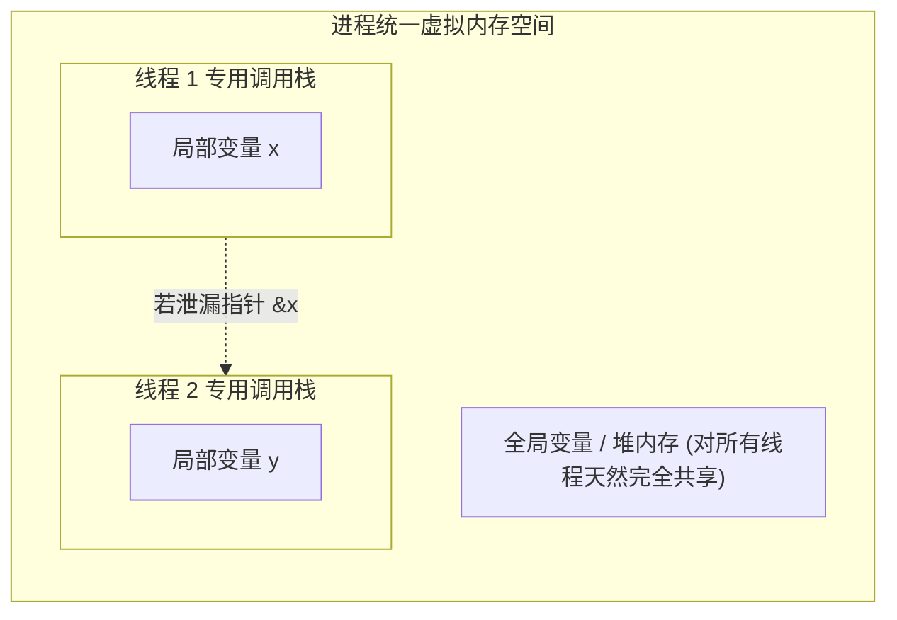
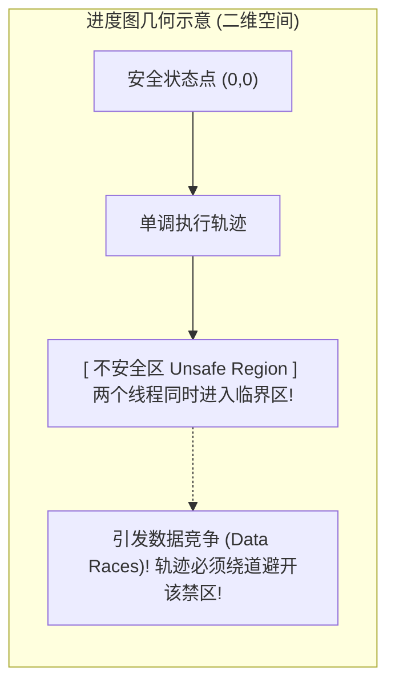

> **讲师**：David R. O'Hallaron ｜ **原视频**：Bilibili 分 P24 ｜ **时长**：56:31  
> **所属模块**：Module 10: 并发编程 (Concurrent Programming)（L23 - L26 · 多进程、I/O 多路复用、多线程、信号量同步与并行加速比）  
> **原视频地址**：[https://www.bilibili.com/video/BV1iW411d7hd/?p=24](https://www.bilibili.com/video/BV1iW411d7hd/?p=24)  
> **课程官方归属**：Carnegie Mellon University (CMU) 15-213 / 18-213 / 15-513: Introduction to Computer Systems (CSAPP Fall 2015)  
> **对应教材**：*Computer Systems: A Programmer's Perspective (3rd Edition)* by R. Bryant & D. O'Hallaron  
> **字幕与讲义出处**：字幕由 EugeneLiu/translationCSAPP 团队翻译校订（CC BY-NC 4.0 开源协议），幻灯片版权归 CMU 课程组所有。  

---

## 1. 多线程内存模型与共享变量 (Shared Variables) 精准判定法则

*(参考时间：00:02:15 · [视频跳转 (P24 00:02:15)](https://www.bilibili.com/video/BV1iW411d7hd/?p=24&t=135))*


多线程编程最强大的特性在于它们共享整个进程的内存，但这同时也是恶梦的温床。
当多个线程并发读写内存时，我们如何精准判定一个变量在物理上到底是不是**被共享的（Shared）**？

### 共享变量判定金标准
* **定义**：一个变量 $v$ 被称为是共享的，当且仅当**存在两个或多个不同线程的逻辑流引用了该变量在内存中的同一个物理存储实例**！
* **变量物理存放位置的决定性规律**：
  1. **全局变量与静态 C 变量**：永远存放在 `.data` 或 `.bss` 段中，在整个进程中**全局唯一**，所有线程对其访问百分之百是共享的！
  2. **局部自动变量（未加 static 的函数内局部变量）**：分配在各自线程的私有栈帧中。
     * *惊天漏洞*：如果线程 A 故意将其局部变量的内存地址指针传递给了线程 B，**线程 B 顺着指针可以合法读写线程 A 的私有栈！栈内存并不会受到硬件 MMU 的跨线程保护！**



## 2. 数据竞争 (Race Conditions) 现场重演：cnt++ 的汇编级撕裂

*(参考时间：00:15:30 · [视频跳转 (P24 00:15:30)](https://www.bilibili.com/video/BV1iW411d7hd/?p=24&t=930))*


考察一段所有并发教材必讲的经典计数器代码：
```c
#define NITERS 100000000
volatile long cnt = 0; // 全局计数器

void *thread(void *vargp) {
    long i;
    for (i = 0; i < NITERS; i++)
        cnt++; // 致命的一行代码！
    return NULL;
}
```
两个线程并发执行该函数，直觉上最终结果应为 $2 \times \text{NITERS}$。
然而在实际计算机上运行，结果可能只有 134,821,902，且**每次运行的输出全部随机不同**！

### 撕开 C 语言假象：`cnt++` 汇编级三步微操作
在 x86-64 汇编层面上，`cnt++` 根本不是原子操作，而是被编译器拆分为三条完全独立的离散指令：
1. **加载阶段 ($H_i$)**：`movq cnt(%rip), %rax`（从内存中将 `cnt` 的当前值读入该线程私有的寄存器 `%rax`）；
2. **更新阶段 ($U_i$)**：`addq $1, %rax`（在 ALU 寄存器中将值自增 1）；
3. **写回阶段 ($S_i$)**：`movq %rax, cnt(%rip)`（将自增后的寄存器值写回物理内存）。

### 灾难时序推演（丢失更新 Lost Update）
* 初始状态：内存中 `cnt = 0`；
* 时钟 1：线程 A 执行 $H_A$，读出 `cnt = 0` 放入 `%rax_A`；
* **突发时钟中断！内核触发上下文切换！**
* 时钟 2：线程 B 获得 CPU，一口气执行完毕 $H_B, U_B, S_B$！内存中 `cnt` 变为 1；
* 时钟 3：线程 A 恢复执行，在它的私有视角里 `%rax_A` 依然是 0！它执行 $U_A$ 将寄存器加为 1，随后执行 $S_A$ **强行把 1 写入内存**！
* **惨烈结果**：两个线程各自进行了一次自增迭代，最终内存中的 `cnt` 竟然仅仅是 1！线程 B 辛辛苦苦完成的计算被线程 A 的写回完全抹杀！

## 3. 进度图 (Progress Graphs) 几何理论与临界区不安全区判定

*(参考时间：00:28:40 · [视频跳转 (P24 00:28:40)](https://www.bilibili.com/video/BV1iW411d7hd/?p=24&t=1720))*


为了从数学理论高度精确建模并发状态，图灵奖得主 Edsger Dijkstra 提出了**进度图（Progress Graphs）**模型：
* 将 $n$ 个并发线程的执行进度建模为一个 $n$ 维离散笛卡尔坐标空间；
* 对于两个线程，横轴 $X$ 表示线程 1 指令推进点，纵轴 $Y$ 表示线程 2 指令推进点；
* 程序的每一次执行都是坐标原点 $(0,0)$ 到终点的一条单调向上向右延伸的**执行轨迹（Trajectory）**。

### 临界区 (Critical Section) 与不安全区 (Unsafe Region)
* **临界区**：访问共享变量代码片段构成的区间（即包含指令 $H_i, U_i, S_i$ 的范围）；
* **不安全区**：当两个线程同时处于临界区时，在进度图上对应构成的二维矩形闭合区域！
* **并发正确的数学定理**：**一条合法的执行轨迹，绝对不能横穿或踏入不安全区的任何一个点！** 只要轨迹与不安全区产生交集，系统就必然发生数据踩踏！



## 4. 计算机大师迪杰斯特拉的救赎：信号量 (Semaphores) P 与 V 操作

*(参考时间：00:41:50 · [视频跳转 (P24 00:41:50)](https://www.bilibili.com/video/BV1iW411d7hd/?p=24&t=2510))*


1965 年，计算机先驱 Edsger Dijkstra 正式提出了经典的**信号量（Semaphore）**机制，用优雅的数学公理终结了并发同步混乱。

### 信号量的公理化定义
信号量 $s$ 是一个受系统内核保护的具有非负整数值的全局特殊变量。对它的操作**只能通过两个不可分割的硬件级原子操作**完成：
1. **$P(s)$ 操作（荷语 Proberen，意为测试/等待/加锁）**：
   * 如果 $s > 0$，则将 $s$ 减 1，并立即返回继续执行；
   * 如果 $s == 0$，则将当前调用线程置入阻塞休眠队列（挂起），直到某处执行了 $V$ 操作唤醒。
2. **$V(s)$ 操作（荷语 Verhogen，意为增加/发信号/释放锁）**：
   * 将 $s$ 加 1；
   * 如果此时有任何线程正阻塞在等待 $s$ 的 $P$ 操作队列中，系统**随机唤醒其中某一个线程**，使其完成 $P$ 操作恢复执行。
* **物理不变法则（Semaphore Invariant）**：信号量的值在任意物理瞬间**永远不可能小于 0（$s \ge 0$）**！

### 二值信号量 (Binary Semaphore) 实现互斥锁 (Mutex)
当信号量初值被设定为 **`1`** 时，它被称为**二值信号量**或**互斥锁（Mutex）**：
* 状态 `1`：锁处于空闲状态；
* 状态 `0`：锁已经被某个线程持有。
* **互斥保护范式**：
  ```c
  P(&mutex);
  /* --- 临界区 (同一瞬间绝对只有唯一一个线程能够进入) --- */
  cnt++;
  /* ------------------------------------------------ */
  V(&mutex);
  ```
在进度图上，信号量操作在不安全区周围建立了一道道坚不可摧的“高压电网”：任何轨迹在试图冲入不安全区之前，必然被 $P$ 操作强制勒马停顿，直到另一个线程执行 $V$ 走出禁区！


---

### 本讲小结与核心思考 (Takeaways)

1. **系统视角的本质转变**：本讲从底层机制剖析了「Synchronization: Basics（共享变量判定、数据竞争、进度图与 Dijkstra 信号量）」的核心实现原理。
2. **软硬件协同设计**：理解底层规则不仅能消除潜在的难以调试的隐蔽 Bug，更是编写极致性能工业级代码的前提。
3. **动手实践验证**：推荐配合 CSAPP 对应章节课后习题与官方实验（Lab），在 Linux 终端环境下使用 GDB 与性能分析工具亲自印证理论。
