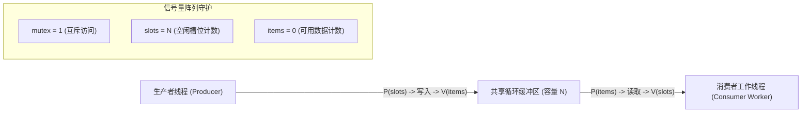

> **讲师**：David R. O'Hallaron ｜ **原视频**：Bilibili 分 P25 ｜ **时长**：01:20:43  
> **所属模块**：Module 10: 并发编程 (Concurrent Programming)（L23 - L26 · 多进程、I/O 多路复用、多线程、信号量同步与并行加速比）  
> **原视频地址**：[https://www.bilibili.com/video/BV1iW411d7hd/?p=25](https://www.bilibili.com/video/BV1iW411d7hd/?p=25)  
> **课程官方归属**：Carnegie Mellon University (CMU) 15-213 / 18-213 / 15-513: Introduction to Computer Systems (CSAPP Fall 2015)  
> **对应教材**：*Computer Systems: A Programmer's Perspective (3rd Edition)* by R. Bryant & D. O'Hallaron  
> **字幕与讲义出处**：字幕由 EugeneLiu/translationCSAPP 团队翻译校订（CC BY-NC 4.0 开源协议），幻灯片版权归 CMU 课程组所有。  

---

## 1. 经典同步模式一：生产者-消费者问题与有限缓冲区 (sbuf 包设计)

*(参考时间：00:02:15 · [视频跳转 (P25 00:02:15)](https://www.bilibili.com/video/BV1iW411d7hd/?p=25&t=135))*


在现代高性能服务器架构中，生产者-消费者模式（Producer-Consumer）是最基础、应用最广的模型：
* **生产者线程**：源源不断生成数据项（如 Web 服务器的主监听线程接受新的客户端请求套接字）；
* **消费者线程**：从缓冲区中取出数据项进行繁重的计算（如工作线程池 Worker Threads 从队列读取套接字并解析 HTTP 请求）；
* **共享有限缓冲区 (Bounded Buffer)**：容量为 $n$ 个插槽的固定队列。

### 三大同步约束与信号量三剑客
1. **互斥访问约束**：对缓冲区队列本身的入队和出队指针修改必须是互斥的（使用互斥锁 `mutex`，初值为 1）；
2. **缓冲区不能溢出**：当缓冲区所有 $n$ 个槽位全部被填满时，生产者必须被挂起等待（使用计数信号量 `slots`，**初值设为 $n$**）；
3. **缓冲区不能下溢**：当缓冲区为空（0 个数据项）时，消费者必须被挂起等待（使用计数信号量 `items`，**初值设为 0**）。

```c
/* CSAPP sbuf 包核心实现 */
typedef struct {
    int *buf;          /* 动态数组指针 */
    int n;             /* 最大插槽数 */
    int front;         /* 队头索引 */
    int rear;          /* 队尾索引 */
    sem_t mutex;       /* 二值信号量：保护共享队列指针 */
    sem_t slots;       /* 计数信号量：可用空槽数 (初值 n) */
    sem_t items;       /* 计数信号量：可用数据项数 (初值 0) */
} sbuf_t;

/* 生产者插入操作 */
void sbuf_insert(sbuf_t *sp, int item) {
    P(&sp->slots);     /* 等待有空槽位 (slots--) */
    P(&sp->mutex);     /* 加互斥锁 */
    sp->buf[(++sp->rear) % (sp->n)] = item; /* 写入数据项 */
    V(&sp->mutex);     /* 释放互斥锁 */
    V(&sp->items);     /* 宣布有新数据可用 (items++) */
}

/* 消费者读取操作 */
int sbuf_remove(sbuf_t *sp) {
    int item;
    P(&sp->items);     /* 等待有数据项 (items--) */
    P(&sp->mutex);     /* 加互斥锁 */
    item = sp->buf[(++sp->front) % (sp->n)]; /* 取出数据项 */
    V(&sp->mutex);     /* 释放互斥锁 */
    V(&sp->slots);     /* 宣布腾出一个空槽位 (slots++) */
    return item;
}
```



## 2. 经典同步模式二：读者-写者问题与读写饥饿博弈

*(参考时间：00:18:40 · [视频跳转 (P25 00:18:40)](https://www.bilibili.com/video/BV1iW411d7hd/?p=25&t=1120))*


在许多真实场景中（如数据库管理系统、在线航班订票系统、DNS 缓存），对共享资源的访问具有不对称性：
* **读操作（Readers）**：只查看数据，不修改数据；
* **写操作（Writers）**：修改数据内容。

### 核心并发准则
* 允许多个读者**同时并发读取**；
* 写者必须拥有**绝对独占权（排他锁）**：只要有一个写者正在写入，既不允许任何其他写者写入，也不允许任何读者读取！

### 读者优先 (Readers-Preference) 算法推演
如果当前已经有一个读者在持有资源，后续到达的所有读者可以直接并入读取，写者必须等待所有读者全部离开。
```c
int readcnt = 0;   /* 当前正在读取的读者总数 */
sem_t mutex = 1;   /* 保护 readcnt 变量的互斥锁 */
sem_t w = 1;       /* 控制对共享资源独占访问的排他锁 */

void reader() {
    while (1) {
        P(&mutex);
        readcnt++;
        if (readcnt == 1) /* 进门的第一个读者负责加排他锁锁死写者！ */
            P(&w);
        V(&mutex);

        /* 正在并发临界区进行安全读取 ... */

        P(&mutex);
        readcnt--;
        if (readcnt == 0) /* 出门的最后一个读者负责释放排他锁，交还写者！ */
            V(&w);
        V(&mutex);
    }
}

void writer() {
    while (1) {
        P(&w); /* 获取绝对独占排他锁 */
        /* 正在执行写入修改 ... */
        V(&w);
    }
}
```
* **潜在风险：写者饥饿（Starvation）**：
  若源源不断有新读者涌入，`readcnt` 永远不会降为 0，写者将被无限期推迟甚至被活活饿死！在追求高可用工业系统中，通常采用**写者优先**或**公平排队读写锁（Fair Read-Write Lock）**。

## 3. 线程安全 (Thread Safety) 与可重入性 (Reentrancy) 严格界定

*(参考时间：00:36:15 · [视频跳转 (P25 00:36:15)](https://www.bilibili.com/video/BV1iW411d7hd/?p=25&t=2175))*


如果一个函数在被多个并发线程反复调用时，总是能产生正确的结果，我们称该函数是**线程安全（Thread-Safe）**的。

### 系统编程中四类臭名昭著的线程不安全函数
1. **第 1 类：不保护共享变量的函数**：
   函数直接读写了全局变量或静态变量，且没有加锁。
2. **第 2 类：跨越连续调用保持静态内部状态的函数**：
   * 经典代表：标准库函数 `strtok()`、`rand()`；
   * `strtok` 内部维护了一个静态全局指针记录上次扫描的位置；两个线程同时调用 `strtok`，扫描指针会被彻底打架打烂！
3. **第 3 类：返回指向静态全局缓冲区指针的函数**：
   * 经典代表：`ctime()`, `gethostbyname()`, `inet_ntoa()`；
   * 函数计算完毕后，将结果写入一个静态私有缓冲区并返回其指针。当线程 A 刚拿到指针准备读取时，线程 B 紧接着调用该函数，**直接将线程 A 手里指针指向的内存数据强行覆盖**！
4. **第 4 类：调用了其他线程不安全函数的函数**。

### 可重入函数 (Reentrant Functions)：线程安全的最高圣殿
* **定义**：一个函数如果**完全不引用任何共享数据（所有变量全部纯粹分配在各自独立的寄存器和局部栈上）**，则称该函数是**可重入的**；
* **关系**：**可重入函数是线程安全函数的严格真子集！** 所有的可重入函数都是线程安全的，且无需任何昂贵的锁竞争！
* **POSIX 工业标准安全替代库**：
  为了消灭历史包袱，标准库为所有不安全函数提供了带 `_r` 后缀的现代化可重入版本，如 `rand_r(&seed)`、`strtok_r()`、`asctime_r()`。

## 4. 并发之癌：死锁 (Deadlocks) 产生的充分条件与锁顺序预防法则

*(参考时间：00:54:30 · [视频跳转 (P25 00:54:30)](https://www.bilibili.com/video/BV1iW411d7hd/?p=25&t=3270))*


### 什么是死锁 (Deadlock)？
死锁是指这样一种死寂状态：**一组线程中的每一个线程都在等待由该组中另一个线程持有的资源，导致全组所有线程无限期卡死挂起**。

```c
/* 经典的死锁交叉加锁反面教材 */
/* 线程 1 流程 */               /* 线程 2 流程 */
P(&mutex_A);                   P(&mutex_B);
P(&mutex_B);                   P(&mutex_A);
// 做操作...                    // 做操作...
V(&mutex_B);                   V(&mutex_A);
V(&mutex_A);                   V(&mutex_B);
```
* **灾难时序**：
  * 线程 1 执行 `P(&mutex_A)` 成功持有 A；
  * 线程 2 执行 `P(&mutex_B)` 成功持有 B；
  * 接下来，线程 1 试图执行 `P(&mutex_B)` 被挂起；
  * 线程 2 试图执行 `P(&mutex_A)` 同样被挂起！
  * **双方互相死扣对方脖子不放，整个服务器彻底陷入脑死亡！**

### 终极解决良方：全局严格锁顺序规则 (Lock Ordering Rule)
死锁的发生必须满足循环等待链。破除死锁的最强大、最实用的软件工程法则是：
**为系统中所有互斥锁定义一个全序关系（Total Order）。任何线程在需要同时获取多个锁时，必须严格按照预定义的升序顺序逐一加锁！**
* 规定：永远必须先获取 `mutex_A`，再获取 `mutex_B`；
* 此时线程 2 绝不允许写出 `P(&mutex_B); P(&mutex_A);`！
* 在进度图上，全局锁排序彻底消灭了死锁禁区，系统在数学上绝不可能产生闭环等待！


---

### 本讲小结与核心思考 (Takeaways)

1. **系统视角的本质转变**：本讲从底层机制剖析了「Synchronization: Advanced（生产者-消费者、读者-写者模型、线程安全与死锁预防）」的核心实现原理。
2. **软硬件协同设计**：理解底层规则不仅能消除潜在的难以调试的隐蔽 Bug，更是编写极致性能工业级代码的前提。
3. **动手实践验证**：推荐配合 CSAPP 对应章节课后习题与官方实验（Lab），在 Linux 终端环境下使用 GDB 与性能分析工具亲自印证理论。
