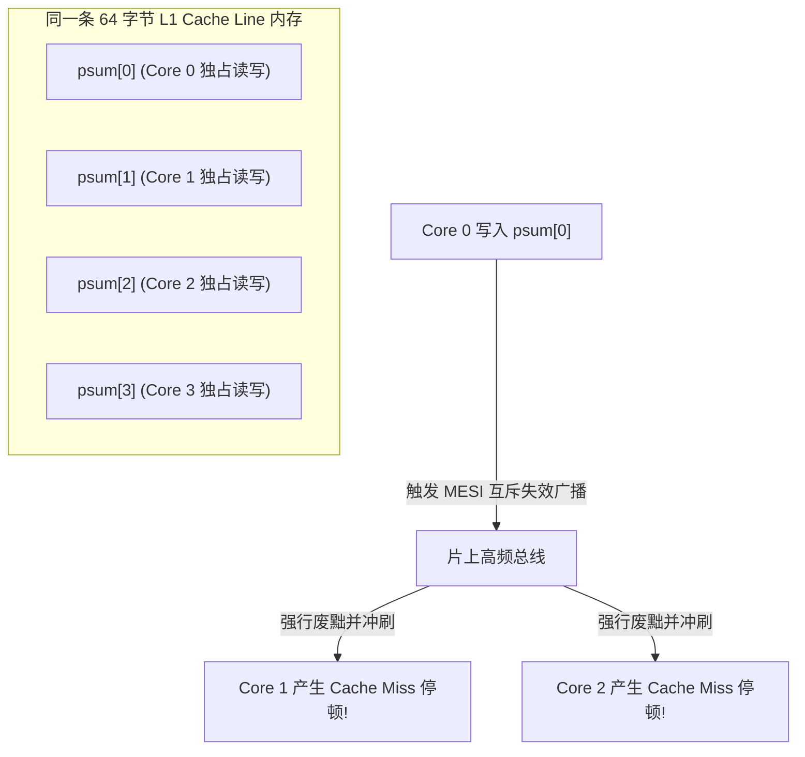

> **讲师**：Randal E. Bryant & David R. O'Hallaron ｜ **原视频**：Bilibili 分 P26 ｜ **时长**：01:05:36  
> **所属模块**：Module 10: 并发编程 (Concurrent Programming)（L23 - L26 · 多进程、I/O 多路复用、多线程、信号量同步与并行加速比）  
> **原视频地址**：[https://www.bilibili.com/video/BV1iW411d7hd/?p=26](https://www.bilibili.com/video/BV1iW411d7hd/?p=26)  
> **课程官方归属**：Carnegie Mellon University (CMU) 15-213 / 18-213 / 15-513: Introduction to Computer Systems (CSAPP Fall 2015)  
> **对应教材**：*Computer Systems: A Programmer's Perspective (3rd Edition)* by R. Bryant & D. O'Hallaron  
> **字幕与讲义出处**：字幕由 EugeneLiu/translationCSAPP 团队翻译校订（CC BY-NC 4.0 开源协议），幻灯片版权归 CMU 课程组所有。  

---

## 1. 并行计算的硬核指标：加速比 (Speedup) 与并行效率

*(参考时间：00:02:15 · [视频跳转 (P26 00:02:15)](https://www.bilibili.com/video/BV1iW411d7hd/?p=26&t=135))*


随着单核处理器主频遭遇物理“功耗墙（Power Wall）”，摩尔定律在物理晶体管缩放维度的放缓，倒逼现代半导体厂商转向**多核处理器（Multi-Core Processors）**架构。
编写多线程程序的最高追求，就是利用多个 CPU 核心同时协作，大幅压缩解决单一庞大科学计算问题的物理耗时。

### 核心并行指标
* **加速比 (Speedup, $S_p$)**：
  在单核处理器上运行同一算法的最优纯串行执行时间 $T_1$，与在包含 $p$ 个核心的硬件上运行该算法的并行执行时间 $T_p$ 之间的比值：
  $$S_p = \frac{T_1}{T_p}$$
  * **线性加速比 (Linear Speedup)**：$S_p = p$。如果 8 个核心能够快 8 倍，这是理论的完美天花板。
  * **超线性加速比 (Superlinear Speedup)**：极罕见情况下 $S_p > p$，通常是因为多个核心各自持有的 L1/L2 Cache 容量叠加总和恰好装下了整个工作集。
* **并行效率 (Parallel Efficiency, $E_p$)**：
  $$E_p = \frac{S_p}{p} = \frac{T_1}{p \times T_p}$$
  通常介于 0 到 1 之间（即 0% 到 100%）。

## 2. 阿姆达尔定律 (Amdahl's Law)：并行加速比的永恒物理悲歌

*(参考时间：00:15:40 · [视频跳转 (P26 00:15:40)](https://www.bilibili.com/video/BV1iW411d7hd/?p=26&t=940))*


许多非专业工程师误以为：只要我堆砌足够多的核心（比如购买 1000 核心的超级计算机），我的程序就能快 1000 倍。
计算机先驱 Gene Amdahl 揭示了一条无情的数学铁律——**阿姆达尔定律（Amdahl's Law）**！

### 阿姆达尔定律数学形式推导
假设一个程序中，存在一部分代码因为内在的数据依赖或全局锁，是**绝对无法并行的严格串行部分（比例为 $s$，其中 $0 \le s \le 1$）**；剩余部分可以被无限并行切分（比例为 $1 - s$）。
当使用 $p$ 个并行核心时，总耗时为：
$$T_p = T_1 \times \left( s + \frac{1 - s}{p} \right)$$
由此推导出加速比公式：
$$S_p = \frac{T_1}{T_p} = \frac{1}{s + \frac{1 - s}{p}}$$

### 极限结论：无限核心下的天花板
当核心数 $p \to \infty$ 趋于无限大时：
$$S_\infty = \lim_{p \to \infty} S_p = \frac{1}{s}$$

### 触目惊心的工业现实算例
* 假设一个庞大程序中，**仅有微不足道的 5% 代码是严格串行的（$s = 0.05$）**，其余 95% 完美并行；
* 即使你动用一艘拥有 100 万颗 CPU 核心的银河战舰，**最大的理论极限加速比也永远无法突破**：
  $$S_\infty = \frac{1}{0.05} = 20 \times ！$$
* **系统启示**：并行的瓶颈永远不在于你可以把并行部分做得多快，而在于**你如何千方百计压缩消灭那一点点串行瓶颈**！

## 3. 微架构暗箭：伪共享 (False Sharing) 与 Cache 颠簸灾难

*(参考时间：00:29:20 · [视频跳转 (P26 00:29:20)](https://www.bilibili.com/video/BV1iW411d7hd/?p=26&t=1760))*


在设计多线程并行求和程序时，很多资深程序员写出了如下看似完美的并行代码：
```c
/* 并行累加求和测试 */
long psum[MAXTHREADS]; // 全局数组，每个线程独立累加自己的槽位

void *sum_thread(void *vargp) {
    long myid = *((long *)vargp);
    long start = myid * nelems_per_thread;
    long end = start + nelems_per_thread;
    psum[myid] = 0; // 专属槽位！完全没有锁竞争！
    for (long i = start; i < end; i++)
        psum[myid] += a[i]; // 致命灾难！
    return NULL;
}
```
* **实验反常结果**：在 4 核机器上运行 4 个线程，运行时间居然比单核串行版本**慢整整 10 倍以上**！
* **代码逻辑审视**：每个线程只读写属于自己的 `psum[myid]`，没有任何两个线程在访问同一个变量，完全没有锁，怎么会变慢？

### 祸起萧墙：Cache 一致性协议与 64 字节缓存行
底层硬件硬件架构揭开了黑幕：
* CPU 高速缓存不是按单个 `long`（8 字节）装载的，而是以 **64 字节块（Cache Line）** 为绝对物理搬运单位！
* `psum` 数组的相邻元素 `psum[0]`, `psum[1]`, `psum[2]`, `psum[3]` **恰好全部挤在同一根 64 字节的物理 Cache Line 内部**！
* **MESI 协议的乒乓球惨剧**：
  * Core 0 上的线程 0 执行加法，将这一行 Cache Line 标记为修改态（Modified）；
  * 硬件 Cache 一致性总线嗅探机制（Bus Snooping）立即生效：**强制将 Core 1、Core 2、Core 3 上的对应 Cache Line 全部置为失效（Invalid）**！
  * 紧接着 Core 1 尝试自增 `psum[1]`，遭遇 Cache Miss，被迫向总线发出同步请求，把这一行数据从 Core 0 抢夺过来；
  * 这根 Cache Line 就像乒乓球一样在多个核心之间以光速来回剧烈颠簸拉扯（Cache Bouncing），内存总线被彻底打瘫痪！

### 程序员的手术刀级救赎
1. **方案一：局部变量累加（完美消除）**：
   在循环内部使用栈上的私有局部寄存器变量 `acc` 累加，循环结束后只向 `psum[myid]` 写入一次！
2. **方案二：缓存行填充对齐（Padding）**：
   强制将每个线程的结构体通过填充字节撑满 64 字节，确保各个线程的变量永不落在同一个 Cache Line 中。



## 4. CSAPP 全景终章与程序员的系统世界观

*(参考时间：00:46:10 · [视频跳转 (P26 00:46:10)](https://www.bilibili.com/video/BV1iW411d7hd/?p=26&t=2770))*


历经 26 讲波澜壮阔的系统探索，我们跨越了计算机软硬件设计的整座宏伟金字塔：
1. **信息的比特表示**：从二进制补码的截断溢出，到 IEEE 754 浮点数的舍入裂痕；
2. **机器级代码透视**：从 x86-64 寄存器、控制流条件码、过程调用栈帧，到缓冲区溢出与 ROP 攻防；
3. **程序性能极限压榨**：从现代超标量乱序微架构，到指令级并行、循环展开与关键路径消除；
4. **存储器层次体系**：从磁盘与 SSD 的物理延迟，到局部性原理、Cache 组相联映射与分块优化；
5. **链接与系统运行**：从静态库 ELF 符号重定位，到动态共享库 PIC 与延迟绑定的巧夺天工；
6. **异常控制流与进程**：从硬件中断、系统调用，到 `fork`、`execve`、写时复制 COW 与信号异步安全；
7. **虚拟内存圣殿**：从 MMU 硬件分页、多级页表压缩、TLB 极速翻译，到堆的动态内存分配与分离适配；
8. **网络互连与并发**：从套接字编程接口、HTTP 协议，到多线程同步互斥、信号量与并行微架构陷阱。

### 结语：系统思维的终极力量
从今天起，你不再是一个仅仅停留在高级抽象世界的普通程序员。
当你按下键盘敲下一行代码时，你的脑海中能够清晰映照出：
* 电荷在 DRAM 电容中的泄漏；
* 晶体管流水线在乱序发射微操作；
* 缓存行在多核芯片总线间的跃动；
* 操作系统内核在毫秒之间优雅地调度上下文与页表。

**站在巨人的肩膀上，深刻理解底层，你便拥有了掌控整个数字物理世界的终极力量！**


---

### 本讲小结与核心思考 (Takeaways)

1. **系统视角的本质转变**：本讲从底层机制剖析了「Thread-Level Parallelism（线程级并行、Amdahl 定律、伪共享 Cache 颠簸与课程总结）」的核心实现原理。
2. **软硬件协同设计**：理解底层规则不仅能消除潜在的难以调试的隐蔽 Bug，更是编写极致性能工业级代码的前提。
3. **动手实践验证**：推荐配合 CSAPP 对应章节课后习题与官方实验（Lab），在 Linux 终端环境下使用 GDB 与性能分析工具亲自印证理论。
