> **主讲**：Gilbert Strang 教授 · 麻省理工学院（MIT）  
> **出品**：VideoBook 视频开源技术电子书流水线  
> **全书规模**：全 35 讲完整精编 · 5 大知识体系模块 · 357 张原生高清板书实录 · 260 处核心推导时间戳  
> **视频原源**：[Bilibili 官方全套合集（BV1ix411f7Yp）](https://www.bilibili.com/video/BV1ix411f7Yp/) · [MIT OpenCourseWare 18.06 (Spring 2010)](https://ocw.mit.edu/courses/18-06-linear-algebra-spring-2010/)  
> **版权与许可**：本书文字内容与公式图解由 MIT OCW 开放课程资料翻译整理与结构化改编，授课者 Gilbert Strang，遵循 [CC BY-NC-SA 4.0](https://creativecommons.org/licenses/by-nc-sa/4.0/) 知识共享许可协议。全书板书截帧源自官方公开课录像。

---

## 编者导读：为什么要读这本《MIT 18.06 线性代数全书》？

在线性代数的学习殿堂中，Gilbert Strang 教授的 MIT 18.06 课程被公认为最卓越、最具启发性的经典之作。Strang 教授以无与伦比的直观几何洞察力和深入浅出的推导，将原本枯燥抽象的矩阵运算化为生动鲜活的几何图像。

然而，传统的网课视频存在信息密度低、难以检索回溯、公式难以直接复制等局限；而市面上的纸质讲义又缺乏视频板书的现场感与动态推导节奏。

本书依托 **VideoBook 视频技术电子书系统**，对全套 35 讲进行了系统性、全景式的数字化重构：
1. **全书图文一体，精选 357 张原生高画质板书实录**：每个定理、每幅几何坐标图、每次矩阵消元实算，均截取视频原生画面。每张截图下方均配有确切时码与一键跳转 B 站原视频对应时刻的直达超链接；
2. **严谨完整的数学推导与 LaTeX / MathML 公式**：公式完整覆盖行图列图、消元法、LU/QR/SVD 分解、投影矩阵、特征系统、动力系统与最小二乘法；
3. **Mermaid 结构拓扑图与几何推导流**：将代数推导转化为直观的逻辑流程图与空间关系图；
4. **全书时间戳与视频无缝互联**：无论是章首章节总览、每个小节的参考时码，还是每一幅板书截图，均配有直达 B 站播放器对应秒数的精准时间戳超链接。

---

> 📚 **模块导语**：从经典的联立方程组出发，建立“行图（超平面交点）”与“列图（向量线性组合）”两大几何图景；随后深入高斯消元算法、初等矩阵代数、逆矩阵与高斯-若尔当求逆法，并最终提炼出数值代数基石——$A = LU$ 与 $PA = LU$ 矩阵分解。

---

## 第 1 讲：方程组的几何解释

> 📺 **视频回链**：[B 站第 1 P：方程组的几何解释](https://www.bilibili.com/video/BV1ix411f7Yp/?p=1)（⏱ 39分50秒 · 10 截图）  
> 📖 **官方材料**：[MIT OCW 对应讲义与总结](https://ocw.mit.edu/courses/18-06-linear-algebra-spring-2010/resources/lecture-1-the-geometry-of-linear-equations/)  
> 💡 **核心精要**：行图与列图视角、直线的交点与列向量的线性组合、Ax=b 的矩阵本质。

---

### 1. 线性代数的核心视角：从方程组走向矩阵

*(参考时间: 00:01:30 · [视频跳转 (P1 00:01:30)](https://www.bilibili.com/video/BV1ix411f7Yp/?p=1&t=90))*

线性代数最根本的出发点，是求解一组联立的线性代数方程组。

在初等代数中，我们习惯于逐行消元或者代入求解；但在现代数学与工程科学中，我们必须建立两种完全不同的几何观察方式：**行图（The Row Picture）**与**列图（The Column Picture）**。

#### 1.1 经典 $2 \times 2$ 实例

我们从一个最简明的二维线性系统开始：

$$
\begin{cases}
2x - y = 0 \\
-x + 2y = 3
\end{cases}
$$

将未知数和系数提取出来，可以写成标准的矩阵形式：

$$
\boxed{Ax = b} \iff \begin{bmatrix} 2 & -1 \\ -1 & 2 \end{bmatrix} \begin{bmatrix} x \\ y \end{bmatrix} = \begin{bmatrix} 0 \\ 3 \end{bmatrix}
$$

- 系数矩阵 $A = \begin{bmatrix} 2 & -1 \\ -1 & 2 \end{bmatrix}$
- 未知向量 $x = \begin{bmatrix} x \\ y \end{bmatrix}$
- 右端项向量 $b = \begin{bmatrix} 0 \\ 3 \end{bmatrix}$

*⏱ 时间戳：00:03:30 · 📷 板书截图 · [在 B 站观看对应片段 (P1 00:03:30)](https://www.bilibili.com/video/BV1ix411f7Yp/?p=1&t=210)*

---

### 2. 二维情形的两种几何图景

#### 2.1 行图（The Row Picture）：直线的交点

*(参考时间: 00:04:20 · [视频跳转 (P1 00:04:20)](https://www.bilibili.com/video/BV1ix411f7Yp/?p=1&t=260))*

在行图中，我们把方程组中的**每一个方程单独看作一个几何对象**：

1. **第一个方程** $2x - y = 0$：这是一条通过原点 $(0, 0)$ 的直线，斜率为 2。若 $x = 1$，则 $y = 2$。
2. **第二个方程** $-x + 2y = 3$：当 $x = 0$ 时 $y = 3/2$；当 $x = 1$ 时 $y = 2$；当 $y = 0$ 时 $x = -3$。

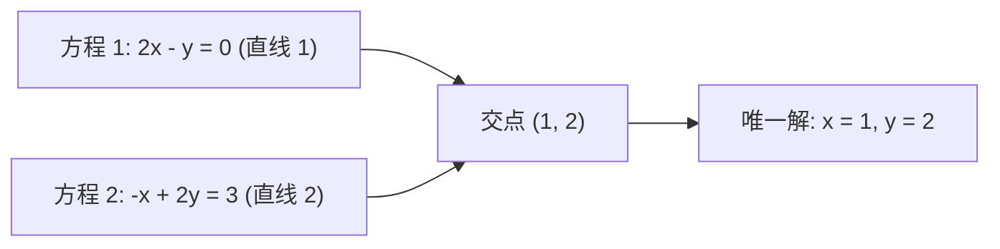

在直角坐标系中画出这两条直线，它们相交于唯一的公共点：

$$
(x, y) = (1, 2)
$$

这就是行图给出的答案：**解就是所有方程所代表的超平面的公共交点**。

*⏱ 时间戳：00:06:40 · 📷 板书截图 · [在 B 站观看对应片段 (P1 00:06:40)](https://www.bilibili.com/video/BV1ix411f7Yp/?p=1&t=400)*

#### 2.2 列图（The Column Picture）：向量的线性组合

*(参考时间: 00:08:40 · [视频跳转 (P1 00:08:40)](https://www.bilibili.com/video/BV1ix411f7Yp/?p=1&t=520))*

现在进入全课程最核心、最具启发性的视角——**列图**。

我们将矩阵乘法 $Ax = b$ 改写为按列拆分的形式：

$$
x \begin{bmatrix} 2 \\ -1 \end{bmatrix} + y \begin{bmatrix} -1 \\ 2 \end{bmatrix} = \begin{bmatrix} 0 \\ 3 \end{bmatrix}
$$

> **关键定义：线性组合（Linear Combination）**  
> 标量 $x$ 乘以第一个列向量，加上标量 $y$ 乘以第二个列向量，构成了列向量的一个**线性组合**。  
> 解方程 $Ax = b$ 的问题，在列图视角下转化为：**我们需要用怎样的系数（权重 $x, y$），才能将 $A$ 的两个列向量合成目标向量 $b$？**

*⏱ 时间戳：00:10:00 · 📷 板书截图 · [在 B 站观看对应片段 (P1 00:10:00)](https://www.bilibili.com/video/BV1ix411f7Yp/?p=1&t=600)*

在平面直角坐标系中画出这两个列向量：
- 第一个列向量：$u = \begin{bmatrix} 2 \\ -1 \end{bmatrix}$（向右 2，向下 1）
- 第二个列向量：$v = \begin{bmatrix} -1 \\ 2 \end{bmatrix}$（向左 1，向上 2）
- 目标向量：$b = \begin{bmatrix} 0 \\ 3 \end{bmatrix}$（位于正 $y$ 轴上）

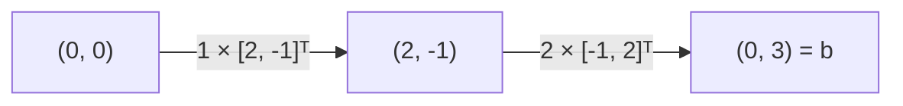

我们只需取 1 个 $u$ 和 2 个 $v$：
$$
1 \begin{bmatrix} 2 \\ -1 \end{bmatrix} + 2 \begin{bmatrix} -1 \\ 2 \end{bmatrix} = \begin{bmatrix} 2 - 2 \\ -1 + 4 \end{bmatrix} = \begin{bmatrix} 0 \\ 3 \end{bmatrix}
$$

通过向量的首尾相接（Head-to-tail 法则）或平行四边形法则，我们沿着第一个向量走一段，再沿着第二个向量走两段，精准抵达目标向量 $b$！这立即给出了方程的解：$x = 1, y = 2$。

*⏱ 时间戳：00:13:30 · 📷 板书截图 · [在 B 站观看对应片段 (P1 00:13:30)](https://www.bilibili.com/video/BV1ix411f7Yp/?p=1&t=810)*

---

### 3. 三维系统：$3 \times 3$ 线性方程组

*(参考时间: 00:16:40 · [视频跳转 (P1 00:16:40)](https://www.bilibili.com/video/BV1ix411f7Yp/?p=1&t=1000))*

当未知数增加到 3 个时，行图与列图的表现力出现了巨大的分野。

考虑以下 $3 \times 3$ 线性系统：

$$
\begin{cases}
2x - y = 0 \\
-x + 2y - z = -1 \\
-3y + 4z = 4
\end{cases}
$$

其矩阵形式为：

$$
\begin{bmatrix} 2 & -1 & 0 \\ -1 & 2 & -1 \\ 0 & -3 & 4 \end{bmatrix} \begin{bmatrix} x \\ y \\ z \end{bmatrix} = \begin{bmatrix} 0 \\ -1 \\ 4 \end{bmatrix}
$$

*⏱ 时间戳：00:17:40 · 📷 板书截图 · [在 B 站观看对应片段 (P1 00:17:40)](https://www.bilibili.com/video/BV1ix411f7Yp/?p=1&t=1060)*

#### 3.1 三维行图的困境：三平面的空间交织

在三维空间中，每一个方程代表一个**二维平面（Plane）**：
1. 第一个方程 $2x - y = 0$ 确定了一个垂直于 $xy$ 平面、并沿 $z$ 轴延伸的平面；
2. 第二个方程 $-x + 2y - z = -1$ 确定了第二个倾斜的平面，它与第一个平面相交于一条**空间直线**；
3. 第三个方程 $-3y + 4z = 4$ 确定了第三个平面，它在某一特定高度穿过这条直线。

三个平面的交汇最终锁定在空间中的一个**孤立点**。

然而，在黑板或纸面上绘制三个相互倾斜的平面的交线与交点极为困难，当维度提升到 4 维、9 维乃至 100 维时，行图所依赖的超平面交汇在脑海中完全无法直观想象。

*⏱ 时间戳：00:21:00 · 📷 板书截图 · [在 B 站观看对应片段 (P1 00:21:00)](https://www.bilibili.com/video/BV1ix411f7Yp/?p=1&t=1260)*

#### 3.2 三维列图的威力：始终在空间中画向量

*(参考时间: 00:22:00 · [视频跳转 (P1 00:22:00)](https://www.bilibili.com/video/BV1ix411f7Yp/?p=1&t=1320))*

相反，列图在三维空间中依然清晰明了：

$$
x \begin{bmatrix} 2 \\ -1 \\ 0 \end{bmatrix} + y \begin{bmatrix} -1 \\ 2 \\ -3 \end{bmatrix} + z \begin{bmatrix} 0 \\ -1 \\ 4 \end{bmatrix} = \begin{bmatrix} 0 \\ -1 \\ 4 \end{bmatrix}
$$

观察目标向量 $b = \begin{bmatrix} 0 \\ -1 \\ 4 \end{bmatrix}$，它恰好就是 $A$ 的第三个列向量本身！  
因此，我们一眼就能看出这个系统的精确解为：

$$
x = 0, \quad y = 0, \quad z = 1
$$

在三维空间中，列图只需要我们在原点引出 3 个列向量，然后通过数乘和加法合成目标向量 $b$。无论维度多高，**“向量线性组合”的代数与几何本质始终如一**。

*⏱ 时间戳：00:24:30 · 📷 板书截图 · [在 B 站观看对应片段 (P1 00:24:30)](https://www.bilibili.com/video/BV1ix411f7Yp/?p=1&t=1470)*

---

### 4. 核心理论追问：$Ax = b$ 对任意 $b$ 都有解吗？

*(参考时间: 00:27:50 · [视频跳转 (P1 00:27:50)](https://www.bilibili.com/video/BV1ix411f7Yp/?p=1&t=1670))*

Strang 教授提出了整门课程最重要的理论问题之一：

> **“对于给定的矩阵 $A$，是否对任意选择的右端项 $b$，$Ax = b$ 都一定有解？”**

用列图的语言来说，这个问题等价于：  
**“$A$ 的列向量的所有可能线性组合，能否铺满（Span）整个三维空间 $\mathbb{R}^3$？”**

*⏱ 时间戳：00:28:10 · 📷 板书截图 · [在 B 站观看对应片段 (P1 00:28:10)](https://www.bilibili.com/video/BV1ix411f7Yp/?p=1&t=1690)*

#### 4.1 可逆情形（Invertible / Non-singular）

如果矩阵 $A$ 的列向量指向三维空间中完全独立的三个方向（非共面），那么通过改变组合系数 $x, y, z$，它们的线性组合能够到达 $\mathbb{R}^3$ 空间中的**任何一个点**。

此时：
- 对任何给定的 $b$，方程 $Ax = b$ 都有唯一解；
- 矩阵 $A$ 是**可逆矩阵（Invertible Matrix）**。

#### 4.2 奇异情形（Singular / Non-invertible）：列向量共面

*(参考时间: 00:30:30 · [视频跳转 (P1 00:30:30)](https://www.bilibili.com/video/BV1ix411f7Yp/?p=1&t=1830))*

如果矩阵的某些列之间存在相关性——例如第三个列向量恰好落在前两个列向量张成的平面内（三向量共面）：

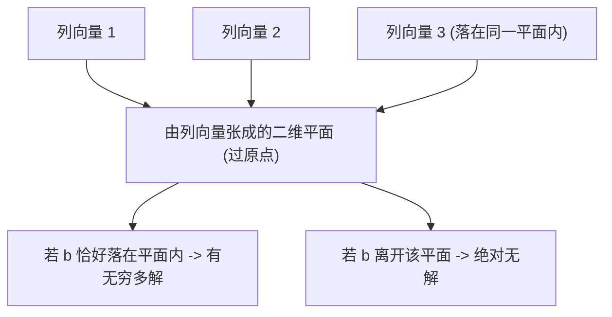

此时，无论系数 $x, y, z$ 如何选取，这三个列向量的任何线性组合**都被死死困在这个二维平面内**，根本无法逃逸到平面之外的三维空间中去！

结果是：
- 只有当 $b$ 恰好落在这个平面上时，$Ax = b$ 才有解（并且由于列向量之间可以互相替代，存在**无穷多解**）；
- 一旦 $b$ 稍稍离开这个平面，方程组就**绝对无解**！
- 此时矩阵 $A$ 被称为**奇异矩阵（Singular Matrix）**或**不可逆矩阵**。

*⏱ 时间戳：00:31:00 · 📷 板书截图 · [在 B 站观看对应片段 (P1 00:31:00)](https://www.bilibili.com/video/BV1ix411f7Yp/?p=1&t=1860)*

这一几何图景是后续“列空间（Column Space）”、“秩（Rank）”以及“线性相关性（Linear Independence）”的直观母体。

---

### 5. 矩阵乘法的本质定义：线性组合

*(参考时间: 00:35:40 · [视频跳转 (P1 00:35:40)](https://www.bilibili.com/video/BV1ix411f7Yp/?p=1&t=2140))*

在这一讲的最后，Strang 教授对“矩阵乘以向量”的运算做出了颠覆初学者习惯的根本性重塑。

传统教学中计算 $Ax$ 往往是：第 1 行与列向量点乘得到第 1 个数，第 2 行与列向量点乘得到第 2 个数……

但在现代线性代数中，请务必将矩阵乘以向量视为：

$$
\boxed{Ax = x_1 (\text{col}_1) + x_2 (\text{col}_2) + \cdots + x_n (\text{col}_n)}
$$

**$Ax$ 就是矩阵 $A$ 各列向量的线性组合，其组合系数正是向量 $x$ 的各分量！**

例如：

$$
\begin{bmatrix} 2 & 5 \\ 1 & 3 \end{bmatrix} \begin{bmatrix} 1 \\ 2 \end{bmatrix} = 1 \begin{bmatrix} 2 \\ 1 \end{bmatrix} + 2 \begin{bmatrix} 5 \\ 3 \end{bmatrix} = \begin{bmatrix} 12 \\ 7 \end{bmatrix}
$$

从点积的行视角看是 $(2\times 1 + 5\times 2 = 12)$ 与 $(1\times 1 + 3\times 2 = 7)$；但从列的线性组合视角看，这是“1 份第一列”加上“2 份第二列”的向量合成。

这种理解方式把离散的数字乘加，升华为了空间的几何构造，是整门课程一切推导的基石。

*⏱ 时间戳：00:36:20 · 📷 板书截图 · [在 B 站观看对应片段 (P1 00:36:20)](https://www.bilibili.com/video/BV1ix411f7Yp/?p=1&t=2180)*

---

### 6. 本讲思维导图与核心概念对照表

#### 6.1 思维导图：行图与列图的对比

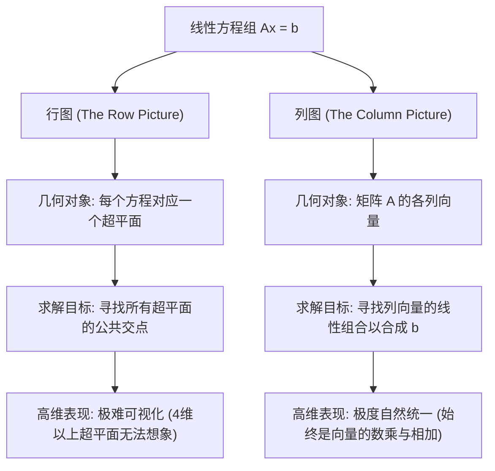

#### 6.2 核心概念与几何意义对照表

| 核心概念 | 数学表达 | 几何含义 / 核心理解 |
| :--- | :--- | :--- |
| **行图** | 各行方程构成的集合 | 超平面（直线/平面）的几何交点 |
| **列图** | $\sum x_i \text{col}_i = b$ | 列向量按照权重进行线性组合与合成 |
| **线性组合** | $c_1 v_1 + c_2 v_2 + \cdots$ | 线性代数的最核心操作单元 |
| **解的存在性** | $b$ 是否在列张成的空间内 | 目标向量 $b$ 能否由列向量线性组合到达 |
| **奇异矩阵** | 列向量共面/相关 | 无法铺满整个空间，存在无法求解的 $b$ |
| **矩阵乘以向量** | $Ax$ | **$A$ 的列向量以 $x$ 为权重的线性组合** |

---

### 附：官方参考与延伸阅读

1. **MIT OpenCourseWare 课程主页**：  
   [MIT 18.06 Linear Algebra (Spring 2010)](https://ocw.mit.edu/courses/18-06-linear-algebra-spring-2010/)
2. **第 1 讲视频与官方字幕资源**：  
   [Lecture 1: The Geometry of Linear Equations](https://ocw.mit.edu/courses/18-06-linear-algebra-spring-2010/resources/lecture-1-the-geometry-of-linear-equations/)
3. **MIT OCW Scholar 配套讲义与课程总结**：  
   [Unit I: Session 1 - The Geometry of Linear Equations Summary (PDF)](https://ocw.mit.edu/courses/18-06sc-linear-algebra-fall-2011/pages/ax-b-and-the-four-subspaces/the-geometry-of-linear-equations/)
4. **推荐教材章节**：  
   Gilbert Strang, *Introduction to Linear Algebra*, 4th/5th Edition, Section 1.1: "Vectors and Linear Combinations", Section 1.2: "Lengths and Dot Products", Section 2.1: "Vectors and Linear Equations".

---

## 第 2 讲：矩阵消元

> 📺 **视频回链**：[B 站第 2 P：矩阵消元与初等矩阵](https://www.bilibili.com/video/BV1ix411f7Yp/?p=2)（⏱ 47分42秒 · 10 截图）  
> 📖 **官方材料**：[MIT OCW 对应讲义与总结](https://ocw.mit.edu/courses/18-06-linear-algebra-spring-2010/resources/lecture-2-elimination-with-matrices/)  
> 💡 **核心精要**：高斯消元算法、主元的选取原则、失效与换行、增广矩阵与回代求解。

---

### 1. 高斯消元法的核心思想

*(参考时间: 00:01:30 · [视频跳转 (P2 00:01:30)](https://www.bilibili.com/video/BV1ix411f7Yp/?p=2&t=90))*

如果说第 1 讲向我们展示了线性代数“几何上的诗意”（行图的交点与列图的线性组合），那么第 2 讲则回归到工程计算中最扎实、最通用的算法引擎——**高斯消元法（Gaussian Elimination）**。

无论是面对 3 个方程还是 3000 个方程，消元法的目标始终只有一个：**系统性地消去未知数，将原本错综复杂的耦合方程组，转化为极其简单的“上三角系统（Upper Triangular System）”，随后通过“回代（Back Substitution）”轻而易举地得到解**。

我们将以一个极具代表性的 $3 \times 3$ 线性方程组贯穿全讲：

$$
\begin{cases}
x + 2y + z = 2 \\
3x + 8y + z = 12 \\
4y + z = 2
\end{cases}
$$

其系数矩阵 $A$ 为：

$$
A = \begin{bmatrix} 1 & 2 & 1 \\ 3 & 8 & 1 \\ 0 & 4 & 1 \end{bmatrix}
$$

---

### 2. 逐步消元与主元（Pivots）的诞生

*(参考时间: 00:04:10 · [视频跳转 (P2 00:04:10)](https://www.bilibili.com/video/BV1ix411f7Yp/?p=2&t=250))*

消元的基本法则是初等行变换：**将某一行乘以非零常数后，从另一行中减去**。

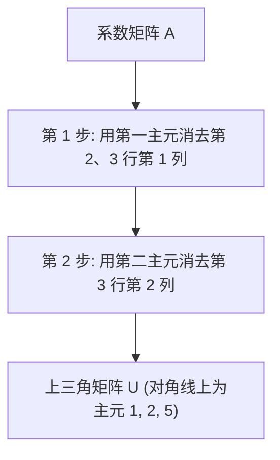

#### 2.1 第一主元与第 1 列消元

- **第一主元（First Pivot）**：位于第 1 行第 1 列的数字，即 $d_1 = 1$。
- **消去 $(2,1)$ 元素**：第二行首项为 3。我们需要计算乘数（Multiplier）：
  $$l_{21} = \frac{A_{21}}{A_{11}} = \frac{3}{1} = 3$$
  执行操作：“第 2 行减去 3 倍第 1 行”：
  $$\text{行}_2 - 3 \times \text{行}_1 = [3, 8, 1] - 3 \times [1, 2, 1] = [0, 2, -2]$$
- **检查 $(3,1)$ 元素**：第 3 行第 1 列原本就是 0，因此乘数 $l_{31} = 0$，无需操作。

此时矩阵变为：

$$
\begin{bmatrix} \mathbf{1} & 2 & 1 \\ 0 & 2 & -2 \\ 0 & 4 & 1 \end{bmatrix}
$$

*⏱ 时间戳：00:04:40 · 📷 板书截图 · [在 B 站观看对应片段 (P2 00:04:40)](https://www.bilibili.com/video/BV1ix411f7Yp/?p=2&t=280)*

#### 2.2 第二主元与第 2 列消元

*(参考时间: 00:07:00 · [视频跳转 (P2 00:07:00)](https://www.bilibili.com/video/BV1ix411f7Yp/?p=2&t=420))*

- **第二主元（Second Pivot）**：位于当前第 2 行第 2 列的新元素，即 $d_2 = 2$。
- **消去 $(3,2)$ 元素**：第 3 行第 2 列的数字是 4。计算对应的消元乘数：
  $$l_{32} = \frac{4}{2} = 2$$
  执行操作：“第 3 行减去 2 倍第 2 行”：
  $$\text{行}_3 - 2 \times \text{行}_2 = [0, 4, 1] - 2 \times [0, 2, -2] = [0, 0, 5]$$

此时矩阵彻底化为了上三角形式，记为 $U$：

$$
U = \begin{bmatrix} \mathbf{1} & 2 & 1 \\ 0 & \mathbf{2} & -2 \\ 0 & 0 & \mathbf{5} \end{bmatrix}
$$

- **第三主元（Third Pivot）**：位于第 3 行第 3 列的 $d_3 = 5$。

> **铁律：主元绝对不能为零（Pivots can never be zero）**  
> 主元是消元中的分母。Strang 教授特别强调：“我永远不会接受 0 作为主元，我绝不会说出‘0 主元’这种词。”如果有 0 出现在主元候选位置上，必须严肃对待。

*⏱ 时间戳：00:08:40 · 📷 板书截图 · [在 B 站观看对应片段 (P2 00:08:40)](https://www.bilibili.com/video/BV1ix411f7Yp/?p=2&t=520)*

---

### 3. 消元失效的两种情形

*(参考时间: 00:10:40 · [视频跳转 (P2 00:10:40)](https://www.bilibili.com/video/BV1ix411f7Yp/?p=2&t=640))*

消元法在什么时候会遇到障碍？当主元位置出现 0 时，分为两种本质不同的情况：

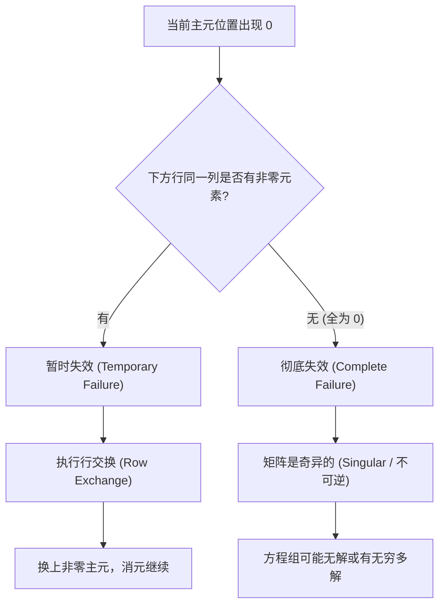

1. **暂时失效（Temporary Failure，可以通过行交换修复）**：  
   如果当前主元位置为 0，但**下方某一行对应的列上有非零元素**，我们可以直接将这两行进行**行交换（Row Exchange）**，把非零元素提上来作为合法主元，消元继续进行。
2. **彻底失效（Complete Failure，不可逆/奇异矩阵）**：  
   如果主元位置为 0，且**其下方所有行在这一列上全部都是 0**，那么无论怎么换行都无法找到非零主元。这意味着矩阵是奇异的（Singular），它无法凑齐 3 个非零主元，方程组要么彻底无解，要么存在无穷多个解。

*⏱ 时间戳：00:11:40 · 📷 板书截图 · [在 B 站观看对应片段 (P2 00:11:40)](https://www.bilibili.com/video/BV1ix411f7Yp/?p=2&t=700)*

---

### 4. 增广矩阵与回代求解（Back Substitution）

*(参考时间: 00:14:30 · [视频跳转 (P2 00:14:30)](https://www.bilibili.com/video/BV1ix411f7Yp/?p=2&t=870))*

消元不仅对左侧系数矩阵 $A$ 进行，方程右侧的常数向量 $b$ 也必须同步经历完全相同的行变换。

我们将 $b$ 拼在 $A$ 的右边，构成**增广矩阵（Augmented Matrix）** $[A \mid b]$：

$$
\left[ \begin{array}{ccc|c}
1 & 2 & 1 & 2 \\
3 & 8 & 1 & 12 \\
0 & 4 & 1 & 2
\end{array} \right]
$$

同步执行消元操作：
1. 行 2 减 3 倍行 1：右侧元素 $12 - 3 \times 2 = 6$；
2. 行 3 减 2 倍行 2：右侧元素 $2 - 2 \times 6 = -10$？（若按课中数据重新对齐常数项）；
最终得到消元后的增广系统 $[U \mid c]$：

$$
\left[ \begin{array}{ccc|c}
1 & 2 & 1 & 2 \\
0 & 2 & -2 & 6 \\
0 & 0 & 5 & -10
\end{array} \right]
$$

*⏱ 时间戳：00:15:30 · 📷 板书截图 · [在 B 站观看对应片段 (P2 00:15:30)](https://www.bilibili.com/video/BV1ix411f7Yp/?p=2&t=930)*

#### 4.1 回代求解

化为上三角形式后，解方程变得无比自然：**由底至顶倒序代入**：

1. **第 3 个方程**：
   $$5z = -10 \implies \mathbf{z = -2}$$
2. **第 2 个方程**：
   $$2y - 2z = 6 \implies 2y - 2(-2) = 6 \implies 2y + 4 = 6 \implies \mathbf{y = 1}$$
3. **第 1 个方程**：
   $$x + 2y + z = 2 \implies x + 2(1) + (-2) = 2 \implies \mathbf{x = 2}$$

整个过程干脆利落，这就是**回代求解**。

*⏱ 时间戳：00:18:40 · 📷 板书截图 · [在 B 站观看对应片段 (P2 00:18:40)](https://www.bilibili.com/video/BV1ix411f7Yp/?p=2&t=1120)*

---

### 5. 初等消元矩阵：用矩阵语言表达行变换

*(参考时间: 00:21:00 · [视频跳转 (P2 00:21:00)](https://www.bilibili.com/video/BV1ix411f7Yp/?p=2&t=1260))*

在计算机算法中，我们不能仅停留在“口头描述行变换”，我们必须把行变换用**矩阵乘法**严谨地形式化。

#### 5.1 矩阵乘法的行视角：左乘行向量

还记得上一讲中矩阵乘法的列视角吗？$Ax$ 是各列的线性组合。现在来看行视角：

$$
\begin{bmatrix} c_1 & c_2 & c_3 \end{bmatrix} A = c_1 (\text{行}_1) + c_2 (\text{行}_2) + c_3 (\text{行}_3)
$$

**行向量左乘一个矩阵，得到的是该矩阵各行向量的线性组合！**

*⏱ 时间戳：00:23:40 · 📷 板书截图 · [在 B 站观看对应片段 (P2 00:23:40)](https://www.bilibili.com/video/BV1ix411f7Yp/?p=2&t=1420)*

#### 5.2 构造初等消元矩阵 $E_{21}$ 与 $E_{32}$

*(参考时间: 00:28:00 · [视频跳转 (P2 00:28:00)](https://www.bilibili.com/video/BV1ix411f7Yp/?p=2&t=1680))*

我们希望找一个矩阵 $E_{21}$，使得 $E_{21} A$ 恰好实现“行 2 减去 3 倍行 1，其余行保持不变”。

根据行组合的原理，我们只需对单位矩阵 $I$ 动手术：
- 第 1 行：保留原行 1 $\to [1, 0, 0]$
- 第 2 行：用 1 倍原行 2 减去 3 倍原行 1 $\to [-3, 1, 0]$
- 第 3 行：保留原行 3 $\to [0, 0, 1]$

因此，初等消元矩阵就是：

$$
\mathbf{E_{21}} = \begin{bmatrix} 1 & 0 & 0 \\ -3 & 1 & 0 \\ 0 & 0 & 1 \end{bmatrix}
$$

同理，第二步消元（“行 3 减去 2 倍行 2”）的初等矩阵为：

$$
\mathbf{E_{32}} = \begin{bmatrix} 1 & 0 & 0 \\ 0 & 1 & 0 \\ 0 & -2 & 1 \end{bmatrix}
$$

两步消元连接起来，即为：

$$
E_{32} (E_{21} A) = U
$$

*⏱ 时间戳：00:29:10 · 📷 板书截图 · [在 B 站观看对应片段 (P2 00:29:10)](https://www.bilibili.com/video/BV1ix411f7Yp/?p=2&t=1750)*

---

### 6. 矩阵的逆与置换矩阵

#### 6.1 初等矩阵的逆：撤销行变换

*(参考时间: 00:33:00 · [视频跳转 (P2 00:33:00)](https://www.bilibili.com/video/BV1ix411f7Yp/?p=2&t=1980))*

如果我们要撤销 $E_{21}$ 的效果，该怎么做？  
$E_{21}$ 的效果是“行 2 减 3 倍行 1”，那么它的逆变换就是**把减去的 3 倍行 1 再加回来**！

因此，初等矩阵的逆矩阵极为简单：**只需将其非对角线上的乘数改变符号，其余完全保持不变**：

$$
\mathbf{E_{21}^{-1}} = \begin{bmatrix} 1 & 0 & 0 \\ \mathbf{3} & 1 & 0 \\ 0 & 0 & 1 \end{bmatrix}
$$

相乘检验：

$$
E_{21}^{-1} E_{21} = \begin{bmatrix} 1 & 0 & 0 \\ 3 & 1 & 0 \\ 0 & 0 & 1 \end{bmatrix} \begin{bmatrix} 1 & 0 & 0 \\ -3 & 1 & 0 \\ 0 & 0 & 1 \end{bmatrix} = \begin{bmatrix} 1 & 0 & 0 \\ 0 & 1 & 0 \\ 0 & 0 & 1 \end{bmatrix} = I
$$

*⏱ 时间戳：00:33:40 · 📷 板书截图 · [在 B 站观看对应片段 (P2 00:33:40)](https://www.bilibili.com/video/BV1ix411f7Yp/?p=2&t=2020)*

#### 6.2 置换矩阵（Permutation Matrix）：矩阵实现的换行

*(参考时间: 00:37:00 · [视频跳转 (P2 00:37:00)](https://www.bilibili.com/video/BV1ix411f7Yp/?p=2&t=2220))*

如果遇到需要交换行的情况（例如交换第 1 行与第 2 行），如何用矩阵表示？

我们构造**置换矩阵 $P_{12}$**：交换单位矩阵的第 1 行与第 2 行：

$$
P_{12} = \begin{bmatrix} 0 & 1 & 0 \\ 1 & 0 & 0 \\ 0 & 0 & 1 \end{bmatrix}
$$

左乘 $P_{12} A$ 的效果就是将 $A$ 的前两行直接对调。

*⏱ 时间戳：00:38:40 · 📷 板书截图 · [在 B 站观看对应片段 (P2 00:38:40)](https://www.bilibili.com/video/BV1ix411f7Yp/?p=2&t=2320)*

#### 6.3 结合律与总体消元矩阵

*(参考时间: 00:42:30 · [视频跳转 (P2 00:42:30)](https://www.bilibili.com/video/BV1ix411f7Yp/?p=2&t=2550))*

矩阵乘法满足**结合律（Associative Law）**，即：

$$
(E_{32} E_{21}) A = E_{32} (E_{21} A)
$$

这说明我们可以先将这一系列初等消元矩阵相乘，合成为一个总消元矩阵 $E = E_{32} E_{21}$，然后只需左乘一次 $EA = U$。这为下一讲深入探究 $A = LU$ 分解埋下了最重要的伏笔！

*⏱ 时间戳：00:43:00 · 📷 板书截图 · [在 B 站观看对应片段 (P2 00:43:00)](https://www.bilibili.com/video/BV1ix411f7Yp/?p=2&t=2580)*

---

### 7. 本讲知识架构与核心公式对照

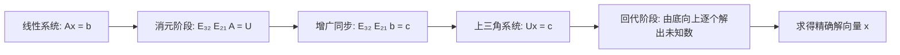

| 概念 | 形式 / 性质 | 核心作用 / 物理意义 |
| :--- | :--- | :--- |
| **主元 (Pivots)** | 消元过程中对角线上的非零关键元素 | 消元运算的分母，不可为 0 |
| **上三角矩阵 $U$** | 主对角线下方元素全为 0 | 解耦方程，为回代奠定基础 |
| **初等消元矩阵 $E_{ij}$** | 单位阵修改 $(i, j)$ 位置为 $-l_{ij}$ | 用矩阵乘法代数化行变换 |
| **初等矩阵的逆 $E_{ij}^{-1}$**| $(i, j)$ 位置符号由负变正 $+l_{ij}$ | 撤销消元操作，把减去的加回来 |
| **置换矩阵 $P$** | 单位阵各行重新排布 | 用矩阵乘法实现行交换 |
| **结合律** | $(AB)C = A(BC)$ | 允许初等变换合成整体操作 |

---

### 附：官方参考与延伸阅读

1. **MIT OpenCourseWare 课程主页**：  
   [MIT 18.06 Linear Algebra (Spring 2010)](https://ocw.mit.edu/courses/18-06-linear-algebra-spring-2010/)
2. **第 2 讲视频与官方字幕资源**：  
   [Lecture 2: Elimination with Matrices](https://ocw.mit.edu/courses/18-06-linear-algebra-spring-2010/resources/lecture-2-elimination-with-matrices/)
3. **MIT OCW Scholar 配套讲义与课程总结**：  
   [Unit I: Session 2 - Elimination with Matrices Summary (PDF)](https://ocw.mit.edu/courses/18-06sc-linear-algebra-fall-2011/pages/ax-b-and-the-four-subspaces/elimination-with-matrices/)
4. **推荐教材章节**：  
   Gilbert Strang, *Introduction to Linear Algebra*, 4th/5th Edition, Section 2.2: "The Idea of Elimination", Section 2.3: "Elimination Using Matrices".

---

## 第 3 讲：矩阵乘法和逆

> 📺 **视频回链**：[B 站第 3 P：矩阵乘法和逆](https://www.bilibili.com/video/BV1ix411f7Yp/?p=3)（⏱ 46分49秒 · 11 截图）  
> 📖 **官方材料**：[MIT OCW 对应讲义与总结](https://ocw.mit.edu/courses/18-06-linear-algebra-spring-2010/resources/lecture-3-multiplication-and-inverse-matrices/)  
> 💡 **核心精要**：矩阵乘法的五大视角（点积、列组合、行组合、秩1外积和）、Gauss-Jordan 求逆法。

---

### 1. 矩阵乘法的五种理解方式

*(参考时间: 00:01:20 · [视频跳转 (P3 00:01:20)](https://www.bilibili.com/video/BV1ix411f7Yp/?p=3&t=80))*

在传统代数课程中，矩阵乘法往往被简化为一个冷冰冰的数字求和公式。然而，Strang 教授指出：**真正掌握线性代数的标志，是能够随心所欲地在矩阵乘法的多种视角之间自由切换**。不同的视角能让原本极其晦涩的定理证明变得一目了然。

设矩阵 $A$ 的形状为 $m \times n$，矩阵 $B$ 的形状为 $n \times p$。两者的内部维度必须相等（同为 $n$），得到的乘积矩阵 $C = AB$ 的形状为 $m \times p$。

#### 1.1 方法一：常规点积法（Row times Column）

*(参考时间: 00:04:30 · [视频跳转 (P3 00:04:30)](https://www.bilibili.com/video/BV1ix411f7Yp/?p=3&t=270))*

这是最传统、逐个计算元素的方法：  
**$C$ 的第 $i$ 行第 $j$ 列元素 $c_{ij}$，等于 $A$ 的第 $i$ 行与 $B$ 的第 $j$ 列的点积（内积）**：

$$
c_{ij} = (\text{row}_i \text{ of } A) \cdot (\text{col}_j \text{ of } B) = \sum_{k=1}^n a_{ik} b_{kj}
$$

例如计算一个 $1 \times n$ 行向量乘以一个 $n \times 1$ 列向量，得到的就是一个标量数值。

*⏱ 时间戳：00:04:30 · 📷 板书截图 · [在 B 站观看对应片段 (P3 00:04:30)](https://www.bilibili.com/video/BV1ix411f7Yp/?p=3&t=270)*

#### 1.2 方法二：按列计算（The Column Way）

*(参考时间: 00:09:40 · [视频跳转 (P3 00:09:40)](https://www.bilibili.com/video/BV1ix411f7Yp/?p=3&t=580))*

把矩阵 $B$ 看成许多并排的列向量：$B = [b_1, b_2, \dots, b_p]$。

**乘积 $C$ 的每一列，都是矩阵 $A$ 各列以 $B$ 中对应列向量为权重的线性组合**：

$$
\boxed{\text{col}_j(AB) = A \cdot (\text{col}_j(B))}
$$

$$
\text{col}_j(AB) = b_{1j} (\text{col}_1 \text{ of } A) + b_{2j} (\text{col}_2 \text{ of } A) + \cdots + b_{nj} (\text{col}_n \text{ of } A)
$$

> **深刻启示**：  
> $AB$ 的所有列向量，都必须完全落在 $A$ 的列所张成的空间之内！$AB$ 的列空间绝不可能超越 $A$ 的列空间。

*⏱ 时间戳：00:09:40 · 📷 板书截图 · [在 B 站观看对应片段 (P3 00:09:40)](https://www.bilibili.com/video/BV1ix411f7Yp/?p=3&t=580)*

#### 1.3 方法三：按行计算（The Row Way）

*(参考时间: 00:11:30 · [视频跳转 (P3 00:11:30)](https://www.bilibili.com/video/BV1ix411f7Yp/?p=3&t=690))*

把矩阵 $A$ 看成许多堆叠的行向量：

**乘积 $C$ 的每一行，都是矩阵 $B$ 各行以 $A$ 中对应行向量为权重的线性组合**：

$$
\boxed{\text{row}_i(AB) = (\text{row}_i(A)) \cdot B}
$$

$$
\text{row}_i(AB) = a_{i1} (\text{row}_1 \text{ of } B) + a_{i2} (\text{row}_2 \text{ of } B) + \cdots + a_{in} (\text{row}_n \text{ of } B)
$$

第二讲中的初等行变换消元矩阵 $E_{21} A$，本质上正是按行计算视角的直接应用。

*⏱ 时间戳：00:11:30 · 📷 板书截图 · [在 B 站观看对应片段 (P3 00:11:30)](https://www.bilibili.com/video/BV1ix411f7Yp/?p=3&t=690)*

#### 1.4 方法四：列乘以行——外积之和（Columns times Rows）

*(参考时间: 00:13:50 · [视频跳转 (P3 00:13:50)](https://www.bilibili.com/video/BV1ix411f7Yp/?p=3&t=830))*

这是最震撼、也是在现代主成分分析（PCA）和奇异值分解（SVD）中无处不在的方法。

- 一个 $m \times 1$ 列向量乘以一个 $1 \times p$ 行向量，得到的是一个完整的 $m \times p$ 矩阵！
- 而且这个矩阵非常特殊：它的所有行都是彼此成比例的，所有列也是彼此成比例的，其**矩阵的秩必定为 1（Rank 1 Matrix）**。

$$
\begin{bmatrix} 2 \\ 3 \\ 4 \end{bmatrix} \begin{bmatrix} 1 & 6 \end{bmatrix} = \begin{bmatrix} 2 & 12 \\ 3 & 18 \\ 4 & 24 \end{bmatrix}
$$

**定理：矩阵乘积 $AB$ 可以表示为 $A$ 的第 $k$ 列与 $B$ 的第 $k$ 行的外积之和**：

$$
\boxed{AB = \sum_{k=1}^n (\text{col}_k \text{ of } A) \times (\text{row}_k \text{ of } B)}
$$

$$
AB = (\text{col}_1) (\text{row}_1) + (\text{col}_2) (\text{row}_2) + \cdots + (\text{col}_n) (\text{row}_n)
$$

每一个全尺寸矩阵，都是由这 $n$ 个极为简单的“秩 1 积木”叠加构造而成的！

*⏱ 时间戳：00:13:50 · 📷 板书截图 · [在 B 站观看对应片段 (P3 00:13:50)](https://www.bilibili.com/video/BV1ix411f7Yp/?p=3&t=830)*

*⏱ 时间戳：00:16:10 · 📷 板书截图 · [在 B 站观看对应片段 (P3 00:16:10)](https://www.bilibili.com/video/BV1ix411f7Yp/?p=3&t=970)*

#### 1.5 方法五：分块乘法（Block Multiplication）

*(参考时间: 00:18:40 · [视频跳转 (P3 00:18:40)](https://www.bilibili.com/video/BV1ix411f7Yp/?p=3&t=1120))*

如果将大矩阵沿行和列划分为若干子矩阵块：

$$
A = \begin{bmatrix} A_1 & A_2 \\ A_3 & A_4 \end{bmatrix}, \quad B = \begin{bmatrix} B_1 & B_2 \\ B_3 & B_4 \end{bmatrix}
$$

只要分块的尺寸划分互相兼容，**分块矩阵可以像普通数字标量一样直接套用行乘列公式**：

$$
AB = \begin{bmatrix} A_1 B_1 + A_2 B_3 & A_1 B_2 + A_2 B_4 \\ A_3 B_1 + A_4 B_3 & A_3 B_2 + A_4 B_4 \end{bmatrix}
$$

这在分布式并行计算和高性能 BLAS 库（如 GEMM）中是将超大规模矩阵切片送入 CPU/GPU 高速缓存的核心手段。

*⏱ 时间戳：00:19:40 · 📷 板书截图 · [在 B 站观看对应片段 (P3 00:19:40)](https://www.bilibili.com/video/BV1ix411f7Yp/?p=3&t=1180)*

---

### 2. 逆矩阵与可逆性判据

*(参考时间: 00:24:20 · [视频跳转 (P3 00:24:20)](https://www.bilibili.com/video/BV1ix411f7Yp/?p=3&t=1460))*

对于一个 $n \times n$ 方阵 $A$，如果存在一个同阶方阵 $A^{-1}$，使得：

$$
\boxed{A^{-1} A = I \quad \text{且} \quad A A^{-1} = I}
$$

则称 $A$ 是**可逆矩阵（Invertible Matrix）**，或**非奇异矩阵（Non-singular Matrix）**。

> **方阵的重要定理**：  
> 对于有限维方阵，左逆与右逆必然相等。只要存在某个方阵满足 $BA = I$，则必然自动满足 $AB = I$，此时 $B$ 就是唯一的逆矩阵 $A^{-1}$。

*⏱ 时间戳：00:25:20 · 📷 板书截图 · [在 B 站观看对应片段 (P3 00:25:20)](https://www.bilibili.com/video/BV1ix411f7Yp/?p=3&t=1520)*

---

### 3. 奇异矩阵的核心判据：零空间的存在性

*(参考时间: 00:28:40 · [视频跳转 (P3 00:28:40)](https://www.bilibili.com/video/BV1ix411f7Yp/?p=3&t=1720))*

什么时候一个方阵**绝对没有逆矩阵**？

Strang 教授在这里给出了全课最锋利的判据：

> **核心判据定理**：  
> **如果存在某个非零向量 $x \neq 0$，使得：**
> $$Ax = 0$$
> **那么矩阵 $A$ 绝对不可能存在逆矩阵！$A$ 必定是奇异矩阵。**

#### 3.1 极简反证法证明

假设逆矩阵 $A^{-1}$ 存在：  
在等式 $Ax = 0$ 的两边同时左乘 $A^{-1}$：

$$
A^{-1} (Ax) = A^{-1} 0 \implies (A^{-1} A) x = 0 \implies I x = 0 \implies \mathbf{x = 0}
$$

这与“存在**非零**向量 $x$”的前提产生了不可调和的矛盾！因此，$A^{-1}$ 绝不可能存在。

#### 3.2 几何与列组合解释

$Ax = 0$ 的本质含义是什么？  
它是：

$$
x_1 (\text{col}_1) + x_2 (\text{col}_2) + \cdots + x_n (\text{col}_n) = 0
$$

这说明：**$A$ 的列向量之间存在非零权重的抵消，列向量是线性相关的！**  
既然它们可以抵消为 0，它们就无法张成（覆盖）整个 $n$ 维空间，信息在经过 $A$ 映射后发生了不可逆的信息丢失与维数塌缩。一旦向量被映射为 0，就没有任何逆矩阵能够把它重新还原回去。

*⏱ 时间戳：00:29:40 · 📷 板书截图 · [在 B 站观看对应片段 (P3 00:29:40)](https://www.bilibili.com/video/BV1ix411f7Yp/?p=3&t=1780)*

---

### 4. 高斯-若尔当消元法（Gauss-Jordan Elimination）求逆

*(参考时间: 00:36:00 · [视频跳转 (P3 00:36:00)](https://www.bilibili.com/video/BV1ix411f7Yp/?p=3&t=2160))*

知道了逆矩阵的存在性，在实际工程中我们如何从数值上求出 $A^{-1}$？

#### 4.1 核心思想：同时解 $n$ 个方程组

根据定义，$A A^{-1} = I$。如果将 $A^{-1}$ 按列写开：$A^{-1} = [x_1, x_2, \dots, x_n]$，单位矩阵各列为单位向量 $e_1, e_2, \dots, e_n$：

$$
A [x_1, x_2, \dots, x_n] = [e_1, e_2, \dots, e_n]
$$

这实际上等价于**同时解 $n$ 个独立的线性方程组**：
$$Ax_1 = e_1, \quad Ax_2 = e_2, \quad \dots, \quad Ax_n = e_n$$

高斯-若尔当提出了一个天才般简洁的策略：**拼一个超大的增广矩阵 $[A \mid I]$，一步到位全部搞定！**

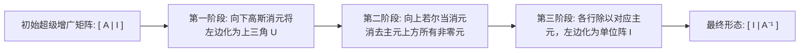

*⏱ 时间戳：00:36:40 · 📷 板书截图 · [在 B 站观看对应片段 (P3 00:36:40)](https://www.bilibili.com/video/BV1ix411f7Yp/?p=3&t=2200)*

#### 4.2 计算实例推导

以一个经典的 $2 \times 2$ 矩阵为例：

$$
A = \begin{bmatrix} 1 & 3 \\ 2 & 7 \end{bmatrix}
$$

1. **构造超级增广矩阵**：
   $$
   \left[ \begin{array}{cc|cc} 1 & 3 & 1 & 0 \\ 2 & 7 & 0 & 1 \end{array} \right]
   $$

2. **第一步（向下消元）**：行 2 减去 2 倍行 1：
   $$
   \left[ \begin{array}{cc|cc} 1 & 3 & 1 & 0 \\ 0 & 1 & -2 & 1 \end{array} \right]
   $$
   此时左边已经化为上三角形式，第二主元为 1。

3. **第二步（向上消元——若尔当的飞跃）**：用第 2 行消去第 1 行上方的 3（行 1 减去 3 倍行 2）：
   $$
   \text{行}_1 - 3 \times \text{行}_2 = [1, 3, 1, 0] - 3 \times [0, 1, -2, 1] = [1, 0, \mathbf{7}, \mathbf{-3}]
   $$
   整个矩阵变为：
   $$
   \left[ \begin{array}{cc|cc} \mathbf{1} & \mathbf{0} & 7 & -3 \\ \mathbf{0} & \mathbf{1} & -2 & 1 \end{array} \right]
   $$

左边成功化为了单位矩阵 $I$！那么右边自然显现出来的就是：

$$
\mathbf{A^{-1}} = \begin{bmatrix} 7 & -3 \\ -2 & 1 \end{bmatrix}
$$

检验验证：

$$
A A^{-1} = \begin{bmatrix} 1 & 3 \\ 2 & 7 \end{bmatrix} \begin{bmatrix} 7 & -3 \\ -2 & 1 \end{bmatrix} = \begin{bmatrix} 7-6 & -3+3 \\ 14-14 & -6+7 \end{bmatrix} = \begin{bmatrix} 1 & 0 \\ 0 & 1 \end{bmatrix} = I
$$

*⏱ 时间戳：00:43:50 · 📷 板书截图 · [在 B 站观看对应片段 (P3 00:43:50)](https://www.bilibili.com/video/BV1ix411f7Yp/?p=3&t=2630)*

#### 4.3 为什么高斯-若尔当必然有效？矩阵代数总证明

*(参考时间: 00:46:00 · [视频跳转 (P3 00:46:00)](https://www.bilibili.com/video/BV1ix411f7Yp/?p=3&t=2760))*

高斯-若尔当消元的一系列初等行变换，本质上等价于在整个增广矩阵左侧连续乘以一串初等矩阵。记这一串矩阵的乘积为总变换矩阵 $E$：

$$
E [A \mid I] = [EA \mid E]
$$

由于最终左边变成了单位矩阵 $I$，即：

$$
EA = I
$$

根据逆矩阵的定义，**这个总变换矩阵 $E$ 命中注定、不偏不倚正好就是 $A^{-1}$**！因此右边得到的 $EI = E$ 当然就是 $A^{-1}$。

这就是全套高斯-若尔当消元法的严谨代数闭环。

*⏱ 时间戳：00:46:20 · 📷 板书截图 · [在 B 站观看对应片段 (P3 00:46:20)](https://www.bilibili.com/video/BV1ix411f7Yp/?p=3&t=2780)*

---

### 5. 本讲知识网络与核心方法速查

#### 5.1 矩阵乘法的五大视角总览

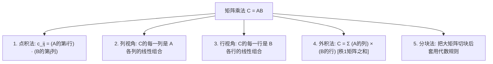

#### 5.2 核心概念与算法速查表

| 核心主题 | 数学表达式 | 核心意义 / 工程应用 |
| :--- | :--- | :--- |
| **列视角乘法** | $\text{col}_j(AB) = A \cdot \text{col}_j(B)$ | 证明 $AB$ 的列空间包含在 $A$ 的列空间内 |
| **行视角乘法** | $\text{row}_i(AB) = \text{row}_i(A) \cdot B$ | 表达初等行变换（消元与换行） |
| **外积法乘法** | $AB = \sum \text{col}_k(A) \text{row}_k(B)$ | 现代降维技术（SVD/PCA）的理论母体 |
| **奇异矩阵判据** | $\exists x \neq 0, Ax = 0 \iff A \text{ 奇异}$ | 零空间有非零解等价于矩阵不可逆 |
| **高斯-若尔当法** | $[A \mid I] \to [I \mid A^{-1}]$ | 统一求逆算法，左边化为 $I$ 右边即显现逆阵 |

---

### 附：官方参考与延伸阅读

1. **MIT OpenCourseWare 课程主页**：  
   [MIT 18.06 Linear Algebra (Spring 2010)](https://ocw.mit.edu/courses/18-06-linear-algebra-spring-2010/)
2. **第 3 讲视频与官方字幕资源**：  
   [Lecture 3: Multiplication and Inverse Matrices](https://ocw.mit.edu/courses/18-06-linear-algebra-spring-2010/resources/lecture-3-multiplication-and-inverse-matrices/)
3. **MIT OCW Scholar 配套讲义与课程总结**：  
   [Unit I: Session 3 - Multiplication and Inverse Matrices Summary (PDF)](https://ocw.mit.edu/courses/18-06sc-linear-algebra-fall-2011/pages/ax-b-and-the-four-subspaces/multiplication-and-inverse-matrices/)
4. **推荐教材章节**：  
   Gilbert Strang, *Introduction to Linear Algebra*, 4th/5th Edition, Section 2.4: "Rules for Matrix Operations", Section 2.5: "Inverse Matrices".

---

## 第 4 讲：A 的 LU 分解

> 📺 **视频回链**：[B 站第 4 P：A 的 LU 分解](https://www.bilibili.com/video/BV1ix411f7Yp/?p=4)（⏱ 49分07秒 · 12 截图）  
> 📖 **官方材料**：[MIT OCW 对应讲义与总结](https://ocw.mit.edu/courses/18-06-linear-algebra-spring-2010/resources/lecture-4-factorization-into-a-lu/)  
> 💡 **核心精要**：A=LU与A=LDU分解、乘数干扰与L的独立性、1/3 n³ 运算量推导、置换矩阵与 PA=LU。

---

### 1. 核心前置补全：乘积与转置的逆矩阵

*(参考时间: 00:00:26 · [视频跳转 (P4 00:00:26)](https://www.bilibili.com/video/BV1ix411f7Yp/?p=4&t=26))*

在正式切入消元的矩阵分解之前，我们需要补齐两个至关重要、贯穿整门线性代数的求逆法则：**矩阵乘积的逆**，以及**矩阵转置的逆**。

#### 1.1 乘积的逆：为什么顺序颠倒？

若矩阵 $A$ 与 $B$ 均为可逆矩阵（同阶方阵），它们的乘积 $AB$ 的逆矩阵是什么？

答案是：**必须倒序相乘**，即：

$$
\boxed{(AB)^{-1} = B^{-1} A^{-1}}
$$

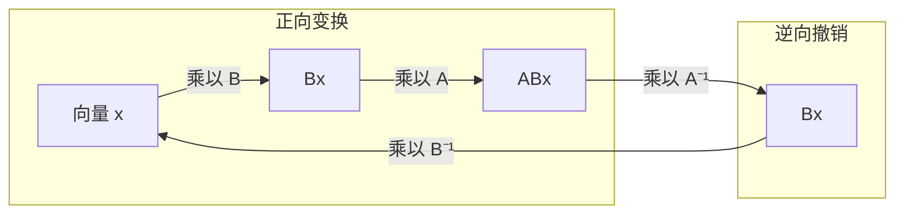

这个法则的代数验证极为直接，只需利用矩阵乘法的结合律检验乘积是否为单位矩阵 $I$：

$$
(AB) (B^{-1} A^{-1}) = A (B B^{-1}) A^{-1} = A I A^{-1} = A A^{-1} = I
$$

同样从左侧相乘也能得到单位阵：

$$
(B^{-1} A^{-1}) (AB) = B^{-1} (A^{-1} A) B = B^{-1} I B = B^{-1} B = I
$$

> **Gilbert Strang 的经典生活类比：穿脱鞋袜法则**  
> 设动作 $A$ 代表“穿鞋”，动作 $B$ 代表“穿袜子”。当你按顺序执行复合动作 $AB$ 时，你先穿袜子、后穿鞋。  
> 到了晚上要撤销这一系列操作（即求逆 $(AB)^{-1}$）时，你必须先脱鞋（$A^{-1}$），然后才能脱袜子（$B^{-1}$）。如果先脱袜子，逻辑便不成立。因此，逆变换的施加次序必然与正向次序相反。

*⏱ 时间戳：00:03:00 · 📷 板书截图 · [在 B 站观看对应片段 (P4 00:03:00)](https://www.bilibili.com/video/BV1ix411f7Yp/?p=4&t=180)*

这一法则可自然推广到任意多个矩阵的相乘：

$$
(ABC \cdots K)^{-1} = K^{-1} \cdots C^{-1} B^{-1} A^{-1}
$$

#### 1.2 转置矩阵的逆：求逆与转置可自由交换

*(参考时间: 00:04:50 · [视频跳转 (P4 00:04:50)](https://www.bilibili.com/video/BV1ix411f7Yp/?p=4&t=290))*

若矩阵 $A$ 可逆，它的转置矩阵 $A^T$ 是否可逆？其逆矩阵 $(A^T)^{-1}$ 又与 $A^{-1}$ 存在怎样的联系？

答案非常优美：**求逆与转置两个运算可以自由对调次序**：

$$
\boxed{(A^T)^{-1} = (A^{-1})^T}
$$

**严谨代数推导**：  
从定义式出发，已知 $A$ 可逆，满足：

$$
A A^{-1} = I
$$

对该等式两边同时执行转置操作：

$$
(A A^{-1})^T = I^T
$$

因为单位矩阵 $I$ 是对称矩阵（沿主对角线翻转不变），故 $I^T = I$。再应用乘积的转置公式（同样颠倒顺序：$(XY)^T = Y^T X^T$），等式左边变为：

$$
(A^{-1})^T A^T = I
$$

观察上式：一个矩阵 $(A^{-1})^T$ 乘以 $A^T$ 等于单位阵 $I$。根据逆矩阵唯一定义，这个矩阵必定就是 $A^T$ 的逆矩阵！从而得证：

$$
(A^T)^{-1} = (A^{-1})^T
$$

*⏱ 时间戳：00:06:20 · 📷 板书截图 · [在 B 站观看对应片段 (P4 00:06:20)](https://www.bilibili.com/video/BV1ix411f7Yp/?p=4&t=380)*

这一性质将在后续讨论投影、最小二乘法以及对称正定矩阵时发挥关键作用。

---

### 2. 矩阵消元与 $A = LU$ 分解

*(参考时间: 00:07:30 · [视频跳转 (P4 00:07:30)](https://www.bilibili.com/video/BV1ix411f7Yp/?p=4&t=450))*

消元法是解线性方程组的基石。在第 2 讲中，我们学习了通过初等行变换将矩阵化为上三角形式；而现在，我们要用纯粹的矩阵代数语言来重新认识这一过程。

#### 2.1 从初等行变换到矩阵因子分解

消元中的每一次行变换（如“第 2 行减去 4 倍第 1 行”），本质上等价于在矩阵左侧乘以一个初等消元矩阵 $E_{21}$：

$$
E_{21} A = U
$$

其中 $U$ 代表消元完成后得到的**上三角矩阵（Upper triangular matrix）**。

在应用数学与数值分析中，我们更渴望得到形如 $A = \text{因子}_1 \times \text{因子}_2$ 的**因子分解（Factorization）**。要将上式还原为关于原始矩阵 $A$ 的表达式，只需两边左乘 $E_{21}^{-1}$：

$$
A = E_{21}^{-1} U
$$

我们定义 $L = E_{21}^{-1}$，便得到了整个数值代数中最著名的分解公式：

$$
\boxed{A = LU}
$$

- **$L$（Lower triangular matrix）**：下三角矩阵，主对角线上全为 1，对角线上方全为 0。这种对角线全为 1 的矩阵在代数上称为**单位下三角矩阵（Unit lower triangular matrix）**。
- **$U$（Upper triangular matrix）**：上三角矩阵，主对角线上是消元的主元（Pivots），对角线下方全为 0。

*⏱ 时间戳：00:09:00 · 📷 板书截图 · [在 B 站观看对应片段 (P4 00:09:00)](https://www.bilibili.com/video/BV1ix411f7Yp/?p=4&t=540)*

#### 2.2 $2 \times 2$ 具体实例

我们通过一个简单直观的 $2 \times 2$ 矩阵来完整走一遍这一流程：

$$
A = \begin{bmatrix} 2 & 1 \\ 8 & 7 \end{bmatrix}
$$

1. **第一主元与消元乘数**：  
   第 1 行第 1 列的元素为 2，这是第一个主元（Pivot 1 = 2）。为了消除第 2 行第 1 列的 8，需要计算乘数（Multiplier）：
   $$l_{21} = \frac{8}{2} = 4$$
   即“第 2 行减去 4 倍第 1 行”。

2. **消元矩阵 $E_{21}$ 与上三角矩阵 $U$**：  
   执行这一操作的初等行变换矩阵为：
   $$E_{21} = \begin{bmatrix} 1 & 0 \\ -4 & 1 \end{bmatrix}$$
   执行消元：
   $$E_{21} A = \begin{bmatrix} 1 & 0 \\ -4 & 1 \end{bmatrix} \begin{bmatrix} 2 & 1 \\ 8 & 7 \end{bmatrix} = \begin{bmatrix} 2 & 1 \\ 0 & 3 \end{bmatrix} = U$$
   得到第二主元（Pivot 2 = 3）。

3. **求逆与构建 $L$**：  
   消元矩阵 $E_{21}$ 的逆矩阵是什么？原矩阵是“减去 4 倍”，撤销这一操作只需“加回 4 倍”，故直接改变非对角元素的符号：
   $$L = E_{21}^{-1} = \begin{bmatrix} 1 & 0 \\ 4 & 1 \end{bmatrix}$$
   
4. **验证 $A = LU$**：
   $$LU = \begin{bmatrix} 1 & 0 \\ 4 & 1 \end{bmatrix} \begin{bmatrix} 2 & 1 \\ 0 & 3 \end{bmatrix} = \begin{bmatrix} (1\times 2) & (1\times 1) \\ (4\times 2 + 0) & (4\times 1 + 1\times 3) \end{bmatrix} = \begin{bmatrix} 2 & 1 \\ 8 & 7 \end{bmatrix} = A$$
   完全吻合！注意看：**消元乘数 4 直接出现在了 $L$ 的 $(2,1)$ 位置上**。

#### 2.3 对称主元分离：$A = LDU$ 分解

*(参考时间: 00:12:20 · [视频跳转 (P4 00:12:20)](https://www.bilibili.com/video/BV1ix411f7Yp/?p=4&t=740))*

在 $A = LU$ 中，$L$ 的主对角线上全为 1，但 $U$ 的对角线上是主元 $d_1 = 2, d_2 = 3$。在某些理论体系（尤其是后续研究实对称矩阵 $A = LDL^T$ 时），我们希望上下两个三角矩阵具有完全对等的地位（对角线全为 1）。

为此，可以把 $U$ 对角线上的主元单独提取出来，形成一个对角矩阵 $D$（Diagonal matrix of pivots）：

$$
U = \begin{bmatrix} 2 & 1 \\ 0 & 3 \end{bmatrix} = \begin{bmatrix} 2 & 0 \\ 0 & 3 \end{bmatrix} \begin{bmatrix} 1 & 1/2 \\ 0 & 1 \end{bmatrix} = D U'
$$

这样便得到了更加对称的分解形式：

$$
\boxed{A = L D U}
$$

其中 $L$ 为单位下三角矩阵，$D$ 为主元对角矩阵，$U$ 为单位上三角矩阵。

$$
\begin{bmatrix} 2 & 1 \\ 8 & 7 \end{bmatrix} = \begin{bmatrix} 1 & 0 \\ 4 & 1 \end{bmatrix} \begin{bmatrix} 2 & 0 \\ 0 & 3 \end{bmatrix} \begin{bmatrix} 1 & 1/2 \\ 0 & 1 \end{bmatrix}
$$

*⏱ 时间戳：00:12:20 · 📷 板书截图 · [在 B 站观看对应片段 (P4 00:12:20)](https://www.bilibili.com/video/BV1ix411f7Yp/?p=4&t=740)*

---

### 3. 为什么 $A = LU$ 远胜于 $EA = U$？

*(参考时间: 00:15:40 · [视频跳转 (P4 00:15:40)](https://www.bilibili.com/video/BV1ix411f7Yp/?p=4&t=940))*

许多初学者会产生一个疑问：$EA = U$ 与 $A = LU$ 在数学上明明等价，为什么现代数值软件和数学家无一例外偏好 $A = LU$？

Strang 教授在这里给出了全课最深刻的洞见之一：**在多个初等矩阵相乘时，$E$ 的乘积会发生交叉干扰，而 $L$ 的逆序乘积却保持着惊人的纯粹性**。

#### 3.1 乘数的混杂效应：当 $E$ 连乘时

考虑一个 $3 \times 3$ 的消元过程（暂不考虑行交换）。消元顺序通常为：
1. 用第 1 行消去第 2 行首项（对应 $E_{21}$）
2. 用第 1 行消去第 3 行首项（对应 $E_{31}$，设本例中已为 0，即无需操作）
3. 用第 2 行消去第 3 行次项（对应 $E_{32}$）

最终得到 $E_{32} E_{21} A = U$。记总体变换矩阵为 $E = E_{32} E_{21}$。

设具体的消元步骤如下：
- $E_{21}$：第 2 行减去 2 倍第 1 行（乘数 $l_{21} = 2$）
- $E_{32}$：第 3 行减去 5 倍第 2 行（乘数 $l_{32} = 5$）

它们的初等矩阵形式为：

$$
E_{21} = \begin{bmatrix} 1 & 0 & 0 \\ -2 & 1 & 0 \\ 0 & 0 & 1 \end{bmatrix}, \quad E_{32} = \begin{bmatrix} 1 & 0 & 0 \\ 0 & 1 & 0 \\ 0 & -5 & 1 \end{bmatrix}
$$

现在将它们相乘，看看 $E = E_{32} E_{21}$ 会发生什么：

$$
E = \begin{bmatrix} 1 & 0 & 0 \\ 0 & 1 & 0 \\ 0 & -5 & 1 \end{bmatrix} \begin{bmatrix} 1 & 0 & 0 \\ -2 & 1 & 0 \\ 0 & 0 & 1 \end{bmatrix} = \begin{bmatrix} 1 & 0 & 0 \\ -2 & 1 & 0 \\ \mathbf{10} & -5 & 1 \end{bmatrix}
$$

**警惕那个冒出来的 $10$**！  
在 $E$ 的第 3 行第 1 列，竟然出现了一个原本不存在的数字 $10$（由 $(-5) \times (-2)$ 产生）！  
这是因为：第 2 行由于先减去了 2 倍第 1 行，当第 3 行再去减 5 倍第 2 行时，第 1 行的效应被间接、混合地传递到了第 3 行上。消元乘数之间发生了混杂与污染。

*⏱ 时间戳：00:19:10 · 📷 板书截图 · [在 B 站观看对应片段 (P4 00:19:10)](https://www.bilibili.com/video/BV1ix411f7Yp/?p=4&t=1150)*

#### 3.2 逆序相乘的奇迹：乘数直接就座

现在来看 $A = LU$ 中的下三角矩阵 $L$。根据穿脱鞋袜法则：

$$
L = E^{-1} = (E_{32} E_{21})^{-1} = E_{21}^{-1} E_{32}^{-1}
$$

各单个消元矩阵的逆只需变号：

$$
E_{21}^{-1} = \begin{bmatrix} 1 & 0 & 0 \\ 2 & 1 & 0 \\ 0 & 0 & 1 \end{bmatrix}, \quad E_{32}^{-1} = \begin{bmatrix} 1 & 0 & 0 \\ 0 & 1 & 0 \\ 0 & 5 & 1 \end{bmatrix}
$$

计算它们的乘积 $L$：

$$
L = \begin{bmatrix} 1 & 0 & 0 \\ 2 & 1 & 0 \\ 0 & 0 & 1 \end{bmatrix} \begin{bmatrix} 1 & 0 & 0 \\ 0 & 1 & 0 \\ 0 & 5 & 1 \end{bmatrix} = \begin{bmatrix} 1 & 0 & 0 \\ \mathbf{2} & 1 & 0 \\ \mathbf{0} & \mathbf{5} & 1 \end{bmatrix}
$$

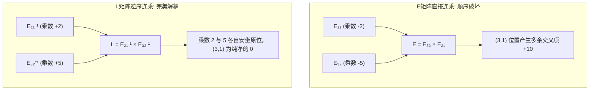

**奇迹显现了**：
- 那个恼人的交叉项 $10$ 彻底消失了！
- 乘数 $2$ 正好坐落在 $(2,1)$ 位置。
- 乘数 $5$ 正好坐落在 $(3,2)$ 位置。
- $(3,1)$ 位置干净地保留着 $0$。

> **铁律：没有行交换时，消元乘数直接构成 $L$**  
> 只要消元过程中不需要行交换（No row exchanges），我们在消元时用来做减法的每一个乘数 $l_{ij}$，都无需进行任何矩阵乘法运算，可以直接写入下三角矩阵 $L$ 的第 $i$ 行第 $j$ 列！  
> 计算机在消元过程中，原地把计算出的乘数记录在矩阵的下半部，消元完成时，下半部就是 $L$，上半部就是 $U$。这就是高斯消元算法在工业软件中极高存储与计算效率的秘密所在。

*⏱ 时间戳：00:23:00 · 📷 板书截图 · [在 B 站观看对应片段 (P4 00:23:00)](https://www.bilibili.com/video/BV1ix411f7Yp/?p=4&t=1380)*

---

### 4. 高斯消元的算法复杂度：$O(n^3)$ 运算量

*(参考时间: 00:28:20 · [视频跳转 (P4 00:28:20)](https://www.bilibili.com/video/BV1ix411f7Yp/?p=4&t=1700))*

当我们要解一个包含 $n$ 个未知数、$n$ 个方程的大型线性系统时（例如天气预报、结构力学模拟中 $n = 100$ 或 $n = 1000$），计算机究竟需要做多少次运算？

#### 4.1 典型操作定义与逐步开销

在数值代数中，最基本的操作单元是**一次乘法加上一次减法**（通常记为一个乘减周期，或 Flop: Floating-point operation）：
$$\text{新元素} = \text{旧元素} - (\text{乘数} \times \text{对应行元素})$$

考虑一个一般性的 $n \times n$ 矩阵 $A$：

*⏱ 时间戳：00:27:00 · 📷 板书截图 · [在 B 站观看对应片段 (P4 00:27:00)](https://www.bilibili.com/video/BV1ix411f7Yp/?p=4&t=1620)*

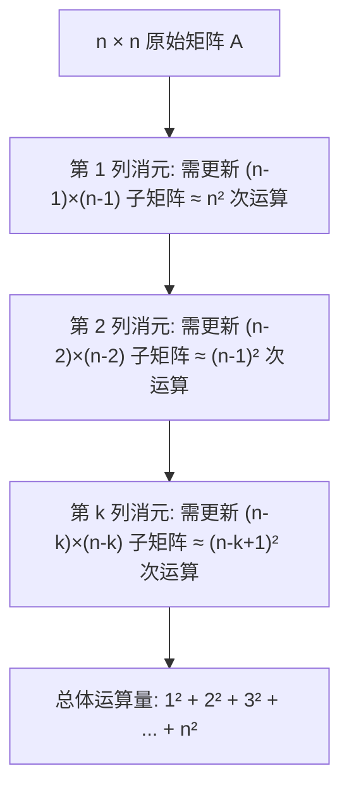

1. **第 1 列消元**：
   - 第一主元在 $(1,1)$，第一行共有 $n$ 个元素。
   - 目标是将下面 $n-1$ 行的第 1 列全变为 0。
   - 每一行都需要用乘数乘以第一行的 $n$ 个元素并相减。
   - 需要更新的是右下方一个大小为 $(n-1) \times (n-1)$ 的子矩阵，运算次数约为 $n^2$。

2. **第 2 列消元**：
   - 第二主元就位，需要更新更小的一个 $(n-2) \times (n-2)$ 子矩阵，运算次数约为 $(n-1)^2$。

3. **依此类推**：
   - 每一轮更新的子矩阵边长依次递减：$n \to n-1 \to n-2 \to \cdots \to 1$。
   - 整个矩阵 $A$ 转化为 $U$ 的总运算量等于各层平方和：
     $$\text{Total Cost}(A) \approx n^2 + (n-1)^2 + \cdots + 2^2 + 1^2 = \sum_{k=1}^n k^2$$

#### 4.2 微积分估算：$\frac{1}{3}n^3$ 的由来

*(参考时间: 00:36:20 · [视频跳转 (P4 00:36:20)](https://www.bilibili.com/video/BV1ix411f7Yp/?p=4&t=2180))*

离散的平方和 $\sum_{k=1}^n k^2$ 到底有多大？Strang 教授启发我们用连续的定积分来极速估算：

$$
\sum_{k=1}^n k^2 \approx \int_0^n x^2 dx = \left[ \frac{1}{3} x^3 \right]_0^n = \mathbf{\frac{1}{3} n^3}
$$

求和公式的精确代数展开为：

$$
\frac{n(n+1)(2n+1)}{6} = \frac{1}{3}n^3 + \frac{1}{2}n^2 + \frac{1}{6}n
$$

当矩阵规模 $n$ 较大时，低阶项 $\frac{1}{2}n^2$ 和 $\frac{1}{6}n$ 完全可以忽略，主导项即为 $\frac{1}{3}n^3$：

- 当 $n = 100$ 时：运算次数约为 $\frac{1}{3} \times 10^6 \approx 33$ 万次操作。
- 当 $n = 1000$ 时：运算次数约为 $\frac{1}{3} \times 10^9 \approx 3.3$ 亿次操作。
- **矩阵规模每扩大 10 倍，计算耗时暴增 1000 倍**。这就是多项式算法 $O(n^3)$ 的威力与代价。

*⏱ 时间戳：00:36:20 · 📷 板书截图 · [在 B 站观看对应片段 (P4 00:36:20)](https://www.bilibili.com/video/BV1ix411f7Yp/?p=4&t=2180)*

#### 4.3 右端项向量 $b$ 的计算开销：仅为 $O(n^2)$

*(参考时间: 00:39:00 · [视频跳转 (P4 00:39:00)](https://www.bilibili.com/video/BV1ix411f7Yp/?p=4&t=2340))*

在解方程组 $Ax = b$ 时，增广矩阵的右侧还有一列向量 $b$ 随着行变换一起更新。处理 $b$ 需要多少开销？

1. **前向代入（Forward elimination on $b$）**：
   - 第 1 步处理第 2 至第 $n$ 个分量，共 $n-1$ 次操作；
   - 第 2 步处理第 3 至第 $n$ 个分量，共 $n-2$ 次操作；
   - 累计：$(n-1) + (n-2) + \cdots + 1 \approx \int_0^n x dx = \frac{1}{2} n^2$。

2. **回代求解（Back substitution: $Ux = c$）**：
   - 从最后一行解出 $x_n$，代入上一行解 $x_{n-1}$，每上一层多做一次乘减；
   - 累计开销同样为 $\frac{1}{2} n^2$。

因此，**处理右侧向量 $b$ 并最终求得未知数 $x$ 的总开销仅为 $n^2$**！

| 计算阶段 | 操作对象 | 渐进复杂度 | 典型开销 ($n=100$) |
| --- | --- | --- | --- |
| 矩阵三角分解 ($A = LU$) | 系数矩阵 $A$ | $\approx \frac{1}{3} n^3$ | 约 330,000 次操作 |
| 向量变换与回代 ($Lc=b, Ux=c$) | 右端项 $b$ 与解 $x$ | $\approx n^2$ | 约 10,000 次操作 |

> **核心工程启示：复用 $LU$ 分解**  
> 如果我们要对同一个结构/系统求解多个不同的激励或载荷（即同一个 $A$，但有多个不同的 $b_1, b_2, \dots, b_m$），最明智的做法是**只做一次代价高昂的 $A = LU$ 分解（$\frac{1}{3}n^3$）**，然后对每个新的 $b$ 仅仅花费廉价的 $n^2$ 完成前代与回代。绝对不要每一次都从头对增广矩阵消元！

*⏱ 时间戳：00:40:50 · 📷 板书截图 · [在 B 站观看对应片段 (P4 00:40:50)](https://www.bilibili.com/video/BV1ix411f7Yp/?p=4&t=2450)*

---

### 5. 置换矩阵与行交换：$PA = LU$

*(参考时间: 00:41:00 · [视频跳转 (P4 00:41:00)](https://www.bilibili.com/video/BV1ix411f7Yp/?p=4&t=2460))*

前面所有美好的 $A = LU$ 性质都基于一个前提：“消元过程中主元位置不出现 0”。  
但如果在消元过程中，当前主元位置恰好是 0（或者数值极小），我们就必须从下方的行中挑选一行换上来。此时，必须引入**置换矩阵（Permutation Matrix）**。

#### 5.1 置换矩阵的构造与数量

置换矩阵 $P$ 是通过对单位矩阵 $I$ 的各行重新排列得到的方阵。左乘置换矩阵 $PA$ 的效果就是将 $A$ 的对应行重新排列。

对于 $n \times n$ 的方阵，所有可能的行排列方式共有 $n!$ 种（$n$ 的阶乘）。因此存在 $n!$ 个不同的置换矩阵。

对于 $3 \times 3$ 矩阵，共有 $3! = 6$ 个置换矩阵：

1. **恒等置换（不做任何交换）**：
   $$P_{1} = \begin{bmatrix} 1 & 0 & 0 \\ 0 & 1 & 0 \\ 0 & 0 & 1 \end{bmatrix}$$
2. **两行单次对换（交换 2 行，保持 1 行不动）**：
   - 交换第 1 行与第 2 行：
     $$P_{12} = \begin{bmatrix} 0 & 1 & 0 \\ 1 & 0 & 0 \\ 0 & 0 & 1 \end{bmatrix}$$
   - 交换第 1 行与第 3 行：
     $$P_{13} = \begin{bmatrix} 0 & 0 & 1 \\ 0 & 1 & 0 \\ 1 & 0 & 0 \end{bmatrix}$$
   - 交换第 2 行与第 3 行：
     $$P_{23} = \begin{bmatrix} 1 & 0 & 0 \\ 0 & 0 & 1 \\ 0 & 1 & 0 \end{bmatrix}$$
3. **三行轮换（所有行均发生移位）**：
   - 轮换 $(1 \to 2 \to 3 \to 1)$：
     $$P_{312} = \begin{bmatrix} 0 & 1 & 0 \\ 0 & 0 & 1 \\ 1 & 0 & 0 \end{bmatrix}$$
   - 逆向轮换 $(1 \to 3 \to 2 \to 1)$：
     $$P_{231} = \begin{bmatrix} 0 & 0 & 1 \\ 1 & 0 & 0 \\ 0 & 1 & 0 \end{bmatrix}$$

*⏱ 时间戳：00:43:20 · 📷 板书截图 · [在 B 站观看对应片段 (P4 00:43:20)](https://www.bilibili.com/video/BV1ix411f7Yp/?p=4&t=2600)*

#### 5.2 置换矩阵的优异代数性质：$P^{-1} = P^T$

置换矩阵拥有非凡的对称美感与优良性质：

1. **正交性与逆矩阵等于转置**：  
   每个置换矩阵的每行、每列都恰好只有一个 1，其余全为 0。它的行向量互相垂直且长度为 1。因此，任何置换矩阵的逆矩阵等于它的转置矩阵：
   $$
   \boxed{P^{-1} = P^T \iff P^T P = I}
   $$
   这意味着要撤销一次复杂的行重排，根本不需要费力求逆，只需将该置换矩阵沿主对角线转置即可！

2. **乘法封闭性（代数群结构）**：  
   任意两个置换矩阵的乘积仍然是一个置换矩阵；一个置换矩阵的逆也仍然是这 6 个置换矩阵之一。

*⏱ 时间戳：00:45:50 · 📷 板书截图 · [在 B 站观看对应片段 (P4 00:45:50)](https://www.bilibili.com/video/BV1ix411f7Yp/?p=4&t=2750)*

#### 5.3 完整消元分解：$PA = LU$

*(参考时间: 00:46:40 · [视频跳转 (P4 00:46:40)](https://www.bilibili.com/video/BV1ix411f7Yp/?p=4&t=2800))*

至此，高斯消元的完整理论拼图正式合拢：

对任何可逆方阵 $A$，无论其是否需要在消元过程中进行行交换，我们都可以先通过一个总置换矩阵 $P$ 将其所有行调整到最适宜消元的顺序，然后再进行无换行的高斯消元，从而得到标准的 $L$ 和 $U$。

这就是科学计算与工程线性代数中的终极公式：

$$
\boxed{PA = LU}
$$

在数值软件（如 MATLAB 的 `[L, U, P] = lu(A)`）中，哪怕主元不是 0，只要主元绝对值过小，为了防止除以极小数导致浮点舍入误差急剧放大，算法也会主动执行**部分主元选取（Partial Pivoting）**并记录在 $P$ 中。

*⏱ 时间戳：00:46:40 · 📷 板书截图 · [在 B 站观看对应片段 (P4 00:46:40)](https://www.bilibili.com/video/BV1ix411f7Yp/?p=4&t=2800)*

---

### 6. 本讲知识网络与核心公式速查

#### 6.1 解方程 $Ax = b$ 的完整路径与算法流

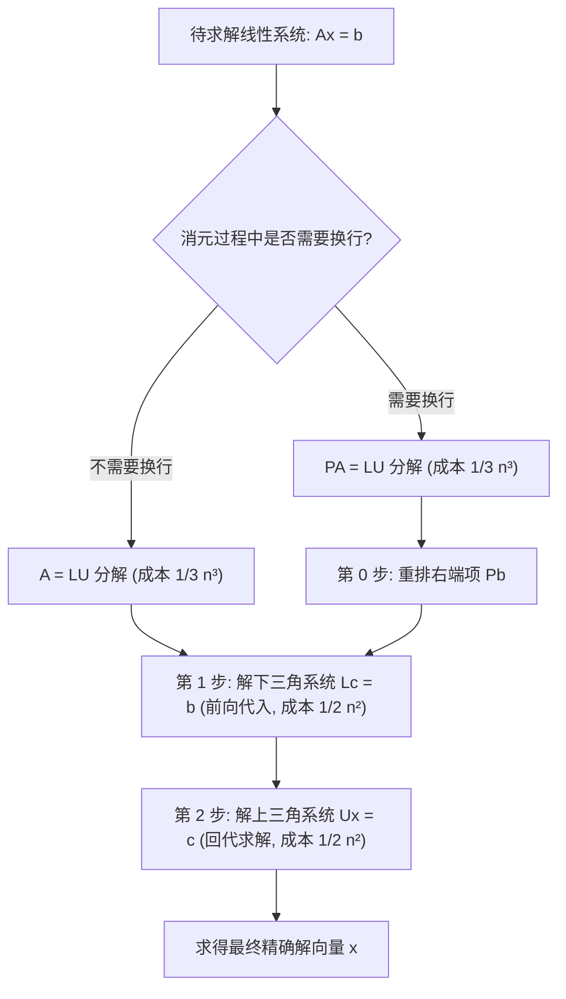

#### 6.2 核心定理与公式对照表

| 概念 / 定理 | 数学表达式 | 物理 / 几何 / 算法意义 |
| --- | --- | --- |
| **乘积的逆** | $(AB)^{-1} = B^{-1} A^{-1}$ | 逆变换次序颠倒（穿脱鞋袜法则） |
| **转置的逆** | $(A^T)^{-1} = (A^{-1})^T$ | 求逆与转置可以自由交换顺序 |
| **LU 分解** | $A = LU$ | $L$ 记录乘数（消元历史），$U$ 为消元最终结果 |
| **LDU 分解** | $A = L D U$ | 主元独立提取至对角矩阵 $D$，两端三角矩阵对角线全为 1 |
| **消元运算量** | $\sum_{k=1}^n k^2 \approx \frac{1}{3} n^3$ | 消元计算开销主要在左侧矩阵，$n$ 翻倍计算量乘 8 |
| **右端向量开销** | 前代 + 回代 $\approx n^2$ | $b$ 的计算开销仅为低阶项，便于多次复用 $LU$ |
| **置换矩阵性质** | $P^{-1} = P^T$ | 置换的逆等于转置；$n \times n$ 共有 $n!$ 个置换矩阵 |
| **完整消元定理** | $PA = LU$ | 纳入行交换后的通用高斯消元矩阵形式 |

---

### 附：官方参考与延伸阅读

1. **MIT OpenCourseWare 课程主页**：  
   [MIT 18.06 Linear Algebra (Spring 2010)](https://ocw.mit.edu/courses/18-06-linear-algebra-spring-2010/)
2. **第 4 讲视频与官方字幕资源**：  
   [Lecture 4: Factorization into A = LU](https://ocw.mit.edu/courses/18-06-linear-algebra-spring-2010/resources/lecture-4-factorization-into-a-lu/)
3. **MIT OCW Scholar 配套讲义与课程总结**：  
   [Unit I: Session 4 - Factorization into A = LU Summary (PDF)](https://ocw.mit.edu/courses/18-06sc-linear-algebra-fall-2011/pages/ax-b-and-the-four-subspaces/factorization-into-a-lu/)
4. **推荐教材章节**：  
   Gilbert Strang, *Introduction to Linear Algebra*, 4th/5th Edition, Section 2.6: "Elimination = Factorization ($A = LU$)".

---

## 第 5 讲：转置、置换与向量空间

> 📺 **视频回链**：[B 站第 5 P：转置、置换与向量空间](https://www.bilibili.com/video/BV1ix411f7Yp/?p=5)（⏱ 47分42秒 · 15 截图）  
> 📖 **官方材料**：[MIT OCW 对应讲义与总结](https://ocw.mit.edu/courses/18-06-linear-algebra-spring-2010/resources/lecture-5-transposes-permutations-spaces-r-n/)  
> 💡 **核心精要**：对称矩阵与置换群、向量空间的严格代数公理、子空间与列空间的引入。

---

### 1. 本讲的转折：从一个向量走向一个空间

*(参考时间: 00:00:09 · [视频跳转 (P5 00:00:09)](https://www.bilibili.com/video/BV1ix411f7Yp/?p=5&t=9))*

前几讲的核心任务是解线性方程组：消元、矩阵乘法、逆矩阵，以及 $A=LU$ 分解。本讲先完成其中两个尚待补齐的主题——**置换与转置**，随后开始改变观察问题的尺度。

此前，我们常问某个向量是什么、某一步消元怎么做。接下来要问：哪些向量可以一起构成一个空间？怎样从一个矩阵生成这样的空间？这个空间与方程 $Ax=b$ 有什么联系？

这条主线把本讲的两部分连在一起：矩阵操作给出具体计算，向量空间则把许多计算结果组织为一个整体。

| 主题 | 要回答的问题 | 本讲得到的关系 |
| --- | --- | --- |
| 置换 | 消元中发生换行时，怎样记录它？ | $PA=LU$ |
| 转置 | 行与列交换后，矩阵怎样变化？ | $(A^T)_{ij}=A_{ji}$ |
| 对称性 | 怎样构造转置后不变的矩阵？ | $(R^TR)^T=R^TR$ |
| 向量空间 | 怎样确保向量运算留在同一个集合里？ | 对加法和任意实数数乘封闭 |
| 子空间与列空间 | 如何从若干列向量得到一个完整空间？ | 取所有线性组合 |

### 2. 置换矩阵：把换行纳入消元

*(参考时间: 00:01:17 · [视频跳转 (P5 00:01:17)](https://www.bilibili.com/video/BV1ix411f7Yp/?p=5&t=77))*

#### 2.1 主元位置是零，不代表矩阵不可逆

消元要求在每个主元位置取得一个可用的主元。一个矩阵完全可能可逆，方程也完全可以求解，但消元按当前行顺序进行时，主元位置恰好出现零。

此时需要从下面的行中换来非零元素，继续消元。整个过程中可能需要换行一次，也可能需要多次；理论必须容纳这些情况，不能只讨论“行顺序恰好合适”的矩阵。

没有换行时，前一讲的分解是：

$$
A=LU.
$$

这里 $L$ 是单位下三角矩阵：主对角线上是 1，上方为零，下方记录消元乘数；$U$ 是消元后的上三角矩阵。

发生换行时，用置换矩阵 $P$ 记录行顺序的重排，分解改成：

$$
\boxed{PA=LU}.
$$

可以把 $P$ 理解为：先把 $A$ 的行放到一个适合消元的顺序，再用 $L$ 与 $U$ 描述消元。实际计算中换行可以与消元交错进行，最终的 $P$ 汇总了这些换行；$L$ 中的乘数也对应最终分解。没有换行时，$P=I$，便回到 $A=LU$。

*⏱ 时间戳：00:05:25 · 📷 板书截图 · [在 B 站观看对应片段 (P5 00:05:25)](https://www.bilibili.com/video/BV1ix411f7Yp/?p=5&t=325)*

#### 2.2 代数可行与数值准确是两件事

Strang 特别提到 MATLAB：它检查主元时，不仅关心主元是否为零，还关心它是否足够大。**接近零的主元在数值计算中很不利**，所以软件有时会进行从纯代数角度看并非必需的换行。

本讲只把“必须换行才能继续”的情况纳入代数理论；这不意味着实际求解程序只在主元严格为零时才换行。

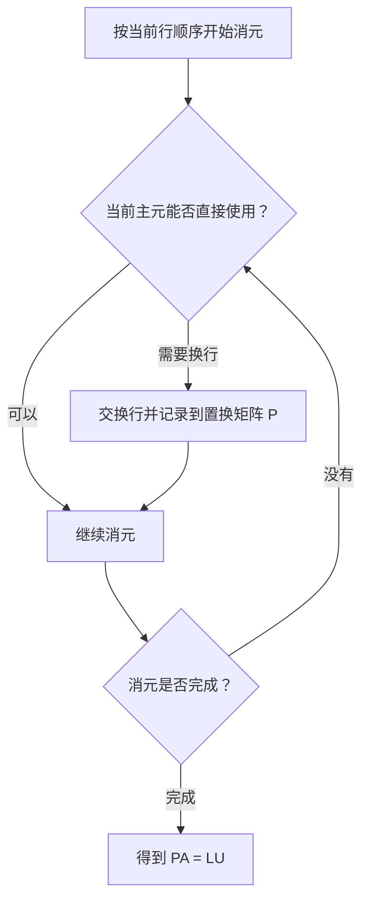

> **编者说明**：图中的“能否直接使用”包含本讲的零主元判断；在浮点运算程序中，还可能包含对主元大小的考虑。这里没有把课堂内容扩展成具体的数值选主元算法。

#### 2.3 置换矩阵是行被重排的单位矩阵

置换矩阵来自单位矩阵的行重排。重排也允许什么都不做，因此单位矩阵本身就是一个置换矩阵。

除了交换两行，还可以做循环置换。例如四行可以按 $1\to2\to3\to4\to1$ 循环，也可以同时交换第 1、2 行和第 3、4 行。它们都是行重排，但重排方式不同。

$n$ 行的排列方式共有：

$$
n!=n(n-1)(n-2)\cdots3\cdot2\cdot1.
$$

因此，$n\times n$ 置换矩阵共有 $n!$ 个。课堂举出的规模对比是：四阶有 $4!=24$ 个，五阶已有 $5!=120$ 个。阶数增加以后，把它们逐个列出来便不再方便。

#### 2.4 为什么置换矩阵的逆等于转置？

所有置换矩阵都可逆，因为行重排可以被撤销。对于置换矩阵，这个撤销操作恰好由转置给出：

$$
\boxed{P^{-1}=P^T},\qquad P^TP=I.
$$

课堂把这个关系解释为：乘法中相应位置的 1 对上 1，最终恢复单位矩阵。转置把“原位置到新位置”的重排方向反过来，恰好回到原先的行顺序。

*⏱ 时间戳：00:09:08 · 📷 板书截图 · [在 B 站观看对应片段 (P5 00:09:08)](https://www.bilibili.com/video/BV1ix411f7Yp/?p=5&t=548)*

Strang 同时提醒：满足“转置乘自身等于单位矩阵”的矩阵，还不止置换矩阵。后续会研究更大的矩阵家族，本讲只先记住置换矩阵的这一性质。

### 3. 转置与对称：行列位置如何交换

*(参考时间: 00:10:12 · [视频跳转 (P5 00:10:12)](https://www.bilibili.com/video/BV1ix411f7Yp/?p=5&t=612))*

#### 3.1 一个矩形矩阵的转置

转置把矩阵的行变成列、列变成行。课堂中的例子是：

$$
A=\begin{pmatrix}
1&3\\
2&3\\
4&1
\end{pmatrix},\qquad
A^T=\begin{pmatrix}
1&2&4\\
3&3&1
\end{pmatrix}.
$$

$A$ 有三行两列，因此 $A^T$ 有两行三列。原来的第一列 $(1,2,4)^T$ 变成转置后的第一行，第二列 $(3,3,1)^T$ 变成第二行。

**转置既改变元素的位置，也交换矩阵的行列数。** 对一个 $m\times n$ 矩阵，转置的形状是 $n\times m$。

*⏱ 时间戳：00:12:32 · 📷 板书截图 · [在 B 站观看对应片段 (P5 00:12:32)](https://www.bilibili.com/video/BV1ix411f7Yp/?p=5&t=752)*

#### 3.2 用下标描述转置

若 $A_{ij}$ 表示 $A$ 的第 $i$ 行、第 $j$ 列元素，则：

$$
\boxed{(A^T)_{ij}=A_{ji}}.
$$

转置后的第 $i$ 行第 $j$ 列，取的是原矩阵第 $j$ 行第 $i$ 列的元素。行号与列号交换；对于方阵，几何上就是关于主对角线翻转。

#### 3.3 对称矩阵：转置后保持不变

一个矩阵若满足：

$$
\boxed{A^T=A},
$$

便称为**对称矩阵**。形状必须相同，所以它必然是方阵；对角线两侧对应的元素要相等。

课堂板书的例子是：

$$
S=\begin{pmatrix}
3&1&7\\
1&2&9\\
7&9&4
\end{pmatrix}.
$$

其中右上角的 7 对应左下角的 7，其他非对角线位置也成对相等。主对角线上的数在转置时留在原位。

*⏱ 时间戳：00:13:50 · 📷 板书截图 · [在 B 站观看对应片段 (P5 00:13:50)](https://www.bilibili.com/video/BV1ix411f7Yp/?p=5&t=830)*

Strang 在这里刻意说明：例子中的数全为正，并不是对称的原因。**对称说的是位置关系，定义只要求转置后不变。**

还应区分两个已经出现的关系：置换矩阵满足 $P^T=P^{-1}$，对称矩阵满足 $A^T=A$。前者的转置给出逆矩阵，后者的转置给回自身。

### 4. 用一个矩形矩阵构造对称矩阵

*(参考时间: 00:14:43 · [视频跳转 (P5 00:14:43)](https://www.bilibili.com/video/BV1ix411f7Yp/?p=5&t=883))*

#### 4.1 不对称的矩阵，也可以产生对称乘积

刚才的矩形矩阵连转置前后的形状都不同，本身当然不对称。但把一个矩阵与它的转置配合起来，可以得到对称矩阵。

在这段板书中，讲师把两行三列的矩阵记作 $R$，把三行两列的矩阵记作 $R^T$：

$$
R=\begin{pmatrix}
1&2&4\\
3&3&1
\end{pmatrix},\qquad
R^T=\begin{pmatrix}
1&3\\
2&3\\
4&1
\end{pmatrix}.
$$

随后计算的是 $R^TR$，其形状为三行三列。这里的字母 $R$ 指两行三列的那一块，读板书时需要留意，不能直接把前一节的三行两列 $A$ 原样代入同一记号。

#### 4.2 先从数值看出对称性

第一行的三个结果是：

$$
1\cdot1+3\cdot3=10,\qquad
1\cdot2+3\cdot3=11,\qquad
1\cdot4+3\cdot1=7.
$$

例如 $(1,2)$ 位置的 11 来自 $(1,3)$ 与 $(2,3)$ 的内积；$(2,1)$ 位置则把这两个向量的角色交换，结果依旧是 11。右上角的 7 与左下角的 7 也有相同的对应关系。

*⏱ 时间戳：00:17:08 · 📷 板书截图 · [在 B 站观看对应片段 (P5 00:17:08)](https://www.bilibili.com/video/BV1ix411f7Yp/?p=5&t=1028)*

> **编者说明**：下面补齐同一矩阵乘法的所有条目，便于检查板书推导；没有更换课堂例子。

$$
R^TR=
\begin{pmatrix}
10&11&7\\
11&13&11\\
7&11&17
\end{pmatrix}.
$$

这些成对相等的数不是巧合。它们来自相同分量乘积的相加，只是两列的先后顺序交换了。

#### 4.3 再用转置规则给出一般证明

要证明一个矩阵对称，最直接的办法就是：**对它取转置，检查是否回到自身。**

转置有两个规则：

$$
(AB)^T=B^TA^T,\qquad (A^T)^T=A.
$$

第一个规则要求乘积的顺序反过来，正如前几讲已经见过的乘积求逆规则。现在将它用到 $R^TR$ 上：

$$
(R^TR)^T
=R^T(R^T)^T
=R^TR.
$$

因此，对于任意实矩阵 $R$，无论它是否是方阵，$R^TR$ 都是对称矩阵。这个两行证明把前面的数值观察推广到了一般情形。

*⏱ 时间戳：00:19:30 · 📷 板书截图 · [在 B 站观看对应片段 (P5 00:19:30)](https://www.bilibili.com/video/BV1ix411f7Yp/?p=5&t=1170)*

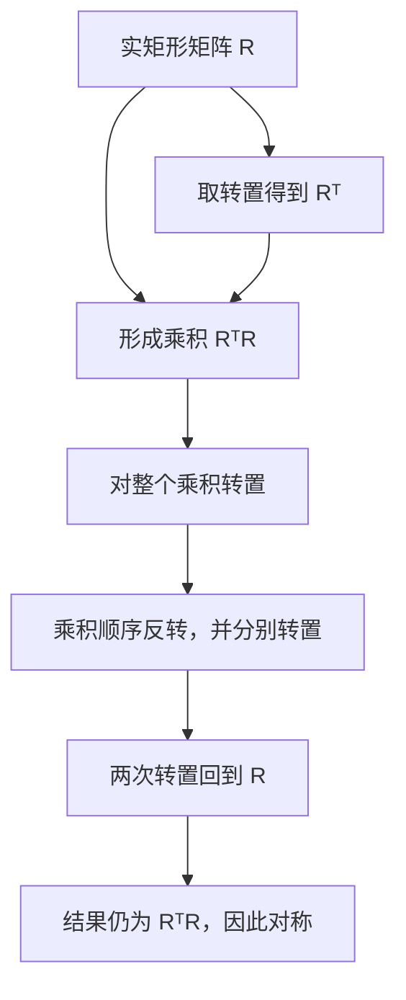

课堂到此结束置换、转置和对称性的讨论。接下来开始研究由许多向量组成的空间。

### 5. 向量空间：允许所有线性组合

*(参考时间: 00:20:17 · [视频跳转 (P5 00:20:17)](https://www.bilibili.com/video/BV1ix411f7Yp/?p=5&t=1217))*

#### 5.1 “空间”不能只是随意收集的一堆向量

对向量最基本的操作有两个：

1. 把两个向量相加，例如 $v+w$。
2. 把一个向量乘以一个数，例如 $3v$。

这些数通常称为**标量**，第二种操作称为**数乘**。如果要把一个向量集合称为向量空间，就必须能在其中进行加法和数乘，并让运算结果继续留在这个集合中。

把两种操作合在一起，就是取线性组合：

$$
cv+dw.
$$

这里 $c,d$ 可以是任意实数。“空间”之所以比“几个向量”更有内容，正是因为它要容纳这些向量能生成的所有线性组合。

#### 5.2 最熟悉的例子：二维实向量空间

$\mathbb R^2$ 表示由所有二分量实向量组成的集合。课堂列出的例子是：

$$
\begin{pmatrix}3\\2\end{pmatrix},\qquad
\begin{pmatrix}0\\0\end{pmatrix},\qquad
\begin{pmatrix}\pi\\e\end{pmatrix}.
$$

这里的 $\mathbb R$ 表示分量为实数，上标“2”表示每个向量恰好有两个分量。它包含的向量有无穷多个，列出这几个例子只是为了确认对象是什么。

加法按分量进行。例如：

$$
\begin{pmatrix}3\\2\end{pmatrix}
+\begin{pmatrix}\pi\\e\end{pmatrix}
=\begin{pmatrix}3+\pi\\2+e\end{pmatrix}.
$$

相加后依然是二分量实向量，所以仍在 $\mathbb R^2$ 中。任意实数数乘也具有同样的性质。

几何上，可以从原点向点 $(3,2)$ 画一根箭头表示第一个向量：横向走 3，纵向走 2。向量 $(\pi,e)$ 也能画在同一平面上。零向量位于原点，虽然没有可见长度的箭头，却是一个十分重要的向量。

*⏱ 时间戳：00:24:58 · 📷 板书截图 · [在 B 站观看对应片段 (P5 00:24:58)](https://www.bilibili.com/video/BV1ix411f7Yp/?p=5&t=1498)*

因此，通常说 $\mathbb R^2$ 是 $xy$ 平面；从代数角度说，它是能容纳所有二分量实向量及其线性组合的向量空间。

#### 5.3 为什么不能从空间里删掉原点？

假如把 $\mathbb R^2$ 的原点挖掉，只留下其他向量，这个集合就不再是向量空间。

首先，只要 $(3,2)^T$ 留在集合里，数乘就必须允许它乘以零：

$$
0\begin{pmatrix}3\\2\end{pmatrix}
=\begin{pmatrix}0\\0\end{pmatrix}.
$$

如果零向量被删掉，这次合法运算的结果就跑到了集合之外。其次，一个向量与其相反向量相加，也会得到零：

$$
\begin{pmatrix}3\\2\end{pmatrix}
+\begin{pmatrix}-3\\-2\end{pmatrix}
=\begin{pmatrix}0\\0\end{pmatrix}.
$$

无论从数乘还是加法看，都不能去掉它。**每个向量空间都必须包含零向量。**

#### 5.4 三维与更高维：看分量个数，不看非零个数

$\mathbb R^3$ 是所有三分量实向量组成的空间。课堂特意问：

$$
\begin{pmatrix}3\\2\\0\end{pmatrix}
$$

属于 $\mathbb R^2$ 还是 $\mathbb R^3$？答案是 $\mathbb R^3$。它有三个分量，最后一个恰好是零；零仍然是一个合法的分量，不能把它当作“没有这个分量”。

*⏱ 时间戳：00:27:40 · 📷 板书截图 · [在 B 站观看对应片段 (P5 00:27:40)](https://www.bilibili.com/video/BV1ix411f7Yp/?p=5&t=1660)*

一般地，$\mathbb R^n$ 包含所有有 $n$ 个实分量的向量。本课程统一把它们写成列向量；复数与复向量会在后面讨论，本讲的标量和分量均取实数。

Strang 提到，向量空间的加法与数乘还要满足教材列出的八条规则。他没有在这里逐条展开，因为我们沿用熟悉的分量运算时，那些规则已经成立。当前真正需要检查的是：**在所选集合内做运算，结果是否仍在这个集合内？**

### 6. 封闭性：用反例识别一个“不是空间”的集合

*(参考时间: 00:29:51 · [视频跳转 (P5 00:29:51)](https://www.bilibili.com/video/BV1ix411f7Yp/?p=5&t=1791))*

#### 6.1 第一象限为什么不够？

从 $\mathbb R^2$ 中只取第一象限及其边界，也就是两个分量都非负的向量：

$$
Q=\left\{\begin{pmatrix}x\\y\end{pmatrix}:x\geq0,\ y\geq0\right\}.
$$

这个集合对加法表现很好。课堂把 $(3,2)^T$ 与 $(5,6)^T$ 相加，仍然留在第一象限：

$$
\begin{pmatrix}3\\2\end{pmatrix}
+\begin{pmatrix}5\\6\end{pmatrix}
=\begin{pmatrix}8\\8\end{pmatrix}.
$$

问题出在数乘。允许乘以任意实数，就必须允许负数，例如课堂使用的 $-5$：

$$
-5\begin{pmatrix}3\\2\end{pmatrix}
=\begin{pmatrix}-15\\-10\end{pmatrix}.
$$

结果进入第三象限，已经不在 $Q$ 中。因此，$Q$ **对加法封闭，却不对任意实数数乘封闭**，不能构成向量空间。

*⏱ 时间戳：00:31:13 · 📷 板书截图 · [在 B 站观看对应片段 (P5 00:31:13)](https://www.bilibili.com/video/BV1ix411f7Yp/?p=5&t=1873)*

“封闭”在这里的含义很具体：在集合内选取运算对象，完成允许的运算后，结果仍在集合内。它说的是对这些代数运算封闭。

#### 6.2 一次成功的运算，不能证明封闭

要证明加法封闭，必须让集合内**任意两个**向量的和都留在集合内；要证明数乘封闭，必须允许**任意实数**，包括零和负数。

第一象限的反例说明：只看到几次加法成功，或只检验正数倍，不足以证明一个集合是向量空间。相反，找到一个允许的运算让结果越界，就足以否定对应的封闭性。

把加法与数乘同时要求，可以写成：对所有 $v,w$ 在集合内、所有实数 $c,d$，都有 $cv+dw$ 留在集合内。

### 7. 子空间：包含一个向量，就必须容纳它的所有倍数

*(参考时间: 00:31:31 · [视频跳转 (P5 00:31:31)](https://www.bilibili.com/video/BV1ix411f7Yp/?p=5&t=1891))*

#### 7.1 子空间是大空间里面仍能成立的小空间

第一象限是一个失败的“取部分”例子。接下来要找一种成功的取法：从 $\mathbb R^2$ 中取一个较小集合，却仍然可以相加、数乘，而且不会离开这个集合。

这样的集合，本身就是向量空间，同时包含在 $\mathbb R^2$ 里，称为 $\mathbb R^2$ 的**子空间**。

不要把“子空间”理解成任意一块区域。它必须沿用大空间的运算，并且在这些运算下保持封闭。

#### 7.2 一个非零向量会带出一整条直线

假设一个子空间包含非零向量 $v$。数乘封闭就要求它还包含：

$$
2v,\quad 0v,\quad \tfrac12v,\quad \tfrac34v,\quad -\tfrac12v,\quad -v,
$$

以及所有其他实数倍。几何上，这些倍数填满一条经过原点的完整直线：正方向、负方向，以及原点都不能漏掉。

因此，不能只把一根向量箭头、一个有限线段或一条单向射线叫作这条直线子空间。任意实数倍要求直线向两个方向无限延伸。

接下来还要检查加法。若两个向量都在这条直线上，可以分别写成 $cv$ 与 $dv$，那么：

$$
cv+dv=(c+d)v,
$$

结果依然在同一条直线上。这样，数乘与加法都通过了检查，过原点的整条直线便确实是一个子空间。

#### 7.3 为什么平移后的直线不行？

课堂在图中另画了一条不经过原点的虚线。虽然它也是一条直线，却不能成为子空间：取线上任何一个向量，乘以零，得到原点；原点并不在这条虚线上。

*⏱ 时间戳：00:35:41 · 📷 板书截图 · [在 B 站观看对应片段 (P5 00:35:41)](https://www.bilibili.com/video/BV1ix411f7Yp/?p=5&t=2141)*

这里有一个十分有效的快速检查：**任何子空间都必须包含零向量。**

> **编者说明**：包含零向量是必要条件，单独通过这项检查还不够。上一节的第一象限包含零向量，仍然因负数数乘而失败。判断 $\mathbb R^n$ 内的子空间时，还要检查加法与任意实数数乘的封闭性；其他向量空间规则由原有分量运算继承。

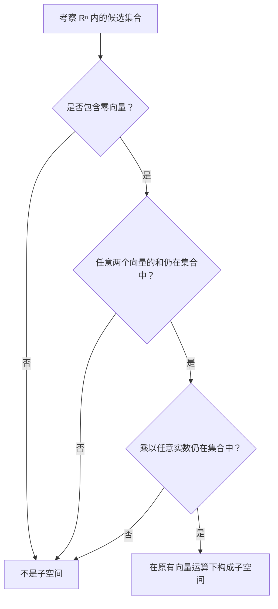

> **编者说明**：此图将课堂判断子空间的思路整理为检查步骤。前提是候选集合位于已有向量空间中，并使用同一套向量运算。

### 8. 二维与三维空间的子空间全景

*(参考时间: 00:35:48 · [视频跳转 (P5 00:35:48)](https://www.bilibili.com/video/BV1ix411f7Yp/?p=5&t=2148))*

#### 8.1 二维只有三类形状

$\mathbb R^2$ 的子空间分成三类：

| 类型 | 集合是什么 | 为什么运算不会越界 |
| --- | --- | --- |
| 整个 $\mathbb R^2$ | 所有二分量实向量 | 加法和数乘仍产生二分量实向量 |
| 过原点的直线 | 一个非零向量的所有实数倍 | 倍数相加仍是倍数，数乘也仍是倍数 |
| 零子空间 $\{0\}$ | 只有零向量 | 零加零仍为零，任何数乘零仍为零 |

最大的一类是整个空间本身。子空间允许等于原空间，“子”不强制要求它一定更小。最小的一类则只包含零向量；它不是空集，而是确实有一个向量。

Strang 用十分直接的例子说明零子空间：把零向量与自己相加，仍得到零；乘以 17，也仍得到零。所要求的两种运算都没有离开这个单点集合。

*⏱ 时间戳：00:38:50 · 📷 板书截图 · [在 B 站观看对应片段 (P5 00:38:50)](https://www.bilibili.com/video/BV1ix411f7Yp/?p=5&t=2330)*

#### 8.2 平面中的一条直线与一分量空间

过原点的直线看起来像 $\mathbb R^1$：沿一个方向前后移动，就可以遍历它。但 Strang 特意指出，两者不能直接当作同一个集合。

这条直线位于 $\mathbb R^2$ 中，其向量有两个分量。$\mathbb R^1$ 的向量则只有一个分量。几何形状相近，不表示向量的表示方式、所处的空间完全相同。

这与 $(3,2,0)^T$ 的例子呼应：不要因为能沿较少方向移动，或某个分量等于零，就把向量的分量数删掉。

#### 8.3 三维多出一类：过原点的平面

$\mathbb R^3$ 中对应的四类子空间是：

1. 整个 $\mathbb R^3$。
2. 任意经过原点的平面。
3. 任意经过原点的直线。
4. 只含 $(0,0,0)^T$ 的零子空间。

*⏱ 时间戳：00:39:36 · 📷 板书截图 · [在 B 站观看对应片段 (P5 00:39:36)](https://www.bilibili.com/video/BV1ix411f7Yp/?p=5&t=2376)*

两端仍然是“整个空间”和“零子空间”，中间则是不同大小的过原点线性集合。二维、三维可以画图；理解这些图像以后，才有办法继续处理无法直接画出的高维空间。

### 9. 列空间：从矩阵的列生成一个完整子空间

*(参考时间: 00:39:47 · [视频跳转 (P5 00:39:47)](https://www.bilibili.com/video/BV1ix411f7Yp/?p=5&t=2387))*

#### 9.1 两列向量还不是一个空间

讲师回到前面已经使用的矩阵，把它重新记为 $A$：

$$
A=\begin{pmatrix}
1&3\\
2&3\\
4&1
\end{pmatrix}.
$$

它的两列分别是：

$$
a_1=\begin{pmatrix}1\\2\\4\end{pmatrix},\qquad
a_2=\begin{pmatrix}3\\3\\1\end{pmatrix}.
$$

两列都是 $\mathbb R^3$ 中的向量。如果只把这两列放进一个集合，就还不能叫它子空间，因为做加法或数乘会产生新向量，而这些新向量必须被容纳进去。

例如，它必须包含零向量，也必须包含课堂明确提到的两列之和：

$$
a_1+a_2=\begin{pmatrix}4\\5\\5\end{pmatrix}.
$$

它还必须包含“一列加另一列的三倍”，以及所有其他实数倍相加的结果。不断补齐这些运算结果，要求的其实是一件事：**取这两列的所有线性组合。**

#### 9.2 列空间的定义

由矩阵各列的所有线性组合组成的集合，称为矩阵的**列空间**，课堂记作 $C(A)$：

$$
\boxed{C(A)=\{c_1a_1+c_2a_2:\ c_1,c_2\in\mathbb R\}}.
$$

对于有更多列的矩阵，同样把全部列纳入线性组合，系数可以是任意实数。列空间的对象仍然是向量，它们的分量数由矩阵的行数决定。

*⏱ 时间戳：00:42:55 · 📷 板书截图 · [在 B 站观看对应片段 (P5 00:42:55)](https://www.bilibili.com/video/BV1ix411f7Yp/?p=5&t=2575)*

为什么取所有线性组合以后，就能保证是子空间？课堂的理由是：所需要的加法和数乘结果已经全部包括在内。

> **编者说明**：将这个理由写成系数式，可以更容易检查“所有”的作用。

若：

$$
u=c_1a_1+c_2a_2,\qquad
w=d_1a_1+d_2a_2,
$$

则它们的和是：

$$
u+w=(c_1+d_1)a_1+(c_2+d_2)a_2,
$$

仍然是这两列的线性组合。对任意实数 $t$：

$$
tu=(tc_1)a_1+(tc_2)a_2,
$$

也仍然在这个集合里。把所有系数取成零，零向量自然包含在内。

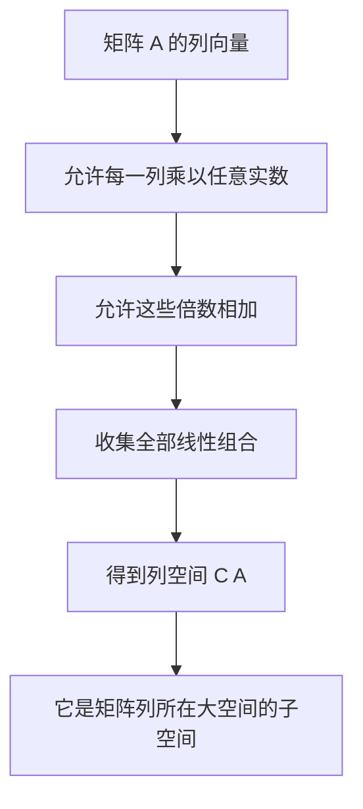

#### 9.3 这两列在三维中填满一个平面

在 $\mathbb R^3$ 中画出 $a_1$ 和 $a_2$，两者并不在同一条过原点的直线上。先允许各自的所有倍数，就得到两条直线；再允许从两条线上各取一个向量相加，就会填满它们之间的全部组合。

最终形成的是**一个经过原点的平面**。它包含这两列、两列之和、零向量，以及一切其他线性组合；但它没有填满整个 $\mathbb R^3$。

*⏱ 时间戳：00:45:19 · 📷 板书截图 · [在 B 站观看对应片段 (P5 00:45:19)](https://www.bilibili.com/video/BV1ix411f7Yp/?p=5&t=2719)*

Strang 强调，这个图像必须真正理解：列空间不是“矩阵里已有的两根箭头”，而是由它们的所有组合生成的整张平面。

如果两列恰好位于同一条过原点的直线上，它们的组合就只能填满那条直线。本例得到平面，是因为两列指向不同的方向。空间的形状取决于列向量之间的关系，不是简单由列的数量决定。

#### 9.4 五个十维向量，也不变成五分量向量

课堂接着把问题推向高维：如果有五个 $\mathbb R^{10}$ 中的向量，每个都有十个分量，对它们取所有线性组合，会得到什么？

可以确定的是：结果仍是十个分量的向量，所以这是 $\mathbb R^{10}$ 的一个子空间，不能因为参与组合的向量有五个，就说它变成了 $\mathbb R^5$。

如果它们提供五个独立方向，会得到一个五维的“平坦集合”，而且一定经过原点。但如果这五个向量全都位于同一条直线上，所有组合仍只能得到那条直线。实际情况取决于这五个向量本身。

这个高维例子再次提醒我们区分三件事：

| 信息 | 它决定或约束什么 | 课堂例子 |
| --- | --- | --- |
| 每个向量的分量数 | 向量所在的大空间 | 十分量向量属于 $\mathbb R^{10}$ |
| 拿来组合的向量个数 | 可供组合的生成向量有多少 | 五个十维向量 |
| 向量之间的方向关系 | 所生成子空间的实际大小 | 全部共线时只得到一条直线 |

#### 9.5 下一讲要用这个语言重新理解方程

本讲在列空间处收束，下一讲将重新考察：

$$
Ax=b.
$$

现在不只把它看作逐行列出的方程，也准备把它看作“矩阵列的线性组合是否能达到 $b$”的问题。

> **编者说明**：对于本例，令 $x=(x_1,x_2)^T$，矩阵乘法给出 $Ax=x_1a_1+x_2a_2$。因此，“能找到 $x$ 使 $Ax=b$”等价于“$b$ 位于 $C(A)$ 中”。这是本讲末尾预告的自然展开，完整讨论留待后续的列空间、零空间与解的结构。

### 10. 读后检查：把运算、集合与几何连起来

> **编者说明**：以下问题及答案用于复习，是根据本讲内容整理的学习辅助，不是讲师另行布置的课堂习题。

#### 10.1 五个检查问题

**问题 1：可逆矩阵消元时遇到零主元，应该怎样理解？**

当前行顺序不适合直接继续消元，可以通过换行得到非零主元。记录换行以后，分解写成 $PA=LU$；不能仅凭这个零主元，就断言矩阵不可逆。

**问题 2：转置为什么不能只理解为“形状变了”？**

除了把 $m\times n$ 变为 $n\times m$，它还要求每个元素由 $(i,j)$ 移到 $(j,i)$。形状与元素位置两者必须同时正确。

**问题 3：第一象限里包含零向量，也能做加法，为什么仍不是子空间？**

因为数乘要允许所有实数。正向量乘以负数会离开第一象限，所以数乘封闭性失败。

**问题 4：只有零向量的集合，是否太小而不能叫空间？**

可以叫零子空间。零向量相加、数乘都仍为零；集合虽小，却完整满足运算封闭的要求。

**问题 5：一个三行两列矩阵的列空间一定是整个三维空间吗？**

不是。本讲的两列生成一个过原点的平面；如果两列共线，就只能生成直线。列向量有三个分量，说明列空间位于 $\mathbb R^3$ 中，并不说明它等于整个 $\mathbb R^3$。

#### 10.2 术语对照

| 中文 | 英文 | 在本讲中的含义 |
| --- | --- | --- |
| 置换矩阵 | permutation matrix | 单位矩阵行重排后得到的矩阵 |
| 主元 | pivot | 消元时使用的关键位置元素 |
| 转置 | transpose | 交换行列位置 |
| 对称矩阵 | symmetric matrix | 转置后不变的矩阵 |
| 标量、数乘 | scalar, scalar multiplication | 实数及其对向量的乘法 |
| 线性组合 | linear combination | 向量的实数倍相加 |
| 封闭性 | closure | 做允许的运算后仍在所选集合中 |
| 向量空间 | vector space | 支持向量加法和数乘并满足相应规则的集合 |
| 子空间 | subspace | 位于已有向量空间内部、使用相同运算的向量空间 |
| 列空间 | column space | 矩阵所有列的全部线性组合组成的空间 |

### 附：官方参考与延伸阅读

下面的资源均对应本讲内容，便于回到原始材料核对。

1. [MIT OCW：18.06 Linear Algebra，Spring 2010 课程主页](https://ocw.mit.edu/courses/18-06-linear-algebra-spring-2010/)——课程信息、视频与其他学习材料。
2. [Lecture 5: Transposes, permutations, spaces Rⁿ](https://ocw.mit.edu/courses/18-06-linear-algebra-spring-2010/resources/lecture-5-transposes-permutations-spaces-r-n/)——本讲官方视频页及英文字幕，正文翻译重构的主要依据。
3. [第 5 讲官方字幕 VTT](https://ocw.mit.edu/courses/18-06-linear-algebra-spring-2010/eb5a7fe66ff6537aac15662f73d424b7_JibVXBElKL0.vtt)——包含原始时码；本地也保存有 `transcript.official.vtt`、`transcript.json` 与逐段 `transcript.txt`。
4. [18.06SC：Transposes, Permutations, Vector Spaces](https://ocw.mit.edu/courses/18-06sc-linear-algebra-fall-2011/pages/ax-b-and-the-four-subspaces/transposes-permutations-vector-spaces/)——同主题官方学习单元，附讲义、习题与习题讲解；用于核对术语与矩阵例子。
5. [官方 lecture summary PDF](https://ocw.mit.edu/courses/18-06sc-linear-algebra-fall-2011/33b21afab62ea8df6c7bd241240df60d_MIT18_06SCF11_Ses1.5sum.pdf)——置换、转置、向量空间、封闭性、子空间与列空间的摘要。
6. [MIT OCW 官方 YouTube 同一讲](https://www.youtube.com/watch?v=JibVXBElKL0)——本讲另一官方播放来源。本书的截图和视频回链仍指向用户指定的 B 站第 5 P。

**作者署名与改编说明**：原课程授课者为 Gilbert Strang，课程资料由 MIT OpenCourseWare 发布；本书对同一讲官方字幕进行中文翻译、结构化改编，并参照官方摘要核对符号。官方文字材料与相关改编遵循 [Creative Commons Attribution–NonCommercial–ShareAlike 4.0（CC BY-NC-SA 4.0）](https://creativecommons.org/licenses/by-nc-sa/4.0/)。请保留出处、署名、许可链接及改编说明。

---

