> **主讲**：Gilbert Strang 教授 · 麻省理工学院（MIT）  
> **出品**：VideoBook 视频开源技术电子书流水线  
> **全书规模**：全 35 讲完整精编 · 5 大知识体系模块 · 357 张原生高清板书实录 · 260 处核心推导时间戳  
> **视频原源**：[Bilibili 官方全套合集（BV1ix411f7Yp）](https://www.bilibili.com/video/BV1ix411f7Yp/) · [MIT OpenCourseWare 18.06 (Spring 2010)](https://ocw.mit.edu/courses/18-06-linear-algebra-spring-2010/)  
> **版权与许可**：本书文字内容与公式图解由 MIT OCW 开放课程资料翻译整理与结构化改编，授课者 Gilbert Strang，遵循 [CC BY-NC-SA 4.0](https://creativecommons.org/licenses/by-nc-sa/4.0/) 知识共享许可协议。全书板书截帧源自官方公开课录像。

---

> 📚 **模块导语**：跨越初等代数门槛，构建抽象向量空间与子空间理论；系统求解齐次方程 $Ax=0$ 与特解、完全解 $x = x_p + x_n$；奠定全书核心理论支柱——矩阵的“四个基本子空间”（列空间、零空间、行空间、左零空间）与线性代数基本定理；并将理论拓展至矩阵空间、关联矩阵与图网络拓扑分析。

---

## 第 6 讲：列空间和零空间

> 📺 **视频回链**：[B 站第 6 P：列空间和零空间](https://www.bilibili.com/video/BV1ix411f7Yp/?p=6)（⏱ 45分58秒 · 10 截图）  
> 📖 **官方材料**：[MIT OCW 对应讲义与总结](https://ocw.mit.edu/courses/18-06-linear-algebra-spring-2010/resources/lecture-6-column-space-and-nullspace/)  
> 💡 **核心精要**：向量空间公理、R³子空间形态、交集与并集定理、Ax=b 可解性定理、零空间是子空间的严格证明。

---

### 1. 向量空间的核心本质：线性组合的封闭性

*(参考时间: 00:01:00 · [视频跳转 (P6 00:01:00)](https://www.bilibili.com/video/BV1ix411f7Yp/?p=6&t=60))*

在上一讲（第 5 讲）末尾，我们正式踏入了线性代数的心脏地带——**向量空间（Vector Space）**与**子空间（Subspace）**。从这一讲开始，我们的思维方式必须发生关键跃迁：不再仅仅关注单个向量或具体的数值计算，而是将**整个向量集合**作为一个整体来考察。

什么是向量空间？粗略地讲，向量空间是由一组向量构成的集合，在这个集合内部，我们允许进行两种最基本的代数运算：
1. **向量加法**：集合中任意两个向量相加，结果仍然属于该集合；
2. **数乘运算**：集合中任意向量乘以任意实数标量，结果仍然属于该集合。

将这两条法则合二为一，就是**线性组合的封闭性**：

$$
\forall v, w \in V, \quad \forall c, d \in \mathbb{R} \implies cv + dw \in V
$$

只要一个集合对任意实数线性组合保持封闭，并且满足八条标准的代数公理（加法交换律、结合律、存在零向量、存在加法逆元等），它就是一个合法的实向量空间。

*⏱ 时间戳：00:03:10 · 📷 板书截图 · [在 B 站观看对应片段 (P6 00:03:10)](https://www.bilibili.com/video/BV1ix411f7Yp/?p=6&t=190)*

> [!NOTE] 零向量的必然存在性
> 由于数乘封闭性对任意标量成立，我们令标量 $c = 0$，则 $0 \cdot v = \mathbf{0}$。这意味着：**任何一个向量空间或子空间，都必须无条件包含零向量 $\mathbf{0}$！**

---

### 2. $\mathbb{R}^3$ 的所有可能子空间

*(参考时间: 00:03:30 · [视频跳转 (P6 00:03:30)](https://www.bilibili.com/video/BV1ix411f7Yp/?p=6&t=210))*

一个向量空间 $V$ 的**子空间（Subspace）**，是指位于 $V$ 内部的一个子集，该子集本身在原空间的加法和数乘运算下仍然构成一个独立的向量空间。

为了建立直观图景，我们考察三维实欧氏空间 $\mathbb{R}^3$。在 $\mathbb{R}^3$ 内部，都有哪些几何对象能够构成合法的子空间？

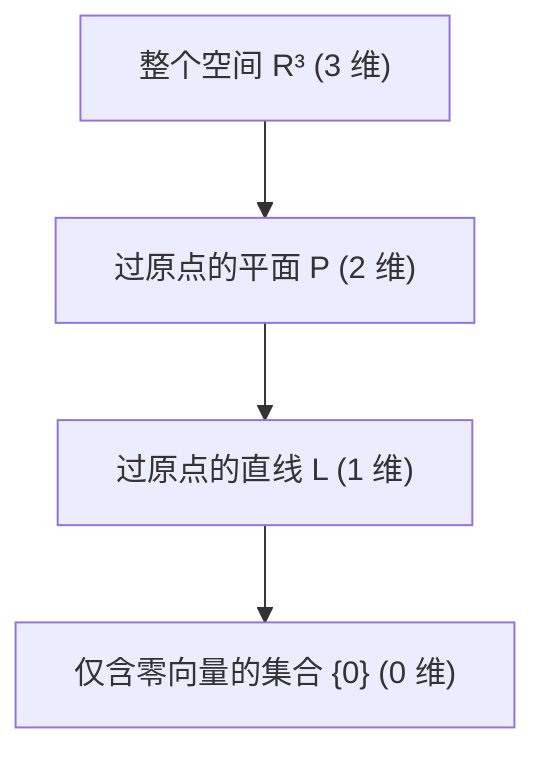

Strang 教授在黑板上完整列举了 $\mathbb{R}^3$ 中的全部子空间类型：

1. **整个空间 $\mathbb{R}^3$ 自身**：任何两个三维向量相加仍是三维向量，任何数乘仍在 $\mathbb{R}^3$ 中，显然是子空间。
2. **所有穿过原点 $(0, 0, 0)$ 的平面 $P$**：
   - 如果一个平面不穿过原点，它就不包含零向量，因此绝对不是子空间！
   - 如果平面穿过原点，在该平面上任取两向量相加，由平行四边形法则，它们的和依然躺在该平面内；任意拉伸或反向缩放，也绝不可能飞出该平面。
3. **所有穿过原点 $(0, 0, 0)$ 的直线 $L$**：
   - 沿该直线的向量无论如何缩放或与同直线向量相加，结果始终停留在此直线上。
4. **仅包含零向量的平凡子空间 $\mathbf{Z} = \{\mathbf{0}\}$**：
   - 检验封闭性：$\mathbf{0} + \mathbf{0} = \mathbf{0}$，$c \cdot \mathbf{0} = \mathbf{0}$。它是维数最低的零维子空间。

*⏱ 时间戳：00:06:40 · 📷 板书截图 · [在 B 站观看对应片段 (P6 00:06:40)](https://www.bilibili.com/video/BV1ix411f7Yp/?p=6&t=400)*

---

### 3. 子空间的代数运算：并集与交集

*(参考时间: 00:06:30 · [视频跳转 (P6 00:06:30)](https://www.bilibili.com/video/BV1ix411f7Yp/?p=6&t=390))*

假设我们在同一个母空间（例如 $\mathbb{R}^3$）中有两个合法的子空间 $S_1$ 与 $S_2$。我们来考察集合运算能否产生新的子空间：

#### 3.1 两个子空间的并集 $S_1 \cup S_2$ 通常不是子空间

考虑穿过原点的两条不同直线 $L_1$ 与 $L_2$。它们的并集 $L_1 \cup L_2$ 表示这两条直线上所有点的集合。
- 在 $L_1$ 上取一个非零向量 $v$；
- 在 $L_2$ 上取一个非零向量 $w$；
- 它们的和 $v + w$ 将落在两直线所张成的平行四边形对角线上，既不在 $L_1$ 上，也不在 $L_2$ 上！
- 因此，$v + w \notin L_1 \cup L_2$。并集对加法不封闭，**通常不是子空间**。

#### 3.2 两个子空间的交集 $S_1 \cap S_2$ 必定是子空间

假设平面 $P$ 和直线 $L$ 是 $\mathbb{R}^3$ 中的两个子空间，考察它们的交集 $P \cap L$：
- 如果直线 $L$ 不在平面 $P$ 内，由于二者都必经原点，它们至少且仅相交于唯一的零向量 $\mathbf{0}$，交集为 $\{\mathbf{0}\}$，是合法子空间。
- 如果直线 $L$ 恰好落在平面 $P$ 内，则交集就是直线 $L$ 本身，也是合法子空间。
- 两个平面的交集则通常是一条穿过原点的直线，依然是子空间！

*⏱ 时间戳：00:09:20 · 📷 板书截图 · [在 B 站观看对应片段 (P6 00:09:20)](https://www.bilibili.com/video/BV1ix411f7Yp/?p=6&t=560)*

> [!IMPORTANT] 交集定理的严格代数证明
> 设 $S$ 与 $T$ 是向量空间 $V$ 的两个子空间，任取 $v, w \in S \cap T$ 与标量 $c, d$：
> 1. 因为 $v, w \in S$，且 $S$ 是子空间，所以 $cv + dw \in S$；
> 2. 因为 $v, w \in T$，且 $T$ 是子空间，所以 $cv + dw \in T$；
> 3. 从而 $cv + dw \in S \cap T$。
> 证毕！由此可见，**任意多个子空间的交集永远是子空间**。

---

### 4. 矩阵的列空间（Column Space, $C(A)$）

*(参考时间: 00:10:00 · [视频跳转 (P6 00:10:00)](https://www.bilibili.com/video/BV1ix411f7Yp/?p=6&t=600))*

现在，我们把目光从几何抽象转向矩阵本身。给定一个 $m \times n$ 矩阵 $A$，它的列向量属于 $\mathbb{R}^m$。

考虑 Strang 教授给出的经典示例矩阵：

$$
A = \begin{bmatrix}
1 & 1 & 2 \\
2 & 1 & 3 \\
3 & 1 & 4 \\
4 & 1 & 5
\end{bmatrix}
$$

这是一个 $4 \times 3$ 矩阵（4 行 3 列）：
- 每个列向量有 4 个分量，是四维空间 $\mathbb{R}^4$ 中的向量。
- 三个列向量分别为：
  $$
  c_1 = \begin{bmatrix} 1 \\ 2 \\ 3 \\ 4 \end{bmatrix}, \quad
  c_2 = \begin{bmatrix} 1 \\ 1 \\ 1 \\ 1 \end{bmatrix}, \quad
  c_3 = \begin{bmatrix} 2 \\ 3 \\ 4 \\ 5 \end{bmatrix}
  $$

*⏱ 时间戳：00:12:30 · 📷 板书截图 · [在 B 站观看对应片段 (P6 00:12:30)](https://www.bilibili.com/video/BV1ix411f7Yp/?p=6&t=750)*

#### 4.1 列空间的严格定义

> **定义：列空间 $C(A)$**  
> 矩阵 $A$ 的列空间记作 $C(A)$，它是由 $A$ 的所有列向量的所有线性组合张成（span）的集合：
> $$
> C(A) = \left\{ x_1 c_1 + x_2 c_2 + \cdots + x_n c_n \ \middle|\ x_i \in \mathbb{R} \right\} = \left\{ Ax \ \middle|\ x \in \mathbb{R}^n \right\}
> $$
> 因为列向量都属于 $\mathbb{R}^m$，所以 **$C(A)$ 是 $\mathbb{R}^m$ 的一个子空间**。

在本例中，$C(A)$ 是四维空间 $\mathbb{R}^4$ 的一个子空间。

---

### 5. 线性方程组 $Ax = b$ 的可解性本质

*(参考时间: 00:16:30 · [视频跳转 (P6 00:16:30)](https://www.bilibili.com/video/BV1ix411f7Yp/?p=6&t=990))*

列空间为什么至关重要？因为它直接彻底地回答了线性代数的核心问题：**对于怎样的右端项 $b$，方程组 $Ax = b$ 才有解？**

根据矩阵与向量相乘的列组合法则：

$$
Ax = x_1 \begin{bmatrix} 1 \\ 2 \\ 3 \\ 4 \end{bmatrix} + x_2 \begin{bmatrix} 1 \\ 1 \\ 1 \\ 1 \end{bmatrix} + x_3 \begin{bmatrix} 2 \\ 3 \\ 4 \\ 5 \end{bmatrix} = \begin{bmatrix} b_1 \\ b_2 \\ b_3 \\ b_4 \end{bmatrix} = b
$$

方程有解意味着：我们能找到一组系数 $x_1, x_2, x_3$，使得这三列的线性组合恰好等于 $b$。

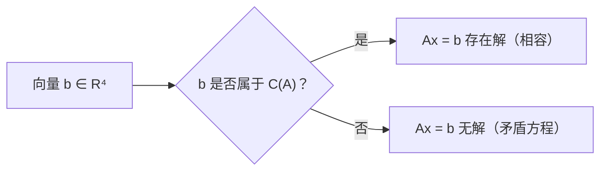

*⏱ 时间戳：00:18:20 · 📷 板书截图 · [在 B 站观看对应片段 (P6 00:18:20)](https://www.bilibili.com/video/BV1ix411f7Yp/?p=6&t=1100)*

> [!IMPORTANT] 线性代数基本判定准则
> **线性方程组 $Ax = b$ 可解（有解），当且仅当右端项向量 $b$ 位于系数矩阵 $A$ 的列空间 $C(A)$ 之中。**

#### 5.1 本例列空间的真实维数

仔细观察这三个列向量：
$$
c_3 = \begin{bmatrix} 2 \\ 3 \\ 4 \\ 5 \end{bmatrix} = \begin{bmatrix} 1 \\ 2 \\ 3 \\ 4 \end{bmatrix} + \begin{bmatrix} 1 \\ 1 \\ 1 \\ 1 \end{bmatrix} = c_1 + c_2
$$

第三列完全是前两列相加得来的！它没有为列空间带来任何新的方向：
- 仅用前两列，就能张成与三列完全相同的空间；
- 前两列彼此不共线（线性无关）；
- 因此，$C(A)$ 是一个嵌入在四维欧氏空间 $\mathbb{R}^4$ 中的**二维超平面**。

*⏱ 时间戳：00:24:10 · 📷 板书截图 · [在 B 站观看对应片段 (P6 00:24:10)](https://www.bilibili.com/video/BV1ix411f7Yp/?p=6&t=1450)*

---

### 6. 矩阵的零空间（Nullspace, $N(A)$）

*(参考时间: 00:28:40 · [视频跳转 (P6 00:28:40)](https://www.bilibili.com/video/BV1ix411f7Yp/?p=6&t=1720))*

现在我们介绍与列空间并驾齐驱的第二个至关重要的子空间——**零空间（Nullspace）**。

#### 6.1 零空间的定义

> **定义：零空间 $N(A)$**  
> 矩阵 $A$ 的零空间记作 $N(A)$，它是齐次线性方程组 $Ax = 0$ 的所有解向量 $x$ 构成的集合：
> $$
> N(A) = \left\{ x \in \mathbb{R}^n \ \middle|\ Ax = \mathbf{0} \right\}
> $$

特别注意维度：
- 矩阵 $A$ 是 $m \times n$（4 行 3 列）；
- 未知向量 $x = \begin{bmatrix} x_1 \\ x_2 \\ x_3 \end{bmatrix}$ 有 3 个未知数，属于 $\mathbb{R}^3$；
- 输出结果 $\mathbf{0} = \begin{bmatrix} 0 \\ 0 \\ 0 \\ 0 \end{bmatrix}$ 属于 $\mathbb{R}^4$；
- **因此，$N(A)$ 是 $\mathbb{R}^n = \mathbb{R}^3$ 的子集！**

*⏱ 时间戳：00:30:40 · 📷 板书截图 · [在 B 站观看对应片段 (P6 00:30:40)](https://www.bilibili.com/video/BV1ix411f7Yp/?p=6&t=1840)*

---

### 7. 零空间是子空间的严格证明与具体求解

*(参考时间: 00:35:00 · [视频跳转 (P6 00:35:00)](https://www.bilibili.com/video/BV1ix411f7Yp/?p=6&t=2100))*

为什么所有满足 $Ax = \mathbf{0}$ 的解集合，能自动构成一个向量空间？

#### 7.1 严格代数检验

根据子空间判据，设 $x, y \in N(A)$，即 $Ax = \mathbf{0}$ 且 $Ay = \mathbf{0}$：
1. **加法封闭性**：
   $$
   A(x + y) = Ax + Ay = \mathbf{0} + \mathbf{0} = \mathbf{0} \implies x + y \in N(A)
   $$
2. **数乘封闭性**：
   $$
   A(cx) = c(Ax) = c \cdot \mathbf{0} = \mathbf{0} \implies cx \in N(A)
   $$

这完全依赖于矩阵乘法的**线性分配律**！由此严格证明了 $N(A)$ 确实是一个向量空间。

*⏱ 时间戳：00:36:20 · 📷 板书截图 · [在 B 站观看对应片段 (P6 00:36:20)](https://www.bilibili.com/video/BV1ix411f7Yp/?p=6&t=2180)*

> [!WARNING] 非齐次方程 $Ax = b$ 的解集绝不是子空间！
> 如果 $b \neq \mathbf{0}$，考察 $Ax = b$ 的解集：
> - 零向量 $\mathbf{0}$ 绝不是解（因为 $A\mathbf{0} = \mathbf{0} \neq b$）；
> - 若 $Ax_1 = b$ 且 $Ax_2 = b$，则 $A(x_1 + x_2) = 2b \neq b$；
> 因此，非齐次方程的解集不通过原点，绝对不是子空间（它是一个平移的仿射空间）。

#### 7.2 求解本例矩阵的零空间

对于矩阵 $A = \begin{bmatrix} 1 & 1 & 2 \\ 2 & 1 & 3 \\ 3 & 1 & 4 \\ 4 & 1 & 5 \end{bmatrix}$，求解：

$$
Ax = x_1 \begin{bmatrix} 1 \\ 2 \\ 3 \\ 4 \end{bmatrix} + x_2 \begin{bmatrix} 1 \\ 1 \\ 1 \\ 1 \end{bmatrix} + x_3 \begin{bmatrix} 2 \\ 3 \\ 4 \\ 5 \end{bmatrix} = \begin{bmatrix} 0 \\ 0 \\ 0 \\ 0 \end{bmatrix}
$$

前面我们已经敏锐地发现了列的关系：$c_1 + c_2 = c_3$，即：
$$
1 \cdot c_1 + 1 \cdot c_2 - 1 \cdot c_3 = \mathbf{0}
$$

由此立即得到一个非零特解：
$$
x = \begin{bmatrix} 1 \\ 1 \\ -1 \end{bmatrix}
$$

根据数乘封闭性，该解的任意常数倍依然是解：
$$
x = c \begin{bmatrix} 1 \\ 1 \\ -1 \end{bmatrix}, \quad \forall c \in \mathbb{R}
$$

在三维空间 $\mathbb{R}^3$ 中，所有这些向量构成了穿过原点的一条**直线**！

*⏱ 时间戳：00:41:50 · 📷 板书截图 · [在 B 站观看对应片段 (P6 00:41:50)](https://www.bilibili.com/video/BV1ix411f7Yp/?p=6&t=2510)*

---

### 8. 全讲总结：列空间与零空间的核心对照

*(参考时间: 00:45:00 · [视频跳转 (P6 00:45:00)](https://www.bilibili.com/video/BV1ix411f7Yp/?p=6&t=2700))*

在本讲中，针对任意 $m \times n$ 矩阵 $A$，我们建立了两个最核心的子空间：

| 核心维度 | 列空间 $C(A)$ | 零空间 $N(A)$ |
| :--- | :--- | :--- |
| **几何宿主空间** | 位于输出空间 $\mathbb{R}^m$ 中 | 位于输入空间 $\mathbb{R}^n$ 中 |
| **代数定义** | 所有列向量的线性组合 $\{Ax \mid x \in \mathbb{R}^n\}$ | 齐次方程的全部解 $\{x \mid Ax = \mathbf{0}\}$ |
| **核心使命** | 判定 $Ax = b$ 是否有解（$b \in C(A)$） | 描述方程解的不唯一性与结构自由度 |
| **在本例中** | $\mathbb{R}^4$ 中的二维平面 | $\mathbb{R}^3$ 中的一维直线 |

*⏱ 时间戳：00:45:10 · 📷 板书截图 · [在 B 站观看对应片段 (P6 00:45:10)](https://www.bilibili.com/video/BV1ix411f7Yp/?p=6&t=2710)*

下一讲（第 7 讲），我们将引入系统性的高斯消元算法，通过主变量与自由变量，彻底攻克一般矩阵 $Ax = 0$ 的零空间求解！

---

## 第 7 讲：求解 Ax = 0：主变量与特解

> 📺 **视频回链**：[B 站第 7 P：求解 Ax = 0：主变量、特解](https://www.bilibili.com/video/BV1ix411f7Yp/?p=7)（⏱ 43分06秒 · 10 截图）  
> 📖 **官方材料**：[MIT OCW 对应讲义与总结](https://ocw.mit.edu/courses/18-06-linear-algebra-spring-2010/resources/lecture-7-solving-ax-0-pivot-variables-special-solutions/)  
> 💡 **核心精要**：长方矩阵消元、阶梯形矩阵 U、主变量与自由变量、特解回代、行最简形 R 与 RN=[-F; I] 构造。

---

### 1. 长方矩阵消元：阶梯形矩阵 U 的诞生

*(参考时间: 00:01:00 · [视频跳转 (P7 00:01:00)](https://www.bilibili.com/video/BV1ix411f7Yp/?p=7&t=60))*

在上一讲中，我们定义了矩阵的零空间 $N(A)$，即满足 $Ax = \mathbf{0}$ 的所有向量构成的子空间。但当时我们只是凭肉眼观察找出了特解。这一讲的目标是：**建立一套普适、严密且高效的系统性算法，求解任意长方矩阵（Rectangular Matrix）$A$ 的零空间。**

我们使用的核心算法依然是**高斯消元法（Gaussian Elimination）**，但与前面对方阵消元不同，长方矩阵的消元结果将不再是严格的上方三角阵，而是**行阶梯形矩阵（Echelon Matrix）**。

#### 1.1 经典 $3 \times 4$ 示例矩阵

考虑 Strang 教授贯穿全讲的经典矩阵：

$$
A = \begin{bmatrix}
1 & 2 & 2 & 2 \\
2 & 4 & 6 & 8 \\
3 & 6 & 8 & 10
\end{bmatrix}
$$

这是一个 $3 \times 4$ 矩阵（$m = 3$ 行，$n = 4$ 列）。未知向量 $x \in \mathbb{R}^4$，右端项 $\mathbf{0} \in \mathbb{R}^3$。

消元步骤如下：
1. **确定第 1 行第 1 列为主元**：$a_{11} = 1$（非零）；
2. **消去第 1 列下方的元素**：
   - 第二行减去 $2 \times$ 第一行（乘数 $l_{21} = 2$）；
   - 第三行减去 $3 \times$ 第一行（乘数 $l_{31} = 3$）；

$$
A \xrightarrow{\text{消第 1 列}}
\begin{bmatrix}
\mathbf{1} & 2 & 2 & 2 \\
0 & 0 & 2 & 4 \\
0 & 0 & 2 & 4
\end{bmatrix}
$$

*⏱ 时间戳：00:03:00 · 📷 板书截图 · [在 B 站观看对应片段 (P7 00:03:00)](https://www.bilibili.com/video/BV1ix411f7Yp/?p=7&t=180)*

---

### 2. 阶梯形态、主元列与自由列

*(参考时间: 00:04:30 · [视频跳转 (P7 00:04:30)](https://www.bilibili.com/video/BV1ix411f7Yp/?p=7&t=270))*

现在考察第二列：第一行下方的元素全部为 0！
- 我们无法在第 2 列找到非零元素作为第二主元；
- 换行操作也无法拯救，因为第二行和第三行的第 2 列都是 0；
- **算法决策：直接向右推进到第 3 列！**

在第 3 列中，第二行的元素为 $2 \neq 0$，这就是我们的**第二主元**。
接着用第二行消去第三行：
- 第三行减去 $1 \times$ 第二行（乘数 $l_{32} = 1$）：

$$
U = \begin{bmatrix}
\mathbf{1} & 2 & 2 & 2 \\
0 & 0 & \mathbf{2} & 4 \\
0 & 0 & 0 & 0
\end{bmatrix}
$$

矩阵呈现出像楼梯台阶一样的形态，故称为**阶梯形矩阵 $U$（Echelon Form）**，“U”代表 Upper，阶梯下方全部是 0。

*⏱ 时间戳：00:06:50 · 📷 板书截图 · [在 B 站观看对应片段 (P7 00:06:50)](https://www.bilibili.com/video/BV1ix411f7Yp/?p=7&t=410)*

#### 2.1 矩阵的秩（Rank）

> **核心定义：矩阵的秩 $r$（Rank）**  
> 矩阵 $A$ 的秩 $r$ 等于消元后阶梯矩阵 $U$ 中的**主元个数（Number of Pivots）**。  
> 在本例中，主元个数为 2，因此 **$\text{rank}(A) = r = 2$**。

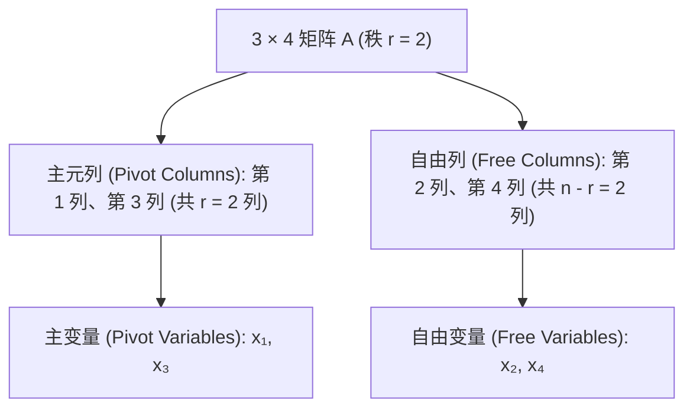

*⏱ 时间戳：00:09:40 · 📷 板书截图 · [在 B 站观看对应片段 (P7 00:09:40)](https://www.bilibili.com/video/BV1ix411f7Yp/?p=7&t=580)*

- **主元列（Pivot Columns）**：含有主元的列，对应第 1 列和第 3 列。对应未知数称为**主变量（Pivot Variables）**：$x_1, x_3$。
- **自由列（Free Columns）**：不含主元的列，对应第 2 列和第 4 列。对应未知数称为**自由变量（Free Variables）**：$x_2, x_4$。
- 自由变量的数量永远等于 **$n - r = 4 - 2 = 2$**。

---

### 3. 求解特解（Special Solutions）

*(参考时间: 00:09:00 · [视频跳转 (P7 00:09:00)](https://www.bilibili.com/video/BV1ix411f7Yp/?p=7&t=540))*

为什么要区分主变量和自由变量？因为：**我们可以对自由变量任意赋值，然后通过回代（Back-Substitution）严格且唯一地解出主变量！**

为了找出零空间的一组基，我们采用最简洁、最标准的方式为自由变量赋值：**每次令一个自由变量为 1，其余自由变量为 0**。

因为有两个自由变量（$x_2, x_4$），我们将得到两个**特解（Special Solutions）**。

#### 3.1 第一个特解 $s_1$：令 $x_2 = 1, x_4 = 0$

将自由变量代入阶梯方程组 $Ux = \mathbf{0}$：

$$
\begin{bmatrix}
1 & 2 & 2 & 2 \\
0 & 0 & 2 & 4 \\
0 & 0 & 0 & 0
\end{bmatrix}
\begin{bmatrix}
x_1 \\ 1 \\ x_3 \\ 0
\end{bmatrix}
=
\begin{bmatrix}
0 \\ 0 \\ 0
\end{bmatrix}
$$

展开方程：
1. 第二行方程：$2x_3 + 4(0) = 0 \implies 2x_3 = 0 \implies \mathbf{x_3 = 0}$；
2. 第一行方程：$1x_1 + 2(1) + 2(x_3) + 2(0) = 0 \implies x_1 + 2 = 0 \implies \mathbf{x_1 = -2}$。

于是得到第一个特解：

$$
s_1 = \begin{bmatrix} -2 \\ 1 \\ 0 \\ 0 \end{bmatrix}
$$

*⏱ 时间戳：00:12:40 · 📷 板书截图 · [在 B 站观看对应片段 (P7 00:12:40)](https://www.bilibili.com/video/BV1ix411f7Yp/?p=7&t=760)*

#### 3.2 第二个特解 $s_2$：令 $x_2 = 0, x_4 = 1$

再次代入阶梯方程组 $Ux = \mathbf{0}$：

$$
\begin{bmatrix}
1 & 2 & 2 & 2 \\
0 & 0 & 2 & 4 \\
0 & 0 & 0 & 0
\end{bmatrix}
\begin{bmatrix}
x_1 \\ 0 \\ x_3 \\ 1
\end{bmatrix}
=
\begin{bmatrix}
0 \\ 0 \\ 0
\end{bmatrix}
$$

回代求解：
1. 第二行方程：$2x_3 + 4(1) = 0 \implies 2x_3 = -4 \implies \mathbf{x_3 = -2}$；
2. 第一行方程：$1x_1 + 2(0) + 2(-2) + 2(1) = 0 \implies x_1 - 4 + 2 = 0 \implies \mathbf{x_1 = 2}$。

于是得到第二个特解：

$$
s_2 = \begin{bmatrix} 2 \\ 0 \\ -2 \\ 1 \end{bmatrix}
$$

*⏱ 时间戳：00:15:30 · 📷 板书截图 · [在 B 站观看对应片段 (P7 00:15:30)](https://www.bilibili.com/video/BV1ix411f7Yp/?p=7&t=930)*

---

### 4. 零空间的完整结构与几何形态

*(参考时间: 00:16:30 · [视频跳转 (P7 00:16:30)](https://www.bilibili.com/video/BV1ix411f7Yp/?p=7&t=990))*

$Ax = \mathbf{0}$ 的完全解（通解）是这两个特解的任意线性组合：

$$
x = c \begin{bmatrix} -2 \\ 1 \\ 0 \\ 0 \end{bmatrix} + d \begin{bmatrix} 2 \\ 0 \\ -2 \\ 1 \end{bmatrix}, \quad \forall c, d \in \mathbb{R}
$$

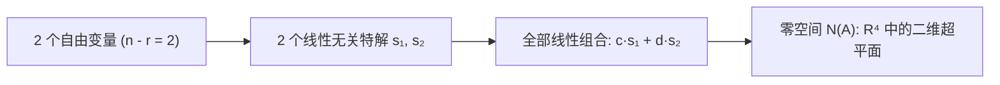

*⏱ 时间戳：00:17:40 · 📷 板书截图 · [在 B 站观看对应片段 (P7 00:17:40)](https://www.bilibili.com/video/BV1ix411f7Yp/?p=7&t=1060)*

> [!NOTE] 零空间维数定理
> - 零空间 $N(A)$ 中的特解个数 = 自由变量个数 = $n - r$；
> - 特解之间必然线性无关（因为每个特解都在其对应的自由变量位置上拥有唯一的 1，其他为 0）；
> - 因此，**零空间 $N(A)$ 的维数（Dimension）恰好等于 $n - r$**。
> - 在本例中，维数为 $4 - 2 = 2$。零空间是四维空间 $\mathbb{R}^4$ 中穿过原点的一个二维平面。

---

### 5. 行简化阶梯形（Reduced Row Echelon Form, R）

*(参考时间: 00:19:30 · [视频跳转 (P7 00:19:30)](https://www.bilibili.com/video/BV1ix411f7Yp/?p=7&t=1170))*

消元到阶梯形 $U$ 已经可以求解，但我们还可以继续向上简化，得到全线代中最精纯的矩阵形式——**行简化阶梯形 $R = \text{rref}(A)$**。

简化规则：
1. **主元归一化**：将包含主元的每一行除以该主元数值，使所有主元变为 1；
2. **向上消元**：利用主元行，将主元上方的所有非零元素全部消为 0。

对阶梯形 $U$ 继续操作：
- 第二行除以主元 2：第二行变为 $\begin{bmatrix} 0 & 0 & 1 & 2 \end{bmatrix}$；
- 用第二行消除第一行中的第三列元素（第一行减去 $2 \times$ 第二行）：

$$
U = \begin{bmatrix}
1 & 2 & 2 & 2 \\
0 & 0 & 2 & 4 \\
0 & 0 & 0 & 0
\end{bmatrix}
\longrightarrow
\begin{bmatrix}
1 & 2 & 2 & 2 \\
0 & 0 & 1 & 2 \\
0 & 0 & 0 & 0
\end{bmatrix}
\xrightarrow{\text{向上消元}}
R = \begin{bmatrix}
\mathbf{1} & 2 & \mathbf{0} & -2 \\
\mathbf{0} & 0 & \mathbf{1} & 2 \\
0 & 0 & 0 & 0
\end{bmatrix}
$$

这就是 MATLAB 中 `rref(A)` 输出的最终矩阵！

*⏱ 时间戳：00:21:40 · 📷 板书截图 · [在 B 站观看对应片段 (P7 00:21:40)](https://www.bilibili.com/video/BV1ix411f7Yp/?p=7&t=1300)*

---

### 6. 分块矩阵视角的秒杀公式：$R = [I \quad F]$

*(参考时间: 00:24:30 · [视频跳转 (P7 00:24:30)](https://www.bilibili.com/video/BV1ix411f7Yp/?p=7&t=1470))*

将 $R$ 的主元列与自由列重排到一起（这相当于对未知数重新编号）：

$$
R_{\text{permuted}} = \begin{bmatrix}
I & F \\
0 & 0
\end{bmatrix}
$$

- $I$ 是 $r \times r$ 的单位矩阵（由 $r$ 个主元列构成，此处为 $2 \times 2$）；
- $F$ 是 $r \times (n - r)$ 的自由列分块（Free Block，此处为 $\begin{bmatrix} 2 & -2 \\ 0 & 2 \end{bmatrix}$，对应第 2、4 列）；
- 下方是全零行。

*⏱ 时间戳：00:25:20 · 📷 板书截图 · [在 B 站观看对应片段 (P7 00:25:20)](https://www.bilibili.com/video/BV1ix411f7Yp/?p=7&t=1520)*

#### 6.1 零空间矩阵 $N$ 的神奇构造

我们把所有特解拼成一个矩阵，称为**零空间矩阵 $N$（Nullspace Matrix）**，使得 $A N = 0$，即 $R N = 0$。

令：
$$
N = \begin{bmatrix}
-F \\
I_{(n-r)}
\end{bmatrix}
$$

直接利用分块矩阵乘法检验：

$$
R N = \begin{bmatrix} I & F \end{bmatrix} \begin{bmatrix} -F \\ I \end{bmatrix} = I(-F) + F(I) = -F + F = \mathbf{0}!
$$

乘积恒等于零矩阵！

*⏱ 时间戳：00:28:40 · 📷 板书截图 · [在 B 站观看对应片段 (P7 00:28:40)](https://www.bilibili.com/video/BV1ix411f7Yp/?p=7&t=1720)*

> [!TIP] 秒杀特解的心算法则
> 在本例中，分块 $F$ 在第 1 行是 $[2, -2]$，第 2 行是 $[0, 2]$。
> 按照公式 $N = \begin{bmatrix} -F \\ I \end{bmatrix}$：
> - 自由部分是单位阵 $\begin{bmatrix} 1 & 0 \\ 0 & 1 \end{bmatrix}$（分别赋 $x_2=1, x_4=0$ 与 $x_2=0, x_4=1$）；
> - 主变量部分直接取 $-F$ 的对应列：$- \begin{bmatrix} 2 \\ 0 \end{bmatrix} = \begin{bmatrix} -2 \\ 0 \end{bmatrix}$ 和 $- \begin{bmatrix} -2 \\ 2 \end{bmatrix} = \begin{bmatrix} 2 \\ -2 \end{bmatrix}$！
> 与我们辛辛苦苦回代求出的 $s_1, s_2$ 完全一致！

---

### 7. 进阶实例与转置矩阵的秩

*(参考时间: 00:33:00 · [视频跳转 (P7 00:33:00)](https://www.bilibili.com/video/BV1ix411f7Yp/?p=7&t=1980))*

Strang 教授进一步给出一个 $2 \times 3$ 矩阵进行巩固演练：

$$
B = \begin{bmatrix}
1 & 2 & 3 \\
2 & 4 & 6
\end{bmatrix}
$$

- 第二行是第一行的 2 倍；
- 消元后第二行全为 0：
  $$
  U = \begin{bmatrix} \mathbf{1} & 2 & 3 \\ 0 & 0 & 0 \end{bmatrix} = R
  $$
- 矩阵的秩 $r = 1$（仅有 1 个主元）；
- 自由变量个数为 $n - r = 3 - 1 = 2$ 个（$x_2, x_3$ 为自由变量）；
- 分块 $F = \begin{bmatrix} 2 & 3 \end{bmatrix}$；
- 零空间特解直接写出：
  $$
  s_1 = \begin{bmatrix} -2 \\ 1 \\ 0 \end{bmatrix}, \quad s_2 = \begin{bmatrix} -3 \\ 0 \\ 1 \end{bmatrix}
  $$
- 零空间 $N(B)$ 是三维空间 $\mathbb{R}^3$ 中的一个二维平面。

*⏱ 时间戳：00:38:00 · 📷 板书截图 · [在 B 站观看对应片段 (P7 00:38:00)](https://www.bilibili.com/video/BV1ix411f7Yp/?p=7&t=2280)*

---

### 8. 全讲总结：求解 $Ax = 0$ 的标准流水线

1. **消元至阶梯形 $U$**：确定主元个数，得出矩阵的秩 $r$；
2. **区分两类变量**：
   - 主变量（$r$ 个）：对应包含主元的列；
   - 自由变量（$n - r$ 个）：对应其余列；
3. **构造行简化阶梯形 $R$**：归一化主元并向上消元，识别自由分块 $F$；
4. **生成 $n - r$ 个特解**：通过 $N = \begin{bmatrix} -F \\ I \end{bmatrix}$ 或逐次回代，令一个自由变量为 1、其余为 0；
5. **写出通解**：特解的任意线性组合张成整个零空间 $N(A)$，其维数严格等于 $n - r$。

---

## 第 8 讲：求解 Ax = b：行简化阶梯形 R 与完全解

> 📺 **视频回链**：[B 站第 8 P：求解 Ax = b：行简化阶梯形 R 与完全解](https://www.bilibili.com/video/BV1ix411f7Yp/?p=8)（⏱ 47分08秒 · 10 截图）  
> 📖 **官方材料**：[MIT OCW 对应讲义与总结](https://ocw.mit.edu/courses/18-06-linear-algebra-spring-2010/resources/lecture-8-solving-ax-b-row-reduced-form-r/)  
> 💡 **核心精要**：增广矩阵消元、相容性条件、特解 xp 与完全解 x=xp+xn 的仿射几何结构、解结构的四大秩情形。

---

### 1. 非齐次线性方程组 $Ax = b$ 的增广矩阵消元

*(参考时间: 00:01:00 · [视频跳转 (P8 00:01:00)](https://www.bilibili.com/video/BV1ix411f7Yp/?p=8&t=60))*

在第 7 讲中，我们彻底攻克了齐次方程组 $Ax = \mathbf{0}$ 的解空间（零空间 $N(A)$）。现在，我们将面对更具普适性、更具现实工程意义的问题：**非齐次线性方程组 $Ax = b$ 的求解**。

我们延续之前的 $3 \times 4$ 矩阵 $A$，但右侧引入非零向量 $b$：

$$
\begin{bmatrix}
1 & 2 & 2 & 2 \\
2 & 4 & 6 & 8 \\
3 & 6 & 8 & 10
\end{bmatrix}
\begin{bmatrix} x_1 \\ x_2 \\ x_3 \\ x_4 \end{bmatrix}
=
\begin{bmatrix} b_1 \\ b_2 \\ b_3 \end{bmatrix}
$$

为了在消元过程中对两端保持同等操作，我们将 $b$ 作为最后一列附加在 $A$ 右侧，构造**增广矩阵（Augmented Matrix）$[A \quad b]$**：

$$
[A \quad b] =
\begin{bmatrix}
1 & 2 & 2 & 2 & b_1 \\
2 & 4 & 6 & 8 & b_2 \\
3 & 6 & 8 & 10 & b_3
\end{bmatrix}
$$

执行行消元：
1. 行 2 减去 $2 \times$ 行 1：右端项变为 $b_2 - 2b_1$；
2. 行 3 减去 $3 \times$ 行 1：右端项变为 $b_3 - 3b_1$；
3. 行 3 减去行 2：右端项变为 $(b_3 - 3b_1) - (b_2 - 2b_1) = b_3 - b_2 - b_1$。

$$
\longrightarrow
\begin{bmatrix}
\mathbf{1} & 2 & 2 & 2 & b_1 \\
0 & 0 & \mathbf{2} & 4 & b_2 - 2b_1 \\
0 & 0 & 0 & 0 & b_3 - b_2 - b_1
\end{bmatrix}
= [U \quad c]
$$

*⏱ 时间戳：00:03:30 · 📷 板书截图 · [在 B 站观看对应片段 (P8 00:03:30)](https://www.bilibili.com/video/BV1ix411f7Yp/?p=8&t=210)*

---

### 2. 方程组的可解性条件（Solvability Condition on b）

*(参考时间: 00:06:00 · [视频跳转 (P8 00:06:00)](https://www.bilibili.com/video/BV1ix411f7Yp/?p=8&t=360))*

观察消元后的最后一行：
$$
0x_1 + 0x_2 + 0x_3 + 0x_4 = b_3 - b_2 - b_1
$$

左边恒等于 0！如果右侧非零（例如等于 5），方程组就会出现 $0 = 5$ 的荒谬矛盾，此时方程组**无解**。

> [!IMPORTANT] 可解性充要条件
> 方程组 $Ax = b$ 存在解的充要条件是：**消元后左侧出现全零行的地方，右端项也必须精确为零！**
> 在本例中，必须满足：
> $$
> b_3 - b_2 - b_1 = 0 \iff b_1 + b_2 = b_3
> $$

*⏱ 时间戳：00:06:50 · 📷 板书截图 · [在 B 站观看对应片段 (P8 00:06:50)](https://www.bilibili.com/video/BV1ix411f7Yp/?p=8&t=410)*

#### 2.1 行视角与列视角的奇妙统一

为什么正好是 $b_1 + b_2 = b_3$？
- 从**行视角（Row Picture）**看：消元揭示了矩阵第 1 行加第 2 行恰好等于第 3 行；因此方程要有解，右端项也必须满足第 1 个分量加第 2 个分量等于第 3 个分量！
- 从**列视角（Column Picture）**看：第 6 讲指出，$Ax = b$ 有解意味着 $b$ 必须在列空间 $C(A)$ 中。因为 $A$ 的所有列向量的第 1 分量加第 2 分量都精确等于第 3 分量（例如 $1+2=3, 2+4=6, 2+6=8, 2+8=10$），所以它们的任何线性组合也必须满足 $b_1 + b_2 = b_3$！
两个视角殊途同归，完美印证了线性代数的内在和谐。

*⏱ 时间戳：00:09:50 · 📷 板书截图 · [在 B 站观看对应片段 (P8 00:09:50)](https://www.bilibili.com/video/BV1ix411f7Yp/?p=8&t=590)*

---

### 3. 求特解 $x_p$（A Particular Solution）

*(参考时间: 00:11:00 · [视频跳转 (P8 00:11:00)](https://www.bilibili.com/video/BV1ix411f7Yp/?p=8&t=660))*

现在假设 $b$ 满足可解性条件，例如选取具体的 $b = \begin{bmatrix} 1 \\ 5 \\ 6 \end{bmatrix}$（显然 $1 + 5 = 6$）。

我们如何求出一个具体的解 $x_p$？

> **求特解的标准操作准则（Standard Recipe for $x_p$）**  
> **将所有自由变量统统设为 0！** 然后回代求解主变量。

在本例中，自由变量是 $x_2$ 和 $x_4$，令：
$$
x_2 = 0, \quad x_4 = 0
$$

消元后的方程组 $[U \quad c]$ 简化为主变量方程：
$$
\begin{cases}
x_1 + 2x_3 = b_1 = 1 \\
2x_3 = b_2 - 2b_1 = 5 - 2(1) = 3
\end{cases}
$$

由第二式解得：
$$
x_3 = \frac{3}{2}
$$
代入第一式解得：
$$
x_1 = 1 - 2\left(\frac{3}{2}\right) = -2
$$

于是我们得到了一个极其干净的特解：

$$
x_p = \begin{bmatrix} -2 \\ 0 \\ 3/2 \\ 0 \end{bmatrix}
$$

*⏱ 时间戳：00:12:40 · 📷 板书截图 · [在 B 站观看对应片段 (P8 00:12:40)](https://www.bilibili.com/video/BV1ix411f7Yp/?p=8&t=760)*

带入原方程验证：
$$
-2 \begin{bmatrix} 1 \\ 2 \\ 3 \end{bmatrix} + 0 \begin{bmatrix} 2 \\ 4 \\ 6 \end{bmatrix} + \frac{3}{2} \begin{bmatrix} 2 \\ 6 \\ 8 \end{bmatrix} + 0 \begin{bmatrix} 2 \\ 8 \\ 10 \end{bmatrix}
= \begin{bmatrix} -2 + 3 \\ -4 + 9 \\ -6 + 12 \end{bmatrix}
= \begin{bmatrix} 1 \\ 5 \\ 6 \end{bmatrix} = b
$$
精确成立！

*⏱ 时间戳：00:15:20 · 📷 板书截图 · [在 B 站观看对应片段 (P8 00:15:20)](https://www.bilibili.com/video/BV1ix411f7Yp/?p=8&t=920)*

---

### 4. 完全解（The Complete Solution）：$x = x_p + x_n$

*(参考时间: 00:17:00 · [视频跳转 (P8 00:17:00)](https://www.bilibili.com/video/BV1ix411f7Yp/?p=8&t=1020))*

找到了一个特解 $x_p$，我们如何得到方程组的**所有解（完全解）**？

答案是：**加上零空间 $N(A)$ 中的任意解 $x_n$！**

$$
\boxed{x_{\text{complete}} = x_p + x_n}
$$

代入检验：
$$
A(x_p + x_n) = Ax_p + Ax_n = b + \mathbf{0} = b
$$

将第 7 讲求出的零空间基向量组合代入，得到完全解公式：

$$
x_{\text{complete}} = \begin{bmatrix} -2 \\ 0 \\ 3/2 \\ 0 \end{bmatrix} + c_1 \begin{bmatrix} -2 \\ 1 \\ 0 \\ 0 \end{bmatrix} + c_2 \begin{bmatrix} 2 \\ 0 \\ -2 \\ 1 \end{bmatrix}, \quad \forall c_1, c_2 \in \mathbb{R}
$$

*⏱ 时间戳：00:18:00 · 📷 板书截图 · [在 B 站观看对应片段 (P8 00:18:00)](https://www.bilibili.com/video/BV1ix411f7Yp/?p=8&t=1080)*

#### 4.1 完全解的几何图像

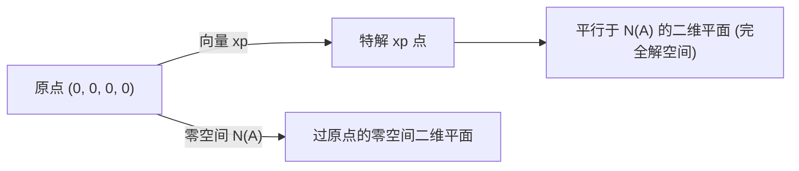

- 零空间 $N(A)$ 是四维空间中穿过原点的二维平面；
- 完全解集合是**通过特解点 $x_p$、且与零空间完全平行的二维平面**；
- 因为完全解平面不经过原点（$x = \mathbf{0}$ 不是 $Ax = b$ 的解），所以**非齐次方程的解集绝对不是子空间**！

*⏱ 时间戳：00:23:00 · 📷 板书截图 · [在 B 站观看对应片段 (P8 00:23:00)](https://www.bilibili.com/video/BV1ix411f7Yp/?p=8&t=1380)*

---

### 5. 矩阵秩 $r$ 与解的结构的四大经典情形

*(参考时间: 00:25:00 · [视频跳转 (P8 00:25:00)](https://www.bilibili.com/video/BV1ix411f7Yp/?p=8&t=1500))*

给定任意 $m \times n$ 矩阵 $A$，其秩为 $r$。显然，主元个数受限于行数与列数：$r \le m$ 且 $r \le n$。

根据 $r$ 与 $m, n$ 的大小关系，线性方程组的解结构被彻底分为四种情形：

#### 5.1 情形一：列满秩（Full Column Rank, $r = n < m$）

- **特征**：每一列都是主元列，**没有自由变量**（$n - r = 0$）；
- **零空间**：零空间只有零向量 $N(A) = \{\mathbf{0}\}$；
- **化简阶梯形**：$R = \begin{bmatrix} I \\ \mathbf{0} \end{bmatrix}$（上面是 $n \times n$ 单位阵，下面是全零行）；
- **解的可能数目**：**唯一解或无解（0 或 1 个解）**。
  - 若 $b \in C(A)$，则存在唯一的特解 $x = x_p$；
  - 若 $b \notin C(A)$，则无解。

*⏱ 时间戳：00:27:30 · 📷 板书截图 · [在 B 站观看对应片段 (P8 00:27:30)](https://www.bilibili.com/video/BV1ix411f7Yp/?p=8&t=1650)*

#### 5.2 情形二：行满秩（Full Row Rank, $r = m < n$）

- **特征**：每一行都有主元，**没有全零行**；
- **列空间**：列空间充满整个输出空间 $C(A) = \mathbb{R}^m$；
- **化简阶梯形**：$R = \begin{bmatrix} I & F \end{bmatrix}$；
- **自由变量**：存在 $n - m > 0$ 个自由变量；
- **解的可能数目**：**对任意右端项 $b$，恒有无穷多解（$\infty$ 个解）**！

*⏱ 时间戳：00:35:40 · 📷 板书截图 · [在 B 站观看对应片段 (P8 00:35:40)](https://www.bilibili.com/video/BV1ix411f7Yp/?p=8&t=2140)*

#### 5.3 情形三：方阵满秩（Full Rank, $r = m = n$）

- **特征**：方阵且可逆（Invertible Matrix）；
- **化简阶梯形**：$R = I$；
- **解的可能数目**：对任意 $b$，恒有**唯一解** $x = A^{-1}b$。

#### 5.4 情形四：非满秩（$r < m$ 且 $r < n$）

- **特征**：既有自由变量，又有全零行；
- **化简阶梯形**：$R = \begin{bmatrix} I & F \\ 0 & 0 \end{bmatrix}$；
- **解的可能数目**：**0 或 $\infty$ 个解**（若 $b \in C(A)$ 则无穷多解，否则无解）。

---

### 6. 全讲终极汇总：秩决定解的结构

| 秩的大小 | $R$ 的分块形态 | 零空间 $N(A)$ | 解的情况 |
| :--- | :--- | :--- | :--- |
| **$r = m = n$**（方阵满秩） | $I$ | 仅含零向量 $\{\mathbf{0}\}$ | 对任何 $b$ 都有**唯一解 (1)** |
| **$r = n < m$**（列满秩） | $\begin{bmatrix} I \\ 0 \end{bmatrix}$ | 仅含零向量 $\{\mathbf{0}\}$ | **0 或 1 个解** |
| **$r = m < n$**（行满秩） | $\begin{bmatrix} I & F \end{bmatrix}$ | 维数为 $n - m$ 的空间 | 对任何 $b$ 都有**无穷多解 ($\infty$)** |
| **$r < m, r < n$**（非满秩） | $\begin{bmatrix} I & F \\ 0 & 0 \end{bmatrix}$ | 维数为 $n - r$ 的空间 | **0 或 $\infty$ 个解** |

*⏱ 时间戳：00:43:20 · 📷 板书截图 · [在 B 站观看对应片段 (P8 00:43:20)](https://www.bilibili.com/video/BV1ix411f7Yp/?p=8&t=2600)*

这四种情形将线性代数中关于方程组求解的理论划上了圆满句号！

---

## 第 9 讲：线性相关性、基与维数

> 📺 **视频回链**：[B 站第 9 P：线性相关性、基与维数](https://www.bilibili.com/video/BV1ix411f7Yp/?p=9)（⏱ 49分58秒 · 10 截图）  
> 📖 **官方材料**：[MIT OCW 对应讲义与总结](https://ocw.mit.edu/courses/18-06-linear-algebra-spring-2010/resources/lecture-9-independence-basis-and-dimension/)  
> 💡 **核心精要**：线性相关严格定义、n>m 必相关定理、张成空间、基（不多不少黄金集合）、维数守恒与秩-零化度定理。

---

### 1. 线性无关（Linear Independence）的严格定义

*(参考时间: 00:01:00 · [视频跳转 (P9 00:01:00)](https://www.bilibili.com/video/BV1ix411f7Yp/?p=9&t=60))*

在前几讲中，我们频繁使用“没有多余列”、“列之间彼此独立”等直观表述。在这一讲中，我们将给出整个高等线性代数中最为核心、最为精练的三个概念的严格定义：**线性无关（Independence）**、**基（Basis）**与**维数（Dimension）**。

首先给出**线性无关**的严格代数判据：

> **定义：线性无关（Linear Independence）**  
> 设有一组向量 $v_1, v_2, \dots, v_k$。若关于标量 $c_1, c_2, \dots, c_k$ 的方程：
> $$
> c_1 v_1 + c_2 v_2 + \cdots + c_k v_k = \mathbf{0}
> $$
> **仅有唯一平凡解 $c_1 = c_2 = \cdots = c_k = 0$**，则称这组向量是**线性无关的（Linearly Independent）**。  
> 反之，如果存在**不全为零**的标量使上式成立，则称这组向量是**线性相关的（Linearly Dependent）**。

*⏱ 时间戳：00:03:00 · 📷 板书截图 · [在 B 站观看对应片段 (P9 00:03:00)](https://www.bilibili.com/video/BV1ix411f7Yp/?p=9&t=180)*

线性相关的本质在于：**其中至少有一个向量可以写成其余向量的线性组合**。例如若 $c_1 \neq 0$，则：
$$
v_1 = -\frac{c_2}{c_1}v_2 - \cdots - \frac{c_k}{c_1}v_k
$$
这意味着 $v_1$ 是一个“多余”的向量，它并没有带来任何全新的几何方向。

---

### 2. 矩阵视角下的线性无关性判据

*(参考时间: 00:05:30 · [视频跳转 (P9 00:05:30)](https://www.bilibili.com/video/BV1ix411f7Yp/?p=9&t=330))*

将这组向量 $v_1, \dots, v_n$ 作为列，拼接成矩阵 $A = \begin{bmatrix} v_1 & v_2 & \cdots & v_n \end{bmatrix}$（大小为 $m \times n$）。

则线性组合等于零向量的方程，恰好就是矩阵方程：

$$
A c = \mathbf{0}, \quad \text{其中 } c = \begin{bmatrix} c_1 \\ c_2 \\ \vdots \\ c_n \end{bmatrix}
$$

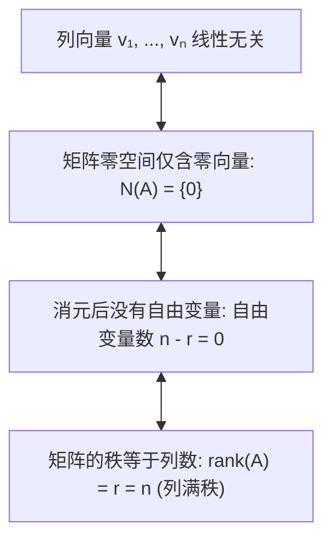

*⏱ 时间戳：00:06:50 · 📷 板书截图 · [在 B 站观看对应片段 (P9 00:06:50)](https://www.bilibili.com/video/BV1ix411f7Yp/?p=9&t=410)*

> [!IMPORTANT] 矩阵列无关定理
> 矩阵 $A$ 的列向量线性无关，当且仅当满足以下等价条件之一：
> 1. 齐次方程 $Ac = \mathbf{0}$ 仅有零解；
> 2. 零空间中没有非零向量：$N(A) = \{\mathbf{0}\}$；
> 3. 矩阵消元后所有列都是主元列，没有自由变量；
> 4. 矩阵的秩等于列数：$\text{rank}(A) = r = n$。

---

### 3. 几何图景与关键不等式：$n > m$ 必相关

*(参考时间: 00:10:00 · [视频跳转 (P9 00:10:00)](https://www.bilibili.com/video/BV1ix411f7Yp/?p=9&t=600))*

考虑欧氏空间中的几何情形：
- 在平面 $\mathbb{R}^2$ 中：两个不共线的向量是线性无关的；若有三个向量，则第三个向量必定落在前两个张成的平面上，因此任意 3 个平面向量必线性相关！
- 在空间 $\mathbb{R}^3$ 中：若三个向量不共面，它们线性无关；但只要给出 4 个三维向量，它们必线性相关！

*⏱ 时间戳：00:11:40 · 📷 板书截图 · [在 B 站观看对应片段 (P9 00:11:40)](https://www.bilibili.com/video/BV1ix411f7Yp/?p=9&t=700)*

> [!IMPORTANT] 核心定理：未知数多于方程必相关
> 假设有 $n$ 个向量属于 $m$ 维空间 $\mathbb{R}^m$。如果 **$n > m$**，则这 $n$ 个向量**必定线性相关**！
> 
> **证明**：将这 $n$ 个向量构成 $m \times n$ 矩阵 $A$。  
> 矩阵消元的主元数 $r \le m$。  
> 自由变量数 $= n - r \ge n - m > 0$。  
> 因为至少存在一个自由变量，齐次方程 $Ax = \mathbf{0}$ 必然存在非零特解！  
> 所以这些列向量必定线性相关。

---

### 4. 张成空间（Spanning a Space）

*(参考时间: 00:16:00 · [视频跳转 (P9 00:16:00)](https://www.bilibili.com/video/BV1ix411f7Yp/?p=9&t=960))*

第二个核心概念是**张成（Span）**。

> **定义：张成（Spanning）**  
> 设 $v_1, \dots, v_l$ 是一组向量。由它们的所有可能线性组合构成的集合：
> $$
> \text{span}(v_1, \dots, v_l) = \left\{ c_1 v_1 + \cdots + c_l v_l \ \middle|\ c_i \in \mathbb{R} \right\}
> $$
> 称为由这组向量**张成的空间**。  
> 如果一个向量空间 $V$ 中的每一个向量都能表示为 $v_1, \dots, v_l$ 的线性组合，我们就称**这组向量张成了空间 $V$**。

举例而言：
- 矩阵 $A$ 的列向量，自然张成了 $A$ 的列空间 $C(A)$；
- 但是，列向量可能过多（存在冗余/相关）。例如第 6 讲中的 3 列向量张成了 $\mathbb{R}^4$ 中的二维平面，但第 3 列是多余的。

*⏱ 时间戳：00:17:00 · 📷 板书截图 · [在 B 站观看对应片段 (P9 00:17:00)](https://www.bilibili.com/video/BV1ix411f7Yp/?p=9&t=1020)*

---

### 5. 基（Basis）：刚刚好的黄金向量集合

*(参考时间: 00:22:00 · [视频跳转 (P9 00:22:00)](https://www.bilibili.com/video/BV1ix411f7Yp/?p=9&t=1320))*

现在将前两个概念完美结合。向量太多会破坏无关性；向量太少又无法张成整个空间。

我们追求的是一种**不多也不少、恰到好处的精炼集合**——这就是**基（Basis）**。

> **权威定义：向量空间的基（Basis）**  
> 向量空间 $V$ 的一组向量 $v_1, v_2, \dots, v_d$ 称为 $V$ 的一个**基（Basis）**，当且仅当满足以下两个条件：
> 1. **线性无关（Linearly Independent）**：向量之间没有任何冗余；
> 2. **张成整个空间（Span the Space）**：空间中的任何向量都可以由它们线性组合生成。

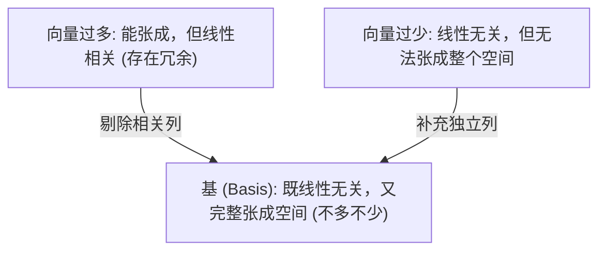

*⏱ 时间戳：00:23:40 · 📷 板书截图 · [在 B 站观看对应片段 (P9 00:23:40)](https://www.bilibili.com/video/BV1ix411f7Yp/?p=9&t=1420)*

#### 5.1 标准基（Standard Basis）示例

在欧氏空间 $\mathbb{R}^3$ 中，最经典也是最显而易见的基是三维坐标轴方向的单位向量：

$$
e_1 = \begin{bmatrix} 1 \\ 0 \\ 0 \end{bmatrix}, \quad
e_2 = \begin{bmatrix} 0 \\ 1 \\ 0 \end{bmatrix}, \quad
e_3 = \begin{bmatrix} 0 \\ 0 \\ 1 \end{bmatrix}
$$

将它们按列排开，恰好就是单位矩阵 $I$！
- 它们线性无关（$I c = \mathbf{0} \implies c = \mathbf{0}$）；
- 任意向量 $\begin{bmatrix} x \\ y \\ z \end{bmatrix} = x e_1 + y e_2 + z e_3$ 都能被唯一组合出来。

*⏱ 时间戳：00:27:10 · 📷 板书截图 · [在 B 站观看对应片段 (P9 00:27:10)](https://www.bilibili.com/video/BV1ix411f7Yp/?p=9&t=1630)*

---

### 6. 维数（Dimension）：基的唯一不变量

*(参考时间: 00:31:00 · [视频跳转 (P9 00:31:00)](https://www.bilibili.com/video/BV1ix411f7Yp/?p=9&t=1860))*

一个向量空间可以拥有千千万万组完全不同的基（例如将坐标轴旋转任意角度，就能得到一组全新的基）。

但是，所有基都拥有一个神圣不可侵犯的共同性质：

> [!IMPORTANT] 基的维数唯一性大定理
> **一个向量空间 $V$ 的任意两组基，其所包含的向量个数必然严格相等！**

这个固定的、由空间本质所决定的向量个数，就定义为该空间的**维数（Dimension）**。

> **定义：维数（Dimension）**  
> 向量空间 $V$ 的维数记作 $\dim(V)$，它等于**构成该空间任意一组基所包含的向量个数**。

*⏱ 时间戳：00:32:00 · 📷 板书截图 · [在 B 站观看对应片段 (P9 00:32:00)](https://www.bilibili.com/video/BV1ix411f7Yp/?p=9&t=1920)*

Strang 教授强调：
- 我们可以说矩阵的秩（Rank），但绝不能说空间的秩；
- 我们可以说子空间的维数（Dimension），但绝不能说矩阵的维数（矩阵用大小 $m \times n$ 描述）；
- **Rank 属于 Matrix，Dimension 属于 Space！**

*⏱ 时间戳：00:35:40 · 📷 板书截图 · [在 B 站观看对应片段 (P9 00:35:40)](https://www.bilibili.com/video/BV1ix411f7Yp/?p=9&t=2140)*

---

### 7. 矩阵基本子空间的基与维数

*(参考时间: 00:38:00 · [视频跳转 (P9 00:38:00)](https://www.bilibili.com/video/BV1ix411f7Yp/?p=9&t=2280))*

现在将本讲的宏伟理论，应用到上一讲建立的列空间 $C(A)$ 与零空间 $N(A)$ 上：

#### 7.1 列空间 $C(A)$ 的基与维数

设矩阵 $A$ 的秩为 $r$（通过消元得到 $r$ 个主元）：
- 消元过程识别出了 $r$ 个**主元列（Pivot Columns）**；
- 自由列完全可以由主元列线性表出；
- 主元列之间彼此线性无关，且张成了全部列向量能够生成的空间；
- **结论：矩阵 $A$ 的主元列，构成了列空间 $C(A)$ 的一组基！**
- **列空间的维数严格等于矩阵的秩**：
  $$
  \boxed{\dim(C(A)) = r}
  $$

*⏱ 时间戳：00:41:20 · 📷 板书截图 · [在 B 站观看对应片段 (P9 00:41:20)](https://www.bilibili.com/video/BV1ix411f7Yp/?p=9&t=2480)*

#### 7.2 零空间 $N(A)$ 的基与维数

在第 7 讲中，我们为每一个自由变量赋值 1、其余自由变量赋值 0，求解出 $n - r$ 个特解 $s_1, \dots, s_{n-r}$：
- 每个特解都在其对应的自由变量位置上有 1，其余特解在该位置全为 0；这保证了**特解之间必然线性无关**！
- 零空间中的任何解都是这 $n - r$ 个特解的线性组合（完全解公式）；
- **结论：特解构成了零空间 $N(A)$ 的一组基！**
- **零空间的维数严格等于自由变量的个数**：
  $$
  \boxed{\dim(N(A)) = n - r}
  $$

*⏱ 时间戳：00:46:10 · 📷 板书截图 · [在 B 站观看对应片段 (P9 00:46:10)](https://www.bilibili.com/video/BV1ix411f7Yp/?p=9&t=2770)*

---

### 8. 全讲终极定理：秩-零化度定理（Rank-Nullity Theorem）

将两个子空间的维数相加：

$$
\boxed{\dim(C(A)) + \dim(N(A)) = r + (n - r) = n}
$$

输出空间由 $r$ 个主元维度把守，输入空间剩余的 $n - r$ 个自由维度被压扁到零向量。二者维数之和恰好完完全全等于输入变量的全体维度 $n$！

---

## 第 10 讲：四个基本子空间

> 📺 **视频回链**：[B 站第 10 P：四个基本子空间](https://www.bilibili.com/video/BV1ix411f7Yp/?p=10)（⏱ 49分11秒 · 10 截图）  
> 📖 **官方材料**：[MIT OCW 对应讲义与总结](https://ocw.mit.edu/courses/18-06-linear-algebra-spring-2010/resources/lecture-10-the-four-fundamental-subspaces/)  
> 💡 **核心精要**：基本定理第一部分、The Big Picture 大图景、行空间初等变换不变性、左零空间 Gauss-Jordan 矩阵 E、3x3 矩阵空间。

---

### 1. 线性代数的核心圣杯：四个基本子空间

*(参考时间: 00:01:00 · [视频跳转 (P10 00:01:00)](https://www.bilibili.com/video/BV1ix411f7Yp/?p=10&t=60))*

如果说整个线性代数有一座巍峨的大厦，那么**四个基本子空间（The Four Fundamental Subspaces）**就是支撑这座大厦的四根巨型承重柱。

对于任意一个 $m \times n$ 实矩阵 $A$（$m$ 行 $n$ 列，秩为 $r$），天然伴随着四个彼此紧密关联的子空间：

1. **列空间（Column Space）**：记作 $C(A)$；
2. **零空间（Nullspace）**：记作 $N(A)$；
3. **行空间（Row Space）**：即转置矩阵的列空间，记作 $C(A^T)$；
4. **左零空间（Left Nullspace）**：即转置矩阵的零空间，记作 $N(A^T)$。

*⏱ 时间戳：00:03:00 · 📷 板书截图 · [在 B 站观看对应片段 (P10 00:03:00)](https://www.bilibili.com/video/BV1ix411f7Yp/?p=10&t=180)*

---

### 2. 为什么称为“左零空间”（Left Nullspace）？

*(参考时间: 00:06:30 · [视频跳转 (P10 00:06:30)](https://www.bilibili.com/video/BV1ix411f7Yp/?p=10&t=390))*

为什么转置矩阵的零空间 $N(A^T)$ 被赋予一个特殊的名字——“左零空间”？

根据定义，$y \in N(A^T)$ 意味着：
$$
A^T y = \mathbf{0}
$$

两边同时取转置：
$$
(A^T y)^T = \mathbf{0}^T \implies y^T (A^T)^T = \mathbf{0}^T \implies \boxed{y^T A = \mathbf{0}^T}
$$

此时，行向量 $y^T$ **位于矩阵 $A$ 的左侧**！
- 普通零空间 $Ax = \mathbf{0}$ 寻求的是**列向量的线性组合为零**（$x$ 乘在右侧）；
- 左零空间 $y^T A = \mathbf{0}^T$ 寻求的是**行向量的线性组合为零**（$y$ 乘在左侧）！

*⏱ 时间戳：00:07:30 · 📷 板书截图 · [在 B 站观看对应片段 (P10 00:07:30)](https://www.bilibili.com/video/BV1ix411f7Yp/?p=10&t=450)*

---

### 3. 四大子空间的宏伟总览（The Big Picture）

*(参考时间: 00:10:00 · [视频跳转 (P10 00:10:00)](https://www.bilibili.com/video/BV1ix411f7Yp/?p=10&t=600))*

这是 Gilbert Strang 教授闻名全球的经典示意图。矩阵 $A$ 就像一座桥梁，将输入空间 $\mathbb{R}^n$ 与输出空间 $\mathbb{R}^m$ 紧密连接起来：

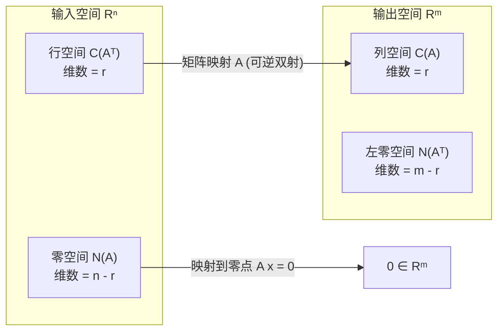

*⏱ 时间戳：00:10:40 · 📷 板书截图 · [在 B 站观看对应片段 (P10 00:10:40)](https://www.bilibili.com/video/BV1ix411f7Yp/?p=10&t=640)*

#### 3.1 维数大定理（Fundamental Theorem of Linear Algebra, Part 1）

| 子空间名称 | 记号 | 宿主空间 | 维数（Dimension） | 一组标准基 |
| :--- | :--- | :--- | :--- | :--- |
| **行空间** | $C(A^T)$ | $\mathbb{R}^n$ | $\mathbf{r}$ | 化简阶梯形 $R$ 的前 $r$ 个非零行 |
| **零空间** | $N(A)$ | $\mathbb{R}^n$ | $\mathbf{n - r}$ | 齐次方程的 $n - r$ 个特解 |
| **列空间** | $C(A)$ | $\mathbb{R}^m$ | $\mathbf{r}$ | 原矩阵 $A$ 的 $r$ 个主元列 |
| **左零空间** | $N(A^T)$ | $\mathbb{R}^m$ | $\mathbf{m - r}$ | 消元矩阵 $E$ 对应全零行的后 $m - r$ 行 |

注意维度之和的绝对守恒：
- 在输入空间 $\mathbb{R}^n$ 中：$r + (n - r) = n$；
- 在输出空间 $\mathbb{R}^m$ 中：$r + (m - r) = m$！

*⏱ 时间戳：00:14:40 · 📷 板书截图 · [在 B 站观看对应片段 (P10 00:14:40)](https://www.bilibili.com/video/BV1ix411f7Yp/?p=10&t=880)*

---

### 4. 行空间与其最佳基底：初等行变换的深刻几何

*(参考时间: 00:20:00 · [视频跳转 (P10 00:20:00)](https://www.bilibili.com/video/BV1ix411f7Yp/?p=10&t=1200))*

当对方阵或长方矩阵执行初等行变换（消元法）将 $A$ 化为阶梯形 $U$ 或行最简形 $R$ 时：
- **列空间改变了！** $C(A) \neq C(R)$。原矩阵的列与 $R$ 的列张成的不是同一个空间。
- **但行空间保持绝对不变！** 因为消元中的每一步操作都是行的线性组合；新矩阵的每一行都是原矩阵各行的组合，反之亦然。

$$
\boxed{C(A^T) = C(U^T) = C(R^T)}
$$

*⏱ 时间戳：00:20:50 · 📷 板书截图 · [在 B 站观看对应片段 (P10 00:20:50)](https://www.bilibili.com/video/BV1ix411f7Yp/?p=10&t=1250)*

#### 4.1 如何选出最干净的行空间基？

既然 $C(A^T) = C(R^T)$，而 $R$ 拥有极其干净的主元单位矩阵结构：
- $R$ 的前 $r$ 行是非零行，主元位置为 1，上方和下方全为 0；
- 这些非零行显然**线性无关**；
- 它们能组合出 $R$ 的所有行，从而组合出 $A$ 的所有行；
- **结论：化简阶梯形 $R$ 的前 $r$ 个非零行，直接构成了行空间 $C(A^T)$ 的一组最佳基！**

*⏱ 时间戳：00:26:00 · 📷 板书截图 · [在 B 站观看对应片段 (P10 00:26:00)](https://www.bilibili.com/video/BV1ix411f7Yp/?p=10&t=1560)*

---

### 5. 攻克左零空间 $N(A^T)$：Gauss-Jordan 联立算法

*(参考时间: 00:30:00 · [视频跳转 (P10 00:30:00)](https://www.bilibili.com/video/BV1ix411f7Yp/?p=10&t=1800))*

列空间、零空间和行空间的基我们都已掌握，最后一块拼图是**左零空间 $N(A^T)$**。

我们如何系统性地求出所有满足 $y^T A = \mathbf{0}^T$ 的向量 $y$？

回顾 Gauss-Jordan 消元法：我们将消元过程记为一个可逆矩阵 $E$，使得：
$$
E A = R
$$

我们将单位矩阵 $I$ 拼在 $A$ 右侧，对增广矩阵 $[A \quad I]$ 实行同等行变换：

$$
\begin{bmatrix} A & I \end{bmatrix} \xrightarrow{\text{消元}} \begin{bmatrix} R & E \end{bmatrix}
$$

*⏱ 时间戳：00:30:50 · 📷 板书截图 · [在 B 站观看对应片段 (P10 00:30:50)](https://www.bilibili.com/video/BV1ix411f7Yp/?p=10&t=1850)*

#### 5.1 零行背后的左零空间特解

如果矩阵 $A$ 的秩 $r < m$，则化简阶梯形 $R$ 的底部必定出现 $m - r$ 个**全零行**。

由矩阵乘法：
$$
E A = \begin{bmatrix} \text{前 } r \text{ 行非零} \\ \mathbf{0}^T \\ \vdots \\ \mathbf{0}^T \end{bmatrix}
$$

这说明：**消元矩阵 $E$ 的最后 $m - r$ 行，乘在 $A$ 的左侧，恰好给出了零行 $\mathbf{0}^T$！**

因为 $E$ 是由初等变换矩阵乘积构成的可逆方阵，它的所有行天然线性无关。
因此：**消元矩阵 $E$ 的最后 $m - r$ 行，直接构成了左零空间 $N(A^T)$ 的一组基！**

*⏱ 时间戳：00:37:30 · 📷 板书截图 · [在 B 站观看对应片段 (P10 00:37:30)](https://www.bilibili.com/video/BV1ix411f7Yp/?p=10&t=2250)*

---

### 6. 超越 $\mathbb{R}^n$：全新的向量空间与子空间体系

*(参考时间: 00:43:00 · [视频跳转 (P10 00:43:00)](https://www.bilibili.com/video/BV1ix411f7Yp/?p=10&t=2580))*

在全讲后半部分，Strang 教授将视野进一步大幅拓宽：**向量不一定是由数字排成的一列向量！**

只要满足加法与数乘的 8 条向量空间公理，任何数学对象集合都可以是向量空间。

#### 6.1 所有 $3 \times 3$ 实矩阵构成的向量空间 $M$

考虑所有 $3 \times 3$ 矩阵的集合 $M$：
- 任意两个 $3 \times 3$ 矩阵相加，仍然是 $3 \times 3$ 矩阵；
- 乘以标量仍是 $3 \times 3$ 矩阵；
- 零向量就是 $3 \times 3$ 全零矩阵。

它的维数是多少？
要确定一个 $3 \times 3$ 矩阵，我们需要且仅需要填入 9 个独立的数字。因此：
$$
\boxed{\dim(M) = 9}
$$
其标准基由 9 个基本矩阵构成（每个位置各放一个 1，其余为 0）。

*⏱ 时间戳：00:43:50 · 📷 板书截图 · [在 B 站观看对应片段 (P10 00:43:50)](https://www.bilibili.com/video/BV1ix411f7Yp/?p=10&t=2630)*

#### 6.2 矩阵空间内部的子空间

在 $M$ 内部，我们可以定义各种令人兴奋的子空间：
1. **对称矩阵子空间（Symmetric Matrices, $S$）**：
   - 满足 $A^T = A$；
   - 对角线上有 3 个独立元素，上三角有 3 个独立元素（下三角被强制对称）；
   - $\dim(S) = 3 + 3 = \mathbf{6}$。
2. **上三角矩阵子空间（Upper Triangular Matrices, $U$）**：
   - 主对角线及以上可任意填数，主对角线下方全为 0；
   - $\dim(U) = 3 + 2 + 1 = \mathbf{6}$。
3. **对角矩阵子空间（Diagonal Matrices, $D$）**：
   - 既是对称矩阵又是上三角矩阵：$D = S \cap U$；
   - 只有主对角线上 3 个元素自由；
   - $\dim(D) = \dim(S \cap U) = \mathbf{3}$。
4. **子空间之和 $S + U$**：
   - 由维数公式：$\dim(S + U) = \dim(S) + \dim(U) - \dim(S \cap U) = 6 + 6 - 3 = \mathbf{9} = \dim(M)$！
   - 这意味着：**任何一个 $3 \times 3$ 矩阵都可以写成一个对称矩阵与一个上三角矩阵之和！**

*⏱ 时间戳：00:48:40 · 📷 板书截图 · [在 B 站观看对应片段 (P10 00:48:40)](https://www.bilibili.com/video/BV1ix411f7Yp/?p=10&t=2920)*

这标志着我们对向量空间的理解，彻底摆脱了狭隘的“箭头”或“数字列表”，升华到现代代数学的宏大殿堂！

---

## 第 11 讲：矩阵空间、秩 1 矩阵与小世界图

> 📺 **视频回链**：[B 站第 11 P：矩阵空间、秩 1 矩阵与小世界图](https://www.bilibili.com/video/BV1ix411f7Yp/?p=11)（⏱ 45分42秒 · 10 截图）  
> 📖 **官方材料**：[MIT OCW 对应讲义与总结](https://ocw.mit.edu/courses/18-06-linear-algebra-spring-2010/resources/lecture-11-matrix-spaces-rank-1-small-world-graphs/)  
> 💡 **核心精要**：子空间交与和维数公式、微分方程解函数空间、秩 1 外积原子积木 A=uvᵀ、分量和为 0 超平面、小世界图。

---

### 1. 矩阵空间体系的深化：基与维数

*(参考时间: 00:01:00 · [视频跳转 (P11 00:01:00)](https://www.bilibili.com/video/BV1ix411f7Yp/?p=11&t=60))*

在上一讲末尾，我们迈出了革命性的一步：将全体 $3 \times 3$ 矩阵的集合视作一个合法的实向量空间 $M$。在这个空间中：
- “向量”就是 $3 \times 3$ 矩阵；
- 矩阵加法扮演向量加法，矩阵与实数相乘扮演标量乘法；
- 因为一个 $3 \times 3$ 矩阵由 9 个独立的数值完全决定，其维数严格为：
  $$
  \dim(M) = 9
  $$

它的标准基由 9 个基本矩阵 $E_{ij}$ 构成（在第 $i$ 行第 $j$ 列为 1，其余全为 0）。

*⏱ 时间戳：00:03:00 · 📷 板书截图 · [在 B 站观看对应片段 (P11 00:03:00)](https://www.bilibili.com/video/BV1ix411f7Yp/?p=11&t=180)*

#### 1.1 关键子空间的基构造

在母空间 $M$ 内部，我们重点考察三个经典子空间：

1. **对称矩阵子空间 $S$（Symmetric Matrices）**：
   - 满足 $A^T = A$；
   - 主对角线上有 3 个独立元素，对角线上方有 3 个独立元素（下方由对称性锁定）；
   - 一组基包含 6 个矩阵：3 个对角位置基阵（如 $\operatorname{diag}(1, 0, 0)$），以及 3 个非对角对称基阵（如在 $(1,2)$ 与 $(2,1)$ 处填 1，其余填 0）；
   - 因此，**$\dim(S) = 6$**。

2. **上三角矩阵子空间 $U$（Upper Triangular Matrices）**：
   - 主对角线及以上可填任意实数，主对角线下方严格全为 0；
   - 一组基包含 6 个矩阵（对角线 3 个，第 1 行上方 2 个，第 2 行上方 1 个）；
   - 因此，**$\dim(U) = 6$**。

*⏱ 时间戳：00:06:50 · 📷 板书截图 · [在 B 站观看对应片段 (P11 00:06:50)](https://www.bilibili.com/video/BV1ix411f7Yp/?p=11&t=410)*

---

### 2. 子空间的交集、并集与维数守恒公式

*(参考时间: 00:09:00 · [视频跳转 (P11 00:09:00)](https://www.bilibili.com/video/BV1ix411f7Yp/?p=11&t=540))*

现在考察这两个 6 维子空间的相互关系：

#### 2.1 交集空间 $S \cap U$

矩阵若既属于 $S$（对称）又属于 $U$（上三角）：
- 上三角要求主对角线下方全为 0；
- 对称性强制要求主对角线上方必须与下方相同，因而上方也必须全为 0；
- **交集恰好是对角矩阵子空间 $D$（Diagonal Matrices）！**
$$
S \cap U = D, \quad \dim(S \cap U) = \mathbf{3}
$$

#### 2.2 和空间 $S + U$

由这两个子空间中矩阵的所有可能和构成的集合：
$$
S + U = \{A + B \mid A \in S, B \in U\}
$$
任何一个 $3 \times 3$ 矩阵都可以分解为一个对称矩阵和一个上三角矩阵之和，因此：
$$
S + U = M, \quad \dim(S + U) = \mathbf{9}
$$

*⏱ 时间戳：00:10:40 · 📷 板书截图 · [在 B 站观看对应片段 (P11 00:10:40)](https://www.bilibili.com/video/BV1ix411f7Yp/?p=11&t=640)*

#### 2.3 经典的维数守恒公式

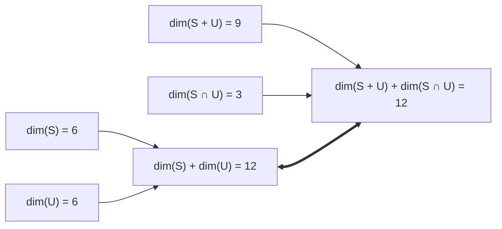

$$
\boxed{\dim(S) + \dim(U) = \dim(S + U) + \dim(S \cap U)}
$$
代入具体数值：
$$
6 + 6 = 9 + 3 = 12
$$
这个公式对于任意有限维向量空间的任意两个子空间恒成立！

*⏱ 时间戳：00:13:30 · 📷 板书截图 · [在 B 站观看对应片段 (P11 00:13:30)](https://www.bilibili.com/video/BV1ix411f7Yp/?p=11&t=810)*

---

### 3. 微分方程解空间的向量空间本质

*(参考时间: 00:15:00 · [视频跳转 (P11 00:15:00)](https://www.bilibili.com/video/BV1ix411f7Yp/?p=11&t=900))*

线性代数的威力和普适性远不止于矩阵。考察经典的常系数线性齐次微分方程：

$$
\frac{d^2 y}{dx^2} + y = 0 \quad (y'' + y = 0)
$$

在微积分中，我们知道其通解为：
$$
y(x) = c_1 \cos(x) + c_2 \sin(x), \quad \forall c_1, c_2 \in \mathbb{R}
$$

从线性代数的高维视角审视：
- 满足该方程的所有解函数集合，构成一个合法的实向量空间！
- 验证封闭性：若 $y_1, y_2$ 是解，则任何线性组合 $c y_1 + d y_2$ 依然满足方程；
- $\cos(x)$ 与 $\sin(x)$ 线性无关，且张成了全部解集合；
- 因此，**$\{\cos(x), \sin(x)\}$ 构成了解空间的一组基**！
- **解空间的维数严格等于 2**（这与微分方程的阶数 2 精确对应）。

我们也可以选取另一组等价的复数基：$\{e^{ix}, e^{-ix}\}$。基可以有多种选择，但维数永远是 2。

*⏱ 时间戳：00:16:40 · 📷 板书截图 · [在 B 站观看对应片段 (P11 00:16:40)](https://www.bilibili.com/video/BV1ix411f7Yp/?p=11&t=1000)*

---

### 4. 秩 1 矩阵（Rank 1 Matrices）：所有矩阵的基本积木

*(参考时间: 00:20:00 · [视频跳转 (P11 00:20:00)](https://www.bilibili.com/video/BV1ix411f7Yp/?p=11&t=1200))*

现在回到矩阵理论。在线性代数中，最简单、最根本的非零矩阵是**秩 1 矩阵（Rank 1 Matrix）**。

#### 4.1 秩 1 矩阵的结构定理

> **定理：秩 1 矩阵的外积表示**  
> 任意一个秩为 1 的矩阵 $A$，都可以精确分解为一个列向量 $u$ 与一个行向量 $v^T$ 的外积：
> $$
> \boxed{A = u v^T}
> $$

例如取列向量 $u = \begin{bmatrix} 2 \\ 3 \end{bmatrix}$ 与行向量 $v^T = \begin{bmatrix} 1 & 4 & 5 \end{bmatrix}$：

$$
A = \begin{bmatrix} 2 \\ 3 \end{bmatrix} \begin{bmatrix} 1 & 4 & 5 \end{bmatrix}
= \begin{bmatrix}
2 \cdot 1 & 2 \cdot 4 & 2 \cdot 5 \\
3 \cdot 1 & 3 \cdot 4 & 3 \cdot 5
\end{bmatrix}
= \begin{bmatrix}
2 & 8 & 10 \\
3 & 12 & 15
\end{bmatrix}
$$

- 观察行：第二行恰好是第一行的 $1.5$ 倍，所有行都落在由 $v^T = \begin{bmatrix} 1 & 4 & 5 \end{bmatrix}$ 张成的一维行空间上！
- 观察列：第 2 列是第 1 列的 4 倍，第 3 列是第 1 列的 5 倍，所有列都落在由 $u = \begin{bmatrix} 2 \\ 3 \end{bmatrix}$ 张成的一维列空间上！
- 行空间维数 $= 1$，列空间维数 $= 1$，秩为 1。

*⏱ 时间戳：00:21:40 · 📷 板书截图 · [在 B 站观看对应片段 (P11 00:21:40)](https://www.bilibili.com/video/BV1ix411f7Yp/?p=11&t=1300)*

#### 4.2 为什么秩 1 矩阵如此重要？

因为**秩 1 矩阵是构建一切矩阵的原子构件（Building Blocks）**！

由矩阵消元或 SVD 分解可知：**任何一个秩为 $r$ 的矩阵，都可以拆解为 $r$ 个秩 1 矩阵之和**：
$$
A = u_1 v_1^T + u_2 v_2^T + \cdots + u_r v_r^T
$$

> [!WARNING] 秩 1 矩阵集合不是子空间！
> 两个秩 1 矩阵相加，其结果的秩通常会跃升为 2（或变为 0 矩阵）。它对加法不封闭，因此**全体秩 1 矩阵不构成向量子空间**。

*⏱ 时间戳：00:25:20 · 📷 板书截图 · [在 B 站观看对应片段 (P11 00:25:20)](https://www.bilibili.com/video/BV1ix411f7Yp/?p=11&t=1520)*

---

### 5. 子空间实例：分量和为 0 的超平面

*(参考时间: 00:28:00 · [视频跳转 (P11 00:28:00)](https://www.bilibili.com/video/BV1ix411f7Yp/?p=11&t=1680))*

考察四维欧氏空间 $\mathbb{R}^4$ 中所有满足下列代数约束的向量 $v = \begin{bmatrix} v_1 \\ v_2 \\ v_3 \\ v_4 \end{bmatrix}$：

$$
v_1 + v_2 + v_3 + v_4 = 0
$$

这构成了 $\mathbb{R}^4$ 的一个子空间吗？它的维数是多少？

#### 5.1 零空间视角的秒杀

将这个单方程改写为矩阵形式：

$$
Av = \begin{bmatrix} 1 & 1 & 1 & 1 \end{bmatrix} \begin{bmatrix} v_1 \\ v_2 \\ v_3 \\ v_4 \end{bmatrix} = [0]
$$

- 这是一个 $1 \times 4$ 矩阵（1 行 4 列）；
- 该集合正是矩阵 $A = \begin{bmatrix} 1 & 1 & 1 & 1 \end{bmatrix}$ 的**零空间 $N(A)$**！
- 矩阵的秩 $r = 1$（仅第 1 列为主元，后 3 列全为自由列）；
- 由秩-零化度定理，零空间的维数为：
  $$
  \dim(N(A)) = n - r = 4 - 1 = \mathbf{3}
  $$

这是一个嵌入在四维欧氏空间中的三维超平面！

*⏱ 时间戳：00:30:20 · 📷 板书截图 · [在 B 站观看对应片段 (P11 00:30:20)](https://www.bilibili.com/video/BV1ix411f7Yp/?p=11&t=1820)*

#### 5.2 寻找零空间的一组基

分别令自由变量 $(v_2, v_3, v_4)$ 取 $(1, 0, 0), (0, 1, 0), (0, 0, 1)$，由 $v_1 = -v_2 - v_3 - v_4$ 迅速解出 3 个特解基向量：

$$
s_1 = \begin{bmatrix} -1 \\ 1 \\ 0 \\ 0 \end{bmatrix}, \quad
s_2 = \begin{bmatrix} -1 \\ 0 \\ 1 \\ 0 \end{bmatrix}, \quad
s_3 = \begin{bmatrix} -1 \\ 0 \\ 0 \\ 1 \end{bmatrix}
$$

这 3 个特解相互独立，张成了整个三维子空间。

同时，矩阵的行空间 $C(A^T)$ 是由 $\begin{bmatrix} 1 \\ 1 \\ 1 \\ 1 \end{bmatrix}$ 张成的一维直线。下一讲我们将看到：**行空间这条直线与零空间这个三维超平面，在几何上是严格相互垂直正交的！**

*⏱ 时间戳：00:36:20 · 📷 板书截图 · [在 B 站观看对应片段 (P11 00:36:20)](https://www.bilibili.com/video/BV1ix411f7Yp/?p=11&t=2180)*

---

### 6. 图与网络引言：小世界图（Small World Graphs）

*(参考时间: 00:40:00 · [视频跳转 (P11 00:40:00)](https://www.bilibili.com/video/BV1ix411f7Yp/?p=11&t=2400))*

在全讲最后，Strang 教授引入了现代应用数学中最为广泛的网络模型——**图（Graphs）**。

一个图由两个基本集合构成：
1. **节点集合（Nodes / Vertices）**：例如网络中的计算机、电网中的变电站、人际关系中的个人；
2. **边集合（Edges）**：连接两个节点的连线，代表通信线路、输电电缆或朋友关系。

*⏱ 时间戳：00:43:50 · 📷 板书截图 · [在 B 站观看对应片段 (P11 00:43:50)](https://www.bilibili.com/video/BV1ix411f7Yp/?p=11&t=2630)*

#### 6.1 小世界网络模型（Watts-Strogatz）

Strang 教授特别提到了著名的**小世界网络（Small World Graphs）**与“六度分隔（Six Degrees of Separation）”理论：
- 在一个环状网络中，每个人只与近邻相连，信息传递非常慢（平均路径长）；
- 如果随机为远距离节点之间添加几条“捷径（Shortcuts）”，网络的整体连通性将发生雪崩式的突变——平均最短路径急剧缩小，同时依然保持极高的局部聚集度！
- 万维网（World Wide Web）、神经元突触网络以及航空航线，都服从小世界图规律。

下一讲（第 12 讲），我们将把线性代数的四大基本子空间与微积分理论，全部倾注到图与网络之中，揭开**关联矩阵（Incidence Matrix）**的壮丽篇章！

---

## 第 12 讲：图、网络与关联矩阵

> 📺 **视频回链**：[B 站第 12 P：图、网络与关联矩阵](https://www.bilibili.com/video/BV1ix411f7Yp/?p=12)（⏱ 47分42秒 · 10 截图）  
> 📖 **官方材料**：[MIT OCW 对应讲义与总结](https://ocw.mit.edu/courses/18-06-linear-algebra-spring-2010/resources/lecture-12-graphs-networks-incidence-matrices/)  
> 💡 **核心精要**：网络拓扑建模、5x4 关联矩阵 A、电势差算子 e=Ax、基尔霍夫定律 KCL 与回路电流、Rank-Nullity 证明欧拉公式、AᵀCAx=f。

---

### 1. 现实工程与物理世界的网络抽象：图模型

*(参考时间: 00:01:00 · [视频跳转 (P12 00:01:00)](https://www.bilibili.com/video/BV1ix411f7Yp/?p=12&t=60))*

线性代数在工程科学中最为壮丽的应用之一，就是对**物理网络（Networks）**的分析。无论是电路网络、城市供水管网、建筑桁架结构，还是因特网与交通流，它们在拓扑上都可以抽象为一个**图（Graph）**。

在这一讲中，Strang 教授引入了一个包含 **4 个节点（Nodes）**和 **5 条有向边（Edges）**的经典图模型：

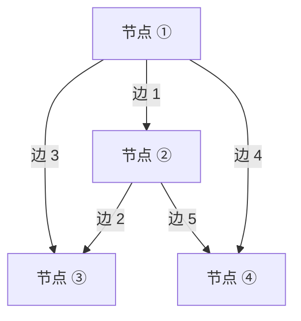

- 节点集合：$\{1, 2, 3, 4\}$（$n = 4$）；
- 有向边集合：5 条带有箭头方向的连接线（$m = 5$）；
  - 边 1：$1 \to 2$
  - 边 2：$2 \to 3$
  - 边 3：$1 \to 3$（与边 1、边 2 构成一个三角形回路）
  - 边 4：$1 \to 4$
  - 边 5：$2 \to 4$

*⏱ 时间戳：00:03:00 · 📷 板书截图 · [在 B 站观看对应片段 (P12 00:03:00)](https://www.bilibili.com/video/BV1ix411f7Yp/?p=12&t=180)*

---

### 2. 关联矩阵（Incidence Matrix, $A$）的构造

*(参考时间: 00:05:00 · [视频跳转 (P12 00:05:00)](https://www.bilibili.com/video/BV1ix411f7Yp/?p=12&t=300))*

如何将这样一个拓扑图，转化为线性代数可以运算的矩阵？

我们构造**关联矩阵（Incidence Matrix）$A$**：
- **行（Rows）代表边**：共有 $m = 5$ 条边，故有 5 行；
- **列（Columns）代表节点**：共有 $n = 4$ 个节点，故有 4 列；
- **矩阵元素规则**：对于边 $k$ 从节点 $i$ 指向节点 $j$：
  - 在起始节点列（第 $i$ 列）填 **$-1$**；
  - 在终止节点列（第 $j$ 列）填 **$+1$**；
  - 其余无连接的节点列填 **$0$**。

根据图的连接关系，写出完整的 $5 \times 4$ 关联矩阵：

$$
A = \begin{bmatrix}
-1 & 1 & 0 & 0 & \text{ (边 1: } 1 \to 2) \\
0 & -1 & 1 & 0 & \text{ (边 2: } 2 \to 3) \\
-1 & 0 & 1 & 0 & \text{ (边 3: } 1 \to 3) \\
-1 & 0 & 0 & 1 & \text{ (边 4: } 1 \to 4) \\
0 & -1 & 0 & 1 & \text{ (边 5: } 2 \to 4)
\end{bmatrix}
$$

每一行都恰好有一个 $-1$ 和一个 $+1$，其余全为 0。

*⏱ 时间戳：00:06:50 · 📷 板书截图 · [在 B 站观看对应片段 (P12 00:06:50)](https://www.bilibili.com/video/BV1ix411f7Yp/?p=12&t=410)*

---

### 3. 零空间 $N(A)$ 与节点电势（Potentials）

*(参考时间: 00:09:00 · [视频跳转 (P12 00:09:00)](https://www.bilibili.com/video/BV1ix411f7Yp/?p=12&t=540))*

现在，四个基本子空间的深刻物理涵义开始浮出水面。

设未知向量 $x = \begin{bmatrix} x_1 \\ x_2 \\ x_3 \\ x_4 \end{bmatrix} \in \mathbb{R}^4$ 表示**各个节点上的电势（Potentials）**。

计算矩阵向量乘积 $Ax$：

$$
Ax =
\begin{bmatrix}
-1 & 1 & 0 & 0 \\
0 & -1 & 1 & 0 \\
-1 & 0 & 1 & 0 \\
-1 & 0 & 0 & 1 \\
0 & -1 & 0 & 1
\end{bmatrix}
\begin{bmatrix} x_1 \\ x_2 \\ x_3 \\ x_4 \end{bmatrix}
=
\begin{bmatrix}
x_2 - x_1 \\
x_3 - x_2 \\
x_3 - x_1 \\
x_4 - x_1 \\
x_4 - x_2
\end{bmatrix}
= e
$$

> [!NOTE] $Ax$ 的物理本质：电势差（Potential Differences）
> **矩阵 $A$ 是一个差分算子！** $Ax$ 计算的正是**网络中每条边两端的电势降（电压差 $e = Ax$）**！

*⏱ 时间戳：00:10:40 · 📷 板书截图 · [在 B 站观看对应片段 (P12 00:10:40)](https://www.bilibili.com/video/BV1ix411f7Yp/?p=12&t=640)*

#### 3.1 求解零空间 $Ax = \mathbf{0}$

$$
Ax = \mathbf{0} \iff
\begin{cases}
x_2 - x_1 = 0 \\
x_3 - x_2 = 0 \\
x_3 - x_1 = 0 \\
x_4 - x_1 = 0 \\
x_4 - x_2 = 0
\end{cases}
\iff x_1 = x_2 = x_3 = x_4
$$

所有节点电势必须严格相等！零空间的所有解形如：

$$
x = c \begin{bmatrix} 1 \\ 1 \\ 1 \\ 1 \end{bmatrix}, \quad \forall c \in \mathbb{R}
$$

- 零空间 $N(A)$ 是一维的，**$\dim(N(A)) = 1$**；
- 物理意义：**电压的绝对数值没有物理意义，只有相对电势差才能驱动物理流动！** 如果把所有节点的电位同时抬高 100 伏，网络内部的电势差完全不变。
- 为了消除这 1 个维度的自由度，工程师在电路中必须**接地（Grounding）**，即固定某一个参考节点的电位为 0（如令 $x_4 = 0$）。

*⏱ 时间戳：00:14:20 · 📷 板书截图 · [在 B 站观看对应片段 (P12 00:14:20)](https://www.bilibili.com/video/BV1ix411f7Yp/?p=12&t=860)*

---

### 4. 矩阵的秩与行空间：树（Trees）的拓扑

*(参考时间: 00:19:00 · [视频跳转 (P12 00:19:00)](https://www.bilibili.com/video/BV1ix411f7Yp/?p=12&t=1140))*

由秩-零化度定理：
$$
\text{rank}(A) = r = n - \dim(N(A)) = 4 - 1 = \mathbf{3}
$$

关联矩阵 $A$ 的秩为 3。这意味着 $A$ 的 5 个行向量中，只有 3 个是线性无关的！

哪些行是相关的？
观察由节点 1、2、3 构成的闭合回路：
- 边 1: $x_2 - x_1$（行 1）；
- 边 2: $x_3 - x_2$（行 2）；
- 边 3: $x_3 - x_1$（行 3）；
显而易见：
$$
\text{行 1} + \text{行 2} = (x_2 - x_1) + (x_3 - x_2) = x_3 - x_1 = \text{行 3}!
$$
行 3 完全是多余的，它对应网络中的一个**闭合回路（Loop）**！

> [!IMPORTANT] 树与行空间基定理
> - **无环的连通图称为树（Tree）**；
> - 树所包含的边数永远等于 **$\text{Nodes} - 1 = 4 - 1 = 3$**；
> - **树对应的各行在关联矩阵中必然线性无关，构成了行空间的一组基！**

*⏱ 时间戳：00:20:40 · 📷 板书截图 · [在 B 站观看对应片段 (P12 00:20:40)](https://www.bilibili.com/video/BV1ix411f7Yp/?p=12&t=1240)*

---

### 5. 左零空间 $N(A^T)$ 与基尔霍夫电流定律（KCL）

*(参考时间: 00:25:00 · [视频跳转 (P12 00:25:00)](https://www.bilibili.com/video/BV1ix411f7Yp/?p=12&t=1500))*

现在考察转置矩阵 $A^T$。此时，未知向量 $y = \begin{bmatrix} y_1 \\ y_2 \\ y_3 \\ y_4 \\ y_5 \end{bmatrix} \in \mathbb{R}^5$ 表示**流经各条边上的电流（Currents）**。

写出方程 $A^T y = \mathbf{0}$：

$$
A^T y =
\begin{bmatrix}
-1 & 0 & -1 & -1 & 0 \\
1 & -1 & 0 & 0 & -1 \\
0 & 1 & 1 & 0 & 0 \\
0 & 0 & 0 & 1 & 1
\end{bmatrix}
\begin{bmatrix} y_1 \\ y_2 \\ y_3 \\ y_4 \\ y_5 \end{bmatrix}
=
\begin{bmatrix}
-y_1 - y_3 - y_4 \\
y_1 - y_2 - y_5 \\
y_2 + y_3 \\
y_4 + y_5
\end{bmatrix}
=
\begin{bmatrix} 0 \\ 0 \\ 0 \\ 0 \end{bmatrix}
$$

展开每一行：
- 第 1 行：离开节点 1 的电流和等于 0；
- 第 2 行：流入节点 2 的电流等于流出节点 2 的电流；
- 第 3 行、第 4 行：节点 3 和节点 4 处的净电流为 0。

这正是物理学中著名的**基尔霍夫电流定律（Kirchhoff's Current Law, KCL）**！
$$
\boxed{A^T y = \mathbf{0} \iff \text{每个节点满足电荷守恒 / 电流守恒}}
$$

*⏱ 时间戳：00:26:00 · 📷 板书截图 · [在 B 站观看对应片段 (P12 00:26:00)](https://www.bilibili.com/video/BV1ix411f7Yp/?p=12&t=1560)*

#### 5.1 求解左零空间：环流（Loop Currents）

左零空间 $N(A^T)$ 的维数是多少？
$$
\dim(N(A^T)) = m - r = 5 - 3 = \mathbf{2}
$$

这 2 个自由度来自于网络中的 **2 个独立闭合回路（Independent Loops）**！

1. **第一个回路（由边 1, 2, 3 构成的小三角形）**：
   - 沿边 1（正向）、边 2（正向）、边 3（逆向）流通 1 单位环流：
   $$
   y_{(1)} = \begin{bmatrix} 1 \\ 1 \\ -1 \\ 0 \\ 0 \end{bmatrix}
   $$
2. **第二个回路（由边 3, 5, 4 构成的小三角形）**：
   - 沿边 3（正向）、边 2（逆向）、边 5（正向）、边 4（逆向）或直接在下方回路流动：
   $$
   y_{(2)} = \begin{bmatrix} 0 \\ 0 \\ 1 \\ -1 \\ 1 \end{bmatrix}
   $$

任意一个在节点处满足电荷守恒的电流向量，都可以分解为这两个独立回路电流的线性组合！

*⏱ 时间戳：00:31:40 · 📷 板书截图 · [在 B 站观看对应片段 (P12 00:31:40)](https://www.bilibili.com/video/BV1ix411f7Yp/?p=12&t=1900)*

*⏱ 时间戳：00:35:40 · 📷 板书截图 · [在 B 站观看对应片段 (P12 00:35:40)](https://www.bilibili.com/video/BV1ix411f7Yp/?p=12&t=2140)*

---

### 6. 拓扑学奇迹：线性代数证明欧拉公式

*(参考时间: 00:39:00 · [视频跳转 (P12 00:39:00)](https://www.bilibili.com/video/BV1ix411f7Yp/?p=12&t=2340))*

结合前面的维数定理：
- 节点数 $n = \text{Nodes}$；
- 边数 $m = \text{Edges}$；
- 矩阵的秩 $r = \text{Nodes} - 1$；
- 独立回路数（面数）$l = \dim(N(A^T)) = m - r = \text{Edges} - (\text{Nodes} - 1)$。

将等式稍作移项：
$$
\text{Loops} = \text{Edges} - \text{Nodes} + 1
$$
$$
\boxed{\text{Nodes} - \text{Edges} + \text{Loops} = 1}
$$

加上外部无限大的无界平面（面数 $F = \text{Loops} + 1$），就得到了拓扑学中最伟大的**欧拉多面体公式**：
$$
\mathbf{V - E + F = 2}
$$
线性代数的子空间维数定理，居然以如此纯粹的方式证明了深刻的拓扑几何学定理！

*⏱ 时间戳：00:40:20 · 📷 板书截图 · [在 B 站观看对应片段 (P12 00:40:20)](https://www.bilibili.com/video/BV1ix411f7Yp/?p=12&t=2420)*

---

### 7. 物理网络的全系统方程：$A^T C A x = f$

*(参考时间: 00:43:00 · [视频跳转 (P12 00:43:00)](https://www.bilibili.com/video/BV1ix411f7Yp/?p=12&t=2580))*

最后，我们将图的所有物理规律串联为一个完整的系统：

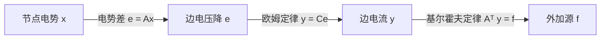

1. **几何拓扑关系**：$e = Ax$（电势差）；
2. **本构物理定律（欧姆定律）**：$y = C e = C A x$（其中对角矩阵 $C$ 包含各条边的电导率）；
3. **节点守恒平衡方程**：$A^T y = f$（其中 $f$ 为外部注入各节点的电源电流）。

将前两式代入第三式，得到掌控一切工程网络的**主方程**：

$$
\boxed{(A^T C A) x = f}
$$

矩阵 $K = A^T C A$ 必然是**对称半正定矩阵**（接地后变为严格对称正定，可逆！）。
这一优雅的对称形式，在有限元分析、弹性力学、流体力学以及图神经网络（GNN 图拉普拉斯算子）中无处不在！

*⏱ 时间戳：00:45:10 · 📷 板书截图 · [在 B 站观看对应片段 (P12 00:45:10)](https://www.bilibili.com/video/BV1ix411f7Yp/?p=12&t=2710)*

---

## 第 13 讲：第一次测验复习

> 📺 **视频回链**：[B 站第 13 P：第一次测验复习](https://www.bilibili.com/video/BV1ix411f7Yp/?p=13)（⏱ 47分35秒 · 10 截图）  
> 📖 **官方材料**：[MIT OCW 对应讲义与总结](https://ocw.mit.edu/courses/18-06-linear-algebra-spring-2010/resources/lecture-13-quiz-1-review/)  
> 💡 **核心精要**：两模块考点大结网、阶梯形完全解实战、B²=0 幂零矩阵秩不等式 r≤n/2 证明、真伪命题辨析、逆向构造子空间矩阵。

---

### 1. 第一次测验（Quiz 1）考点全景剖析

*(参考时间: 00:01:00 · [视频跳转 (P13 00:01:00)](https://www.bilibili.com/video/BV1ix411f7Yp/?p=13&t=60))*

本讲是 MIT 18.06 课程的第一次复习课。在这堂课中，Gilbert Strang 教授系统地回顾了从第一讲到第十二讲的所有核心精髓，并通过典型期中试题、经典反例与判断题，对知识点进行了全方位的串联与高强度检验。

测验涵盖两大核心模块：
1. **第一模块（Lec 01 ~ Lec 05）**：方程组的行图与列图、$Ax = b$、高斯消元法、初等矩阵与逆矩阵、对称矩阵与 $A = LU$ / $PA = LU$ 分解；
2. **第二模块（Lec 06 ~ Lec 12）**：向量空间与子空间、列空间 $C(A)$ 与零空间 $N(A)$、阶梯形矩阵与特解、完全解 $x = x_p + x_n$、线性无关、基与维数、四个基本子空间（基本定理第一部分）、矩阵空间以及网络关联矩阵。

*⏱ 时间戳：00:03:00 · 📷 板书截图 · [在 B 站观看对应片段 (P13 00:03:00)](https://www.bilibili.com/video/BV1ix411f7Yp/?p=13&t=180)*

---

### 2. 经典大题一：阶梯矩阵的完全解与四大子空间剖析

*(参考时间: 00:03:00 · [视频跳转 (P13 00:03:00)](https://www.bilibili.com/video/BV1ix411f7Yp/?p=13&t=180))*

Strang 教授给出了一个典型的消元终态矩阵 $U$（它实际上已经处于极简行阶梯形 $R$）：

$$
A \xrightarrow{\text{消元}} R = \begin{bmatrix}
\mathbf{1} & 2 & \mathbf{0} & 1 \\
\mathbf{0} & 0 & \mathbf{1} & 3 \\
0 & 0 & 0 & 0
\end{bmatrix}
$$

这是一个 $3 \times 4$ 矩阵（$m = 3, n = 4$）。

#### 2.1 秩与变量划分

- **主元（Pivots）**：位于第 1 行第 1 列、第 2 行第 3 列（均为 1）；
- **矩阵的秩**：$\text{rank}(R) = r = \mathbf{2}$；
- **主元列**：第 1 列、第 3 列 $\implies$ 主变量为 $x_1, x_3$；
- **自由列**：第 2 列、第 4 列 $\implies$ 自由变量为 $x_2, x_4$（自由变量数 $= n - r = 4 - 2 = \mathbf{2}$）。

#### 2.2 求解零空间 $N(R)$ 的特解基向量

由 $Rx = \mathbf{0}$：
1. 令 $x_2 = 1, x_4 = 0$：
   - 第二行：$x_3 + 3(0) = 0 \implies x_3 = 0$；
   - 第一行：$x_1 + 2(1) + 0 + 1(0) = 0 \implies x_1 = -2$；
   - 得到第一个特解：$s_1 = \begin{bmatrix} -2 \\ 1 \\ 0 \\ 0 \end{bmatrix}$。
2. 令 $x_2 = 0, x_4 = 1$：
   - 第二行：$x_3 + 3(1) = 0 \implies x_3 = -3$；
   - 第一行：$x_1 + 2(0) + 0 + 1(1) = 0 \implies x_1 = -1$；
   - 得到第二个特解：$s_2 = \begin{bmatrix} -1 \\ 0 \\ -3 \\ 1 \end{bmatrix}$。

$$
N(R) = \left\{ c_1 \begin{bmatrix} -2 \\ 1 \\ 0 \\ 0 \end{bmatrix} + c_2 \begin{bmatrix} -1 \\ 0 \\ -3 \\ 1 \end{bmatrix} \ \middle|\ c_1, c_2 \in \mathbb{R} \right\}
$$

*⏱ 时间戳：00:06:50 · 📷 板书截图 · [在 B 站观看对应片段 (P13 00:06:50)](https://www.bilibili.com/video/BV1ix411f7Yp/?p=13&t=410)*

#### 2.3 求解非齐次方程组的完全解

考察方程 $Rx = d$，其中令右端项为 $d = \begin{bmatrix} 1 \\ 2 \\ 0 \end{bmatrix}$（满足第 3 行 $0 = 0$ 的可解性相容条件）：
- **求特解 $x_p$**：将自由变量强制归零：$x_2 = 0, x_4 = 0$；
- 代入得：$x_1 = 1, x_3 = 2$；
- 于是 $x_p = \begin{bmatrix} 1 \\ 0 \\ 2 \\ 0 \end{bmatrix}$；
- **完全解**：
  $$
  \boxed{x_{\text{complete}} = x_p + x_n = \begin{bmatrix} 1 \\ 0 \\ 2 \\ 0 \end{bmatrix} + c_1 \begin{bmatrix} -2 \\ 1 \\ 0 \\ 0 \end{bmatrix} + c_2 \begin{bmatrix} -1 \\ 0 \\ -3 \\ 1 \end{bmatrix}}
  $$

*⏱ 时间戳：00:09:50 · 📷 板书截图 · [在 B 站观看对应片段 (P13 00:09:50)](https://www.bilibili.com/video/BV1ix411f7Yp/?p=13&t=590)*

#### 2.4 写出该矩阵的四个基本子空间

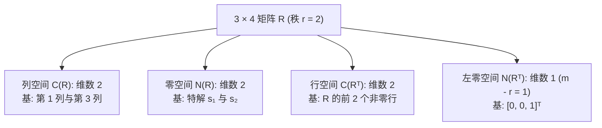

注意：对于化简阶梯矩阵 $R$ 本身，产生零行的第 3 行直接给出左零空间的基 $[0, 0, 1]^T$！

*⏱ 时间戳：00:13:30 · 📷 板书截图 · [在 B 站观看对应片段 (P13 00:13:30)](https://www.bilibili.com/video/BV1ix411f7Yp/?p=13&t=810)*

---

### 3. 经典大题二：平方为零的矩阵（$B^2 = \mathbf{0}$）

*(参考时间: 00:18:00 · [视频跳转 (P13 00:18:00)](https://www.bilibili.com/video/BV1ix411f7Yp/?p=13&t=1080))*

这是线性代数竞赛与期中考试中极具启发性的高频考题：

> **问题**：设 $B$ 是一个 $n \times n$ 实方阵，已知 $B^2 = \mathbf{0}$（即 $B$ 乘自身等于零矩阵）。
> 1. 列空间 $C(B)$ 与零空间 $N(B)$ 之间存在怎样的包含关系？
> 2. 矩阵 $B$ 的秩最大可能是多少？

*⏱ 时间戳：00:19:20 · 📷 板书截图 · [在 B 站观看对应片段 (P13 00:19:20)](https://www.bilibili.com/video/BV1ix411f7Yp/?p=13&t=1160)*

#### 3.1 包含关系的严格证明

任取列空间中的任意向量 $y \in C(B)$：
- 根据列空间的定义，存在某个向量 $x \in \mathbb{R}^n$，使得 $y = Bx$；
- 考察矩阵 $B$ 作用在 $y$ 上的效果：
  $$
  By = B(Bx) = B^2 x = \mathbf{0} x = \mathbf{0}
  $$
- 满足 $By = \mathbf{0}$ 说明：**向量 $y$ 必然属于矩阵 $B$ 的零空间 $N(B)$！**

由此严格证明了：
$$
\boxed{C(B) \subseteq N(B)}
$$
**列空间完全包含在零空间之中！** 矩阵的输出向量，全部被矩阵自身视为零空间的死角。

#### 3.2 秩的不等式推导

因为子集的维数绝不可能超越母集的维数：
$$
\dim(C(B)) \le \dim(N(B))
$$
代入维数公式：$\dim(C(B)) = r$ 且 $\dim(N(B)) = n - r$：
$$
r \le n - r \implies 2r \le n \implies \boxed{r \le \frac{n}{2}}
$$

> [!IMPORTANT] 幂零矩阵秩的上界
> **若一个 $n \times n$ 方阵满足 $B^2 = \mathbf{0}$，则其秩绝不可能超过矩阵阶数的一半：$r \le n/2$！**
> 例如对于 $3 \times 3$ 矩阵，秩只能是 0 或 1，绝不可能是 2 或 3！

*⏱ 时间戳：00:22:40 · 📷 板书截图 · [在 B 站观看对应片段 (P13 00:22:40)](https://www.bilibili.com/video/BV1ix411f7Yp/?p=13&t=1360)*

---

### 4. 概念辨析与经典判断题集锦（True or False）

*(参考时间: 00:25:00 · [视频跳转 (P13 00:25:00)](https://www.bilibili.com/video/BV1ix411f7Yp/?p=13&t=1500))*

Strang 教授通过一系列锋利的判断题，扫清同学们的认知误区：

#### 4.1 判断题 1：方程数少于未知数

> **题目**：方程组 $Ax = b$ 有 $m$ 个方程和 $n$ 个未知数，已知 $m < n$。  
> 1. 对任意 $b$，$Ax = b$ 是否必定有解？  
> 2. $Ax = \mathbf{0}$ 是否必定有非零解？

- **第 1 问答案：错误（False）！** 尽管未知数多，但行向量之间可能线性相关（例如两行完全矛盾或平行）。如果 $b$ 破坏了相容性，方程组可能无解。
- **第 2 问答案：正确（True）！** 齐次方程永远相容（至少有零解）。因为 $r \le m < n$，自由变量数 $n - r \ge n - m > 0$。至少存在 1 个自由变量，必定存在非零特解！

#### 4.2 判断题 2：四大子空间相同是否说明矩阵互为倍数？

> **题目**：如果矩阵 $A$ 和矩阵 $B$ 拥有完全相同的四个基本子空间，那么 $A$ 一定是 $B$ 的常数倍（$A = c B$）吗？

- **答案：大错特错（False）！**
- **最强反例**：任取两个不同的可逆 $n \times n$ 方阵，例如单位矩阵 $I$ 和某个不对称的可逆矩阵（如 $\begin{bmatrix} 1 & 1 \\ 0 & 1 \end{bmatrix}$）：
  - 它们的列空间都是整个 $\mathbb{R}^n$；
  - 它们的行空间都是整个 $\mathbb{R}^n$；
  - 它们的零空间都只有零向量 $\{\mathbf{0}\}$；
  - 它们的左零空间都只有零向量 $\{\mathbf{0}\}$；
  - 四大子空间一模一样，但它们显然不是倍数关系！

*⏱ 时间戳：00:27:10 · 📷 板书截图 · [在 B 站观看对应片段 (P13 00:27:10)](https://www.bilibili.com/video/BV1ix411f7Yp/?p=13&t=1630)*

*⏱ 时间戳：00:32:00 · 📷 板书截图 · [在 B 站观看对应片段 (P13 00:32:00)](https://www.bilibili.com/video/BV1ix411f7Yp/?p=13&t=1920)*

---

### 5. 逆向构造题：构造指定子空间的矩阵

*(参考时间: 00:38:00 · [视频跳转 (P13 00:38:00)](https://www.bilibili.com/video/BV1ix411f7Yp/?p=13&t=2280))*

这是检验对子空间理解是否透彻的最高境界——**给定子空间要求，反求矩阵**！

> **题目**：试构造一个 $3 \times 3$ 实矩阵 $A$，使其：
> 1. 列空间 $C(A)$ 包含向量 $\begin{bmatrix} 1 \\ 1 \\ 1 \end{bmatrix}$；
> 2. 零空间 $N(A)$ 包含向量 $\begin{bmatrix} 1 \\ 2 \\ 3 \end{bmatrix}$。

*⏱ 时间戳：00:39:40 · 📷 板书截图 · [在 B 站观看对应片段 (P13 00:39:40)](https://www.bilibili.com/video/BV1ix411f7Yp/?p=13&t=2380)*

#### 5.1 妙用秩 1 矩阵外积法

利用第 11 讲学过的外积法：设 $A$ 是一个秩 1 矩阵：
$$
A = u v^T, \quad \text{其中 } u = \begin{bmatrix} 1 \\ 1 \\ 1 \end{bmatrix}
$$
由于 $A$ 的所有列都是 $u$ 的倍数，这自动无条件满足了“列空间包含 $u$”！

现在考察零空间要求：需要 $A x = \mathbf{0}$，其中 $x = \begin{bmatrix} 1 \\ 2 \\ 3 \end{bmatrix}$：
$$
A x = (u v^T) x = u (v^T x) = \mathbf{0}
$$
因为 $u \neq \mathbf{0}$，这要求标量内积：
$$
v^T x = 0 \iff v_1(1) + v_2(2) + v_3(3) = 0
$$

我们只需任找一个与 $\begin{bmatrix} 1 \\ 2 \\ 3 \end{bmatrix}$ 垂直的点积为 0 的行向量 $v^T$ 即可！
例如取 $v^T = \begin{bmatrix} -2 & 1 & 0 \end{bmatrix}$（因为 $-2(1) + 1(2) + 0(3) = 0$）。

将 $u$ 与 $v^T$ 相乘：
$$
A = \begin{bmatrix} 1 \\ 1 \\ 1 \end{bmatrix} \begin{bmatrix} -2 & 1 & 0 \end{bmatrix}
=
\begin{bmatrix}
-2 & 1 & 0 \\
-2 & 1 & 0 \\
-2 & 1 & 0
\end{bmatrix}
$$

带入验证：
1. 列向量全是 $\begin{bmatrix} 1 \\ 1 \\ 1 \end{bmatrix}$ 的倍数，$C(A)$ 满足要求；
2. $A \begin{bmatrix} 1 \\ 2 \\ 3 \end{bmatrix} = \begin{bmatrix} -2 + 2 + 0 \\ -2 + 2 + 0 \\ -2 + 2 + 0 \end{bmatrix} = \begin{bmatrix} 0 \\ 0 \\ 0 \end{bmatrix}$，$N(A)$ 完美吻合！
只需两行推导，干净利落地完成了逆向构造！

---

### 6. 全讲总结与测验建议

*(参考时间: 00:46:00 · [视频跳转 (P13 00:46:00)](https://www.bilibili.com/video/BV1ix411f7Yp/?p=13&t=2760))*

在全讲末尾，Strang 教授给出了应对线性代数测验的黄金原则：
1. **抓牢矩阵的秩 $r$**：主元数决定一切子空间的维数；
2. **区分概念归属**：Rank 属于矩阵，Dimension 属于空间；
3. **熟练运用四大子空间定理**：维数守恒 $r + (n - r) = n$ 和 $r + (m - r) = m$；
4. **重视几何直觉与外积分解**：$A = u v^T$ 是分析和构造低秩矩阵的最强利器。

祝大家在测验中旗开得胜！第二模块至此圆满结课！

*⏱ 时间戳：00:46:10 · 📷 板书截图 · [在 B 站观看对应片段 (P13 00:46:10)](https://www.bilibili.com/video/BV1ix411f7Yp/?p=13&t=2770)*

---

