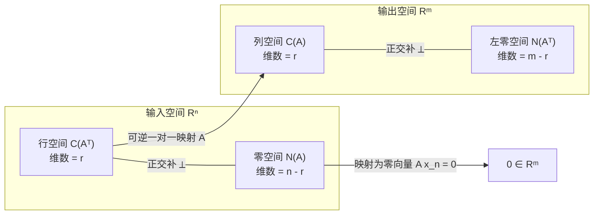
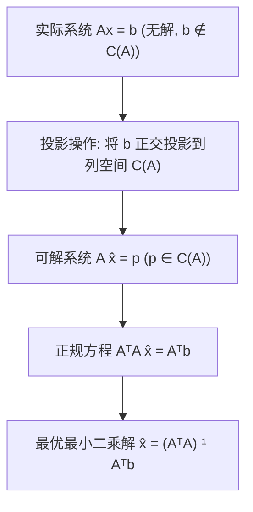
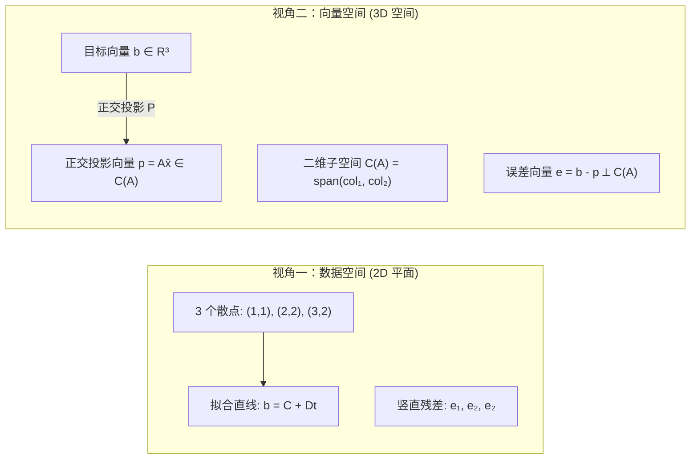
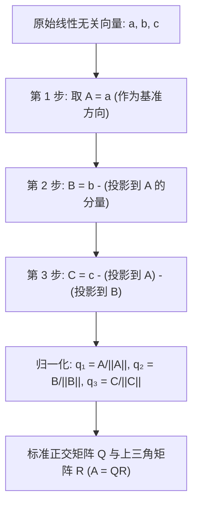
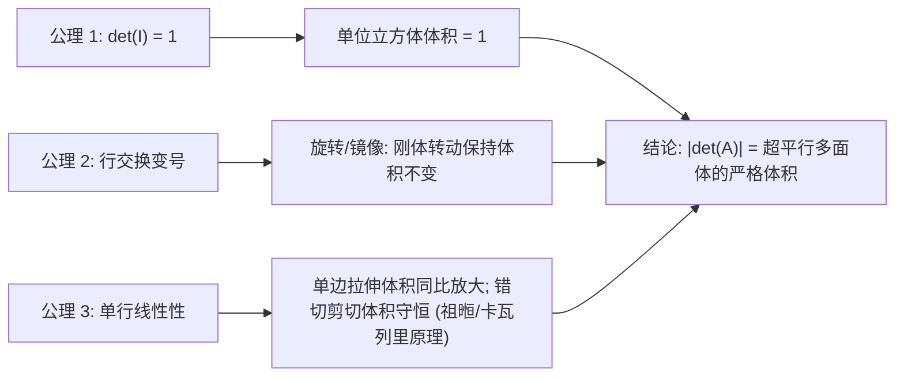

> **主讲**：Gilbert Strang 教授 · 麻省理工学院（MIT）  
> **出品**：VideoBook 视频开源技术电子书流水线  
> **全书规模**：全 35 讲完整精编 · 5 大知识体系模块 · 357 张原生高清板书实录 · 260 处核心推导时间戳  
> **视频原源**：[Bilibili 官方全套合集（BV1ix411f7Yp）](https://www.bilibili.com/video/BV1ix411f7Yp/) · [MIT OpenCourseWare 18.06 (Spring 2010)](https://ocw.mit.edu/courses/18-06-linear-algebra-spring-2010/)  
> **版权与许可**：本书文字内容与公式图解由 MIT OCW 开放课程资料翻译整理与结构化改编，授课者 Gilbert Strang，遵循 [CC BY-NC-SA 4.0](https://creativecommons.org/licenses/by-nc-sa/4.0/) 知识共享许可协议。全书板书截帧源自官方公开课录像。

---

> 📚 **模块导语**：引入内积与正交性几何概念，证明四个基本子空间的正交补关系；系统阐述子空间投影与投影矩阵 $P = A(A^T A)^{-1}A^T$，彻底解决数据科学核心问题——不相容方程组的最小二乘法；讲解 Gram-Schmidt 正交化算法与 $A = QR$ 分解；全面剖析行列式的三大公理、代数余子式大公式与几何体积诠释。

---

## 第 14 讲：正交向量与正交子空间

> 📺 **视频回链**：[B 站第 14 P：正交向量与正交子空间](https://www.bilibili.com/video/BV1ix411f7Yp/?p=14)（⏱ 49分37秒 · 10 截图）  
> 📖 **官方材料**：[MIT OCW 对应讲义与总结](https://ocw.mit.edu/courses/18-06-linear-algebra-spring-2010/resources/lecture-14-orthogonal-vectors-and-subspaces/)  
> 💡 **核心精要**：正交性与勾股定理、行空间与零空间正交补、基本定理第二部分、不相容方程组与正规方程序幕。

---

### 1. 向量的正交性与毕达哥拉斯定理

*(参考时间: 00:01:00 · [视频跳转 (P14 00:01:00)](https://www.bilibili.com/video/BV1ix411f7Yp/?p=14&t=60))*

在进入本课程后半程时，我们将迎来线性代数中最具几何美感和实用价值的工具——**正交性（Orthogonality）**。

正交是“垂直”在高维空间的数学推广。对于两个向量 $x, y \in \mathbb{R}^n$，它们相互正交的充要代数条件是**点积为零**：

$$
x^T y = 0 \quad \left(\text{等价于 } y^T x = 0\right)
$$

写成分量形式即为：
$$
x^T y = x_1 y_1 + x_2 y_2 + \cdots + x_n y_n = 0
$$

*⏱ 时间戳：00:03:30 · 📷 板书截图 · [在 B 站观看对应片段 (P14 00:03:30)](https://www.bilibili.com/video/BV1ix411f7Yp/?p=14&t=210)*

#### 1.1 为什么点积为零等价于几何直角？

毕达哥拉斯定理（勾股定理）告诉我们：直角三角形两直角边的平方和等于斜边的平方。以 $x$ 和 $y$ 为直角边，斜边就是 $x + y$（或 $x - y$）。

在 $\mathbb{R}^n$ 空间中，向量 $x$ 的长度（范数）平方定义为：
$$
\|x\|^2 = x^T x = x_1^2 + x_2^2 + \cdots + x_n^2
$$

当且仅当 $x \perp y$ 时，勾股定理成立：
$$
\|x\|^2 + \|y\|^2 = \|x + y\|^2
$$

展开右侧的内积表达式：
$$
\begin{aligned}
\|x + y\|^2 &= (x + y)^T (x + y) \\
&= x^T x + x^T y + y^T x + y^T y \\
&= \|x\|^2 + 2 x^T y + \|y\|^2
\end{aligned}
$$

两边消去 $\|x\|^2 + \|y\|^2$，立即得到：
$$
2 x^T y = 0 \implies \boxed{x^T y = 0}
$$

这一优美的代数推导说明：**点积为零是勾股定理在任何有限维空间成立的绝对等价条件**。特别地，零向量 $\mathbf{0}$ 与任何向量都正交，因为 $\mathbf{0}^T y = 0$。

*⏱ 时间戳：00:06:50 · 📷 板书截图 · [在 B 站观看对应片段 (P14 00:06:50)](https://www.bilibili.com/video/BV1ix411f7Yp/?p=14&t=410)*

---

### 2. 正交子空间（Orthogonal Subspaces）

*(参考时间: 00:08:30 · [视频跳转 (P14 00:08:30)](https://www.bilibili.com/video/BV1ix411f7Yp/?p=14&t=510))*

将正交的概念从“两个向量”提升到“两个子空间”：

> **定义（正交子空间）**：设 $V$ 和 $W$ 是同一个欧氏空间 $\mathbb{R}^n$ 中的两个子空间。若对任意 $v \in V$ 和任意 $w \in W$，均有 $v^T w = 0$，则称子空间 $V$ 与 $W$ **相互正交**，记作 $V \perp W$。

*⏱ 时间戳：00:10:50 · 📷 板书截图 · [在 B 站观看对应片段 (P14 00:10:50)](https://www.bilibili.com/video/BV1ix411f7Yp/?p=14&t=650)*

#### 2.1 教室墙面与地板是正交子空间吗？

Strang 教授在这里给出了一个极其生动深刻的直观反例：**黑板所在的垂直墙面与教室地板是正交子空间吗？**

在日常语言中，人们常说“墙面与地面垂直（$90^\circ$）”。但在严格的线性代数中：
- 墙面包含墙面上的所有方向向量；
- 地面包含地面上的所有方向向量；
- 墙面与地面的**交线**上的非零向量，既在墙面内，又在地面内！
- 如果一个非零向量 $v$ 同时属于墙面和地面，那么如果两个子空间正交，必须有 $v^T v = \|v\|^2 = 0$，这只能导出 $v = \mathbf{0}$！

因此，墙面与地面**绝不是正交子空间**！

> **核心结论**：如果两个子空间 $V$ 与 $W$ 相互正交，它们的交集只能包含零向量：
> $$
> V \perp W \implies V \cap W = \{\mathbf{0}\}
> $$

*⏱ 时间戳：00:14:20 · 📷 板书截图 · [在 B 站观看对应片段 (P14 00:14:20)](https://www.bilibili.com/video/BV1ix411f7Yp/?p=14&t=860)*

---

### 3. 四个基本子空间的正交性：基本定理第二部分

*(参考时间: 00:20:00 · [视频跳转 (P14 00:20:00)](https://www.bilibili.com/video/BV1ix411f7Yp/?p=14&t=1200))*

在第 10 讲中，我们学习了四个基本子空间的维数关系（基本定理第一部分）。现在，我们将揭示它们在几何上的垂直对偶关系：

$$
\boxed{\text{行空间 } C(A^T) \perp \text{零空间 } N(A) \quad \left(\text{在 } \mathbb{R}^n \text{ 中}\right)}
$$
$$
\boxed{\text{列空间 } C(A) \perp \text{左零空间 } N(A^T) \quad \left(\text{在 } \mathbb{R}^m \text{ 中}\right)}
$$

#### 3.1 严格证明：为什么行空间垂直于零空间？

根据零空间的定义，$x \in N(A)$ 意味着齐次方程组 $Ax = \mathbf{0}$ 成立：

$$
Ax = \begin{bmatrix} \text{row}_1 \\ \text{row}_2 \\ \vdots \\ \text{row}_m \end{bmatrix} x = \begin{bmatrix} \text{row}_1 \cdot x \\ \text{row}_2 \cdot x \\ \vdots \\ \text{row}_m \cdot x \end{bmatrix} = \begin{bmatrix} 0 \\ 0 \\ \vdots \\ 0 \end{bmatrix}
$$

这说明 $x$ 垂直于矩阵 $A$ 的**每一行**！

*⏱ 时间戳：00:21:40 · 📷 板书截图 · [在 B 站观看对应片段 (P14 00:21:40)](https://www.bilibili.com/video/BV1ix411f7Yp/?p=14&t=1300)*

而行空间 $C(A^T)$ 中的任意向量 $v$ 都是这 $m$ 个行向量的线性组合：
$$
v = c_1 \text{row}_1 + c_2 \text{row}_2 + \cdots + c_m \text{row}_m = A^T c
$$

因此，计算 $v$ 与 $x$ 的内积：
$$
v^T x = (A^T c)^T x = c^T A x = c^T (Ax) = c^T \mathbf{0} = 0
$$

由于 $v$ 和 $x$ 是各自子空间中的任意向量，我们证明了：**行空间中的每一个向量都严格垂直于零空间中的每一个向量**！

同理，将矩阵 $A$ 替换为 $A^T$，立即证明了**列空间与左零空间在 $\mathbb{R}^m$ 中相互正交**！

*⏱ 时间戳：00:26:00 · 📷 板书截图 · [在 B 站观看对应片段 (P14 00:26:00)](https://www.bilibili.com/video/BV1ix411f7Yp/?p=14&t=1560)*

---

### 4. 正交补（Orthogonal Complements）

*(参考时间: 00:28:00 · [视频跳转 (P14 00:28:00)](https://www.bilibili.com/video/BV1ix411f7Yp/?p=14&t=1680))*

行空间与零空间不仅是正交的，而且它们在 $\mathbb{R}^n$ 中是“恰好互补”的：
- 行空间维数：$\dim C(A^T) = r$
- 零空间维数：$\dim N(A) = n - r$
- 二者维数之和：$r + (n - r) = n$

这意味着：**零空间包含了 $\mathbb{R}^n$ 中与行空间正交的全部向量**！没有任何漏网之鱼。

> **定义（正交补）**：在 $\mathbb{R}^n$ 中，与子空间 $V$ 正交的所有向量构成的集合称为 $V$ 的正交补（Orthogonal Complement），记作 $V^\perp$。
> $$
> C(A^T)^\perp = N(A), \quad N(A)^\perp = C(A^T)
> $$
> 在 $\mathbb{R}^m$ 中：
> $$
> C(A)^\perp = N(A^T), \quad N(A^T)^\perp = C(A)
> $$

*⏱ 时间戳：00:31:30 · 📷 板书截图 · [在 B 站观看对应片段 (P14 00:31:30)](https://www.bilibili.com/video/BV1ix411f7Yp/?p=14&t=1890)*

---

### 5. 线性代数大图景的直角升级（The Big Picture with $\perp$）

*(参考时间: 00:34:00 · [视频跳转 (P14 00:34:00)](https://www.bilibili.com/video/BV1ix411f7Yp/?p=14&t=2040))*

现在，我们可以把第 10 讲的宏观大图景升级为带有**正交补直角符号**的完整版本（线性代数基本定理第二部分）：

每个向量 $x \in \mathbb{R}^n$ 都可以唯一正交分解为一个行空间分量和一个零空间分量：
$$
x = x_r + x_n, \quad x_r \in C(A^T), \; x_n \in N(A)
$$
当矩阵作用于 $x$ 时：
$$
A x = A (x_r + x_n) = A x_r + A x_n = A x_r + \mathbf{0} = A x_r
$$
**整个零空间被直接压缩为零，而行空间与列空间之间存在一一对应的可逆双射！**

*⏱ 时间戳：00:36:20 · 📷 板书截图 · [在 B 站观看对应片段 (P14 00:36:20)](https://www.bilibili.com/video/BV1ix411f7Yp/?p=14&t=2180)*

---

### 6. 不相容方程组 $Ax = b$ 与正交投影的序曲

*(参考时间: 00:40:00 · [视频跳转 (P14 00:40:00)](https://www.bilibili.com/video/BV1ix411f7Yp/?p=14&t=2400))*

在工程和真实科学实验中，我们经常遇到未知数较少而测量方程极多的超定方程组（$m > n$）。
例如：100 个测量点，只有 2 个未知参数。由于测量噪声，$b$ 几乎不可能恰好落在 $A$ 的列空间 $C(A)$ 内：
$$
b \notin C(A) \implies Ax = b \text{ 无解！}
$$

既然无法得到精确解，最佳的策略是什么？
**寻找一个最接近 $b$ 的解 $\hat{x}$，使得 $A\hat{x}$ 尽可能贴近 $b$！**

几何上，$A\hat{x}$ 必须位于列空间 $C(A)$ 中。要让距离 $\|b - A\hat{x}\|$ 最小，$A\hat{x}$ 必须是 $b$ 在列空间 $C(A)$ 上的**正交投影向量 $p$**：
$$
p = A \hat{x} \in C(A)
$$
误差向量 $e = b - p = b - A\hat{x}$ 必须垂直于整个列空间 $C(A)$：
$$
e \in C(A)^\perp = N(A^T) \implies A^T e = \mathbf{0}
$$

将 $e = b - A\hat{x}$ 代入：
$$
A^T (b - A\hat{x}) = \mathbf{0} \implies \boxed{A^T A \hat{x} = A^T b}
$$
这组至关重要的方程称为**正规方程组（Normal Equations）**！

*⏱ 时间戳：00:43:10 · 📷 板书截图 · [在 B 站观看对应片段 (P14 00:43:10)](https://www.bilibili.com/video/BV1ix411f7Yp/?p=14&t=2590)*

---

### 7. 矩阵 $A^T A$ 的性质与可逆性判据

*(参考时间: 00:45:00 · [视频跳转 (P14 00:45:00)](https://www.bilibili.com/video/BV1ix411f7Yp/?p=14&t=2700))*

方程 $A^T A \hat{x} = A^T b$ 无论原始矩阵 $A$ 尺寸如何，都具有极佳的代数性质：
1. **尺寸对称**：若 $A$ 是 $m \times n$ 长方矩阵，则 $A^T A$ 必为 $n \times n$ 的方阵；
2. **矩阵对称**：$(A^T A)^T = A^T (A^T)^T = A^T A$，因此 $A^T A$ 始终是对称矩阵。

#### 7.1 $A^T A$ 什么时候可逆？

要解出最优估计 $\hat{x} = (A^T A)^{-1} A^T b$，$A^T A$ 必须可逆。它在什么条件下可逆？

> **关键定理**：$A^T A$ 可逆（$n \times n$ 满秩）当且仅当 $A$ 的**列向量线性无关**（即 $A$ 的秩为 $n$，零空间只含零向量 $N(A) = \{\mathbf{0}\}$）。

**简捷证明**：
假设存在向量 $x$ 使得 $A^T A x = \mathbf{0}$。
在左侧同乘 $x^T$：
$$
x^T (A^T A x) = 0 \implies (A x)^T (A x) = 0 \implies \|A x\|^2 = 0 \implies A x = \mathbf{0}
$$
由于 $A$ 的各列线性无关，方程 $Ax = \mathbf{0}$ 的解只有 $x = \mathbf{0}$！
因此 $A^T A x = \mathbf{0}$ 只有零解，说明 $A^T A$ 的零空间只包含零向量，**$A^T A$ 必然可逆！**

下一讲，我们将全面展开子空间投影与最小二乘法的几何推导与投影矩阵 $P$。

*⏱ 时间戳：00:48:30 · 📷 板书截图 · [在 B 站观看对应片段 (P14 00:48:30)](https://www.bilibili.com/video/BV1ix411f7Yp/?p=14&t=2910)*

---

## 第 15 讲：子空间投影

> 📺 **视频回链**：[B 站第 15 P：子空间投影](https://www.bilibili.com/video/BV1ix411f7Yp/?p=15)（⏱ 48分50秒 · 10 截图）  
> 📖 **官方材料**：[MIT OCW 对应讲义与总结](https://ocw.mit.edu/courses/18-06-linear-algebra-spring-2010/resources/lecture-15-projections-onto-subspaces/)  
> 💡 **核心精要**：一维直线投影与 P=aaᵀ/aᵀa、多维子空间投影矩阵 P=A(AᵀA)⁻¹Aᵀ、对称性与幂等性 P²=P。

---

### 1. 投影的几何动机：为什么需要投影？

*(参考时间: 00:01:00 · [视频跳转 (P15 00:01:00)](https://www.bilibili.com/video/BV1ix411f7Yp/?p=15&t=60))*

在实际应用中，由于测量误差、方程过多或噪声干扰，线性方程组 $Ax = b$ 往往**无解**（$b$ 不在矩阵 $A$ 的列空间 $C(A)$ 中）。
然而科学与工程问题必须给出答案。我们无法改变客观的物理数据，但我们能做的是：
**在列空间 $C(A)$ 中寻找一个与 $b$ 距离最近的向量 $p$（投影），转而求解相容方程 $A\hat{x} = p$！**

这就是投影的核心使命。为了彻底掌握高维子空间的投影，我们从最简单的**一维直线投影**开始步步升级。

*⏱ 时间戳：00:03:20 · 📷 板书截图 · [在 B 站观看对应片段 (P15 00:03:20)](https://www.bilibili.com/video/BV1ix411f7Yp/?p=15&t=200)*

---

### 2. 一维直线投影：标量 $\hat{x}$ 与向量 $p$

*(参考时间: 00:04:00 · [视频跳转 (P15 00:04:00)](https://www.bilibili.com/video/BV1ix411f7Yp/?p=15&t=240))*

设通过原点和已知向量 $a$ 的直线为子空间 $L$。给定任意向量 $b$，求 $b$ 在该直线上的投影 $p$：
- 既然 $p$ 落在直线上，它必然是 $a$ 的某个标量倍数：
  $$
  p = \hat{x} a
  $$
- 从 $b$ 到 $p$ 的误差向量记为 $e$：
  $$
  e = b - p = b - \hat{x} a
  $$
- 投影的几何本质是**垂足**：误差向量 $e$ 必须与直线方向 $a$ 垂直！
  $$
  a \perp e \iff a^T e = 0
  $$

将 $e = b - \hat{x} a$ 代入正交条件：
$$
a^T (b - \hat{x} a) = 0 \implies a^T b - \hat{x} (a^T a) = 0
$$

因为 $a \neq \mathbf{0}$，标量 $a^T a = \|a\|^2 > 0$，立即解出最优乘数 $\hat{x}$：
$$
\boxed{\hat{x} = \frac{a^T b}{a^T a}}
$$

进而得到投影向量 $p$：
$$
\boxed{p = a \hat{x} = a \frac{a^T b}{a^T a}}
$$

> **三角学对照**：$\frac{a^T b}{\|a\| \|b\|} = \cos \theta$。因此 $\|p\| = \|b\| \cos \theta$，标量 $\hat{x} = \frac{\|b\|}{\|a\|} \cos \theta$，代数公式与初等三角投影完全吻合！

*⏱ 时间戳：00:06:40 · 📷 板书截图 · [在 B 站观看对应片段 (P15 00:06:40)](https://www.bilibili.com/video/BV1ix411f7Yp/?p=15&t=400)*

---

### 3. 一维投影矩阵 $P$

*(参考时间: 00:08:30 · [视频跳转 (P15 00:08:30)](https://www.bilibili.com/video/BV1ix411f7Yp/?p=15&t=510))*

线性代数的精髓在于：**将几何操作统一表达为矩阵变换**。我们希望找到一个矩阵 $P$，使得对任意向量 $b$，乘上 $P$ 就直接输出它的投影 $p$：
$$
p = P b
$$

观察上面的投影向量表达式，调整乘法结合顺序：
$$
p = a \left(\frac{a^T b}{a^T a}\right) = \frac{a (a^T b)}{a^T a} = \left(\frac{a a^T}{a^T a}\right) b
$$

从而得到了**一维投影矩阵**的表达式：
$$
\boxed{P = \frac{a a^T}{a^T a}}
$$

#### 3.1 警惕陷阱：为什么分子分母中的 $a$ 不能“约分”？
- **分母 $a^T a$** 是行向量乘列向量（内积），结果是一个**标量（数）**；
- **分子 $a a^T$** 是列向量乘行向量（外积），结果是一个 $n \times n$ 的**方阵**（秩为 1）！
一个矩阵除以一个数完全有意义，但绝不能把向量从矩阵分子中“随意约分”！

*⏱ 时间戳：00:09:40 · 📷 板书截图 · [在 B 站观看对应片段 (P15 00:09:40)](https://www.bilibili.com/video/BV1ix411f7Yp/?p=15&t=580)*

#### 3.2 投影矩阵的两大根本性质

任何投影矩阵都具备以下两个决定性的代数特征：

1. **对称性（Symmetric）**：
   $$
   P^T = \left(\frac{a a^T}{a^T a}\right)^T = \frac{(a a^T)^T}{a^T a} = \frac{(a^T)^T a^T}{a^T a} = \frac{a a^T}{a^T a} = P
   $$
2. **幂等性（Idempotent，$P^2 = P$）**：
   投影一次已经落在了直线上，再次投影依然保持在原地！
   $$
   P^2 = \left(\frac{a a^T}{a^T a}\right) \left(\frac{a a^T}{a^T a}\right) = \frac{a (a^T a) a^T}{(a^T a)^2} = \frac{(a^T a) \cdot (a a^T)}{(a^T a)^2} = \frac{a a^T}{a^T a} = P
   $$

此外，投影矩阵的列空间就是由 $a$ 张成的直线 $L$，其秩 $\text{rank}(P) = 1$。

*⏱ 时间戳：00:14:10 · 📷 板书截图 · [在 B 站观看对应片段 (P15 00:14:10)](https://www.bilibili.com/video/BV1ix411f7Yp/?p=15&t=850)*

---

### 4. 为什么要将问题拓展到多维高阶子空间？

*(参考时间: 00:19:00 · [视频跳转 (P15 00:19:00)](https://www.bilibili.com/video/BV1ix411f7Yp/?p=15&t=1140))*

现实中，不相容方程组 $Ax = b$ 的系数矩阵 $A$ 通常有多个列向量（$n > 1$）。
$b$ 是 $\mathbb{R}^m$ 中的测量向量，而 $A$ 的列向量 $a_1, a_2, \dots, a_n$ 张成了一个 $n$ 维子空间——列空间 $C(A)$。

当 $b \notin C(A)$ 时，$Ax = b$ 无解。我们要把 $b$ 投影到由全体列向量张成的**多维超平面**上！

*⏱ 时间戳：00:19:50 · 📷 板书截图 · [在 B 站观看对应片段 (P15 00:19:50)](https://www.bilibili.com/video/BV1ix411f7Yp/?p=15&t=1190)*

---

### 5. 多维子空间投影的几何与代数推导

*(参考时间: 00:24:00 · [视频跳转 (P15 00:24:00)](https://www.bilibili.com/video/BV1ix411f7Yp/?p=15&t=1440))*

假设矩阵 $A = \begin{bmatrix} a_1 & a_2 & \cdots & a_n \end{bmatrix}$ 的列向量线性无关。它们是子空间（列空间 $C(A)$）的一组基。
设 $p$ 为 $b$ 在 $C(A)$ 上的投影向量。

因为 $p \in C(A)$，$p$ 必为各列的线性组合：
$$
p = \hat{x}_1 a_1 + \hat{x}_2 a_2 + \cdots + \hat{x}_n a_n = A \hat{x}
$$
其中系数向量 $\hat{x} = \begin{bmatrix} \hat{x}_1 & \hat{x}_2 & \cdots & \hat{x}_n \end{bmatrix}^T$ 是我们要寻找的最佳权值。

*⏱ 时间戳：00:26:20 · 📷 板书截图 · [在 B 站观看对应片段 (P15 00:26:20)](https://www.bilibili.com/video/BV1ix411f7Yp/?p=15&t=1580)*

#### 5.1 误差向量垂直于整个平面

连接 $b$ 与投影 $p$ 的误差向量为：
$$
e = b - p = b - A \hat{x}
$$
$e$ 必须垂直于平面内的**每一个基向量**：
$$
\begin{cases}
a_1^T (b - A\hat{x}) = 0 \\
a_2^T (b - A\hat{x}) = 0 \\
\vdots \\
a_n^T (b - A\hat{x}) = 0
\end{cases}
$$

将这 $n$ 个联立方程写成极其优美的矩阵形式：
$$
\begin{bmatrix} a_1^T \\ a_2^T \\ \vdots \\ a_n^T \end{bmatrix} (b - A\hat{x}) = \begin{bmatrix} 0 \\ 0 \\ \vdots \\ 0 \end{bmatrix} \implies \boxed{A^T (b - A\hat{x}) = \mathbf{0}}
$$

展开即得经典神级方程——**正规方程组（Normal Equations）**：
$$
\boxed{A^T A \hat{x} = A^T b}
$$

> **与第 14 讲大图景呼应**：$A^T e = \mathbf{0}$ 意味着 $e \in N(A^T)$（误差在左零空间中）。而 $p \in C(A)$。
> 由于 $C(A) \perp N(A^T)$，误差向量天然且必须落在与列空间正交的补空间中！

*⏱ 时间戳：00:30:10 · 📷 板书截图 · [在 B 站观看对应片段 (P15 00:30:10)](https://www.bilibili.com/video/BV1ix411f7Yp/?p=15&t=1810)*

---

### 6. 高维投影矩阵 $P$ 的核心公式

*(参考时间: 00:33:00 · [视频跳转 (P15 00:33:00)](https://www.bilibili.com/video/BV1ix411f7Yp/?p=15&t=1980))*

当 $A$ 各列线性无关时，上一讲证明了 $A^T A$ 必定可逆。解出最优系数向量：
$$
\hat{x} = (A^T A)^{-1} A^T b
$$

将 $\hat{x}$ 代回投影向量 $p = A\hat{x}$：
$$
p = A \hat{x} = \underbrace{A (A^T A)^{-1} A^T}_{P} b
$$

于是，我们得到了贯穿整个应用数学的**高维投影矩阵大公式**：
$$
\boxed{P = A (A^T A)^{-1} A^T}
$$

#### 6.1 一维公式与高维公式的完美统一
- 当 $A$ 只有一列 $a$ 时：
  $$
  P = a (a^T a)^{-1} a^T = \frac{a a^T}{a^T a}
  $$
  高维公式在一维退化为之前的标量除法，完全自洽！

*⏱ 时间戳：00:34:50 · 📷 板书截图 · [在 B 站观看对应片段 (P15 00:34:50)](https://www.bilibili.com/video/BV1ix411f7Yp/?p=15&t=2090)*

---

### 7. 检验高维投影矩阵的两大铁律

*(参考时间: 00:36:30 · [视频跳转 (P15 00:36:30)](https://www.bilibili.com/video/BV1ix411f7Yp/?p=15&t=2190))*

无论公式多复杂，它必须满足投影矩阵的本质属性：

1. **对称性 $P^T = P$**：
   $$
   \begin{aligned}
   P^T &= \left[ A (A^T A)^{-1} A^T \right]^T = (A^T)^T \left[(A^T A)^{-1}\right]^T A^T \\
   &= A \left[(A^T A)^T\right]^{-1} A^T = A (A^T A)^{-1} A^T = P
   \end{aligned}
   $$
2. **幂等性 $P^2 = P$**：
   $$
   \begin{aligned}
   P^2 &= \left[ A (A^T A)^{-1} A^T \right] \left[ A (A^T A)^{-1} A^T \right] \\
   &= A (A^T A)^{-1} \underbrace{\left(A^T A\right) (A^T A)^{-1}}_{I} A^T \\
   &= A (A^T A)^{-1} A^T = P
   \end{aligned}
   $$

中间的 $(A^T A) (A^T A)^{-1}$ 完美抵消为单位阵 $I$！

*⏱ 时间戳：00:37:30 · 📷 板书截图 · [在 B 站观看对应片段 (P15 00:37:30)](https://www.bilibili.com/video/BV1ix411f7Yp/?p=15&t=2250)*

---

### 8. 两个极限特例与最小二乘法展望

*(参考时间: 00:41:00 · [视频跳转 (P15 00:41:00)](https://www.bilibili.com/video/BV1ix411f7Yp/?p=15&t=2460))*

#### 8.1 特例 1：若 $A$ 本身是方阵且可逆
如果 $A$ 是 $n \times n$ 可逆方阵，那么它的列空间就是整个 $\mathbb{R}^n$。任何向量 $b$ 本身就已经在列空间中，投影矩阵理应不做任何改变（即 $P = I$）。

代数展开验证：
$$
P = A (A^T A)^{-1} A^T = A A^{-1} (A^T)^{-1} A^T = I \cdot I = I
$$
公式完全符合直觉！

#### 8.2 特例 2：若 $b$ 垂直于列空间（$b \in N(A^T)$）
此时 $A^T b = \mathbf{0}$，代入公式立即有 $p = P b = \mathbf{0}$，投影点退化为原点！

#### 8.3 最小二乘法（Least Squares）的序幕
下一讲（第 16 讲），我们将把这一套强大的投影理论，应用到统计学与数据科学中最重要的问题：**用直线拟合散点数据（最小二乘法）**。当给出一组实验观测点 $(t_i, b_i)$ 时，如何通过投影矩阵找到那条最佳拟合直线？我们下节课见！

*⏱ 时间戳：00:43:20 · 📷 板书截图 · [在 B 站观看对应片段 (P15 00:43:20)](https://www.bilibili.com/video/BV1ix411f7Yp/?p=15&t=2600)*

---

## 第 16 讲：投影矩阵与最小二乘法

> 📺 **视频回链**：[B 站第 16 P：投影矩阵与最小二乘法](https://www.bilibili.com/video/BV1ix411f7Yp/?p=16)（⏱ 47分58秒 · 10 截图）  
> 📖 **官方材料**：[MIT OCW 对应讲义与总结](https://ocw.mit.edu/courses/18-06-linear-algebra-spring-2010/resources/lecture-16-projection-matrices-and-least-squares/)  
> 💡 **核心精要**：散点拟合实战、正规方程求解最佳直线、微积分与线性代数几何投影的等价性、AᵀA 可逆性终极定理。

---

### 1. 投影矩阵与互补投影回顾

*(参考时间: 00:01:00 · [视频跳转 (P16 00:01:00)](https://www.bilibili.com/video/BV1ix411f7Yp/?p=16&t=60))*

在第 15 讲中，我们推导出了将任意向量 $b$ 正交投影到矩阵 $A$ 的列空间 $C(A)$ 上的投影矩阵：
$$
P = A (A^T A)^{-1} A^T
$$
投影向量为 $p = P b$，而残差（误差）向量为：
$$
e = b - p = b - P b = (I - P) b
$$

矩阵 $I - P$ 同样是一个合法的投影矩阵！它将向量 $b$ 投影到与列空间正交的补空间——**左零空间 $N(A^T)$** 上。
- 显然 $(I - P)^T = I^T - P^T = I - P$（对称性）；
- $(I - P)^2 = I - 2P + P^2 = I - 2P + P = I - P$（幂等性）。

*⏱ 时间戳：00:03:10 · 📷 板书截图 · [在 B 站观看对应片段 (P16 00:03:10)](https://www.bilibili.com/video/BV1ix411f7Yp/?p=16&t=190)*

---

### 2. 经典数据拟合问题：寻找最佳拟合直线

*(参考时间: 00:05:30 · [视频跳转 (P16 00:05:30)](https://www.bilibili.com/video/BV1ix411f7Yp/?p=16&t=330))*

假设在实验中观测到 3 个时间点上的数据 $(t, b)$：
- $t_1 = 1, \; b_1 = 1$
- $t_2 = 2, \; b_2 = 2$
- $t_3 = 3, \; b_3 = 2$

这 3 个散点显然**不共线**（经过前两点的直线斜率为 1，在 $t=3$ 时应为 3，但实际观测值为 2）。
我们希望找到一条最佳直线：
$$
b = C + D t
$$
使得该直线能够“尽可能好地”代表这组数据。

*⏱ 时间戳：00:06:50 · 📷 板书截图 · [在 B 站观看对应片段 (P16 00:06:50)](https://www.bilibili.com/video/BV1ix411f7Yp/?p=16&t=410)*

---

### 3. 将拟合问题表达为矩阵方程 $Ax = b$

*(参考时间: 00:09:00 · [视频跳转 (P16 00:09:00)](https://www.bilibili.com/video/BV1ix411f7Yp/?p=16&t=540))*

如果直线能完美穿过这 3 个点，将 3 个点的坐标代入方程：
$$
\begin{cases}
C + 1 \cdot D = 1 \\
C + 2 \cdot D = 2 \\
C + 3 \cdot D = 2
\end{cases}
$$

写成紧凑的矩阵形式：
$$
\underbrace{\begin{bmatrix} 1 & 1 \\ 1 & 2 \\ 1 & 3 \end{bmatrix}}_{A} \underbrace{\begin{bmatrix} C \\ D \end{bmatrix}}_{x} = \underbrace{\begin{bmatrix} 1 \\ 2 \\ 2 \end{bmatrix}}_{b}
$$

这是一个 $3 \times 2$ 的超定方程组（3 个方程，只有 2 个未知数 $C$ 和 $D$）。
由于数据不共线，向量 $b = \begin{bmatrix} 1 & 2 & 2 \end{bmatrix}^T$ **不在**矩阵 $A$ 的列空间中，方程组**无精确解**！

*⏱ 时间戳：00:10:40 · 📷 板书截图 · [在 B 站观看对应片段 (P16 00:10:40)](https://www.bilibili.com/video/BV1ix411f7Yp/?p=16&t=640)*

---

### 4. 两个截然不同的几何视界

*(参考时间: 00:13:30 · [视频跳转 (P16 00:13:30)](https://www.bilibili.com/video/BV1ix411f7Yp/?p=16&t=810))*

Strang 教授在这里强调了理解最小二乘法的**两个关键几何视角**：

| 视角 | 所在空间 | 几何图景 |
| :--- | :--- | :--- |
| **视角一：数据空间** | 二维平面 $(t, b)$ | 3 个分离的数据点，1 条直线穿行其中。误差 $e_i = b_i - (C + D t_i)$ 是每个点到直线的**垂直竖直偏差**。 |
| **视角二：向量与子空间** | 三维欧氏空间 $\mathbb{R}^3$ | 目标向量 $b \in \mathbb{R}^3$。矩阵 $A$ 的两列张成二维平面 $C(A)$。$b$ 悬在平面外，$p$ 是 $b$ 在该平面上的**垂直垂足**！ |

*⏱ 时间戳：00:15:20 · 📷 板书截图 · [在 B 站观看对应片段 (P16 00:15:20)](https://www.bilibili.com/video/BV1ix411f7Yp/?p=16&t=920)*

---

### 5. 建立并求解正规方程组

*(参考时间: 00:18:30 · [视频跳转 (P16 00:18:30)](https://www.bilibili.com/video/BV1ix411f7Yp/?p=16&t=1110))*

根据正交投影原理，最佳解 $\hat{x} = \begin{bmatrix} \hat{C} \\ \hat{D} \end{bmatrix}$ 必须满足正规方程：
$$
A^T A \hat{x} = A^T b
$$

我们一步步计算左侧和右侧的矩阵乘积：
$$
A^T A = \begin{bmatrix} 1 & 1 & 1 \\ 1 & 2 & 3 \end{bmatrix} \begin{bmatrix} 1 & 1 \\ 1 & 2 \\ 1 & 3 \end{bmatrix} = \begin{bmatrix} 1+1+1 & 1+2+3 \\ 1+2+3 & 1^2+2^2+3^2 \end{bmatrix} = \begin{bmatrix} 3 & 6 \\ 6 & 14 \end{bmatrix}
$$

右端项：
$$
A^T b = \begin{bmatrix} 1 & 1 & 1 \\ 1 & 2 & 3 \end{bmatrix} \begin{bmatrix} 1 \\ 2 \\ 2 \end{bmatrix} = \begin{bmatrix} 1+2+2 \\ 1+4+6 \end{bmatrix} = \begin{bmatrix} 5 \\ 11 \end{bmatrix}
$$

于是，原始无解系统化为极其干净的 $2 \times 2$ 对称正定方程组：
$$
\begin{bmatrix} 3 & 6 \\ 6 & 14 \end{bmatrix} \begin{bmatrix} \hat{C} \\ \hat{D} \end{bmatrix} = \begin{bmatrix} 5 \\ 11 \end{bmatrix}
$$

*⏱ 时间戳：00:20:10 · 📷 板书截图 · [在 B 站观看对应片段 (P16 00:20:10)](https://www.bilibili.com/video/BV1ix411f7Yp/?p=16&t=1210)*

#### 5.1 求解最优参数

对应标量方程组：
$$
\begin{cases}
3 \hat{C} + 6 \hat{D} = 5 \\
6 \hat{C} + 14 \hat{D} = 11
\end{cases}
$$

将第一个方程乘 2：$6\hat{C} + 12\hat{D} = 10$。两式相减：
$$
2\hat{D} = 1 \implies \boxed{\hat{D} = \frac{1}{2}}
$$
代入第一个方程：
$$
3\hat{C} + 3 = 5 \implies 3\hat{C} = 2 \implies \boxed{\hat{C} = \frac{2}{3}}
$$

因此，最优拟合直线方程为：
$$
\boxed{b = \frac{2}{3} + \frac{1}{2} t}
$$

*⏱ 时间戳：00:25:30 · 📷 板书截图 · [在 B 站观看对应片段 (P16 00:25:30)](https://www.bilibili.com/video/BV1ix411f7Yp/?p=16&t=1530)*

---

### 6. 验证投影向量与残差的正交性

*(参考时间: 00:28:00 · [视频跳转 (P16 00:28:00)](https://www.bilibili.com/video/BV1ix411f7Yp/?p=16&t=1680))*

有了最优直线，我们来计算直线在 3 个观测点处给出的预测值（投影向量 $p = A\hat{x}$）：
- $t=1$: $p_1 = \frac{2}{3} + \frac{1}{2}(1) = \frac{7}{6}$
- $t=2$: $p_2 = \frac{2}{3} + \frac{1}{2}(2) = \frac{10}{6}$
- $t=3$: $p_3 = \frac{2}{3} + \frac{1}{2}(3) = \frac{13}{6}$

因此投影向量为：
$$
p = \begin{bmatrix} 7/6 \\ 10/6 \\ 13/6 \end{bmatrix}
$$

残差误差向量 $e = b - p$：
$$
e = \begin{bmatrix} 1 \\ 2 \\ 2 \end{bmatrix} - \begin{bmatrix} 7/6 \\ 10/6 \\ 13/6 \end{bmatrix} = \begin{bmatrix} -1/6 \\ 2/6 \\ -1/6 \end{bmatrix}
$$

*⏱ 时间戳：00:29:50 · 📷 板书截图 · [在 B 站观看对应片段 (P16 00:29:50)](https://www.bilibili.com/video/BV1ix411f7Yp/?p=16&t=1790)*

#### 6.1 奇迹般的正交检验

误差向量 $e$ 是否真的垂直于列空间 $C(A)$？
1. 与 $A$ 的第一列 $\begin{bmatrix} 1 & 1 & 1 \end{bmatrix}^T$ 点积：
   $$
   1 \cdot \left(-\frac{1}{6}\right) + 1 \cdot \left(\frac{2}{6}\right) + 1 \cdot \left(-\frac{1}{6}\right) = 0 \quad (\checkmark)
   $$
   **统计学意义**：这说明残差之和严格为零（$\sum e_i = 0$），拟合直线的平均偏差为零！
2. 与 $A$ 的第二列 $\begin{bmatrix} 1 & 2 & 3 \end{bmatrix}^T$ 点积：
   $$
   1 \cdot \left(-\frac{1}{6}\right) + 2 \cdot \left(\frac{2}{6}\right) + 3 \cdot \left(-\frac{1}{6}\right) = -\frac{1}{6} + \frac{4}{6} - \frac{3}{6} = 0 \quad (\checkmark)
   $$

两个内积全部严格为零！$e$ 完全垂直于平面内的两根基底，代数与几何达到完全一致。

*⏱ 时间戳：00:32:40 · 📷 板书截图 · [在 B 站观看对应片段 (P16 00:32:40)](https://www.bilibili.com/video/BV1ix411f7Yp/?p=16&t=1960)*

---

### 7. 微积分视角的惊人等价性

*(参考时间: 00:34:00 · [视频跳转 (P16 00:34:00)](https://www.bilibili.com/video/BV1ix411f7Yp/?p=16&t=2040))*

若不用线性代数，高斯（Gauss）与勒让德（Legendre）最初是如何求解最小二乘的？
通过微积分！定义总平方误差：
$$
E(C, D) = \|e\|^2 = (C + D - 1)^2 + (C + 2D - 2)^2 + (C + 3D - 2)^2
$$

为了找到极小值，分别对参数 $C$ 和 $D$ 求偏导并令其为零：
$$
\frac{\partial E}{\partial C} = 2(C + D - 1) + 2(C + 2D - 2) + 2(C + 3D - 2) = 0
$$
整理即得：$3C + 6D = 5$！

对 $D$ 求偏导：
$$
\frac{\partial E}{\partial D} = 2(C + D - 1)(1) + 2(C + 2D - 2)(2) + 2(C + 3D - 2)(3) = 0
$$
整理即得：$6C + 14D = 11$！

**微积分求偏导得到的极值方程，与线性代数几何投影得到的正规方程组一模一样！**
线性代数直接避开了繁琐的微积分求导，用几何直观统一了所有维度的拟合问题。

*⏱ 时间戳：00:35:50 · 📷 板书截图 · [在 B 站观看对应片段 (P16 00:35:50)](https://www.bilibili.com/video/BV1ix411f7Yp/?p=16&t=2150)*

---

### 8. 矩阵 $A^T A$ 可逆性定理的终极证明

*(参考时间: 00:41:00 · [视频跳转 (P16 00:41:00)](https://www.bilibili.com/video/BV1ix411f7Yp/?p=16&t=2460))*

正规方程组 $A^T A \hat{x} = A^T b$ 能保证有唯一解的前提是：方阵 $A^T A$ **可逆**。

> **大定理**：$A^T A$ 可逆，当且仅当 $A$ 的列向量线性无关（即零空间 $N(A) = \{\mathbf{0}\}$）。

**严格简明证明**：
假设有一个向量 $x$ 使得 $A^T A x = \mathbf{0}$。
两边左乘 $x^T$：
$$
x^T (A^T A x) = 0 \implies (A x)^T (A x) = 0 \implies \|A x\|^2 = 0
$$
在实向量空间中，一个向量的模长平方为零，该向量必为零向量：
$$
A x = \mathbf{0}
$$
由于假设矩阵 $A$ 的各列线性无关，它的零空间里只有零向量，因此：
$$
x = \mathbf{0}
$$
这证明了方程 $A^T A x = \mathbf{0}$ 仅有平凡零解，因此 $A^T A$ 的各列线性无关，方阵 $A^T A$ 必定是**满秩可逆矩阵**！

下一讲（第 17 讲），我们将探讨当矩阵 $A$ 的各列不仅线性无关、而且彼此相互正交（标准正交基）时，$A^T A$ 会退化为单位矩阵 $I$！届时所有方程将瞬间化为常数计算。

*⏱ 时间戳：00:43:00 · 📷 板书截图 · [在 B 站观看对应片段 (P16 00:43:00)](https://www.bilibili.com/video/BV1ix411f7Yp/?p=16&t=2580)*

---

## 第 17 讲：正交矩阵与格拉姆-施密特正交化

> 📺 **视频回链**：[B 站第 17 P：正交矩阵与格拉姆-施密特正交化](https://www.bilibili.com/video/BV1ix411f7Yp/?p=17)（⏱ 48分59秒 · 10 截图）  
> 📖 **官方材料**：[MIT OCW 对应讲义与总结](https://ocw.mit.edu/courses/18-06-linear-algebra-spring-2010/resources/lecture-17-orthogonal-matrices-and-gram-schmidt/)  
> 💡 **核心精要**：标准正交基与正交矩阵 Q、正规方程解耦 x̂=Qᵀb、Gram-Schmidt 正交化算法、A=QR 三角分解。

---

### 1. 标准正交向量（Orthonormal Vectors）

*(参考时间: 00:01:00 · [视频跳转 (P17 00:01:00)](https://www.bilibili.com/video/BV1ix411f7Yp/?p=17&t=60))*

在前几讲中，我们发现无论是投影还是最小二乘拟合，核心瓶颈都在于计算逆矩阵 $(A^T A)^{-1}$。
如果能选择一组特殊的基底，使得 $A^T A$ 直接变成**单位矩阵 $I$**，那么所有复杂的求逆运算都将烟消云散！

这组梦幻般的基底就是**标准正交向量（Orthonormal Vectors）**。
设向量集合为 $q_1, q_2, \dots, q_n$：
1. **互相正交**：不同向量之间的点积为 0；
2. **单位长度**：每个向量自身点积为 1（长度为 1）。

用克罗内克符号（Kronecker delta）紧凑表示：
$$
q_i^T q_j = \delta_{ij} = \begin{cases} 0, & i \neq j \\ 1, & i = j \end{cases}
$$

*⏱ 时间戳：00:03:30 · 📷 板书截图 · [在 B 站观看对应片段 (P17 00:03:30)](https://www.bilibili.com/video/BV1ix411f7Yp/?p=17&t=210)*

---

### 2. 矩阵 $Q$ 与正交矩阵定义

*(参考时间: 00:05:00 · [视频跳转 (P17 00:05:00)](https://www.bilibili.com/video/BV1ix411f7Yp/?p=17&t=300))*

把这些标准正交向量作为列向量拼成矩阵 $Q = \begin{bmatrix} q_1 & q_2 & \cdots & q_n \end{bmatrix}$：
计算乘积 $Q^T Q$：
$$
Q^T Q = \begin{bmatrix} q_1^T \\ q_2^T \\ \vdots \\ q_n^T \end{bmatrix} \begin{bmatrix} q_1 & q_2 & \cdots & q_n \end{bmatrix} = \begin{bmatrix} q_1^T q_1 & q_1^T q_2 & \cdots & q_1^T q_n \\ q_2^T q_1 & q_2^T q_2 & \cdots & q_2^T q_n \\ \vdots & \vdots & \ddots & \vdots \\ q_n^T q_1 & q_n^T q_2 & \cdots & q_n^T q_n \end{bmatrix} = \begin{bmatrix} 1 & 0 & \cdots & 0 \\ 0 & 1 & \cdots & 0 \\ \vdots & \vdots & \ddots & \vdots \\ 0 & 0 & \cdots & 1 \end{bmatrix} = I
$$
**只要各列是标准正交向量，无论长方还是方阵，$Q^T Q = I$ 恒成立！**

#### 2.1 正交矩阵（Orthogonal Matrix）的严格定义
当且仅当 $Q$ 为**方阵**（$n \times n$）时：
$$
Q^T Q = I \implies \boxed{Q^{-1} = Q^T}
$$
> **定义（正交矩阵）**：一个具有标准正交列向量的实方阵称为**正交矩阵（Orthogonal Matrix）**。其逆矩阵就是它的转置矩阵！

*(注：尽管叫“正交矩阵”，但其各列必须是“标准正交”即单位化的。)*

*⏱ 时间戳：00:06:50 · 📷 板书截图 · [在 B 站观看对应片段 (P17 00:06:50)](https://www.bilibili.com/video/BV1ix411f7Yp/?p=17&t=410)*

#### 2.2 经典正交矩阵范例

1. **二维旋转矩阵**：将平面向量逆时针旋转 $\theta$ 角：
   $$
   Q = \begin{bmatrix} \cos \theta & -\sin \theta \\ \sin \theta & \cos \theta \end{bmatrix}, \quad Q^{-1} = Q^T = \begin{bmatrix} \cos \theta & \sin \theta \\ -\sin \theta & \cos \theta \end{bmatrix}
   $$
2. **反射矩阵**：关于某条轴的镜面反射：
   $$
   Q = \begin{bmatrix} 0 & 1 \\ 1 & 0 \end{bmatrix}, \quad Q = \begin{bmatrix} \cos 2\theta & \sin 2\theta \\ \sin 2\theta & -\cos 2\theta \end{bmatrix}
   $$
3. **阿达马矩阵（Hadamard Matrix）**：元素全为 $\pm 1$（归一化系数为 $1/2$）：
   $$
   Q = \frac{1}{2} \begin{bmatrix} 1 & 1 & 1 & 1 \\ 1 & -1 & 1 & -1 \\ 1 & 1 & -1 & -1 \\ 1 & -1 & -1 & 1 \end{bmatrix}
   $$

*⏱ 时间戳：00:10:40 · 📷 板书截图 · [在 B 站观看对应片段 (P17 00:10:40)](https://www.bilibili.com/video/BV1ix411f7Yp/?p=17&t=640)*

---

### 3. 标准正交基如何彻底化简投影与最小二乘

*(参考时间: 00:15:00 · [视频跳转 (P17 00:15:00)](https://www.bilibili.com/video/BV1ix411f7Yp/?p=17&t=900))*

假设我们想要将向量 $b$ 投影到由矩阵 $Q$ 的列张成的子空间上。
回顾通用的投影矩阵大公式：
$$
P = A (A^T A)^{-1} A^T
$$
将 $A$ 替换为列向量标准正交的矩阵 $Q$：
$$
P = Q (Q^T Q)^{-1} Q^T = Q (I)^{-1} Q^T = \boxed{Q Q^T}
$$
原本最棘手的求逆项 $(A^T A)^{-1}$ 直接化为恒等矩阵消失了！

若 $Q$ 是方阵，则 $P = Q Q^T = I$（投影到整个空间就是自身）。

*⏱ 时间戳：00:16:30 · 📷 板书截图 · [在 B 站观看对应片段 (P17 00:16:30)](https://www.bilibili.com/video/BV1ix411f7Yp/?p=17&t=990)*

#### 3.1 最小二乘正规方程的完全解耦

在最小二乘法中，正规方程组为：
$$
A^T A \hat{x} = A^T b \implies Q^T Q \hat{x} = Q^T b \implies I \hat{x} = Q^T b
$$
解直接写出，**完全无需任何消元与矩阵求逆**：
$$
\boxed{\hat{x} = Q^T b}
$$

展开每一个分量：
$$
\hat{x}_i = q_i^T b
$$
这揭示了一个无比美妙的数学事实：
**在标准正交基下，每个坐标分量 $\hat{x}_i$ 只取决于该基向量 $q_i$ 与目标 $b$ 的内积！**
各分量之间彻底**解耦（Decoupled）**，互不干扰，计算量降到极致。傅里叶级数（Fourier Series）在函数空间中正是利用了这一伟大的正交解耦性质。

*⏱ 时间戳：00:20:40 · 📷 板书截图 · [在 B 站观看对应片段 (P17 00:20:40)](https://www.bilibili.com/video/BV1ix411f7Yp/?p=17&t=1240)*

---

### 4. 格拉姆-施密特正交化算法（Gram-Schmidt）

*(参考时间: 00:24:00 · [视频跳转 (P17 00:24:00)](https://www.bilibili.com/video/BV1ix411f7Yp/?p=17&t=1440))*

既然标准正交基如此强大，如果初始给定的基向量 $a, b, c$ 只是普通的线性无关向量（既不正交，长度也不为 1），我们如何系统化地将它们打造成标准正交基 $q_1, q_2, q_3$？

这就是著名的**格拉姆-施密特正交化（Gram-Schmidt Orthogonalization）**！

#### 4.1 第一步与第二步：产生互相正交的 $A$ 和 $B$

- **第一向量**：直接保留 $a$ 作为第一个正交方向，记为 $A$：
  $$
  A = a
  $$
- **第二向量**：我们需要找一个与 $A$ 垂直的向量 $B$。
  将向量 $b$ 分解为两部分：沿着 $A$ 的投影分量，以及垂直于 $A$ 的垂直误差分量。
  根据第 15 讲的投影公式：
  $$
  \boxed{B = b - \frac{A^T b}{A^T A} A}
  $$

检验 $B$ 是否垂直于 $A$：
$$
A^T B = A^T b - \frac{A^T b}{A^T A} (A^T A) = A^T b - A^T b = 0 \quad (\checkmark)
$$
几何直观与代数验证完美一致！

*⏱ 时间戳：00:26:10 · 📷 板书截图 · [在 B 站观看对应片段 (P17 00:26:10)](https://www.bilibili.com/video/BV1ix411f7Yp/?p=17&t=1570)*

#### 4.2 第三步：构造第三个正交向量 $C$

对于第三个向量 $c$，它必须同时垂直于 $A$ 和 $B$（即垂直于由 $A, B$ 张成的平面）。
做法极其自然：**从 $c$ 中同时减去它在 $A$ 方向的投影以及在 $B$ 方向的投影**！
$$
\boxed{C = c - \frac{A^T c}{A^T A} A - \frac{B^T c}{B^T B} B}
$$

检验：分别与 $A$ 和 $B$ 作内积，由于 $A^T B = 0$，与 $B$ 相关的项在乘 $A^T$ 时自动消失，内积全部严格为零！

如果有更多向量，依此类推：从新向量中减去它在所有已构造正交方向上的投影。

*⏱ 时间戳：00:30:40 · 📷 板书截图 · [在 B 站观看对应片段 (P17 00:30:40)](https://www.bilibili.com/video/BV1ix411f7Yp/?p=17&t=1840)*

---

### 5. 经典数值实战计算

*(参考时间: 00:35:00 · [视频跳转 (P17 00:35:00)](https://www.bilibili.com/video/BV1ix411f7Yp/?p=17&t=2100))*

Strang 教授给出了一个生动的具体算例：
设输入两个无关列向量：
$$
a = \begin{bmatrix} 1 \\ 1 \\ 1 \end{bmatrix}, \quad b = \begin{bmatrix} 1 \\ 0 \\ 2 \end{bmatrix}
$$

1. **构造 $A$**：
   $$
   A = a = \begin{bmatrix} 1 \\ 1 \\ 1 \end{bmatrix}
   $$
   模长平方 $A^T A = 1^2 + 1^2 + 1^2 = 3$。
2. **构造 $B$**：
   计算内积 $A^T b = 1(1) + 1(0) + 1(2) = 3$。
   投影系数：$\frac{A^T b}{A^T A} = \frac{3}{3} = 1$。
   代入公式：
   $$
   B = b - 1 \cdot A = \begin{bmatrix} 1 \\ 0 \\ 2 \end{bmatrix} - \begin{bmatrix} 1 \\ 1 \\ 1 \end{bmatrix} = \begin{bmatrix} 0 \\ -1 \\ 1 \end{bmatrix}
   $$
   检验正交性：$A^T B = 1(0) + 1(-1) + 1(1) = 0$！完全正确。

*⏱ 时间戳：00:36:50 · 📷 板书截图 · [在 B 站观看对应片段 (P17 00:36:50)](https://www.bilibili.com/video/BV1ix411f7Yp/?p=17&t=2210)*

#### 5.1 归一化为单位正交向量

计算模长：
$$
\|A\| = \sqrt{1^2 + 1^2 + 1^2} = \sqrt{3}, \quad \|B\| = \sqrt{0^2 + (-1)^2 + 1^2} = \sqrt{2}
$$

单位化：
$$
q_1 = \frac{A}{\|A\|} = \frac{1}{\sqrt{3}} \begin{bmatrix} 1 \\ 1 \\ 1 \end{bmatrix}, \quad q_2 = \frac{B}{\|B\|} = \frac{1}{\sqrt{2}} \begin{bmatrix} 0 \\ -1 \\ 1 \end{bmatrix}
$$

于是得到标准正交矩阵：
$$
Q = \begin{bmatrix} 1/\sqrt{3} & 0 \\ 1/\sqrt{3} & -1/\sqrt{2} \\ 1/\sqrt{3} & 1/\sqrt{2} \end{bmatrix}
$$

*⏱ 时间戳：00:41:20 · 📷 板书截图 · [在 B 站观看对应片段 (P17 00:41:20)](https://www.bilibili.com/video/BV1ix411f7Yp/?p=17&t=2480)*

---

### 6. 矩阵分解新高峰：$A = QR$ 分解

*(参考时间: 00:44:00 · [视频跳转 (P17 00:44:00)](https://www.bilibili.com/video/BV1ix411f7Yp/?p=17&t=2640))*

如同高斯消元法对应 $A = LU$ 分解，**格拉姆-施密特正交化过程对应着线性代数另一个基石级分解——$A = QR$ 分解**！

矩阵 $A$ 的列与矩阵 $Q$ 的列之间是什么代数关系？
- $a_1$ 只由 $q_1$ 构成：$a_1 = (q_1^T a_1) q_1$；
- $a_2$ 由 $q_1$ 和 $q_2$ 线性组合而成：$a_2 = (q_1^T a_2) q_1 + (q_2^T a_2) q_2$；
- $a_3$ 只由 $q_1, q_2, q_3$ 组合而成，不包含后面的任何基向量！

这意味着，连接 $A$ 与 $Q$ 的系数矩阵 $R$ 必须是一个**上三角矩阵（Upper Triangular Matrix）**！
$$
A = Q R \implies \begin{bmatrix} a_1 & a_2 & \cdots & a_n \end{bmatrix} = \begin{bmatrix} q_1 & q_2 & \cdots & q_n \end{bmatrix} \begin{bmatrix} q_1^T a_1 & q_1^T a_2 & \cdots & q_1^T a_n \\ 0 & q_2^T a_2 & \cdots & q_2^T a_n \\ \vdots & \vdots & \ddots & \vdots \\ 0 & 0 & \cdots & q_n^T a_n \end{bmatrix}
$$

因为 $Q^T Q = I$，在两边同时左乘 $Q^T$：
$$
Q^T A = Q^T (Q R) = I R \implies \boxed{R = Q^T A}
$$
对角线元素为 $r_{ii} = q_i^T a_i = \|A_i\| > 0$，因此只要 $A$ 的各列线性无关，$R$ 是严格可逆的上三角阵。

至此，正交性（Orthogonality）章节圆满落幕。下一讲（第 18 讲），我们将开启全书第三个核心篇章——**行列式（Determinants）**！

*⏱ 时间戳：00:46:50 · 📷 板书截图 · [在 B 站观看对应片段 (P17 00:46:50)](https://www.bilibili.com/video/BV1ix411f7Yp/?p=17&t=2810)*

---

## 第 18 讲：行列式的核心性质

> 📺 **视频回链**：[B 站第 18 P：行列式的核心性质](https://www.bilibili.com/video/BV1ix411f7Yp/?p=18)（⏱ 48分49秒 · 10 截图）  
> 📖 **官方材料**：[MIT OCW 对应讲义与总结](https://ocw.mit.edu/courses/18-06-linear-algebra-spring-2010/resources/lecture-18-properties-of-determinants/)  
> 💡 **核心精要**：三大定义公理（I 的行列式为 1、行交换变号、单行线性）、消元不变性、det(AB)=det(A)det(B)、det(Aᵀ)=det(A)。

---

### 1. 为什么用“公理化性质”而不是死记公式？

*(参考时间: 00:01:00 · [视频跳转 (P18 00:01:00)](https://www.bilibili.com/video/BV1ix411f7Yp/?p=18&t=60))*

在传统代数教材中，行列式往往以一个极其恐怖的 $n!$ 项全排列公式或者繁杂的展开式登场，令初学者望而生畏。
然而 Gilbert Strang 教授在此展现了无与伦比的现代数学思想：
**不要死背大公式，而是从 3 条最根本的公理化性质（Properties 1, 2, 3）出发！**
其余所有的运算技巧与重要定理（性质 4 到 10），都可以从这 3 条最基本的规则中行云流水般自然推导出来。

行列式将一个 $n \times n$ 的方阵 $A$ 映射为一个实数，记作 $\det(A)$ 或 $|A|$。

---

### 2. 三大基本定义公理（Properties 1, 2, 3）

*(参考时间: 00:03:00 · [视频跳转 (P18 00:03:00)](https://www.bilibili.com/video/BV1ix411f7Yp/?p=18&t=180))*

#### 性质 1：单位矩阵的行列式为 1
$$
\det(I) = 1
$$
这是整个行列式理论的标定原点（归一化基准）。例如在二维中，以单位向量为邻边的正方形面积为 1。

#### 性质 2：交换任意两行，行列式变号
当对矩阵进行一次行交换时，行列式的值乘以 $-1$：
$$
\det \begin{bmatrix} c & d \\ a & b \end{bmatrix} = - \det \begin{bmatrix} a & b \\ c & d \end{bmatrix}
$$
- 置换矩阵 $P$ 的行列式由其行交换次数决定：若交换偶数次则 $\det(P) = 1$，若交换奇数次则 $\det(P) = -1$。

*⏱ 时间戳：00:03:10 · 📷 板书截图 · [在 B 站观看对应片段 (P18 00:03:10)](https://www.bilibili.com/video/BV1ix411f7Yp/?p=18&t=190)*

#### 性质 3：关于每一单独行呈线性行为（Linear in each row）

必须极力注意：**行列式作为一个整体并不是线性的**（一般情况下 $\det(A+B) \neq \det(A) + \det(B)$）。
但是，**当固定其余所有行不变时，行列式对任意单独一行具有严格的线性运算性质**：

1. **行数乘提公因数（性质 3a）**：
   $$
   \det \begin{bmatrix} t a & t b \\ c & d \end{bmatrix} = t \det \begin{bmatrix} a & b \\ c & d \end{bmatrix}
   $$
2. **单行向量加法拆分（性质 3b）**：
   $$
   \det \begin{bmatrix} a + a' & b + b' \\ c & d \end{bmatrix} = \det \begin{bmatrix} a & b \\ c & d \end{bmatrix} + \det \begin{bmatrix} a' & b' \\ c & d \end{bmatrix}
   $$

仅凭上述三条基础公理，行列式的定义就已被完全唯一确定！

*⏱ 时间戳：00:07:30 · 📷 板书截图 · [在 B 站观看对应片段 (P18 00:07:30)](https://www.bilibili.com/video/BV1ix411f7Yp/?p=18&t=450)*

---

### 3. 从三大公理推导出的衍生性质（Properties 4 ~ 7）

*(参考时间: 00:11:00 · [视频跳转 (P18 00:11:00)](https://www.bilibili.com/video/BV1ix411f7Yp/?p=18&t=660))*

#### 性质 4：若两行完全相同，行列式为 0

**优雅证明**：
假设矩阵 $A$ 的第 $i$ 行与第 $j$ 行完全相同。
根据**性质 2**，交换第 $i$ 行与第 $j$ 行，行列式必须变号：$\det(A) = -\det(A)$。
然而由于这两行内容完全一样，交换之后得到的矩阵依然是 $A$！
$$
\det(A) = -\det(A) \implies 2 \det(A) = 0 \implies \boxed{\det(A) = 0}
$$

*⏱ 时间戳：00:11:50 · 📷 板书截图 · [在 B 站观看对应片段 (P18 00:11:50)](https://www.bilibili.com/video/BV1ix411f7Yp/?p=18&t=710)*

#### 性质 5：消元操作（行倍加减）不改变行列式！

*(参考时间: 00:14:30 · [视频跳转 (P18 00:14:30)](https://www.bilibili.com/video/BV1ix411f7Yp/?p=18&t=870))*

高斯消元的核心操作是：从某一行减去另一行的倍数（例如 $\text{row}_2 - l \cdot \text{row}_1$）。
这个操作会改变行列式的值吗？**完全不会！**

**证明**：
利用**性质 3b**将第二行拆开：
$$
\det \begin{bmatrix} a & b \\ c - l a & d - l b \end{bmatrix} = \det \begin{bmatrix} a & b \\ c & d \end{bmatrix} + \det \begin{bmatrix} a & b \\ -l a & -l b \end{bmatrix}
$$
右边第二项根据**性质 3a**提出因子 $-l$：
$$
-l \det \begin{bmatrix} a & b \\ a & b \end{bmatrix}
$$
因为两行完全相同，根据**性质 4**，这一项恒等于 0！
因此：
$$
\boxed{\det \begin{bmatrix} a & b \\ c - l a & d - l b \end{bmatrix} = \det \begin{bmatrix} a & b \\ c & d \end{bmatrix}}
$$

> **震撼的计算意义**：高斯消元法将矩阵化简为上三角矩阵阶梯形 $U$ 的所有消元步骤，**完全保持行列式的值不变**！我们不必进行复杂的行列式公式计算，消元法就是计算行列式最快的最优算法。

*⏱ 时间戳：00:15:20 · 📷 板书截图 · [在 B 站观看对应片段 (P18 00:15:20)](https://www.bilibili.com/video/BV1ix411f7Yp/?p=18&t=920)*

#### 性质 6：全零行导致行列式为 0

若矩阵有一整行全为 0，根据**性质 3a**，取标量 $t = 0$，提出 0 乘数：
$$
\det(A) = 0 \cdot \det(A') = \mathbf{0}
$$
或将其看作两行相同经消元后生成的全零行，值必然为 0。

*⏱ 时间戳：00:19:10 · 📷 板书截图 · [在 B 站观看对应片段 (P18 00:19:10)](https://www.bilibili.com/video/BV1ix411f7Yp/?p=18&t=1150)*

#### 性质 7：三角矩阵的行列式为主对角线元素的连乘积

*(参考时间: 00:22:00 · [视频跳转 (P18 00:22:00)](https://www.bilibili.com/video/BV1ix411f7Yp/?p=18&t=1320))*

设矩阵 $U$ 为上三角矩阵（或下三角矩阵），对角线元素为主元 $d_1, d_2, \dots, d_n$：
$$
U = \begin{bmatrix} d_1 & * & \cdots & * \\ 0 & d_2 & \cdots & * \\ \vdots & \vdots & \ddots & \vdots \\ 0 & 0 & \cdots & d_n \end{bmatrix}
$$

1. 若所有对角线主元 $d_i \neq 0$：
   利用高斯-若尔当向上消元（**性质 5**），可以将对角线上方的所有非零元素全部消去，变为对角矩阵而不改变行列式！
   再利用**性质 3a**分别从每一行提出主元公因子 $d_1, d_2, \dots, d_n$：
   $$
   \det(U) = (d_1 d_2 \cdots d_n) \det(I)
   $$
   最后根据**性质 1**（$\det(I) = 1$），立即得到：
   $$
   \boxed{\det(U) = d_1 d_2 \cdots d_n}
   $$
2. 若某主元 $d_k = 0$：消元必产生全零行，行列式为 0，连乘积公式依然完美成立！

*⏱ 时间戳：00:23:40 · 📷 板书截图 · [在 B 站观看对应片段 (P18 00:23:40)](https://www.bilibili.com/video/BV1ix411f7Yp/?p=18&t=1420)*

---

### 4. 行列式与矩阵奇异性：性质 8

*(参考时间: 00:27:00 · [视频跳转 (P18 00:27:00)](https://www.bilibili.com/video/BV1ix411f7Yp/?p=18&t=1620))*

> **性质 8**：方阵 $A$ 可逆（非奇异）当且仅当 $\det(A) \neq 0$；$A$ 奇异当且仅当 $\det(A) = 0$。

**证明框架**：
对任意方阵 $A$ 进行高斯消元：
$$
P A = L U
$$
- 若 $A$ 可逆，消元过程能产生 $n$ 个非零主元 $d_1, \dots, d_n$，此时 $\det(A) = \pm \prod d_i \neq 0$；
- 若 $A$ 奇异，消元后必然出现主元缺失，第 $n$ 行变成全零行，此时 $\det(A) = 0$。

这为检验矩阵是否满秩提供了全新的标量判据。

*⏱ 时间戳：00:28:10 · 📷 板书截图 · [在 B 站观看对应片段 (P18 00:28:10)](https://www.bilibili.com/video/BV1ix411f7Yp/?p=18&t=1690)*

---

### 5. 乘法大定理：性质 9

*(参考时间: 00:32:00 · [视频跳转 (P18 00:32:00)](https://www.bilibili.com/video/BV1ix411f7Yp/?p=18&t=1920))*

> **性质 9**：两矩阵乘积的行列式等于各自行列式的乘积：
> $$
> \boxed{\det(A B) = \det(A) \det(B)}
> $$

这是行列式最不可思议、最优美的性质之一。矩阵乘法本身极其复杂（行乘列交织），但其行列式居然完全相乘！

#### 5.1 重要推论
1. **逆矩阵的行列式**：
   $$
   A A^{-1} = I \implies \det(A) \det(A^{-1}) = \det(I) = 1 \implies \boxed{\det(A^{-1}) = \frac{1}{\det(A)}}
   $$
2. **幂次行列式**：$\det(A^k) = (\det A)^k$。
3. **正交矩阵的行列式**：
   若 $Q$ 是正交矩阵，则 $Q^T Q = I \implies (\det Q)^2 = 1 \implies \boxed{\det(Q) = \pm 1}$！

*⏱ 时间戳：00:33:50 · 📷 板书截图 · [在 B 站观看对应片段 (P18 00:33:50)](https://www.bilibili.com/video/BV1ix411f7Yp/?p=18&t=2030)*

#### 5.2 绝不可犯的初学者致命错误：$\det(2A)$ 等于什么？

*(参考时间: 00:38:00 · [视频跳转 (P18 00:38:00)](https://www.bilibili.com/video/BV1ix411f7Yp/?p=18&t=2280))*

很多人会脱口而出“$\det(2A) = 2 \det(A)$”，**这是严重的错误！**
根据**性质 3a**，将数乘 2 分配给矩阵意味着矩阵的**每一行**都乘上了 2。
如果有 $n$ 行，每一行都要提出一个因数 2：
$$
\boxed{\det(2 A) = 2^n \det(A)}
$$
更一般地，对任何标量 $c$：
$$
\det(c A) = c^n \det(A)
$$
几何上，当一个 $n$ 维盒子的每条边都放大 2 倍时，其 $n$ 维体积将扩大 $2^n$ 倍！

*⏱ 时间戳：00:39:20 · 📷 板书截图 · [在 B 站观看对应片段 (P18 00:39:20)](https://www.bilibili.com/video/BV1ix411f7Yp/?p=18&t=2360)*

---

### 6. 转置不变性：性质 10

*(参考时间: 00:43:00 · [视频跳转 (P18 00:43:00)](https://www.bilibili.com/video/BV1ix411f7Yp/?p=18&t=2580))*

> **性质 10**：转置矩阵的行列式等于原矩阵的行列式：
> $$
> \boxed{\det(A^T) = \det(A)}
> $$

**证明**：
利用消元法分解 $P A = L U$。
对两边取转置：$A^T P^T = U^T L^T$。
取行列式：
- 之前证明过 $\det(P) = \det(P^T) = \pm 1$；
- $L$ 是单位下三角矩阵，主对角线全为 1，故 $\det(L) = \det(L^T) = 1$；
- $U$ 是上三角矩阵，对角线为主元，故 $\det(U) = \det(U^T) = \prod d_i$。
比较两式：
$$
\det(P) \det(A) = \det(L) \det(U) = \det(U^T) \det(L^T) = \det(A^T) \det(P^T)
$$
消去符号因数，立即证明了 $\boxed{\det(A^T) = \det(A)}$！

> **终极推论（行与列地位平等）**：
> 因为 $\det(A^T) = \det(A)$，**之前所有针对“行”叙述的性质（性质 2 到性质 6），自动适用于“列”！**
> 列交换变号、列倍加减保持行列式不变、两列相同行列式为 0、全零列行列式为 0。

下一讲（第 19 讲），我们将从这 10 大性质中推导出完整的行列式展开公式与代数余子式！

*⏱ 时间戳：00:44:50 · 📷 板书截图 · [在 B 站观看对应片段 (P18 00:44:50)](https://www.bilibili.com/video/BV1ix411f7Yp/?p=18&t=2690)*

---

## 第 19 讲：行列式公式和代数余子式

> 📺 **视频回链**：[B 站第 19 P：行列式公式和代数余子式](https://www.bilibili.com/video/BV1ix411f7Yp/?p=19)（⏱ 53分08秒 · 10 截图）  
> 📖 **官方材料**：[MIT OCW 对应讲义与总结](https://ocw.mit.edu/courses/18-06-linear-algebra-spring-2010/resources/lecture-19-determinant-formulas-and-cofactors/)  
> 💡 **核心精要**：单行拆分筛选、全排列 n! 项大公式、代数余子式定义与按行展开定理、三对角矩阵周期性递推数列。

---

### 1. 探索行列式的通项表达：从单行线性拆分说起

*(参考时间: 00:01:00 · [视频跳转 (P19 00:01:00)](https://www.bilibili.com/video/BV1ix411f7Yp/?p=19&t=60))*

在上一讲中，我们通过 10 条优美的性质建立了行列式的公理化体系。
本讲的目标是：**推导出具体的数值计算大公式与代数余子式（Cofactors）展开公式**。

我们首先来看最简单的 $2 \times 2$ 矩阵。众所周知：
$$
\det \begin{bmatrix} a & b \\ c & d \end{bmatrix} = ad - bc
$$
这个公式是如何从上一讲的**单行线性性质（性质 3）**自然涌现出来的？

将第一行拆成两个向量之和：$\begin{bmatrix} a & b \end{bmatrix} = \begin{bmatrix} a & 0 \end{bmatrix} + \begin{bmatrix} 0 & b \end{bmatrix}$：
$$
\det \begin{bmatrix} a & b \\ c & d \end{bmatrix} = \det \begin{bmatrix} a & 0 \\ c & d \end{bmatrix} + \det \begin{bmatrix} 0 & b \\ c & d \end{bmatrix}
$$
接着再把第二行继续拆分，一共分裂出 $2^2 = 4$ 个极其简单的基本矩阵！

*⏱ 时间戳：00:03:20 · 📷 板书截图 · [在 B 站观看对应片段 (P19 00:03:20)](https://www.bilibili.com/video/BV1ix411f7Yp/?p=19&t=200)*

#### 1.1 谁能存活？两列相同全军覆没

在这 4 个拆分出的矩阵中：
$$
\det \begin{bmatrix} a & b \\ c & d \end{bmatrix} = \det \begin{bmatrix} a & 0 \\ c & 0 \end{bmatrix} + \det \begin{bmatrix} a & 0 \\ 0 & d \end{bmatrix} + \det \begin{bmatrix} 0 & b \\ c & 0 \end{bmatrix} + \det \begin{bmatrix} 0 & b \\ 0 & d \end{bmatrix}
$$
- 第 1 个矩阵第二列全为 0（奇异，行列式为 0）；
- 第 4 个矩阵第一列全为 0（奇异，行列式为 0）；
- **只有两列分别取在不同列的矩阵才能存活！**

对幸存的两个矩阵提取非零元素：
$$
\det \begin{bmatrix} a & 0 \\ 0 & d \end{bmatrix} = ad \det \begin{bmatrix} 1 & 0 \\ 0 & 1 \end{bmatrix} = ad \cdot (+1)
$$
$$
\det \begin{bmatrix} 0 & b \\ c & 0 \end{bmatrix} = bc \det \begin{bmatrix} 0 & 1 \\ 1 & 0 \end{bmatrix} = bc \cdot (-1)
$$
二者相加，正是熟悉的神奇结果：$ad - bc$！

*⏱ 时间戳：00:07:40 · 📷 板书截图 · [在 B 站观看对应片段 (P19 00:07:40)](https://www.bilibili.com/video/BV1ix411f7Yp/?p=19&t=460)*

---

### 2. 跃迁到 $3 \times 3$ 矩阵：27 项中的 6 个幸存者

*(参考时间: 00:10:00 · [视频跳转 (P19 00:10:00)](https://www.bilibili.com/video/BV1ix411f7Yp/?p=19&t=600))*

如果对 $3 \times 3$ 矩阵的每一行进行同样的三重线性拆分：
- 第一行拆成 3 个向量；
- 第二行拆成 3 个向量；
- 第三行拆成 3 个向量；
总共会产生 $3 \times 3 \times 3 = 3^3 = 27$ 个小矩阵！

然而，**绝大多数矩阵都会因为包含全零列或重复列而直接夭折（行列式为 0）**！
要让行列式非零，**每一行、每一列必须恰好各挑出且仅挑出一个元素**：
- 第一行有 3 种选择；
- 第二行只能在剩余的 2 列中选择；
- 第三行只能在最后剩下的 1 列中选择；

因此，在 27 个矩阵中，**恰好只有 $3! = 3 \times 2 \times 1 = 6$ 个矩阵能够存活！**

$$
\begin{aligned}
\det(A) &= a_{11} a_{22} a_{33} \det(I) + a_{12} a_{23} a_{31} \det(P_1) + a_{13} a_{21} a_{32} \det(P_2) \\
&\quad + a_{11} a_{23} a_{32} \det(P_3) + a_{12} a_{21} a_{33} \det(P_4) + a_{13} a_{22} a_{31} \det(P_5)
\end{aligned}
$$
其中 3 项对应偶置换（符号为 $+$），3 项对应奇置换（符号为 $-$）。

*⏱ 时间戳：00:12:10 · 📷 板书截图 · [在 B 站观看对应片段 (P19 00:12:10)](https://www.bilibili.com/video/BV1ix411f7Yp/?p=19&t=730)*

---

### 3. 全局通项大公式（The Big Formula）

*(参考时间: 00:16:00 · [视频跳转 (P19 00:16:00)](https://www.bilibili.com/video/BV1ix411f7Yp/?p=19&t=960))*

现在，我们可以把这一规律无缝推广到任意 $n \times n$ 矩阵！

> **行列式全排列通项大公式（The Big Formula）**：
> $$
> \boxed{\det(A) = \sum_{\text{all } P} (\det P) \, a_{1 \alpha} a_{2 \beta} \cdots a_{n \omega}}
> $$
> 其中：
> 1. 求和遍历从列指标 $(1, 2, \dots, n)$ 到 $(\alpha, \beta, \dots, \omega)$ 的**全部 $n!$ 种全排列**；
> 2. 每个乘积项包含来自**不同行且不同列的恰好 $n$ 个元素**；
> 3. 每项的符号由对应置换矩阵的行列式 $\det(P) \in \{+1, -1\}$ 唯一裁定（偶置换为正，奇置换为负）。

当 $n=4$ 时，共有 $4! = 24$ 项；
当 $n=10$ 时，共有 $10! = 3,628,800$ 项！
由此可见，全排列公式适合用于代数理论推导，若用于大型矩阵的数值计算则会导致指数级爆炸。

*⏱ 时间戳：00:17:30 · 📷 板书截图 · [在 B 站观看对应片段 (P19 00:17:30)](https://www.bilibili.com/video/BV1ix411f7Yp/?p=19&t=1050)*

---

### 4. 代数余子式（Cofactors）的诞生与构造

*(参考时间: 00:22:00 · [视频跳转 (P19 00:22:00)](https://www.bilibili.com/video/BV1ix411f7Yp/?p=19&t=1320))*

既然大公式有 $n!$ 项，我们能否像程序员重构代码一样，把包含同一行某个元素的项**提取公因式**？

以第一行元素为例，在全部 $n!$ 项中：
- 包含 $a_{11}$ 的项共有 $(n-1)!$ 个；
- 包含 $a_{12}$ 的项共有 $(n-1)!$ 个；
- ...
- 包含 $a_{1n}$ 的项共有 $(n-1)!$ 个。

我们将所有乘以 $a_{11}$ 的项提取出来，其括号内的全部余项总和，定义为 $a_{11}$ 的**代数余子式**，记作 $C_{11}$！
$$
\det(A) = a_{11} C_{11} + a_{12} C_{12} + \cdots + a_{1n} C_{1n}
$$

*⏱ 时间戳：00:23:10 · 📷 板书截图 · [在 B 站观看对应片段 (P19 00:23:10)](https://www.bilibili.com/video/BV1ix411f7Yp/?p=19&t=1390)*

#### 4.1 代数余子式的标准计算法则

代数余子式 $C_{ij}$ 由两部分乘积构成：

1. **正负符号**：由行列坐标之和的奇偶性决定：
   $$
   (-1)^{i+j}
   $$
   在方阵中呈现国际象棋棋盘状的交替正负分布：
   $$
   \begin{bmatrix} + & - & + & \cdots \\ - & + & - & \cdots \\ + & - & + & \cdots \\ \vdots & \vdots & \vdots & \ddots \end{bmatrix}
   $$
2. **余子式行列式 $M_{ij}$**：将原矩阵的**第 $i$ 行与第 $j$ 列彻底划掉**后，剩余的 $(n-1) \times (n-1)$ 子矩阵的行列式！

$$
\boxed{C_{ij} = (-1)^{i+j} \det(M_{ij})}
$$

*⏱ 时间戳：00:30:20 · 📷 板书截图 · [在 B 站观看对应片段 (P19 00:30:20)](https://www.bilibili.com/video/BV1ix411f7Yp/?p=19&t=1820)*

---

### 5. 按行（列）展开定理

*(参考时间: 00:35:00 · [视频跳转 (P19 00:35:00)](https://www.bilibili.com/video/BV1ix411f7Yp/?p=19&t=2100))*

于是，我们得到了在手算中小尺寸矩阵时最常用的展开法则：

> **拉普拉斯展开定理**：方阵 $A$ 的行列式等于其任意选定的一行中各元素与其对应代数余子式乘积的总和：
> $$
> \boxed{\det(A) = \sum_{j=1}^n a_{ij} C_{ij} \quad (\text{按第 } i \text{ 行展开})}
> $$
> 由于转置不变性 $\det(A^T) = \det(A)$，按任意一列展开完全等价：
> $$
> \boxed{\det(A) = \sum_{i=1}^n a_{ij} C_{ij} \quad (\text{按第 } j \text{ 列展开})}
> $$

**解题心法**：如果某一行或某一列包含大量的 0，选择该行或该列展开，大部分乘积项直接为 0，能够极其迅速地降阶求解！

*⏱ 时间戳：00:36:10 · 📷 板书截图 · [在 B 站观看对应片段 (P19 00:36:10)](https://www.bilibili.com/video/BV1ix411f7Yp/?p=19&t=2170)*

---

### 6. 三大算法效率大比武

*(参考时间: 00:40:00 · [视频跳转 (P19 00:40:00)](https://www.bilibili.com/video/BV1ix411f7Yp/?p=19&t=2400))*

至此，我们已经掌握了计算行列式的三种不同途径：

| 方法 | 核心机制 | 运算量复杂度 | 最佳应用场景 |
| :--- | :--- | :--- | :--- |
| **消元主元法** | 高斯消元为上三角阵 $U$，乘积 $\det = \pm \prod d_i$ | $\approx \frac{1}{3} n^3$ | **计算机与大型数值计算首选** |
| **全排列大公式** | $n!$ 项全排列遍历求和 | $O(n!)$ | **理论证明、稀疏矩阵结构分析** |
| **代数余子式展开** | 递归降阶展开到 $(n-1) \times (n-1)$ | $O(n!)$ | **含多零行/列手算，递推关系推导** |

*⏱ 时间戳：00:41:40 · 📷 板书截图 · [在 B 站观看对应片段 (P19 00:41:40)](https://www.bilibili.com/video/BV1ix411f7Yp/?p=19&t=2500)*

---

### 7. 巅峰应用：三对角矩阵与周期性递推数列

*(参考时间: 00:45:00 · [视频跳转 (P19 00:45:00)](https://www.bilibili.com/video/BV1ix411f7Yp/?p=19&t=2700))*

Strang 教授以一个极具启发性的**三对角矩阵（Tridiagonal Matrix）**家族展示了代数余子式的无敌威力：
设 $A_n$ 为 $n \times n$ 的方阵，主对角线及相邻上下对角线全为 1，其余位置全为 0：
$$
A_1 = \begin{bmatrix} 1 \end{bmatrix}, \quad A_2 = \begin{bmatrix} 1 & 1 \\ 1 & 1 \end{bmatrix}, \quad A_3 = \begin{bmatrix} 1 & 1 & 0 \\ 1 & 1 & 1 \\ 0 & 1 & 1 \end{bmatrix}, \quad A_4 = \begin{bmatrix} 1 & 1 & 0 & 0 \\ 1 & 1 & 1 & 0 \\ 0 & 1 & 1 & 1 \\ 0 & 0 & 1 & 1 \end{bmatrix}
$$

我们来求其行列式 $|A_n|$：
- 对 $A_n$ 的第一行做代数余子式展开：
  - 第一个元素是 $a_{11} = 1$，划掉第 1 行第 1 列后，剩下的是尺寸为 $(n-1)$ 的同结构矩阵，其行列式就是 $|A_{n-1}|$；
  - 第二个元素是 $a_{12} = 1$，符号为 $(-1)^{1+2} = -1$。划掉第 1 行第 2 列后，进一步按新矩阵的第一列展开，只有第 1 个元素是 1，剩下的是尺寸为 $(n-2)$ 的同结构矩阵 $|A_{n-2}|$！

于是我们得到了一个优美绝伦的二阶线性递推关系式：
$$
\boxed{|A_n| = |A_{n-1}| - |A_{n-2}|}
$$

*⏱ 时间戳：00:46:50 · 📷 板书截图 · [在 B 站观看对应片段 (P19 00:46:50)](https://www.bilibili.com/video/BV1ix411f7Yp/?p=19&t=2810)*

#### 7.1 神奇的周期性循环

我们计算前几个小尺寸的值：
- $|A_1| = 1$
- $|A_2| = 1 \cdot 1 - 1 \cdot 1 = 0$
- $|A_3| = |A_2| - |A_1| = 0 - 1 = -1$
- $|A_4| = |A_3| - |A_2| = -1 - 0 = -1$
- $|A_5| = |A_4| - |A_3| = -1 - (-1) = 0$
- $|A_6| = |A_5| - |A_4| = 0 - (-1) = 1$
- $|A_7| = |A_6| - |A_5| = 1 - 0 = 1$（回到起点！）

整个数列呈现出以 6 为周期的奇妙振荡节律：
$$
\mathbf{1, \quad 0, \quad -1, \quad -1, \quad 0, \quad 1, \quad 1, \quad 0, \dots}
$$

代数余子式将一个看似复杂的 $n$ 阶矩阵行列式，化为了一曲美妙的离散动力系统交响乐！

下一讲（第 20 讲），我们将把代数余子式推向应用极致——**克莱姆法则（Cramer's Rule）、逆矩阵显式公式与 $n$ 维体积**！

*⏱ 时间戳：00:51:20 · 📷 板书截图 · [在 B 站观看对应片段 (P19 00:51:20)](https://www.bilibili.com/video/BV1ix411f7Yp/?p=19&t=3080)*

---

## 第 20 讲：克莱姆法则、逆矩阵与体积

> 📺 **视频回链**：[B 站第 20 P：克莱姆法则、逆矩阵与体积](https://www.bilibili.com/video/BV1ix411f7Yp/?p=20)（⏱ 50分49秒 · 10 截图）  
> 📖 **官方材料**：[MIT OCW 对应讲义与总结](https://ocw.mit.edu/courses/18-06-linear-algebra-spring-2010/resources/lecture-20-cramers-rule-inverse-matrix-and-volume/)  
> 💡 **核心精要**：逆矩阵显式公式 A⁻¹=(1/det A)Cᵀ、克莱姆法则解方程组、超平行六面体几何体积 |det A|、二维三角形面积与三维向量叉乘。

---

### 1. 逆矩阵的显式代数公式：$A^{-1} = \frac{1}{\det(A)} C^T$

*(参考时间: 00:01:00 · [视频跳转 (P20 00:01:00)](https://www.bilibili.com/video/BV1ix411f7Yp/?p=20&t=60))*

在第 3 讲中，我们学习了用高斯-若尔当（Gauss-Jordan）消元法 $[A \; I] \to [I \; A^{-1}]$ 求解逆矩阵。
当时我们给出了 $2 \times 2$ 矩阵的逆矩阵公式：
$$
\begin{bmatrix} a & b \\ c & d \end{bmatrix}^{-1} = \frac{1}{ad - bc} \begin{bmatrix} d & -b \\ -c & a \end{bmatrix}
$$
现在，有了第 19 讲的代数余子式，我们将这个公式推广到**任意阶数 $n \times n$ 的方阵**！

> **逆矩阵大公式**：
> $$
> \boxed{A^{-1} = \frac{1}{\det(A)} C^T}
> $$
> 其中 $C$ 是由矩阵 $A$ 的所有代数余子式构成的**代数余子式矩阵**（Cofactor Matrix），而其转置 $C^T$ 在历史上被称为**伴随矩阵（Adjugate Matrix，记作 $\text{adj}(A)$）**。

*⏱ 时间戳：00:03:30 · 📷 板书截图 · [在 B 站观看对应片段 (P20 00:03:30)](https://www.bilibili.com/video/BV1ix411f7Yp/?p=20&t=210)*

---

### 2. 为什么公式成立？矩阵相乘奇迹：$A C^T = (\det A) I$

*(参考时间: 00:06:00 · [视频跳转 (P20 00:06:00)](https://www.bilibili.com/video/BV1ix411f7Yp/?p=20&t=360))*

为了证明该公式，我们计算矩阵乘积 $A C^T$：
$$
\begin{bmatrix} a_{11} & a_{12} & \cdots & a_{1n} \\ a_{21} & a_{22} & \cdots & a_{2n} \\ \vdots & \vdots & \ddots & \vdots \\ a_{n1} & a_{n2} & \cdots & a_{nn} \end{bmatrix} \begin{bmatrix} C_{11} & C_{21} & \cdots & C_{n1} \\ C_{12} & C_{22} & \cdots & C_{n2} \\ \vdots & \vdots & \ddots & \vdots \\ C_{1n} & C_{2n} & \cdots & C_{nn} \end{bmatrix}
$$
注意 $C^T$ 的第 $j$ 列正好是矩阵 $C$ 的第 $j$ 行！

#### 2.1 主对角线元素：恰好是拉普拉斯展开！
当计算乘积的第 $i$ 行与第 $i$ 列时（对角线位置）：
$$
(A C^T)_{ii} = a_{i1} C_{i1} + a_{i2} C_{i2} + \cdots + a_{in} C_{in}
$$
根据上一讲的**拉普拉斯按行展开定理**，这正好就是**矩阵 $A$ 的行列式 $\det(A)$**！
因此，对角线上的每一个位置都等于 $\det(A)$！

*⏱ 时间戳：00:07:40 · 📷 板书截图 · [在 B 站观看对应片段 (P20 00:07:40)](https://www.bilibili.com/video/BV1ix411f7Yp/?p=20&t=460)*

#### 2.2 非对角线元素：两行相同幽灵矩阵展开

*(参考时间: 00:11:00 · [视频跳转 (P20 00:11:00)](https://www.bilibili.com/video/BV1ix411f7Yp/?p=20&t=660))*

当计算非对角线元素时（例如第 1 行乘第 2 列）：
$$
(A C^T)_{12} = a_{11} C_{21} + a_{12} C_{22} + \cdots + a_{1n} C_{2n}
$$
这里的元素来自于 $A$ 的**第一行**，但代数余子式却属于**第二行**！
这在代数上意味着什么？
这等价于计算这样一个新矩阵的行列式：**它的第二行被强制替换成了第一行**！
$$
\det \begin{bmatrix} a_{11} & a_{12} & \cdots & a_{1n} \\ a_{11} & a_{12} & \cdots & a_{1n} \\ \vdots & \vdots & \ddots & \vdots \end{bmatrix}
$$
这个新矩阵有**两行完全相同**！根据性质 4，具有相同行的矩阵行列式**严格为 0**！

因此，乘积矩阵的非对角线元素**全为 0**！
$$
A C^T = \begin{bmatrix} \det(A) & 0 & \cdots & 0 \\ 0 & \det(A) & \cdots & 0 \\ \vdots & \vdots & \ddots & \vdots \\ 0 & 0 & \cdots & \det(A) \end{bmatrix} = \det(A) I
$$
两边同除以标量 $\det(A)$，立即得证 $A^{-1} = \frac{1}{\det(A)} C^T$！

*⏱ 时间戳：00:12:20 · 📷 板书截图 · [在 B 站观看对应片段 (P20 00:12:20)](https://www.bilibili.com/video/BV1ix411f7Yp/?p=20&t=740)*

---

### 3. 克莱姆法则（Cramer's Rule）：求解 $Ax = b$

*(参考时间: 00:16:00 · [视频跳转 (P20 00:16:00)](https://www.bilibili.com/video/BV1ix411f7Yp/?p=20&t=960))*

对于可逆方程组 $Ax = b$，理论解为 $x = A^{-1} b$。将伴随矩阵公式代入：
$$
x = \frac{1}{\det(A)} C^T b
$$
观察解向量的每一个分量 $x_j$：
$$
x_j = \frac{b_1 C_{1j} + b_2 C_{2j} + \cdots + b_n C_{nj}}{\det(A)}
$$
分子是 $b$ 的分量与第 $j$ 列各代数余子式的乘积之和。这正是把矩阵 $A$ 的**第 $j$ 列替换为右端向量 $b$** 之后的新矩阵的行列式展开式！

> **克莱姆法则（Cramer's Rule）**：
> 记 $B_j$ 为把矩阵 $A$ 的第 $j$ 列替换为 $b$ 所得到的矩阵，则未知数的第 $j$ 个分量为：
> $$
> \boxed{x_j = \frac{\det(B_j)}{\det(A)}}
> $$

*⏱ 时间戳：00:18:10 · 📷 板书截图 · [在 B 站观看对应片段 (P20 00:18:10)](https://www.bilibili.com/video/BV1ix411f7Yp/?p=20&t=1090)*

#### 3.1 Strang 教授的一步神级证明

*(参考时间: 00:22:00 · [视频跳转 (P20 00:22:00)](https://www.bilibili.com/video/BV1ix411f7Yp/?p=20&t=1320))*

Gilbert Strang 在黑板上展示了克莱姆法则世界上最纯净、最直观的证明：
以求解 $x_1$ 为例，构造一个特殊的矩阵乘积：
$$
A \begin{bmatrix} x_1 & 0 & 0 \\ x_2 & 1 & 0 \\ x_3 & 0 & 1 \end{bmatrix} = \begin{bmatrix} A x & a_2 & a_3 \end{bmatrix} = \begin{bmatrix} b & a_2 & a_3 \end{bmatrix} = B_1
$$
左侧第二个矩阵只在第 1 列放入未知向量 $x$，其余列取自单位矩阵。
两边同时取行列式（利用乘法定理 $\det(MN) = \det(M)\det(N)$）：
$$
\det(A) \cdot \det \begin{bmatrix} x_1 & 0 & 0 \\ x_2 & 1 & 0 \\ x_3 & 0 & 1 \end{bmatrix} = \det(B_1)
$$
由于中间那个矩阵是下三角矩阵，其行列式就是对角线乘积：$x_1 \cdot 1 \cdot 1 = x_1$！
$$
\det(A) \cdot x_1 = \det(B_1) \implies \boxed{x_1 = \frac{\det(B_1)}{\det(A)}}
$$
一行矩阵乘法，瞬间完成证明！

*⏱ 时间戳：00:23:40 · 📷 板书截图 · [在 B 站观看对应片段 (P20 00:23:40)](https://www.bilibili.com/video/BV1ix411f7Yp/?p=20&t=1420)*

#### 3.2 算法实践警告：克莱姆法则绝不要用于工程计算

求解一个 $n$ 阶方程组，克莱姆法则需要计算 $n+1$ 个行列式。
如果用消元法算行列式，总运算量为 $(n+1) \times \frac{1}{3} n^3 \approx \frac{1}{3} n^4$；
若直接对增广矩阵高斯消元，只需 $\frac{1}{3} n^3$！
**克莱姆法则比高斯消元慢整整一个数量级（慢 $n$ 倍）**。它是优雅的代数公式，但绝不是适于大型工程的实用算法。

*⏱ 时间戳：00:29:10 · 📷 板书截图 · [在 B 站观看对应片段 (P20 00:29:10)](https://www.bilibili.com/video/BV1ix411f7Yp/?p=20&t=1750)*

---

### 4. 行列式的几何灵魂：高维盒子的体积

*(参考时间: 00:32:00 · [视频跳转 (P20 00:32:00)](https://www.bilibili.com/video/BV1ix411f7Yp/?p=20&t=1920))*

行列式最根本的几何意义是什么？
**行列式的绝对值 $|\det(A)|$，就是由矩阵各行（或各列）向量张成的平行多面体（超平行六面体，Box）的体积！**

在二维平面中，矩阵两行张成的平行四边形面积为 $|\det(A)|$；
在三维空间中，矩阵三行张成的平行六面体体积为 $|\det(A)|$。

*⏱ 时间戳：00:34:20 · 📷 板书截图 · [在 B 站观看对应片段 (P20 00:34:20)](https://www.bilibili.com/video/BV1ix411f7Yp/?p=20&t=2060)*

#### 4.1 为什么体积恰好满足行列式的 3 条定义公理？

1. **单位矩阵**：$I$ 的各行是标准正交基，围成单位立方体，体积显然为 $1 = \det(I)$；
2. **正交矩阵**：若各行为互相正交的单位向量（正交矩阵 $Q$），盒子是一个经过任意刚体旋转的立方体，其体积依然为 1。而 $Q^T Q = I \implies (\det Q)^2 = 1 \implies |\det Q| = 1$；
3. **剪切形变（错切）**：消元操作 $\text{row}_2 - l \cdot \text{row}_1$ 在几何上对应平行移动顶边（底不变、高不变），根据经典的卡瓦列里原理（祖暅原理），平行四边形的面积保持不变！这完美印证了消元不改变行列式。

*⏱ 时间戳：00:39:10 · 📷 板书截图 · [在 B 站观看对应片段 (P20 00:39:10)](https://www.bilibili.com/video/BV1ix411f7Yp/?p=20&t=2350)*

---

### 5. 平面任意三角形面积公式

*(参考时间: 00:43:00 · [视频跳转 (P20 00:43:00)](https://www.bilibili.com/video/BV1ix411f7Yp/?p=20&t=2580))*

平面上一个以原点 $(0,0)$、$(x_1, y_1)$ 和 $(x_2, y_2)$ 为顶点的三角形，其面积是平行四边形的一半：
$$
\text{面积} = \frac{1}{2} \left| \det \begin{bmatrix} x_1 & y_1 \\ x_2 & y_2 \end{bmatrix} \right|
$$

若三角形顶点不经过原点，三个顶点分别为 $(x_1, y_1), (x_2, y_2), (x_3, y_3)$：
将其升维嵌入到 $z=1$ 平面上，立即得到著名的**三维齐次坐标三角形面积公式**：
$$
\boxed{\text{面积} = \frac{1}{2} \left| \det \begin{bmatrix} x_1 & y_1 & 1 \\ x_2 & y_2 & 1 \\ x_3 & y_3 & 1 \end{bmatrix} \right|}
$$
若从第 2、3 行分别减去第 1 行，行列式保持不变，右侧第三列变成 $\begin{bmatrix} 1 & 0 & 0 \end{bmatrix}^T$，公式退化回移到原点后的二维行列式！

*⏱ 时间戳：00:44:30 · 📷 板书截图 · [在 B 站观看对应片段 (P20 00:44:30)](https://www.bilibili.com/video/BV1ix411f7Yp/?p=20&t=2670)*

---

### 6. 三维向量叉乘（Cross Product）与右手系

*(参考时间: 00:48:00 · [视频跳转 (P20 00:48:00)](https://www.bilibili.com/video/BV1ix411f7Yp/?p=20&t=2880))*

三维空间中两个向量 $u, v \in \mathbb{R}^3$ 的叉积（外积）$u \times v$ 是一个垂直于 $u$ 和 $v$ 的新向量，其长度等于 $u$ 和 $v$ 构成的平行四边形面积，方向由右手定则决定。

在代数上，叉乘可以通过一个**形式行列式**精确定义：
$$
u \times v = \det \begin{bmatrix} \mathbf{i} & \mathbf{j} & \mathbf{k} \\ u_1 & u_2 & u_3 \\ v_1 & v_2 & v_3 \end{bmatrix} = (u_2 v_3 - u_3 v_2) \mathbf{i} + (u_3 v_1 - u_1 v_3) \mathbf{j} + (u_1 v_2 - u_2 v_1) \mathbf{k}
$$

这完美展示了代数余子式的威力：
- 沿着第一行的虚构基向量 $\mathbf{i}, \mathbf{j}, \mathbf{k}$ 展开，展开所得的三个系数正是叉乘在三个空间轴上的分量！
- 若将第一行替换为一个具体的向量 $w$，则 $w \cdot (u \times v)$ 变为普通标量三重积，其绝对值正是 $u, v, w$ 三个向量张成的三维平行六面体的体积！

至此，**第三模块（正交性、投影与行列式）全景大功告成！**
下一讲（第 21 讲），我们将昂首跨入整个线性代数的终极王冠章节——**特征值与特征向量（Eigenvalues & Eigenvectors）**！

*⏱ 时间戳：00:49:50 · 📷 板书截图 · [在 B 站观看对应片段 (P20 00:49:50)](https://www.bilibili.com/video/BV1ix411f7Yp/?p=20&t=2990)*

---

