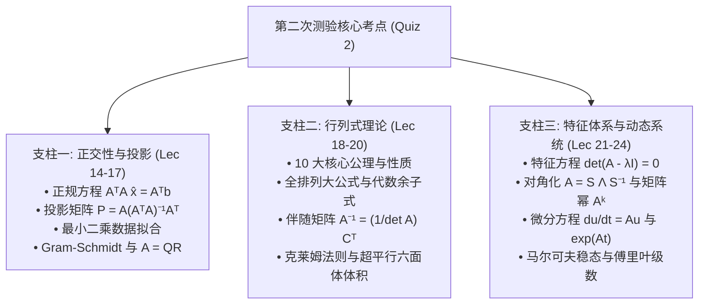

> **主讲**：Gilbert Strang 教授 · 麻省理工学院（MIT）  
> **出品**：VideoBook 视频开源技术电子书流水线  
> **全书规模**：全 35 讲完整精编 · 5 大知识体系模块 · 357 张原生高清板书实录 · 260 处核心推导时间戳  
> **视频原源**：[Bilibili 官方全套合集（BV1ix411f7Yp）](https://www.bilibili.com/video/BV1ix411f7Yp/) · [MIT OpenCourseWare 18.06 (Spring 2010)](https://ocw.mit.edu/courses/18-06-linear-algebra-spring-2010/)  
> **版权与许可**：本书文字内容与公式图解由 MIT OCW 开放课程资料翻译整理与结构化改编，授课者 Gilbert Strang，遵循 [CC BY-NC-SA 4.0](https://creativecommons.org/licenses/by-nc-sa/4.0/) 知识共享许可协议。全书板书截帧源自官方公开课录像。

---

> 📚 **模块导语**：探索动态线性系统演化的核心工具——特征值与特征向量；阐明相似对角化 $A = S\Lambda S^{-1}$、矩阵幂次与差分方程（斐波那契数列）；建立矩阵指数 $e^{At}$ 与一阶常微分方程动力系统稳定性判据；拓展至马尔可夫稳态转移与傅里叶级数；深入实对称矩阵谱定理 $A = Q\Lambda Q^T$ 与正定矩阵的四大等价判别法则。

---

## 第 21 讲：特征值与特征向量

> 📺 **视频回链**：[B 站第 21 P：特征值与特征向量](https://www.bilibili.com/video/BV1ix411f7Yp/?p=21)（⏱ 51分03秒 · 10 截图）  
> 📖 **官方材料**：[MIT OCW 对应讲义与总结](https://ocw.mit.edu/courses/18-06-linear-algebra-spring-2010/resources/lecture-21-eigenvalues-and-eigenvectors/)  
> 💡 **核心精要**：Ax = λx 的几何意义、det(A - λI) = 0 特征方程、迹与行列式性质、旋转与投影矩阵谱分析。

---

### 1. 动态系统的灵魂：什么是特征值与特征向量？

*(参考时间: 00:01:00 · [视频跳转 (P21 00:01:00)](https://www.bilibili.com/video/BV1ix411f7Yp/?p=21&t=60))*

在前二十讲中，我们研究的主要是静态方程组 $Ax = b$。
从第 21 讲开始，我们将迎来线性代数最宏伟、最具动态威力的核心主题——**特征值（Eigenvalues）与特征向量（Eigenvectors）**。

通常情况下，当矩阵 $A$ 乘以一个向量 $x$ 时，$Ax$ 会改变向量的方向，指向全新的空间位置。
但是，对于某些极其特殊的特殊向量 $x$：
**矩阵 $A$ 作用在它们身上后，产生的新向量 $Ax$ 依然与原向量 $x$ 保持在同一条直线上（严格平行）！**

$$
\boxed{Ax = \lambda x}
$$
其中：
- 非零向量 $x$ 称为矩阵 $A$ 的**特征向量（Eigenvector）**；
- 缩放因子标量 $\lambda$ 称为对应的**特征值（Eigenvalue）**。

> **核心哲学**：特征向量是矩阵变换的“固有轴线”，在变换下方向保持不变；特征值则是沿该轴线伸缩的倍率（若 $\lambda < 0$ 则反向反转，若 $\lambda = 0$ 则压至零点）。

*⏱ 时间戳：00:03:10 · 📷 板书截图 · [在 B 站观看对应片段 (P21 00:03:10)](https://www.bilibili.com/video/BV1ix411f7Yp/?p=21&t=190)*

---

### 2. 特征方程与求解两步走算法

*(参考时间: 00:05:30 · [视频跳转 (P21 00:05:30)](https://www.bilibili.com/video/BV1ix411f7Yp/?p=21&t=330))*

在方程 $Ax = \lambda x$ 中，$\lambda$ 和 $x$ 都是未知的。如何解出它们？
将右边项移到左侧：
$$
Ax - \lambda x = \mathbf{0} \implies \boxed{(A - \lambda I) x = \mathbf{0}}
$$

根据定义，特征向量 $x$ 必须是**非零向量**（$x \neq \mathbf{0}$）。
这意味着齐次线性方程组 $(A - \lambda I)x = \mathbf{0}$ 必须拥有**非零解**！
非零解存在的充要条件是：**系数矩阵 $A - \lambda I$ 必须是奇异矩阵（不可逆）**！
根据上一讲的性质 8，奇异矩阵的行列式必须严格为零：

$$
\boxed{\det(A - \lambda I) = 0}
$$
这个关于 $\lambda$ 的 $n$ 次多项式方程称为矩阵 $A$ 的**特征方程（Characteristic Equation）**。

#### 标准求解流程：
1. **第一步（求特征值）**：计算多项式方程 $\det(A - \lambda I) = 0$，解出 $n$ 个特征值 $\lambda_1, \dots, \lambda_n$；
2. **第二步（求特征向量）**：将每个求得的 $\lambda_i$ 代回原方程，寻找零空间 $N(A - \lambda_i I)$ 的基向量，通过高斯消元求出特解 $x_i$。

*⏱ 时间戳：00:07:30 · 📷 板书截图 · [在 B 站观看对应片段 (P21 00:07:30)](https://www.bilibili.com/video/BV1ix411f7Yp/?p=21&t=450)*

---

### 3. 几何直观范例：投影矩阵与置换矩阵

*(参考时间: 00:09:00 · [视频跳转 (P21 00:09:00)](https://www.bilibili.com/video/BV1ix411f7Yp/?p=21&t=540))*

Strang 教授指出：对于具有鲜明几何意义的矩阵，我们甚至不需要列代数式，凭几何直觉就能秒杀特征值和特征向量！

#### 3.1 投影矩阵 $P$
设 $P$ 是向某个平面投影的投影矩阵。
- 若向量 $x$ 本身就落在该平面内，投影操作对其毫无改变：$Px = 1 \cdot x \implies \mathbf{\lambda = 1}$！
  该平面内的所有向量都是属于 $\lambda = 1$ 的特征向量。
- 若向量 $x$ 垂直于该平面，投影操作直接将其压为零点：$Px = \mathbf{0} = 0 \cdot x \implies \mathbf{\lambda = 0}$！
  平面的法向量是属于 $\lambda = 0$ 的特征向量。
- **结论**：任何投影矩阵的特征值只能是 $\mathbf{1}$ 或 $\mathbf{0}$！

*⏱ 时间戳：00:11:10 · 📷 板书截图 · [在 B 站观看对应片段 (P21 00:11:10)](https://www.bilibili.com/video/BV1ix411f7Yp/?p=21&t=670)*

#### 3.2 置换矩阵 $P = \begin{bmatrix} 0 & 1 \\ 1 & 0 \end{bmatrix}$

*(参考时间: 00:13:30 · [视频跳转 (P21 00:13:30)](https://www.bilibili.com/video/BV1ix411f7Yp/?p=21&t=810))*

该矩阵交换二维向量的两个坐标：$P \begin{bmatrix} x_1 \\ x_2 \end{bmatrix} = \begin{bmatrix} x_2 \\ x_1 \end{bmatrix}$。
- 如果向量两分量相等，例如 $x = \begin{bmatrix} 1 \\ 1 \end{bmatrix}$，交换后依然是 $\begin{bmatrix} 1 \\ 1 \end{bmatrix}$：
  $$
  P \begin{bmatrix} 1 \\ 1 \end{bmatrix} = 1 \cdot \begin{bmatrix} 1 \\ 1 \end{bmatrix} \implies \mathbf{\lambda_1 = 1}
  $$
- 如果向量两分量互为相反数，例如 $x = \begin{bmatrix} -1 \\ 1 \end{bmatrix}$，交换后变成 $\begin{bmatrix} 1 \\ -1 \end{bmatrix} = -1 \cdot \begin{bmatrix} -1 \\ 1 \end{bmatrix}$：
  $$
  P \begin{bmatrix} -1 \\ 1 \end{bmatrix} = -1 \cdot \begin{bmatrix} -1 \\ 1 \end{bmatrix} \implies \mathbf{\lambda_2 = -1}
  $$

*⏱ 时间戳：00:15:30 · 📷 板书截图 · [在 B 站观看对应片段 (P21 00:15:30)](https://www.bilibili.com/video/BV1ix411f7Yp/?p=21&t=930)*

---

### 4. 迹（Trace）与行列式（Determinant）两大守恒定理

*(参考时间: 00:18:00 · [视频跳转 (P21 00:18:00)](https://www.bilibili.com/video/BV1ix411f7Yp/?p=21&t=1080))*

观察上述置换矩阵 $P$ 的两个特征值 $\lambda_1 = 1, \lambda_2 = -1$：
- 它们的和：$1 + (-1) = 0$。恰好等于矩阵主对角线元素之和 $0 + 0 = 0$！
- 它们的积：$1 \times (-1) = -1$。恰好等于矩阵的行列式 $0 \cdot 0 - 1 \cdot 1 = -1$！

这绝不是巧合，而是所有方阵永恒成立的**两大特征值守恒定理**：

> **定理 1（迹守恒）**：所有特征值之和等于方阵的主对角线元素之和，称为矩阵的**迹（Trace）**：
> $$
> \boxed{\sum_{i=1}^n \lambda_i = \text{trace}(A) = a_{11} + a_{22} + \cdots + a_{nn}}
> $$

> **定理 2（行列式守恒）**：所有特征值之乘积等于方阵的**行列式**：
> $$
> \boxed{\prod_{i=1}^n \lambda_i = \det(A)}
> $$

这两个定理是检验特征值计算是否正确的终极验算神器！

*⏱ 时间戳：00:19:40 · 📷 板书截图 · [在 B 站观看对应片段 (P21 00:19:40)](https://www.bilibili.com/video/BV1ix411f7Yp/?p=21&t=1180)*

---

### 5. 经典数值实战计算

*(参考时间: 00:23:00 · [视频跳转 (P21 00:23:00)](https://www.bilibili.com/video/BV1ix411f7Yp/?p=21&t=1380))*

设矩阵 $A = \begin{bmatrix} 3 & 1 \\ 1 & 3 \end{bmatrix}$。我们来完整走一遍两步法：

1. **写出特征方程**：
   $$
   \det(A - \lambda I) = \det \begin{bmatrix} 3 - \lambda & 1 \\ 1 & 3 - \lambda \end{bmatrix} = (3 - \lambda)^2 - 1 = \lambda^2 - 6\lambda + 8 = 0
   $$
   因式分解：
   $$
   (\lambda - 4)(\lambda - 2) = 0 \implies \boxed{\lambda_1 = 4, \quad \lambda_2 = 2}
   $$
   **秒速验算**：
   - $\lambda_1 + \lambda_2 = 4 + 2 = 6 = \text{trace}(A) = 3 + 3$ ($\checkmark$)；
   - $\lambda_1 \lambda_2 = 4 \times 2 = 8 = \det(A) = 9 - 1 = 8$ ($\checkmark$)。

*⏱ 时间戳：00:25:20 · 📷 板书截图 · [在 B 站观看对应片段 (P21 00:25:20)](https://www.bilibili.com/video/BV1ix411f7Yp/?p=21&t=1520)*

#### 5.1 求解对应的特征向量

- **对于 $\lambda_1 = 4$**：
  $$
  (A - 4I) x = \begin{bmatrix} -1 & 1 \\ 1 & -1 \end{bmatrix} \begin{bmatrix} x_1 \\ x_2 \end{bmatrix} = \begin{bmatrix} 0 \\ 0 \end{bmatrix} \implies \boxed{x_1 = \begin{bmatrix} 1 \\ 1 \end{bmatrix}}
  $$
- **对于 $\lambda_2 = 2$**：
  $$
  (A - 2I) x = \begin{bmatrix} 1 & 1 \\ 1 & 1 \end{bmatrix} \begin{bmatrix} x_1 \\ x_2 \end{bmatrix} = \begin{bmatrix} 0 \\ 0 \end{bmatrix} \implies \boxed{x_2 = \begin{bmatrix} -1 \\ 1 \end{bmatrix}}
  $$

注意：由于 $A$ 是**对称矩阵**（$A^T = A$），它的两个特征向量 $x_1$ 与 $x_2$ 的内积 $1(-1) + 1(1) = 0$，**彼此严格正交**！这预告了第 25 讲对称矩阵谱定理的宏伟规律。

*⏱ 时间戳：00:28:40 · 📷 板书截图 · [在 B 站观看对应片段 (P21 00:28:40)](https://www.bilibili.com/video/BV1ix411f7Yp/?p=21&t=1720)*

---

### 6. 矩阵平移定理（Shifting Property）

*(参考时间: 00:30:30 · [视频跳转 (P21 00:30:30)](https://www.bilibili.com/video/BV1ix411f7Yp/?p=21&t=1830))*

如果已知矩阵 $A$ 的特征值和特征向量，对矩阵加上一个单位矩阵的常数倍 $cI$（矩阵平移），其特征体系会发生什么改变？

设 $Ax = \lambda x$：
$$
(A + cI) x = Ax + cIx = \lambda x + cx = \boxed{(\lambda + c) x}
$$

> **关键推论**：
> 给方阵加上 $cI$，**特征向量完全不变，每一个特征值严格平移 $+c$！**
> 例如上述矩阵 $A = \begin{bmatrix} 3 & 1 \\ 1 & 3 \end{bmatrix} = \begin{bmatrix} 0 & 1 \\ 1 & 0 \end{bmatrix} + 3I$。
> 之前置换矩阵特征值为 $1, -1$；加上 $3I$ 后，新特征值立即变为 $1+3=4$ 和 $-1+3=2$，与我们刚才算出的结果毫厘不差！

*⏱ 时间戳：00:32:10 · 📷 板书截图 · [在 B 站观看对应片段 (P21 00:32:10)](https://www.bilibili.com/video/BV1ix411f7Yp/?p=21&t=1930)*

---

### 7. 奇异情况与反直觉现象

*(参考时间: 00:36:00 · [视频跳转 (P21 00:36:00)](https://www.bilibili.com/video/BV1ix411f7Yp/?p=21&t=2160))*

#### 7.1 复数特征值：90° 旋转矩阵 $Q$
考虑顺时针旋转 90 度的正交矩阵：
$$
Q = \begin{bmatrix} 0 & -1 \\ 1 & 0 \end{bmatrix}
$$
在二维实平面中，任何非零向量旋转 90 度后方向都彻底改变，不可能与原方向平行！实特征向量似乎不可能存在。

代数求解：
$$
\det(Q - \lambda I) = \lambda^2 + 1 = 0 \implies \boxed{\lambda = \pm i}
$$
解落入了**复数域**！
- 特征值是纯虚数：$\lambda_1 = i, \lambda_2 = -i$；
- 验算：$\text{trace} = 0 = i + (-i)$，$\det = 1 = i(-i) = -i^2 = 1$；
- 这说明实对称矩阵有实特征值，而非对称矩阵（特别是反对称、正交旋转）很容易产生复数共轭特征值。

*⏱ 时间戳：00:38:40 · 📷 板书截图 · [在 B 站观看对应片段 (P21 00:38:40)](https://www.bilibili.com/video/BV1ix411f7Yp/?p=21&t=2320)*

#### 7.2 亏损矩阵（Defective Matrix）：特征向量不足

*(参考时间: 00:42:00 · [视频跳转 (P21 00:42:00)](https://www.bilibili.com/video/BV1ix411f7Yp/?p=21&t=2520))*

再看一个看似人畜无害的上三角矩阵：
$$
A = \begin{bmatrix} 3 & 1 \\ 0 & 3 \end{bmatrix}
$$
- 对角线即特征值：$\lambda_1 = 3, \lambda_2 = 3$（重根特征值）；
- 求解特征向量：
  $$
  (A - 3I)x = \begin{bmatrix} 0 & 1 \\ 0 & 0 \end{bmatrix} \begin{bmatrix} x_1 \\ x_2 \end{bmatrix} = \begin{bmatrix} 0 \\ 0 \end{bmatrix} \implies x_2 = 0, \quad x_1 \text{ 自由}
  $$
  只能找出一个线性无关的特征向量：$x_1 = \begin{bmatrix} 1 \\ 0 \end{bmatrix}$！

这种拥有**重特征值且无法凑齐 $n$ 个线性无关特征向量**的矩阵，在数学上被称为**亏损矩阵（Defective Matrix）**。它们无法进行相似对角化。

下一讲（第 22 讲），我们将深入探讨如何利用 $n$ 个完全无关的特征向量将矩阵对角化为 $A = S \Lambda S^{-1}$，并秒杀矩阵高次幂 $A^k$！

*⏱ 时间戳：00:44:20 · 📷 板书截图 · [在 B 站观看对应片段 (P21 00:44:20)](https://www.bilibili.com/video/BV1ix411f7Yp/?p=21&t=2660)*

---

## 第 22 讲：对角化与矩阵的幂次

> 📺 **视频回链**：[B 站第 22 P：矩阵对角化与 A 的幂次](https://www.bilibili.com/video/BV1ix411f7Yp/?p=22)（⏱ 47分18秒 · 10 截图）  
> 📖 **官方材料**：[MIT OCW 对应讲义与总结](https://ocw.mit.edu/courses/18-06-linear-algebra-spring-2010/resources/lecture-22-diagonalization-and-powers-of-a/)  
> 💡 **核心精要**：相似对角化 A = SΛS⁻¹、矩阵幂 Aᵏ、一阶差分方程 uₖ = Aᵏu₀、斐波那契数列通项推导。

---

### 1. 为什么要把矩阵对角化？

*(参考时间: 00:01:00 · [视频跳转 (P22 00:01:00)](https://www.bilibili.com/video/BV1ix411f7Yp/?p=22&t=60))*

在科学计算与工程建模中，一个系统随着时间步长离散演化：
$$
u_{k+1} = A u_k \implies u_k = A^k u_0
$$
计算矩阵的高次幂 $A^k$（例如 $A^{100}$）极其昂贵且容易数值发散。
如果矩阵是一个普通的非对角矩阵，各分量相互交织耦合，很难看出长期演化趋势。
但是，**如果矩阵是对角矩阵 $\Lambda$**：
$$
\Lambda = \begin{bmatrix} \lambda_1 & & \\ & \lambda_2 & \\ & & \ddots \end{bmatrix} \implies \Lambda^k = \begin{bmatrix} \lambda_1^k & & \\ & \lambda_2^k & \\ & & \ddots \end{bmatrix}
$$
计算对角矩阵的幂只需要对角线各个标量自乘，简单到极致！

**对角化（Diagonalization）的终极目的，就是通过基底变换（特征向量基），将一个复杂的矩阵变成简单的对角矩阵！**

---

### 2. 特征向量矩阵 $S$ 与核心恒等式 $A S = S \Lambda$

*(参考时间: 00:03:00 · [视频跳转 (P22 00:03:00)](https://www.bilibili.com/video/BV1ix411f7Yp/?p=22&t=180))*

设矩阵 $A$ 拥有 $n$ 个线性无关的特征向量 $x_1, x_2, \dots, x_n$，对应特征值为 $\lambda_1, \lambda_2, \dots, \lambda_n$。
满足：
$$
A x_1 = \lambda_1 x_1, \quad A x_2 = \lambda_2 x_2, \quad \dots, \quad A x_n = \lambda_n x_n
$$

我们将这 $n$ 个列向量并排拼成一个方阵，记作**特征向量矩阵 $S$**：
$$
S = \begin{bmatrix} x_1 & x_2 & \cdots & x_n \end{bmatrix}
$$
现在考察矩阵乘积 $A S$：
$$
A S = A \begin{bmatrix} x_1 & x_2 & \cdots & x_n \end{bmatrix} = \begin{bmatrix} A x_1 & A x_2 & \cdots & A x_n \end{bmatrix} = \begin{bmatrix} \lambda_1 x_1 & \lambda_2 x_2 & \cdots & \lambda_n x_n \end{bmatrix}
$$

*⏱ 时间戳：00:03:40 · 📷 板书截图 · [在 B 站观看对应片段 (P22 00:03:40)](https://www.bilibili.com/video/BV1ix411f7Yp/?p=22&t=220)*

#### 2.1 将 $\lambda$ 提取为对角矩阵 $\Lambda$

注意观察最右侧的矩阵：每一列是原特征向量乘以一个标量。
根据分块矩阵乘法，这完全等价于：
$$
\begin{bmatrix} \lambda_1 x_1 & \lambda_2 x_2 & \cdots & \lambda_n x_n \end{bmatrix} = \begin{bmatrix} x_1 & x_2 & \cdots & x_n \end{bmatrix} \begin{bmatrix} \lambda_1 & 0 & \cdots & 0 \\ 0 & \lambda_2 & \cdots & 0 \\ \vdots & \vdots & \ddots & \vdots \\ 0 & 0 & \cdots & \lambda_n \end{bmatrix}
$$

于是，我们得到了整个特征理论最神圣、最优雅的**矩阵级基本公式**：
$$
\boxed{A S = S \Lambda}
$$
其中 $\Lambda$ 是主对角线排布着特征值的对角矩阵！

*⏱ 时间戳：00:07:30 · 📷 板书截图 · [在 B 站观看对应片段 (P22 00:07:30)](https://www.bilibili.com/video/BV1ix411f7Yp/?p=22&t=450)*

---

### 3. 相似对角化分解公式

*(参考时间: 00:10:30 · [视频跳转 (P22 00:10:30)](https://www.bilibili.com/video/BV1ix411f7Yp/?p=22&t=630))*

如果这 $n$ 个特征向量是**线性无关**的，那么方阵 $S$ 是**可逆矩阵**（$S^{-1}$ 存在）！
在 $A S = S \Lambda$ 两端同时左乘 $S^{-1}$：
$$
\boxed{S^{-1} A S = \Lambda}
$$
或者在两端同时右乘 $S^{-1}$，得到矩阵 $A$ 的**谱分解（对角化分解）**：
$$
\boxed{A = S \Lambda S^{-1}}
$$

> **数学意义**：在标准直角基下，线性变换由矩阵 $A$ 表示；如果切换到以特征向量为坐标轴的“天然基”，该变换直接退化为最纯粹的沿各轴缩放变换 $\Lambda$！

*⏱ 时间戳：00:11:20 · 📷 板书截图 · [在 B 站观看对应片段 (P22 00:11:20)](https://www.bilibili.com/video/BV1ix411f7Yp/?p=22&t=680)*

---

### 4. 秒杀矩阵高次幂：$A^k = S \Lambda^k S^{-1}$

*(参考时间: 00:14:00 · [视频跳转 (P22 00:14:00)](https://www.bilibili.com/video/BV1ix411f7Yp/?p=22&t=840))*

现在我们来看计算 $A^2$ 会发生什么：
$$
A^2 = (S \Lambda S^{-1}) (S \Lambda S^{-1}) = S \Lambda \underbrace{(S^{-1} S)}_{I} \Lambda S^{-1} = S \Lambda^2 S^{-1}
$$
中间的 $S^{-1} S$ 瞬间抵消为单位阵！

推广到任意 $k$ 次幂：
$$
\boxed{A^k = S \Lambda^k S^{-1}}
$$
这意味着：
1. **$A^k$ 的特征向量与原矩阵 $A$ 完全相同**（特征向量矩阵依然是 $S$）；
2. **$A^k$ 的特征值直接是原特征值的 $k$ 次方**（$\lambda_i^k$）！

#### 4.1 动态系统稳定性准则（Stability）

当 $k \to \infty$ 时，系统状态 $u_k = A^k u_0$ 会爆炸还是衰减归零？
完全取决于特征值的大小：
$$
\lim_{k \to \infty} A^k = \mathbf{O} \iff \text{对所有特征值，均有 } \boxed{|\lambda_i| < 1}
$$
只要存在一个特征值 $|\lambda| > 1$，系统就会沿该特征方向指数级发散失控。

*⏱ 时间戳：00:15:40 · 📷 板书截图 · [在 B 站观看对应片段 (P22 00:15:40)](https://www.bilibili.com/video/BV1ix411f7Yp/?p=22&t=940)*

---

### 5. 矩阵何时可对角化？

*(参考时间: 00:19:30 · [视频跳转 (P22 00:19:30)](https://www.bilibili.com/video/BV1ix411f7Yp/?p=22&t=1170))*

并不是所有方阵都可以对角化！关键充分与必要条件如下：

> **充要条件**：$n \times n$ 矩阵 $A$ 可对角化，当且仅当 $A$ 拥有 **$n$ 个线性无关的特征向量**（几何重数等于代数重数）。

> **充分条件（无重根定理）**：若 $n \times n$ 矩阵 $A$ 拥有 **$n$ 个互不相同的特征值**（$\lambda_1 \neq \lambda_2 \neq \cdots \neq \lambda_n$），则这 $n$ 个特征向量必然线性无关，**矩阵 $A$ 必定可对角化！**

**警惕概念误区**：
- **可逆性 $\neq$ 可对角化性**！
  - 可逆性关心的是是否有零特征值（$\lambda \neq 0 \iff$ 可逆）；
  - 可对角化性关心的是特征向量是否充足，哪怕 $\lambda = 0$ 也完全可以对角化（例如全零矩阵已经是对角阵）。

*⏱ 时间戳：00:20:50 · 📷 板书截图 · [在 B 站观看对应片段 (P22 00:20:50)](https://www.bilibili.com/video/BV1ix411f7Yp/?p=22&t=1250)*

---

### 6. 一阶差分方程组求解机制

*(参考时间: 00:25:00 · [视频跳转 (P22 00:25:00)](https://www.bilibili.com/video/BV1ix411f7Yp/?p=22&t=1500))*

考虑差分演化系统 $u_{k+1} = A u_k$。
将初始状态 $u_0$ 在特征向量基底上展开：
$$
u_0 = c_1 x_1 + c_2 x_2 + \cdots + c_n x_n = S c
$$
系数向量由 $c = S^{-1} u_0$ 唯一确定。

当对两边乘以 $A$ 时：
$$
u_1 = A u_0 = c_1 A x_1 + \cdots + c_n A x_n = c_1 \lambda_1 x_1 + \cdots + c_n \lambda_n x_n
$$
每乘以一次 $A$，每个特征分量各自乘以对应的 $\lambda_i$：
$$
\boxed{u_k = A^k u_0 = c_1 \lambda_1^k x_1 + c_2 \lambda_2^k x_2 + \cdots + c_n \lambda_n^k x_n}
$$
高维系统的演化，彻底分解为 $n$ 个独立的一维纯几何增长/衰减！

*⏱ 时间戳：00:26:30 · 📷 板书截图 · [在 B 站观看对应片段 (P22 00:26:30)](https://www.bilibili.com/video/BV1ix411f7Yp/?p=22&t=1590)*

---

### 7. 世纪经典应用：斐波那契数列与黄金分割

*(参考时间: 00:30:30 · [视频跳转 (P22 00:30:30)](https://www.bilibili.com/video/BV1ix411f7Yp/?p=22&t=1830))*

斐波那契数列定义为：
$$
F_0 = 0, \quad F_1 = 1, \quad F_{k+2} = F_{k+1} + F_k
$$
数列前几项为：$0, 1, 1, 2, 3, 5, 8, 13, 21, 34, 55, \dots$。
这是一个二阶标量递推方程。如何用线性代数求出通项公式 $F_{100}$？

#### 7.1 升维技巧：构造伴随状态向量
引入状态向量 $u_k = \begin{bmatrix} F_{k+1} \\ F_k \end{bmatrix}$：
下一时刻的状态为：
$$
u_{k+1} = \begin{bmatrix} F_{k+2} \\ F_{k+1} \end{bmatrix} = \begin{bmatrix} F_{k+1} + F_k \\ F_{k+1} \end{bmatrix}
$$
写成矩阵乘法形式：
$$
\begin{bmatrix} F_{k+2} \\ F_{k+1} \end{bmatrix} = \underbrace{\begin{bmatrix} 1 & 1 \\ 1 & 0 \end{bmatrix}}_{A} \begin{bmatrix} F_{k+1} \\ F_k \end{bmatrix} \implies \boxed{u_{k+1} = A u_k}
$$
二阶标量递推瞬间变成了我们熟知的一阶 $2 \times 2$ 矩阵系统！初始向量为 $u_0 = \begin{bmatrix} 1 \\ 0 \end{bmatrix}$。

*⏱ 时间戳：00:32:10 · 📷 板书截图 · [在 B 站观看对应片段 (P22 00:32:10)](https://www.bilibili.com/video/BV1ix411f7Yp/?p=22&t=1930)*

#### 7.2 求解特征值与黄金分割比

*(参考时间: 00:37:00 · [视频跳转 (P22 00:37:00)](https://www.bilibili.com/video/BV1ix411f7Yp/?p=22&t=2220))*

计算伴随矩阵 $A = \begin{bmatrix} 1 & 1 \\ 1 & 0 \end{bmatrix}$ 的特征方程：
$$
\det(A - \lambda I) = \det \begin{bmatrix} 1 - \lambda & 1 \\ 1 & -\lambda \end{bmatrix} = (1 - \lambda)(-\lambda) - 1 = \lambda^2 - \lambda - 1 = 0
$$
利用二次方程求根公式：
$$
\boxed{\lambda_1 = \frac{1 + \sqrt{5}}{2} \approx 1.618 \quad (\text{黄金分割比 } \phi)}
$$
$$
\boxed{\lambda_2 = \frac{1 - \sqrt{5}}{2} \approx -0.618}
$$
验算：$\lambda_1 + \lambda_2 = 1 = \text{trace}(A)$；$\lambda_1 \lambda_2 = -1 = \det(A)$。完美无缺！

*⏱ 时间戳：00:38:20 · 📷 板书截图 · [在 B 站观看对应片段 (P22 00:38:20)](https://www.bilibili.com/video/BV1ix411f7Yp/?p=22&t=2300)*

#### 7.3 特征向量与初始分解

*(参考时间: 00:42:30 · [视频跳转 (P22 00:42:30)](https://www.bilibili.com/video/BV1ix411f7Yp/?p=22&t=2550))*

对于每一个特征值，求解 $(A - \lambda I)x = \mathbf{0}$：
$$
\begin{bmatrix} 1 - \lambda & 1 \\ 1 & -\lambda \end{bmatrix} \begin{bmatrix} x_1 \\ x_2 \end{bmatrix} = \begin{bmatrix} 0 \\ 0 \end{bmatrix} \implies x_1 - \lambda x_2 = 0 \implies \boxed{x = \begin{bmatrix} \lambda \\ 1 \end{bmatrix}}
$$
因此：
$$
x_1 = \begin{bmatrix} \lambda_1 \\ 1 \end{bmatrix}, \quad x_2 = \begin{bmatrix} \lambda_2 \\ 1 \end{bmatrix}
$$

将初值 $u_0 = \begin{bmatrix} 1 \\ 0 \end{bmatrix}$ 分解在两特征向量上：
$$
\begin{bmatrix} 1 \\ 0 \end{bmatrix} = c_1 \begin{bmatrix} \lambda_1 \\ 1 \end{bmatrix} + c_2 \begin{bmatrix} \lambda_2 \\ 1 \end{bmatrix} \implies \begin{cases} c_1 \lambda_1 + c_2 \lambda_2 = 1 \\ c_1 + c_2 = 0 \end{cases}
$$
由于 $c_2 = -c_1$，代入第一式：$c_1 (\lambda_1 - \lambda_2) = 1$。
因为 $\lambda_1 - \lambda_2 = \frac{1+\sqrt{5}}{2} - \frac{1-\sqrt{5}}{2} = \sqrt{5}$：
$$
c_1 = \frac{1}{\sqrt{5}}, \quad c_2 = -\frac{1}{\sqrt{5}}
$$

*⏱ 时间戳：00:43:50 · 📷 板书截图 · [在 B 站观看对应片段 (P22 00:43:50)](https://www.bilibili.com/video/BV1ix411f7Yp/?p=22&t=2630)*

---

### 8. 比内公式（Binet's Formula）的终极诞生

*(参考时间: 00:47:00 · [视频跳转 (P22 00:47:00)](https://www.bilibili.com/video/BV1ix411f7Yp/?p=22&t=2820))*

根据通解公式 $u_k = c_1 \lambda_1^k x_1 + c_2 \lambda_2^k x_2$：
$$
\begin{bmatrix} F_{k+1} \\ F_k \end{bmatrix} = \frac{1}{\sqrt{5}} \lambda_1^k \begin{bmatrix} \lambda_1 \\ 1 \end{bmatrix} - \frac{1}{\sqrt{5}} \lambda_2^k \begin{bmatrix} \lambda_2 \\ 1 \end{bmatrix}
$$
提取第二行分量，直接得到闻名遐迩的**比内闭式公式**：
$$
\boxed{F_k = \frac{1}{\sqrt{5}} \left[ \left(\frac{1+\sqrt{5}}{2}\right)^k - \left(\frac{1-\sqrt{5}}{2}\right)^k \right]}
$$

由于 $|\lambda_2| = | -0.618 | < 1$，随着 $k$ 的增大，第二项 $\lambda_2^k$ 以指数速度趋于 0！
因此：
$$
F_k \approx \frac{1}{\sqrt{5}} \left(\frac{1+\sqrt{5}}{2}\right)^k
$$
这严格证明了：**斐波那契数列第 $k$ 项本质上就是纯粹的黄金分割指数增长！只需对第一项四舍五入取整即可得到绝对精确的整数项。**

下一讲（第 23 讲），我们将把差分方程推广到连续时间物理世界——**线性微分方程组与矩阵指数 $\exp(At)$**！

*⏱ 时间戳：00:48:30 · 📷 板书截图 · [在 B 站观看对应片段 (P22 00:48:30)](https://www.bilibili.com/video/BV1ix411f7Yp/?p=22&t=2910)*

---

## 第 23 讲：微分方程与矩阵指数 $\exp(At)$

> 📺 **视频回链**：[B 站第 23 P：微分方程与矩阵指数 exp(At)](https://www.bilibili.com/video/BV1ix411f7Yp/?p=23)（⏱ 50分58秒 · 10 截图）  
> 📖 **官方材料**：[MIT OCW 对应讲义与总结](https://ocw.mit.edu/courses/18-06-linear-algebra-spring-2010/resources/lecture-23-differential-equations-and-exp-at/)  
> 💡 **核心精要**：一阶常系数线性微分方程组 du/dt = Au、矩阵指数 e^{At} = S e^{Λt} S⁻¹、动力系统解的渐近稳定性。

---

### 1. 从离散差分跃迁到连续微分方程

*(参考时间: 00:01:00 · [视频跳转 (P23 00:01:00)](https://www.bilibili.com/video/BV1ix411f7Yp/?p=23&t=60))*

上一讲我们研究了一阶离散差分方程 $u_{k+1} = A u_k$。
本讲我们将特征体系全面投入到连续物理世界的统治性方程——**一阶常系数线性微分方程组**：
$$
\boxed{\frac{du}{dt} = A u}
$$
其中 $u(t) = \begin{bmatrix} u_1(t) \\ u_2(t) \\ \vdots \\ u_n(t) \end{bmatrix}$ 是随时间演化的状态向量，$A$ 是 $n \times n$ 的常数系数矩阵。
在初值 $u(0) = u_0$ 给定下，如何求解 $u(t)$？

#### 1.1 纯指数试解的奇迹

在标量一维微积分中，方程 $\frac{du}{dt} = a u$ 的解是纯指数函数 $u(t) = e^{a t} u(0)$。
对于多维向量方程，我们大胆猜测解的形式也是**纯指数演化乘以一个恒定方向向量**：
$$
u(t) = e^{\lambda t} x
$$
将该试解代入方程两边：
- 左边对时间求导：$\frac{du}{dt} = \lambda e^{\lambda t} x$；
- 右边矩阵相乘：$A u(t) = A (e^{\lambda t} x) = e^{\lambda t} (Ax)$。

两边消去非零标量因子 $e^{\lambda t}$，立即得到：
$$
\lambda x = A x \iff \boxed{A x = \lambda x}
$$
**这是纯粹的数学奇迹！标量指数函数的增长率 $\lambda$ 恰好是矩阵 $A$ 的特征值，而固定不变的方向向量 $x$ 恰好是对应的特征向量！**

*⏱ 时间戳：00:03:20 · 📷 板书截图 · [在 B 站观看对应片段 (P23 00:03:20)](https://www.bilibili.com/video/BV1ix411f7Yp/?p=23&t=200)*

---

### 2. 经典二阶流体/浓度耦合模型

*(参考时间: 00:05:00 · [视频跳转 (P23 00:05:00)](https://www.bilibili.com/video/BV1ix411f7Yp/?p=23&t=300))*

Strang 教授引入了一个极其直观的物理模型：两容器相互渗透扩散问题。
$$
\begin{cases}
\frac{du_1}{dt} = -u_1 + 2u_2 \\
\frac{du_2}{dt} = u_1 - 2u_2
\end{cases}
\implies \frac{du}{dt} = \underbrace{\begin{bmatrix} -1 & 2 \\ 1 & -2 \end{bmatrix}}_{A} u
$$
初始状态设为：$u(0) = \begin{bmatrix} 1 \\ 0 \end{bmatrix}$。

注意矩阵 $A$ 的显著特征：
- 每一列的元素之和为零（$-1 + 1 = 0$, $2 - 2 = 0$）；
- 物理意义：两容器总物质守恒，$\frac{d(u_1 + u_2)}{dt} = 0$，系统总质量不增不减！

*⏱ 时间戳：00:06:50 · 📷 板书截图 · [在 B 站观看对应片段 (P23 00:06:50)](https://www.bilibili.com/video/BV1ix411f7Yp/?p=23&t=410)*

#### 2.1 求解特征值与特征向量

计算矩阵 $A$ 的迹与行列式：
- 迹：$\text{trace}(A) = -1 + (-2) = -3$；
- 行列式：$\det(A) = (-1)(-2) - (2)(1) = 2 - 2 = 0$（列线性相关，不可逆）。

根据第 21 讲的守恒定理：
$$
\begin{cases} \lambda_1 + \lambda_2 = -3 \\ \lambda_1 \lambda_2 = 0 \end{cases} \implies \boxed{\lambda_1 = 0, \quad \lambda_2 = -3}
$$

求解对应特征向量：
- **对于 $\lambda_1 = 0$**（零空间特解）：
  $$
  A x_1 = \begin{bmatrix} -1 & 2 \\ 1 & -2 \end{bmatrix} x_1 = \mathbf{0} \implies \boxed{x_1 = \begin{bmatrix} 2 \\ 1 \end{bmatrix}}
  $$
- **对于 $\lambda_2 = -3$**：
  $$
  (A + 3I) x_2 = \begin{bmatrix} 2 & 2 \\ 1 & 1 \end{bmatrix} x_2 = \mathbf{0} \implies \boxed{x_2 = \begin{bmatrix} -1 \\ 1 \end{bmatrix}}
  $$

*⏱ 时间戳：00:11:40 · 📷 板书截图 · [在 B 站观看对应片段 (P23 00:11:40)](https://www.bilibili.com/video/BV1ix411f7Yp/?p=23&t=700)*

---

### 3. 齐次线性微分方程组的通解与稳态演化

*(参考时间: 00:14:00 · [视频跳转 (P23 00:14:00)](https://www.bilibili.com/video/BV1ix411f7Yp/?p=23&t=840))*

利用特征解的线性叠加，方程的通解为：
$$
u(t) = c_1 e^{\lambda_1 t} x_1 + c_2 e^{\lambda_2 t} x_2 = c_1 e^{0 \cdot t} \begin{bmatrix} 2 \\ 1 \end{bmatrix} + c_2 e^{-3t} \begin{bmatrix} -1 \\ 1 \end{bmatrix}
$$
由于 $e^{0 \cdot t} = 1$，第一项是**完全不随时间改变的稳态解（Steady State）**，第二项是**随时间迅速衰减的瞬态解（Transient State）**！

代入初值 $u(0) = \begin{bmatrix} 1 \\ 0 \end{bmatrix}$：
$$
c_1 \begin{bmatrix} 2 \\ 1 \end{bmatrix} + c_2 \begin{bmatrix} -1 \\ 1 \end{bmatrix} = \begin{bmatrix} 1 \\ 0 \end{bmatrix} \implies \begin{cases} 2c_1 - c_2 = 1 \\ c_1 + c_2 = 0 \end{cases} \implies c_1 = \frac{1}{3}, \quad c_2 = -\frac{1}{3}
$$

代入得到精确特解：
$$
u(t) = \frac{1}{3} \begin{bmatrix} 2 \\ 1 \end{bmatrix} - \frac{1}{3} e^{-3t} \begin{bmatrix} -1 \\ 1 \end{bmatrix}
$$

当 $t \to \infty$ 时，$e^{-3t} \to 0$：
$$
\lim_{t \to \infty} u(t) = \begin{bmatrix} 2/3 \\ 1/3 \end{bmatrix}
$$
两容器物质按 $2:1$ 的比例达到最终热力学平衡！

*⏱ 时间戳：00:15:30 · 📷 板书截图 · [在 B 站观看对应片段 (P23 00:15:30)](https://www.bilibili.com/video/BV1ix411f7Yp/?p=23&t=930)*

---

### 4. 连续系统稳定性大定理（Stability）

*(参考时间: 00:19:00 · [视频跳转 (P23 00:19:00)](https://www.bilibili.com/video/BV1ix411f7Yp/?p=23&t=1140))*

对于任意 $n$ 阶线性微分方程组 $\frac{du}{dt} = Au$，当 $t \to \infty$ 时，解何时会衰减至零（渐近稳定）？

回顾通解：$u(t) = \sum c_i e^{\lambda_i t} x_i$。
若 $\lambda = \alpha + i \beta$ 是复数，则：
$$
|e^{\lambda t}| = |e^{(\alpha + i\beta)t}| = |e^{\alpha t}| \cdot |e^{i\beta t}| = e^{\alpha t} \cdot 1 = e^{\text{Re}(\lambda) t}
$$

> **连续系统渐近稳定充要条件**：
> 矩阵 $A$ 的**所有特征值的实部严格为负**：
> $$
> \boxed{\text{Re}(\lambda_i) < 0 \quad (\forall i = 1, \dots, n)}
> $$

#### 离散与连续稳定性的大对比：
- **离散差分方程 $u_{k+1} = A u_k$**：关心的是 $|\lambda| < 1$（位于复平面**单位圆盘内部**）；
- **连续微分方程 $\frac{du}{dt} = Au$**：关心的是 $\text{Re}(\lambda) < 0$（位于复平面**左半开平面**）！

*⏱ 时间戳：00:20:10 · 📷 板书截图 · [在 B 站观看对应片段 (P23 00:20:10)](https://www.bilibili.com/video/BV1ix411f7Yp/?p=23&t=1210)*

#### 4.1 二阶实矩阵的秒杀判据
对于 $2 \times 2$ 矩阵，特征方程为 $\lambda^2 - \text{trace}(A) \lambda + \det(A) = 0$。
两个根的实部全为负数，等价于：
$$
\boxed{\text{trace}(A) < 0 \quad \text{且} \quad \det(A) > 0}
$$
只要检验迹与行列式两个标量，无需解根就能瞬间断言稳定性！

*⏱ 时间戳：00:24:40 · 📷 板书截图 · [在 B 站观看对应片段 (P23 00:24:40)](https://www.bilibili.com/video/BV1ix411f7Yp/?p=23&t=1480)*

---

### 5. 解耦机制：特征向量基底下的对角化

*(参考时间: 00:29:30 · [视频跳转 (P23 00:29:30)](https://www.bilibili.com/video/BV1ix411f7Yp/?p=23&t=1770))*

为什么特征向量能够彻底化解耦合的微分方程？
利用矩阵相似对角化 $A = S \Lambda S^{-1}$，做变量代换：
$$
u(t) = S v(t) \iff v(t) = S^{-1} u(t)
$$
代入原方程：
$$
S \frac{dv}{dt} = A S v \implies \frac{dv}{dt} = S^{-1} A S v = \boxed{\Lambda v}
$$

由于 $\Lambda$ 是对角矩阵，原本交织在一起的 $n$ 个联立方程，**瞬间彻底解耦成了 $n$ 个完全彼此独立的一维标量方程**：
$$
\frac{dv_i}{dt} = \lambda_i v_i \implies v_i(t) = e^{\lambda_i t} v_i(0)
$$
解出 $v(t)$ 后，左乘 $S$ 变换回原坐标系：$u(t) = S v(t) = S e^{\Lambda t} S^{-1} u(0)$。

*⏱ 时间戳：00:30:50 · 📷 板书截图 · [在 B 站观看对应片段 (P23 00:30:50)](https://www.bilibili.com/video/BV1ix411f7Yp/?p=23&t=1850)*

---

### 6. 矩阵指数 $\exp(At)$ 的定义与性质

*(参考时间: 00:35:00 · [视频跳转 (P23 00:35:00)](https://www.bilibili.com/video/BV1ix411f7Yp/?p=23&t=2100))*

我们在标量微积分中熟悉泰勒级数：
$$
e^{a t} = 1 + a t + \frac{(a t)^2}{2!} + \frac{(a t)^3}{3!} + \cdots = \sum_{k=0}^\infty \frac{(a t)^k}{k!}
$$
将标量 $a$ 换成矩阵 $A$，定义**矩阵指数（Matrix Exponential）**：
$$
\boxed{e^{At} = I + At + \frac{(At)^2}{2!} + \frac{(At)^3}{3!} + \cdots = \sum_{k=0}^\infty \frac{A^k t^k}{k!}}
$$
因为阶乘的分母 $k!$ 增长极为恐怖，该级数对任何实方阵 $A$ 和任意时间 $t$ 恒绝对收敛！

*⏱ 时间戳：00:36:20 · 📷 板书截图 · [在 B 站观看对应片段 (P23 00:36:20)](https://www.bilibili.com/video/BV1ix411f7Yp/?p=23&t=2180)*

#### 6.1 矩阵指数的谱分解公式

由于 $A^k = S \Lambda^k S^{-1}$，将它代入每一项：
$$
e^{At} = S \left( I + \Lambda t + \frac{(\Lambda t)^2}{2!} + \cdots \right) S^{-1} = \boxed{S e^{\Lambda t} S^{-1}}
$$
其中，对角矩阵的指数直接就是各对角元素的标量指数：
$$
e^{\Lambda t} = \begin{bmatrix} e^{\lambda_1 t} & 0 & \cdots & 0 \\ 0 & e^{\lambda_2 t} & \cdots & 0 \\ \vdots & \vdots & \ddots & \vdots \\ 0 & 0 & \cdots & e^{\lambda_n t} \end{bmatrix}
$$

于是，一阶线性微分方程组的初值问题，拥有了极其霸气的**紧凑统一解**：
$$
\boxed{u(t) = e^{At} u(0)}
$$

*⏱ 时间戳：00:41:10 · 📷 板书截图 · [在 B 站观看对应片段 (P23 00:41:10)](https://www.bilibili.com/video/BV1ix411f7Yp/?p=23&t=2470)*

---

### 7. 高阶单方程降阶为一阶方程组

*(参考时间: 00:46:00 · [视频跳转 (P23 00:46:00)](https://www.bilibili.com/video/BV1ix411f7Yp/?p=23&t=2760))*

在物理学（如牛顿第二定律、简谐振子、RLC 振荡电路）中，最常见的是二阶微分方程：
$$
y'' + b y' + k y = 0
$$
如何用我们这套强大的矩阵工具求解？**升维降阶法**！

定义状态向量：
$$
u(t) = \begin{bmatrix} y'(t) \\ y(t) \end{bmatrix}
$$
求导：
$$
u'(t) = \begin{bmatrix} y'' \\ y' \end{bmatrix} = \begin{bmatrix} -b y' - k y \\ y' \end{bmatrix} = \begin{bmatrix} -b & -k \\ 1 & 0 \end{bmatrix} \begin{bmatrix} y' \\ y \end{bmatrix} = A u
$$
伴随矩阵 $A = \begin{bmatrix} -b & -k \\ 1 & 0 \end{bmatrix}$ 的特征方程为：
$$
\det(A - \lambda I) = \lambda^2 + b\lambda + k = 0
$$
这与经典常微分方程的辅助特征方程完全一模一样！任何高阶单微分方程都可以通过增加状态变量降阶为标准一阶矩阵微分系统。

下一讲（第 24 讲），我们将把特征体系延伸到概率转移世界——**马尔可夫矩阵（Markov Matrices）与傅里叶级数**！

*⏱ 时间戳：00:46:50 · 📷 板书截图 · [在 B 站观看对应片段 (P23 00:46:50)](https://www.bilibili.com/video/BV1ix411f7Yp/?p=23&t=2810)*

---

## 第 24 讲：马尔可夫矩阵与傅里叶级数

> 📺 **视频回链**：[B 站第 24 P：马尔可夫矩阵与傅里叶级数](https://www.bilibili.com/video/BV1ix411f7Yp/?p=24)（⏱ 50分58秒 · 10 截图）  
> 📖 **官方材料**：[MIT OCW 对应讲义与总结](https://ocw.mit.edu/courses/18-06-linear-algebra-spring-2010/resources/lecture-24-markov-matrices-fourier-series/)  
> 💡 **核心精要**：稳态概率向量与 λ=1 特征值、佩隆-弗罗贝尼乌斯定理、无穷维内积与函数正交投影、傅里叶级数系数积分。

---

### 1. 随机演化过程与马尔可夫矩阵（Markov Matrix）

*(参考时间: 00:01:00 · [视频跳转 (P24 00:01:00)](https://www.bilibili.com/video/BV1ix411f7Yp/?p=24&t=60))*

在概率论、经济学、网页排名（Google PageRank）与统计物理中，系统状态往往按概率规律在各个状态之间转移。
描述这种状态转移的核心数学工具是**马尔可夫矩阵（Markov Matrix）**。

一个方阵 $A$ 成为马尔可夫矩阵必须满足以下两大公理化条件：
1. **元素非负性**：矩阵中的每一个元素都大于等于零（概率非负）：
   $$
   a_{ij} \ge 0 \quad (\forall i, j)
   $$
2. **列和守恒性**：**矩阵的每一列元素之和严格等于 1**（系统从某个状态出发，转移到所有可能状态的概率之和为 100%）：
   $$
   \sum_{i=1}^n a_{ij} = 1 \quad (\forall j = 1, \dots, n)
   $$

*⏱ 时间戳：00:03:30 · 📷 板书截图 · [在 B 站观看对应片段 (P24 00:03:30)](https://www.bilibili.com/video/BV1ix411f7Yp/?p=24&t=210)*

---

### 2. 马尔可夫矩阵的两大特征值神定理

*(参考时间: 00:05:30 · [视频跳转 (P24 00:05:30)](https://www.bilibili.com/video/BV1ix411f7Yp/?p=24&t=330))*

马尔可夫矩阵之所以拥有无与伦比的优雅性质，全归功于其特征体系：

> **定理 1**：$\lambda = 1$ **永远是任何马尔可夫矩阵的特征值**！

> **定理 2**：所有其他特征值的绝对值（模长）**全部小于等于 1**（对于正马尔可夫矩阵，其余 $|\lambda_i| < 1$）：
> $$
> |\lambda_i| \le 1
> $$

根据第 22 讲的差分方程通解展开：
$$
u_k = A^k u_0 = c_1 (1)^k x_1 + c_2 \lambda_2^k x_2 + \cdots + c_n \lambda_n^k x_n
$$
当步数 $k \to \infty$ 时：
- 因为 $|\lambda_i| < 1$，所有瞬态项 $\lambda_i^k \to 0$ 全部消亡；
- 只有第一项 $c_1 (1)^k x_1 = c_1 x_1$ 屹立不倒！
- **结论：系统必然以指数速度收敛到一个不随时间改变的唯一稳态分布（Steady State）$x_1$！**

#### 2.1 为什么 $\lambda = 1$ 必定存在？Strang 教授的绝妙证明

考察矩阵 $A - I$：
由于 $A$ 的每一列元素之和为 1，减去单位矩阵后，**新矩阵 $A - I$ 的每一列元素之和恰好为 $1 - 1 = 0$**！
这意味着，将 $A - I$ 的所有行相加，得到全零行：
$$
\begin{bmatrix} 1 & 1 & \cdots & 1 \end{bmatrix} (A - I) = \mathbf{0}^T
$$
两边取转置：
$$
(A - I)^T \begin{bmatrix} 1 \\ 1 \\ \vdots \\ 1 \end{bmatrix} = \mathbf{0}
$$
这说明全 1 向量是转置矩阵 $A^T$ 属于特征值 1 的特征向量！
因为方阵与转置矩阵拥有相同的行列式：$\det(A - I) = \det((A - I)^T) = 0$。
因此 $A - I$ 必然是奇异矩阵，**$\lambda = 1$ 必然是原矩阵 $A$ 的特征值！**

*⏱ 时间戳：00:07:40 · 📷 板书截图 · [在 B 站观看对应片段 (P24 00:07:40)](https://www.bilibili.com/video/BV1ix411f7Yp/?p=24&t=460)*

---

### 3. 人口流动动态模型实战

*(参考时间: 00:11:00 · [视频跳转 (P24 00:11:00)](https://www.bilibili.com/video/BV1ix411f7Yp/?p=24&t=660))*

Strang 教授给出了一个生动的双城人口流动案例：加州（California）与麻省（Massachusetts）。
每年人口流动概率如下：
- 加州居民：90% 留在加州，10% 搬迁到麻省；
- 麻省居民：20% 搬迁到加州，80% 留在麻省。

转移矩阵为：
$$
u_{k+1} = \underbrace{\begin{bmatrix} 0.9 & 0.2 \\ 0.1 & 0.8 \end{bmatrix}}_{A} u_k
$$
检查：$0.9 + 0.1 = 1$, $0.2 + 0.8 = 1$。这是一个标准的马尔可夫矩阵！

矩阵的迹为：$\text{trace}(A) = 0.9 + 0.8 = 1.7$。
因为必有一个特征值 $\lambda_1 = 1$，由迹守恒定理立即口算出第二个特征值：
$$
\lambda_1 + \lambda_2 = 1.7 \implies 1 + \lambda_2 = 1.7 \implies \boxed{\lambda_2 = 0.7}
$$
由于 $|0.7| < 1$，验证了所有其他特征值严格小于 1！

*⏱ 时间戳：00:11:50 · 📷 板书截图 · [在 B 站观看对应片段 (P24 00:11:50)](https://www.bilibili.com/video/BV1ix411f7Yp/?p=24&t=710)*

#### 3.1 求解终极稳态人口比例

寻找对应于稳态特征值 $\lambda_1 = 1$ 的特征向量：
$$
(A - I) x_1 = \begin{bmatrix} -0.1 & 0.2 \\ 0.1 & -0.2 \end{bmatrix} \begin{bmatrix} x_{\text{cal}} \\ x_{\text{mass}} \end{bmatrix} = \begin{bmatrix} 0 \\ 0 \end{bmatrix}
$$
得到方程 $-0.1 x_{\text{cal}} + 0.2 x_{\text{mass}} = 0 \implies x_{\text{cal}} = 2 x_{\text{mass}}$！
取特解：
$$
x_1 = \begin{bmatrix} 2 \\ 1 \end{bmatrix} \quad \left(\text{概率归一化为 } \begin{bmatrix} 2/3 \\ 1/3 \end{bmatrix}\right)
$$
**深刻结论**：无论初始人口分布如何，经过充分多次的年份转移后，加州人口将稳定在总人口的 **2/3**，麻省人口稳定在 **1/3**！

*⏱ 时间戳：00:16:30 · 📷 板书截图 · [在 B 站观看对应片段 (P24 00:16:30)](https://www.bilibili.com/video/BV1ix411f7Yp/?p=24&t=990)*

#### 3.2 初值衰减演化计算

设初始所有人全在麻省：$u_0 = \begin{bmatrix} 0 \\ 1000 \end{bmatrix}$。
- 第一年：$u_1 = A u_0 = \begin{bmatrix} 200 \\ 800 \end{bmatrix}$；
- 第二年：$u_2 = A u_1 = \begin{bmatrix} 0.9(200) + 0.2(800) \\ 0.1(200) + 0.8(800) \end{bmatrix} = \begin{bmatrix} 340 \\ 660 \end{bmatrix}$；
- 长期极限：随着 $(0.7)^k \to 0$，人口单调收敛于 $u_\infty = \begin{bmatrix} 667 \\ 333 \end{bmatrix}$。

*⏱ 时间戳：00:23:10 · 📷 板书截图 · [在 B 站观看对应片段 (P24 00:23:10)](https://www.bilibili.com/video/BV1ix411f7Yp/?p=24&t=1390)*

---

### 4. 视角飞跃：标准正交基与傅里叶级数

*(参考时间: 00:29:00 · [视频跳转 (P24 00:29:00)](https://www.bilibili.com/video/BV1ix411f7Yp/?p=24&t=1740))*

在课程后半段，Strang 教授做出了一个跨学科的宏伟连接：**从有限维几何正交基飞跃到无穷维函数空间与傅里叶分析！**

回顾第 17 讲，设 $q_1, q_2, \dots, q_n$ 是 $\mathbb{R}^n$ 中的标准正交基（$q_i^T q_j = \delta_{ij}$）。
将任意向量 $v$ 展开在正交基上：
$$
v = c_1 q_1 + c_2 q_2 + \cdots + c_n q_n
$$
两边同乘 $q_i^T$：
$$
q_i^T v = c_1 (q_i^T q_1) + \cdots + c_i (q_i^T q_i) + \cdots = c_i \cdot 1 \implies \boxed{c_i = q_i^T v}
$$
每个基底系数通过点积瞬解，各分量彼此独立。

*⏱ 时间戳：00:29:40 · 📷 板书截图 · [在 B 站观看对应片段 (P24 00:29:40)](https://www.bilibili.com/video/BV1ix411f7Yp/?p=24&t=1780)*

---

### 5. 跨越到无穷维：函数即向量，积分为内积

*(参考时间: 00:34:30 · [视频跳转 (P24 00:34:30)](https://www.bilibili.com/video/BV1ix411f7Yp/?p=24&t=2070))*

如果空间维数从 $n$ 走向无穷大：
- **向量 $v$** $\longrightarrow$ **函数 $f(x)$**；
- 离散分量点积 $\sum v_i w_i$ $\longrightarrow$ **连续区间积分 $\int f(x) g(x) dx$**！

在区间 $[-\pi, \pi]$ 上，两函数的**内积**定义为：
$$
\boxed{\langle f, g \rangle = \int_{-\pi}^\pi f(x) g(x) dx}
$$
若内积积分为零，则两函数**互相正交**！

*⏱ 时间戳：00:35:20 · 📷 板书截图 · [在 B 站观看对应片段 (P24 00:35:20)](https://www.bilibili.com/video/BV1ix411f7Yp/?p=24&t=2120)*

---

### 6. 傅里叶正交基系统

*(参考时间: 00:40:00 · [视频跳转 (P24 00:40:00)](https://www.bilibili.com/video/BV1ix411f7Yp/?p=24&t=2400))*

在区间 $[-\pi, \pi]$ 上，著名的三角函数族：
$$
\{1, \; \cos x, \; \sin x, \; \cos 2x, \; \sin 2x, \; \dots, \; \cos n x, \; \sin n x, \; \dots\}
$$
构成了一组宏伟的**无穷维正交基底**！

*⏱ 时间戳：00:41:10 · 📷 板书截图 · [在 B 站观看对应片段 (P24 00:41:10)](https://www.bilibili.com/video/BV1ix411f7Yp/?p=24&t=2470)*

#### 6.1 正交性检验积分

1. 任意正弦函数与余弦函数正交：
   $$
   \int_{-\pi}^\pi \sin mx \cos nx \, dx = 0 \quad (\forall m, n)
   $$
2. 不同频率的余弦（或正弦）之间相互正交：
   $$
   \int_{-\pi}^\pi \cos mx \cos nx \, dx = 0 \quad (m \neq n)
   $$
3. 相同频率的模长平方（自内积）：
   $$
   \int_{-\pi}^\pi \cos^2 mx \, dx = \pi, \quad \int_{-\pi}^\pi \sin^2 mx \, dx = \pi, \quad \int_{-\pi}^\pi 1^2 \, dx = 2\pi
   $$

*⏱ 时间戳：00:45:50 · 📷 板书截图 · [在 B 站观看对应片段 (P24 00:45:50)](https://www.bilibili.com/video/BV1ix411f7Yp/?p=24&t=2750)*

---

### 7. 傅里叶级数展开公式的线性代数本质

*(参考时间: 00:48:00 · [视频跳转 (P24 00:48:00)](https://www.bilibili.com/video/BV1ix411f7Yp/?p=24&t=2880))*

将任意平方可积函数 $f(x)$ 展开为傅里叶级数：
$$
f(x) = a_0 + \sum_{n=1}^\infty a_n \cos n x + \sum_{n=1}^\infty b_n \sin n x
$$

要求余弦分量系数 $a_n$，完全依循欧氏空间的点积投影法：
在两边同时与 $\cos nx$ 作内积（积分），除自身项外其余项全部被正交性抹杀为 0：
$$
\int_{-\pi}^\pi f(x) \cos n x \, dx = a_n \int_{-\pi}^\pi \cos^2 n x \, dx = a_n \cdot \pi
$$
从而直接导出著名的**傅里叶系数积分公式**：
$$
\boxed{a_n = \frac{1}{\pi} \int_{-\pi}^\pi f(x) \cos n x \, dx}
$$
同理：
$$
\boxed{b_n = \frac{1}{\pi} \int_{-\pi}^\pi f(x) \sin n x \, dx}
$$

> **震撼的数学统一**：微积分中看似深奥神秘的傅里叶分析，其代数本质无非是**标准正交基下的投影分解 $c_i = \frac{q_i^T v}{q_i^T q_i}$ 在无穷维希尔伯特空间的自然体现**！线性代数将离散与连续融汇于一炉。

下一讲（第 24b 讲），我们将对第二阶段（特征值、微分方程与正交性）进行**期中总复习与经典考题大串讲**！

*⏱ 时间戳：00:49:30 · 📷 板书截图 · [在 B 站观看对应片段 (P24 00:49:30)](https://www.bilibili.com/video/BV1ix411f7Yp/?p=24&t=2970)*

---

## 第 24b 讲：第二次测验总复习

> 📺 **视频回链**：[B 站第 25 P：第二次测验总复习](https://www.bilibili.com/video/BV1ix411f7Yp/?p=25)（⏱ 47分08秒 · 10 截图）  
> 📖 **官方材料**：[MIT OCW 对应讲义与总结](https://ocw.mit.edu/courses/18-06-linear-algebra-spring-2010/resources/lecture-24b-quiz-2-review/)  
> 💡 **核心精要**：四大子空间全景串讲、投影与最小二乘正规方程、三阶三对角矩阵行列式递推、特征值与特征向量求解精要。

---

### 1. 第二次测验考核核心网状图

*(参考时间: 00:01:00 · [视频跳转 (P25 00:01:00)](https://www.bilibili.com/video/BV1ix411f7Yp/?p=25&t=60))*

这是 MIT 18.06 全课程最具分量的关键复习课。本次期中测验（Quiz 2）将对从第 14 讲到第 24 讲的核心知识点进行全方位的综合考核。
整体考察三大不可分割的支柱：

*⏱ 时间戳：00:03:10 · 📷 板书截图 · [在 B 站观看对应片段 (P25 00:03:10)](https://www.bilibili.com/video/BV1ix411f7Yp/?p=25&t=190)*

---

### 2. 考点大题实战一：子空间正交投影与投影矩阵

*(参考时间: 00:05:00 · [视频跳转 (P25 00:05:00)](https://www.bilibili.com/video/BV1ix411f7Yp/?p=25&t=300))*

> **真题回顾**：给定三维空间中由两线性无关向量 $a_1, a_2$ 张成的二维平面子空间 $S$：
> $$
> a_1 = \begin{bmatrix} 1 \\ 0 \\ 0 \end{bmatrix}, \quad a_2 = \begin{bmatrix} 1 \\ 1 \\ 0 \end{bmatrix}
> $$
> 给定空间中任意目标向量 $b = \begin{bmatrix} b_1 \\ b_2 \\ b_3 \end{bmatrix}$。

1. **构造列矩阵 $A$**：
   $$
   A = \begin{bmatrix} a_1 & a_2 \end{bmatrix} = \begin{bmatrix} 1 & 1 \\ 0 & 1 \\ 0 & 0 \end{bmatrix}
   $$
2. **计算投影矩阵 $P$**：
   计算 $A^T A$：
   $$
   A^T A = \begin{bmatrix} 1 & 0 & 0 \\ 1 & 1 & 0 \end{bmatrix} \begin{bmatrix} 1 & 1 \\ 0 & 1 \\ 0 & 0 \end{bmatrix} = \begin{bmatrix} 1 & 1 \\ 1 & 2 \end{bmatrix}
   $$
   求逆：
   $$
   (A^T A)^{-1} = \begin{bmatrix} 2 & -1 \\ -1 & 1 \end{bmatrix}
   $$
   计算万能公式 $P = A (A^T A)^{-1} A^T$：
   $$
   P = \begin{bmatrix} 1 & 1 \\ 0 & 1 \\ 0 & 0 \end{bmatrix} \begin{bmatrix} 2 & -1 \\ -1 & 1 \end{bmatrix} \begin{bmatrix} 1 & 0 & 0 \\ 1 & 1 & 0 \end{bmatrix} = \begin{bmatrix} 1 & 0 & 0 \\ 0 & 1 & 0 \\ 0 & 0 & 0 \end{bmatrix}
   $$

几何审视：子空间恰好是 $xy$ 坐标平面！将任意向量 $b$ 投影到 $xy$ 平面，自然是保留前两个分量、第三分量压为 0。矩阵计算与几何直觉毫发不爽。

*⏱ 时间戳：00:07:30 · 📷 板书截图 · [在 B 站观看对应片段 (P25 00:07:30)](https://www.bilibili.com/video/BV1ix411f7Yp/?p=25&t=450)*

#### 2.1 投影矩阵的特征值与特征向量

求矩阵 $P = \begin{bmatrix} 1 & 0 & 0 \\ 0 & 1 & 0 \\ 0 & 0 & 0 \end{bmatrix}$ 的特征值和特征向量：
- 矩阵已是对角矩阵！对角线元素就是特征值：
  $$
  \lambda_1 = 1, \quad \lambda_2 = 1, \quad \lambda_3 = 0
  $$
- 属于 $\lambda = 1$ 的特征空间是整个二维被投影平面 $xy$ 平面（重数 2，任意属于平面的向量都不变）；
- 属于 $\lambda = 0$ 的特征向量是垂直于该平面的法向量 $\begin{bmatrix} 0 \\ 0 \\ 1 \end{bmatrix}$（直接压至零点）。
- **核查性质**：$P^T = P$, $P^2 = P$, $\text{rank}(P) = 1 + 1 = 2$。

*⏱ 时间戳：00:12:10 · 📷 板书截图 · [在 B 站观看对应片段 (P25 00:12:10)](https://www.bilibili.com/video/BV1ix411f7Yp/?p=25&t=730)*

---

### 3. 考点大题实战二：格拉姆-施密特正交化与 $A = QR$

*(参考时间: 00:16:00 · [视频跳转 (P25 00:16:00)](https://www.bilibili.com/video/BV1ix411f7Yp/?p=25&t=960))*

> **真题演练**：将上述矩阵 $A$ 的列向量 $a_1, a_2$ 正交化为标准正交基 $q_1, q_2$。

- **第一向量**：
  $$
  A_1 = a_1 = \begin{bmatrix} 1 \\ 0 \\ 0 \end{bmatrix}, \quad \|A_1\| = 1 \implies q_1 = \begin{bmatrix} 1 \\ 0 \\ 0 \end{bmatrix}
  $$
- **第二向量**：减去在 $A_1$ 方向的投影：
  $$
  A_2 = a_2 - \frac{A_1^T a_2}{A_1^T A_1} A_1 = \begin{bmatrix} 1 \\ 1 \\ 0 \end{bmatrix} - \frac{1}{1} \begin{bmatrix} 1 \\ 0 \\ 0 \end{bmatrix} = \begin{bmatrix} 0 \\ 1 \\ 0 \end{bmatrix}
  $$
  模长 $\|A_2\| = 1 \implies q_2 = \begin{bmatrix} 0 \\ 1 \\ 0 \end{bmatrix}$。

写出 $A = QR$ 分解：
$$
\begin{bmatrix} 1 & 1 \\ 0 & 1 \\ 0 & 0 \end{bmatrix} = \underbrace{\begin{bmatrix} 1 & 0 \\ 0 & 1 \\ 0 & 0 \end{bmatrix}}_{Q} \underbrace{\begin{bmatrix} 1 & 1 \\ 0 & 1 \end{bmatrix}}_{R}
$$
上三角矩阵 $R = Q^T A$ 的对角线元素为正（$1, 1$），可逆性与正交性一目了然。

*⏱ 时间戳：00:16:40 · 📷 板书截图 · [在 B 站观看对应片段 (P25 00:16:40)](https://www.bilibili.com/video/BV1ix411f7Yp/?p=25&t=1000)*

---

### 4. 考点大题实战三：微分方程系统与渐近稳定性

*(参考时间: 00:21:00 · [视频跳转 (P25 00:21:00)](https://www.bilibili.com/video/BV1ix411f7Yp/?p=25&t=1260))*

> **真题回顾**：设连续时间系统 $\frac{du}{dt} = A u$，系数矩阵为：
> $$
> A = \begin{bmatrix} 0 & 1 \\ -2 & -3 \end{bmatrix}
> $$
> 1. 判断系统是否渐近稳定（当 $t \to \infty$ 时 $u(t) \to \mathbf{0}$）？
> 2. 求给定初值 $u(0) = \begin{bmatrix} 1 \\ 0 \end{bmatrix}$ 下的显式解。

#### 4.1 稳定性秒杀判据
计算迹与行列式：
$$
\text{trace}(A) = 0 + (-3) = -3 < 0 \quad (\checkmark)
$$
$$
\det(A) = 0(-3) - (1)(-2) = 2 > 0 \quad (\checkmark)
$$
因为迹为负且行列式为正，**特征值的实部必然严格为负，系统必定渐近稳定！**

特征方程：
$$
\lambda^2 - \text{trace} \lambda + \det = \lambda^2 + 3\lambda + 2 = (\lambda + 1)(\lambda + 2) = 0
$$
解得两负实根：
$$
\boxed{\lambda_1 = -1, \quad \lambda_2 = -2}
$$

*⏱ 时间戳：00:22:20 · 📷 板书截图 · [在 B 站观看对应片段 (P25 00:22:20)](https://www.bilibili.com/video/BV1ix411f7Yp/?p=25&t=1340)*

#### 4.2 特征向量与特解装配

- **对于 $\lambda_1 = -1$**：
  $$
  (A + I) x_1 = \begin{bmatrix} 1 & 1 \\ -2 & -2 \end{bmatrix} x_1 = \mathbf{0} \implies x_1 = \begin{bmatrix} -1 \\ 1 \end{bmatrix}
  $$
- **对于 $\lambda_2 = -2$**：
  $$
  (A + 2I) x_2 = \begin{bmatrix} 2 & 1 \\ -2 & -1 \end{bmatrix} x_2 = \mathbf{0} \implies x_2 = \begin{bmatrix} -1 \\ 2 \end{bmatrix}
  $$

通解为：
$$
u(t) = c_1 e^{-t} \begin{bmatrix} -1 \\ 1 \end{bmatrix} + c_2 e^{-2t} \begin{bmatrix} -1 \\ 2 \end{bmatrix}
$$
代入初值 $u(0) = \begin{bmatrix} 1 \\ 0 \end{bmatrix}$：
$$
\begin{cases} -c_1 - c_2 = 1 \\ c_1 + 2c_2 = 0 \end{cases} \implies c_2 = 1, \quad c_1 = -2
$$
故显式演化解为：
$$
\boxed{u(t) = -2 e^{-t} \begin{bmatrix} -1 \\ 1 \end{bmatrix} + e^{-2t} \begin{bmatrix} -1 \\ 2 \end{bmatrix}}
$$

*⏱ 时间戳：00:27:10 · 📷 板书截图 · [在 B 站观看对应片段 (P25 00:27:10)](https://www.bilibili.com/video/BV1ix411f7Yp/?p=25&t=1630)*

---

### 5. 考点大题实战四：行列式结构巧算

*(参考时间: 00:32:00 · [视频跳转 (P25 00:32:00)](https://www.bilibili.com/video/BV1ix411f7Yp/?p=25&t=1920))*

> **真题演练**：求 $4 \times 4$ 矩阵 $A_4$ 的行列式，其中主对角线全为 2，其余元素全为 1：
> $$
> A_4 = \begin{bmatrix} 2 & 1 & 1 & 1 \\ 1 & 2 & 1 & 1 \\ 1 & 1 & 2 & 1 \\ 1 & 1 & 1 & 2 \end{bmatrix}
> $$

#### 方法一：特征值法（最快降维打击）
注意 $A_4 = I_4 + \mathbf{1} \mathbf{1}^T$。全 1 外积矩阵的秩为 1，特征值为 $4, 0, 0, 0$。
加上单位矩阵 $I$ 后，由平移定理，矩阵 $A_4$ 的特征值为：
$$
\lambda_1 = 4 + 1 = 5, \quad \lambda_2 = \lambda_3 = \lambda_4 = 0 + 1 = 1
$$
由行列式等于特征值乘积（守恒定理 2）：
$$
\boxed{\det(A_4) = 5 \times 1 \times 1 \times 1 = 5}
$$

#### 方法二：消元行变换法
各行减去第一行：
$$
\det(A_4) = \det \begin{bmatrix} 2 & 1 & 1 & 1 \\ -1 & 1 & 0 & 0 \\ -1 & 0 & 1 & 0 \\ -1 & 0 & 0 & 1 \end{bmatrix}
$$
将后三行全部加回第一行，第一行变为 $\begin{bmatrix} -1 & 1 & 1 & 1 \end{bmatrix} \dots$ 向上消元后得到对角阵，结果完全一致。

*⏱ 时间戳：00:32:40 · 📷 板书截图 · [在 B 站观看对应片段 (P25 00:32:40)](https://www.bilibili.com/video/BV1ix411f7Yp/?p=25&t=1960)*

---

### 6. 期中易错概念辨析（True / False）

*(参考时间: 00:37:00 · [视频跳转 (P25 00:37:00)](https://www.bilibili.com/video/BV1ix411f7Yp/?p=25&t=2220))*

Strang 教授在复习课的压轴环节抛出了一组震撼灵魂的经典概念辨析题：

| 命题 | 判决 | 经典反例 / 理论核心判据 |
| :--- | :--- | :--- |
| **1. 若 $A$ 可逆，则 $A$ 必定可对角化？** | **错误（False）** | 反例：$\begin{bmatrix} 1 & 1 \\ 0 & 1 \end{bmatrix}$。行列式为 1（可逆），但重根 $\lambda = 1, 1$ 只有 1 个特征向量（亏损矩阵）。 |
| **2. 若 $A$ 可对角化，则 $A$ 必定可逆？** | **错误（False）** | 反例：$\begin{bmatrix} 0 & 0 \\ 0 & 2 \end{bmatrix}$。已经是对角阵（必定可对角化），但有零特征值（不可逆）。 |
| **3. 若两矩阵 $A, B$ 可对角化，则 $A+B$ 可对角化？**| **错误（False）** | 特征向量通常不同，线性组合容易破坏特征基底。 |
| **4. 投影矩阵 $P$ 必然可对角化？** | **正确（True）** | 投影矩阵是对称矩阵（$P^T = P$），实对称矩阵必然可以正交对角化！ |
| **5. 正交矩阵 $Q$ 的特征值模长必然为 1？** | **正确（True）** | $\|Qx\| = \|x\| \implies |\lambda| \|x\| = \|x\| \implies |\lambda| = 1$。保距变换必保模长。 |

*⏱ 时间戳：00:37:50 · 📷 板书截图 · [在 B 站观看对应片段 (P25 00:37:50)](https://www.bilibili.com/video/BV1ix411f7Yp/?p=25&t=2270)*

*⏱ 时间戳：00:42:30 · 📷 板书截图 · [在 B 站观看对应片段 (P25 00:42:30)](https://www.bilibili.com/video/BV1ix411f7Yp/?p=25&t=2550)*

---

### 7. 测验决胜指南

*(参考时间: 00:43:00 · [视频跳转 (P25 00:43:00)](https://www.bilibili.com/video/BV1ix411f7Yp/?p=25&t=2580))*

复习课最后，Strang 教授总结了面对 Quiz 2 的三大策略：
1. **优先找几何捷径**：遇到投影、反射、置换，先在草稿纸上画图找特征向量和特征值，免去繁琐多项式展开；
2. **两步核验法**：算完特征值，第一时间计算 $\sum \lambda = \text{trace}$ 与 $\prod \lambda = \det$，一旦不合立即重算；
3. **分清差分与微分**：离散收敛看 $|\lambda| < 1$（模长），连续稳定看 $\text{Re}(\lambda) < 0$（实部）。

下一讲（第 25 讲），我们将正式跨入**对称矩阵与正定性（Positive Definiteness）**的黄金世界！

*⏱ 时间戳：00:46:50 · 📷 板书截图 · [在 B 站观看对应片段 (P25 00:46:50)](https://www.bilibili.com/video/BV1ix411f7Yp/?p=25&t=2810)*

---

## 第 25 讲：对称矩阵与正定性

> 📺 **视频回链**：[B 站第 26 P：对称矩阵与正定性](https://www.bilibili.com/video/BV1ix411f7Yp/?p=26)（⏱ 43分32秒 · 10 截图）  
> 📖 **官方材料**：[MIT OCW 对应讲义与总结](https://ocw.mit.edu/courses/18-06-linear-algebra-spring-2010/resources/lecture-25-symmetric-matrices-and-positive-definiteness/)  
> 💡 **核心精要**：谱定理 A = QΛQᵀ、纯实数特征值与正交特征向量、主元正负号对应特征值正负号（惯性定理）、正定性初探。

---

### 1. 线性代数王冠上的明珠：对称矩阵（Symmetric Matrices）

*(参考时间: 00:01:00 · [视频跳转 (P26 00:01:00)](https://www.bilibili.com/video/BV1ix411f7Yp/?p=26&t=60))*

在所有的实方阵中，有一类矩阵具有无与伦比的美丽与完美的代数性质——**实对称矩阵（$A = A^T$）**。
它们统治了物理学、结构力学、量子力学、统计学协方差分析以及当代机器学习的各个核心领域。

对称矩阵拥有两大不可思议的**神级定理（谱定理，The Spectral Theorem）**：

> **谱定理核心内容**：
> 1. **特征值全为实数**：哪怕矩阵元素复杂、非对角、带负数，其实对称矩阵的**所有特征值必定全部落在实数轴上**，绝不可能产生虚数！
> 2. **特征向量相互正交**：对称矩阵的特征向量总是能够选出一组**完全互相垂直的标准正交基**（即便有重根特征值也绝不亏损）！

*⏱ 时间戳：00:03:30 · 📷 板书截图 · [在 B 站观看对应片段 (P26 00:03:30)](https://www.bilibili.com/video/BV1ix411f7Yp/?p=26&t=210)*

---

### 2. 谱分解（Spectral Decomposition）：$A = Q \Lambda Q^T$

*(参考时间: 00:06:00 · [视频跳转 (P26 00:06:00)](https://www.bilibili.com/video/BV1ix411f7Yp/?p=26&t=360))*

回顾第 22 讲的通用对角化公式：
$$
A = S \Lambda S^{-1}
$$
对于一般的方阵，$S$ 只是普通的特征向量矩阵，$S^{-1}$ 的计算非常繁琐。
但对于实对称矩阵，由于特征向量是**标准正交的**，特征向量矩阵变成了**正交矩阵 $Q$**！
根据正交矩阵的铁律 $Q^{-1} = Q^T$：

$$
\boxed{A = Q \Lambda Q^T}
$$
或者写成对角化形式：
$$
\boxed{Q^T A Q = \Lambda}
$$

将 $Q = \begin{bmatrix} q_1 & q_2 & \cdots & q_n \end{bmatrix}$ 与对角矩阵 $\Lambda$ 展开：
$$
\begin{aligned}
A &= \begin{bmatrix} q_1 & q_2 & \cdots & q_n \end{bmatrix} \begin{bmatrix} \lambda_1 & & \\ & \ddots & \\ & & \lambda_n \end{bmatrix} \begin{bmatrix} q_1^T \\ q_2^T \\ \vdots \\ q_n^T \end{bmatrix} \\
&= \boxed{\lambda_1 q_1 q_1^T + \lambda_2 q_2 q_2^T + \cdots + \lambda_n q_n q_n^T}
\end{aligned}
$$

> **震撼的几何结构**：
> 每一项 $q_i q_i^T$ 是向特征向量 $q_i$ 方向的一维正交投影矩阵（秩为 1，满足对称与幂等）！
> **任何实对称矩阵，本质上就是一组互相垂直的纯几何投影矩阵的加权线性组合，权重正是对应的特征值！**

*⏱ 时间戳：00:07:40 · 📷 板书截图 · [在 B 站观看对应片段 (P26 00:07:40)](https://www.bilibili.com/video/BV1ix411f7Yp/?p=26&t=460)*

*⏱ 时间戳：00:11:50 · 📷 板书截图 · [在 B 站观看对应片段 (P26 00:11:50)](https://www.bilibili.com/video/BV1ix411f7Yp/?p=26&t=710)*

---

### 3. 为什么对称矩阵的特征值必定是实数？

*(参考时间: 00:14:00 · [视频跳转 (P26 00:14:00)](https://www.bilibili.com/video/BV1ix411f7Yp/?p=26&t=840))*

这是线性代数中最令人心驰神往的优美证明之一。
设 $Ax = \lambda x$。允许特征值 $\lambda$ 和特征向量 $x$ 先假设为复数。
对两边同时取复共轭（记作横杠 $\bar{\phantom{x}}$）：
$$
\bar{A} \bar{x} = \bar{\lambda} \bar{x}
$$
因为 $A$ 是实矩阵，$\bar{A} = A$。因此：
$$
A \bar{x} = \bar{\lambda} \bar{x}
$$
对两边取转置：
$$
\bar{x}^T A^T = \bar{\lambda} \bar{x}^T
$$
因为 $A$ 是对称矩阵，$A^T = A$。所以：
$$
\bar{x}^T A = \bar{\lambda} \bar{x}^T
$$

现在，我们计算三重乘积 $\bar{x}^T A x$ 的两种结合方式：
1. 从右侧结合：
   $$
   \bar{x}^T (Ax) = \bar{x}^T (\lambda x) = \lambda (\bar{x}^T x)
   $$
2. 从左侧结合：
   $$
   (\bar{x}^T A) x = (\bar{\lambda} \bar{x}^T) x = \bar{\lambda} (\bar{x}^T x)
   $$

比较两式：
$$
\lambda (\bar{x}^T x) = \bar{\lambda} (\bar{x}^T x) \implies (\lambda - \bar{\lambda}) (\bar{x}^T x) = 0
$$
因为 $x$ 是非零特征向量，复向量的内积模长：
$$
\bar{x}^T x = |x_1|^2 + |x_2|^2 + \cdots + |x_n|^2 > 0
$$
因此括号内必须为零：
$$
\lambda - \bar{\lambda} = 0 \implies \boxed{\lambda = \bar{\lambda}}
$$
**一个数的共轭等于它自身，该数必然是纯实数！**

*⏱ 时间戳：00:16:30 · 📷 板书截图 · [在 B 站观看对应片段 (P26 00:16:30)](https://www.bilibili.com/video/BV1ix411f7Yp/?p=26&t=990)*

---

### 4. 为什么属于不同特征值的特征向量必定垂直？

*(参考时间: 00:20:00 · [视频跳转 (P26 00:20:00)](https://www.bilibili.com/video/BV1ix411f7Yp/?p=26&t=1200))*

设 $A x = \lambda_1 x$，$A y = \lambda_2 y$，其中 $\lambda_1 \neq \lambda_2$。
计算内积标量 $(A x)^T y$：
$$
(A x)^T y = x^T A^T y = x^T A y = x^T (\lambda_2 y) = \lambda_2 (x^T y)
$$
另一方面：
$$
(A x)^T y = (\lambda_1 x)^T y = \lambda_1 (x^T y)
$$
两式相减：
$$
(\lambda_1 - \lambda_2) (x^T y) = 0
$$
因为已知两特征值互不相等（$\lambda_1 - \lambda_2 \neq 0$），立即得出：
$$
\boxed{x^T y = 0}
$$
**不同特征值对应的特征向量天生绝对垂直！**

*⏱ 时间戳：00:22:20 · 📷 板书截图 · [在 B 站观看对应片段 (P26 00:22:20)](https://www.bilibili.com/video/BV1ix411f7Yp/?p=26&t=1340)*

---

### 5. 正定矩阵（Positive Definite Matrices）

*(参考时间: 00:26:00 · [视频跳转 (P26 00:26:00)](https://www.bilibili.com/video/BV1ix411f7Yp/?p=26&t=1560))*

*⏱ 时间戳：00:27:40 · 📷 板书截图 · [在 B 站观看对应片段 (P26 00:27:40)](https://www.bilibili.com/video/BV1ix411f7Yp/?p=26&t=1660)*

在所有的对称矩阵中，有一类最为优越的精英家族——**正定矩阵（Positive Definite Matrices）**。
它们是实数世界中“严格正数（$a > 0$）”在矩阵世界的高维对应物。

> **正定矩阵四大等价判据（Four Equivalent Tests）**：
> 对于实对称矩阵 $A = A^T$，以下 4 个条件完全等价：
> 1. **特征值检验**：所有特征值都严格大于 0（$\lambda_i > 0$）；
> 2. **能量/二次型检验**：对任意非零向量 $x \neq \mathbf{0}$，二次型始终严格为正：
>    $$
>    \boxed{x^T A x > 0}
>    $$
> 3. **主元检验**：消元过程中的所有主元都严格大于 0（$d_i > 0$）；
> 4. **主子式检验**：所有左上角一阶、二阶、...、$n$ 阶顺序主子式全大于 0。

*⏱ 时间戳：00:32:10 · 📷 板书截图 · [在 B 站观看对应片段 (P26 00:32:10)](https://www.bilibili.com/video/BV1ix411f7Yp/?p=26&t=1930)*

---

### 6. 二次型与能量曲面几何

*(参考时间: 00:36:00 · [视频跳转 (P26 00:36:00)](https://www.bilibili.com/video/BV1ix411f7Yp/?p=26&t=2160))*

考察 $2 \times 2$ 对称矩阵 $A = \begin{bmatrix} a & b \\ b & c \end{bmatrix}$：
其二次型（能量函数）展开为：
$$
f(x_1, x_2) = x^T A x = \begin{bmatrix} x_1 & x_2 \end{bmatrix} \begin{bmatrix} a & b \\ b & c \end{bmatrix} \begin{bmatrix} x_1 \\ x_2 \end{bmatrix} = \boxed{a x_1^2 + 2b x_1 x_2 + c x_2^2}
$$

三维曲面 $z = x^T A x$ 在原点 $(0,0)$ 处的形状：
- 若 $A$ 正定，曲面是一个向上开口的**优美椭圆抛物面（碗状）**，原点是真正的**严格极小值点（Minimum）**！
- 若特征值一正一负，原点是一个**马鞍面（鞍点，Saddle Point）**；
- 若特征值全为负，曲面是一个向下开口的倒扣碗（极大值点）。

*⏱ 时间戳：00:36:50 · 📷 板书截图 · [在 B 站观看对应片段 (P26 00:36:50)](https://www.bilibili.com/video/BV1ix411f7Yp/?p=26&t=2210)*

#### 6.1 等高线与椭圆主轴

考察能量等高线 $x^T A x = 1$：
在平面上，它是一条**封闭的椭圆**！
椭圆的长轴与短轴方向，**正好精确沿着特征向量 $q_1, q_2$ 的方向**！
半轴长度正好等于特征值的倒数平方根：$\frac{1}{\sqrt{\lambda_1}}$ 与 $\frac{1}{\sqrt{\lambda_2}}$。

下一讲（第 26 讲），我们将把视野扩展到包含虚数单位 $i$ 的**复数矩阵与快速傅里叶变换（FFT）**！

*⏱ 时间戳：00:40:40 · 📷 板书截图 · [在 B 站观看对应片段 (P26 00:40:40)](https://www.bilibili.com/video/BV1ix411f7Yp/?p=26&t=2440)*

*⏱ 时间戳：00:43:00 · 📷 板书截图 · [在 B 站观看对应片段 (P26 00:43:00)](https://www.bilibili.com/video/BV1ix411f7Yp/?p=26&t=2580)*

---

## 第 26 讲：复数矩阵与快速傅里叶变换（FFT）

> 📺 **视频回链**：[B 站第 27 P：复数矩阵与快速傅里叶变换（FFT）](https://www.bilibili.com/video/BV1ix411f7Yp/?p=27)（⏱ 47分47秒 · 10 截图）  
> 📖 **官方材料**：[MIT OCW 对应讲义与总结](https://ocw.mit.edu/courses/18-06-linear-algebra-spring-2010/resources/lecture-26-complex-matrices-fast-fourier-transform/)  
> 💡 **核心精要**：埃尔米特转置 zᴴ 与酉矩阵 U、傅里叶矩阵 Fₙ 与各列复正交性、Cooley-Tukey 稀疏分解、复杂度从 n² 骤降至 n log n。

---

### 1. 跨入复数向量空间：复共轭转置 $z^H$

*(参考时间: 00:01:00 · [视频跳转 (P27 00:01:00)](https://www.bilibili.com/video/BV1ix411f7Yp/?p=27&t=60))*

在之前的课程中，我们的向量和矩阵绝大多数位于实数空间 $\mathbb{R}^n$。
但无论是信号处理、量子力学还是频域分析，复数 $z = a + bi$ 都是无法避开的底层语言。

当向量 $z \in \mathbb{C}^n$ 含有虚数分量时，我们不能再简单用 $z^T z$ 来定义向量长度的平方！
**反例**：若 $z = \begin{bmatrix} 1 \\ i \end{bmatrix}$，若套用旧公式：$z^T z = 1^2 + i^2 = 1 - 1 = 0$！一个非零向量的长度居然为零，这在几何上是荒谬的。

在复空间中，模长必须由每个分量与自身的**复共轭**相乘给出：
$$
\|z\|^2 = |z_1|^2 + |z_2|^2 + \cdots + |z_n|^2 = \bar{z}_1 z_1 + \bar{z}_2 z_2 + \cdots + \bar{z}_n z_n
$$

写成紧凑的矩阵形式，必须在**转置的同时取复共轭**：
$$
\boxed{z^H = \bar{z}^T = \begin{bmatrix} \bar{z}_1 & \bar{z}_2 & \cdots & \bar{z}_n \end{bmatrix}}
$$
其中上标 $H$ 称为**埃尔米特转置（Hermitian Conjugate，共轭转置）**。
向量长度平方严格定义为：
$$
\boxed{\|z\|^2 = z^H z}
$$
由于每一项 $\bar{z}_k z_k = |z_k|^2 \ge 0$，当且仅当 $z = \mathbf{0}$ 时长度才为 0。

*⏱ 时间戳：00:03:20 · 📷 板书截图 · [在 B 站观看对应片段 (P27 00:03:20)](https://www.bilibili.com/video/BV1ix411f7Yp/?p=27&t=200)*

---

### 2. 厄米特矩阵与酉矩阵（Hermitian & Unitary）

*(参考时间: 00:06:00 · [视频跳转 (P27 00:06:00)](https://www.bilibili.com/video/BV1ix411f7Yp/?p=27&t=360))*

在实数世界与复数世界之间，存在着一组极其工整的**概念对偶镜像**：

| 实数空间概念（Real $\mathbb{R}^n$） | 复数空间对偶概念（Complex $\mathbb{C}^n$） | 核心代数条件 | 核心谱性质 |
| :--- | :--- | :--- | :--- |
| **实转置 $A^T$** | **共轭转置 $A^H = \bar{A}^T$** | $(A B)^H = B^H A^H$ | — |
| **实内积 $y^T x$** | **复内积 $y^H x = \bar{y}^T x$** | $x^H y = \overline{y^H x}$ | 保证长度非负 |
| **对称矩阵（Symmetric）** $A^T = A$ | **厄米特矩阵（Hermitian）** $A^H = A$ | 对角线元素必为纯实数，非对角互为共轭 | **所有特征值必为纯实数！** 特征向量相互正交（$x_i^H x_j = 0$） |
| **正交矩阵（Orthogonal）** $Q^T Q = I \implies Q^{-1} = Q^T$ | **酉矩阵（Unitary）** $U^H U = I \implies U^{-1} = U^H$ | 各列向量在复空间标准正交：$u_i^H u_j = \delta_{ij}$ | **保距变换**：$\|Uz\| = \|z\|$，特征值模长恒为 1（$|\lambda| = 1$） |

*⏱ 时间戳：00:07:40 · 📷 板书截图 · [在 B 站观看对应片段 (P27 00:07:40)](https://www.bilibili.com/video/BV1ix411f7Yp/?p=27&t=460)*

#### 2.1 厄米特矩阵谱定理
对于任意满足 $A^H = A$ 的复方阵，它具有与实对称矩阵完全相同的神圣性质：
$$
\boxed{A = U \Lambda U^H}
$$
其中 $U$ 是酉矩阵（各列为复标准正交特征向量），$\Lambda$ 是对角线元素全为**纯实数**的特征值矩阵！

*⏱ 时间戳：00:12:30 · 📷 板书截图 · [在 B 站观看对应片段 (P27 00:12:30)](https://www.bilibili.com/video/BV1ix411f7Yp/?p=27&t=750)*

---

### 3. 离散傅里叶变换矩阵 $F_n$（The Fourier Matrix）

*(参考时间: 00:17:00 · [视频跳转 (P27 00:17:00)](https://www.bilibili.com/video/BV1ix411f7Yp/?p=27&t=1020))*

现在，我们将迎来全人类科学计算历史上最伟大的矩阵之一——**傅里叶矩阵 $F_n$**。

在信号处理与数字计算中，Strang 教授特别指出：数学系习惯从 1 开始计数，而电机工程（EE）与计算机习惯从 0 开始计数——在傅里叶变换中，从 0 计数能带来极为优美的代数指数对应。

*⏱ 时间戳：00:16:50 · 📷 板书截图 · [在 B 站观看对应片段 (P27 00:16:50)](https://www.bilibili.com/video/BV1ix411f7Yp/?p=27&t=1010)*

在复平面上，方程 $w^n = 1$ 的 $n$ 个单位根均匀分布在单位圆上：
$$
w = e^{-2\pi i / n} = \cos\left(\frac{2\pi}{n}\right) - i \sin\left(\frac{2\pi}{n}\right)
$$
随着幂次推进，$w^0, w^1, w^2, \dots, w^{n-1}$ 依次逆时针（或顺时针）等角度旋转，并在第 $n$ 步回到 $w^n = 1$。

*⏱ 时间戳：00:22:10 · 📷 板书截图 · [在 B 站观看对应片段 (P27 00:22:10)](https://www.bilibili.com/video/BV1ix411f7Yp/?p=27&t=1330)*

#### 3.1 傅里叶矩阵 $F_4$ 范例
以 $n=4$ 为例，$w = e^{-2\pi i / 4} = e^{-i \pi/2} = -i$。
$F_4$ 是一个 $4 \times 4$ 的对称矩阵，其第 $(j, k)$ 个元素为 $w^{j \cdot k}$（下标从 0 到 3）：
$$
F_4 = \begin{bmatrix}
w^0 & w^0 & w^0 & w^0 \\
w^0 & w^1 & w^2 & w^3 \\
w^0 & w^2 & w^4 & w^6 \\
w^0 & w^3 & w^6 & w^9
\end{bmatrix} = \begin{bmatrix}
1 & 1 & 1 & 1 \\
1 & -i & -1 & i \\
1 & -1 & 1 & -1 \\
1 & i & -1 & -i
\end{bmatrix}
$$

检验各列的正交性：
计算列 1 与列 2 的复内积：
$$
\text{col}_1^H \text{col}_2 = 1(1) + 1(-i) + 1(-1) + 1(i) = 1 - i - 1 + i = 0 \quad (\checkmark)
$$
计算每一列自身的模长平方：
$$
\|\text{col}_k\|^2 = |1|^2 + | \pm i|^2 + |-1|^2 + |\mp i|^2 = 1 + 1 + 1 + 1 = 4 = n
$$

因此，**$F_n$ 的各列天生就是一组完美的互相垂直的复向量**！
$$
F_n^H F_n = n I \implies \boxed{\frac{1}{\sqrt{n}} F_n \text{ 是一个严格的酉矩阵（Unitary Matrix）！}}
$$

*⏱ 时间戳：00:26:40 · 📷 板书截图 · [在 B 站观看对应片段 (P27 00:26:40)](https://www.bilibili.com/video/BV1ix411f7Yp/?p=27&t=1600)*

---

### 4. 算法革命：快速傅里叶变换（FFT）的矩阵分解

*(参考时间: 00:32:00 · [视频跳转 (P27 00:32:00)](https://www.bilibili.com/video/BV1ix411f7Yp/?p=27&t=1920))*

离散傅里叶变换（DFT）要求将一个 $n$ 维信号向量 $x$ 乘以矩阵 $F_n$：$y = F_n x$。
如果进行朴素的矩阵-向量乘法：
- 需要计算 $n^2$ 次复数乘法。
- 当 $n = 1024$ 时，$n^2 \approx 10^6$ 次运算；
- 当音频或图像达到 $n = 2^{20} \approx 10^6$ 时，$n^2 \approx 10^{12}$ 次运算，现代计算机将彻底卡死。

1965 年，高斯曾发现、Cooley 与 Tukey 重新提出的**快速傅里叶变换（FFT）**，被誉为 20 世纪最伟大的十大算法之一。
其背后的线性代数本质是什么？**将庞大的矩阵 $F_n$ 分解为稀疏矩阵的乘积！**

*⏱ 时间戳：00:31:50 · 📷 板书截图 · [在 B 站观看对应片段 (P27 00:31:50)](https://www.bilibili.com/video/BV1ix411f7Yp/?p=27&t=1910)*

#### 4.1 奇偶拆分（Even-Odd Decoupling）

设 $n$ 为偶数（以 $n=64$ 为例）。若将 $F_{64}$ 与两个规模减半的 $F_{32}$ 连接：
$$
\begin{bmatrix} F_{32} & \mathbf{O} \\ \mathbf{O} & F_{32} \end{bmatrix}
$$
朴素计算需要 $64^2 = 4096$ 次运算，而两个 $F_{32}$ 仅需 $2 \times 32^2 = 2048$ 次运算，直接砍半！加上简单的修正矩阵（置换矩阵 $P$ 抽选偶数索引与奇数索引分量），即可实现无缝连接。

*⏱ 时间戳：00:36:20 · 📷 板书截图 · [在 B 站观看对应片段 (P27 00:36:20)](https://www.bilibili.com/video/BV1ix411f7Yp/?p=27&t=2180)*

将输入向量 $x$ 按照偶数索引和奇数索引重新排列：
$$
P x = \begin{bmatrix} x_0 \\ x_2 \\ \vdots \\ \hline x_1 \\ x_3 \\ \vdots \end{bmatrix}
$$
其中 $P$ 是一个简单的置换矩阵。

经过分块推导，惊天大公式浮出水面：
$$
\boxed{F_n = \begin{bmatrix} I_{n/2} & D_{n/2} \\ I_{n/2} & -D_{n/2} \end{bmatrix} \begin{bmatrix} F_{n/2} & \mathbf{O} \\ \mathbf{O} & F_{n/2} \end{bmatrix} P}
$$
其中 $D_{n/2}$ 是一个对角矩阵（扭转因子，Twiddle Factors）：
$$
D_{n/2} = \begin{bmatrix} 1 & & & \\ & w & & \\ & & \ddots & \\ & & & w^{n/2 - 1} \end{bmatrix}
$$

*⏱ 时间戳：00:40:50 · 📷 板书截图 · [在 B 站观看对应片段 (P27 00:40:50)](https://www.bilibili.com/video/BV1ix411f7Yp/?p=27&t=2450)*

---

### 5. 运算复杂度从 $O(n^2)$ 骤降至 $O(n \log n)$

*(参考时间: 00:43:00 · [视频跳转 (P27 00:43:00)](https://www.bilibili.com/video/BV1ix411f7Yp/?p=27&t=2580))*

观察上述分块矩阵分解：
- 原本规模为 $n$ 的傅里叶变换，被拆成了**两个完全并行的、规模减半为 $n/2$ 的子傅里叶变换**！
- 递归进行这套拆分，直到规模降为 1（$F_1 = [1]$，无需任何乘法）。
- 总递归层数为 $\log_2 n$ 层，每一层只需进行简单的对角缩放与加减法（Butterfly 蝶形运算）。

运算量对比：
$$
n^2 \quad \Longrightarrow \quad \boxed{\frac{1}{2} n \log_2 n}
$$

| 信号采样点数 $n$ | 朴素矩阵乘法 $n^2$ | 快速傅里叶变换 FFT $\frac{1}{2} n \log_2 n$ | **提速倍数** |
| :--- | :--- | :--- | :--- |
| $n = 64$ | 4,096 | 192 | **21 倍** |
| $n = 1,024$ | 1,048,576 | 5,120 | **205 倍** |
| $n = 1,048,576$ ($2^{20}$) | $\approx 1.1 \times 10^{12}$ | $\approx 1.0 \times 10^7$ | **超 100,000 倍！** |

正是这一基于矩阵分块稀疏化的神奇代数分解，使得实时数字音频处理、MP3/JPEG 压缩、CT 扫描医学成像与 5G 无线通信成为了现实！

下一讲（第 27 讲），我们将把正定性与多元微积分极值融会贯通——**正定矩阵与多元函数极小值判别法**！

*⏱ 时间戳：00:45:30 · 📷 板书截图 · [在 B 站观看对应片段 (P27 00:45:30)](https://www.bilibili.com/video/BV1ix411f7Yp/?p=27&t=2730)*

---

## 第 27 讲：正定矩阵与极小值

> 📺 **视频回链**：[B 站第 28 P：正定矩阵与极小值](https://www.bilibili.com/video/BV1ix411f7Yp/?p=28)（⏱ 50分31秒 · 10 截图）  
> 📖 **官方材料**：[MIT OCW 对应讲义与总结](https://ocw.mit.edu/courses/18-06-linear-algebra-spring-2010/resources/lecture-27-positive-definite-matrices-and-minima/)  
> 💡 **核心精要**：正定性四大等价判定（特征值/主元/主子式/二次型）、微积分 Hessian 矩阵极值判定、A=LDLᵀ 配方、主轴定理与椭球体。

---

### 1. 正定性的四大等价判定准则

*(参考时间: 00:03:00 · [视频跳转 (P28 00:03:00)](https://www.bilibili.com/video/BV1ix411f7Yp/?p=28&t=180))*

在第 25 讲中，我们结识了对称矩阵（$A = A^T$）并初识了正定矩阵。
在本讲中，我们将揭示正定矩阵之所以成为整个应用数学和计算科学基石的深层原因：**正定性正是多元微积分中“极小值”（Local Minimum）的矩阵化本质**！

对于一个 $n \times n$ 的实对称矩阵 $A$，以下四个命题在代数与几何上是**完全等价**的：

1. **特征值判定（Eigenvalues）**：矩阵的所有特征值均为严格正数：
   $$
   \lambda_1 > 0, \; \lambda_2 > 0, \; \dots, \; \lambda_n > 0
   $$
2. **主元判定（Pivots）**：在不进行行交换的高斯消元过程中，所有主元均为严格正数：
   $$
   d_1 > 0, \; d_2 > 0, \; \dots, \; d_n > 0
   $$
3. **顺序主子式判定（Leading Principal Determinants）**：所有左上角 $k \times k$ 子矩阵的行列式均为严格正数：
   $$
   \det(A_1) > 0, \; \det(A_2) > 0, \; \dots, \; \det(A_n) = \det(A) > 0
   $$
4. **能量 / 二次型判定（Energy / Quadratic Form）**：对任意非零向量 $x = \begin{bmatrix} x_1 & \cdots & x_n \end{bmatrix}^T \ne \mathbf{0}$，二次型恒为正：
   $$
   \boxed{x^T A x > 0 \quad (\forall x \ne \mathbf{0})}
   $$

在实际检验中，准则 2（消元主元）与准则 3（顺序主子式）计算速度最快；而准则 4（二次型恒正）则是正定矩阵在物理、工程、优化和微积分中无所不在的根本定义！

*⏱ 时间戳：00:03:30 · 📷 板书截图 · [在 B 站观看对应片段 (P28 00:03:30)](https://www.bilibili.com/video/BV1ix411f7Yp/?p=28&t=210)*

---

### 2. 二阶对称矩阵与参数临界分析

*(参考时间: 00:06:00 · [视频跳转 (P28 00:06:00)](https://www.bilibili.com/video/BV1ix411f7Yp/?p=28&t=360))*

以最直观的 $2 \times 2$ 对称矩阵为例：
$$
A = \begin{bmatrix} a & b \\ b & c \end{bmatrix} = \begin{bmatrix} 2 & 6 \\ 6 & c \end{bmatrix}
$$
其对应的二次型标量函数为：
$$
f(x_1, x_2) = x^T A x = \begin{bmatrix} x_1 & x_2 \end{bmatrix} \begin{bmatrix} 2 & 6 \\ 6 & c \end{bmatrix} \begin{bmatrix} x_1 \\ x_2 \end{bmatrix} = 2x_1^2 + 12x_1 x_2 + c x_2^2
$$

观察参数 $c$ 在不同取值下的代数与几何命运：

#### 2.1 临界半正定：$c = 18$
计算行列式与主元：
- 1 阶顺序主子式：$\det(A_1) = 2 > 0$；
- 2 阶顺序主子式：$\det(A) = 2(18) - 6^2 = 36 - 36 = 0$。
- 主元为 $d_1 = 2$，$d_2 = 0$。
- 特征值为 $\lambda_1 = 0$，$\lambda_2 = \text{tr}(A) = 20$。

此时二次型化为：
$$
f(x_1, x_2) = 2x_1^2 + 12x_1 x_2 + 18x_2^2 = 2(x_1 + 3x_2)^2 \ge 0
$$
当 $x_1 + 3x_2 = 0$ 时（即沿直线 $x_1 = -3x_2$），二次型恒为 0！矩阵是奇异的，称为**半正定矩阵（Positive Semi-definite）**。

#### 2.2 严格正定：$c = 20 > 18$
- 顺序主子式：$\det(A_1) = 2 > 0$，$\det(A_2) = 2(20) - 36 = 4 > 0$。
- 两个特征值与两个消元主元全部为正数！
- 二次型除了在原点 $(0, 0)$ 取 0 之外，在全平面任意非零点恒严格大于 0！

*⏱ 时间戳：00:07:30 · 📷 板书截图 · [在 B 站观看对应片段 (P28 00:07:30)](https://www.bilibili.com/video/BV1ix411f7Yp/?p=28&t=450)*

#### 2.3 不定矩阵与鞍点：$c = 7 < 18$
*(参考时间: 00:12:00 · [视频跳转 (P28 00:12:00)](https://www.bilibili.com/video/BV1ix411f7Yp/?p=28&t=720))*

若将右下角换为 $c = 7$：
$$
A = \begin{bmatrix} 2 & 6 \\ 6 & 7 \end{bmatrix} \implies \det(A) = 14 - 36 = -22 < 0
$$
因为行列式等于特征值之乘积 $\lambda_1 \lambda_2 = -22 < 0$，两特征值必定一正一负！
- 沿某些方向（如 $x_1$ 轴，$x_2=0$），二次型为 $2x_1^2 > 0$，函数向上弯曲；
- 沿另一些方向（如特征值负对应的特征向量方向），二次型为负，函数向下掉落！
此时原点既不是极小值也不是极大值，而是一个**马鞍点（Saddle Point）**。

*⏱ 时间戳：00:12:30 · 📷 板书截图 · [在 B 站观看对应片段 (P28 00:12:30)](https://www.bilibili.com/video/BV1ix411f7Yp/?p=28&t=750)*

---

### 3. 几何图景：碗状、马鞍面与微积分二阶导判别

*(参考时间: 00:17:00 · [视频跳转 (P28 00:17:00)](https://www.bilibili.com/video/BV1ix411f7Yp/?p=28&t=1020))*

将函数 $z = f(x_1, x_2) = a x_1^2 + 2b x_1 x_2 + c x_2^2$ 绘制在三维坐标系中：

1. **正定情况（$c=20$）**：
   三维曲面形成一个完美的**椭圆抛物面“碗”（Bowl）**。
   碗底在原点 $(0, 0, 0)$，函数在原点取得全局严格极小值。
2. **半正定情况（$c=18$）**：
   三维曲面退化为一个**抛物槽谷（Valley / Trough）**。
   沿着槽底的谷线 $x_1 + 3x_2 = 0$，高度恒等于 0，存在一整条非孤立的极小值线。
3. **不定情况（$c=7$）**：
   三维曲面形成一个**双曲抛物面“马鞍”（Saddle）**。
   原点是切平面平坦的驻点，但既不是极小也不是极大。

*⏱ 时间戳：00:18:20 · 📷 板书截图 · [在 B 站观看对应片段 (P28 00:18:20)](https://www.bilibili.com/video/BV1ix411f7Yp/?p=28&t=1100)*

#### 3.1 联结多元微积分：Hessian 矩阵
*(参考时间: 00:23:00 · [视频跳转 (P28 00:23:00)](https://www.bilibili.com/video/BV1ix411f7Yp/?p=28&t=1380))*

对于任意光滑多元函数 $F(x, y)$，我们在微积分中寻找极值的标准步骤是：
1. **一阶导数为零（寻找驻点/临界点）**：
   $$
   \frac{\partial F}{\partial x} = 0, \quad \frac{\partial F}{\partial y} = 0 \quad (\nabla F = \mathbf{0})
   $$
2. **二阶导数矩阵（判定极值性质）**：
   在临界点处将函数进行二阶泰勒展开：
   $$
   F(x, y) \approx F(0, 0) + \frac{1}{2} \begin{bmatrix} x & y \end{bmatrix} \begin{bmatrix} F_{xx} & F_{xy} \\ F_{yx} & F_{yy} \end{bmatrix} \begin{bmatrix} x \\ y \end{bmatrix}
   $$
   其中对称矩阵 $H = \begin{bmatrix} F_{xx} & F_{xy} \\ F_{yx} & F_{yy} \end{bmatrix}$ 就是著名的 **Hessian 矩阵（二阶偏导数矩阵）**！

**微积分第二导数审敛法与线性代数的完美融合**：
- 函数在驻点取得**严格局部极小值**的充要条件是：**Hessian 矩阵 $H$ 是严格正定矩阵**！
- 这对应微积分中两条熟悉的判据：
  1. $F_{xx} > 0$（一阶主子式大于零）；
  2. $F_{xx} F_{yy} - (F_{xy})^2 > 0$（二阶主子式/行列式大于零）。

*⏱ 时间戳：00:24:30 · 📷 板书截图 · [在 B 站观看对应片段 (P28 00:24:30)](https://www.bilibili.com/video/BV1ix411f7Yp/?p=28&t=1470)*

---

### 4. 配方法与消元法的高维统合：$A = L D L^T$

*(参考时间: 00:28:00 · [视频跳转 (P28 00:28:00)](https://www.bilibili.com/video/BV1ix411f7Yp/?p=28&t=1680))*

为什么消元得到的主元 $d_i$ 与主子式能直接判定正定性？Strang 教授给出了全书最精妙的推导——**完全平方配方法**。

考虑 $c=20$ 时的二次型：
$$
f(x_1, x_2) = 2x_1^2 + 12x_1 x_2 + 20x_2^2
$$
将含有 $x_1$ 的项集中并提取首项系数 2：
$$
f(x_1, x_2) = 2\left(x_1^2 + 6x_1 x_2\right) + 20x_2^2
$$
在括号内配成关于 $(x_1 + 3x_2)$ 的完全平方：
$$
2\left(x_1 + 3x_2\right)^2 + \left(20 - 2 \times 3^2\right)x_2^2 = \boxed{2(x_1 + 3x_2)^2 + 2x_2^2}
$$

看！二次型被拆解成了两个**相互独立的完全平方项之和**！
因为平方项恒非负，要使整个式子恒正，**平方项前面的乘数必须全部严格大于零**！

*⏱ 时间戳：00:28:40 · 📷 板书截图 · [在 B 站观看对应片段 (P28 00:28:40)](https://www.bilibili.com/video/BV1ix411f7Yp/?p=28&t=1720)*

#### 4.1 惊人发现：消元主元就是平方项系数！
*(参考时间: 00:32:00 · [视频跳转 (P28 00:32:00)](https://www.bilibili.com/video/BV1ix411f7Yp/?p=28&t=1920))*

回想对矩阵 $A$ 进行高斯消元求 $L D L^T$ 分解：
$$
A = \begin{bmatrix} 2 & 6 \\ 6 & 20 \end{bmatrix} \xrightarrow{\text{消元第 2 行减去 3 倍第 1 行}} \begin{bmatrix} 2 & 6 \\ 0 & 2 \end{bmatrix}
$$
- 消元倍数是 $l_{21} = 3$；
- 第一个主元是 $d_1 = 2$；
- 第二个主元是 $d_2 = 2$！

现在对比配方公式：
$$
x^T A x = \mathbf{d_1}(x_1 + \mathbf{l_{21}}x_2)^2 + \mathbf{d_2} x_2^2
$$
消元过程中的乘数 $l_{21} = 3$ 恰好就是配方括号内的线性组合系数；而**消元得到的主元 $d_1, d_2$ 丝毫不差地正是完全平方项外面的乘数**！
$$
x^T A x = (L^T x)^T D (L^T x) = y^T D y = d_1 y_1^2 + d_2 y_2^2 + \cdots + d_n y_n^2
$$
这证明了：**消元主元全部为正 $\iff$ 二次型可以写成带有正系数的独立平方和 $\iff x^T A x > 0$！**

*⏱ 时间戳：00:33:10 · 📷 板书截图 · [在 B 站观看对应片段 (P28 00:33:10)](https://www.bilibili.com/video/BV1ix411f7Yp/?p=28&t=1990)*

---

### 5. 高阶推广：$3 \times 3$ 矩阵与差分算子

*(参考时间: 00:37:00 · [视频跳转 (P28 00:37:00)](https://www.bilibili.com/video/BV1ix411f7Yp/?p=28&t=2220))*

考虑科学计算与物理学中最经典的二阶导数差分矩阵：
$$
A = \begin{bmatrix} 2 & -1 & 0 \\ -1 & 2 & -1 \\ 0 & -1 & 2 \end{bmatrix}
$$
检验各阶顺序主子式：
- 1 阶主子式：$\det(A_1) = 2 > 0$
- 2 阶主子式：$\det(A_2) = \begin{vmatrix} 2 & -1 \\ -1 & 2 \end{vmatrix} = 4 - 1 = 3 > 0$
- 3 阶主子式：$\det(A_3) = 2(3) - (-1)(-2) = 6 - 2 = 4 > 0$

全部顺序主子式均为正数！各主元为：
$$
d_1 = 2, \quad d_2 = \frac{3}{2}, \quad d_3 = \frac{4}{3} \quad (\text{全为正数})
$$

*⏱ 时间戳：00:38:30 · 📷 板书截图 · [在 B 站观看对应片段 (P28 00:38:30)](https://www.bilibili.com/video/BV1ix411f7Yp/?p=28&t=2310)*

对应的二次型为：
$$
x^T A x = 2x_1^2 + 2x_2^2 + 2x_3^2 - 2x_1 x_2 - 2x_2 x_3
$$
将其写为完全平方和：
$$
x^T A x = x_1^2 + (x_1 - x_2)^2 + (x_2 - x_3)^2 + x_3^2
$$
这是一个四项平方和，只有当 $x_1 = x_2 = x_3 = 0$ 时才可能为零，因而严格大于零！

*⏱ 时间戳：00:43:50 · 📷 板书截图 · [在 B 站观看对应片段 (P28 00:43:50)](https://www.bilibili.com/video/BV1ix411f7Yp/?p=28&t=2630)*

---

### 6. 水平截面与主轴定理（Principal Axis Theorem）

*(参考时间: 00:48:00 · [视频跳转 (P28 00:48:00)](https://www.bilibili.com/video/BV1ix411f7Yp/?p=28&t=2880))*

如果我们用水平面 $z = 1$ 去横截二次型曲面 $x^T A x = 1$：
$$
2x_1^2 + 12x_1 x_2 + 20x_2^2 = 1
$$
截出的二维平面曲线是一个**倾斜的椭圆（Ellipse）**！

#### 6.1 椭圆与谱分解的绝妙统一
根据对称矩阵谱定理 $A = Q \Lambda Q^T$：
- 椭圆的长短轴方向由**特征向量（$Q$ 的列向量）**完全决定；
- 椭圆的主半轴长度分别为 $\frac{1}{\sqrt{\lambda_1}}$ 和 $\frac{1}{\sqrt{\lambda_2}}$！

在三维空间中，$x^T A x = 1$ 则是一个类似橄榄球的**椭球体（Ellipsoid）**：
- 三条主对称轴的方向就是矩阵的三个正交特征向量；
- 三个主半轴的长度分别正比于特征值的倒数平方根 $1/\sqrt{\lambda_i}$。

*⏱ 时间戳：00:49:30 · 📷 板书截图 · [在 B 站观看对应片段 (P28 00:49:30)](https://www.bilibili.com/video/BV1ix411f7Yp/?p=28&t=2970)*

至此，第四模块（特征值、特征向量、微分方程、马尔可夫矩阵、复数傅里叶变换与正定矩阵极小值）圆满收官！我们完整见证了对称矩阵谱理论在几何、代数与微积分优化中的极致和谐。

---

