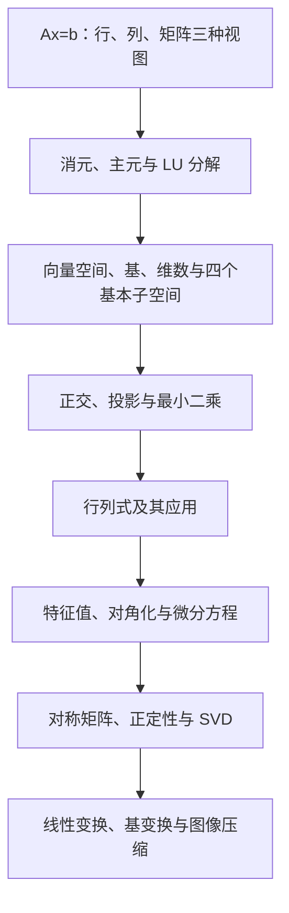

> 用 Gilbert Strang 的 35 讲课堂录像与完整逐字稿重构的线性代数教材。一讲一章，每章都嵌有对应视频，可读、可查、可跟看。

## 课程信息

| 项目 | 内容 |
| --- | --- |
| 课程 | MIT 18.06 Linear Algebra（Spring 2010；课堂录像录制于 1999 年秋季） |
| 讲师 | Gilbert Strang |
| 讲次 | 35 讲（Lecture 1–34，另含 Lecture 24b 测验复习） |
| 总时长 | 约 27.9 小时 |
| 视频 | [Bilibili · 全 34 讲 + 配套教材](https://www.bilibili.com/video/BV1ix411f7Yp)（BV1ix411f7Yp） |
| 插图 | 每讲 2–6 页 MIT OCW 官方讲义摘要 + 5–8 张 Bilibili 课堂视频帧，共 352 张 |
| 官方课程 | [MIT OpenCourseWare 18.06](https://ocw.mit.edu/courses/18-06-linear-algebra-spring-2010/) |
| 教材 | Gilbert Strang, *Introduction to Linear Algebra* |
| 许可 | 逐字稿与课程资料：CC BY-NC-SA 4.0；视频版权归原权利人 |

## 这本书是什么

这不是逐字稿的直译，也不是考点摘要。每一讲都按知识逻辑重新组织：先用“本讲导读”交代问题与位置，再用若干小节把定义、动机、推导、例子串起来，最后用“本讲小结”和“关键词”收束。所有数学内容都以该讲逐字稿为依据；讲稿中的例子、数字和推导链尽量保留，只删除寒暄、重复和课堂互动。

每讲开头还附有 2–6 页 **MIT OCW 18.06SC 官方讲义摘要**（清晰印刷版公式与示意图），正文中再插入 5–8 张带时间点的 **Bilibili 课堂视频帧**；每讲约 10 张图，官方图负责准确，视频帧负责还原课堂现场。

全书按课程自身的三段结构组织：

1. **消元与向量空间**（Lecture 1–12）：从 $A\boldsymbol{x}=\boldsymbol{b}$ 的三种视图出发，用消元把方程组化为上三角，再引入列空间、零空间、基、维数与四个基本子空间。
2. **正交性与行列式**（Lecture 13–20）：正交补、投影、最小二乘、Gram-Schmidt，以及行列式的性质、公式与应用。
3. **特征值、正定性与线性变换**（Lecture 21–34）：特征值、对角化、微分方程、马尔可夫矩阵、对称与正定矩阵、SVD、线性变换与基变换。

## 如何使用

- **顺着读**：从 [Lecture 1](/notes/mit-1806/lec01) 开始，按目录顺序推进。每章末尾都有上一讲/下一讲导航。
- **跟视频**：每章顶部嵌有对应 Bilibili 分 P 播放器；若播放器未加载，点击同一行的 Bilibili 链接即可。视频为完整课堂录像，正文按知识逻辑重组，不逐句对应时间轴。
- **查概念**：每章末尾的“关键词”表给出英文、中文与一句话解释；课程末尾的 [总复习](/notes/mit-1806/lec34) 串起全部主线。
- **看图**：每讲开头连续给出 2–6 页官方讲义摘要，覆盖本讲的核心公式与示意图；正文中再穿插 5–8 张带时间点的视频帧，可对照 Bilibili 视频定位。
- **配合官方材料**：每章顶部链接到 MIT OCW 对应讲次，可下载官方讲义、习题与考试。

## 课程地图

## 目录

### 第一部分 · 消元与向量空间（Lecture 1–12）

| 讲次 | 主题 | 核心问题 | 时长 |
| --- | --- | --- | --- |
| [1](/notes/mit-1806/lec01) | 方程组的几何解释 | 行、列、矩阵三种视角如何描述并求解线性方程组？ | 39:49 |
| [2](/notes/mit-1806/lec02) | 矩阵消元 | 高斯消元如何把方程组化为上三角，什么时候失败？ | 47:42 |
| [3](/notes/mit-1806/lec03) | 矩阵乘法与逆矩阵 | 矩阵乘法有哪几种理解？逆矩阵何时存在、如何求？ | 46:49 |
| [4](/notes/mit-1806/lec04) | $A$ 的 LU 分解 | 消元如何导出 A=LU，为什么它是计算的核心？ | 49:06 |
| [5](/notes/mit-1806/lec05) | 转置、置换与向量空间 $\mathbb{R}^n$ | 转置、置换与向量空间：为什么子空间是整门课的舞台？ | 47:42 |
| [6](/notes/mit-1806/lec06) | 列空间与零空间 | 列空间与零空间如何刻画 Ax=b 的可解性？ | 46:01 |
| [7](/notes/mit-1806/lec07) | 求解 $A\boldsymbol{x}=\boldsymbol{0}$：主变量与特殊解 | 如何用主元与自由变量写出 Ax=0 的全部解？ | 43:20 |
| [8](/notes/mit-1806/lec08) | 求解 $A\boldsymbol{x}=\boldsymbol{b}$：行最简形 $R$ | 秩如何决定 Ax=b 解的存在性与唯一性？ | 47:26 |
| [9](/notes/mit-1806/lec09) | 线性无关、基与维数 | 线性无关、基与维数如何度量一个向量空间？ | 50:20 |
| [10](/notes/mit-1806/lec10) | 四个基本子空间 | 四个基本子空间如何拼成线性代数的完整地图？ | 49:26 |
| [11](/notes/mit-1806/lec11) | 矩阵空间、秩 1 矩阵与小世界图 | 矩阵本身也构成向量空间；秩 1 矩阵为何能生成一切矩阵？ | 46:02 |
| [12](/notes/mit-1806/lec12) | 图、网络与关联矩阵 | 图与网络如何写成关联矩阵？基尔霍夫定律如何对应子空间？ | 47:57 |

### 第二部分 · 正交性与行列式（Lecture 13–20）

| 讲次 | 主题 | 核心问题 | 时长 |
| --- | --- | --- | --- |
| [13](/notes/mit-1806/lec13) | 第一次测验复习 | 从消元到四个子空间：第一部分的主线是什么？ | 47:40 |
| [14](/notes/mit-1806/lec14) | 正交向量与正交子空间 | 正交向量与正交子空间如何补全四个基本子空间？ | 49:48 |
| [15](/notes/mit-1806/lec15) | 子空间上的投影 | 如何把向量投影到子空间？投影为什么是最佳逼近？ | 48:51 |
| [16](/notes/mit-1806/lec16) | 投影矩阵与最小二乘 | 投影矩阵与最小二乘如何联系？ | 48:05 |
| [17](/notes/mit-1806/lec17) | 正交矩阵与 Gram-Schmidt 正交化 | 正交矩阵与 Gram-Schmidt 如何把一组基变成标准正交基？ | 49:25 |
| [18](/notes/mit-1806/lec18) | 行列式的性质 | 行列式的三条定义性质如何推出其余全部性质？ | 49:12 |
| [19](/notes/mit-1806/lec19) | 行列式公式与代数余子式 | 行列式的大公式与代数余子式如何给出通用计算方法？ | 53:17 |
| [20](/notes/mit-1806/lec20) | 克拉默法则、逆矩阵与体积 | 克拉默法则、逆矩阵公式与体积如何统一在行列式之下？ | 51:01 |

### 第三部分 · 特征值、正定性与线性变换（Lecture 21–34）

| 讲次 | 主题 | 核心问题 | 时长 |
| --- | --- | --- | --- |
| [21](/notes/mit-1806/lec21) | 特征值与特征向量 | 特征值与特征向量是什么，如何求解？ | 51:23 |
| [22](/notes/mit-1806/lec22) | 对角化与矩阵的幂 | 如何对角化 A，并用它计算 A^k？ | 51:51 |
| [23](/notes/mit-1806/lec23) | 微分方程与矩阵指数 $e^{At}$ | 如何解线性微分方程组 du/dt=Au？ | 51:03 |
| [24](/notes/mit-1806/lec24) | 马尔可夫矩阵与傅里叶级数 | 马尔可夫矩阵的稳态与傅里叶级数有什么共同结构？ | 51:12 |
| [24b](/notes/mit-1806/lec24b) | 第二次测验复习 | 正交、投影、行列式与特征值：第二部分的主线是什么？ | 48:20 |
| [25](/notes/mit-1806/lec25) | 对称矩阵与正定性 | 对称矩阵为什么一定能正交对角化？正定性意味着什么？ | 43:52 |
| [26](/notes/mit-1806/lec26) | 复矩阵与快速傅里叶变换 | 复矩阵、埃尔米特矩阵与 FFT 如何推广实对称理论？ | 47:52 |
| [27](/notes/mit-1806/lec27) | 正定矩阵与最小值 | 正定矩阵为什么对应多元函数的极小值？如何判定？ | 50:40 |
| [28](/notes/mit-1806/lec28) | 相似矩阵与若尔当标准型 | 相似矩阵何时代表同一个线性变换？不可对角化时若尔当型如何补足？ | 45:57 |
| [29](/notes/mit-1806/lec29) | 奇异值分解 | SVD 如何把任意矩阵分解为“旋转—拉伸—旋转”？ | 41:35 |
| [30](/notes/mit-1806/lec30) | 线性变换及其矩阵 | 线性变换与矩阵如何一一对应？基的选择如何影响矩阵？ | 49:27 |
| [31](/notes/mit-1806/lec31) | 基变换与图像压缩 | 基变换如何简化矩阵？图像压缩如何利用基变换？ | 50:14 |
| [32](/notes/mit-1806/lec32) | 第三次测验复习 | 特征值、正定性、SVD 与线性变换：第三部分的主线是什么？ | 47:05 |
| [33](/notes/mit-1806/lec33) | 左逆、右逆与伪逆 | 左逆、右逆与伪逆如何刻画长方矩阵的“逆”？ | 41:53 |
| [34](/notes/mit-1806/lec34) | 总复习 | 整门课的八条主线与核心考点是什么？ | 43:26 |

## 记号与约定

| 记号 | 含义 |
| --- | --- |
| $A$ | 系数矩阵（$m\times n$） |
| $\boldsymbol{x}$ | 未知向量（$n$ 维） |
| $\boldsymbol{b}$ | 右端向量（$m$ 维） |
| $A^{\mathsf T}$ | $A$ 的转置 |
| $C(A)$ | 列空间（column space） |
| $N(A)$ | 零空间（nullspace） |
| $C(A^{\mathsf T})$ | 行空间（row space） |
| $N(A^{\mathsf T})$ | 左零空间（left nullspace） |
| $r$ | 秩（rank） |
| $\lambda$ | 特征值（eigenvalue） |
| $\det A$ | 行列式（determinant） |
| $\|\boldsymbol{x}\|$ | 向量范数（norm） |

## 来源与许可

- **逐字稿**：来自用户提供的 *MIT 18.06 Complete Lecture Transcripts*，原始内容为 MIT OpenCourseWare 18.06 Linear Algebra（Spring 2010）的英文课堂字幕，教师为 Gilbert Strang。逐字稿按 [CC BY-NC-SA 4.0](https://creativecommons.org/licenses/by-nc-sa/4.0/) 使用；本书对其进行了中文重构、删节与排版。
- **视频**：Bilibili 合集 [BV1ix411f7Yp](https://www.bilibili.com/video/BV1ix411f7Yp)，由上传者整理；视频版权归原权利人所有，本书仅嵌入官方播放器链接，不下载、不再分发视频文件。
- **官方讲义摘要**：MIT OCW [18.06SC Lecture Summaries](https://ocw.mit.edu/courses/18-06sc-linear-algebra-fall-2011/)（CC BY-NC-SA 4.0）。本书将每讲对应摘要 PDF 的各内容页渲染为插图，按官方页面原样呈现公式与示意图。
- **官方课程**：[MIT OCW 18.06](https://ocw.mit.edu/courses/18-06-linear-algebra-spring-2010/)。各讲官方页面链接见每章顶部。
- **本书**：基于上述逐字稿的中文视频书，仅供学习交流，非 MIT 或 OCW 官方出版物。若发现错误，请以官方讲义与视频为准。

---

*整理日期：2026-11-14 ｜ 共 35 章 ｜ 视频总时长约 27.9 小时*
