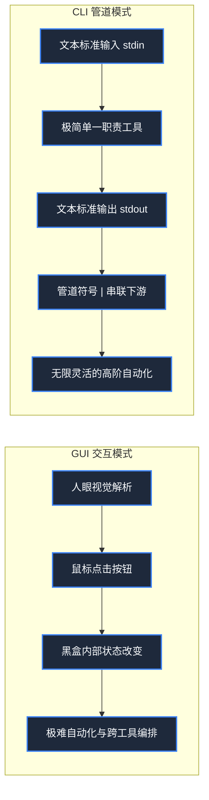
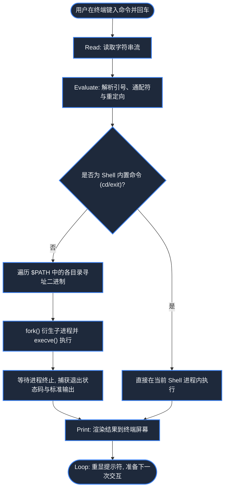
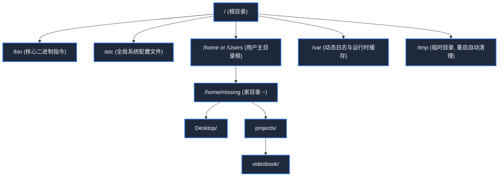
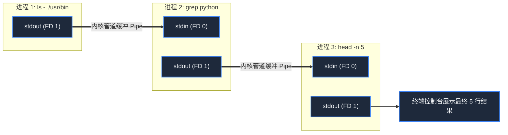
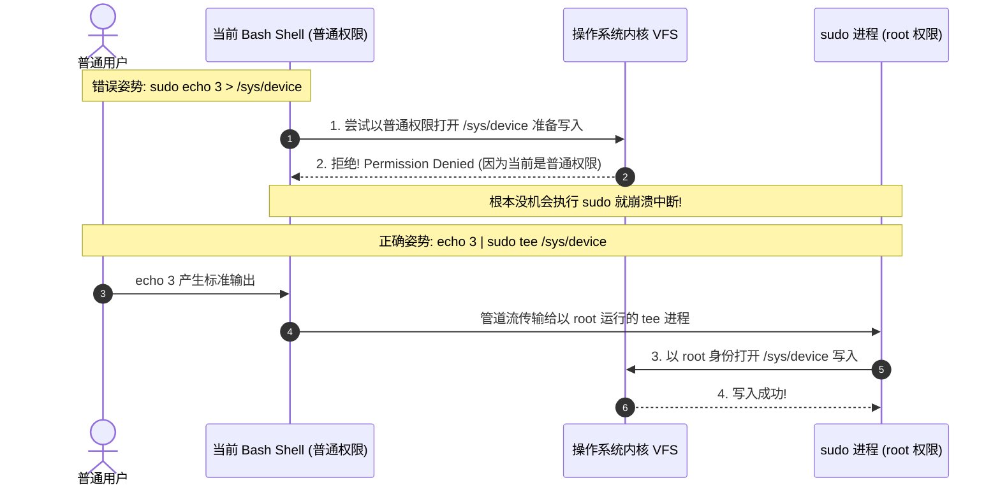

> **课程体系**：麻省理工学院 · 计算机教育中缺失的一课 (MIT The Missing Semester of Your CS Education, 2020)  
> **课程许可**：CC BY-NC-SA 4.0。  
> **所属模块**：模块一：终端交互与工作流基石 (Foundation: Shell & Tooling)  
> **主讲团队**：Anish Athalye, Jose Javier Gonzalez Ortiz, Philip Levis (MIT CSAIL)  
> **视频时长**：00:48:20 ｜ **课堂高清演示板书**：4 张原画截图 ｜ **交互图谱**：Mermaid 架构流程图  
> **课程官方讲义**：[📖 MIT 官方中文课程讲义](https://missing-semester-cn.github.io/2020/course-shell/) ｜ [📺 YouTube 原版视频](https://www.youtube.com/watch?v=Z56Jmr9Z34Q)  
> **B 站直达**：[📺 在 B 站观看本讲高清双语视频 (BV1uc411N7eK)](https://www.bilibili.com/video/BV1uc411N7eK/)  
> **全书导航**：<span>上一讲：无（第一讲）</span> ｜ [📚 返回全书目录](/notes/topics/Missing%20Semester) ｜ [下一讲 (L02) →](/notes/missing-semester/lecture-02)

---

## 核心导读与概念全景

系统阐述命令行界面 (CLI) 的组合性生产力优势，剖析 Shell REPL 交互原理、POSIX 层次化目录树导航、文件与元数据操纵、标准 I/O 流重定向、管道级联与 Linux 权限隔离模型，解开 sudo 重定向陷阱背后的底层文件描述符机制。

---

## 1. 课程初心：为什么计算机系学生需要专门学习工具链？

*(参考时间戳：`00:02:15` · [📺 B站视频片段跳转](https://www.bilibili.com/video/BV1uc411N7eK/?t=135))*

大学计算机系课程（如操作系统、编译器、分布式系统、算法与数据结构）通常专注于高深的计算理论与软件架构，但往往假定学生“自然而然”就会高效使用计算机本身。现实中，大量学生和工程师将过多时间浪费在低效的操作上：在图形界面中做繁琐的重复点击、卡住时在搜索引擎盲目复制粘贴咒语般的命令、把代码修改保存在形如 `code_v2_final_final.py` 的文件名中。

本课程由麻省理工学院（MIT）三位博士生 Anish Athalye、Jose Javier Gonzalez Ortiz 和 Philip Levis 发起，旨在系统填补这一计算机教育断层。

#### 命令行界面 (CLI) vs 图形用户界面 (GUI) 的哲学对决
- **GUI (Graphical User Interface)**：直观、学习曲线平缓，适合一次性、非高频的视觉操作。但 GUI 具有极差的**组合性（Composability）**与**自动化能力**——很难用一个按键把三个不同软件的按钮动作串联循环 1000 次。
- **CLI (Command Line Interface)**：基于纯文本流的通用交互接口。UNIX 哲学的核心即是“编写只做一件事并做好它的程序；编写能够协同工作的程序；编写处理文本流的程序，因为文本是通用的接口”。通过简单的流连接，你可以让数十个极简工具组合出近乎无限的算力管道。



[](https://www.bilibili.com/video/BV1uc411N7eK/?t=240)
*⏱ 时间戳：00:04:00 · 📷 课堂演示截图 · [在 B 站观看对应片段 (BV1uc411N7eK 00:04:00)](https://www.bilibili.com/video/BV1uc411N7eK/?t=240)*

## 2. Shell 的本质与 REPL 交互模型

*(参考时间戳：`00:05:40` · [📺 B站视频片段跳转](https://www.bilibili.com/video/BV1uc411N7eK/?t=340))*

**Shell** 是一个提供给用户的命令解释器程序，运行在内核（Kernel）之上，充当用户与计算机底层系统调用之间的桥梁。最常见的 Shell 包括 Bourne Again SHell (`bash`)、Z Shell (`zsh`) 以及友好的 `fish`。

当你打开终端窗口时，你看到的是 Shell 的命令提示符（Prompt），例如：
```bash
missing:~$ 
```
这通常包含了当前登录用户名、主机名以及当前工作路径（`~` 表示用户家目录 `$HOME`）。

Shell 的运行遵循经典计算机语言的 **REPL** 循环：
1. **Read（读取）**：等待并读取用户键入的字符串；
2. **Evaluate（求值/解析）**：将输入按空格切分为命令名称与参数列表，解析环境变量、通配符和重定向符号，并在系统路径中寻找对应可执行文件；
3. **Print（输出/执行）**：衍生（fork/exec）子进程运行目标程序，并将程序产生的输出打印至终端屏；
4. **Loop（循环）**：重新打印提示符，等待下一次输入。

#### 环境变量与 PATH 寻址
当你在终端输入 `date` 时，Shell 是如何知道该去执行硬盘上的哪一个文件的？
答案是系统环境变量 `$PATH`。`PATH` 变量由一系列以冒号 `:` 分隔的目录路径组成。
```bash
$ echo $PATH
/usr/local/bin:/usr/bin:/bin:/usr/sbin:/sbin
```
Shell 会从左到右依次扫描这些目录。你可以使用 `which` 或 `type` 查看某个命令被解析的具体二进制路径：
```bash
$ which date
/bin/date
$ type echo
echo is a shell builtin
```
这里需要特别区分**系统独立二进制程序**与 **Shell 内置命令 (Builtin)**。例如 `cd`（改变当前工作目录）必须是 Shell 内置的，因为如果 `cd` 是子进程运行，修改子进程的工作目录并不能改变父 Shell 的当前路径！



[](https://www.bilibili.com/video/BV1uc411N7eK/?t=780)
*⏱ 时间戳：00:13:00 · 📷 课堂演示截图 · [在 B 站观看对应片段 (BV1uc411N7eK 00:13:00)](https://www.bilibili.com/video/BV1uc411N7eK/?t=780)*

## 3. POSIX 目录树、路径导航与文件元数据操纵

*(参考时间戳：`00:11:30` · [📺 B站视频片段跳转](https://www.bilibili.com/video/BV1uc411N7eK/?t=690))*

Linux 和 macOS 遵循统一的 POSIX 文件系统模型：**单一根节点 `/` 的树状层级结构**（与 Windows 的盘符驱动器如 `C:\`、`D:\` 截然不同）。

#### 路径的两种表达形式
- **绝对路径（Absolute Path）**：以根目录 `/` 开头，确定性指向该节点在整棵文件树中的唯一位置，如 `/home/eason/projects`。
- **相对路径（Relative Path）**：相对于当前工作目录（Current Working Directory）计算。包含两个特殊虚拟目录：
  - `.`：指代当前目录；
  - `..`：指代上一级父目录。

#### 核心文件与导航命令速查
- `pwd`：Print Working Directory，输出当前所在绝对路径；
- `cd <path>`：Change Directory。无参数时默认跳转到 `$HOME`，`cd -` 快速切回上一次的工作目录；
- `ls`：List 目录内容。常用标志：
  - `ls -a`：显示包含 `.` 开头的隐藏文件（如 `.bashrc`, `.git`）；
  - `ls -l`：长格式输出文件元数据；
  - `ls -h`：人性化显示文件尺寸（如 4K, 12M）；
- `mkdir -p a/b/c`：递归创建多级目录；
- `cp -r src/ dst/`：递归拷贝文件或目录；
- `mv old_name new_name`：移动或重命名文件；
- `rm -rf target/`：强制递归删除目录（请务必谨慎确认路径！）。

#### 详解 `ls -l` 长列表输出格式
执行 `ls -l` 时，每行首部的 10 个字符揭示了 UNIX 的核心元数据体系：
```
-rwxr-xr-- 1 eason staff 4096 Oct 24 19:30 script.sh
```
1. **第 1 位（文件类型）**：`-` 代表普通文件，`d` 代表目录（Directory），`l` 代表符号链接（Symlink），`c/b` 代表字符/块设备；
2. **第 2-4 位（所有者权限 User）**：文件属主拥有的权限（`r` 读, `w` 写, `x` 执行）；
3. **第 5-7 位（属组权限 Group）**：文件所属用户组成员的权限；
4. **第 8-10 位（其他用户 Other）**：系统中其余所有账户的权限。



[](https://www.bilibili.com/video/BV1uc411N7eK/?t=1560)
*⏱ 时间戳：00:26:00 · 📷 课堂演示截图 · [在 B 站观看对应片段 (BV1uc411N7eK 00:26:00)](https://www.bilibili.com/video/BV1uc411N7eK/?t=1560)*

## 4. 标准流重定向与管道（Pipelines）实战

*(参考时间戳：`00:22:10` · [📺 B站视频片段跳转](https://www.bilibili.com/video/BV1uc411N7eK/?t=1330))*

在 UNIX 系统中，任何新启动的进程默认打开三个标准文件描述符（File Descriptors, FD）：
- **FD 0 (stdin)**：标准输入，默认绑定键盘；
- **FD 1 (stdout)**：标准输出，默认打印到屏幕终端；
- **FD 2 (stderr)**：标准错误输出，默认同样打印到屏幕，但与 stdout 逻辑分离。

#### 流重定向操作符
- `< filename`：将目标文件内容重定向为进程的标准输入 stdin；
- `> filename`：将标准输出 stdout 写入文件（**覆盖已有内容**）；
- `>> filename`：将标准输出 stdout 以**追加模式（Append）**写入文件末尾；
- `2> error.log`：将标准错误 stderr 专门重定向至日志；
- `&> all.log` 或 `> all.log 2>&1`：将 stdout 和 stderr 同时合并重定向至同一文件。

#### 管道（`|`）：UNIX 进程间通信的巅峰之作
管道符号 `|` 能够将左侧程序的 `stdout` 直接嫁接为右侧程序的 `stdin`，两者在内核中作为并发进程异步启动，数据通过内核管道缓冲区高速流动，无需产生任何磁盘中间临时文件：
```bash
$ ls -l /usr/bin | grep python | head -n 5
```
这一行命令在内核中瞬间孵化出三个流水线协作的独立进程，数据如同流水般经过过滤与截断后吐出最终结果。



[](https://www.bilibili.com/video/BV1uc411N7eK/?t=2220)
*⏱ 时间戳：00:37:00 · 📷 课堂演示截图 · [在 B 站观看对应片段 (BV1uc411N7eK 00:37:00)](https://www.bilibili.com/video/BV1uc411N7eK/?t=2220)*

## 5. 权限控制、root 提权与经典 sudo 重定向陷阱

*(参考时间戳：`00:34:00` · [📺 B站视频片段跳转](https://www.bilibili.com/video/BV1uc411N7eK/?t=2040))*

在 Linux 中，超级管理员账户被称为 **root**（User ID 为 0）。root 拥有对整个操作系统的绝对控制权，能够越过一切常规文件权限限制。为了日常安全性，我们绝不应当直接以 root 账户登录系统，而是通过 `sudo`（SuperUser DO）临时赋予特定命令以 root 权限。

#### 经典踩坑案例：为什么 `sudo echo 3 > brightness` 会报 Permission Denied？
很多开发者在尝试向系统设备文件修改参数时，常常敲出如下命令：
```bash
$ sudo echo 3 > /sys/class/backlight/intel_backlight/brightness
bash: /sys/class/backlight/intel_backlight/brightness: Permission denied
```
明明加上了 `sudo`，为什么系统依然冷酷地报错拒绝权限？

**原因剖析（文件描述符与进程派生时序）**：
1. Shell 在准备执行命令前，**首先由当前普通用户身份的 Shell 进程**执行重定向解析；
2. 当前 Shell 尝试以普通用户身份打开 `/sys/.../brightness` 进行写入；
3. 由于该设备节点仅限 root 写入，打开文件失败，直接触发 `Permission denied` 中断；
4. 此时甚至根本还没有来得及派生 `sudo` 子进程！

#### 两种优雅的标准解法
- **解法 1：使用 `tee` 命令配合管道（强烈推荐）**
  `tee` 命令的作用是从标准输入读取数据，同时将其写入标准输出与一个或多个目标文件。
  ```bash
  $ echo 3 | sudo tee /sys/class/backlight/intel_backlight/brightness
  ```
  此时 `echo 3` 是普通用户，管道后面的 `tee` 则是以 `sudo` 提权的 root 身份运行，由 root 身份的 `tee` 打开文件写入，完美绕过陷阱！
- **解法 2：让提权的 Shell 执行整串命令**
  ```bash
  $ sudo sh -c 'echo 3 > /sys/class/backlight/intel_backlight/brightness'
  ```



## 6. 官方核心课后练习与实战解析

*(参考时间戳：`00:44:10` · [📺 B站视频片段跳转](https://www.bilibili.com/video/BV1uc411N7eK/?t=2650))*

MIT 官方为本讲提供了精妙的课后实操练习，帮助固化命令行直觉：

#### 练习 1：创建临时实验目录与文件生命周期
在 `/tmp` 下创建名为 `missing` 的新目录，并在其中创建名为 `semester` 的空白文件，向其中逐行写入数据：
```bash
# 1. 递归创建并切换进入
$ cd $(mktemp -d /tmp/missing.XXXXXX)
# 2. 写入两行数据
$ echo "#!/bin/sh" > semester
$ echo "curl --head --silent https://missing.csail.mit.edu" >> semester
```

#### 练习 2：执行权限赋予与 Shebang 机制
尝试直接运行 `./semester`，观察系统提示：
```bash
$ ./semester
bash: ./semester: Permission denied
$ ls -l semester
-rw-r--r-- 1 missing staff 61 Oct 24 19:40 semester
```
发现缺少 `x`（执行）权限。通过 `chmod` 赋予属主执行权限：
```bash
$ chmod u+x semester
$ ./semester
HTTP/2 200 
server: GitHub.com
content-type: text/html; charset=utf-8
...
```
此时操作系统内核解析文件头部的 `#!/bin/sh`（Shebang），自动调用 `/bin/sh` 解释器来逐行运行脚本内的指令！

---

## 附：本讲知识脑图与回顾思考

本讲作为 **模块一：终端交互与工作流基石 (Foundation: Shell & Tooling)** 的核心支柱，从理论动机到底层系统调用、从日常高频操作到前沿最佳实践进行了完整闭环推演。建议结合终端实机演练与课后练习，将命令行与工具链内化为下意识的肌肉记忆。

<span>上一讲：无（第一讲）</span> ｜ [📚 返回全书目录](/notes/topics/Missing%20Semester) ｜ [下一讲 (L02) →](/notes/missing-semester/lecture-02)
