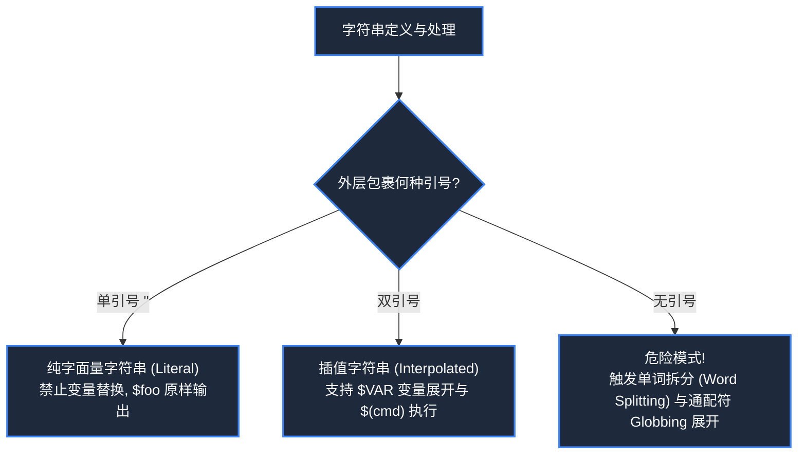
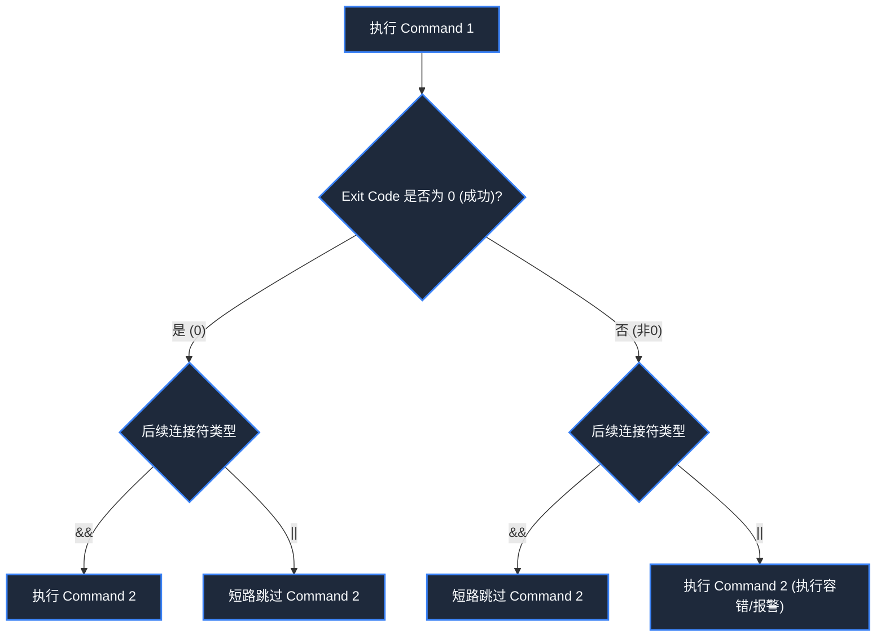
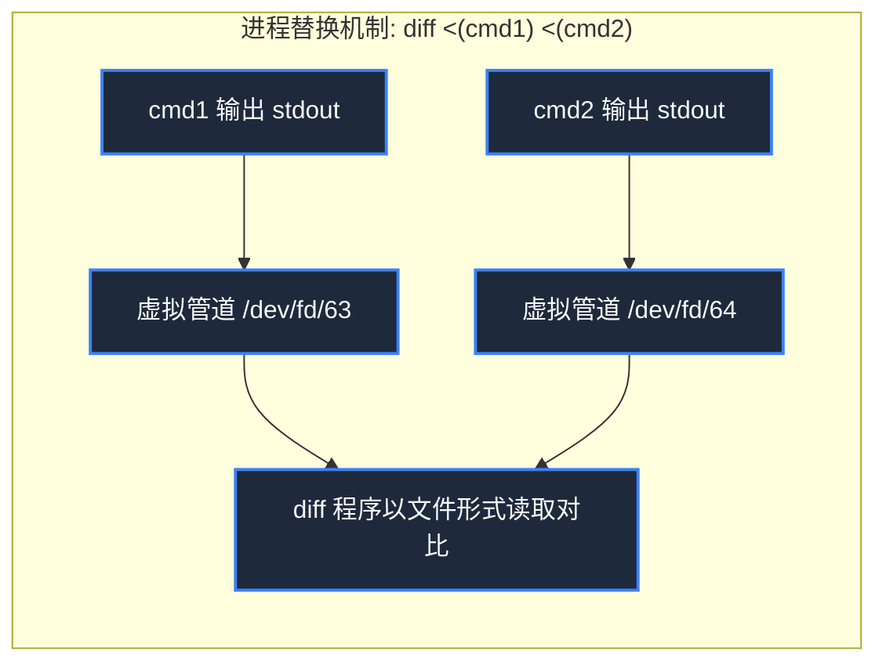
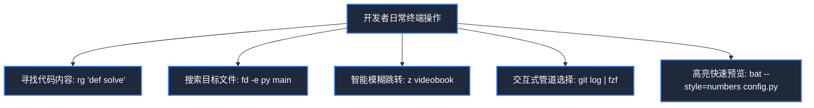

> **课程体系**：麻省理工学院 · 计算机教育中缺失的一课 (MIT The Missing Semester of Your CS Education, 2020)  
> **课程许可**：CC BY-NC-SA 4.0。  
> **所属模块**：模块一：终端交互与工作流基石 (Foundation: Shell & Tooling)  
> **主讲团队**：Anish Athalye, Jose Javier Gonzalez Ortiz, Philip Levis (MIT CSAIL)  
> **视频时长**：00:48:59 ｜ **课堂高清演示板书**：4 张原画截图 ｜ **交互图谱**：Mermaid 架构流程图  
> **课程官方讲义**：[📖 MIT 官方中文课程讲义](https://missing-semester-cn.github.io/2020/shell-tools/) ｜ [📺 YouTube 原版视频](https://www.youtube.com/watch?v=kgII-YWo3Zw)  
> **B 站直达**：[📺 在 B 站观看本讲高清双语视频 (BV1xa4y1g7sZ)](https://www.bilibili.com/video/BV1xa4y1g7sZ/)  
> **全书导航**：[← 上一讲 (L01)](/notes/missing-semester/lecture-01) ｜ [📚 返回全书目录](/notes/topics/Missing%20Semester) ｜ [下一讲 (L03) →](/notes/missing-semester/lecture-03)

---

## 核心导读与概念全景

深入探讨 Bash 脚本语言的语法机制与自动化范式，详尽剖析引号展开差异、特殊变量集、退出状态码、布尔短路求值、命令替换与进程替换，系统介绍 shellcheck 静态审计，并全景横评以 ripgrep、fd、bat、fzf 为代表的新一代现代终端生产力神器。

---

## 1. Bash 脚本结构：Shebang 与变量展开铁律

*(参考时间戳：`00:03:00` · [📺 B站视频片段跳转](https://www.bilibili.com/video/BV1xa4y1g7sZ/?t=180))*

将一系列常用的终端命令固化在文本文件中，加上逻辑控制，就构成了 Shell 脚本。

#### Shebang 行规范
每一个 Shell 脚本的第一行通常以 `#!` 开头，被称为 **Shebang**。它告知内核该使用哪个解释器来运行本文件：
- `#!/bin/bash`：硬编码指定 `/bin/bash`；
- `#!/usr/bin/env bash`（推荐）：通过 `env` 在当前环境的 `$PATH` 中动态寻址 Bash，具有极佳的跨平台与虚拟环境兼容性。

#### 变量定义与引号展开铁律（初学者最易踩坑！）
在 Bash 中定义变量时，**等号 `=` 两侧绝对不能有任何空格**：
```bash
foo="hello"   # 正确：定义变量 foo
foo = "hello" # 错误！Shell 会把 foo 视为命令名，把 = 和 hello 视为两个参数
```
在引用变量时，必须牢记**单引号 `'` 与双引号 `"` 的天壤之别**：
- **双引号 `""`**：允许变量展开与命令替换；
- **单引号 `''`**：保留绝对字面值，禁止任何展开。
```bash
foo="world"
echo "Hello $foo" # 输出: Hello world
echo 'Hello $foo' # 输出: Hello $foo (原样输出)
```



[](https://www.bilibili.com/video/BV1xa4y1g7sZ/?t=300)
*⏱ 时间戳：00:05:00 · 📷 课堂演示截图 · [在 B 站观看对应片段 (BV1xa4y1g7sZ 00:05:00)](https://www.bilibili.com/video/BV1xa4y1g7sZ/?t=300)*

## 2. 函数封装与 Bash 特殊预留变量体系

*(参考时间戳：`00:10:45` · [📺 B站视频片段跳转](https://www.bilibili.com/video/BV1xa4y1g7sZ/?t=645))*

Bash 支持模块化函数定义。在函数与脚本执行上下文中，Bash 自动注入了一整套内置特殊变量：
- `$0`：当前运行脚本的文件名；
- `$1` 至 `$9`：传递给脚本或函数的第 1 到第 9 个位置参数；
- `$@`：所有位置参数列表（以空格分开，推荐用 `"$@"` 保证参数内包含空格时不被二次切分）；
- `$#`：传递的参数总个数；
- `$$`：当前运行的 Shell 进程 ID (PID)；
- `$?`：**前一条命令的退出状态码（Exit Code）**；
- `$_`：前一条命令的最后一个参数。

#### 退出状态码与布尔短路求值
在 POSIX 标准中，程序的退出状态码遵循 **0 代表成功，非 0 代表失败**（这与许多编程语言中 1 为真、0 为假的逻辑相反）：
```bash
$ true; echo $?
0
$ false; echo $?
1
```
基于这一约定，Shell 提供了优雅的布尔逻辑连接符：
- `cmd1 && cmd2`：**短路与**。只有当 `cmd1` 成功返回 0 时，才执行 `cmd2`；
- `cmd1 || cmd2`：**短路或**。只有当 `cmd1` 失败返回非 0 时，才执行 `cmd2`；
- `cmd1 ; cmd2`：无条件顺序执行两条命令。
```bash
# 实践经典范式：编译成功后自动运行，失败则打印警告
make && ./run_tests || echo "Build or test failed!"
```



[](https://www.bilibili.com/video/BV1xa4y1g7sZ/?t=960)
*⏱ 时间戳：00:16:00 · 📷 课堂演示截图 · [在 B 站观看对应片段 (BV1xa4y1g7sZ 00:16:00)](https://www.bilibili.com/video/BV1xa4y1g7sZ/?t=960)*

## 3. 命令替换、进程替换与通配符展开

*(参考时间戳：`00:21:15` · [📺 B站视频片段跳转](https://www.bilibili.com/video/BV1xa4y1g7sZ/?t=1275))*

#### 命令替换（Command Substitution）
当你希望捕获一条命令的执行输出，并将其作为另一条命令的参数传入时，使用 `$(command)`（旧语法使用反引号 `` `command` ``，现已废弃不推荐）：
```bash
# 获取当前日期并嵌入文件名
cp report.md "report_$(date +%Y%m%d).md"
```

#### 进程替换（Process Substitution）
有些命令只接受文件路径作为参数，而不接受管道的 stdin（例如 `diff` 比较两个命令的输出）。此时**进程替换 `<(command)`** 诞生了：
```bash
diff <(ls dir1) <(ls dir2)
```
内核会在后台异步执行括号内的命令，并将其标准输出挂载到一个匿名的命名管道（FIFO）或 `/dev/fd/xx` 虚拟文件中，将文件路径传递给外部命令！

#### 通配符（Globbing）与大括号展开（Brace Expansion）
- **文件名匹配 (Globbing)**：由 Shell 自动扫描匹配磁盘真实文件：
  - `*`：匹配任意数量的字符；
  - `?`：匹配恰好一个任意字符；
  - `*.{png,jpg}`：匹配特定后缀。
- **大括号展开 (Brace Expansion)**：纯文本笛卡尔积批量生成，**不依赖磁盘已有文件**：
  ```bash
  $ echo file{A,B,C}.txt
  fileA.txt fileB.txt fileC.txt
  $ mkdir -p project/{src,bin,doc,test/{unit,integration}}
  ```



[](https://www.bilibili.com/video/BV1xa4y1g7sZ/?t=1680)
*⏱ 时间戳：00:28:00 · 📷 课堂演示截图 · [在 B 站观看对应片段 (BV1xa4y1g7sZ 00:28:00)](https://www.bilibili.com/video/BV1xa4y1g7sZ/?t=1680)*

## 4. 脚本质量保障：shellcheck 静态检查

*(参考时间戳：`00:32:00` · [📺 B站视频片段跳转](https://www.bilibili.com/video/BV1xa4y1g7sZ/?t=1920))*

Bash 脚本极其灵活，也充满了极其阴险的隐式陷阱（如变量未加双引号导致文件名中包含空格时发生参数分裂、未处理空变量直接执行 `rm -rf $DIR/*` 导致意外清空根目录）。

强烈推荐在项目中引入 **`shellcheck`** 静态分析工具：
```bash
$ shellcheck myscript.sh
In myscript.sh line 4:
for file in $(ls *.txt)
            ^---------^ SC2045: Iterating over ls output is fragile. Use globs.
In myscript.sh line 6:
  rm $file
     ^---^ SC2086: Double quote to prevent globbing and word splitting.
```
它能清晰指出错误行、严重级别，并附带针对特定代码气味（Code Smell）的官方修复建议文档。

[](https://www.bilibili.com/video/BV1xa4y1g7sZ/?t=2340)
*⏱ 时间戳：00:39:00 · 📷 课堂演示截图 · [在 B 站观看对应片段 (BV1xa4y1g7sZ 00:39:00)](https://www.bilibili.com/video/BV1xa4y1g7sZ/?t=2340)*

## 5. 现代化 CLI 效率利器全景评测

*(参考时间戳：`00:38:20` · [📺 B站视频片段跳转](https://www.bilibili.com/video/BV1xa4y1g7sZ/?t=2300))*

在过去几十年中，很多基础 UNIX 工具由于向后兼容性包袱，命令语法复杂、输出无色彩、默认单线程。开源社区（尤其是 Rust 生态）涌现出了一批现代化增强替代品：

| 经典工具 | 现代替代品 | 核心优势 |
|---|---|---|
| `man` | **`tldr`** | 抛弃冗长手册，直接给出 5 个最常用的高频实战命令范式 |
| `grep` | **`rg` (ripgrep)** | 默认递归、默认读取 `.gitignore` 过滤无关构建文件，基于 Rust 编写极速多线程 |
| `find` | **`fd`** | 语法直观极简（如 `fd pattern`），彩色输出，性能数倍于 find |
| `cat` | **`bat`** | 自带代码语法高亮、行号展示、Git 修改标记与自动分页 |
| `ls` | **`eza` (exa)** | 树状层级查看 (`eza --tree`)、文件类型图标标注与扩展属性 |
| `Ctrl+R` | **`fzf`** | 通用交互式模糊匹配器，一秒检索数万条历史命令与文件路径 |
| `cd` | **`zoxide`** | 基于访问频次与最近访问时间的智能跳转（`z project` 自动直达） |



## 6. 官方课后练习：捕获偶发性崩溃脚本实战

*(参考时间戳：`00:45:00` · [📺 B站视频片段跳转](https://www.bilibili.com/video/BV1xa4y1g7sZ/?t=2700))*

#### 核心练习：跟踪调试随机失败的脚本
假设有一个会偶发崩溃的脚本 `buggy.sh`：
```bash
#!/usr/bin/env bash
n=$(( RANDOM % 100 ))
if [[ n -eq 42 ]]; then
    echo "Something went wrong"
    >&2 echo "The error was using magic numbers"
    exit 1
fi
echo "Everything went fine"
```
编写一段自动化脚本，连续执行 `buggy.sh`，直到它崩溃退出，并将标准输出与错误输出重定向保存至日志，打印运行了多少次才命中失败：

```bash
#!/usr/bin/env bash
count=0
echo > out.log
while true; do
    ./buggy.sh >> out.log 2>> out.log
    if [[ $? -ne 0 ]]; then
        echo "Script failed after $count successful runs!"
        cat out.log
        break
    fi
    count=$((count + 1))
done
```
这一脚本充分运用了循环控制、`$?` 退出码比对以及标准流追加重定向技术，是自动化测试与模糊测试（Fuzzing）的经典雏形。

---

## 附：本讲知识脑图与回顾思考

本讲作为 **模块一：终端交互与工作流基石 (Foundation: Shell & Tooling)** 的核心支柱，从理论动机到底层系统调用、从日常高频操作到前沿最佳实践进行了完整闭环推演。建议结合终端实机演练与课后练习，将命令行与工具链内化为下意识的肌肉记忆。

[← 上一讲 (L01)](/notes/missing-semester/lecture-01) ｜ [📚 返回全书目录](/notes/topics/Missing%20Semester) ｜ [下一讲 (L03) →](/notes/missing-semester/lecture-03)
