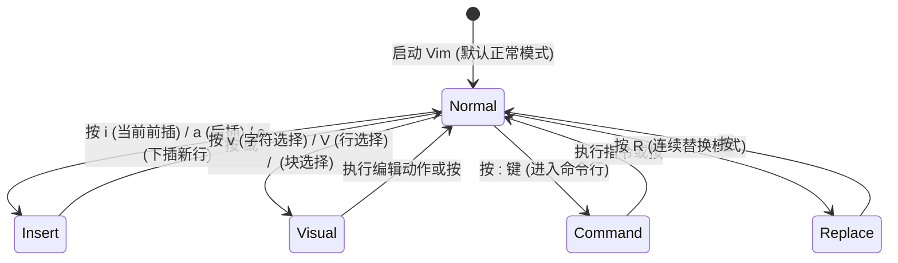
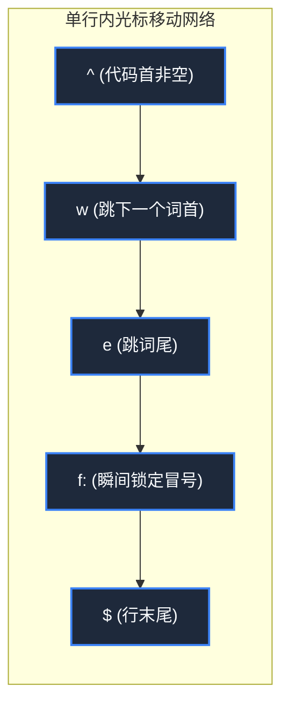
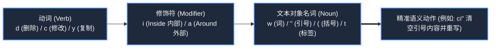

> **课程体系**：麻省理工学院 · 计算机教育中缺失的一课 (MIT The Missing Semester of Your CS Education, 2020)  
> **课程许可**：CC BY-NC-SA 4.0。  
> **所属模块**：模块一：终端交互与工作流基石 (Foundation: Shell & Tooling)  
> **主讲团队**：Anish Athalye, Jose Javier Gonzalez Ortiz, Philip Levis (MIT CSAIL)  
> **视频时长**：00:48:30 ｜ **课堂高清演示板书**：4 张原画截图 ｜ **交互图谱**：Mermaid 架构流程图  
> **课程官方讲义**：[📖 MIT 官方中文课程讲义](https://missing-semester-cn.github.io/2020/editors/) ｜ [📺 YouTube 原版视频](https://www.youtube.com/watch?v=a6Q8Na575qc)  
> **B 站直达**：[📺 在 B 站观看本讲高清双语视频 (BV1CV4y167RA)](https://www.bilibili.com/video/BV1CV4y167RA/)  
> **全书导航**：[← 上一讲 (L02)](/notes/missing-semester/lecture-02) ｜ [📚 返回全书目录](/notes/topics/Missing%20Semester) ｜ [下一讲 (L04) →](/notes/missing-semester/lecture-04)

---

## 核心导读与概念全景

深入剖析文本编辑认知心理学与 Vim 的模态编辑（Modal Editing）哲学，详解正常模式、插入模式、可视模式等状态机流转，系统推演“动词+修饰符+名词”的可组合文本语法（Grammar of Vim），并给出多缓冲区、窗口分屏与现代个性化配置实战方案。

---

## 1. 模态编辑哲学：程序员大部分时间是在阅读与修改，而非打字

*(参考时间戳：`00:02:40` · [📺 B站视频片段跳转](https://www.bilibili.com/video/BV1CV4y167RA/?t=160))*

大多数现代文本编辑器（如 VS Code、Sublime Text）都遵循**无模态模式**：键盘上的按键主要用于向文档中输入字符，移动和操作则依赖鼠标或形如 `Ctrl+Alt+Shift+P` 的手指扭曲快捷键。

然而，软件工程的真实数据表明：**程序员在日常工作中，只有极少数时间在连续键入全新文本，绝大部分时间花费在浏览代码、寻找特定函数、在不同文件间跳跃、重构变量名以及微调几行逻辑上**。

**Vim 的核心破局点即是模态设计（Modal Editing）**：
在默认的**正常模式（Normal Mode）**下，键盘上的每一个键位都被重新映射为精简的导航与编辑操作指令。手指完全不需要离开打字的主按键区（Home Row），也不需要频繁伸手去握鼠标，从而达成“让思维速度与代码操纵速度同步”的至高境界。



[](https://www.bilibili.com/video/BV1CV4y167RA/?t=360)
*⏱ 时间戳：00:06:00 · 📷 课堂演示截图 · [在 B 站观看对应片段 (BV1CV4y167RA 00:06:00)](https://www.bilibili.com/video/BV1CV4y167RA/?t=360)*

## 2. Vim 核心模式与状态转移体系

*(参考时间戳：`00:07:30` · [📺 B站视频片段跳转](https://www.bilibili.com/video/BV1CV4y167RA/?t=450))*

熟练运用 Vim 的第一步是建立清晰的状态机心智模型：
1. **正常模式（Normal Mode）**：进入 Vim 的主干道。在此模式下移动光标、删除、复制、跳转。无论在任何模式下，连续敲击 `<Esc>` 均可随时返回正常模式；
2. **插入模式（Insert Mode）**：如同常规文本编辑器，所见即所得地键入字符：
   - `i`：在光标当前字符前开始插入；
   - `a`：在光标当前字符后开始插入（Append）；
   - `o`：在当前行下方新开一行并进入插入模式；
   - `O`：在当前行上方新开一行并进入插入模式；
3. **可视模式（Visual Mode）**：类似于鼠标划词选区：
   - `v`：字符级可视模式；
   - `V`：整行级可视模式；
   - `Ctrl+v`：**列块选择模式（Block-Visual）**（多行批量加注释或格式对齐的绝技）；
4. **命令行模式（Command-line Mode）**：在正常模式下输入 `:` 触发：
   - `:w`：保存（Write）；
   - `:q`：退出（Quit）；
   - `:wq` 或 `ZZ`：保存并退出；
   - `:q!`：强制放弃修改退出；
   - `:%s/foo/bar/g`：全局正则查找与替换。

[](https://www.bilibili.com/video/BV1CV4y167RA/?t=1020)
*⏱ 时间戳：00:17:00 · 📷 课堂演示截图 · [在 B 站观看对应片段 (BV1CV4y167RA 00:17:00)](https://www.bilibili.com/video/BV1CV4y167RA/?t=1020)*

## 3. 高效位移指令：从像素级挪动到语义级穿梭

*(参考时间戳：`00:15:10` · [📺 B站视频片段跳转](https://www.bilibili.com/video/BV1CV4y167RA/?t=910))*

抛弃方向键！在正常模式下，Vim 提供了全维度的位移按键：
- **基础方向**：`h`（左）、`j`（下）、`k`（上）、`l`（右）；
- **词级别位移**：
  - `w`：跳转到下一个词首（Word）；
  - `b`：回退到上一个词首（Back）；
  - `e`：跳转到当前或下一个词尾（End）；
  - 大写对应键 `W`, `B`, `E`：以纯空白符分割词，跨越代码符号；
- **行内精准定点（极其高效）**：
  - `0`：跳转到绝对行首；
  - `^`：跳转到本行第一个非空白字符；
  - `$`：跳转到行尾；
  - `f<char>`：向前寻找本行下一个特定字符（例如 `f"` 瞬间跳到双引号处）；
  - `t<char>`：向后跳转直到目标字符的前一个位置（Till）；
  - `;` / `,`：重复上一次或反向重复行内字符搜索；
- **文件跨度位移**：
  - `gg`：瞬间直达文档首行；
  - `G`：直达文档末尾；
  - `:<N>` 或 `<N>G`：跳转到第 N 行；
  - `Ctrl+u` / `Ctrl+d`：向上/向下半屏滚动翻页。



[](https://www.bilibili.com/video/BV1CV4y167RA/?t=1740)
*⏱ 时间戳：00:29:00 · 📷 课堂演示截图 · [在 B 站观看对应片段 (BV1CV4y167RA 00:29:00)](https://www.bilibili.com/video/BV1CV4y167RA/?t=1740)*

## 4. 动作语法（The Grammar of Vim）：动词 + 修饰符 + 名词

*(参考时间戳：`00:26:40` · [📺 B站视频片段跳转](https://www.bilibili.com/video/BV1CV4y167RA/?t=1600))*

Vim 最强大的地方在于其命令具有类似人类自然语言的**语法结构**。你不需要记忆成千上万个离散的快捷键组合，只需掌握一组**动词（Verbs）**和一组**文本对象名词（Nouns/Text Objects）**，即可通过笛卡尔积自然组合：

#### 核心动词（Actions / Verbs）
- `d`：删除并剪切（Delete）；
- `c`：修改（Change = 删除并直接切入插入模式）；
- `y`：复制（Yank）；
- `v`：可视选择（Visual）；
- `>` / `<`：增加/减少缩进。

#### 文本对象修饰符与名词（Text Objects）
修饰符：
- `i`：在...内部（Inside，不包含包裹定界符）；
- `a`：围绕...（Around，包含包裹定界符）。

名词目标：
- `w`：单词（word）；
- `s`：句子（sentence）；
- `p`：段落（paragraph）；
- `"`, `'`：引号包裹的字符串；
- `(`, `)`, `b`：小括号包裹的内容；
- `{`, `}`, `B`：代码大括号块；
- `t`：HTML/XML 标签（Tag）。

#### 经典组合实战：
- `ci"`：**Change Inside Quotes**——瞬间清空双引号内部内容并进入插入模式；
- `da(`：**Delete Around Parentheses**——删除小括号以及小括号本身连同内部参数；
- `gUiw`：将当前光标所在的单词瞬间全部转为大写；
- `.`（点操作符）：**重复上一次修改动作**（Vim 中最具生产力的终极神器）。



[](https://www.bilibili.com/video/BV1CV4y167RA/?t=2400)
*⏱ 时间戳：00:40:00 · 📷 课堂演示截图 · [在 B 站观看对应片段 (BV1CV4y167RA 00:40:00)](https://www.bilibili.com/video/BV1CV4y167RA/?t=2400)*

## 5. 多缓冲区（Buffers）与窗口分屏（Windows）体系

*(参考时间戳：`00:36:50` · [📺 B站视频片段跳转](https://www.bilibili.com/video/BV1CV4y167RA/?t=2210))*

在 Vim 中，必须清晰区分三个层级概念：
- **Buffer（缓冲区）**：内存中打开的文件副本。你可以同时打开 50 个缓冲区，但屏幕上只展示 1 个；
- **Window（窗口）**：用来观察某个缓冲区的视窗。一个屏幕可以切分为多个窗口；
- **Tab（标签页）**：窗口的页面布局集合（更类似于虚拟桌面）。

#### 窗口与缓冲区操纵命令
- `:e <filename>`：在当前窗口打开指定文件；
- `:ls` 或 `:buffers`：列出当前所有已打开的缓冲区；
- `:b <name_or_number>`：切换当前活动缓冲区；
- `:sp` / `:vsp`：水平分屏（Split）/ 垂直分屏（Vertical Split）；
- `Ctrl+w` + `h/j/k/l`：在各个分屏视窗之间自由跳转光标焦点；
- `Ctrl+w` + `q`：关闭当前活动窗口。

## 6. 个性化 `.vimrc` 与现代 Neovim 生态启示

*(参考时间戳：`00:43:10` · [📺 B站视频片段跳转](https://www.bilibili.com/video/BV1CV4y167RA/?t=2590))*

通过家目录下的 `~/.vimrc` 配置文件，你可以将 Vim 完全塑造成适合自己的 IDE 级神器：
```vim
" 基础显示与缩进配置
syntax on
set number relativenumber " 混合相对行号，利于快速数字跳转
set tabstop=4
set shiftwidth=4
set expandtab
set smartindent
set hlsearch incsearch ignorecase smartcase

" 快捷键重映射: 将 jk 映射为回到正常模式，手不离主按键区
inoremap jk <Esc>
nnoremap <leader>w :w<CR>
```
近年来，**Neovim** 作为 Vim 的现代重构分支异军突起，引入了 Lua 原生配置驱动、LSP（Language Server Protocol）深度集成、Tree-sitter 语义代码高亮以及高度异步架构，使这门古老的模态编辑艺术在现代云原生与 AI 时代依然焕发着无与伦比的生命力。

---

## 附：本讲知识脑图与回顾思考

本讲作为 **模块一：终端交互与工作流基石 (Foundation: Shell & Tooling)** 的核心支柱，从理论动机到底层系统调用、从日常高频操作到前沿最佳实践进行了完整闭环推演。建议结合终端实机演练与课后练习，将命令行与工具链内化为下意识的肌肉记忆。

[← 上一讲 (L02)](/notes/missing-semester/lecture-02) ｜ [📚 返回全书目录](/notes/topics/Missing%20Semester) ｜ [下一讲 (L04) →](/notes/missing-semester/lecture-04)
