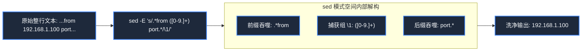
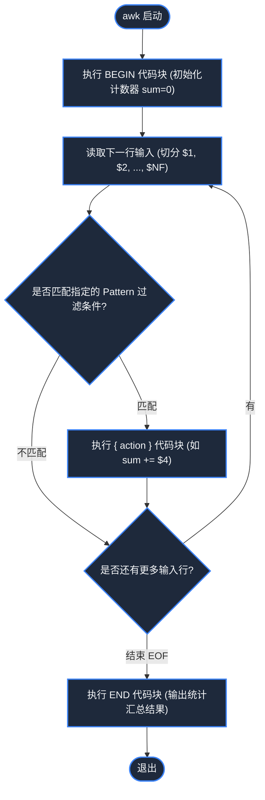

> **课程体系**：麻省理工学院 · 计算机教育中缺失的一课 (MIT The Missing Semester of Your CS Education, 2020)  
> **课程许可**：CC BY-NC-SA 4.0。  
> **所属模块**：模块二：文本流处理与生产力环境 (Data Wrangling & Environment)  
> **主讲团队**：Anish Athalye, Jose Javier Gonzalez Ortiz, Philip Levis (MIT CSAIL)  
> **视频时长**：00:50:07 ｜ **课堂高清演示板书**：4 张原画截图 ｜ **交互图谱**：Mermaid 架构流程图  
> **课程官方讲义**：[📖 MIT 官方中文课程讲义](https://missing-semester-cn.github.io/2020/data-wrangling/) ｜ [📺 YouTube 原版视频](https://www.youtube.com/watch?v=sz_dsktIjt4)  
> **B 站直达**：[📺 在 B 站观看本讲高清双语视频 (BV14u411s7c6)](https://www.bilibili.com/video/BV14u411s7c6/)  
> **全书导航**：[← 上一讲 (L03)](/notes/missing-semester/lecture-03) ｜ [📚 返回全书目录](/notes/topics/Missing%20Semester) ｜ [下一讲 (L05) →](/notes/missing-semester/lecture-05)

---

## 核心导读与概念全景

掌握将异构非结构化文本清洗为高价值结构化洞察的工程技法。系统阐述正则表达式字符集、锚点与捕获组，详解 sed 流编辑替换语法与 awk 列处理模式计算，打通从日志过滤、频次统计到命令行可视化的端到端自动化管道。

---

## 1. 什么是数据整理（Data Wrangling）？

*(参考时间戳：`00:02:10` · [📺 B站视频片段跳转](https://www.bilibili.com/video/BV14u411s7c6/?t=130))*

在日常工程中，系统产生的大多数数据（系统运行日志、传感器指标、网络抓包 dump、爬虫返回的 HTML）都不是整齐排列的 Excel 表格或 SQL 数据库记录，而是充斥着时间戳、冗余调试信息和不规则格式的原始文本。

**数据整理（Data Wrangling）**的核心任务，就是利用精简、高效的命令行工具链，将不可读的原始文本流，逐步提炼、过滤、转换、汇总，最终转化为可以直接回答业务疑问的高阶指标。

#### UNIX 经典数据处理流水线心智模型
整个处理流程类似于一个工业净水厂：
1. **源头抽取（Acquire）**：从日志文件、API 端点或网络抓包获取数据流（`journalctl`, `cat`, `curl`）；
2. **初级过滤（Filter）**：丢弃不关心的无关噪声行（`grep`）；
3. **形态变换（Transform）**：提取核心字段、正则替换重构格式（`sed`, `tr`, `cut`）；
4. **列聚合与计算（Aggregate）**：按列分组、累加计算、求和与平均值（`awk`, `sort`, `uniq`）；
5. **最终呈现（Present）**：排序、截断前 N 名、导出 CSV 或绘制终端字符图表（`head`, `column`, `graph-cli`）。


[](https://www.bilibili.com/video/BV14u411s7c6/?t=360)
*⏱ 时间戳：00:06:00 · 📷 课堂演示截图 · [在 B 站观看对应片段 (BV14u411s7c6 00:06:00)](https://www.bilibili.com/video/BV14u411s7c6/?t=360)*

## 2. 正则表达式（Regular Expressions）系统构建

*(参考时间戳：`00:07:40` · [📺 B站视频片段跳转](https://www.bilibili.com/video/BV14u411s7c6/?t=460))*

正则表达式是数据整理的核心武器，它定义了一种形式化模式，用于匹配特定的字符串序列。

#### 核心元字符与语法体系
- **基础字符集**：
  - `.`：匹配除换行符以外的任意单个字符；
  - `[abc]`：匹配方括号中的任意一个字符；
  - `[^abc]`：取反匹配，不包含这些字符的任意字符；
  - `[0-9]` 或 `[a-zA-Z]`：字符区间范围；
- **位置锚点（Anchors）**：
  - `^`：匹配行的开头；
  - `$`：匹配行的末尾；
  - `\b`：单词边界；
- **量词（Quantifiers）**：
  - `*`：匹配 0 次或多次（贪婪模式）；
  - `+`：匹配 1 次或多次；
  - `?`：匹配 0 次或 1 次；
  - `{m,n}`：匹配最少 m 次、最多 n 次；
- **分组与反向引用（Capture Groups）**：
  - `(...)`：捕获匹配的子模式；在替换阶段可通过 `\1`, `\2` 按序重新引用被捕获的内容。

> **提示**：传统 UNIX 工具存在基础正则（BRE）与扩展正则（ERE）的历史差异。在现代脚本中，执行 `grep -E` 或 `sed -E` 开启扩展正则，可免去大量烦人的反斜杠转义（如直接写 `(abc|def)` 而非 `\(abc\|def\)`）。

[](https://www.bilibili.com/video/BV14u411s7c6/?t=1080)
*⏱ 时间戳：00:18:00 · 📷 课堂演示截图 · [在 B 站观看对应片段 (BV14u411s7c6 00:18:00)](https://www.bilibili.com/video/BV14u411s7c6/?t=1080)*

## 3. `sed` 流编辑器实战：模式空间与正则替换

*(参考时间戳：`00:15:20` · [📺 B站视频片段跳转](https://www.bilibili.com/video/BV14u411s7c6/?t=920))*

`sed`（Stream Editor）是一个轻量级且功能强大的非交互式文本流编辑器。它逐行读取输入流，存入临时内存“模式空间”（Pattern Space），应用指定的编辑脚本，并将结果输出。

#### 最核心语法：`s/regex/replacement/flags`
- `s`：代表 substitute 替换操作；
- `/`：定界符（如果匹配内容本身包含大量的斜杠，比如路径 `/usr/local/bin`，可以任意更换定界符，例如 `s#regex#replacement#g`）；
- `g`（Global Flag）：行内全局匹配。如果不加 `g`，`sed` 默认只替换每一行第一次命中的内容；
- `p`：仅打印被替换的行（常与 `-n` 静默选项配合：`sed -n 's/pattern/\1/p'`）。

#### 捕获组提取案例
假设有一行日志：
```
Jan 15 12:34:56 server sshd[1234]: Failed password for invalid user admin from 192.168.1.100 port 54321 ssh2
```
我们只想精确提炼出其中的攻击者 IP 地址：
```bash
$ sed -E 's/.*from ([0-9.]+) port.*/\1/' log.txt
192.168.1.100
```
这里 `.*from ` 吞掉了 IP 前面的所有前缀，`([0-9.]+)` 作为一个捕获组锁定了纯 IP，` port.*` 吞掉了后续端口与协议，最终整个字符串被单单一个 `\1` 取代！



[](https://www.bilibili.com/video/BV14u411s7c6/?t=1860)
*⏱ 时间戳：00:31:00 · 📷 课堂演示截图 · [在 B 站观看对应片段 (BV14u411s7c6 00:31:00)](https://www.bilibili.com/video/BV14u411s7c6/?t=1860)*

## 4. `awk` 结构化列处理与统计累加引擎

*(参考时间戳：`00:27:00` · [📺 B站视频片段跳转](https://www.bilibili.com/video/BV14u411s7c6/?t=1620))*

如果说 `sed` 擅长按行做模式替换，那么 **`awk`** 就是专为**按列（字段）处理结构化表格数据**而生的完整图灵完备编程语言。

#### `awk` 核心执行模型：`awk 'pattern { action }'`
`awk` 默认以任意连续空白字符（空格或 Tab）切分输入行：
- `$0`：指代当前整行内容；
- `$1, $2, ... $N`：第 1 列、第 2 列，直到最后一列；
- `NF`（Number of Fields）：当前行包含的字段总列数（`$NF` 技巧可直接获取最后一列的内容！）；
- `NR`（Number of Records）：当前行号；
- `BEGIN { ... }`：在开始处理任何行之前执行一次（常用于初始化累加变量或打印表头）；
- `END { ... }`：在所有行全部处理完毕后执行一次（常用于计算平均值或输出最终汇总结果）。

#### 经典实战案例
1. **只打印第二列包含 `error` 的最后一列内容**：
   ```bash
   $ awk '$2 ~ /error/ { print $NF }' system.log
   ```
2. **计算文件所有行第四列数值的总和与均值**：
   ```bash
   $ awk '{ sum += $4; count++ } END { print "Total:", sum, "Avg:", sum/count }' data.tsv
   ```



[](https://www.bilibili.com/video/BV14u411s7c6/?t=2520)
*⏱ 时间戳：00:42:00 · 📷 课堂演示截图 · [在 B 站观看对应片段 (BV14u411s7c6 00:42:00)](https://www.bilibili.com/video/BV14u411s7c6/?t=2520)*

## 5. 流水线组合拳：`sort`, `uniq`, `paste` 与数值计算

*(参考时间戳：`00:38:00` · [📺 B站视频片段跳转](https://www.bilibili.com/video/BV14u411s7c6/?t=2280))*

将各个专职工具用管道拼接，能产生摧枯拉朽的威力：
- **`sort` 文本排序**：
  - `sort -n`：按数值大小排序（而非字典序，避免 10 排在 2 前面）；
  - `sort -k2,2`：指定仅按第 2 列排序；
  - `sort -r`：降序（Reverse）倒序输出；
- **`uniq` 相邻去重**（**铁律：必须先经过 `sort` 才能发挥效力！**）：
  - `uniq -c`：去重并统计每个元素出现的频次（Count）；
- **`paste` 流合并**：
  - `paste -sd+`：将多行数据合并为以加号 `+` 分隔的单行算式；
- **`bc` 任意精度计算器**：
  ```bash
  # 一秒计算 100 个请求时延的总和：
  $ cat latencies.txt | paste -sd+ - | bc
  ```

## 6. 现代结构化数据清洗：`jq` 与终端绘图

*(参考时间戳：`00:45:10` · [📺 B站视频片段跳转](https://www.bilibili.com/video/BV14u411s7c6/?t=2710))*

现代 Web 开发中，API 响应普遍采用 JSON 格式。用传统行正则解析多行嵌套的 JSON 极易碎裂，此时应当使用专门的 **`jq`** 工具：
```bash
# 从 GitHub API 获取最新的 release tag 并提取所有 commit 消息
$ curl -s https://api.github.com/repos/facebook/react/commits |   jq -r '.[0:5] | .[] | "\(.commit.author.date): \(.commit.message)"'
```
配合 `graph-cli` 或 Python 极简绘图脚本，你甚至无需打开浏览器，直接在终端字符界面中实时渲染柱状图与趋势图！

---

## 附：本讲知识脑图与回顾思考

本讲作为 **模块二：文本流处理与生产力环境 (Data Wrangling & Environment)** 的核心支柱，从理论动机到底层系统调用、从日常高频操作到前沿最佳实践进行了完整闭环推演。建议结合终端实机演练与课后练习，将命令行与工具链内化为下意识的肌肉记忆。

[← 上一讲 (L03)](/notes/missing-semester/lecture-03) ｜ [📚 返回全书目录](/notes/topics/Missing%20Semester) ｜ [下一讲 (L05) →](/notes/missing-semester/lecture-05)
