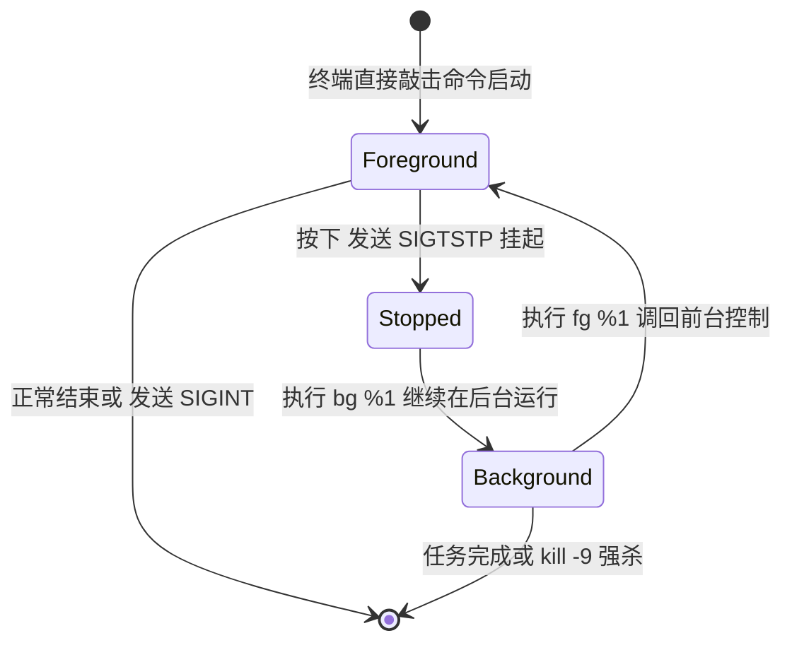
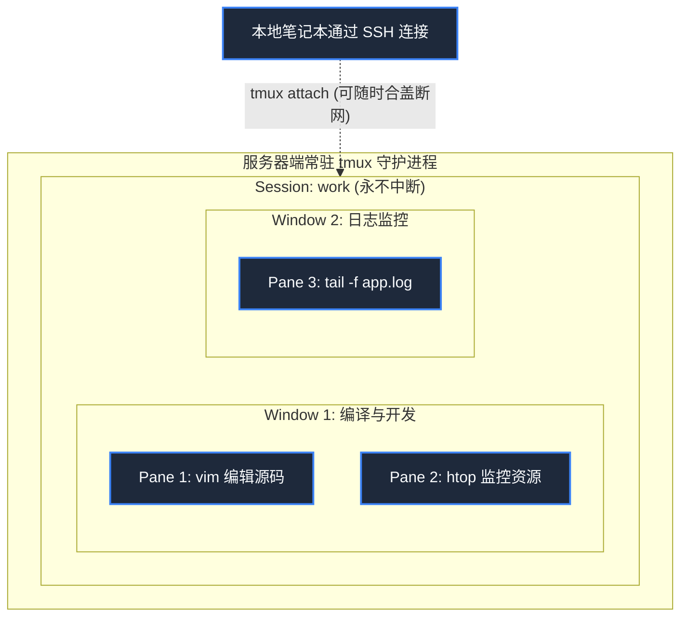
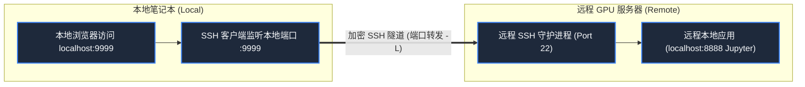

> **课程体系**：麻省理工学院 · 计算机教育中缺失的一课 (MIT The Missing Semester of Your CS Education, 2020)  
> **课程许可**：CC BY-NC-SA 4.0。  
> **所属模块**：模块二：文本流处理与生产力环境 (Data Wrangling & Environment)  
> **主讲团队**：Anish Athalye, Jose Javier Gonzalez Ortiz, Philip Levis (MIT CSAIL)  
> **视频时长**：00:56:10 ｜ **课堂高清演示板书**：4 张原画截图 ｜ **交互图谱**：Mermaid 架构流程图  
> **课程官方讲义**：[📖 MIT 官方中文课程讲义](https://missing-semester-cn.github.io/2020/command-line/) ｜ [📺 YouTube 原版视频](https://www.youtube.com/watch?v=e8BO_dYxk5c)  
> **B 站直达**：[📺 在 B 站观看本讲高清双语视频 (BV1Jh4y1Z7SV)](https://www.bilibili.com/video/BV1Jh4y1Z7SV/)  
> **全书导航**：[← 上一讲 (L04)](/notes/missing-semester/lecture-04) ｜ [📚 返回全书目录](/notes/topics/Missing%20Semester) ｜ [下一讲 (L06) →](/notes/missing-semester/lecture-06)

---

## 核心导读与概念全景

掌握长期运行、可穿透网络断连的稳健生产力工作流。系统剖析 UNIX 任务控制与核心信号量体系，实战 tmux 终端复用器分屏与持久会话，建立以 Git 为骨干的 Dotfiles 配置资产管理体系，深入探索 SSH 非对称认证与三种高级端口转发隧道。

---

## 1. 任务控制（Job Control）与 UNIX 信号量机制

*(参考时间戳：`00:03:30` · [📺 B站视频片段跳转](https://www.bilibili.com/video/BV1Jh4y1Z7SV/?t=210))*

当你在终端运行一个耗时很久的计算任务时，Shell 的当前控制台会被占用。理解操作系统的**任务控制**与**信号量（Signals）**是高效多任务并行的前提。

#### 关键快捷键与信号量映射
信号量是操作系统向正在运行的进程发送的异步中断通知：
- **`Ctrl+C` 发送 `SIGINT` (Signal Interrupt, 信号 2)**：礼貌通知进程中断退出。大多数程序会捕获该信号做优雅关闭（清理临时文件、刷新写缓冲区）；
- **`Ctrl+\` 发送 `SIGQUIT` (Signal Quit, 信号 3)**：强制退出并生成核心转储文件（Core Dump）；
- **`Ctrl+Z` 发送 `SIGTSTP` (Terminal Stop, 信号 20)**：通知进程挂起（暂停），将控制权瞬间交还给终端提示符；
- **`SIGTERM` (信号 15)**：`kill <PID>` 默认发送的终止信号；
- **`SIGKILL` (信号 9)**：内核直接强制抹杀进程，**该信号不能被进程捕获或忽略**（通常在进程陷入死锁无响应时使用：`kill -9 <PID>`）；
- **`SIGHUP` (Signal Hangup, 信号 1)**：当关闭终端窗口或网络 SSH 连接断开时，系统向该会话下的所有子进程广播此信号，默认导致所有运行中的后台任务瞬间暴毙！

#### 挂起与后台任务控制流
```bash
$ python long_task.py
^Z
[1]+  Stopped                 python long_task.py
$ jobs          # 查看当前 Shell 托管的所有后台作业
[1]+  Stopped                 python long_task.py
$ bg %1         # 让作业 1 在后台继续唤醒运行 (Background)
[1]+ python long_task.py &
$ fg %1         # 将后台作业 1 重新调回前台控制 (Foreground)
```



[](https://www.bilibili.com/video/BV1Jh4y1Z7SV/?t=420)
*⏱ 时间戳：00:07:00 · 📷 课堂演示截图 · [在 B 站观看对应片段 (BV1Jh4y1Z7SV 00:07:00)](https://www.bilibili.com/video/BV1Jh4y1Z7SV/?t=420)*

## 2. 终端复用器 `tmux`：永不断线的云端会话

*(参考时间戳：`00:13:50` · [📺 B站视频片段跳转](https://www.bilibili.com/video/BV1Jh4y1Z7SV/?t=830))*

在远程服务器上跑训练模型或编译内核时，最致命的噩梦就是“笔记本合盖或寝室断网，导致 SSH 连接断开，触发 SIGHUP 导致跑了 10 小时的任务前功尽弃”。

**`tmux`（Terminal Multiplexer）彻底终结了这一问题！**
`tmux` 运行在服务器的常驻守护进程中。它将终端分为三个层次：
1. **Session（会话）**：一个独立的工作空间，即使你断开 SSH，该会话在服务器内存中依然全速运行；
2. **Window（窗口）**：会话中的一个独立虚拟桌面，可在多个全屏窗口间瞬时切换；
3. **Pane（窗格）**：将单一屏幕切分为多个互不干扰的小格子（上下分屏、左右分屏）。

#### `tmux` 常用操作速查（所有快捷键默认以 `Ctrl+b` 为前缀键）
- 启动/恢复会话：
  - `tmux new -s work`：创建名为 `work` 的新会话；
  - `tmux ls`：列出服务器上所有存活的会话；
  - `tmux a -t work`：重新依附连接（Attach）到目标会话；
- 会话内快捷键（先按 `Ctrl+b`，松手后再按后面的键）：
  - `d`：**分离（Detach）当前会话**，安全切回外层控制台，后台任务继续无损运行；
  - `%`：左右垂直分屏；
  - `"`：上下水平分屏；
  - 方向键：在不同分屏窗格间转移光标；
  - `c`：创建新的虚拟窗口；
  - `n` / `p`：切换到下一个/上一个窗口。



[](https://www.bilibili.com/video/BV1Jh4y1Z7SV/?t=1260)
*⏱ 时间戳：00:21:00 · 📷 课堂演示截图 · [在 B 站观看对应片段 (BV1Jh4y1Z7SV 00:21:00)](https://www.bilibili.com/video/BV1Jh4y1Z7SV/?t=1260)*

## 3. 别名（Aliases）与环境自动化

*(参考时间戳：`00:25:30` · [📺 B站视频片段跳转](https://www.bilibili.com/video/BV1Jh4y1Z7SV/?t=1530))*

为了节省输入冗长命令的时间，可在配置文件中定义别名：
```bash
alias ll="ls -lah"
alias gs="git status -sb"
alias dc="docker-compose"
```
别名适用于极其简单的命令快捷包装。但**如果涉及到传递动态参数或做分支判断，必须使用 Shell 函数**：
```bash
# 创建目录并立刻自动 cd 进入
mkcd() {
    mkdir -p "$1" && cd "$1"
}
```

[](https://www.bilibili.com/video/BV1Jh4y1Z7SV/?t=2100)
*⏱ 时间戳：00:35:00 · 📷 课堂演示截图 · [在 B 站观看对应片段 (BV1Jh4y1Z7SV 00:35:00)](https://www.bilibili.com/video/BV1Jh4y1Z7SV/?t=2100)*

## 4. Dotfiles：个人配置资产版本化与自动同步

*(参考时间戳：`00:32:40` · [📺 B站视频片段跳转](https://www.bilibili.com/video/BV1Jh4y1Z7SV/?t=1960))*

程序员在终端中沉淀的 `.bashrc`, `.zshrc`, `.vimrc`, `.tmux.conf`, `.gitconfig` 等配置文件，被称为 **Dotfiles**（以点开头的隐藏文件）。这些配置凝聚了开发者数年的效率沉淀与肌肉记忆。

#### 最佳实践方案：Git + GNU Stow
1. 在家目录下建立专门的 Git 仓库 `~/dotfiles/`；
2. 将真实的配置文件移入该仓库，并在家目录建立符号链接（Symlink）；
3. 使用 **GNU Stow** 自动建立并维护这些层级符号链接：
   ```bash
   $ cd ~/dotfiles
   $ stow zsh    # 自动将 ~/dotfiles/zsh/.zshrc 软链至 ~/.zshrc
   $ stow vim    # 自动将 ~/dotfiles/vim/.vimrc 软链至 ~/.vimrc
   ```
4. 将 `dotfiles` 托管至 GitHub 私有或公开仓库。换新电脑或登录新服务器时，只需一秒 `git clone` 即可完全无痛复原整套工作流！

[](https://www.bilibili.com/video/BV1Jh4y1Z7SV/?t=2820)
*⏱ 时间戳：00:47:00 · 📷 课堂演示截图 · [在 B 站观看对应片段 (BV1Jh4y1Z7SV 00:47:00)](https://www.bilibili.com/video/BV1Jh4y1Z7SV/?t=2820)*

## 5. 远程连接终极指南：SSH 密钥认证与三种端口转发

*(参考时间戳：`00:41:00` · [📺 B站视频片段跳转](https://www.bilibili.com/video/BV1Jh4y1Z7SV/?t=2460))*

SSH（Secure Shell）是现代互联网中最重要、最安全的远程管理加密协议。

#### 抛弃繁琐密码：基于 Ed25519 的免密公私钥认证
```bash
# 1. 本地生成最高强度的现代加密密钥对 (推荐 ed25519 算法)
$ ssh-keygen -t ed25519 -C "your_email@example.com"
# 2. 将本地公钥 (~/.ssh/id_ed25519.pub) 一键部署至远程服务器 ~/.ssh/authorized_keys
$ ssh-copy-id user@remote.server.edu
```

#### 配置 `~/.ssh/config`：彻底告别 IP 与端口死记硬背
编辑本地 `~/.ssh/config`：
```ssh
Host myserver
    HostName 198.51.100.42
    User eason
    Port 2222
    IdentityFile ~/.ssh/id_ed25519
```
从此，只需在终端输入极简的 `ssh myserver`，系统自动调取指定密钥、端口和用户名秒级登录！

#### SSH 端口转发三大模式解构
- **本地端口转发（Local Port Forwarding, `-L`）**：
  把远程服务器内部的网络服务，映射到本地机器的端口。
  *典型场景*：远程服务器在 `localhost:8888` 跑着 Jupyter Notebook，本地没有公网 IP 无法直接看，执行：
  ```bash
  ssh -L 9999:localhost:8888 myserver
  ```
  此时在本地浏览器打开 `http://localhost:9999`，流量如同走地下秘密隧道般直接直达远程的 Jupyter！
- **远程端口转发（Remote Port Forwarding, `-R`）**：
  把本地电脑的端口，反向暴露给远程服务器。
- **动态端口转发（Dynamic Port Forwarding, `-D`）**：
  在本地开一个 SOCKS5 代理端口（如 `ssh -D 1080 myserver`），本地浏览器的所有流量均借道远程服务器转发。



---

## 附：本讲知识脑图与回顾思考

本讲作为 **模块二：文本流处理与生产力环境 (Data Wrangling & Environment)** 的核心支柱，从理论动机到底层系统调用、从日常高频操作到前沿最佳实践进行了完整闭环推演。建议结合终端实机演练与课后练习，将命令行与工具链内化为下意识的肌肉记忆。

[← 上一讲 (L04)](/notes/missing-semester/lecture-04) ｜ [📚 返回全书目录](/notes/topics/Missing%20Semester) ｜ [下一讲 (L06) →](/notes/missing-semester/lecture-06)
