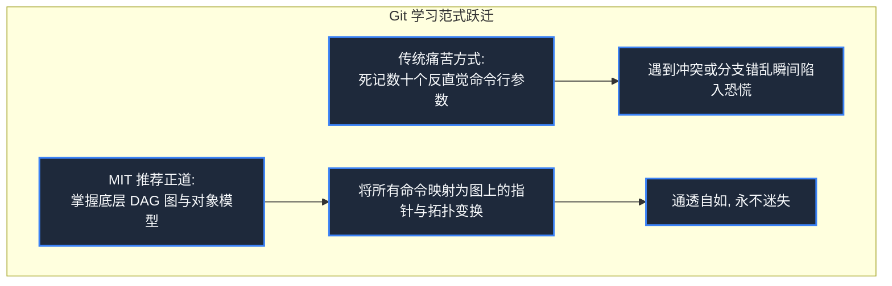
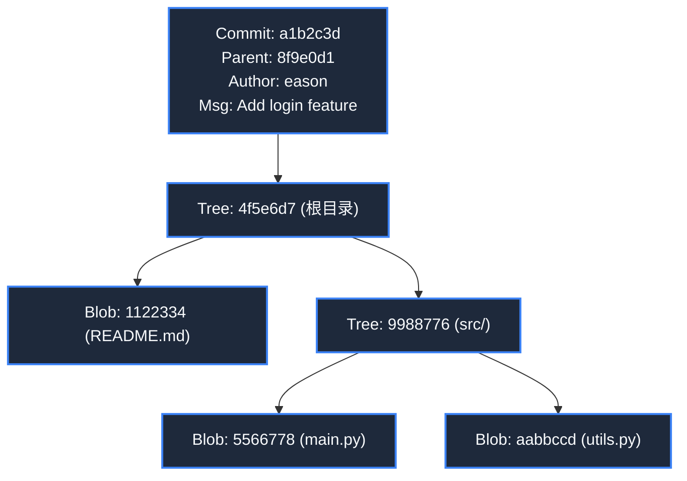
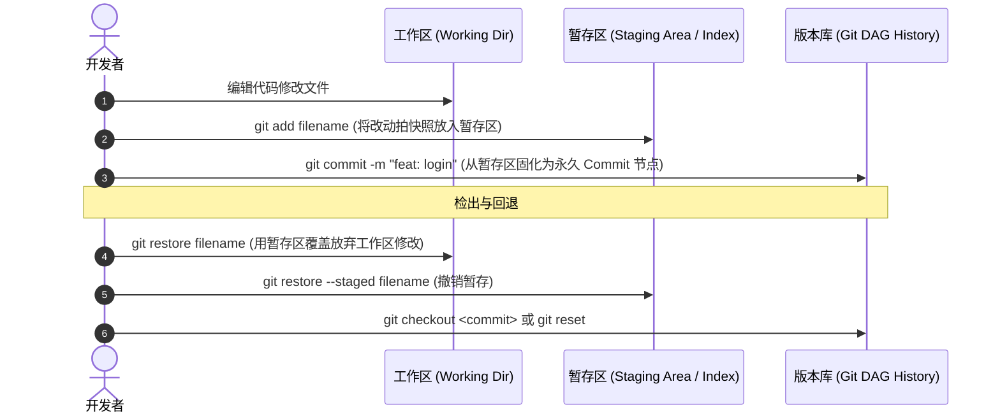
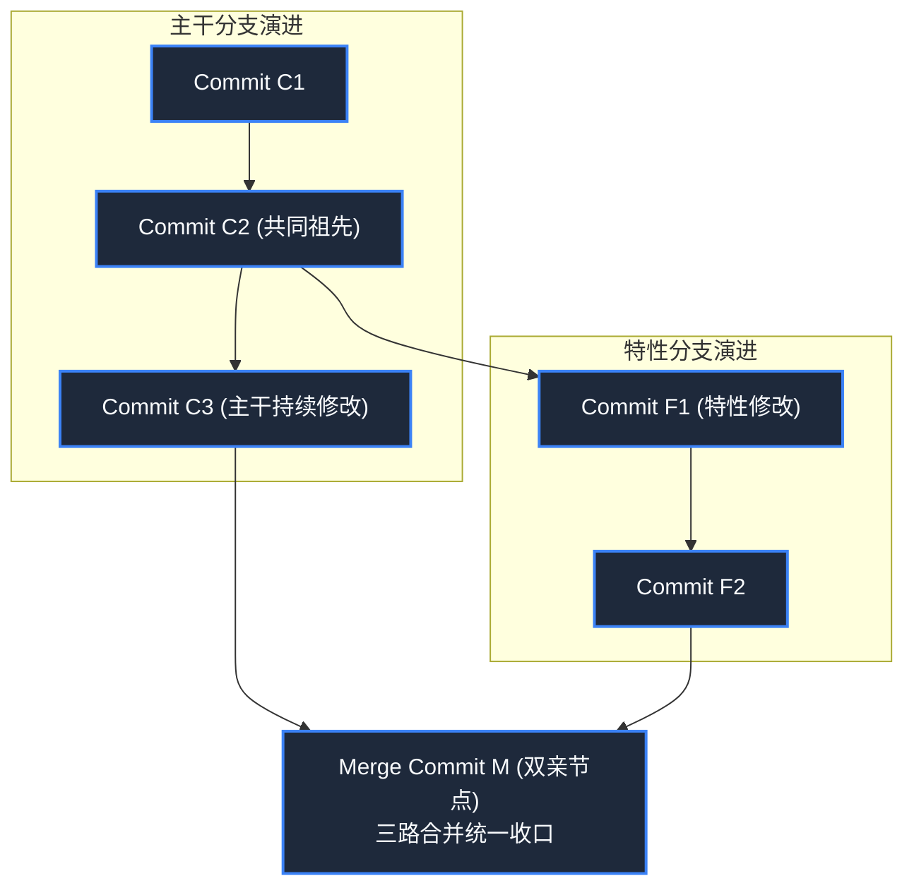

> **课程体系**：麻省理工学院 · 计算机教育中缺失的一课 (MIT The Missing Semester of Your CS Education, 2020)  
> **课程许可**：CC BY-NC-SA 4.0。  
> **所属模块**：模块三：版本控制与软件工程 (Software Engineering & Diagnostics)  
> **主讲团队**：Anish Athalye, Jose Javier Gonzalez Ortiz, Philip Levis (MIT CSAIL)  
> **视频时长**：01:25:03 ｜ **课堂高清演示板书**：4 张原画截图 ｜ **交互图谱**：Mermaid 架构流程图  
> **课程官方讲义**：[📖 MIT 官方中文课程讲义](https://missing-semester-cn.github.io/2020/version-control/) ｜ [📺 YouTube 原版视频](https://www.youtube.com/watch?v=2sjqTHE0zok)  
> **B 站直达**：[📺 在 B 站观看本讲高清双语视频 (BV1Wh4y1s7Lj)](https://www.bilibili.com/video/BV1Wh4y1s7Lj/)  
> **全书导航**：[← 上一讲 (L05)](/notes/missing-semester/lecture-05) ｜ [📚 返回全书目录](/notes/topics/Missing%20Semester) ｜ [下一讲 (L07) →](/notes/missing-semester/lecture-07)

---

## 核心导读与概念全景

跳出死记硬背 Git 命令的泥潭，从数据结构与数学模型维度建立对 Git 的终极认知。全景剖析有向无环图 (DAG)、内容寻址存储、Blob/Tree/Commit 对象底层图谱，推导工作区/暂存区三层状态流转，详解分支指针变动、三路合并算法、交互式变基与二分代码排错法。

---

## 1. 为什么学 Git 必须先学数据模型？

*(参考时间戳：`00:03:00` · [📺 B站视频片段跳转](https://www.bilibili.com/video/BV1Wh4y1s7Lj/?t=180))*

版本控制系统（VCS）是团队协同开发与代码演进不可替代的基石。然而，绝大多数开发者在学习 Git 时都经历了极其痛苦的挣扎：在网上死记硬背 `git add`, `git commit`, `git pull`, `git push`；一旦遭遇合并冲突、HEAD 游离或者分支错乱，就陷入恐慌，甚至采用“删掉整个目录重新 clone 一份再手动把修改考进去”的狼狈策略。

本讲讲师强调：**不要先去死记 Git 的命令行参数！Git 的表面命令接口（CLI）在设计上是出了名的反人类与不直观，但其底层的概念数据模型（Data Model）却优雅得令人叹为观止。**

只要你在脑海中建立了 Git 底层对象的有向无环图（DAG）模型，Git 的所有命令不过是对这个图结构的简单增删改查。当遇到任何问题时，你只需要思考：“我现在在这个图的哪个节点？我希望把图上的哪条边移到哪里去？”



[](https://www.bilibili.com/video/BV1Wh4y1s7Lj/?t=480)
*⏱ 时间戳：00:08:00 · 📷 课堂演示截图 · [在 B 站观看对应片段 (BV1Wh4y1s7Lj 00:08:00)](https://www.bilibili.com/video/BV1Wh4y1s7Lj/?t=480)*

## 2. Git 内部对象结构与内容寻址存储

*(参考时间戳：`00:12:30` · [📺 B站视频片段跳转](https://www.bilibili.com/video/BV1Wh4y1s7Lj/?t=750))*

Git 在本质上是一个**内容寻址键值存储系统（Content-Addressed Key-Value Store）**。你将任意数据放入 Git，Git 会根据数据的全部字节计算出 40 位的 SHA-1 哈希值（或 SHA-256），并以这个哈希值作为唯一的键（Key）将数据对象存储在 `.git/objects` 目录下。

#### Git 的四大核心对象类型
1. **Blob（数据块）**：纯粹的文件内容字节流。注意：Blob **只存文件内容，不存文件名，也不存权限**！两个内容完全相同的 100MB 文件，在 Git 中只会占用一个 Blob 的存储空间；
2. **Tree（目录树）**：代表一个目录。Tree 内部包含一张列表，每一项记录了子目录名、文件名、权限属性，以及指向下游对应 Blob 或子 Tree 的 SHA-1 哈希指针；
3. **Commit（提交节点）**：代表项目在某个时间点的一份**全局完整快照**。Commit 对象包含：
   - 指向顶层根目录 `Tree` 的哈希指针；
   - 若干个**父提交（Parent Commits）**的哈希指针（初始提交无父，普通提交有 1 个父，合并提交有 2 个或多个父）；
   - 作者、提交者、时间戳与提交说明文字；
4. **Annotated Tag（附注标签）**：指向某个 Commit 的永久不变别名。



[](https://www.bilibili.com/video/BV1Wh4y1s7Lj/?t=1440)
*⏱ 时间戳：00:24:00 · 📷 课堂演示截图 · [在 B 站观看对应片段 (BV1Wh4y1s7Lj 00:24:00)](https://www.bilibili.com/video/BV1Wh4y1s7Lj/?t=1440)*

## 3. 工作区、暂存区与仓库的三层流转模型

*(参考时间戳：`00:23:45` · [📺 B站视频片段跳转](https://www.bilibili.com/video/BV1Wh4y1s7Lj/?t=1425))*

在日常修改中，代码在三个工作区域之间流动：
- **工作区（Working Directory）**：硬盘上你直接肉眼可见、用编辑器直接编辑的文件系统真实目录；
- **暂存区（Staging Area / Index）**：准备放入下一次提交的快照草稿，存储在 `.git/index` 二进制文件中。通过 `git add` 将工作区的改动提交至暂存区；
- **版本库（Repository）**：已经永久持久化在 `.git/objects` 里的 Commit DAG 拓扑历史。

#### 为什么需要暂存区？
暂存区给予了开发者精细雕琢提交原子性（Commit Atomicity）的能力。如果你同时修改了 3 个不同的 Bug，你不必把它们混在一起粗糙地打一个 Commit，而是可以通过 `git add -p` 甚至行级挑选，将逻辑相关的改动分批放入暂存区，分别生成 3 个清晰独立、随时可回滚的原子提交。



[](https://www.bilibili.com/video/BV1Wh4y1s7Lj/?t=2520)
*⏱ 时间戳：00:42:00 · 📷 课堂演示截图 · [在 B 站观看对应片段 (BV1Wh4y1s7Lj 00:42:00)](https://www.bilibili.com/video/BV1Wh4y1s7Lj/?t=2520)*

## 4. 分支的真面目：轻量级可变引用与三路合并

*(参考时间戳：`00:36:10` · [📺 B站视频片段跳转](https://www.bilibili.com/video/BV1Wh4y1s7Lj/?t=2170))*

在很多旧式版本控制系统中，创建分支意味着把整个项目的完整代码拷贝一份到新文件夹，耗时数分钟。而在 Git 中：
**分支的本质仅仅是一个存放在 `.git/refs/heads/<branch>` 下的纯文本文件，里面写着它所指向的那个 Commit 节点的 40 位哈希值！**
因此，在 Git 中创建或销毁一个分支，只是在硬盘上写入或删除一个 41 字节的文件，耗时通常不足 1 毫秒！

- **HEAD**：特殊引用，指代当前“你正站在哪个分支上”。
- **Fast-forward 合并**：当主分支自切出子分支后没有任何新提交时，合并只是简单地将主分支指针平移至子分支末端。
- **三路合并（3-Way Merge）**：当两条分支自共同祖先（Common Ancestor）各自演进时，Git 自动寻找该最近公共祖先节点，与两端的目标节点做三方差异对比，自动合成一个新的包含双亲引用的 Merge Commit。若同一行代码被两端同时修改，则产生著名的**合并冲突（Merge Conflict）**，标记为 `<<<<<<<`, `=======`, `>>>>>>>`，等待开发者人工确认。



[](https://www.bilibili.com/video/BV1Wh4y1s7Lj/?t=3960)
*⏱ 时间戳：01:06:00 · 📷 课堂演示截图 · [在 B 站观看对应片段 (BV1Wh4y1s7Lj 01:06:00)](https://www.bilibili.com/video/BV1Wh4y1s7Lj/?t=3960)*

## 5. 交互式变基（`rebase -i`）与历史整容术

*(参考时间戳：`00:52:00` · [📺 B站视频片段跳转](https://www.bilibili.com/video/BV1Wh4y1s7Lj/?t=3120))*

在将本地个人开发分支合入团队主干前，你的本地提交往往充斥着形如 `fix typo`, `wip`, `test again` 的凌乱琐碎提交。使用**交互式变基（Interactive Rebase）**可以将历史修剪得如教科书般整洁：
```bash
$ git rebase -i HEAD~4
```
Git 会弹出一个编辑器列表，允许你对最近 4 个提交指定动作：
- `pick`：保留该提交；
- `reword`：修改该提交的 log message；
- `edit`：停在改提交处，允许追加或修改代码；
- `squash`（极高频）：将该提交**压缩合并**到前一个提交中，抹去临时中间状态；
- `drop`：直接丢弃删除该提交。

> **变基黄金法则**：**绝对不要对已经推送到公开公共分支（如 origin/main）的提交执行 rebase！** 变基会重写哈希值，强推将破坏所有协作者的下游历史基线。

## 6. 奇技淫巧：`git bisect` 二分排错与代码考古

*(参考时间戳：`01:10:00` · [📺 B站视频片段跳转](https://www.bilibili.com/video/BV1Wh4y1s7Lj/?t=4200))*

当项目庞大、包含数万个提交时，如果发现线上突然冒出一个诡异 Bug，但不知道是这几个月里哪一次代码改动引入的，**`git bisect`** 是神级的救命工具：
```bash
$ git bisect start
$ git bisect bad                 # 告诉 Git 当前最新 HEAD 有 Bug
$ git bisect good v1.0.0         # 告诉 Git 几个月前的 v1.0 标签绝对正常
Bisecting: 128 revisions left to test after this (roughly 7 steps)
```
Git 会自动采用**二分搜索算法**，立刻签出中间的提交点让你测试。你只需测试后告诉 Git `git bisect good` 或 `bad`，Git 即可在短短 $\log_2(N)$ 步内（例如 1000 个提交只需 10 步测试）精确揪出导致 Bug 诞生的罪魁祸首 Commit！甚至可以配合自动化测试脚本 `git bisect run ./test.sh` 实现无人值守的全自动二分锁定！

---

## 附：本讲知识脑图与回顾思考

本讲作为 **模块三：版本控制与软件工程 (Software Engineering & Diagnostics)** 的核心支柱，从理论动机到底层系统调用、从日常高频操作到前沿最佳实践进行了完整闭环推演。建议结合终端实机演练与课后练习，将命令行与工具链内化为下意识的肌肉记忆。

[← 上一讲 (L05)](/notes/missing-semester/lecture-05) ｜ [📚 返回全书目录](/notes/topics/Missing%20Semester) ｜ [下一讲 (L07) →](/notes/missing-semester/lecture-07)
