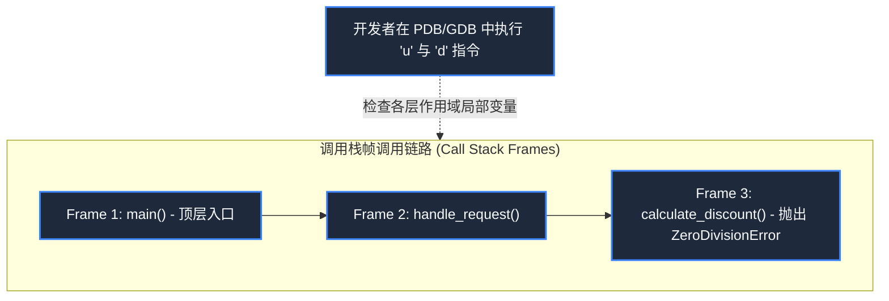
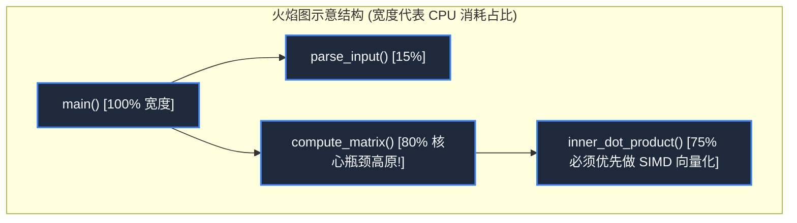

> **课程体系**：麻省理工学院 · 计算机教育中缺失的一课 (MIT The Missing Semester of Your CS Education, 2020)  
> **课程许可**：CC BY-NC-SA 4.0。  
> **所属模块**：模块三：版本控制与软件工程 (Software Engineering & Diagnostics)  
> **主讲团队**：Anish Athalye, Jose Javier Gonzalez Ortiz, Philip Levis (MIT CSAIL)  
> **视频时长**：00:54:17 ｜ **课堂高清演示板书**：4 张原画截图 ｜ **交互图谱**：Mermaid 架构流程图  
> **课程官方讲义**：[📖 MIT 官方中文课程讲义](https://missing-semester-cn.github.io/2020/debugging-profiling/) ｜ [📺 YouTube 原版视频](https://www.youtube.com/watch?v=l812pUnKxME)  
> **B 站直达**：[📺 在 B 站观看本讲高清双语视频 (BV16h4y1471u)](https://www.bilibili.com/video/BV16h4y1471u/)  
> **全书导航**：[← 上一讲 (L06)](/notes/missing-semester/lecture-06) ｜ [📚 返回全书目录](/notes/topics/Missing%20Semester) ｜ [下一讲 (L08) →](/notes/missing-semester/lecture-08)

---

## 核心导读与概念全景

掌握代码缺陷诊断与系统性能瓶颈攻坚的现代工程师双刃剑。系统解构日志排错、防御式断言与断点调试器（GDB/PDB）运行时栈帧检查，理清真实耗时与 CPU 时间的本源差异，深入剖析 CPU 采样 Profiler 与火焰图（Flame Graphs）热点调用栈可视化。

---

## 1. 调试的方法论与防御式编程

*(参考时间戳：`00:02:45` · [📺 B站视频片段跳转](https://www.bilibili.com/video/BV16h4y1471u/?t=165))*

高德纳（Donald Knuth）曾说过：“过早优化是万恶之源。”而在程序开发中，发现并消除程序不符合预期的行为（Bug）占据了开发者超过一半的时间。

#### 科学调试四步法
1. **构建确定性、最小化复现环境（Reproduction）**：如果一个 Bug 无法稳定复现，你就无法证明你修好了它；
2. **假设与二分缩小范围（Hypothesis）**：从现象反推根因，提出假说并设计实验验证；
3. **针对性修复并验证（Fix & Verify）**；
4. **追加防倒退回归测试（Regression Test）**：将导致 Bug 的边界用例沉淀为自动化测试，确保团队今后永不再犯。

#### 为什么 `print` 调试永远不会过时？
虽然高级调试器功能强大，但结构化**日志（Logging）**具备不可替代的优势：
- 能够记录历史时序（时间旅行排错）；
- 可以部署在真实生产环境上长期收集异构并发行为；
- 支持不同的日志等级过滤（DEBUG, INFO, WARN, ERROR, CRITICAL）。

[](https://www.bilibili.com/video/BV16h4y1471u/?t=420)
*⏱ 时间戳：00:07:00 · 📷 课堂演示截图 · [在 B 站观看对应片段 (BV16h4y1471u 00:07:00)](https://www.bilibili.com/video/BV16h4y1471u/?t=420)*

## 2. 交互式调试器实战：PDB 与 GDB 栈帧漫步

*(参考时间戳：`00:11:20` · [📺 B站视频片段跳转](https://www.bilibili.com/video/BV16h4y1471u/?t=680))*

当代码陷入死循环、崩溃抛出异常或内部状态被破坏时，交互式调试器能够让你直接冻结程序时间，在任意时间切片下钻取变量内存。

#### Python 内置调试器 `pdb`
在需要暂停代码的地方插入一行：
```python
import pdb; pdb.set_trace()
# 或 Python 3.7+ 现代内置函数:
breakpoint()
```
运行到此处时，终端自动切入调试交互环境：
- `l`（List）：列出当前光标前后的源代码上下文；
- `p <expr>` / `pp <expr>`：打印任意变量或表达式的求值结果；
- `n`（Next）：单步执行下一行（跳过子函数调用）；
- `s`（Step）：单步进入子函数内部深入探查；
- `c`（Continue）：恢复程序全速执行，直到命中下一个断点；
- `w`（Where）：打印完整的调用栈帧（Backtrace）；
- `u`（Up）/ `d`（Down）：在调用栈的父函数栈帧与子函数栈帧之间上下切换作用域！



[](https://www.bilibili.com/video/BV16h4y1471u/?t=1200)
*⏱ 时间戳：00:20:00 · 📷 课堂演示截图 · [在 B 站观看对应片段 (BV16h4y1471u 00:20:00)](https://www.bilibili.com/video/BV16h4y1471u/?t=1200)*

## 3. 性能剖析哲学：不要猜，必须量化测量！

*(参考时间戳：`00:22:15` · [📺 B站视频片段跳转](https://www.bilibili.com/video/BV16h4y1471u/?t=1335))*

在优化代码前，人类的直觉往往是极度不可靠的：你花费了三天时间把一个循环里的局部变量优化到极致，最终发现程序整体运行耗时只降低了 0.01%，因为系统真正的瓶颈卡在一个未建立索引的数据库磁盘 I/O 上！

#### 时间指标三要素：`real`, `user`, `sys`
在终端前加上 `time` 命令：
```bash
$ time python compute.py
real    0m3.245s
user    0m2.810s
sys     0m0.320s
```
- **Real（钟表物理耗时）**：从命令开始敲下到结束经历的真实物理时间；
- **User（用户态 CPU 耗时）**：CPU 纯粹执行你的应用程序用户空间指令所消耗的总时间；
- **Sys（系统调用 CPU 耗时）**：CPU 代替程序执行系统调用（读取磁盘、分配内存、发送网络报文）在内核态中消耗的时间。

> **典型诊断模式**：
> - `User + Sys ≈ Real`：纯 CPU 密集型任务；
> - `Real >> User + Sys`：严重卡在等待外部 I/O（磁盘、网络）或多线程锁争用；
> - `User + Sys >> Real`：现代多核 CPU 并行并发运行。

[](https://www.bilibili.com/video/BV16h4y1471u/?t=1980)
*⏱ 时间戳：00:33:00 · 📷 课堂演示截图 · [在 B 站观看对应片段 (BV16h4y1471u 00:33:00)](https://www.bilibili.com/video/BV16h4y1471u/?t=1980)*

## 4. CPU Profiler 双流派与热点火焰图（Flame Graphs）

*(参考时间戳：`00:32:40` · [📺 B站视频片段跳转](https://www.bilibili.com/video/BV16h4y1471u/?t=1960))*

#### 采样分析器（Sampling）vs 追踪分析器（Tracing）
- **追踪式分析器（Tracing Profiler）**：拦截记录函数每一次的进出调用。测量绝对精准，但插桩开销极大，会使原本程序变慢十倍以上，甚至改变竞态条件；
- **采样分析器（Sampling Profiler）**：以极高频率（如每秒 99 次）定期打断程序，给当前正在运行的调用栈拍快照。开销极低（通常只有 1~2% 性能损耗），可在高负载生产环境无感运行。

#### 火焰图（Flame Graphs）的阅读心智模型
火焰图由计算机性能大师 Brendan Gregg 发明，将千万条采样快照聚合为极致直观的二维矢量图：
- **纵轴（Y 轴）**：代表调用栈深度。最底层是 `main`，越往上是更深层的子函数调用（自下而上调用）；
- **横轴（X 轴）**：代表采样所占的时间百分比（注意：横轴并不代表从左到右的时间流逝，而是按字母序排列的样本聚合！）；
- **最宽的高原（Plateaus）**：如果在火焰图顶部出现了一大块非常宽平的矩形，说明 CPU 在该函数上消耗了极高比例的周期，这就是你最该首当其冲重构攻坚的**头号性能热点（Hotspot）**！



[](https://www.bilibili.com/video/BV16h4y1471u/?t=2700)
*⏱ 时间戳：00:45:00 · 📷 课堂演示截图 · [在 B 站观看对应片段 (BV16h4y1471u 00:45:00)](https://www.bilibili.com/video/BV16h4y1471u/?t=2700)*

## 5. 系统底层资源剖析：`strace`、`lsof` 与系统监控

*(参考时间戳：`00:43:00` · [📺 B站视频片段跳转](https://www.bilibili.com/video/BV16h4y1471u/?t=2580))*

当一个二进制黑盒程序运行异常卡死，你没有源码无法单步调试时，**系统调用追踪器（`strace`）**是终极探测雷达：
```bash
# 跟踪程序所有的文件打开、读写与网络系统调用
$ strace -e trace=open,read,write ./mystery_app
```
你能清晰看到程序正在疯狂尝试打开哪个不存在的配置文件路径，从而瞬间定位故障。配合 `lsof -p <PID>` 列出该进程打开的所有文件描述符与网络 Socket 句柄，一切系统行为无所遁形。

---

## 附：本讲知识脑图与回顾思考

本讲作为 **模块三：版本控制与软件工程 (Software Engineering & Diagnostics)** 的核心支柱，从理论动机到底层系统调用、从日常高频操作到前沿最佳实践进行了完整闭环推演。建议结合终端实机演练与课后练习，将命令行与工具链内化为下意识的肌肉记忆。

[← 上一讲 (L06)](/notes/missing-semester/lecture-06) ｜ [📚 返回全书目录](/notes/topics/Missing%20Semester) ｜ [下一讲 (L08) →](/notes/missing-semester/lecture-08)
