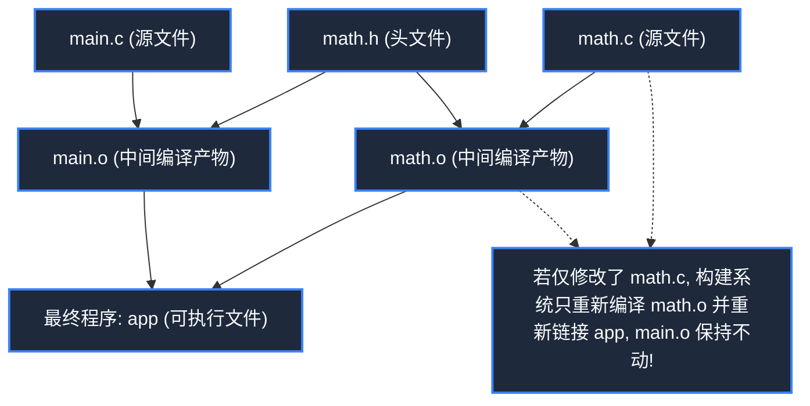
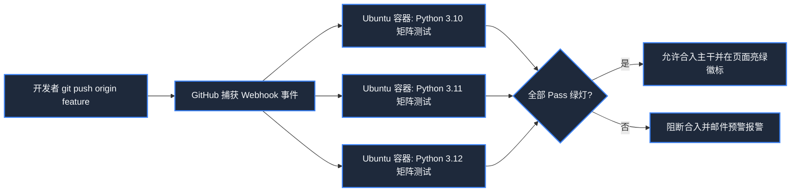

> **课程体系**：麻省理工学院 · 计算机教育中缺失的一课 (MIT The Missing Semester of Your CS Education, 2020)  
> **课程许可**：CC BY-NC-SA 4.0。  
> **所属模块**：模块三：版本控制与软件工程 (Software Engineering & Diagnostics)  
> **主讲团队**：Anish Athalye, Jose Javier Gonzalez Ortiz, Philip Levis (MIT CSAIL)  
> **视频时长**：00:49:56 ｜ **课堂高清演示板书**：4 张原画截图 ｜ **交互图谱**：Mermaid 架构流程图  
> **课程官方讲义**：[📖 MIT 官方中文课程讲义](https://missing-semester-cn.github.io/2020/metaprogramming/) ｜ [📺 YouTube 原版视频](https://www.youtube.com/watch?v=_Ms1Z4xfqv4)  
> **B 站直达**：[📺 在 B 站观看本讲高清双语视频 (BV1fo4y1M7H6)](https://www.bilibili.com/video/BV1fo4y1M7H6/)  
> **全书导航**：[← 上一讲 (L07)](/notes/missing-semester/lecture-07) ｜ [📚 返回全书目录](/notes/topics/Missing%20Semester) ｜ [下一讲 (L09) →](/notes/missing-semester/lecture-09)

---

## 核心导读与概念全景

解开现代软件工程“让代码编写代码、让系统构建系统”的工业化密码。系统推演构建系统基于有向无环依赖图与时间戳的增量编译哲学，详解 Make 与 Makefile 模式规则及自动变量，剖析语义化版本号（SemVer）与锁文件机制，实战基于 GitHub Actions 的现代 CI/CD 自动化流水线。

---

## 1. 构建系统（Build Systems）哲学：增量构建与依赖拓扑

*(参考时间戳：`00:02:30` · [📺 B站视频片段跳转](https://www.bilibili.com/video/BV1fo4y1M7H6/?t=150))*

对于一个仅有十几行的小程序，在终端手动敲击 `gcc main.c -o main` 简单而直接。但当项目成长为由数百个源码模块、第三方静态库、测试用例、静态前端资源与生成文档组成的工业级软件时，全量重新编译一次可能需要耗费数小时。

**构建系统的核心使命，是基于有向无环依赖图（DAG）实现智能的增量编译（Incremental Compilation）**：
1. 构建系统清晰知晓每一个产物（Target）是由哪些前置依赖（Prerequisites）派生而来的；
2. 构建系统检查目标文件与依赖文件的**最近修改时间戳（mtime）**；
3. **只有当某个源文件的修改时间戳比目标产物更新时，才触发对应编译规则**！其余数千个未改动的模块全部跳过复用，从而将构建时间从数小时骤降至 1 秒！



[](https://www.bilibili.com/video/BV1fo4y1M7H6/?t=360)
*⏱ 时间戳：00:06:00 · 📷 课堂演示截图 · [在 B 站观看对应片段 (BV1fo4y1M7H6 00:06:00)](https://www.bilibili.com/video/BV1fo4y1M7H6/?t=360)*

## 2. `make` 与 `Makefile` 核心解构与自动变量

*(参考时间戳：`00:10:15` · [📺 B站视频片段跳转](https://www.bilibili.com/video/BV1fo4y1M7H6/?t=615))*

`make` 是历史上最经久不衰的经典构建引擎。其核心配置文件为 `Makefile`，其基础语法格式如下：
```makefile
target: prerequisites ...
	recipe
	...
```
> **极其致命的历史铁律**：`recipe` 执行行前面**必须是真正的 Tab 键制表符，绝不能是空格！**（这是 Unix 早期历史上最具恶名的语法遗留之一）。

#### Makefile 自动化变量体系
- `$@`：指代当前规则的目标（Target）文件名；
- `$<`：指代先决依赖列表中的第一个依赖文件；
- `$^`：指代所有先决依赖文件列表（以空格分隔并自动去重）；
- `%.o: %.c`：**模式规则（Pattern Rule）**，告诉 Make 如何把任意一个 `.c` 文件编译为对应的 `.o` 文件。

```makefile
CC = gcc
CFLAGS = -Wall -O2

# 终极目标
paper.pdf: paper.tex plot.png
	pdflatex paper.tex

plot.png: plot.py data.csv
	python plot.py -i data.csv -o $@

clean:
	rm -f *.o paper.pdf plot.png

.PHONY: clean
```
`.PHONY` 声明 `clean` 是一个伪目标（Phony Target），防止工程目录下恰好存在一个叫 `clean` 的真实文件时导致命令被判定为“已是最新”而拒绝执行。

[](https://www.bilibili.com/video/BV1fo4y1M7H6/?t=1080)
*⏱ 时间戳：00:18:00 · 📷 课堂演示截图 · [在 B 站观看对应片段 (BV1fo4y1M7H6 00:18:00)](https://www.bilibili.com/video/BV1fo4y1M7H6/?t=1080)*

## 3. 依赖管理与语义化版本号（Semantic Versioning）

*(参考时间戳：`00:23:40` · [📺 B站视频片段跳转](https://www.bilibili.com/video/BV1fo4y1M7H6/?t=1420))*

现代软件工程广泛依赖开源生态包管理器（Python 的 pip, Node.js 的 npm, Rust 的 cargo）。各依赖包版本迭代遵循 **SemVer（语义化版本规范）**：
$$MAJOR.MINOR.PATCH$$
例如 `v2.4.1`：
1. **MAJOR（主版本号）**：包含破坏性（Breaking Changes）的不兼容 API 变更；
2. **MINOR（次版本号）**：向下兼容的新增功能特性；
3. **PATCH（修订版本号）**：向下兼容的问题修复与 Bug 补丁。

#### 锁文件（Lockfile）为什么关乎软件生死？
在配置中指定 `requests = "^2.25.0"` 允许包管理器自动安装兼容的小版本。然而，如果依赖的某个深层传递依赖在某天发布了一个引入 Bug 的 patch 版本，会导致今天能跑的代码明天在生产环境离奇崩溃！

**Lockfile（如 `package-lock.json`, `poetry.lock`, `Cargo.lock`）固化了整棵依赖树中每一个包的绝对精确版本号与内容哈希值**，确保在全世界任何一台机器上执行构建，还原出来的运行环境都毫无二致。

[](https://www.bilibili.com/video/BV1fo4y1M7H6/?t=1860)
*⏱ 时间戳：00:31:00 · 📷 课堂演示截图 · [在 B 站观看对应片段 (BV1fo4y1M7H6 00:31:00)](https://www.bilibili.com/video/BV1fo4y1M7H6/?t=1860)*

## 4. 持续集成与交付（CI/CD）：GitHub Actions 实战

*(参考时间戳：`00:36:00` · [📺 B站视频片段跳转](https://www.bilibili.com/video/BV1fo4y1M7H6/?t=2160))*

**持续集成（Continuous Integration）**的理念是：开发者一向代码仓库推送提交或发起 Pull Request，云端自动化集群立刻拉取代码，在干净的隔离容器中自动执行代码静态检查、全量单元测试与跨平台编译。

#### GitHub Actions 工作流解构
在仓库 `.github/workflows/test.yml` 下配置声明式流水线：
```yaml
name: Test Suite

on: [push, pull_request]

jobs:
  build:
    runs-on: ubuntu-latest
    strategy:
      matrix:
        python-version: ["3.10", "3.11", "3.12"]
    steps:
      - name: 检出代码
        uses: actions/checkout@v4
      - name: 配置 Python 环境
        uses: actions/setup-python@v5
        with:
          python-version: ${{ matrix.python-version }}
      - name: 安装项目依赖
        run: pip install -r requirements.txt
      - name: 运行单元测试
        run: pytest tests/
```
通过极其优雅的矩阵策略（Matrix），一次代码提交即可自动化在三大主流 Python 版本上并行完成质量守门，将线上缺陷彻底扼杀在萌芽之中。



[](https://www.bilibili.com/video/BV1fo4y1M7H6/?t=2460)
*⏱ 时间戳：00:41:00 · 📷 课堂演示截图 · [在 B 站观看对应片段 (BV1fo4y1M7H6 00:41:00)](https://www.bilibili.com/video/BV1fo4y1M7H6/?t=2460)*

---

## 附：本讲知识脑图与回顾思考

本讲作为 **模块三：版本控制与软件工程 (Software Engineering & Diagnostics)** 的核心支柱，从理论动机到底层系统调用、从日常高频操作到前沿最佳实践进行了完整闭环推演。建议结合终端实机演练与课后练习，将命令行与工具链内化为下意识的肌肉记忆。

[← 上一讲 (L07)](/notes/missing-semester/lecture-07) ｜ [📚 返回全书目录](/notes/topics/Missing%20Semester) ｜ [下一讲 (L09) →](/notes/missing-semester/lecture-09)
