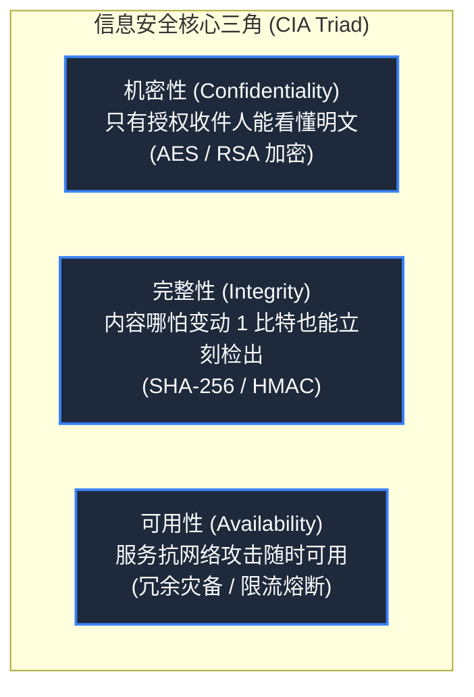
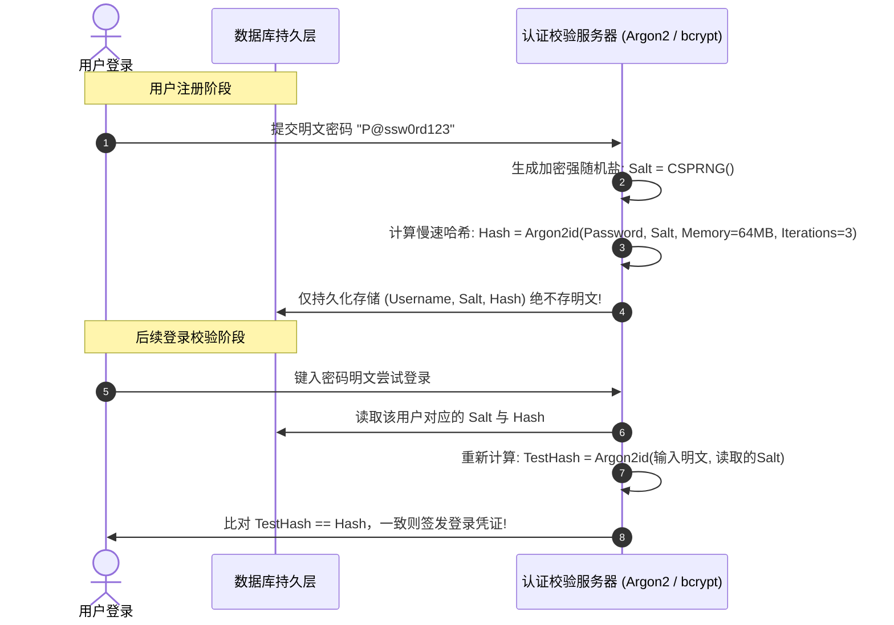
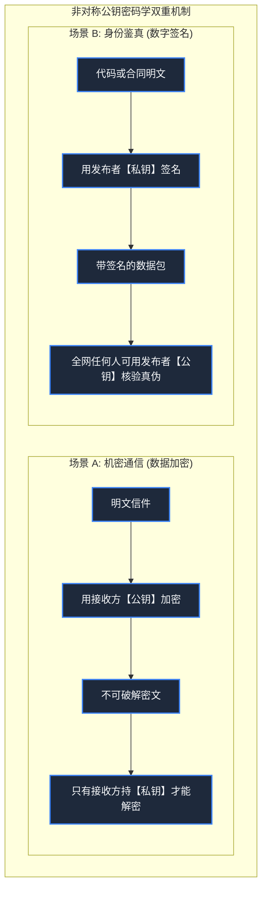
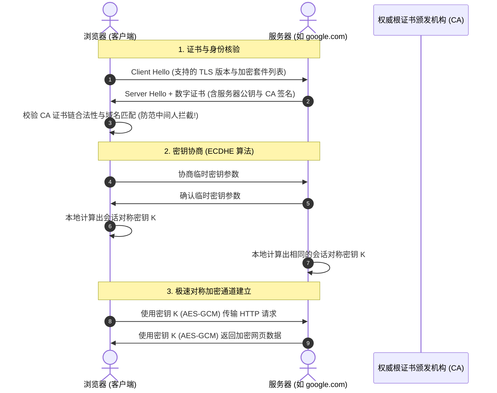

> **课程体系**：麻省理工学院 · 计算机教育中缺失的一课 (MIT The Missing Semester of Your CS Education, 2020)  
> **课程许可**：CC BY-NC-SA 4.0。  
> **所属模块**：模块四：安全防线与进阶全景 (Security & Advanced Topics)  
> **主讲团队**：Anish Athalye, Jose Javier Gonzalez Ortiz, Philip Levis (MIT CSAIL)  
> **视频时长**：01:01:03 ｜ **课堂高清演示板书**：4 张原画截图 ｜ **交互图谱**：Mermaid 架构流程图  
> **课程官方讲义**：[📖 MIT 官方中文课程讲义](https://missing-semester-cn.github.io/2020/security/) ｜ [📺 YouTube 原版视频](https://www.youtube.com/watch?v=tjwobAmnKTo)  
> **B 站直达**：[📺 在 B 站观看本讲高清双语视频 (BV1qP411X7QT)](https://www.bilibili.com/video/BV1qP411X7QT/)  
> **全书导航**：[← 上一讲 (L08)](/notes/missing-semester/lecture-08) ｜ [📚 返回全书目录](/notes/topics/Missing%20Semester) ｜ [下一讲 (L10) →](/notes/missing-semester/lecture-10)

---

## 核心导读与概念全景

掌握数字世界防御体系的数学与协议基石。系统解构信息安全 CIA 三要素，详解密码学单向哈希函数与抗彩虹表密钥派生（KDF），剖析对称加密 (AES) 与非对称加密 (RSA/ECC) 的双轮驱动模型，图解公钥基础设施 (PKI)、数字证书链与 TLS 握手防中间人篡改机制，并给出开发者日常必备的安全自护守则。

---

## 1. 信息安全的基石：CIA 三要素模型

*(参考时间戳：`00:03:15` · [📺 B站视频片段跳转](https://www.bilibili.com/video/BV1qP411X7QT/?t=195))*

在计算机安全领域，一切安全防御机制都围绕着经典的 **CIA 三要素** 展开：
1. **机密性（Confidentiality）**：保护敏感信息不被未授权的第三方窥探或窃听（通过加解密技术实现）；
2. **完整性（Integrity）**：确保数据在传输与存储过程中，未经授权的任何篡改、插入或删除都能被百分之百精准检测（通过哈希散列与数字签名实现）；
3. **可用性（Availability）**：确保授权用户在需要访问资源时，系统能够稳定响应（抵御拒绝服务 DoS/DDoS 攻击，保障集群高可用）。

此外，现代密码学还高度强调**不可否认性（Non-repudiation）**：某一方用其私钥签署了一份操作或声明后，无法在事后抵赖否认该行为。

*⏱ 时间戳：00:07:00 · 📷 课堂演示截图 · [在 B 站观看对应片段 (BV1qP411X7QT 00:07:00)](https://www.bilibili.com/video/BV1qP411X7QT/?t=420)*

## 2. 密码学散列函数（Hash Functions）与密码存储

*(参考时间戳：`00:10:40` · [📺 B站视频片段跳转](https://www.bilibili.com/video/BV1qP411X7QT/?t=640))*

密码学散列函数（如 SHA-256）能将任意长度的输入数据，通过复杂的位混淆与压缩函数，映射为固定长度的输出字符串（摘要）。

#### 密码学安全哈希的核心数学特征
1. **确定性（Deterministic）**：相同的输入必然产生绝对相同的哈希值；
2. **单向不可逆（One-way / Pre-image resistance）**：给定哈希值 $h$，在计算上几乎不可能反向倒推求出原明文 $m$ 使得 $hash(m) = h$；
3. **雪崩效应（Avalanche Effect）**：哪怕输入数据中仅仅改变了 1 个二进制位，输出的哈希值也会有 50% 以上的位发生不可预测的翻转；
4. **强抗碰撞性（Collision resistance）**：在计算上几乎无法找到两个不同的输入 $m_1 
eq m_2$，使得 $hash(m_1) = hash(m_2)$。

#### 用户密码存储陷阱：加盐（Salt）与密钥派生函数（KDF）
如果在数据库中直接保存密码的 SHA-256（甚至明文），黑客在获取数据库泄漏后，可以通过庞大的预计算**彩虹表（Rainbow Tables）**或现代 GPU 算力在一秒钟内暴力破解数亿个弱密码！

**工业级防御铁律**：
- **Salt（随机盐）**：为每个用户注册时生成一个全球唯一的密码学强随机盐，拼入密码再做哈希，彻底使攻击者的通用彩虹表沦为废纸；
- **故意拖慢计算（KDF）**：使用专门设计为**计算密集型与内存密集型**的密钥派生函数，如 **Argon2**、**bcrypt**、**scrypt**。将单次哈希验证的耗时由微秒级人为调增至 0.2 秒左右。对正常登录的用户而言无感知，但能让试图离线暴力破解的黑客成本飙升数百万倍！

*⏱ 时间戳：00:21:00 · 📷 课堂演示截图 · [在 B 站观看对应片段 (BV1qP411X7QT 00:21:00)](https://www.bilibili.com/video/BV1qP411X7QT/?t=1260)*

## 3. 对称加密 vs 非对称公钥密码学

*(参考时间戳：`00:22:30` · [📺 B站视频片段跳转](https://www.bilibili.com/video/BV1qP411X7QT/?t=1350))*

#### 对称加密（Symmetric Cryptography）
加密与解密使用**同一把共享密钥（Shared Secret Key）**，代表算法为 **AES-256**。
- **优点**：极快，现代 CPU 具有专门的硬件加速指令（AES-NI），每秒可吞吐数 GB 流量；
- **缺点**：**密钥分发难题（Key Distribution Problem）**。如果通信双方相隔千里从未谋面，如何在不安全的公共互联网中把这把绝密密钥安全交到对方手中？

#### 非对称公钥密码学（Asymmetric Cryptography）
由 Diffie-Hellman、Rivest-Shamir-Adleman（RSA）以及椭圆曲线密码学（ECC，如 X25519、Ed25519）开创的密码学奇迹。每个实体拥有一对数学上内在关联的密钥对：
- **公钥（Public Key）**：完全公开，任何人都可以获取；
- **私钥（Private Key）**：由拥有者严密保管，绝对不可泄露。

#### 两大核心运作范式
1. **机密传输（公钥加密，私钥解密）**：Alice 想给 Bob 发悄悄话，Alice 用 Bob 的**公钥**加密。加密后的密文全天下只有拥有对应**私钥**的 Bob 本人才能解开！
2. **数字签名（私钥签名，公钥验签）**：Bob 发布一个软件，用自己的**私钥**对软件哈希计算签名。全天下任何人都可以用 Bob 的**公钥**验证签名，确证该软件 100% 出自 Bob 且未被黑客篡改植入木马！

*⏱ 时间戳：00:35:00 · 📷 课堂演示截图 · [在 B 站观看对应片段 (BV1qP411X7QT 00:35:00)](https://www.bilibili.com/video/BV1qP411X7QT/?t=2100)*

## 4. PKI 公钥基础设施、CA 证书与 TLS 握手

*(参考时间戳：`00:36:15` · [📺 B站视频片段跳转](https://www.bilibili.com/video/BV1qP411X7QT/?t=2175))*

非对称加密虽然解决了密钥分发，但引出了新的致命攻击——**中间人攻击（Man-in-the-Middle, MITM）**：如果攻击者 Eve 在网络链路中间伪造了公钥，声称自己就是 google.com，客户端如何辨别真伪？

#### CA 证书体系与公钥基础设施（PKI）
操作系统和浏览器内置了受信任的**根证书颁发机构（Root Certificate Authorities, CA）**公钥列表（如 Let's Encrypt, DigiCert）。网站在向用户出示公钥时，附带一份由 CA 权威机构私钥签署的**数字证书（X.509 Certificate）**。客户端通过一层层回溯验证 CA 签名链，确证对方公钥的合法性。

#### TLS / HTTPS 混合加密握手过程（结合两者之长）
1. 客户端连接服务器，验证服务器的 CA 证书与域名合法性；
2. 双方通过非对称密码学协议（ECDHE 椭圆曲线临时密钥交换）协商出一个临时的、前向安全的对称密钥；
3. 一旦协商成功，后续所有海量网页数据全部切换为性能极高的**对称加密（AES-GCM）**进行安全通信！

*⏱ 时间戳：00:49:00 · 📷 课堂演示截图 · [在 B 站观看对应片段 (BV1qP411X7QT 00:49:00)](https://www.bilibili.com/video/BV1qP411X7QT/?t=2940)*

## 5. 程序员日常安全防线守则

*(参考时间戳：`00:49:00` · [📺 B站视频片段跳转](https://www.bilibili.com/video/BV1qP411X7QT/?t=2940))*

1. **全面启用双因子认证（2FA / MFA）**：优先使用基于时间的一次性密码（TOTP，如 Google Authenticator）或 FIDO2 / WebAuthn 硬件安全密钥（YubiKey），坚决弃用脆弱的短信 SMS 验证码；
2. **严禁在 Git 仓库中硬编码任何 API 密钥或密码**：使用环境变量并在提交前配置 `git-secrets` 或 pre-commit hook 自动扫描检测；
3. **拥抱端到端加密密码管理器**：使用 Bitwarden 或 1Password 生成 20 位以上的随机复杂唯一密码，杜绝多网站复用同一密码；
4. **Git 提交签署**：配置 GPG 或基于 SSH Key 的 commit 签名（`git commit -S`），让 GitHub 上显示尊贵的 `Verified` 认证绿标，证明代码确为你本人所提。

---

## 附：本讲知识脑图与回顾思考

本讲作为 **模块四：安全防线与进阶全景 (Security & Advanced Topics)** 的核心支柱，从理论动机到底层系统调用、从日常高频操作到前沿最佳实践进行了完整闭环推演。建议结合终端实机演练与课后练习，将命令行与工具链内化为下意识的肌肉记忆。

[← 上一讲 (L08)](/notes/missing-semester/lecture-08) ｜ [📚 返回全书目录](/notes/topics/Missing%20Semester) ｜ [下一讲 (L10) →](/notes/missing-semester/lecture-10)
