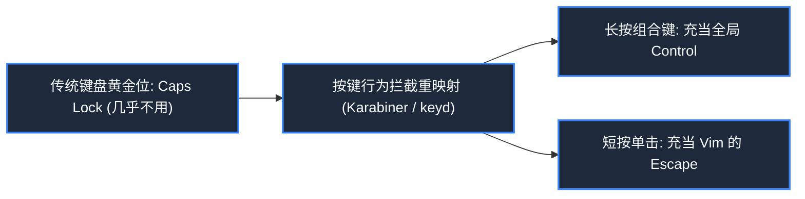
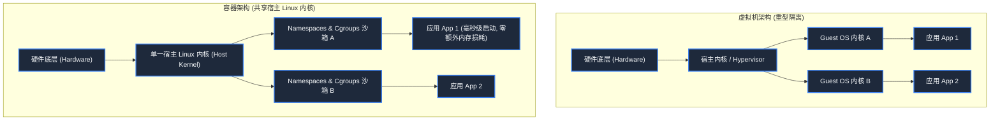

> **课程体系**：麻省理工学院 · 计算机教育中缺失的一课 (MIT The Missing Semester of Your CS Education, 2020)  
> **课程许可**：CC BY-NC-SA 4.0。  
> **所属模块**：模块四：安全防线与进阶全景 (Security & Advanced Topics)  
> **主讲团队**：Anish Athalye, Jose Javier Gonzalez Ortiz, Philip Levis (MIT CSAIL)  
> **视频时长**：00:57:58 ｜ **课堂高清演示板书**：4 张原画截图 ｜ **交互图谱**：Mermaid 架构流程图  
> **课程官方讲义**：[📖 MIT 官方中文课程讲义](https://missing-semester-cn.github.io/2020/potpourri/) ｜ [📺 YouTube 原版视频](https://www.youtube.com/watch?v=JZDt-PRq0uo)  
> **B 站直达**：[📺 在 B 站观看本讲高清双语视频 (BV1Ac411V7XM)](https://www.bilibili.com/video/BV1Ac411V7XM/)  
> **全书导航**：[← 上一讲 (L09)](/notes/missing-semester/lecture-09) ｜ [📚 返回全书目录](/notes/topics/Missing%20Semester) ｜ [下一讲 (L11) →](/notes/missing-semester/lecture-11)

---

## 核心导读与概念全景

融合软硬件交互与系统工程的高效实践大赏。详解键盘人机工程学改键策略，建立数据防灾 3-2-1 自动化快照备份体系，全景梳理从物理机、Type-1/Type-2 虚拟机到轻量化 Linux 容器（Namespaces & Cgroups）的技术演进链，并演示平铺式窗口管理器（Tiling WM）的全键盘极速桌面流。

---

## 1. 键盘人机工程学改造：拯救你的小拇指

*(参考时间戳：`00:02:40` · [📺 B站视频片段跳转](https://www.bilibili.com/video/BV1Ac411V7XM/?t=160))*

标准 QWERTY 键盘布局由于历史打字机机械防卡字原因，存在严重的人机工程学设计缺陷。最黄金的左手打字区中央，放置着使用频率极低、极其鸡肋的 **Caps Lock（大写锁定键）**；而最核心的 **Control** 键却被挤在遥远的左下角，导致程序员在频繁按 `Ctrl+C`、`Ctrl+R`、`Ctrl+W` 时小拇指被迫发生反生理的过度扭曲（甚至引发著名的 Emacs 手 / 腕管综合征 RSI）。

#### 终极改键方案（强烈推荐所有程序员配置！）
- **方案 A：将 Caps Lock 重新映射为 Control**：让左手在主按键区自然下压即可命中 Control；
- **方案 B：智能双模映射（Dual-Role）**：
  - **长按** Caps Lock 时：充当 `Control`；
  - **单击** Caps Lock 时：充当 `Escape`（回到 Vim 正常模式的神器！）。
在 macOS 上可使用 Karabiner-Elements，Linux 上可使用 `xmodmap` 或 `keyd` 轻松实现。

*⏱ 时间戳：00:07:00 · 📷 课堂演示截图 · [在 B 站观看对应片段 (BV1Ac411V7XM 00:07:00)](https://www.bilibili.com/video/BV1Ac411V7XM/?t=420)*

## 2. 数据灾备哲学：3-2-1 备份铁律与工具链

*(参考时间戳：`00:11:30` · [📺 B站视频片段跳转](https://www.bilibili.com/video/BV1Ac411V7XM/?t=690))*

系统管理员界有一句残酷的名言：“世界上只有两种人：已经遭遇过严重数据丢失的人，和即将遭遇严重数据丢失的人。”

#### 工业界黄金备份准则：3-2-1 原则
1. **3 份数据副本**：一份生产数据，两份备份副本；
2. **2 种不同物理介质**：例如一份存放在本地 NVMe SSD，另一份存放在移动机械硬盘或本地 NAS；
3. **1 份异地冷备（Off-site Backup）**：必须有一份备份存放在物理距离数百公里之外的云端对象存储（如 AWS S3, Backblaze B2）中，以防范本地火灾、失窃或勒索病毒侵袭。

#### 现代自动化备份利器：`restic`
传统的简单拷贝（如 `cp`）极其浪费磁盘空间。现代工具 **`restic`** 具备四大杀手级特性：
- **客户端端到端强加密**（哪怕云盘被黑客窃取也无法看到任何明文）；
- **全局内容分块去重（Deduplication）**：修改了 10GB 虚拟机文件里的 1MB 内容，增量备份仅传输存储这 1MB；
- **快照挂载（FUSE Mount）**：能够将任意历史时间点的备份直接挂载为本地虚拟磁盘只读浏览！

*⏱ 时间戳：00:20:00 · 📷 课堂演示截图 · [在 B 站观看对应片段 (BV1Ac411V7XM 00:20:00)](https://www.bilibili.com/video/BV1Ac411V7XM/?t=1200)*

## 3. 虚拟化技术演进：物理机、虚拟机与容器

*(参考时间戳：`00:23:10` · [📺 B站视频片段跳转](https://www.bilibili.com/video/BV1Ac411V7XM/?t=1390))*

为了隔离不同项目依赖、提升服务器资源利用率，计算运行时形态经历了三次技术跃迁：

#### 1. 裸金属物理机（Bare Metal）
应用直接运行在硬件操作系统上，强耦合，环境污染，资源无法弹性切分。

#### 2. 虚拟机（Virtual Machines, VM）
通过 Hypervisor（如 KVM, VMware, VirtualBox）模拟出一整套虚拟硬件，每个虚拟机内都要运行一个**完整的 Guest OS 操作系统内核**。
- **优点**：隔离级别极高（硬件级安全边界）；
- **缺点**：笨重，启动耗时数分钟，内存静态预分配开销大。

#### 3. 容器技术（Containers，以 Docker 为代表）
容器并不是轻量级虚拟机！**容器内没有独立的操作系统内核，它直接共享宿主机（Host）的单一 Linux 内核**。
Linux 内核通过两大核心底层特性实现轻量化沙箱隔离：
- **Namespaces（命名空间）**：给进程戴上“障眼法面具”，实现视图维度的逻辑隔离（PID 进程树隔离、NET 网络协议栈隔离、MNT 挂载点文件系统隔离）；
- **Cgroups（Control Groups 控制组）**：对进程可使用的物理资源上限做刚性约束（限制该容器最多使用 2 个 CPU 核心、4GB 内存）。

*⏱ 时间戳：00:33:00 · 📷 课堂演示截图 · [在 B 站观看对应片段 (BV1Ac411V7XM 00:33:00)](https://www.bilibili.com/video/BV1Ac411V7XM/?t=1980)*

## 4. 平铺式窗口管理器（Tiling Window Managers）

*(参考时间戳：`00:37:40` · [📺 B站视频片段跳转](https://www.bilibili.com/video/BV1Ac411V7XM/?t=2260))*

传统桌面（macOS Finder, Windows Explorer）采用**层叠式窗口模式（Floating Windows）**：窗口之间相互遮挡重叠，开发者需要频繁用鼠标去拖拽角落调整尺寸、在任务栏来回翻找被埋在底层的窗口。

**平铺式窗口管理器（Tiling WM，如 Linux 的 i3/Sway, macOS 的 yabai/aerospace）**将屏幕视为一张可无缝递归切分的画布：
- 每一个新打开的应用自动按照算法平铺占满屏幕剩余空间，窗口之间严丝合缝、零重叠、零死角；
- 全键盘快捷键控制一切：`Mod+Enter` 瞬开终端，`Mod+h/j/k/l` 瞬间转移焦点，`Mod+1..9` 瞬间切换虚拟工作区。手指始终锁定键盘，带来极致流畅沉浸的心流体验。

*⏱ 时间戳：00:45:00 · 📷 课堂演示截图 · [在 B 站观看对应片段 (BV1Ac411V7XM 00:45:00)](https://www.bilibili.com/video/BV1Ac411V7XM/?t=2700)*

---

## 附：本讲知识脑图与回顾思考

本讲作为 **模块四：安全防线与进阶全景 (Security & Advanced Topics)** 的核心支柱，从理论动机到底层系统调用、从日常高频操作到前沿最佳实践进行了完整闭环推演。建议结合终端实机演练与课后练习，将命令行与工具链内化为下意识的肌肉记忆。

[← 上一讲 (L09)](/notes/missing-semester/lecture-09) ｜ [📚 返回全书目录](/notes/topics/Missing%20Semester) ｜ [下一讲 (L11) →](/notes/missing-semester/lecture-11)
