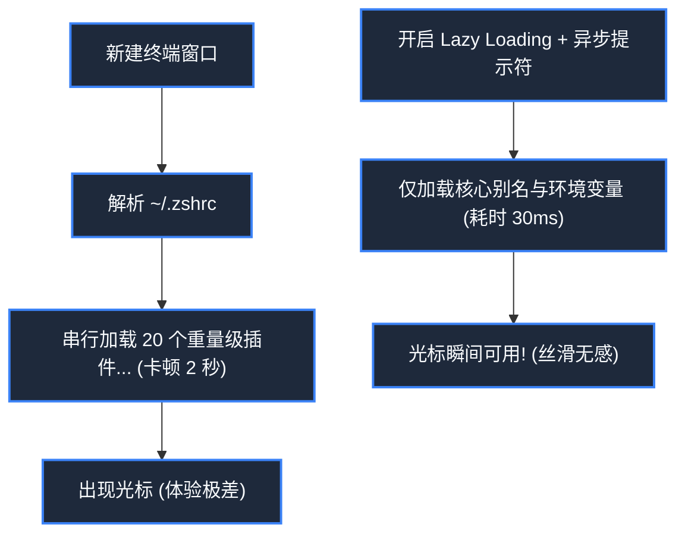

> **课程体系**：麻省理工学院 · 计算机教育中缺失的一课 (MIT The Missing Semester of Your CS Education, 2020)  
> **课程许可**：CC BY-NC-SA 4.0。  
> **所属模块**：模块四：安全防线与进阶全景 (Security & Advanced Topics)  
> **主讲团队**：Anish Athalye, Jose Javier Gonzalez Ortiz, Philip Levis (MIT CSAIL)  
> **视频时长**：00:53:56 ｜ **课堂高清演示板书**：4 张原画截图 ｜ **交互图谱**：Mermaid 架构流程图  
> **课程官方讲义**：[📖 MIT 官方中文课程讲义](https://missing-semester-cn.github.io/2020/qa/) ｜ [📺 YouTube 原版视频](https://www.youtube.com/watch?v=Wz50FvGG6xU)  
> **B 站直达**：[📺 在 B 站观看本讲高清双语视频 (BV12P411X7ey)](https://www.bilibili.com/video/BV12P411X7ey/)  
> **全书导航**：[← 上一讲 (L10)](/notes/missing-semester/lecture-10) ｜ [📚 返回全书目录](/notes/topics/Missing%20Semester) ｜ <span>下一讲：无（全书终章）</span>

---

## 核心导读与概念全景

MIT 教学团队针对全网高频真实工程疑惑的深度答疑与路线指引。系统辨析 Bash、Zsh、Fish 的选型权衡与兼容性边界，传授 Shell 启动耗时微秒级诊断调优心法，总结自动化脚本从玩具走向工业级健壮性的八大铁律，并给出计算机体系与开发工具链的终身精进自学全景图。

---

## 1. 常见高频工具选型辨析：Bash vs Zsh vs Fish

*(参考时间戳：`00:03:00` · [📺 B站视频片段跳转](https://www.bilibili.com/video/BV12P411X7ey/?t=180))*

在课程答疑环节中，学生们最关心的问题之一就是：“市面上 Shell 这么多，我到底该用哪一个？”

| Shell | 定位与核心优势 | 潜在痛点 / 适用场景 |
|---|---|---|
| **Bash** | 事实上的工业界通用标准，几乎预装在全世界所有 Linux 发行版与服务器中 | 语法古老，默认缺乏炫酷的自动补全与语法高亮。**适合作为生产环境服务器的默认 Shell 与自动化脚本编写语言** |
| **Zsh** | 兼顾高度定制性与 POSIX 兼容性（macOS 默认 Shell）。配合 Oh My Zsh 拥有极其繁荣的主题与插件生态 | 插件配置不当容易导致终端启动缓慢卡顿 |
| **Fish** | 追求“开箱即用（Out of the box）”的极客 Shell。自带现代语法高亮、基于历史命令的灰字智能建议与 Web 配置界面 | **不严格向下兼容 POSIX 语法**（网上复制的某些复杂 Bash 脚本不能直接无脑粘贴运行） |

> **讲师最佳实践建议**：**交互界面使用 Zsh 或 Fish 提升日常输入幸福感，而所有保存为文件的自动化脚本一律严格使用 `#!/usr/bin/env bash` 编写以保证跨平台绝对确定性执行！**

[](https://www.bilibili.com/video/BV12P411X7ey/?t=420)
*⏱ 时间戳：00:07:00 · 📷 课堂演示截图 · [在 B 站观看对应片段 (BV12P411X7ey 00:07:00)](https://www.bilibili.com/video/BV12P411X7ey/?t=420)*

## 2. 终端卡顿排查：为什么我的终端打开需要 2 秒？

*(参考时间戳：`00:13:30` · [📺 B站视频片段跳转](https://www.bilibili.com/video/BV12P411X7ey/?t=810))*

许多同学在安装了各种酷炫的终端插件框架（如 Oh My Zsh、nvm、pyenv、conda）后，发现每次在终端新建一个 Tab 都要肉眼可见地卡顿数秒，严重破坏操作流程度。

#### 性能诊断终极工具：Zsh 内置分析器 `zprof`
在 `~/.zshrc` 的**最顶第一行**加入：
```zsh
zmodload zsh/zprof
```
在 `~/.zshrc` 的**最底最后一行**加入：
```zsh
zprof
```
保存后重新打开终端，控制台会立刻打印出一张按耗时倒序排列的函数调用开销榜单：
```
num  calls                time                       self            name
-------------------------------------------------------------------------
 1)    1         345.12   345.12   54.2%    345.12   345.12   54.2%  nvm_auto
 2)    1         120.45   120.45   18.9%    120.45   120.45   18.9%  git_prompt_info
```
你能一眼揪出是哪个插件在启动时扫描了整个硬盘或做了低效的网络请求！

#### 针对性提速黄金法则
- **延迟惰性加载（Lazy Loading）**：将 `nvm`、`pyenv`、`conda` 等重型初始化推迟到真正敲击该命令的瞬间，终端启动耗时瞬间从 2.5 秒骤降至 0.05 秒！
- **选用异步 Git 提示符插件**：如 `starship` 或 `pure`，提示符计算在后台独立线程跑，绝不卡死主打字进程。



[](https://www.bilibili.com/video/BV12P411X7ey/?t=1260)
*⏱ 时间戳：00:21:00 · 📷 课堂演示截图 · [在 B 站观看对应片段 (BV12P411X7ey 00:21:00)](https://www.bilibili.com/video/BV12P411X7ey/?t=1260)*

## 3. 自动化脚本的工业级健壮性八大准则

*(参考时间戳：`00:26:00` · [📺 B站视频片段跳转](https://www.bilibili.com/video/BV12P411X7ey/?t=1560))*

写一段仅供自己跑一次的脚本，和写一段在服务器生产流水线中长期免维护运行的脚本，有着天壤之别。

#### 健壮脚本的“四大护法”指令
在每一个严肃的 Bash 脚本头部，务必写上这行魔法配置：
```bash
set -euo pipefail
IFS=$'
	'
```
1. **`-e`（errexit）**：一旦任何一行命令返回非 0 失败，脚本立刻中断退出，杜绝在错误状态上继续雪崩执行；
2. **`-u`（nounset）**：引用未定义过的变量时，直接报错退出，防止因变量名笔误引发误删系统文件；
3. **`-o pipefail`**：管道中只要有任何一个环节失败，整条管道就被判定为失败（默认 Bash 只检查管道最后一个命令的状态码！）；
4. **`IFS`（Internal Field Separator）**：将默认字段分隔符限制为换行符与制表符，避免参数中包含空格时发生意外切分。

[](https://www.bilibili.com/video/BV12P411X7ey/?t=2040)
*⏱ 时间戳：00:34:00 · 📷 课堂演示截图 · [在 B 站观看对应片段 (BV12P411X7ey 00:34:00)](https://www.bilibili.com/video/BV12P411X7ey/?t=2040)*

## 4. 程序员的进阶之路与终身学习建议

*(参考时间戳：`00:40:00` · [📺 B站视频片段跳转](https://www.bilibili.com/video/BV12P411X7ey/?t=2400))*

《计算机教育缺失的一课》到此落幕，但你的工具探索之旅才刚刚启航。教学团队在课程结语中留下了三条发人深省的心得：

1. **对低效保持敏感与不耐烦（Be impatient with inefficiency）**：如果一项枯燥的机械任务你需要做第二次，思考是否可以写个 3 行脚本自动化它；如果你发现一个快捷键你需要按 5 次，花 10 分钟去研究是否有单键直达的方案；
2. **读一读工具的官方文档与手册（Read the Docs）**：当遇到不熟悉的命令时，不要只去 StackOverflow 抄第一行，花两分钟扫一眼 `tldr` 或 `man`，往往能发现令你惊叹的优雅选项；
3. **保持好奇心，向开源社区敞开**：探索优秀的 GitHub dotfiles 仓库，拆解高水平工程师的工作流，积极尝试新工具，在实践中磨砺出最适合自己的“数字外骨骼”。

[](https://www.bilibili.com/video/BV12P411X7ey/?t=2760)
*⏱ 时间戳：00:46:00 · 📷 课堂演示截图 · [在 B 站观看对应片段 (BV12P411X7ey 00:46:00)](https://www.bilibili.com/video/BV12P411X7ey/?t=2760)*

---

## 附：本讲知识脑图与回顾思考

本讲作为 **模块四：安全防线与进阶全景 (Security & Advanced Topics)** 的核心支柱，从理论动机到底层系统调用、从日常高频操作到前沿最佳实践进行了完整闭环推演。建议结合终端实机演练与课后练习，将命令行与工具链内化为下意识的肌肉记忆。

[← 上一讲 (L10)](/notes/missing-semester/lecture-10) ｜ [📚 返回全书目录](/notes/topics/Missing%20Semester) ｜ <span>下一讲：无（全书终章）</span>
