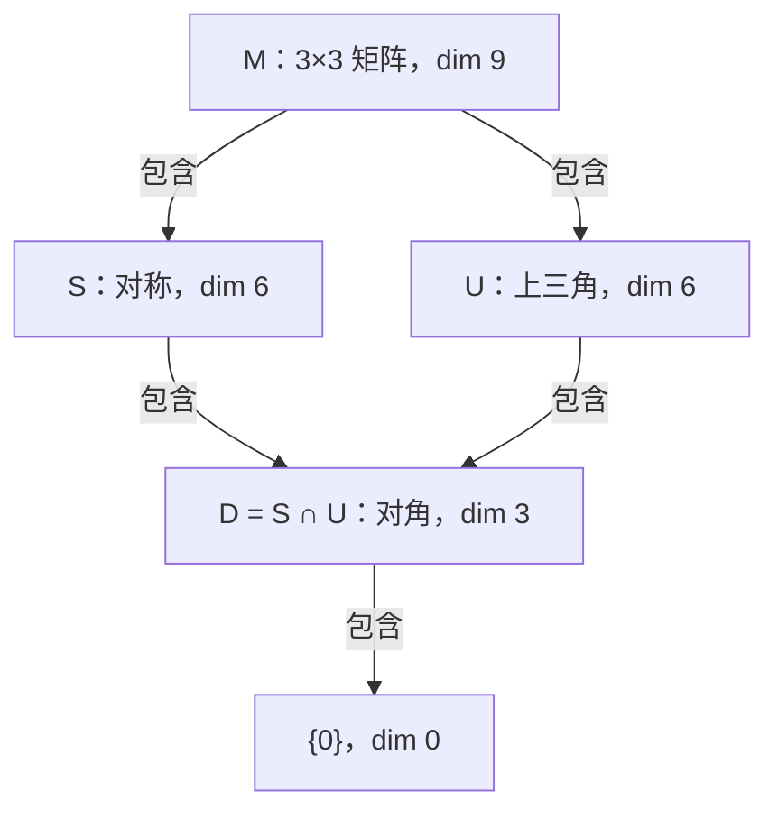
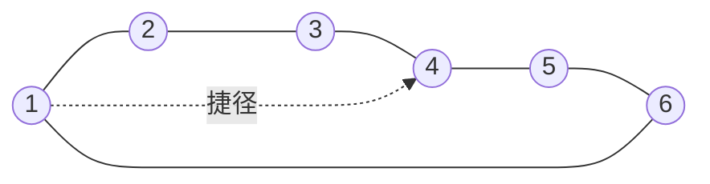
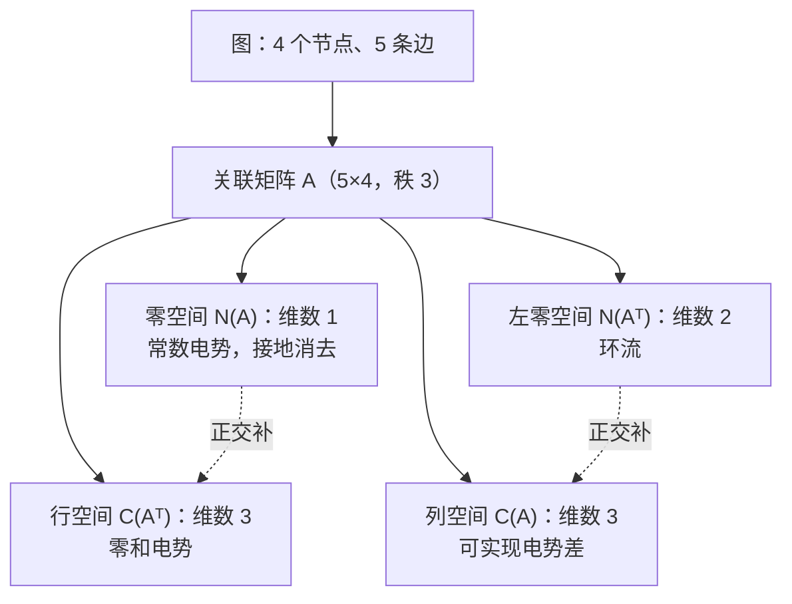
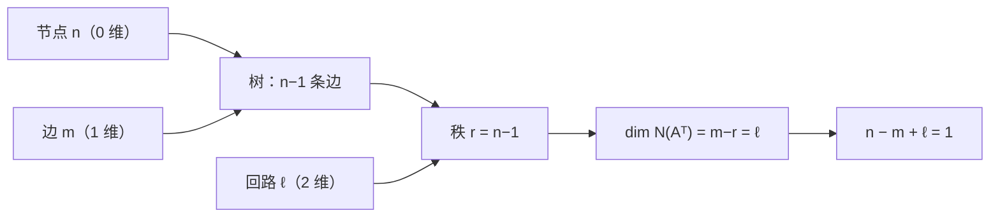
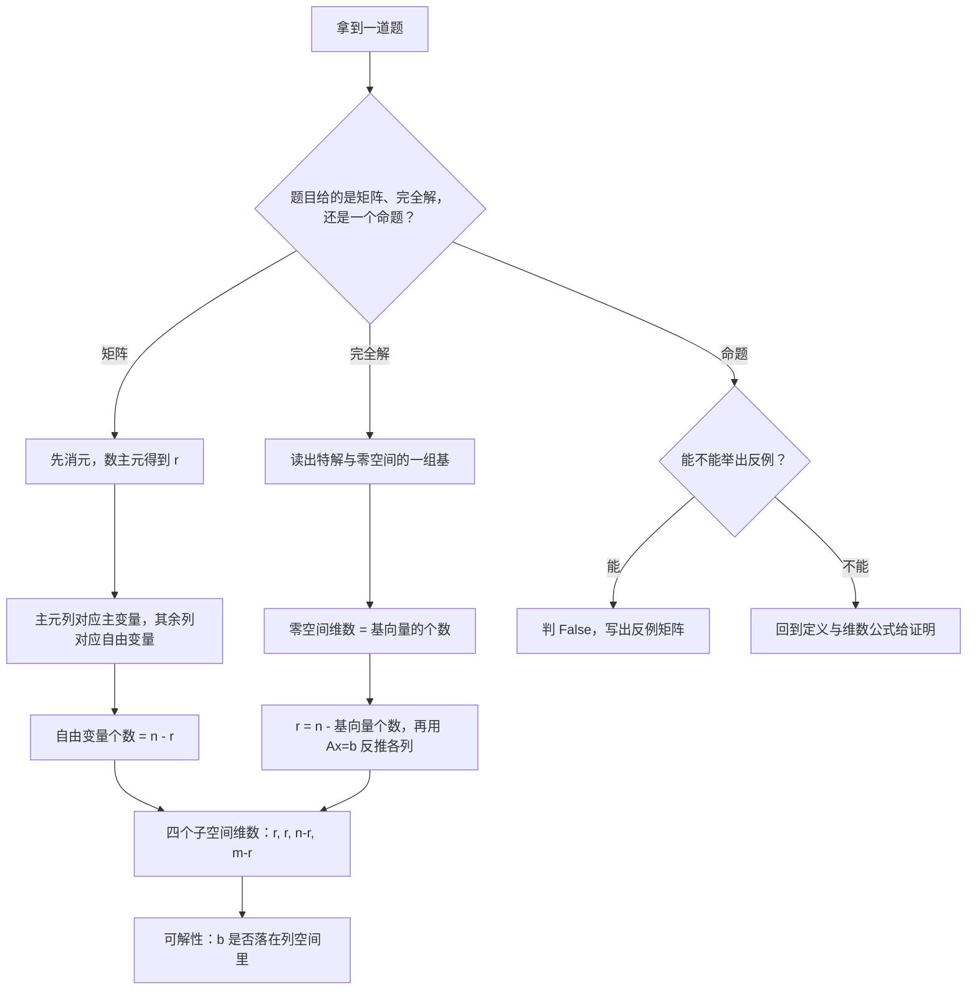
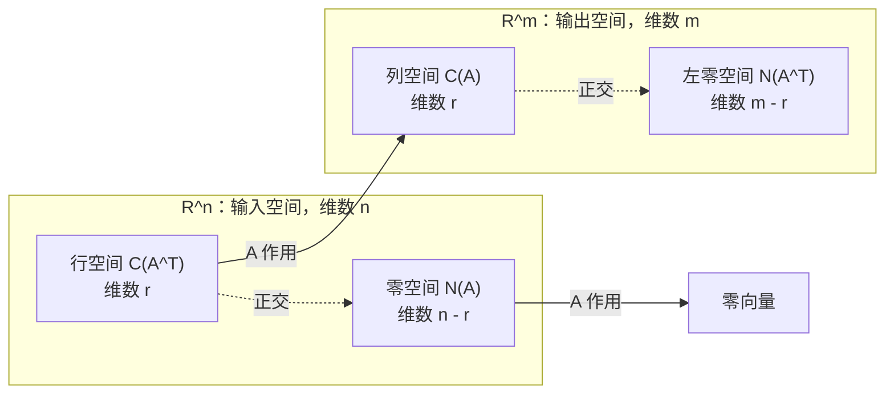

> **主讲**：Gilbert Strang · MIT 18.06 Linear Algebra（2010 年春季）  
> **合集视频**：[B 站 BV1ix411f7Yp 第 11–13 P](https://www.bilibili.com/video/BV1ix411f7Yp/?p=11)  
> **收录**：[第 11 讲 矩阵空间、秩 1 矩阵与小世界图](https://www.bilibili.com/video/BV1ix411f7Yp/?p=11) · [第 12 讲 图、网络与关联矩阵](https://www.bilibili.com/video/BV1ix411f7Yp/?p=12) · [第 13 讲 第一次测验复习](https://www.bilibili.com/video/BV1ix411f7Yp/?p=13)  
> **规模**：3 讲 · 2 小时 21 分 · 41 张原生 640×480 播放器截图 · 6 幅 Mermaid 结构图  
> **整理依据**：三讲完整英文字幕逐段重写；术语与章节参照 MIT OCW 本讲页面与 Strang《Introduction to Linear Algebra》  
> **插图**：每张截图均可点击，跳回 B 站对应分 P 的对应时刻  
> **出处与许可**：课程与官方材料版权归 MIT OpenCourseWare 与 Gilbert Strang，依 [CC BY-NC-SA 4.0](https://creativecommons.org/licenses/by-nc-sa/4.0/) 许可发布；本书为中文整理精编

本合集把此前分别成册的三讲按课程顺序合并为一本，保留每讲原有的时间锚点、截图、公式与「编者说明」，既可从第一页顺序读，也可按讲次单独查阅。

三讲构成一条完整线索：第 11 讲把向量空间推广到矩阵空间，以秩 1 矩阵收束，并用图与小世界图引出网络；第 12 讲把图写成关联矩阵，用四个基本子空间解释电势、电流、回路与欧拉公式；第 13 讲以第一次测验复习把前半学期的消元、秩、零空间、完全解与四个基本子空间重新串成一张网。

### 阅读约定

- **截图**：图下链接或图片本身可跳回 B 站原片对应秒数；源视频为 640×480（4:3），截图按原生分辨率 1:1 截取。
- **公式**：使用 LaTeX 书写；支持 MathJax / KaTeX 的 Markdown 阅读器可直接渲染。
- **时间锚点**：`*(参考时间: MM:SS)*` 指该段在对应分 P 中的位置，不是合集总时长。
- **编者说明**：超出课堂口述的必要补充均以此标记，不代表 Strang 原话。

---

## 第 11 讲：矩阵空间、秩 1 矩阵与小世界图

> **讲师**：Gilbert Strang，MIT 18.06 Linear Algebra  
> **视频**：[B 站 BV1ix411f7Yp 第 11 P](https://www.bilibili.com/video/BV1ix411f7Yp/?p=11)，时长 45 分 42 秒  
> **整理依据**：MIT OCW 官方同一讲英文字幕（687 段）逐段重写；术语参照 [OCW 本讲页面](https://ocw.mit.edu/courses/18-06-linear-algebra-spring-2010/resources/lecture-11-matrix-spaces-rank-1-small-world-graphs/)  
> **插图**：13 处画面取自 B 站播放器板书原画，时间戳与讲述内容一一对应  
> **出处与许可**：课程与官方材料版权属 MIT OpenCourseWare 与 Gilbert Strang，采用 [CC BY-NC-SA 4.0](https://creativecommons.org/licenses/by-nc-sa/4.0/) 许可；本书为中文整理精编

### 1. 从向量到矩阵空间

*(参考时间: 00:00:10)*

上一讲结束的时候，Strang 已经开始谈论一些「向量空间」，但那些空间里的居民并不是我们平时所说的向量。他开门见山地提醒全班：这些东西你照样可以相加，照样可以乘上一个数，所以完全可以被称为向量。他当时用的例子是矩阵，也就是全体三阶矩阵构成的集合。第 11 讲想说的是：前面把$n$维空间讲得太具体，其实只要你能加、能数乘，同一套观念照样成立。

#### 1.1 只承认加法与数乘

这里有一条容易被忽略的界线。Strang 在黑板前特意说明：两个矩阵当然可以相乘，但他不做这件事，因为矩阵乘法不属于向量空间的图景。向量空间只承认两种运算——加法与数乘。只要这两种运算不把元素带出集合，基、维数、子空间、线性组合这一整套语言就全部适用，与元素长什么样无关。

#### 1.2 九个坐标与标准基

于是取$M$为全体三阶实矩阵。它显然对加法与数乘封闭。接下来就是两个标准问题：$M$的基是什么，维数是多少？Strang 没有直接写答案，而是先反问全班：要确定一个三阶矩阵，需要几个数？九个。所以维数将是九。

最自然的基，是在九个位置上分别放一个$1$、其余位置全放$0$的那九个矩阵。用$E_{ij}$表示「第$i$行第$j$列为$1$、其余为零」的矩阵，则

$$
E_{11},E_{12},\dots,E_{33}\ \text{是 } M \text{ 的基，}\quad \boxed{\dim M=9}
$$

它们线性无关，因为任何一个三阶矩阵$A=(a_{ij})$都能唯一地写成$\sum_{i,j}a_{ij}E_{ij}$；系数$a_{ij}$就是那九个坐标。

Strang 对这件事有一句很有分寸的评论：这个空间几乎就是九维空间，只不过那九个数被写成一个方块，而不是写成一列。但它毕竟是不同的东西，应当被当作独立的对象来思考。

**编者说明**：这个区别在后面会变得越来越具体——矩阵带有转置、行空间、秩这些结构，而九维空间中的九元组并没有这些东西；也正因为如此，矩阵空间才值得单独命名，而不是简单地等同于九维空间。

把这个包含关系画出来，全讲的骨架就清楚了：

图里故意没有画$S+U$：它不是包含关系，而是「把两个子空间的所有组合填满」之后得到的那个更大的空间。下一节先把$S$与$U$各自的基交代清楚。

### 2. 对称的 S 与上三角的 U

*(参考时间: 00:05:00)*

#### 2.1 对称子空间：六个参数

先看对称矩阵子空间$S$，即所有满足$A^{T}=A$的三阶矩阵。它为什么是子空间？Strang 的检查方式很朴素：两个对称矩阵相加，和仍然对称。他还顺手设了一个陷阱——两个对称矩阵相乘，乘积还自动对称吗？不。但他并不乘矩阵，所以这个反例并不妨碍$S$是子空间。这类「只承认加法与数乘」的限定，正是全讲反复出现的伏笔。

接着是一个很好的诱导性问题：刚才那九个标准基矩阵里，有几个本身就落在$S$中？答案是三个，即$E_{11},E_{22},E_{33}$——只有在对角线位置放$1$才不会被转置改变。可是$\dim S$并不是三。这里出现了本讲第一个重要教训：**大空间的基通常不包含子空间的基**。要刻画$S$，必须重新想一遍。

重新想的办法是数参数：三阶矩阵一共有九个位置，对称性把对角线以下的三个位置锁死为对角线以上对应位置的值，于是可以自由选择的是对角线三个加上方三个，共六个。因此$\dim S=6$。

一组看得见的基如下，前三个管对角线，后三个各管一对对称位置：

$$
\begin{aligned}
&\begin{bmatrix}1&0&0\\0&0&0\\0&0&0\end{bmatrix},\ 
\begin{bmatrix}0&0&0\\0&1&0\\0&0&0\end{bmatrix},\ 
\begin{bmatrix}0&0&0\\0&0&0\\0&0&1\end{bmatrix},\\[2pt]
&\begin{bmatrix}0&1&0\\1&0&0\\0&0&0\end{bmatrix},\ 
\begin{bmatrix}0&0&1\\0&0&0\\1&0&0\end{bmatrix},\ 
\begin{bmatrix}0&0&0\\0&0&1\\0&1&0\end{bmatrix}.
\end{aligned}
$$

用$E_{ij}$的记号写更省事：$E_{11},E_{22},E_{33},E_{12}+E_{21},E_{13}+E_{31},E_{23}+E_{32}$。这六个矩阵线性无关，且任何对称矩阵都是它们的组合，所以确实是基。Strang 在写这一串时还不忘提醒：对称矩阵的六个参数里，三个在对角线上，三个在对角线上方，下方那三个由对称性决定——这正是「六个」的来源，而不是背下来的结论。

#### 2.2 上三角子空间：一个偶然的方便

再来看上三角子空间$U$，即对角线以下全为零的三阶矩阵。它的一般形状是

$$
U=\left\{\begin{bmatrix}a&b&c\\0&d&e\\0&0&f\end{bmatrix}\right\}
$$

其中六个字母可取任意实数，所以$\dim U=6$。Strang 用三个词总结这个巧合：「又是六。」

但$U$的基有一个与$S$完全不同的性质。九个标准基矩阵中，恰好有六个是对角线上方或对角线上的：$E_{11},E_{22},E_{33},E_{12},E_{13},E_{23}$。它们正好构成$U$的一组基。Strang 把这种情形称为「偶然」：大空间的基里碰巧含着子空间的基，于是你什么都不用做；而对称的情形没有这种运气，你必须重新构造。这组对照说明，找子空间的基没有统一捷径，只能按子空间自身的约束去数自由度。

### 3. 交集、并集与和：$6+6=9+3$

*(参考时间: 00:08:00)*

#### 3.1 交集只剩对角

有了两个六维子空间，最自然的动作是把它们放在一起比较。Strang 先问交集：一个矩阵如果既对称又是上三角，它长什么样？

推理只有两步。上三角要求对角线以下全为零；对称要求$a_{ij}=a_{ji}$，于是把下方的零镜像到上方，对角线上方也必须全为零。两边一夹，只剩对角线。所以

$$
S\cap U=D=\{\text{对角矩阵}\},\quad \boxed{\dim(S\cap U)=3}
$$

基就是$E_{11},E_{22},E_{33}$，没有任何困难。Strang 写到这里还确认了一下符号：$S\cap U$就是「同时在$S$和$U$里的那些向量」的集合。

#### 3.2 并集为什么不是子空间

那么并集呢？把所有对称矩阵和所有上三角矩阵放在一起，记作$S\cup U$。Strang 的问法是「为什么我对并集不感兴趣」，答案很干脆：它不是子空间。他给的类比是本讲最形象的一句话——这就像在平面上取两条直线，然后把这两条线放在那里就停下了；两条线各自是子空间，合起来却不是。两个六维子空间住在九维空间里，各自朝不同的方向伸展，「所以我们不能只是把它们放在一起，我们必须填满」。

**编者说明**：并集失败的原因可以说得更具体。并集只允许「取一个，或者取另一个」，却不允许把两个方向各取一部分再相加；而子空间恰恰要求对一切线性组合封闭。$E_{12}+E_{21}$是对称的，$E_{13}$是上三角的，两者相加得到$E_{12}+E_{21}+E_{13}$：这个和既不对称（$(1,3)$处是$1$、$(3,1)$处却是$0$），也不上三角（$(2,1)$处出现了$1$），于是它掉出了并集。

#### 3.3 和空间与维数公式

填满的办法不是并集，而是和：把所有$s+u$收进来，其中$s$取自$S$、$u$取自$U$。

注意定义里的量词：取任意一个对称矩阵，加上任意一个上三角矩阵，而不是「取一个既对称又上三角的矩阵」。这两者的差别，就是和与交集的差别。

Strang 让全班猜$S+U$是什么，然后自己给出答案：能得到一切，能得到全体三阶矩阵。他说这值得把思路稍微撑开一点——习惯在子空间之间做交与和，是这一章要培养的直觉。既然$S+U=M$，就有$\dim(S+U)=9$。

**编者说明**：这个「能得到一切」可以显式验证。把任意矩阵$A$的对角线及下方原样保留、上方改成下方对应位置的值，记这个结果为$S_0$：它按构造就是对称的。而$A-S_0$在$i\ge j$处全为零，只剩对角线上方的那些差$a_{ij}-a_{ji}$，所以是严格上三角的。于是$A=S_0+(A-S_0)$确实写成了一个对称矩阵加一个上三角矩阵，$S+U=M$得证。

把四个维数摆在一起，就出现了本讲的核心公式：

$$
\boxed{\dim(S)+\dim(U)=\dim(S+U)+\dim(S\cap U)}
$$

代入具体数字，得$6+6=9+3=12$。

Strang 对这一行的评价是「挺令人满意的」：交与和是子空间最自然的两种运算，而维数在这两种运算下算得平。他随即指出这并不是三阶矩阵的特例，对任意两个有限维子空间都成立。

**编者说明**：公式的证明思路是「取交集的基，向两边扩张」。设$\dim(S\cap U)=k$，取其基$w_1,\dots,w_k$，分别扩充为$S$的基$w_1,\dots,w_k,s_1,\dots,s_m$与$U$的基$w_1,\dots,w_k,u_1,\dots,u_n$。可以验证这$k+m+n$个向量合起来张成$S+U$且线性无关，于是$\dim(S+U)=k+m+n$，而$\dim S=k+m$、$\dim U=k+n$，两边相减即得。这个证明也解释了公式为什么「应该」成立：交集被数了两遍，所以要在右边减掉一次。

| 空间 | 含义 | 维数 | 一组基 |
| --- | --- | --- | --- |
| $S$ | 对称矩阵 | 6 | 三个$E_{ii}$，三对$E_{ij}+E_{ji}$ |
| $U$ | 上三角矩阵 | 6 | 六个$E_{ij}$（$i\le j$） |
| $D=S\cap U$ | 对角矩阵 | 3 | 三个$E_{ii}$ |
| $S+U$ | 两者之和 | 9 | 同$M$ |

### 4. 微分方程的解空间

*(参考时间: 00:14:30)*

矩阵空间之外，Strang 还要再给一个「里面装的不是向量」的向量空间，这次来自微分方程。取

$$
\frac{d^{2}y}{dx^{2}}+y=0
$$

#### 4.1 解空间就是一个零空间

他先问：这个方程的解是什么？$\cos x$是一个解，因为求两次导得$-\cos x$，代回去正好为零；$\sin x$也是一个解，同样求两次导得$-\sin x$。他还提到$e^{ix}$也是解，随即自己把它否掉了：「为什么要把它放进来？它本来就在里面了。」这句话点出了解空间的本质——$e^{ix}=\cos x+i\sin x$并不是新东西，只是已有两个解的复数组合。

于是全部解是$y=c_1\cos x+c_2\sin x$，其中$c_1,c_2$为任意常数。

这是一件需要停顿一下才能体会的事：所有解构成一个向量空间。Strang 的原话是「这是一个向量空间，这是一个向量空间」，重复了两遍。为什么？因为解对加法封闭（两个解相加仍是解），对数乘也封闭（解乘一个常数仍是解），零函数是解。换句话说，**这里看的是一个零空间——微分方程的零空间，也就是解空间**。

既然是向量空间，就该问基与维数。$\{\cos x,\sin x\}$是一组基：两者线性无关（若$c_1\cos x+c_2\sin x$恒为零，取$x=0$得$c_1=0$，取$x=\pi/2$得$c_2=0$），且张成全部解。所以

$$
\boxed{\dim\{\text{解空间}\}=2}
$$

Strang 在这里做了一个漂亮的类比：$\cos x$与$\sin x$就像$Ax=0$的「特解」。他先口误说成$Ax=b$，随即更正为$Ax=0$——因为这里讨论的确实是零空间，而不是特解加零空间的那套完整解。这个更正本身值得记下：微分方程的通解，就是齐次方程零空间的一组基的所有线性组合，与线性方程组的情形逐字对应。

#### 4.2 基不唯一，维数固定

基并不唯一。Strang 特意问「这些是唯一的基吗」，然后自己回答「绝不是」：$e^{ix}$与$e^{-ix}$也是一组基，同样两个函数，同样张成这个空间。维数却永远是二，因为方程是二阶的。他把这件事讲成一句玩笑：一门线性微分方程课（MIT 的 18.03）真正在做的事，就是为解空间找一组基；而 18.06 用五分钟就把 18.03 处理掉了。

这个例子的用意不在微分方程，而在「向量」这个词的边界。这些解看起来像函数，不像向量，但它们可以相加、可以乘常数，于是可以取线性组合，于是线性代数关于基、维数、子空间的一切说法都搬得过来。Strang 说，这正是为什么线性代数的作用范围远远超出他一直在讲的$m\times n$矩阵。

### 5. 秩 1 矩阵：一列乘一行

*(参考时间: 00:20:00)*

讲完这些「非典型」向量空间，Strang 把话题拉回矩阵最关键的那个数字：秩。它不超过行数，也不超过列数；除此之外，他想再补一个角度——从最简单的非零矩阵看起，也就是秩 1 矩阵。理由很直接：秩只有一，矩阵就逃不出手掌心。

#### 5.1 一个二乘三的例子

他现场造了一个二乘三的例子。先写下第一行$\begin{bmatrix}1&4&5\end{bmatrix}$，然后问：第二行可以是什么，才能让整个矩阵的秩为一？答案是一个倍数，比如$\begin{bmatrix}2&8&10\end{bmatrix}$。因为第二行与第一行线性相关，行空间是一维的，一组基就是第一行：

$$
A=\begin{bmatrix}1&4&5\\2&8&10\end{bmatrix}
$$

接着按惯例追问列空间。列空间的维数也等于秩，所以也是一；所有列都是第一列的倍数（第二列是第一列的$4$倍，第三列是$5$倍）。这里 Strang 顺带复述了一串等式：列空间的维数等于秩，也等于$A^{T}$的列空间维数，而后者就是$A$的行空间。

#### 5.2 外积 $uv^{T}$

然后他给出了那个「本该早点看出来」的写法：把矩阵写成主元列乘第一行，

$$
A=\begin{bmatrix}1\\2\end{bmatrix}\begin{bmatrix}1&4&5\end{bmatrix}
=\begin{bmatrix}1&4&5\\2&8&10\end{bmatrix}
$$

一个$2\times 1$的矩阵乘一个$1\times 3$的矩阵，结果正好是二乘三。Strang 强调这是一般现象：**每一个秩 1 矩阵都可以写成某一列乘某一行**。若$u$是列向量、$v$也是列向量，把$v$转置成行，就得到

$$
\boxed{A=uv^{T}}
$$

这就是秩 1 矩阵的完整图景。Strang 说以后会对秩 1 矩阵更感兴趣：它们的行列式很容易算，它们的特征值很有意思；更重要的是，秩 1 矩阵是搭出所有矩阵的积木。

**编者说明**：$uv^{T}$的每一列都是$u$的倍数，每一行都是$v^{T}$的倍数，所以列空间至多一维、行空间至多一维，秩不超过一；只要$u\neq 0$且$v\neq 0$，秩恰好为一。这也解释了为什么$uv^{T}$的第$(i,j)$元是$u_iv_j$——一个「行指标只跟着$u$、列指标只跟着$v$」的乘积结构。顺带一提，$\operatorname{tr}(uv^{T})=v^{T}u$。

### 6. 秩 $r$ 分解与秩 1 的边界

*(参考时间: 00:24:30)*

#### 6.1 秩 $r$ 矩阵是 $r$ 块积木

既然秩 1 矩阵是积木，一个自然的猜想是：任何矩阵都能拆成若干块这样的积木。Strang 举了一个刻意夸张的例子——一个五乘十七、秩为四的矩阵。他说，很可能是真的，而且确实是真的：它能拆成四个秩 1 矩阵之和。为什么是四个？因为秩是四。于是他给出一般命题：

$$
A_{m\times n},\ \operatorname{rank}(A)=r
\quad\Longrightarrow\quad
A=u_1v_1^{T}+u_2v_2^{T}+\cdots+u_rv_r^{T}
$$

秩 1 矩阵因此被称为「所有矩阵的建造单元」。这个分解在消元过程中其实已经出现过：$A$的每一列都是主元列的线性组合，把这种组合按列拆开，就得到$r$个「一列乘一行」的项。

#### 6.2 秩 1 的集合为什么不是子空间

紧接着是本讲最好的一个「反例式提问」，Strang 自己说这是期中复习式的问法：把所有五乘十七矩阵当作母空间$M$，其中秩为四的那些矩阵，构成子空间吗？

要成为子空间，零矩阵必须在里面，所以问题应该改成「秩不超过四」的子集。但即便把零矩阵放进来也不够——零矩阵在里面，并不等于就有了子空间。真正的检验是加法：两个秩四矩阵相加，秩还是四吗？

答案是「通常不是」。Strang 给了一个一般的界：$\operatorname{rank}(A+B)\le \operatorname{rank}(A)+\operatorname{rank}(B)$。

按这个界，两个秩四相加，秩不会超过八；但在五乘十七的空间里秩本来最多是五，所以这个界在这里是宽松的。事实上两个秩四矩阵之和完全可能达到秩五。于是「秩不超过四」对加法不封闭，不是子空间。

**编者说明**：这个界不难理解：$A+B$的每一列都是$A$的某一列与$B$的对应列之和，所以$A+B$的列空间落在「$A$的列空间与$B$的列空间合起来张成的空间」里，而后者的维数至多是$\operatorname{rank}A+\operatorname{rank}B$。

把四换成一会更刺眼：两个秩 1 矩阵相加，结果通常是秩 2。所以**全体秩 1 矩阵不构成子空间**——它对数乘封闭，对加法不封闭，连零矩阵都不在里面。这一点特别值得玩味：每一个矩阵都由秩 1 矩阵拼成，可是秩 1 矩阵的集合本身却不是子空间。「由谁张成」与「自己是不是子空间」是两件不同的事。

Strang 在这里插了一句课堂气氛的话：他之所以连着问这些短问题，是在为测验复习，这些问题的用意是检验你是否真的知道这些词的含义；测验之后他就不再这样提问了。这句话也提示了本讲的性质——它更像一次对前十讲的清点，而不是一次全新的出发。

### 7. 四维空间里的一个约束

*(参考时间: 00:28:40)*

换一块黑板，Strang 给出一个更「像向量」的例子。在四维空间中取所有分量之和为零的向量，即$v_1+v_2+v_3+v_4=0$。

先确认它是子空间。Strang 说形式上应当检查一遍：如果一个向量的分量之和为零，把它乘上六，分量之和是六乘零，仍是零；如果$v$与$w$的分量之和都为零，逐项相加后总和仍是零。零向量当然满足。所以$S$是子空间。

那么维数是多少？他让全班先猜，听到答案后确认：三。可是「三」需要理由，而理由不止一种。直观的理由是：四个分量，一个方程，于是有三个自由；严格的理由则要把它认成某个矩阵的零空间。

#### 7.1 把约束写成矩阵

哪个矩阵的零空间是这个集合？Strang 等了一会儿，然后写下四个 1：

$$
\begin{bmatrix}1&1&1&1\end{bmatrix}
\begin{bmatrix}v_1\\v_2\\v_3\\v_4\end{bmatrix}=[0]
$$

正是它。这个一乘四矩阵乘上$v$，得到的唯一分量就是四个分量之和；要求它为零，就是原来的约束。所以$S=N(A)$，而线性方程组的那套机器立刻全部可用。

先看秩。这个矩阵只有一个非零行，所以$r=1$。零空间的维数公式是$\dim N(A)=n-r$，这里$n=4$、$r=1$，于是$4-1=3$。Strang 说，这个问题可以直接看出来，也可以用四个基本子空间的系统办法算出来。

#### 7.2 三个特解

接下来按标准流程找基，也就是找三个特解。主元在第一列，自由变量是第二、三、四列。给第一个自由变量取$1$、其余取$0$，由$v_1=-v_2-v_3-v_4$得主元变量为$-1$：

$$
s_1=\begin{bmatrix}-1\\1\\0\\0\end{bmatrix},\quad
s_2=\begin{bmatrix}-1\\0\\1\\0\end{bmatrix},\quad
s_3=\begin{bmatrix}-1\\0\\0\\1\end{bmatrix}
$$

三个向量的分量之和都是零，所以确实都在$S$里；它们对应三个不同的自由变量，因而线性无关。Strang 的说法很朴实：给那个自由变量一个$1$，主元变量就是$-1$，这样各个分量加起来总是零。他还强调，这三个不是唯一的选法，但它们是「标准的三个」，也是答卷上最该写出来的三个。

### 8. 四个基本子空间的完整清点

*(参考时间: 00:35:55)*

#### 8.1 四个子空间与两条维数账

有了$A=\begin{bmatrix}1&1&1&1\end{bmatrix}$，就可以把四个基本子空间一次性点清。Strang 说，他此刻做的事情其实就是「把这些词说一遍」。

- **行空间** $C(A^{T})$：住在四维空间里，由那一行张成，维数为一。
- **零空间** $N(A)$：也住在四维空间里，维数为三，基就是上一节那三个特解。
- **列空间** $C(A)$：这一列只有一个分量，所以它住在一维空间里；而它的所有倍数正好填满一维空间，因此列空间就是整个一维空间，维数为一。
- **左零空间** $N(A^{T})$：把$A$转置，问这些「列」（一列四行）的什么组合能给出零。Strang 的答案是没有——能让这四个 1 的组合变成零行的，只有零组合。所以左零空间只含零向量。

两边的账都算得平：零空间三维加行空间一维等于$4$，正是列数$n$；列空间一维加左零空间零维等于$1$，正是行数$m$。

#### 8.2 零维空间与空集

零维空间这件事本身值得停一下。Strang 问：最小的子空间维数是多少？只含一个点的那个子空间，维数是零。它的基是什么？空集——因为维数为零，基里就不该有任何成员；而空集里元素的个数是零，正好对上维数。这个看似文字游戏的说法，其实把「基」与「维数」的定义咬合得很紧。

**编者说明**：四个子空间的这份清点也解释了为什么$r+(n-r)=n$与$r+(m-r)=m$这两条恒等式看起来「太平凡」：它们其实是把$\mathbb{R}^n$与$\mathbb{R}^m$分别拆成两个互补的子空间。第 14 讲还会补一句：这种互补不只是维数相加，行空间与零空间、列空间与左零空间还两两正交。

### 9. 图与小世界

*(参考时间: 00:39:04)*

最后五分钟，Strang 用一个全新的对象收尾：图。他先澄清词义——这里说的不是微积分里那条正弦曲线，「graph 这个词的用法完全不同」。图就是一堆节点，加上连接节点的边。

#### 9.1 五个节点与六条边

他在黑板上画了五个节点，然后连边，一边连一边数：一共六条边。接着说出那句为下一讲埋线的话：某个$5\times 6$的矩阵将告诉我们关于这个图的一切，但那个矩阵留到下次再讲。

**编者说明**：这个矩阵就是关联矩阵（incidence matrix），每列对应一条边、每行对应一个节点，边所连的两个节点处分别取$+1$与$-1$；第 12 讲正是从它出发讲图的线性代数。

#### 9.2 距离、六度与捷径

然后 Strang 把图放大到现实尺度。假设这间教室里的每一个人是一个节点，两个人是朋友就连一条边，这就描述了一个图——一个大约一百个节点的大图，边数他也不知道。再把范围扩大到整个国家，就是两亿六千万个节点，边仍然表示朋友关系。对于这样一个图，他关心的问题是：从任意一个人走到任意另一个人，需要几步？换句话说，在这个友谊图里，哪两个人的距离最远？

他用自己的例子说明距离的含义。他与克林顿的距离是二：他不认识克林顿（所以不是一），但他大学时的一位同学认识克林顿，而那位同学是参议员，想必认识。至于在座各位与克林顿的距离，Strang 笑着说，不会超过三——因为你们认识我。他顺势把这份「功劳」揽到自己身上：是我把你们到克林顿的距离降到了三。

课堂在这里还开了一个关于华盛顿新闻的玩笑：有人问某两位公众人物之间的距离，Strang 说这个数字最好不要录进录像里。这类插科打诨是 Strang 课堂的常态，删掉反而失真；但它只是插曲，真正的问题是数学的：**大距离能有多大？**「六度分隔」这个说法正是对此的回答，它成了电影名，也成了书名。Strang 描述了这个说法的日常来源：在飞机上跟邻座聊天，聊起共同的朋友，往往发现彼此只隔两三步、三四步，于是你感叹「世界真小」——small world 这个词就是这么来的。他还补了一句很实在的怀疑：如果真要六步，你恐怕没法在一趟航班上把那六个人一个个找出来。

数学上的要点在最后：**只要加入少量捷径，距离就会戏剧性地下降**。Strang 把这个结论留给了第 12 讲，并开玩笑说，学了线性代数，你到克林顿的距离立刻降到三，算是选这门课的额外奖励。他提到的另一个例子是万维网：节点是网站，边是链接，这是一个规模惊人、人人都想建模的图。

在一个环上，相邻节点相连，从$1$到$4$要走三步；加一条$1$—$4$的捷径之后，距离立刻变成一。整个网络的平均距离也随之塌缩，而局部仍然保持「邻居的邻居还是邻居」的聚集性——这正是小世界图的两个特征。第 12 讲会把这幅图景翻译成矩阵语言：节点与边写成矩阵，距离与连通性变成秩与零空间的问题，这一讲只用直觉提出的疑问，下一讲要用消元来回答。

### 附：第 11 讲官方参考与延伸阅读

- **OCW 课程主页**：[MIT 18.06 Linear Algebra, Spring 2010](https://ocw.mit.edu/courses/18-06-linear-algebra-spring-2010/)——全部视频、字幕与习题。
- **本讲页面**：[Lecture 11: Matrix Spaces; Rank 1; Small World Graphs](https://ocw.mit.edu/courses/18-06-linear-algebra-spring-2010/resources/lecture-11-matrix-spaces-rank-1-small-world-graphs/)——本讲视频与字幕出处。
- **18.06SC 复习页**：[Matrix Spaces; Rank 1; Small World Graphs（18.06SC）](https://ocw.mit.edu/courses/18-06sc-linear-algebra-fall-2011/pages/ax-b-and-the-four-subspaces/matrix-spaces-rank-1-small-world-graphs/)——含习题、解答与专题短片。
- **教材**：Gilbert Strang, *Introduction to Linear Algebra*（第 4/5 版），第 3 章「Vector Spaces and Subspaces」，尤其 §3.1 向量空间、§3.4 独立性与基、§3.5 四个子空间的维数；图与网络部分见第 10 章「应用」中的 Graphs and Networks 一节，对应第 12 讲。

本讲内容版权归 MIT OpenCourseWare 与 Gilbert Strang 所有，依 [CC BY-NC-SA 4.0](https://creativecommons.org/licenses/by-nc-sa/4.0/) 许可发布；引用、转载与再分发请保留署名（Gilbert Strang / MIT OpenCourseWare）、许可标识与原始链接。本书为中文整理精编，对口语讲述做了书面化重构与必要补注，补注处均以「**编者说明**」标出，不代表原作者表述。

---

## 第 12 讲：图、网络与关联矩阵

> **讲师**：Gilbert Strang（MIT 18.06 Linear Algebra，2010 年春季）  
> **视频**：[B 站第 12 P：Lec12 图与网络](https://www.bilibili.com/video/BV1ix411f7Yp/?p=12)，全长 47 分 42 秒。  
> **整理依据**：MIT OCW 官方英文字幕逐段对读；术语与阅读章节参照 [OCW 本讲页面](https://ocw.mit.edu/courses/18-06-linear-algebra-spring-2010/resources/lecture-12-graphs-networks-incidence-matrices/)。  
> **插图**：正文中的图片对应课堂板书画面，时刻取自原片，点击图片可跳转到对应视频位置。  
> **出处与许可**：课程讲授与官方文字材料版权归 MIT OpenCourseWare 与 Gilbert Strang 所有，依 [CC BY-NC-SA 4.0](https://creativecommons.org/licenses/by-nc-sa/4.0/) 发布；本书为中文整理与教学结构化精编。

---

### 1. 从“编出来的矩阵”到有结构的矩阵

*(参考时间: 00:00:12)*

#### 1.1 一句迟到的坦白

"这是第十二讲。"Strang 站在黑板前，先说这一讲和前十一讲不太一样：它"比其它几讲更偏应用"。接着是一句少见的坦白——前几讲讲零空间、行空间时，他随手造出一个小矩阵当例子，"你们大概也看出来了，那个矩阵是我一边讲一边现编的"。他说自己对此"有点内疚"，因为真实的线性代数里，矩阵是"从某个地方来的"，不是教员拍脑袋写出来的；它们带着确定的结构，而真正使用它们的人，正是靠这个结构去计算、去理解问题。

#### 1.2 化学家的配平与 Mathworks 的生日会

为了说明"矩阵从哪里来"，他讲了两个身边的例子。刚过去的周末，他参加了一场有化学教授在场的活动，那些人也在做行消元。他们的矩阵记录的是反应式：每一种分子有多少进入反应、又有多少生成出来；对这样一个矩阵做行消元，一个复杂反应的脉络就清楚了。这个周末他还要去 Mathworks 的生日会——Mathworks 在 Natick 的 9 号公路旁，Matlab 就是在那儿诞生的，"一个极其成功的软件"；那场会议的主题，正是线性代数如何被使用。

这两件事让他觉得"今天讲这个题目心情很好"：与其在黑板上现编一个 $3\times3$，不如讲一个真正会从工程里长出来的矩阵。

#### 1.3 图是应用数学中最重要的模型

于是他把话题收到"应用数学中最重要的模型"上：它的离散版本就是**图（graph）**。图画起来只有两种东西——**节点（nodes）**与**边（edges）**。Strang 说，他真正感兴趣的是"所有网站构成的图""所有电话构成的图""世界上所有人构成的图"；不过今天先画一个小的，把矩阵写出来，看看这个矩阵能告诉我们什么。

这些图都太大，无法一眼看穿。真正有价值的观察是：无论图有多大，描述它的矩阵都只有两种非零元，而且每一个非零元只说明一件事——某条边从哪个节点出发、到哪个节点结束。抓住这一点，图论问题就能翻译成线性代数问题；反过来说，图论里一些纯组合的结论，也能用矩阵的秩和零空间来证明，这一讲最后要推的欧拉公式就是一例。这一讲的路线也因此很清楚：先画一个四节点的小图，写下它的关联矩阵，再把四个基本子空间逐个翻译成网络上的物理量，最后把电压、电流、守恒三条方程拼成一个整体。

这里先交代本书的记号：节点数记作 $n$，边数记作 $m$。图可以描述电路，也可以描述水管网、油管网，甚至一座桥或一个富勒穹顶的桁架结构；但 Strang 选择用"电势"和"电流"这套词来讲，因为电网络的语言最现成，而同一套方程可以原封不动地搬到别的网络上。

---

### 2. 四节点五条边：把图画成矩阵

*(参考时间: 00:02:40)*

#### 2.1 先给每条边一个方向

他在黑板上画下节点 1、2、3，又在偏右处添上节点 4，然后连边：$1\to2$、$1\to3$、$2\to3$、$1\to4$、$3\to4$。四个节点，五条边，于是 $n=4$、$m=5$。

箭头并不是图论强加的：一个图本来只是"点与点的连接"。Strang 给每条边画箭头，是为了让正负号有据可依——电流顺着箭头流记为正，逆着箭头流记为负。他强调这些箭头"是我随手画的"，方向完全可以反过来；但一旦选定，后面矩阵里每个 $+1$ 和 $-1$ 的位置就都定死了。换句话说，**方向是人为的，守恒是客观的**。

画图过程中还有个小插曲：他一边编号一边怀疑自己"是不是把同一条边编了两次"，在黑板上找了一阵，才把五条边的编号一一确认。这段插曲恰好说明关联矩阵的写法容不得含糊：一条边对应一行，行号错了，整张矩阵就错了。

#### 2.2 逐行写出关联矩阵

这张矩阵叫**关联矩阵**。规则只有一句话：**一行对应一条边，一列对应一个节点；边从节点 $i$ 指向节点 $j$，就在第 $i$ 列写 $-1$、第 $j$ 列写 $+1$，其余位置写 $0$。**

于是
$$
A=\begin{bmatrix}
-1&1&0&0\\
0&-1&1&0\\
-1&0&1&0\\
-1&0&0&1\\
0&0&-1&1
\end{bmatrix}
$$
第一行来自边 1（$1\to2$），第二行来自边 2（$2\to3$），第三行来自边 3（$1\to3$），第四行来自边 4（$1\to4$），第五行来自边 5（$3\to4$）。

顺着箭头读一遍，五条边就变成了五行：第一行只在节点 1 与节点 2 上非零，第五行只在节点 3 与节点 4 上非零。Strang 从第一行开始写，写完一行就回头看一眼前面的图，确认起点的 $-1$ 与终点的 $+1$ 没有写反。

矩阵写完之后，有一个立刻能看出来的性质：每一行的两个非零元是 $+1$ 与 $-1$，所以每一行之和都是 $0$。把它写成矩阵语言，就是 $A(1,1,1,1)^T=0$——零空间里的那个常数向量，其实在写第一行的时候就已经出现了。

#### 2.3 稀疏，而且结构极强

Strang 特意停下来看这张矩阵的形状：$5\times4$，每一行只有两个非零元，一个 $-1$、一个 $+1$，所以非零元总数恰好是 $2m=10$。如果图很大——比如整个互联网——矩阵会非常大，但绝大多数位置是零。"它是一个非常稀疏的矩阵。"这正是他开场那番话的落点：真实问题的矩阵**大而稀疏、并且有规律**，线性代数的任务之一，就是利用这种规律，而不是把矩阵当成一堆随机的数字。从四个节点到四百万个节点，变的只是矩阵的尺寸，不变的是每行的两个非零元，以及这两个非零元背后的那张图。五个行向量里只有三个独立，另外两个多余；这个"3"稍后会被解释成一棵树的边数。

---

### 3. $Ax$：矩阵就是一个差分算子

*(参考时间: 00:11:40)*

#### 3.1 把 $x$ 解释成节点电势

面对一个新矩阵，Strang 的老问题是：它的零空间是什么？这一次他先不消元，而是给 $x$ 一个物理身份。设
$$
x=\begin{bmatrix}x_1\\x_2\\x_3\\x_4\end{bmatrix}
$$
其中 $x_i$ 是第 $i$ 个节点上的**电势**。

把 $A$ 乘上去：
$$
Ax=\begin{bmatrix}
-1&1&0&0\\
0&-1&1&0\\
-1&0&1&0\\
-1&0&0&1\\
0&0&-1&1
\end{bmatrix}
\begin{bmatrix}x_1\\x_2\\x_3\\x_4\end{bmatrix}
=\begin{bmatrix}
x_2-x_1\\
x_3-x_2\\
x_3-x_1\\
x_4-x_1\\
x_4-x_3
\end{bmatrix}
=e
$$
每一个分量都是某条边两端的电势之差，方向由箭头决定。Strang 的原话是：这个矩阵"算出了每条边上的电势差"。换句话说，**$A$ 是一个差分算子**：它把定义在节点上的量，变成定义在边上的量。注意第五行是 $x_4-x_3$ 而不是 $x_4-x_2$：边 5 的起点是节点 3，终点是节点 4，符号完全由箭头决定。

#### 3.2 用一组具体数字验证

取 $x=(1,3,5,7)$，即四个节点的电势分别为 1、3、5、7 伏。逐行计算：
$$
Ax=(3-1,\ 5-3,\ 5-1,\ 7-1,\ 7-5)^T=(2,2,4,6,2)^T
$$
边 1 两端差 2 伏，边 2 差 2 伏，边 3 差 4 伏，边 4 差 6 伏，边 5 差 2 伏。这些数字并不独立：沿着三角形 $1\to2\to3\to1$ 走一圈，三段电势差之和是 $2+2-4=0$；沿着 $1\to3\to4\to1$ 走一圈，是 $4+2-6=0$。任何一圈都必须回到起点，电势差绕行一圈必然抵消——这正是基尔霍夫电压定律（KVL）。它之所以自动成立，是因为 $e=Ax$ 的每个分量都来自同一个 $x$。

> **编者说明**：Strang 在本讲只把 $Ax$ 解释为电势差，没有展开 KVL。上面这句"绕回路求和为零"是列空间 $C(A)$ 的直接推论：$e$ 若等于 $Ax$，就必然满足所有回路的电压和为 0；反过来，满足这一条件的 $e$ 也一定落在 $C(A)$ 里。

---

### 4. 零空间：电势只能确定到一个常数

*(参考时间: 00:14:40)*

#### 4.1 解 $Ax=0$

要电势差全为零，就是解 $Ax=0$：令五个分量同时为零，
$$
x_2-x_1=x_3-x_2=x_3-x_1=x_4-x_1=x_4-x_3=0
$$
前两个等式已经给出 $x_1=x_2=x_3$，第四个给出 $x_4=x_1$，于是四个分量必须全部相等。所以零空间是一条直线：
$$
\boxed{\,N(A)=\left\{c\begin{bmatrix}1\\1\\1\\1\end{bmatrix}\ \middle|\ c\in\mathbb{R}\right\}, \dim N(A)=1\,}
$$
Strang 的提问方式很值得记：他先问"这四个列向量独立吗"，再问"零空间里除了零向量还有什么"，最后才让人报出一个解。学生说出 $(1,1,1,1)$ 时，他追问的不是"对不对"，而是"它意味着什么"。

#### 4.2 物理含义：只有电势差会推动电流

如果四个节点的电势同时抬高同一个常数，所有电势差不变，网络上什么也不会发生。"电势只能确定到一个常数。"决定电流的是电势差，而不是电势的绝对值。这也解释了为什么工程师可以随手把某个节点**接地**：令 $x_4=0$，第四个未知量就不再是未知量，矩阵的第四列随之消失，剩下三列独立，问题从 $4$ 个未知量降为 $3$ 个。

接地的做法在电路里司空见惯：把机壳或大地当作零电位，其余各点相对它测量。换一个参考点，所有电势同时平移，电流分布不变——这正是零空间只有一个方向的物理版本。也正因为如此，"某点电势是 5 伏"这句话本身并不完整，必须补一句"相对于哪一点"。

他连着给了三个类比，都是同一个"任意常数"：

- **温度**：可以用摄氏度，也可以从绝对零度算起，两种刻度差一个常数，热的流动只看温差；
- **排名**：给所有球队的积分同时加 10 分，名次不变；
- **微积分**：不定积分后面那个 $+C$，"你必须指定一个起点，才知道 $C$ 是多少"。

零空间在这里不是代数上的怪现象，而是"物理量只有相对值"这件事的矩阵表述。

#### 4.3 秩、列空间与一个容易说错的地方

由秩-零化度定理，
$$
\boxed{r=\operatorname{rank}A=n-\dim N(A)=4-1=3}
$$
五行四列，秩为 3。Strang 说：任意三列都是独立的，"任意三个电势都是好的变量"，第四个电势则要靠接地来确定。这个 3 也可以直接从图上读出来：四个节点里有一个是多余的，去掉它（接地），剩下的三个节点各自提供一维独立信息。列空间 $C(A)$ 的维数因此也是 3：所有可能出现的电势差向量 $e$ 只填满 $\mathbb{R}^5$ 中的一个三维子空间。

> **编者说明**：讲主元列时，Strang 说"前三列不独立"，又说"第一列加第二列等于第三列"。按黑板上的 $A$ 核对，前三列其实是独立的，四列唯一的线性关系是 $c_1+c_2+c_3+c_4=0$，即 $(1,1,1,1)$；他那句话更可能指的是行：行 1 + 行 2 = 行 3。他最终选的主元列是 1、2、4，对应的边不构成回路，这个结论与计算一致。

---

### 5. $A^Ty$：基尔霍夫电流定律

*(参考时间: 00:20:00)*

#### 5.1 写出 $A^T$

接下来是 Strang 眼中"应用数学中最基本的方程"：$A^Ty=0$。先把转置写出来。$A$ 是 $5\times4$，$A^T$ 就是 $4\times5$，原来的五列变成五行：
$$
A^T=\begin{bmatrix}
-1&0&-1&-1&0\\
1&-1&0&0&0\\
0&1&1&0&-1\\
0&0&0&1&1
\end{bmatrix}
$$
未知向量 $y=(y_1,\dots,y_5)^T$ 的分量，是五条边上的**电流**，正负仍按箭头方向计。

#### 5.2 逐节点读方程

把 $A^Ty=0$ 的四个分量写开：
$$
A^Ty=\begin{bmatrix}
-y_1-y_3-y_4\\
y_1-y_2\\
y_2+y_3-y_5\\
y_4+y_5
\end{bmatrix}=\begin{bmatrix}0\\0\\0\\0\end{bmatrix}
$$
Strang 把图重新画了一遍，一条一条对照。之所以要重画，是因为只看 $A^T$ 的数字，很难记住哪一行对应哪个节点；图一在眼前，方程就自己读出意思来了。

- **第一个方程** $-y_1-y_3-y_4=0$：$y_1,y_3,y_4$ 正是从节点 1 出发的三条边上的电流。三条箭头都朝外，所以"流出之和为零"。
- **第二个方程** $y_1-y_2=0$：边 1 把电流送进节点 2，边 2 把它送走，进等于出，$y_1=y_2$。
- **第三个方程** $y_2+y_3-y_5=0$：边 2、边 3 流入节点 3，边 5 流出，流入等于流出。
- **第四个方程** $y_4+y_5=0$：边 4、边 5 都流入节点 4，两者相加为零，说明没有电荷在节点上堆积。

最后一条是这一节的关键：电荷不会在节点上积累，"它只是绕着网络走（it travels around）"。于是
$$
\boxed{\,A^Ty=0\iff\text{每个节点：流入 = 流出}\,}
$$
这就是**基尔霍夫电流定律（Kirchhoff's Current Law, KCL）**。Strang 说，物理学家看到这个式子应该会很高兴：它就是一个平衡方程、一个守恒律。

把四个方程并排看，会发现它们是同一句话在四个节点上的四次复述：进多少、出多少，差额必须为零。第 4 个节点尤其清楚——两条边都指向它，所以两个电流相加为零；若二者同号，电荷就会在那里越积越多，而稳态下这是不可能的。若从外部向某个节点注入电流，右端就不再是零，平衡式变成 $A^Ty=f$。

#### 5.3 用数字检验

取 $y=(2,2,-1,-1,1)$，逐行代入：
$$
A^Ty=(-2+1+1,\ 2-2,\ 2-1-1,\ -1+1)^T=(0,0,0,0)^T
$$
四个节点都平衡。再取一个不平衡的例子：$y=(1,0,0,0,0)$，只有边 1 上有 1 安培电流。此时 $A^Ty=(-1,1,0,0)^T$。

第一个分量 $-1$ 表示节点 1 净流出 $-1$，也就是净流入 1；第二个分量 $+1$ 表示节点 2 净流出 1。一安培从节点 1 沿边 1 走到节点 2，账目正好对上。若把右端写成 $f=(1,-1,0,0)$，那就是"在节点 1 注入 1 安培、从节点 2 抽出 1 安培"，相应的解是 $y=(-1,0,0,0,0)$——电流逆着边 1 的箭头，从节点 2 流向节点 1。

---

### 6. 左零空间：环流

*(参考时间: 00:31:40)*

#### 6.1 维数先算出来

维数是 $\dim N(A^T)=m-r=5-3=2$。不用看矩阵也能知道：$A^T$ 有 5 列、秩为 3，所以有 2 个自由变量。若对它做消元，最后一行必然全零——"因为我们只有三个主元"。但 Strang 不想消元："在真实例子里，我们可以靠想来找到它们。"这里的"想"，指的就是在图上找回路，而不是对着数字推演。

消元当然也能做：把 $A^T$ 化成行最简形，主元只有三个，最后一行必为零行，两个自由变量对应的特殊解，正好就是两个回路的环流。但 Strang 更愿意直接看图——回路是看得见的，何必再算一遍。

#### 6.2 让电流绕着一个回路走

要满足 KCL，最自然的办法是让电流沿闭合回路绕行：从节点出发的每一股电流，最后都回到这个节点，节点上自然不积累电荷。

先令 $y_1=1$：1 安培沿边 1 从节点 1 流向节点 2。节点 2 的方程 $y_1-y_2=0$ 立刻要求 $y_2=1$，于是 1 安培继续沿边 2 流向节点 3。到了节点 3，方程 $y_2+y_3-y_5=0$ 在 $y_5=0$ 时要求 $y_3=-1$：电流沿边 3 逆着箭头流回节点 1。再检查节点 1，$-y_1-y_3-y_4=-1+1-0=0$，成立。于是一个基向量是 $y_{(1)}=(1,1,-1,0,0)^T$：1 安培沿三角形 $1\to2\to3\to1$ 循环一圈。注意这个构造过程——每到一个节点就用一次节点方程，直到回到起点自动闭合。这不是消元，而是沿着图走一遍。

#### 6.3 第二个回路与"大回路"

第二个基向量用同样的办法：让电流绕 $1\to3\to4\to1$ 走一圈。取 $y_3=1$（沿边 3 从 1 到 3）、$y_5=1$（沿边 5 从 3 到 4），那么边 4 上的电流必须是 $-1$（逆着箭头，从 4 回到 1），于是 $y_{(2)}=(0,0,1,-1,1)^T$。逐节点验证：节点 1 为 $-0-1-(-1)=0$，节点 2 为 $0$，节点 3 为 $0+1-1=0$，节点 4 为 $-1+1=0$。

有学生自然会问：绕最外面那个大回路走一圈，不也是环流吗？取 $y=(1,1,0,-1,1)$——沿边 1、边 2 到节点 3，再沿边 5 到节点 4，最后逆着边 4 回到节点 1。它确实满足 KCL，但它**不是新的基向量**：
$$
(1,1,0,-1,1)=(1,1,-1,0,0)+(0,0,1,-1,1)
$$
两个小回路同时通电，公共边 3 上的电流一正一负相互抵消，剩下的正是绕外圈的大环流。所以环流空间的维数是 2，不是 3——多出来的那个"回路"并不独立。

$$
\boxed{\,N(A^T)=\operatorname{span}\{y_{(1)},y_{(2)}\}, \dim N(A^T)=m-r=2\,}
$$

这个图像很直观：环流像水在原地打转，绕一圈回到原处，节点上的账永远是平的。这也解释了为什么环流空间恰好是二维：图里有两个"基本"的小回路，第三个（外圈）是它们的和；若图更复杂，独立回路的个数仍由 $m-r$ 给出。Strang 的总结是："任何绕着回路流动的电流都满足电流定律。"反过来说，左零空间的每一个向量，都是若干个回路电流的叠加。

---

### 7. 树、主元列与四个基本子空间

*(参考时间: 00:36:00)*

#### 7.1 行向量之间的依赖来自回路

$A$ 的秩是 3，五行中只有三行独立。哪三行？看三角形上的三条边：行 1 是 $x_2-x_1$，行 2 是 $x_3-x_2$，两式相加正好是 $x_3-x_1$，即行 3。所以行 3 = 行 1 + 行 2。行与行之间的依赖，来源正是图里的**回路**。Strang 在写矩阵时就埋下了这个伏笔：他先只写边 1、2、3 三行，然后问"这三行独立吗？你们看出关系了吗？"——"把这一行加到那一行，就得到第三行。"反过来，任何一条回路上各边的行向量按绕行方向相加，结果必然为零：回路给出依赖，依赖对应回路。

#### 7.2 主元列对应的边是一棵树

换到列的方向：主元列是第 1、2、4 列，对应边 1、2、4。这三条边连接了全部四个节点，却只有三条边，因而**不含任何回路**。若再加一条边（比如边 3），立刻围出一个三角形。Strang 用粗粉笔把这三条边描出来："图变小了，但节点还是四个。"

一个不含回路的图，名字叫**树**。树的性质正好对上矩阵的性质：

- $n$ 个节点的树恰有 $n-1$ 条边，所以 $n=4$ 时是 3 条；
- 树对应的行（或列）线性无关，构成行空间的一组基；
- 每多一条边，就多一个回路，也就多一个线性依赖。

这三点合起来说明：树是矩阵意义下最经济的连通方式，边数刚刚够用，一条不多，一条不少。

> **编者说明**：覆盖图中全部节点的树，通常称为**生成树（spanning tree）**。本讲取主元列 1、2、4 得到的正是一棵生成树：四个节点都在，三条边，无回路。

#### 7.3 四个子空间在图上的含义

把这一讲的结果收拢成一张表。$A$ 是 $5\times4$、秩为 3：

| 子空间 | 所在空间 | 维数 | 在图上的含义 |
| --- | --- | --- | --- |
| 零空间 $N(A)$ | $\mathbb{R}^4$（节点） | $1$ | 四个节点电势相同，$c(1,1,1,1)$；接地即消去 |
| 行空间 $C(A^T)$ | $\mathbb{R}^4$（节点） | $3$ | 去掉公共常数后的"有效电势"，与 $(1,1,1,1)$ 正交 |
| 列空间 $C(A)$ | $\mathbb{R}^5$（边） | $3$ | 能由电势差实现的 $e=Ax$；沿每个回路电压和为 0 |
| 左零空间 $N(A^T)$ | $\mathbb{R}^5$（边） | $2$ | 环流：绕回路流动、不在节点积累电荷的电流 |

$$
\boxed{\dim N(A)=1,\quad \dim C(A^T)=3,\quad \dim C(A)=3,\quad \dim N(A^T)=2}
$$

前两行活在节点空间，后两行活在边空间——这正是"四个子空间"这个说法的由来。行空间与零空间都是 $\mathbb{R}^4$ 的子空间，维数 $3+1=4$，互相正交；列空间与左零空间都是 $\mathbb{R}^5$ 的子空间，维数 $3+2=5$，也互相正交。四个数字加起来，恰好是"节点数"和"边数"。Strang 说，这正是四个基本子空间值得学的原因：抽象的定义在真实问题里各有一件具体的工作。

---

### 8. 欧拉公式：线性代数证明的拓扑定理

*(参考时间: 00:39:20)*

#### 8.1 从维数公式推出欧拉公式

把两条维数公式放在一起。秩来自节点数：$r=n-1$，因为 $n$ 列之间恰有一个依赖（常数向量 $(1,1,1,1)$）。左零空间的维数是边数减去秩：
$$
\ell:=\dim N(A^T)=m-r=m-(n-1)
$$
移项即得
$$
\boxed{\,n-m+\ell=1\,}
$$
其中 $n$ 是节点数，$m$ 是边数，$\ell$ 是独立回路数。Strang 说这是"一个很棒的公式"，并且马上用一个新图检验。

#### 8.2 换一个图再验一次

他在黑板上另画一个更复杂的图：数一数，5 个节点、7 条边、3 个独立回路。代入 $5-7+3=1$，成立。"欧拉总是对的。"Strang 顺口补了一句：这位欧拉先生从来没闲过。这个公式把三个量绑在一起：知道其中两个，第三个就定了。对工程师来说，这意味着**边的数量、节点的数量与回路的数量不能同时随意指定**——多连一条边，必然多出一个回路。回到最初的例子：四个节点、五条边、两个独立回路，$4-5+2=1$，同样成立。两个例子都说明，这条公式的证明只用到了矩阵的秩，跟图长什么形状无关。

#### 8.3 维度的眼光

Strang 对这条公式给了一个几何解释：节点是零维的对象，边是一维的对象，回路是二维的对象——它围出了一块面积。于是 $n-m+\ell=1$ 是"0 维数 − 1 维数 + 2 维数 = 1"，这是平面图的一个欧拉示性数。换句话说，它不是某一张图的巧合，而是"点数、边数、回路数"这三个计数在平面上必须满足的关系；这条公式既是拓扑的，也是线性的。

> **编者说明**：若把图外那个无界的面也算作一个面 $F$，则 $F=\ell+1$，欧拉公式写成熟悉的 $V-E+F=2$。本讲没有引入"面"这个概念，这里只作为延伸。

---

### 9. 三步循环：$e=Ax$，$y=Ce$，$A^Ty=f$

*(参考时间: 00:43:35)*

#### 9.1 应用数学的三条方程

讲到最后，Strang 把整块黑板上的内容串成一个循环。设 $x$ 是节点电势：

1. **几何一步**：$e=Ax$，电势差由电势决定；
2. **物理一步**：$y=Ce$，电流由电势差决定，这就是**欧姆定律**。$C$ 是对角矩阵，对角线上的元素是每条边的**电导**（电阻的倒数）：电流 = 电导 × 电势降；
3. **守恒一步**：$A^Ty=f$，电流在节点上必须平衡。

前两步合起来是 $y=CAx$，再代入第三步：
$$
\boxed{\,A^TCA\,x=f\,}
$$
这就是这张网络的**主方程**。注意矩阵乘法的顺序：$A$ 把节点上的量送到边上，$C$ 在边上作用，$A^T$ 再把边上的量送回节点；三步各管一件事，最后落回节点，得到一个关于 $x$ 的方程。Strang 强调，这三个方程是"应用数学最基本的三条方程"，而且是在**平衡态**下成立的：时间里没有导数，牛顿定律没有出场，一切都已经稳定下来，问题只是"电流如何分布"。

#### 9.2 外部源从哪个口进入

没有源的网络什么也不会发生。要让电流动起来，有两种加源的方式，分别从两个不同的位置进入这个循环：

- **在节点上注入电流**：外加电流源接在节点与地之间，它进入 $A^Ty=f$ 的右端 $f$；
- **在边上加电池**：电池提供电动势，它进入 $e=Ax$ 那一层。

Strang 只写了第一种，"送 1 安培流入这个节点、再从那个节点流出"，右端就有了非零的 $f$。

#### 9.3 最后的提问：$A^TCA$ 是什么矩阵

课结束前，他把问题留给学生："关于 $A^TCA$，你能说什么？甚至，关于 $A^TA$，你能说什么？"停了一下，自己回答："它总是对称的。"这句回答可以一句话验证：$C$ 是对角矩阵，$C^T=C$，于是 $(A^TCA)^T=A^TC^TA=A^TCA$。这是下一阶段（正交性、最小二乘、正定矩阵）的引子。

> **编者说明**：$A^TCA$ 不仅对称。当电导全为正时，$y^T(A^TCA)y=(Ay)^TC(Ay)\ge 0$，所以它半正定；它的零空间正是 $A$ 的零空间（常数向量），因此仍然奇异。把任一节点接地、删去对应的一行一列之后，剩下的 $3\times3$ 矩阵正定、可逆，主方程有唯一解。这个矩阵也是图论中的**加权拉普拉斯矩阵**，在有限元、网络流与图神经网络里反复出现。

#### 9.4 为什么这是数值线性代数的核心问题

Strang 最后说，这类方程正是"数值线性代数要解的系统"的来源：矩阵不是随便写的，它来自一张图，因而稀疏、对称、有结构；好的算法应当利用这些结构，而不是把它们当成一般的稠密矩阵。对这张四节点图，$A^TCA$ 是 $4\times4$；接地点定下后是 $3\times3$。对真实网络，它可能是一百万阶的稀疏矩阵，但结构完全一样。他也交代了课程安排：周三整堂复习，周五则轮到学生讲给他听。

---

### 附：第 12 讲官方参考与延伸阅读

- **课程主页**：[MIT 18.06 Linear Algebra, Spring 2010](https://ocw.mit.edu/courses/18-06-linear-algebra-spring-2010/)
- **本讲页面（含视频、字幕、讲义下载）**：[Lecture 12: Graphs, networks, incidence matrices](https://ocw.mit.edu/courses/18-06-linear-algebra-spring-2010/resources/lecture-12-graphs-networks-incidence-matrices/)
- **18.06SC 复习页**：[Graphs, Networks, Incidence Matrices](https://ocw.mit.edu/courses/18-06sc-linear-algebra-fall-2011/pages/ax-b-and-the-four-subspaces/graphs-networks-incidence-matrices/)
- **教材章节**：Gilbert Strang《Introduction to Linear Algebra》第 5 版 §3.5 与 §10.1；第 4 版对应 §8.2 "Graphs and Networks"（章节对应关系见 [OCW 阅读表](https://ocw.mit.edu/courses/18-06-linear-algebra-spring-2010/pages/readings/)）。

本讲内容及上述官方材料由 MIT OpenCourseWare 发布，授课教师为 Gilbert Strang，采用 [CC BY-NC-SA 4.0](https://creativecommons.org/licenses/by-nc-sa/4.0/) 许可：允许在署名、非商业用途、相同方式共享的前提下转载与改编。本书为中文整理精编，正文中的翻译、结构编排与「编者说明」均为整理者所加，不代表 MIT 或 Strang 本人的表述；引用与再分发请保留本段署名与许可说明。

---

## 第 13 讲：第一次测验复习（Quiz 1 Review）

> **讲师**：Gilbert Strang（MIT 18.06 Linear Algebra，2010 年春季）  
> **视频**：[B 站 BV1ix411f7Yp 第 13 P](https://www.bilibili.com/video/BV1ix411f7Yp/?p=13)，全长 47 分 39 秒  
> **整理依据**：本讲完整英文字幕（761 段）逐段重写；范围与术语对照 [MIT OCW 18.06 课程主页](https://ocw.mit.edu/courses/18-06-linear-algebra-spring-2010/)与[第 13 讲官方页面](https://ocw.mit.edu/courses/18-06-linear-algebra-spring-2010/resources/lecture-13-quiz-1-review/)  
> **插图**：文中 14 处画面取自 B 站播放器原始板书，时间戳即该画面出现的时刻  
> **出处与许可**：课程内容版权归 MIT OpenCourseWare 与 Gilbert Strang 所有，依 [CC BY-NC-SA 4.0](https://creativecommons.org/licenses/by-nc-sa/4.0/) 许可使用；本书为中文整理精编  

---

### 一、考什么：一张考点地图

*(参考时间: 00:00:09)*

这是前半学期的复习课，范围是课程中 $Ax=b$ 的那一部分。Strang 第一句话就把重点交代清楚：考试会强调第 3 章。

为什么要单独强调第 3 章？他给的理由本身就是一份复习提纲：矩阵是方阵、而且可逆的时候，零空间、$A^{\mathsf T}$ 的零空间、秩这些事情都“清楚得不必多想”——零空间只有零向量，列空间就是整个 $\mathbb{R}^n$，秩等于阶数；可一旦矩阵变成长方形，同样的概念就全都要重新想一遍。零空间可能装下很多向量，$A^{\mathsf T}$ 的零空间第一次真正成为主角，秩既不等于行数，也不等于列数。

紧接着是那句分量很重的话：除了矩形矩阵，还要考向量空间、子空间，以及“最重要的”四个基本子空间。换句话说，第 3 章不是一堆零散技巧，而是一套互相咬合的计数系统：一个数 $r$ 决定四个空间的维数，也决定方程有没有解、有多少解。

他的复习方法很朴素：翻出几份旧考卷，把题目念出来，需要写的地方写到黑板上，然后当场对答案。下面这张表先把本讲出现的题型压成速查表，后面每一章都可以回到这里对照。

| 考点 | 一句话判据 | 最容易错的地方 |
| --- | --- | --- |
| 秩与主元 | $r$ 等于消元后主元的个数 | 把 $r$ 当成行数或列数 |
| 零空间 | $\dim N(A)=n-r$ | 忘记自由变量个数就是 $n-r$ |
| 完全解 | $x=x_p+x_n$ | 把某个特解当成唯一解 |
| 四个子空间 | 维数依次为 $r,\ r,\ n-r,\ m-r$ | 把行空间与列空间混为一谈 |
| 线性无关 | $N(A)=\{\mathbf 0\}\iff r=n$ | 只数向量个数，不看独立性 |
| 可解性 | $b\in C(A)$ | 以为 $m=n$ 就一定有解 |
| $A=LU$ | 乘数进 $L$，主元进 $U$ | 行交换后忘记写成 $PA=LU$ |

如果要在考场上把这张表变成一套动作，顺序大致如下。

开场时他站在讲台前，黑板还空着，先交代这场复习的边界，以及考卷的来源。

---

### 二、热身题：$\mathbb{R}^7$ 里三个非零向量能张成几维

*(参考时间: 00:01:23)*

第一道题他几乎不用写就能念出来。

> **题目**：设 $u,v,w$ 是 $\mathbb{R}^7$ 中的三个非零向量。它们张成的子空间可能有哪些维数？

**思路**：张成空间 $\operatorname{span}\{u,v,w\}$ 由所有线性组合 $c_1u+c_2v+c_3w$ 组成，维数等于其中极大线性无关组的向量个数。于是问题变成两个方向上的夹逼：最多能有多少个独立方向，最少又能少到什么程度。

**推导**：上界是 3。手里只有三个向量，任何线性组合都落在这三个向量张成的集合里，不可能凭空多出第四个独立方向。下界是 1。题目说三个向量都非零，所以至少有一个方向；若三者全是同一方向的倍数，张成空间就是一条过原点的直线，维数为 1。中间情形各举一例即可：$u,v$ 独立而 $w$ 落在它们的平面上，得 2 维；三者两两不共面，得 3 维。

值得注意的是 7 这个数字：它只是向量所在的环境，对答案没有任何约束。哪怕换成 $\mathbb{R}^{100}$，结论仍然是 1、2 或 3。他还专门解释了为什么 0 不在答案里——如果允许三个向量全是零向量，零维子空间 $\{\mathbf 0\}$ 才会被算进来，而题目明确排除了这种可能。

**结论**：

$$\boxed{\dim\operatorname{span}\{u,v,w\}\in\{1,2,3\}}$$

这道题看着简单，却已经用到了本学期最核心的两个概念：张成与线性无关。维数不是数出来的，是由“独立向量的个数”决定的。

---

### 三、$5\times3$ 的阶梯矩阵：零空间、堆叠与分块消元

*(参考时间: 00:02:37)*

第二道题开始有分量。Strang 在黑板上画了一个 $5\times3$ 的矩阵 $U$，说明它已经在阶梯形（echelon form）上，并且有三个主元，$r=3$。他特意停了一下，让大家先看清形状：三列、五行、三个主元。

这个形状本身已经透露了很多信息。三列而秩为三，说明三列全都独立，没有自由变量；五行而秩为三，说明阶梯形里必然出现两行全零，也就是五个方程里只有三个在提供新信息。

#### 3.1 第一问：$U$ 的零空间

> **题目**：$U$ 的零空间是什么？

他要的不是“零空间的定义”，而是这个矩阵具体的零空间。答案是只含零向量。

**推导**：$n=3$，$r=3$，自由变量个数是 $n-r=0$，所以 $Ux=0$ 没有自由变量可以取值，只有 $x=\mathbf 0$。换一种说法：秩为三意味着三列线性无关，任何组合 $x_1u_1+x_2u_2+x_3u_3$ 等于零，只能三个系数全为零。

他顺手把那个向量写了出来：$(0,0,0)$。零空间里就这一个向量，维数是 0。

$$\boxed{N(U)=\{\mathbf 0\}\subset\mathbb{R}^3,\qquad \dim N(U)=3-3=0}$$

#### 3.2 第二问：把 $U$ 摞两遍

> **题目**：取 $10\times3$ 的矩阵 $B=\begin{bmatrix}U\\2U\end{bmatrix}$，即把 $U$ 摞在 $2U$ 上面。它的阶梯形是什么？秩是多少？

**推导**：消元是对行做的，所以完全可以按块来做：把下面那一块行减去上面那一块行的两倍，下半部分就整块变成零。

$$\begin{bmatrix}U\\2U\end{bmatrix}\longrightarrow\begin{bmatrix}U\\0\end{bmatrix}$$

主元仍然只有三个。Strang 自问自答：$B$ 的秩是六还是三？——三。因为消元之后看到的还是那三个主元，多出来的七行全是零行。

**结论**：$\operatorname{rank}(B)=3$。$B$ 有 10 行，所以左零空间 $N(B^{\mathsf T})$ 的维数是 $10-3=7$；而 $B$ 只有 3 列且秩为 3，所以 $N(B)=\{\mathbf 0\}$。

#### 3.3 第三问：四个块拼成的 $C$

> **题目**：再取 $10\times6$ 的矩阵 $C=\begin{bmatrix}U&U\\U&0\end{bmatrix}$，左上、右上、左下三块都是 $U$，右下是零块。它的阶梯形是什么？秩是多少？

**推导**：同样按块消元，这次要做三步。

$$\begin{bmatrix}U&U\\U&0\end{bmatrix}\xrightarrow{R_2-R_1}\begin{bmatrix}U&U\\0&-U\end{bmatrix}\xrightarrow{R_2\times(-1)}\begin{bmatrix}U&U\\0&U\end{bmatrix}\xrightarrow{R_1-R_2}\begin{bmatrix}U&0\\0&U\end{bmatrix}$$

第一步把第二块行减去第一块行，得到右下角的 $-U$；第二步把第二块行整体乘以 $-1$，把主元变回正号；第三步再把第二块行从第一块行里减掉，右上角也清成零。到此为止，两块 $U$ 各自站在对角线上，互不干扰，秩自然是 $3+3=6$。

他还留了一个很细的尾巴：严格说来这还不算简化行阶梯形（RREF）。因为 $U$ 自己带零行，这些零行现在夹在矩阵中间，而 RREF 要求零行全部沉到底部；要把它们挪下去，就得打乱两个块的界限。Strang 的原话是：这件事我就不做成一个项目了（I'm not going to make a project out of that）。对秩和零空间来说，这一点不影响结论。

**结论**：$\operatorname{rank}(C)=6$。$C$ 是 $10\times6$，列数等于秩，所以 $N(C)=\{\mathbf 0\}$；行数大于秩，左零空间有 $10-6=4$ 维。

#### 3.4 第四问：$C^{\mathsf T}$ 的零空间维数

> **题目**：$\dim N(C^{\mathsf T})$ 是多少？

**推导**：这一步只用到“$m-r$”一个公式，但必须先把 $m$ 认对。$C$ 是 $10\times6$，$m=10$；$C^{\mathsf T}$ 是 $6\times10$，它的零空间在 $\mathbb{R}^{10}$ 里。$C^{\mathsf T}$ 的秩等于 $C$ 的秩，仍是 6，所以自由变量有 $10-6=4$ 个。

$$\boxed{\dim N(C^{\mathsf T})=m-r=10-6=4}$$

这一问的价值在于提醒：看到 $C^{\mathsf T}$ 就要立刻把行与列的角色对调。原矩阵的列数变成转置矩阵的行数，原矩阵的行数变成转置矩阵的列数，而秩不变。很多人在这里失分，不是不会公式，而是把 $m$ 和 $n$ 抄反了。

---

### 四、反向题：只给完全解，反推矩阵

*(参考时间: 00:10:37)*

这一题是整堂课最漂亮的一段。Strang 不给矩阵，只给方程和它的完全解，然后要求把矩阵本身还原出来。

> **题目**：已知
>
> $$A x=\begin{bmatrix}2\\4\\2\end{bmatrix},\qquad x=\begin{bmatrix}2\\0\\0\end{bmatrix}+c_1\begin{bmatrix}1\\1\\0\end{bmatrix}+c_2\begin{bmatrix}0\\0\\1\end{bmatrix}$$
>
> 求 $A$ 的行空间维数、秩与 $A$ 本身；并问：对哪些 $b$，$Ax=b$ 有解？

**思路**：完全解 $x=x_p+x_n$ 同时携带两类信息。$x_n$ 的部分告诉我们零空间有多大，从而给出 $n-r$；$x_p$ 的部分告诉我们 $A$ 作用在某个具体向量上等于 $b$，从而给出列的信息。两条信息合起来，矩阵就被钉死了。

#### 4.1 先定形状与秩

$x$ 有三个分量，所以 $n=3$；$b$ 有三个分量，所以 $m=3$。零空间里出现两个独立向量 $(1,1,0)$ 与 $(0,0,1)$，所以 $\dim N(A)=2$，于是

$$r=n-\dim N(A)=3-2=1.$$

秩为一，行空间维数就是一。这也是他反复强调的那句话：所有维数都从 $r$ 出发。

#### 4.2 从特解读出第一列

把 $x_p=(2,0,0)$ 代入 $Ax=b$。乘以 $(2,0,0)$ 只会选中第一列，并且乘上系数 2，所以

$$A\begin{bmatrix}2\\0\\0\end{bmatrix}=2\begin{bmatrix}1\\2\\1\end{bmatrix}=\begin{bmatrix}2\\4\\2\end{bmatrix}\quad\Longrightarrow\quad \text{第一列}=\begin{bmatrix}1\\2\\1\end{bmatrix}.$$

这一步是整道题的钥匙：特解里的非零分量就像一只手，直接从 $b$ 里把对应的那一列“拎”了出来。

#### 4.3 两个零空间向量定下另外两列

$(0,0,1)\in N(A)$ 意味着 $A$ 作用在第三个坐标上必须得零，也就是第三列整列为零。$(1,1,0)\in N(A)$ 意味着第一列加第二列等于零，所以第二列是第一列的相反数。

$$A=\begin{bmatrix}1&-1&0\\2&-2&0\\1&-1&0\end{bmatrix}.$$

**编者说明**：板书给出的完全解以 $(2,0,0)$ 为特解、以 $(1,1,0)$ 与 $(0,0,1)$ 为零空间的一组基；上面三列正是由“第一列是 $(1,2,1)$”“第三列为零”“第二列是 $(-1,-2,-1)$”这三句话反推出来的，与 Strang 逐列填写的顺序一致。代回验证：$A(1,1,0)^{\mathsf T}=\mathbf 0$，$A(0,0,1)^{\mathsf T}=\mathbf 0$，$A(2,0,0)^{\mathsf T}=(2,4,2)^{\mathsf T}$，全部成立。

#### 4.4 四个子空间与可解性

矩阵一旦写出来，四个子空间就一目了然：行空间是 $(1,-1,0)$ 的倍数，列空间是 $(1,2,1)$ 的倍数，两者维数都是 1；零空间由 $(1,1,0)$、$(0,0,1)$ 张成，维数 2；左零空间维数 $m-r=2$。

于是可解性也有了答案：$Ax=b$ 有解，当且仅当 $b$ 落在列空间里，也就是 $b$ 是 $(1,2,1)$ 的倍数。题目给的 $b=(2,4,2)=2(1,2,1)$ 正好合格。但“对每个 $b$ 都有解”吗？不。Strang 的回答很干脆：No。

$$\boxed{Ax=b\ \text{可解}\iff b\in C(A)=\operatorname{span}\left\{\begin{bmatrix}1\\2\\1\end{bmatrix}\right\}}$$

#### 4.5 别忘了满秩的两种极端

讲到这里他特意岔开一句：秩是大的那些情形别忘了，$r=m$ 与 $r=n$。第 10 讲整堂课都在处理这两类满秩矩阵，是考试最容易“想当然”的地方。

**编者说明**：下面这张表按第 10 讲的四种情形整理。本讲只点到“$r=m$ 或 $r=n$”，表格用于把两种极端与一般情形一次对照清楚。

| 情形 | 秩 | 零空间 | 左零空间 | 解的情况 |
| --- | --- | --- | --- | --- |
| $r=m=n$ | 满秩方阵 | $\{\mathbf 0\}$ | $\{\mathbf 0\}$ | 对每个 $b$ 唯一解 |
| $r=m<n$ | 行满秩 | $n-m$ 维 | $\{\mathbf 0\}$ | 对每个 $b$ 都有解，且有无穷多解 |
| $r=n<m$ | 列满秩 | $\{\mathbf 0\}$ | $m-n$ 维 | 有解时唯一；多数 $b$ 无解 |
| $r<m,\ r<n$ | 一般情形 | $n-r$ 维 | $m-r$ 维 | 无解或无穷多解，绝无唯一解 |

只要 $r=m$，每个 $b$ 都有解；只要 $r=n$，解至多一个；两者同时成立才是可逆方阵，此时解唯一。

---

### 五、判断题第一组：从零空间到“危险的矩阵”

*(参考时间: 00:18:31)*

他先声明：这次测验里不会出判断题。但判断题能在几分钟内把一整套概念过一遍，拿来当复习最合适。

在进入题目之前，先把“列独立”这件事说透，因为后面几道题都踩在它上面。

#### 5.1 线性无关、基与维数：三条等价的说法

一组向量 $a_1,\dots,a_n$ 线性无关，意思是

$$c_1a_1+\cdots+c_na_n=\mathbf 0\ \Longrightarrow\ c_1=\cdots=c_n=0.$$

写成矩阵语言，就是 $N(A)=\{\mathbf 0\}$；写成秩的语言，就是 $r=n$。三种说法完全等价，考场上哪个方便就用哪个。

基是“既无关、又能张成”的一组向量；维数是任意一组基里向量的个数。判断一个集合是不是基，要查两件事：独立、够用。少一个向量就张不满，多一个向量必然相关。

$$\boxed{\text{列独立}\iff N(A)=\{\mathbf 0\}\iff r=n\iff\text{没有自由变量}}$$

拿第 6 章那个 $3\times3$ 因子 $C$ 做例子：它的第二列在第二行有个 1，而另外两列在那个位置都是 0，所以任何等于零的组合都不敢用第二列；剩下两列显然独立。Strang 就是用这种“看位置”的办法，一眼断定 $C$ 可逆。

#### 5.2 判断题一：方阵的零空间与转置的零空间

> **题目**：设 $A$ 是方阵。若 $N(A)=\{\mathbf 0\}$，那么 $N(A^{\mathsf T})$ 是什么？

**答案：也只有零向量。**

**推导**：$N(A)=\{\mathbf 0\}$ 说明 $r=n$；方阵又有 $m=n$，所以 $r=m$。于是 $\dim N(A^{\mathsf T})=m-r=0$。也可以从可逆性看：零空间只有零的方阵可逆，可逆矩阵的转置也可逆，所以 $A^{\mathsf T}x=\mathbf 0$ 同样只有零解。

Strang 对这条的评价是：这是一个非常、非常重要的事实。它保证了在方阵里“行独立”与“列独立”是同一件事。

#### 5.3 判断题二：可逆矩阵是不是子空间

> **题目**：把全体 $5\times5$ 矩阵看成一个向量空间，它的维数是 25。其中可逆的那些矩阵，构成子空间吗？

**答案：不构成。**

**推导**：子空间必须对加法、数乘封闭，并且含有零向量。可逆矩阵三条全不满足：零矩阵不可逆，根本不在集合里；$I$ 与 $-I$ 都可逆，加起来却是零矩阵；把可逆矩阵乘以 0，也立刻掉出集合。Strang 的说法很直接：我必须能够乘以零还留在子空间里，可逆矩阵做不到。

他还补了一句：奇异矩阵同样不构成子空间。零矩阵是奇异的，可两个奇异矩阵相加完全可能变成可逆的。

**编者说明**：例如 $\begin{bmatrix}1&0\\0&0\end{bmatrix}$ 与 $\begin{bmatrix}0&0\\0&1\end{bmatrix}$ 都奇异，相加却是单位矩阵。可见“可逆”与“奇异”这两个集合都太脆弱，经不起一次加法。

#### 5.4 判断题三：$B^2=0$ 是否推出 $B=0$

> **题目**：若方阵 $B$ 满足 $B^2=0$，是否一定有 $B=0$？

**答案：不一定，命题为假。**

**推导**：实数里 $b^2=0$ 确实推出 $b=0$，矩阵里这条经验失效。最简单的反例是

$$B=\begin{bmatrix}0&1\\0&0\end{bmatrix},\qquad B^2=\begin{bmatrix}0&1\\0&0\end{bmatrix}\begin{bmatrix}0&1\\0&0\end{bmatrix}=\begin{bmatrix}0&0\\0&0\end{bmatrix}.$$

它把第一个坐标“搬”到第二个坐标上，再搬一次就什么也不剩了。Strang 称它为“一个危险的矩阵”（a dangerous matrix），并说后面讲到某些地方还会拿它当“出问题”的标准例子。

**编者说明**：这个矩阵确实会在后续特征值与相似矩阵的部分反复出现——它不可对角化，正好用来解释“特征向量不够用”是什么意思。

#### 5.5 判断题四：独立列是否保证每个 $b$ 都可解

> **题目**：$m$ 个方程、$m$ 个未知数。若系数矩阵的列线性无关，那么对每个右端 $b$，$Ax=b$ 都有解吗？

**答案：有。**

**推导**：列独立说明 $r=m$；矩阵又是 $m\times m$，所以 $r=m=n$，矩阵可逆，$x=A^{-1}b$ 对任何 $b$ 都存在。

这道题他现场举了手投票，结果大约一半一半。他的点评是：这个班不太可靠（this audience is not reliable）。随后他补了一句自己会怎么答：我投赞成票，因为独立列意味着秩达到了满的 $m$，方阵满秩就是可逆，没有什么地方会出错。

他还顺势开了一个玩笑，说答题节目里的几种求助方式在这里都不太管用：可以问现场观众，也可以打电话给朋友——不过那位朋友在给出错误答案之前才算朋友；实在不行还可以打给兄弟，问他波黑的首都在哪，他反正也只能瞎猜。（**编者说明**：这段影射的是电视答题节目里“问观众、打电话、去掉两个错误选项”的经典求助设置。）

---

### 六、乘积矩阵 $B=CD$：可逆因子不改变零空间

*(参考时间: 00:25:26)*

接下来是一道旧考题。Strang 故意不把矩阵乘开，而是把它写成两个因子的乘积。

> **题目**：设
>
> $$B=\begin{bmatrix}1&1&0\\0&1&0\\1&0&1\end{bmatrix}\begin{bmatrix}1&0&-1&2\\0&1&1&-1\\0&0&0&0\end{bmatrix}=CD.$$
>
> 求 $B$ 的零空间的维数与一组基；再解 $Bx=\begin{bmatrix}1\\0\\1\end{bmatrix}$。

**思路**：先看形状。两个因子分别是 $3\times3$ 与 $3\times4$，乘出来 $B$ 是 $3\times4$，所以零空间在 $\mathbb{R}^4$ 里，未知量有四个。然后注意一件关键的事：第一个因子 $C$ 可逆，而左乘一个可逆矩阵不会改变零空间。

#### 6.1 为什么 $C$ 可逆

$C$ 的三列是 $(1,0,1)$、$(1,1,0)$、$(0,0,1)$。第二列在第二行有个 1，而另外两列在第二行都是 0，所以任何等于零的组合都不敢用第二列；去掉它之后，第一列与第三列显然独立。Strang 就是靠这一眼判断 $C$ 可逆的，并说以后再遇到可以改用行列式。

$$\det C=1\neq0.$$

#### 6.2 一条随时能用的引理

若 $C$ 可逆，则 $N(CD)=N(D)$。

**证明**：一方面，$Dx=\mathbf 0$ 两边左乘 $C$，得 $CDx=\mathbf 0$，所以 $N(D)\subseteq N(CD)$。另一方面，若 $CDx=\mathbf 0$，两边左乘 $C^{-1}$，得 $Dx=\mathbf 0$，所以 $N(CD)\subseteq N(D)$。两个方向合起来就是相等。

$$\boxed{C\ \text{可逆}\ \Longrightarrow\ N(CD)=N(D)}$$

这条引理把问题砍掉一半：不必乘开，直接对 $D$ 求零空间。Strang 的总结是：左乘可逆矩阵不会改变零空间。

#### 6.3 对 $D$ 做自由变量法

$D$ 已经在简化行阶梯形上：主元在第 1、2 列，自由变量是 $x_3,x_4$。主元行里对应自由列的那一块是

$$F=\begin{bmatrix}-1&2\\1&-1\end{bmatrix}.$$

令自由变量依次取 $(1,0)$ 与 $(0,1)$，回代求出主变量，就得到两个特解：$x_3=1$ 时 $x_1=1,x_2=-1$；$x_4=1$ 时 $x_1=-2,x_2=1$。

$$s_1=\begin{bmatrix}1\\-1\\1\\0\end{bmatrix},\qquad s_2=\begin{bmatrix}-2\\1\\0\\1\end{bmatrix}.$$

把它们并排放，正好是

$$N=\begin{bmatrix}-F\\I\end{bmatrix}=\begin{bmatrix}1&-2\\-1&1\\1&0\\0&1\end{bmatrix}.$$

这正是 Strang 想让大家记住的图案：零空间矩阵的上半块是自由列部分的相反数 $-F$，下半块是单位矩阵 $I$。他说，那个 $2\times2$ 的角“所有符号都反过来了”，而下面稳稳地坐着单位矩阵。

$$\boxed{N(B)=\operatorname{span}\left\{\begin{bmatrix}1\\-1\\1\\0\end{bmatrix},\begin{bmatrix}-2\\1\\0\\1\end{bmatrix}\right\},\qquad \dim N(B)=4-2=2}$$

顺带得到 $\operatorname{rank}(B)=\operatorname{rank}(D)=2$。

#### 6.4 解 $Bx=(1,0,1)$

**思路**：先找特解，再加零空间。Strang 注意到一件很巧的事：$B$ 的第一列恰好就是 $(1,0,1)$。原因是 $B$ 的第一列等于 $C$ 乘以 $D$ 的第一列，而 $D$ 的第一列是 $(1,0,0)$，乘以 $C$ 就等于 $C$ 的第一列。

$$B e_1=C D e_1=C\begin{bmatrix}1\\0\\0\end{bmatrix}=\begin{bmatrix}1\\0\\1\end{bmatrix}.$$

所以 $x_p=(1,0,0,0)$ 就是一个特解，完全解是

$$\boxed{x=\begin{bmatrix}1\\0\\0\\0\end{bmatrix}+c_1\begin{bmatrix}1\\-1\\1\\0\end{bmatrix}+c_2\begin{bmatrix}-2\\1\\0\\1\end{bmatrix}}$$

**编者说明**：把两个因子乘开可以核对：$B=\begin{bmatrix}1&1&0&1\\0&1&1&-1\\1&0&-1&2\end{bmatrix}$，第一列确实是 $(1,0,1)$，且 $Bs_1=Bs_2=\mathbf 0$。

#### 6.5 特解不唯一，但只需要一个

有同学追问：能不能取另一个解作为特解？Strang 的回答是：当然可以。任何一个解都可以当特解，因为“特解”只要求我们取一个，并没有规定必须取哪一个；我们取最方便的那个。比如 $x_p+s_1$ 也是特解，它同样满足方程。

他还借题发挥了一句：特解加零空间这个结构贯穿整个线性系统的数学。这里的系统是离散的、有限维的，所以叫线性代数；但“一个特解加上所有齐次解”这个想法并不依赖矩阵是不是有限，它在更广的数学里到处出现。

---

### 七、判断题第二组：行空间、列空间与“同一组子空间”

*(参考时间: 00:36:42)*

这一段他鼓励大家从教材里找题做，自己也随手挑了几道“一眼能答”的判断题。

#### 7.1 方阵的行空间等于列空间吗

> **题目**：若 $m=n$，则行空间等于列空间。对还是错？

**答案：错。**

**推导**：反例还是那个熟悉的矩阵

$$A=\begin{bmatrix}0&1\\0&0\end{bmatrix}.$$

它的行空间是 $(0,1)$ 的倍数，也就是 $y$ 轴；列空间是 $(1,0)$ 的倍数，也就是 $x$ 轴。两者完全不同。Strang 说，这个矩阵几乎总是值得拿来试的第一个例子。

他补了一个条件：如果矩阵是对称的，行与列互换之后还是自己，行空间当然等于列空间。对称性是这里的例外，不是通例。

**编者说明**：行空间住在 $\mathbb{R}^n$，列空间住在 $\mathbb{R}^m$；即使 $m=n$，它们也是两个不同的 $\mathbb{R}^n$ 副本里的子空间，只有在特殊情形下才重合。

#### 7.2 $A$ 与 $-A$ 的四个子空间

> **题目**：$A$ 与 $-A$ 是否共享同样的四个子空间？

**答案：是。**

**推导**：把一整列或一整行乘以 $-1$ 不改变它张成的集合，所以列空间、行空间都不变；$Ax=\mathbf 0$ 与 $-Ax=\mathbf 0$ 是同解的方程，所以两个零空间也不变。四个子空间全部相同。

#### 7.3 四个子空间相同，矩阵就一定是倍数吗

> **题目**：若 $A$ 与 $B$ 有相同的四个子空间，则 $A$ 是 $B$ 的某个常数倍。对还是错？

**答案：错。**

**推导**：这题的正确做法是先找反例，而不是先想证明。取任意两个不同的 $6\times6$ 可逆矩阵，比如 $I$ 与 $I+E_{16}$（只在第 1 行第 6 列多一个 1 的矩阵，它仍是上三角、对角线全为 1，因而可逆）。可逆意味着

$$C(A)=C(A^{\mathsf T})=\mathbb{R}^6,\qquad N(A)=N(A^{\mathsf T})=\{\mathbf 0\}.$$

于是所有可逆 $6\times6$ 矩阵的四个子空间完全一样：两个是整个 $\mathbb{R}^6$，两个是零空间。可它们显然不互为倍数。

Strang 在这里有一句自嘲：这都还是第 2 章的事，那时候我还不知道子空间是什么呢。随后他补了一句更有价值的话：命题虽然是假的，但一定有某个东西是真的——比如它们当然有相同的秩。他本可以顺着这条线继续追问，但他说这一题就不深挖了。

#### 7.4 交换两行，哪些子空间不变

> **题目**：把 $A$ 的两行交换，哪些子空间保持不变？

**答案：行空间与零空间不变；列空间会变。**

**推导**：交换行只是把方程组里的两个方程换个位置，解集当然不变，所以零空间不变；行空间是所有行的线性组合的集合，把行重新排列并不改变这个集合，所以行空间也不变。列空间则不然：交换行等于在左边乘一个排列矩阵 $P$，$PA$ 的每一列都是原来对应列被重新排过序，张成的集合通常会变。

举个最小的例子：$\begin{bmatrix}0&1\\0&0\end{bmatrix}$ 的列空间是 $x$ 轴；交换两行之后变成 $\begin{bmatrix}0&0\\0&1\end{bmatrix}$，列空间成了 $y$ 轴。

---

### 八、收尾题：为什么 $(1,2,3)$ 不能既是行、又在零空间里

*(参考时间: 00:44:00)*

最后一个问题，Strang 说它正好把四个子空间的关系收拢起来。

> **题目**：向量 $v=(1,2,3)$ 能不能既是某个矩阵 $A$ 的一行，又落在 $A$ 的零空间里？

**答案：不能。**

**推导**：反设 $v^{\mathsf T}$ 是 $A$ 的第一行，且 $Av=\mathbf 0$。看 $Av$ 的第一个分量，它就是第一行与 $v$ 的内积：

$$(Av)_1=\begin{bmatrix}1&2&3\end{bmatrix}\begin{bmatrix}1\\2\\3\end{bmatrix}=1+4+9=14\neq0.$$

这就与 $Av=\mathbf 0$ 矛盾。Strang 的原话是：那个数不会是零，它是十四。

#### 8.1 一般结论：零空间与行空间只交于原点

把上面的论证抽象一下：若 $v\in N(A)$，则 $Av=\mathbf 0$，于是 $A$ 的每一行 $r_i$ 都满足 $r_i\cdot v=0$。也就是说，$v$ 与每一行都正交，因而与整个行空间正交。

$$N(A)\cap C(A^{\mathsf T})=\{\mathbf 0\},\qquad N(A)\perp C(A^{\mathsf T}).$$

维数也正好互补：$\dim N(A)+\dim C(A^{\mathsf T})=(n-r)+r=n$。两个子空间住在同一个 $\mathbb{R}^n$ 里，却只在原点相交，而且互相垂直。Strang 说，这正是下一次课“垂直”（perpendiculars）的开头。

**编者说明**：维数相加等于 $n$ 再加上正交性，就得到 $N(A)=C(A^{\mathsf T})^{\perp}$；这是下一讲正交补的主题，这里先把结论记下来即可。

#### 8.2 四个基本子空间的全图

把这张图和维数放在一起看，整门课前半段的结构就清楚了：$A$ 把行空间一一映到列空间，把零空间压成原点；$A^{\mathsf T}$ 反过来把列空间映回行空间，把左零空间压成原点。四个空间、两个维数公式，就是第 3 章的全部内容。

下课之前他交代了日程：周一放假，周三讲垂直，周五再见，祝考试顺利。

---

### 九、考场策略、公式速查与 $A=LU$ 的补课

*(参考时间: 00:23:00)*

#### 9.1 七条考场动作

Strang 没有给押题清单，但他反复示范了一套动作，可以照着做：

1. **先看形状**。$m$ 与 $n$ 各是多少，向量住在哪个 $\mathbb{R}$ 里，这一步错了后面全错。
2. **先求秩**。消元、数主元，得到 $r$，四个维数立刻全部到手。
3. **维数四件套**。$r,\ r,\ n-r,\ m-r$ 依次是列空间、行空间、零空间、左零空间。
4. **可解性只问一件事**。$b$ 是否在列空间里；不要被 $m=n$ 迷惑。
5. **特解取最方便的**。自由变量全部置零，回代主变量。
6. **判断题先找反例**。他的原话是：如果是我，我会直接取极端情形。极端情形包括 $I$、零矩阵、$\begin{bmatrix}0&1\\0&0\end{bmatrix}$，以及各种 $2\times2$ 小矩阵。
7. **最后回代验证**。把答案乘回去，比任何自我感觉都可靠。

#### 9.2 公式速查

| 对象 | 公式或判据 |
| --- | --- |
| 秩 | $r=$ 主元个数 $=\dim C(A)=\dim C(A^{\mathsf T})$ |
| 零空间 | $\dim N(A)=n-r$ |
| 左零空间 | $\dim N(A^{\mathsf T})=m-r$ |
| 完全解 | $x=x_p+x_n$，$x_n$ 取遍零空间 |
| 可解性 | $Ax=b$ 有解 $\iff b\in C(A)$ |
| 零空间矩阵 | $\begin{bmatrix}-F\\I\end{bmatrix}$，$F$ 为主元行里的自由列块 |
| 列独立 | $N(A)=\{\mathbf 0\}\iff r=n$ |
| 行变换 | 不改变行空间与零空间 |
| 左乘可逆矩阵 | 不改变零空间 |
| 消元分解 | $A=LU$；需要换行时 $PA=LU$ |

#### 9.3 把 $A=LU$ 再走一遍

**编者说明**：本讲没有重新推导 $A=LU$，但它属于测验范围（第 2 章）。下面用一个小例子把消元与 $L,U$ 的来历完整走一遍，便于对照复习。

$$A=\begin{bmatrix}2&1&0\\4&3&1\\0&1&2\end{bmatrix}.$$

第一步，用第一行消掉第二行的 $4$：乘数 $l_{21}=4/2=2$，第二行减去第一行的 2 倍，变成 $(0,1,1)$；第三行第一元已经是 0，乘数 $l_{31}=0$。第二步，用新的第二行消掉第三行的 $1$：乘数 $l_{32}=1/1=1$，第三行减去第二行，变成 $(0,0,1)$。把主元放在对角线上，得到

$$U=\begin{bmatrix}2&1&0\\0&1&1\\0&0&1\end{bmatrix},\qquad L=\begin{bmatrix}1&0&0\\2&1&0\\0&1&1\end{bmatrix}.$$

$L$ 的对角线全是 1，对角线以下的元素正是消元时用过的乘数，顺序与原矩阵的位置一一对应。直接相乘可以验证 $LU=A$：第二行是 $2\cdot(2,1,0)+(0,1,1)=(4,3,1)$，第三行是 $(0,1,1)+(0,0,1)=(0,1,2)$。

这条分解与第 6 章的引理是同一件事的两面：消元相当于在左边乘一串初等矩阵，$L$ 就是这些矩阵的逆的乘积，而可逆矩阵不改变零空间，所以 $A$ 与 $U$ 的零空间相同。若某一步必须交换行，分解就要写成 $PA=LU$；排列矩阵 $P$ 同样可逆，零空间依旧不变——这正好呼应第 7 章“交换两行，零空间不变”那道判断题。

#### 9.4 最后一条原则

所有问题都回到秩，所有秩都回到主元，所有主元都回到消元。把这句话记住，比记住任何一个单独公式都管用。

---

### 附：第 13 讲官方参考与延伸阅读

- [MIT OCW 18.06 Linear Algebra 课程主页](https://ocw.mit.edu/courses/18-06-linear-algebra-spring-2010/)：课程大纲、全部视频与习题。
- [第 13 讲：Quiz 1 Review](https://ocw.mit.edu/courses/18-06-linear-algebra-spring-2010/resources/lecture-13-quiz-1-review/)：本讲官方页面，含视频与字幕。
- [18.06 考试与解答](https://ocw.mit.edu/courses/18-06-linear-algebra-spring-2010/pages/exams/)：历年第一次测验（Quiz 1）原卷与答案，本讲所读的旧题多出于此。
- [18.06SC 第一次考试（Exam 1）](https://ocw.mit.edu/courses/18-06sc-linear-algebra-fall-2011/pages/ax-b-and-the-four-subspaces/exam-1/)：习题课版本的对应测验。
- [18.06SC Exam 1 Review](https://ocw.mit.edu/courses/18-06sc-linear-algebra-fall-2011/pages/ax-b-and-the-four-subspaces/exam-1-review/)：助教逐题讲解，可与本讲对照。
- [18.06SC：四个基本子空间](https://ocw.mit.edu/courses/18-06sc-linear-algebra-fall-2011/pages/ax-b-and-the-four-subspaces/the-four-fundamental-subspaces/)：第 10 讲对应的习题课材料。
- Gilbert Strang, *Introduction to Linear Algebra*, 5th ed., Wellesley-Cambridge Press, 2016：第 1 章（1.2–1.3 消元）、第 2 章（2.2–2.4 消元与 $A=LU$）、第 3 章（3.1–3.5 向量空间、零空间、秩、四个基本子空间、线性无关与基）、第 4 章（正交与正交补）。

本讲的课程视频、讲义与考试题版权归 MIT OpenCourseWare 与 Gilbert Strang 所有，依 [CC BY-NC-SA 4.0](https://creativecommons.org/licenses/by-nc-sa/4.0/) 许可发布；转载或改编须保留署名、以相同许可共享，且不得用于商业目的。本书为中文整理精编，对课堂口语做了书面化重写与必要的结构性补充，补充内容均以“编者说明”标出。
