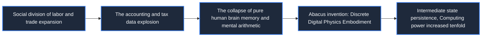
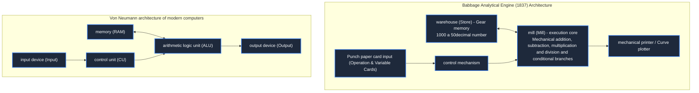

> **Course**: \[Computer Science Crash Course\] Crash Course Computer Science (PBS / All 40 episodes carefully revised)  
> **Module**: Module 1: Hardware & Architecture  
> **Keynote speaker**: Carrie Anne Philbin  
> **Video duration**: 11:53 ｜ **HD screenshots**: 3 blackboard writing/illustrations on core knowledge points  
> **Direct video**: [📺Watch the original video of this lecture on Bilibili (P1)](https://www.bilibili.com/video/BV1EW411u7th/?p=1)  
> **Full book navigation**: Previous Lecture: None (Lecture 1) ｜ [📚 Return to the full book catalog](/en/notes/topics/CCCS) ｜ [Next lecture (P02) →](/en/notes/cccs/lecture-02)

---

## Core Introduction and Concept Panorama

Reviewing the prehistoric evolution of computers from the abacus in the early stages of human civilization, to Pascal's adding machine, Leibniz's step calculator, Babbage's Difference Engine and Analytical Engine, to Hollerith's punched card tabulating machine, it reveals the inevitable transition of computing devices from single-function machines to general automatic calculations.

---

## 1. The large-scale transition of human computing needs and Abacus (Abacus)

*(Reference time: 00:01:15 · [Video jump (P1 00:01:15)](https://www.bilibili.com/video/BV1EW411u7th/?p=1&t=75))*

The computer is not a modern appliance born out of thin air. Its history is the history of mankind's struggle to solve complex calculations and get rid of the inefficiency and high error rate of manual calculations.

As early as the Mesopotamian civilization around 2500 BC, the organizational structure of human society expanded on a large scale, and tasks such as tax collection, granary storage, trade accounting, and land surveying created massive computing demands. Primitive finger counting can no longer support the summary of thousands of accounts, so humans created the first auxiliary calculation tool——**Abacus**.

The essence of the abacus is a manually operated data storage and carry indicator: each string of beads represents a digit (one, tens, hundreds, thousands), and the up and down sliding of the beads directly maps the specific value of the digit. Although the abacus still completely relies on manual manipulation and mental arithmetic rules (it does not have automatic mechanical execution capabilities), it stores the intermediate state of calculation through hardware visualization, completely liberating the load of the human brain's short-term working memory.

*⏱ Timestamp: 00:02:40 · 📷 Classroom screenshot · [Watch the corresponding clip on Bilibili (P1 00:02:40)](https://www.bilibili.com/video/BV1EW411u7th/?p=1&t=160)*

## 2. Gear mechanical calculator: Pascal adding machine and Leibniz stepper

*(Reference time: 00:03:45 · [Video jump (P1 00:03:45)](https://www.bilibili.com/video/BV1EW411u7th/?p=1&t=225))*

Entering the 17th century, the scientific revolution and the outbreak of maritime trade put stringent requirements on calculation accuracy. Calendar of astronomical calendars, artillery trajectories, and navigational longitude and latitude often rely on heavy data tables (such as logarithm tables and trigonometric function tables). These tables are all manually calculated by human computers (Human Computers). They are full of transcription and calculation errors, resulting in frequent navigation tragedies.

Inventors began to explore **Automation machinery gears** Instead of doing math by hand:
- **Chikkad Calculating Clock (1623)**: German astronomer Wilhelm Chirkade used gear meshing transmission to create the first mechanical computing device.
- **Pascaline (1642)**: French mathematician Blaise Pascal developed the Pascal adding machine in order to help his father, a tax official, relieve the heavy burden of tax accounting. It uses a series of interconnected ratchets and gears to realize the automatic triggering of the carry mechanism - for every 10 complete rotations of the lower gear, the upper cam pushes the upper gear to jump forward by 1 frame.
- **Leibniz Step Reckoner (1673)**: German mathematician Gottfried Leibniz achieved a qualitative leap on this basis. He invented the famous **Stepped Drum Gear**, there are 9 teeth of different lengths distributed on the surface of the cylinder. By adjusting the axial position of the driven gear, the machine can directly mechanize multiplication and division (decompose multiplication into controlled high-speed accumulation and shift).

Leibniz once wrote a famous saying that has been passed down through the ages: "It is completely unworthy of making excellent people spend their time like slaves on trivial calculations. If there is a machine, anyone can get the results quickly and accurately."

*⏱ Timestamp: 00:05:40 · 📷 Classroom screenshot · [Watch the corresponding clip on Bilibili (P1 00:05:40)](https://www.bilibili.com/video/BV1EW411u7th/?p=1&t=340)*

## 3. Charles Babbage’s idea of universal mechanical computing: Difference Engine and Analytical Engine

*(Reference time: 00:06:50 · [Video jump (P1 00:06:50)](https://www.bilibili.com/video/BV1EW411u7th/?p=1&t=410))*

Although mechanical calculators solve addition, subtraction, multiplication and division, each operation still requires manual intervention to set the initial value and read the result. It is a fixed arithmetic tool. The real idea of a "modern general-purpose computer" began with British mathematicians **Charles Babbage**.

#### Difference Engine
In 1822, Babbage proposed building a Difference Engine to the Royal Astronomical Society. The mathematical basis of the difference engine is **Method of Finite Differences**. For any smooth polynomial function (even logarithmic and trigonometric functions expanded through Taylor series), its multiple differences will eventually become a constant. This means that extremely complex high-order function evaluation can be completely reduced to continuous, purely mechanical addition! Babbage designed the Difference Engine, which weighed several tons, was made from 25,000 precision bronze parts and had its own printout mechanism, and was designed to eliminate human tabulation errors.

#### Analytical Engine: the ultimate prototype of a general-purpose computer
Before the Difference Engine was completed, Babbage conceived a more ambitious and revolutionary engine. **Analytical Engine (1837)**. The Analytical Engine was no longer a single polynomial evaluator; **The world's first general-purpose, programmable mechanical computer**: 
1. **The Mill**: Equivalent to the Arithmetic Logic Unit (ALU) in modern CPUs, responsible for executing arithmetic instructions;
2. **The Store**: Equivalent to the memory (RAM) of a modern computer, which is composed of thousands of gear shafts and can store 1,000 50-digit decimal numbers;
3. **Card Reader**: Drawing on the punched paper card of the Jacquard Loom, data and operating instructions are input to the machine through the holes on the card;
4. **control flow conditional branching**: The machine can skip certain cards and execute different instruction branches based on the size of the intermediate result of the operation (such as whether the result is negative)!

Babbage's close friend and collaborator, daughter of the English poet Byron **Ada Lovelace **In-depth understanding of the epoch-making significance of the Analytical Engine. She wrote the algorithm for calculating Bernoulli numbers for the Analytical Engine and is recognized as** The first programmer in human history**. Ada even predicted ahead of time: The Analytical Engine can not only process numbers. As long as real-world things (such as music, images, logical propositions) are abstracted into symbols according to rules, the Analytical Engine can manipulate and create them according to algorithms.

*⏱ Timestamp: 00:10:05 · 📷 Classroom screenshot · [Watch the corresponding clip on Bilibili (P1 00:10:05)](https://www.bilibili.com/video/BV1EW411u7th/?p=1&t=605)*

## 4. Herman Hollerith and the Punch Card Tabulating Machine: The Rise of the Data-Intensive Enterprise

*(Reference time: 00:09:40 · [Video jump (P1 00:09:40)](https://www.bilibili.com/video/BV1EW411u7th/?p=1&t=580))*

Although Babbage was unable to build a complete analytical engine due to the bottleneck of machining accuracy that was ahead of his time, the real crisis of automatically processing massive data soon swept the United States at the end of the 19th century.

The U.S. Constitution requires the government to conduct a national census every 10 years. The 1880 census took a full eight years to be completed manually; and with the influx of immigrants, the amount of data in the 1890 census is expected to double. If manual tabulation is still used, the next census in 1900 will have already begun before the census is completed!

inventor **Herman Hollerith **In the face of danger, he was ordered to invent the** Tabulating Machine**: 
- **Drilling and electrical signal detection**: Each person's gender, age, occupation, nationality and other information are encoded in different positions on a paper card. When a card is put into the machine, a set of spring-loaded metal needles will press against the card; wherever a hole is punched, the metal needle will pass through the hole and dip into the mercury tank below, instantly connecting the circuit!
- **Electromagnetic counter stepper**: The circuit is energized to generate electromagnetic attraction, which drives the mechanical counting gear on the dial to move forward one step.

Hollerith's tabulating machines only take **two and a half years** It successfully completed the complex statistics of 62.62 million people in the United States, which not only saved millions of dollars, but also proved the huge value of automated data processing in the business society. Hollerith then founded the Tabulating Machine Company, which went through a series of mergers and developments and was eventually renamed in 1924 -**International Business Machines (IBM)**.

Human beings have thus officially bid farewell to purely manual calculations and handicraft workshop-style accounting processing, and are heading towards an era of relying on machines to automatically process massive amounts of business information.

---

## Attachment: Knowledge mind map and review thinking of this lecture

This lecture serves as  **Module 1: Hardware & Architecture**  As the core component of the system, the system connects the thinking leap from the underlying hardware physical switch, the middle layer abstract protocol to the upper layer application. It is recommended to combine the original video of Station B with the graphic guide of this lecture for repeated verification to understand the engineering trade-offs and inevitable logic behind technological evolution.

Previous Lecture: None (Lecture 1) ｜ [📚 Return to the full book catalog](/en/notes/topics/CCCS) ｜ [Next lecture (P02) →](/en/notes/cccs/lecture-02)
