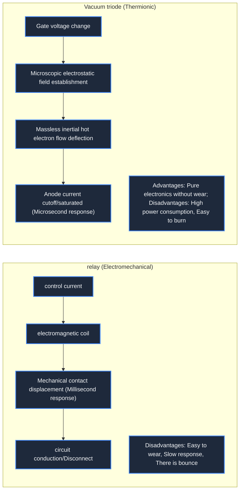

> **Course**: \[Computer Science Crash Course\] Crash Course Computer Science (PBS / All 40 episodes carefully revised)  
> **Module**: Module 1: Hardware & Architecture  
> **Keynote speaker**: Carrie Anne Philbin  
> **Video duration**: 10:44 ｜ **HD screenshots**: 4 blackboard writing/illustrations on core knowledge points  
> **Direct video**: [📺Watch the original video of this lecture on Bilibili (P2)](https://www.bilibili.com/video/BV1EW411u7th/?p=2)  
> **Full book navigation**: [← Previous lecture (P01)](/en/notes/cccs/lecture-01) ｜ [📚 Return to the full book catalog](/en/notes/topics/CCCS) ｜ [Next lecture (P03) →](/en/notes/cccs/lecture-03)

---

## Core Introduction and Concept Panorama

Analyze the physical evolution of computers from electromechanical relays, thermionic vacuum tubes, to revolutionary solid-state semiconductor transistors, and explain in detail the engineering breakthroughs of Harvard Mark I, Colossus Computer, and ENIAC and the far-reaching impact of the rise of Silicon Valley.

---

## 1. The electromechanical era: the mechanical bottleneck of relays and physical contacts

*(Reference time: 00:01:10 · [Video jump (P2 00:01:10)](https://www.bilibili.com/video/BV1EW411u7th/?p=2&t=70))*

As electricity became more widely available in the 20th century, engineers began to introduce electromagnetism into computer construction. Early electronic computers were not purely electronic devices; **Electromechanical Computers**.

The core components of this type of equipment are **Relay**: 
- **working mechanism**: A relay is essentially an electrically controlled mechanical switch. Inside there is a control coil and a spring-loaded iron movable contact (armature). When the control coil is energized, the generated electromagnetic force overcomes the spring tension and pulls the metal contact down and closes, and the circuit is turned on; when the control coil is deenergized, the spring pulls the contact back and the circuit is disconnected.
- **Physical limits and bottlenecks**: Due to the mechanical mass and spring inertia of the contacts, a normal relay can only switch up to about 50 times per second (50 Hz). In addition, metal contacts will generate sparks during frequent switching, causing carbon deposits and wear on the contacts; dust, oil, and even insects falling into the contact gap will cause the switch to fail to close.
- **Famous "Bug" Anecdotes**: In 1947, while debugging the Harvard Mark II electromechanical computer, computer pioneer Grace Hopper suffered a serious malfunction. After investigation, the team found that a moth was stuck between the contacts of relay No. 70, causing a short circuit. Hopper carefully removed the moth and posted it in his engineering journal, jokingly writing, "This is the first real computer bug (bug) ever discovered." Since then, the word "Debug" has spread all over the world.

*⏱ Timestamp: 00:01:45 · 📷 Classroom screenshot · [Watch the corresponding clip on Bilibili (P2 00:01:45)](https://www.bilibili.com/video/BV1EW411u7th/?p=2&t=105)*

## 2. Thermionic Vacuum Tube: Towards the Speed of Light Switch

*(Reference time: 00:03:30 · [Video jump (P2 00:03:30)](https://www.bilibili.com/video/BV1EW411u7th/?p=2&t=210))*

In order to completely get rid of the speed shackles of mechanical motion, physicists have turned their attention to the motion of electrons in vacuum.

The thermionic diode was invented by John Fleming in 1904 and by Lee de Forest in 1906 **Triode vacuum tube (Audion/Triode)**: 
- **Working principle**: Three electrodes are encapsulated in a high-vacuum glass bubble - the cathode (Cathode), the anode/plate (Anode/Plate) and the metal mesh sandwiched between the two. **Grid**. After the cathode is energized and heated, a large number of free electrons (thermoelectron emission) are released, which drift toward the anode with positive high voltage to form a current.
- **Electronic switch control**: If a weak negative voltage is applied to the gate, the negative charge will repel the electron flow and instantly cut off the current from the cathode to the anode; if the negative voltage is removed, the electron flow will be unobstructed again.
- **overwhelming advantage**: Inside the vacuum tube **No mechanical moving parts**, the control current completely relies on the Coulomb force control of microscopic electrons by the space electric field, and the switching frequency can easily soar to thousands or even tens of thousands of Hertz (kHz), which is several orders of magnitude faster than a mechanical relay!

*⏱ Timestamp: 00:04:00 · 📷 Classroom screenshot · [Watch the corresponding clip on Bilibili (P2 00:04:00)](https://www.bilibili.com/video/BV1EW411u7th/?p=2&t=240)*

## 3. Computing behemoths in the flames of war: Harvard Mark I, Colossus Computer and ENIAC

*(Reference time: 00:05:30 · [Video jump (P2 00:05:30)](https://www.bilibili.com/video/BV1EW411u7th/?p=2&t=330))*

World War II was the catalyst that gave rise to the first generation of electronic computing behemoths.

#### 1. Harvard Mark I (IBM ASCC, 1944)
Designed by Howard Aiken and financed by IBM. It is 15 meters long and weighs 5 tons. It is composed of 765,000 electromechanical parts and hundreds of miles of wires. Although it could only complete three additions per second, it performed key numerical calculations for atomic bomb fission simulations during the war for the Manhattan Project.

#### 2. British Colossus Computer (Colossus Mark 1/2, 1943)
It was built in secret at Bletchley Park by British engineer Tommy Flowers to crack the Lorenz code of the Nazi German High Command. The Colossus used 1,600 to 2,400 vacuum tubes and used pure electronic circuits to compare the stream of ciphertext on punched paper tapes. It is known as **The world's first programmable, fully electronic digital computer**.

#### 3. ENIAC (Electronic Numerical Integration Computer, 1946)
Designed and built by John Mauchly and J. Presper Eckert at the University of Pennsylvania to calculate accurate ballistic launch tables for artillery and bombs for the U.S. Army Ordnance Department.
- **Terrifying physical size**: It uses 17,468 vacuum tubes, 7,200 crystal diodes, 1,500 relays and 5 million hand-soldered joints; it covers an area of 167 square meters and consumes up to 150 kilowatts of power (it is said that every time it is turned on, the street lights in half a block of Philadelphia will instantly dim).
- **Shocking computing power**: ENIAC can be executed per second  **5,000 ten-digit additions**, or 357 multiplications! In the past, it took human computers 20 hours to manually calculate a table of artillery ballistic trajectories. ENIAC can accurately spit out it in just 30 seconds.
- **reliability bottleneck**: Due to the heat generated by tens of thousands of vacuum tubes and the aging of the filaments, one tube will burn out every two to three days on average. Engineers spend most of their time traveling between cabinets to check for damaged vacuum tubes.

*⏱ Timestamp: 00:06:40 · 📷 Classroom screenshot · [Watch the corresponding clip on Bilibili (P2 00:06:40)](https://www.bilibili.com/video/BV1EW411u7th/?p=2&t=400)*

## 4. Solid-state physics revolution: Transistor and the rise of Silicon Valley

*(Reference time: 00:07:35 · [Video jump (P2 00:07:35)](https://www.bilibili.com/video/BV1EW411u7th/?p=2&t=455))*

Vacuum tubes are expensive, fragile, hot, consume a lot of power, and cannot support complex computing systems with millions of switches. Computers had to find entirely new physical carriers.

In December 1947, John Bardeen, Walter Brattain and William Shockley of Bell Laboratories in the United States achieved the greatest physical breakthrough of the 20th century - the invention of **Bipolar transistor (Transistor)**.

#### The physical miracle of the transistor
Transistors belong to **All solid-state (Solid-State) devices**. It uses semiconductor materials (such as germanium Ge and silicon Si) to form P-type semiconductors and N-type semiconductors by doping trace impurity elements (such as phosphorus and boron).
- In a transistor, injecting a small amount of control current into the base can drastically change the conductive properties of the depletion layer between the collector and the emitter, thereby achieving perfect solid-state current switching.
- **revolutionary upgrade**: The transistor does not need to heat the cathode filament and generates almost no excess heat; the volume is only one thousandth or even smaller than that of the vacuum tube; it is extremely durable and the response time reaches the nanosecond (ns) level! The three were awarded the 1956 Nobel Prize in Physics.

#### The birth of Silicon Valley
After William Shockley left Bell Labs, he chose to found Shockley Semiconductor Laboratory in California's Santa Clara Valley (near Palo Alto). Because silicon is extremely abundant in the earth's crust (silica is the main component of sand) and is far more stable at high temperatures than germanium, silicon quickly became the preferred substrate for making transistors.

With the famous "Traitorous Eight" running away to found Fairchild Semiconductor and giving birth to technology giants such as Intel and AMD, the Santa Clara Valley was given a name that shines to this day -**Silicon Valley**. From this moment on, computer hardware has completely embarked on a high-speed track of exponential miniaturization and popularization.

*⏱ Timestamp: 00:07:45 · 📷 Classroom screenshot · [Watch the corresponding clip on Bilibili (P2 00:07:45)](https://www.bilibili.com/video/BV1EW411u7th/?p=2&t=465)*

---

## Attachment: Knowledge mind map and review thinking of this lecture

This lecture serves as  **Module 1: Hardware & Architecture**  As the core component of the system, the system connects the thinking leap from the underlying hardware physical switch, the middle layer abstract protocol to the upper layer application. It is recommended to combine the original video of Station B with the graphic guide of this lecture for repeated verification to understand the engineering trade-offs and inevitable logic behind technological evolution.

[← Previous lecture (P01)](/en/notes/cccs/lecture-01) ｜ [📚 Return to the full book catalog](/en/notes/topics/CCCS) ｜ [Next lecture (P03) →](/en/notes/cccs/lecture-03)
