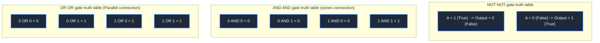

> **Course**: \[Computer Science Crash Course\] Crash Course Computer Science (PBS / All 40 episodes carefully revised)  
> **Module**: Module 1: Hardware & Architecture  
> **Keynote speaker**: Carrie Anne Philbin  
> **Video duration**: 10:07 ｜ **HD screenshots**: 4 blackboard writing/illustrations on core knowledge points  
> **Direct video**: [📺Watch the original video of this lecture (P3) on Bilibili](https://www.bilibili.com/video/BV1EW411u7th/?p=3)  
> **Full book navigation**: [← Previous lecture (P02)](/en/notes/cccs/lecture-02) ｜ [📚 Return to the full book catalog](/en/notes/topics/CCCS) ｜ [Next lecture (P04) →](/en/notes/cccs/lecture-04)

---

## Core Introduction and Concept Panorama

Starting from Boolean algebra founded by George Boole, the electrical signal mapping of high and low levels and True/False is explained in detail, the transistor implementation mechanism and truth table of NOT, AND, OR, and XOR gates are deduced in depth, and the cornerstone of digital logic abstraction is revealed.

---

## 1. George Boole and the mathematical axiomatization of logic

*(Reference time: 00:01:20 · [Video jump (P3 00:01:20)](https://www.bilibili.com/video/BV1EW411u7th/?p=3&t=80))*

At their deepest physical level, modern computers are made up of billions of tiny electronic switches (transistors). But how to use physical switches to express human logical reasoning, mathematical calculations and even complex thoughts?

This theoretical cornerstone was developed by a British self-taught mathematician a century before the advent of computers. **George Boole **Layed in 1847. Boole founded** Boolean Algebra**, completely formalizing the traditional Aristotelian syllogistic philosophical logic into rigorous mathematical operations:
- In Boolean algebra, the value of all variables can only be one of two polarized truth values: **True**  or  **False**; 
- The combination and deduction between propositions are reduced to the three most basic Boolean operations: **AND**, **OR**, **NOT (NOT)**.

In 1937, Claude Shannon, the father of information theory, shockingly pointed out in his famous MIT master's thesis: **The true and false of Boolean algebra can produce a perfect isomorphic mapping with the "on" and "off" of a relay/tube switch (switch closed is True, switch open is False)!**  This paper is called the most epoch-making master's thesis in the 20th century, directly building a bridge from abstract mathematical logic to the realization of physical engineering.

*⏱ Timestamp: 00:03:00 · 📷 Classroom screenshot · [Watch the corresponding clip on Bilibili (P3 00:03:00)](https://www.bilibili.com/video/BV1EW411u7th/?p=3&t=180)*

## 2. Construction of basic logic gates and transistor circuits

*(Reference time: 00:02:50 · [Video jump (P3 00:02:50)](https://www.bilibili.com/video/BV1EW411u7th/?p=3&t=170))*

In modern circuits, we usually refer to high voltages (such as +5V or +3.3V)  **True (binary 1)**, represented by grounded low voltage (0V)  **False (binary 0)**. Tiny circuit units capable of performing Boolean operations are called **Logic Gates**.

#### 1. NOT gate (NOT gate/inverter)
- **logical semantics**: If the input is True, the output is False; if the input is False, the output is True.
- **Transistor hardware implementation**: Connect the output terminal to the high-level power supply (VCC) through a current-limiting resistor, and at the same time, the output terminal is connected downward to the drain of an N-channel transistor, and the source of the transistor is grounded.
  - When the input is 0V (False): the transistor is turned off, the output terminal cannot be connected to ground, and is firmly pulled to the VCC high level by the pull-up resistor, and the output is 1 (True);
  - When the input is +5V (True): the transistor is saturated and turned on, the output current flows directly to the ground through the transistor, the output is clamped to 0V, and the output is 0 (False).

#### 2. AND gate (AND gate)
- **logical semantics**: The output is True only when all inputs are True; as long as one input is False, the output is False immediately.
- **Transistor hardware implementation**: Using two transistors **series connection**. For current to flow from the power supply to the output, it must pass through transistor A and then through transistor B. A complete path is only established when a high level is applied to terminals A and B at the same time to turn on both transistors.

#### 3. OR gate (or gate)
- **logical semantics**: As long as at least one of the inputs is True, the output is True; only when all inputs are False, the output is False.
- **Transistor hardware implementation**: Using two transistors **Parallel connection**. The two parallel branches are controlled by input A and input B respectively. As long as any branch is turned on, current can flow to the output smoothly.

*⏱ Timestamp: 00:04:30 · 📷 Classroom screenshot · [Watch the corresponding clip on Bilibili (P3 00:04:30)](https://www.bilibili.com/video/BV1EW411u7th/?p=3&t=270)*

## 3. XOR gate (XOR) and functional completeness (Functional Completeness)

*(Reference time: 00:07:05 · [Video jump (P3 00:07:05)](https://www.bilibili.com/video/BV1EW411u7th/?p=3&t=425))*

Beyond the basic gates, the most critical gates in computer arithmetic operations are **XOR gate (XOR, Exclusive OR)**.

#### XOR gate: the core soul of arithmetic addition
- **logical semantics**: When two input terminals **The level status is different** When , the output is True; if the two input terminals are the same (both 1 or 0), the output is False.
- **Boolean algebraic expression**: 
  $$A \oplus B = (A \cdot \overline{B}) + (\overline{A} \cdot B)$$
- **Circuit level construction**: Can be composed of 2 NOT gates, 2 AND gates and 1 OR gate.
XOR is extremely important because it accurately reproduces **"Bitwise summation when carry is not considered" in binary addition**: $0+0=0, 0+1=1, 1+0=1, 1+1=0$ (A carry is generated and the bit is 0).

#### Functional Completeness: The “Building Blocks of the Universe” of NAND and NOR
In computer engineering, engineers are extremely fond of a type of gate called a NAND Gate. **and** NOR Gate\*\* logic gate.
- **Functional Completeness**: From a single logic gate, the NAND gate (or NOR gate), through different topological interconnections, all other arbitrary logic gates such as NOT, AND, OR, XOR, etc. can be constructed!
- **Project value**: When manufacturing integrated circuit chips, the wafer factory only needs to crazyly copy the same NAND transistor structure, which is the most streamlined and easiest to etch, on the silicon wafer to build all computing systems from microchips to top-level CPUs! This is the ultimate power of digital abstraction layers.

*⏱ Timestamp: 00:06:10 · 📷 Classroom screenshot · [Watch the corresponding clip on Bilibili (P3 00:06:10)](https://www.bilibili.com/video/BV1EW411u7th/?p=3&t=370)*

*⏱ Timestamp: 00:07:30 · 📷 Classroom screenshot · [Watch the corresponding clip on Bilibili (P3 00:07:30)](https://www.bilibili.com/video/BV1EW411u7th/?p=3&t=450)*

---

## Attachment: Knowledge mind map and review thinking of this lecture

This lecture serves as  **Module 1: Hardware & Architecture**  As the core component of the system, the system connects the thinking leap from the underlying hardware physical switch, the middle layer abstract protocol to the upper layer application. It is recommended to combine the original video of Station B with the graphic guide of this lecture for repeated verification to understand the engineering trade-offs and inevitable logic behind technological evolution.

[← Previous lecture (P02)](/en/notes/cccs/lecture-02) ｜ [📚 Return to the full book catalog](/en/notes/topics/CCCS) ｜ [Next lecture (P04) →](/en/notes/cccs/lecture-04)
