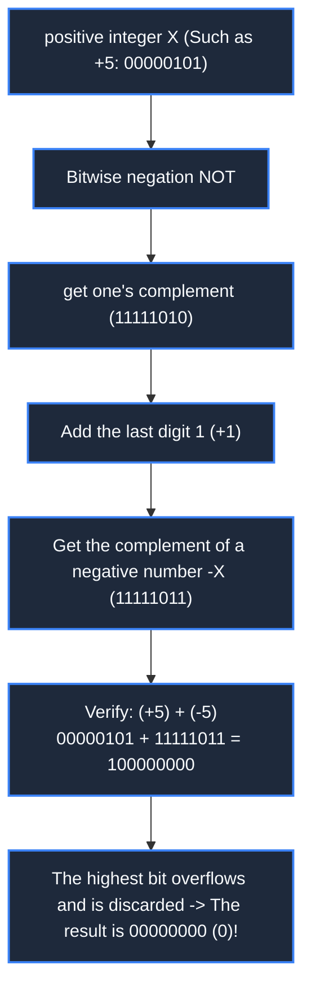

> **Course**: \[Computer Science Crash Course\] Crash Course Computer Science (PBS / All 40 episodes carefully revised)  
> **Module**: Module 1: Hardware & Architecture  
> **Keynote speaker**: Carrie Anne Philbin  
> **Video duration**: 10:45 ｜ **HD screenshots**: 4 blackboard writing/illustrations on core knowledge points  
> **Direct video**: [📺Watch the original video of this lecture on Bilibili (P4)](https://www.bilibili.com/video/BV1EW411u7th/?p=4)  
> **Full book navigation**: [← Previous lecture (P03)](/en/notes/cccs/lecture-03) ｜ [📚 Return to the full book catalog](/en/notes/topics/CCCS) ｜ [Next lecture (P05) →](/en/notes/cccs/lecture-05)

---

## Core Introduction and Concept Panorama

In-depth analysis of the bit-weighted carry system, the mathematical closed loop of the original code/one's complement/complement code, the IEEE 754 standardization specification of floating point numbers, and the panoramic evolution of character encoding from 7-bit ASCII to Unicode/UTF-8.

---

## 1. Base system and bit weight: Why do computers must choose binary system?

*(Reference time: 00:01:10 · [Video jump (P4 00:01:10)](https://www.bilibili.com/video/BV1EW411u7th/?p=4&t=70))*

The reason why humans commonly use the decimal system (Base-10) is purely because we have ten fingers; at the physical hardware level, manufacturing electronic devices that can extremely stably distinguish 10 discrete voltage states (such as 0V, 0.5V, 1.0V... 4.5V) is not only extremely complex, but also extremely susceptible to power supply fluctuations and electromagnetic noise interference, causing reading errors.

In contrast, Binary (Base-2) only needs to distinguish between two states: **Powered vs. without power, high level vs. low level**. This huge anti-interference tolerance gives digital computers unparalleled computational stability.

In binary numbers, each binary digit is called a  **Bit**: 
- 1 Bit can only represent 2 states (0 or 1);
- $n$  Bits can be combined into  $2^n$  states that are different from each other;
- The computer packages and bundles 8 Bits into a group, defined as  **1 Byte**. The bit weights of an 8-bit unsigned binary number from right to left are  $2^0, 2^1, 2^2, \dots, 2^7$ (1, 2, 4, 8, 16, 32, 64, 128), the range of integers it can represent is: 
  $$00000000_2 \sim 11111111_2 \implies 0 \sim 255$$

*⏱ Timestamp: 00:02:30 · 📷 Classroom screenshot · [Watch the corresponding clip on Bilibili (P4 00:02:30)](https://www.bilibili.com/video/BV1EW411u7th/?p=4&t=150)*

## 2. Engineering evolution of negative number representation: original code, complement code and complement code (Two's Complement)

*(Reference time: 00:04:20 · [Video jump (P4 00:04:20)](https://www.bilibili.com/video/BV1EW411u7th/?p=4&t=260))*

Unsigned numbers can only represent positive integers, but the real world is full of negative numbers. How does computer hardware represent negative numbers? This exploration went through three major engineering iterations:

#### 1. Original code (Sign-Magnitude)
The most intuitive idea is to use the highest bit as the sign bit: `0`  represents a positive number, `1`  Represents a negative number, and the remaining low bits represent the absolute value of the value.
- **fatal flaw**: 
  1. Two zeros appear: `00000000`  Yes  $+0$, while  `10000000`  Yes  $-0$, causing huge ambiguities in logical judgment and comparison;
  2. The hardware cannot directly use the adder to perform calculations: calculation  $5 + (-5)$, that is  `00000101 + 10000101 = 10001010`($-10$), the result is completely ridiculous! The computer must additionally design a complex subtraction decision circuit.

#### 2. Ones' Complement
In order to make the adder universal, the one's complement code is proposed: the one's complement code for positive numbers remains unchanged, and the one's complement code for negative numbers except the sign bit remains 1, all other numerical bits are inverted bit by bit (0 becomes 1, and 1 becomes 0).
- **Problems that still exist**: Double zero has not yet been eliminated (`00000000`  with  `11111111`  are all 0), and the wraparound loop carry is required when the addition produces an end carry.

#### 3. The ultimate solution: Two's Complement
All integer operations in modern computers are uniformly used **complement**: 
- **Define rules**: The complement of a positive number is the same as itself; the complement of a negative number is **One's complement plus 1** (ie: negate bitwise, add one to the last bit).
- **algebraic nature**: Complement code uses the principle of modular arithmetic to perfectly equate subtraction to adding a positive number with modular overflow! In 8-bit arithmetic, modulo is  $2^8 = 256$.
- **Unparalleled hardware advantages**: 
  1. Completely eliminate "negative zero": `00000000`  The only representation is 0, negative zero in the original code  `10000000`  is logically used to express  $-128$, extending the range of 8-bit signed integers to  $[-128, +127]$; 
  2. **Addition and subtraction hardware is completely unified**: Calculation  $A - B$, the hardware only needs to directly calculate  $A + (\sim B + 1)$, the same adder chip can handle both positive and negative arithmetic without any subtraction modification!

*⏱ Timestamp: 00:05:15 · 📷 Classroom screenshot · [Watch the corresponding clip on Bilibili (P4 00:05:15)](https://www.bilibili.com/video/BV1EW411u7th/?p=4&t=315)*

## 3. Floating point numbers and the IEEE 754 standard: accommodating infinite micro and macro in finite bits

*(Reference time: 00:07:15 · [Video jump (P4 00:07:15)](https://www.bilibili.com/video/BV1EW411u7th/?p=4&t=435))*

Integers can only represent discrete numbers, but extremely large numbers (such as the speed of light) often appear in scientific calculations  $3 \times 10^8$  m/s) or extremely small (such as the proton mass  $1.67 \times 10^{-27}$  kg) as a decimal.

If the decimal point position is fixed (fixed point number), the limited 32 bits will be seriously wasted, and accuracy and dynamic range cannot be achieved at the same time. Computers use a system similar to scientific notation **Floating-Point number representation (Floating-Point)**.

In 1985, the Institute of Electrical and Electronics Engineers established a globally accepted  **IEEE 754 standard**. Take the most common 32-bit single-precision floating point number (float) as an example: 
$$\text{Value} = (-1)^S \times (1 + \text{Fraction}) \times 2^{(\text{Exponent} - \text{Bias})}$$
- **1 sign bit (Sign, S)**: `0`  represents a positive number, `1`  Represents a negative number;
- **8-digit exponent (Exponent, E)**: means  $2$  to the power of the exponent. Use the frameshift representation with an offset value (Bias = 127) to avoid the complement sign judgment of negative exponents;
- **23-digit mantissa (Fraction / Mantissa)**: Since the first digit before the decimal point of a normalized binary number always implicitly defaults to  `1` (such as  $1.011_2$), so the highest bit  `1`  No need for physical storage, saving 1 Bit of effective accuracy!

Although floating point numbers greatly expand the range of numerical representation, they also bring classic rounding errors caused by precision truncation (such as the famous  $0.1 + 0.2 \neq 0.3$), special precautions must be taken in financial and security systems.

*⏱ Timestamp: 00:07:45 · 📷 Classroom screenshot · [Watch the corresponding clip on Bilibili (P4 00:07:45)](https://www.bilibili.com/video/BV1EW411u7th/?p=4&t=465)*

## 4. Text and character encoding: from ASCII code table to global Unicode

*(Reference time: 00:09:10 · [Video jump (P4 00:09:10)](https://www.bilibili.com/video/BV1EW411u7th/?p=4&t=550))*

Computers must not only do calculations, but also process human language and text. Since the hardware can only read 0 and 1, a dictionary mapping characters to binary numbers must be established.

#### 1. ASCII code (American Standard Code for Information Interchange, 1963)
ASCII usage  **7 binary bits** 128 characters are defined: including English letters (upper and lower case A-Z, a-z), numbers (0-9), common punctuation marks, and 32 invisible telex communication control characters (such as carriage return CR, line feed LF, bell BEL, etc.). For example, capital letters  `'A'`  Corresponds to decimal 65, binary  `01000001`.

#### 2. An era of chaos and confusion
When computers went global, 7-bit ASCII could not even fit into 1 Byte (with 1 highest bit left vacant). European countries use the 8th bit to expand their extended ASCII code tables (ISO-8859 series); in Eastern countries such as China and Japan, tens of thousands of Chinese characters obviously cannot be crammed into 256 codes. China, Japan and South Korea have successively formulated their own double-byte encoding systems (such as China's GB2312, GBK, Taiwan's Big5, and Japan's Shift-JIS). Due to incompatible encoding standards, the same byte sequence is interpreted into completely different glyphs in different operating systems, causing catastrophic "garbled" phenomena.

#### 3. Ultimate unity: Unicode and UTF-8
In order to fundamentally eliminate the Tower of Babel dilemma, the International Organization for Standardization and technology giants established the \*\*Unicode (Unicode/Universal Code)\*\* Alliance. Its ambitious goals are: **Assign a globally unique hexadecimal code point to every character, hieroglyph, and even emoji in every human language in the world**!

In storage and network transmission, Ken Thompson and Rob Pike invented the genius  **UTF-8 variable length encoding**: 
- For English characters, still uses 1 byte and is fully backward compatible with ASCII;
- For complex text such as Chinese characters, smooth adaptive expansion is 3 to 4 bytes;
UTF-8 completely ended the era of text chaos and became the unifying cornerstone of today's World Wide Web and modern operating systems.

*⏱ Timestamp: 00:09:40 · 📷 Classroom screenshot · [Watch the corresponding clip on Bilibili (P4 00:09:40)](https://www.bilibili.com/video/BV1EW411u7th/?p=4&t=580)*

---

## Attachment: Knowledge mind map and review thinking of this lecture

This lecture serves as  **Module 1: Hardware & Architecture**  As the core component of the system, the system connects the thinking leap from the underlying hardware physical switch, the middle layer abstract protocol to the upper layer application. It is recommended to combine the original video of Station B with the graphic guide of this lecture for repeated verification to understand the engineering trade-offs and inevitable logic behind technological evolution.

[← Previous lecture (P03)](/en/notes/cccs/lecture-03) ｜ [📚 Return to the full book catalog](/en/notes/topics/CCCS) ｜ [Next lecture (P05) →](/en/notes/cccs/lecture-05)
