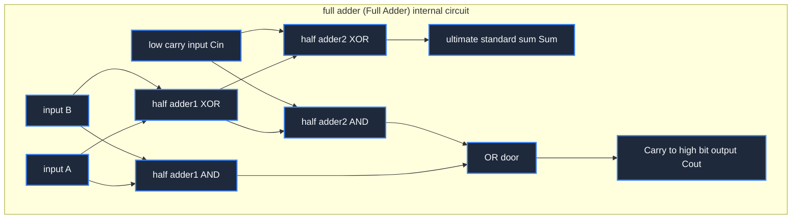

> **Course**: \[Computer Science Crash Course\] Crash Course Computer Science (PBS / All 40 episodes carefully revised)  
> **Module**: Module 1: Hardware & Architecture  
> **Keynote speaker**: Carrie Anne Philbin  
> **Video duration**: 11:09 ｜ **HD screenshots**: 4 blackboard writing/illustrations on core knowledge points  
> **Direct video**: [📺Watch the original video of this lecture on Bilibili (P5)](https://www.bilibili.com/video/BV1EW411u7th/?p=5)  
> **Full book navigation**: [← Previous lecture (P04)](/en/notes/cccs/lecture-04) ｜ [📚 Return to the full book catalog](/en/notes/topics/CCCS) ｜ [Next lecture (P06) →](/en/notes/cccs/lecture-06)

---

## Core Introduction and Concept Panorama

Starting from the circuit construction of half adder and full adder, the cascade principle of 8-bit traveling wave carry adder is deduced step by step, and the integrated architecture of arithmetic unit and logic unit and the control mechanism of status flag bits are discussed in depth.

---

## 1. Arithmetic Logic Unit (ALU): The brain and heart of the computer

*(Reference time: 00:01:05 · [Video jump (P5 00:01:05)](https://www.bilibili.com/video/BV1EW411u7th/?p=5&t=65))*

If you are looking for the physical entity inside the CPU that actually does the dirty work and performs all substantive mathematical operations and logical decisions, there is no doubt that it is **Arithmetic and Logic Unit (ALU)**.

Structurally, ALU is divided into two functional camps:
1. **Arithmetic Unit**: Responsible for all addition, subtraction, self-increment and self-decrement, as well as multiplication and division operations composed of addition iterations;
2. **Logic Unit**: Responsible for bit-level Boolean logical operations (such as AND, OR, NOT, XOR) and numerical left shift (Shift Left) and right shift (Shift Right).

Once you understand how the ALU accurately calculates mathematical results using a bunch of dead logic gates welded together by transistors, you will understand the core physical mysteries of modern digital computers.

*⏱ Timestamp: 00:02:15 · 📷 Classroom screenshot · [Watch the corresponding clip on Bilibili (P5 00:02:15)](https://www.bilibili.com/video/BV1EW411u7th/?p=5&t=135)*

## 2. From Half Adder to Full Adder

*(Reference time: 00:02:00 · [Video jump (P5 00:02:00)](https://www.bilibili.com/video/BV1EW411u7th/?p=5&t=120))*

In elementary school we learn to add two binary numbers:
- $0 + 0 = 0$
- $0 + 1 = 1$
- $1 + 0 = 1$
- $1 + 1 = 10_2$ (The base bit is 0, carry 1 to the high bit)

#### 1. Half Adder
Take a closer look at this truth table and you'll notice a surprising symmetry:
- **Sum, S**: It is 1 only when the two inputs are different, which is a perfect match  **XOR gate** the logic of ($S = A \oplus B$); 
- **Carry to high bit (Carry, C)**: A carry occurs only when both inputs are 1, which is completely consistent.  **AND gate** the logic of ($C = A \cdot B$).
An XOR gate plus an AND gate constitutes **half adder**.
But the half adder has a fatal flaw: it can only process the current bit of input  $A$  and  $B$, **It is impossible to receive carry input from the low bit (Carry-in,  $C_{in}$)**! Therefore it can only be used as the lowest digit (units digit) in multi-digit operations.

#### 2. Full Adder
In order to handle general-purpose calculations with low-order carry, three inputs are necessary: $A, B, C_{in}$, and two output terminals: and  $S$, carry output  $C_{out}$.
- **Circuit level construction**: Full adders cleverly cascaded **two half adders** with **an OR gate**: 
  1. The first half adder first takes the input  $A$  with  $B$  Add together to get the intermediate sum  $S_1$  with intermediate carry  $C_1$; 
  2. The second half-adder adds the intermediate sum  $S_1$  with carry input from low bit  $C_{in}$  Add together to get the final fundamental sum  $S = A \oplus B \oplus C_{in}$, and generates the second carry  $C_2$; 
  3. will  $C_1$  with  $C_2$  Feeding an OR gate: as long as the first step produces a carry ($1+1$), or add  $C_{in}$  After a carry occurs, the high carry must be triggered! Come to  $C_{out} = (A \cdot B) + (C_{in} \cdot (A \oplus B))$.

*⏱ Timestamp: 00:03:50 · 📷 Classroom screenshot · [Watch the corresponding clip on Bilibili (P5 00:03:50)](https://www.bilibili.com/video/BV1EW411u7th/?p=5&t=230)*

## 3. 8-bit traveling wave carry adder and cascade delay bottleneck

*(Reference time: 00:05:10 · [Video jump (P5 00:05:10)](https://www.bilibili.com/video/BV1EW411u7th/?p=5&t=310))*

With a full adder, multi-digit addition becomes as elegant and natural as building blocks.

For an 8-bit adder, we simply arrange 8 full adders side by side:
- 0th place  $C_{in}$  ground(input 0);
- Carry out of bit 0  $C_{out}$  Access the carry input of bit 1  $C_{in}$; 
- 1st place  $C_{out}$  Access the 2nd  $C_{in}$, passed in cascade all the way to the full adder at position 7.

This type of adder is called **Ripple Carry Adder**, because the high-level carry signal is like a water wave, which must be "rippled" from the lowest level to the highest level layer by layer.
- **Engineering bottleneck**: There is a tiny physical propagation delay (Gate Delay, about a few tenths of a nanosecond) between the flow of electrons inside the logic gate and the charge and discharge of the capacitor. In the 64-bit traveling wave adder, the 63rd bit must wait for the carry signals of the previous 62 full adders to stabilize one by one before the correct result can be calculated. This seriously slows down the CPU frequency!
- **modern industrial solutions**: Modern high-performance processors generally adopt **Carry-Lookahead Adder (CL)**. It uses a more complex Boolean algebra look-ahead expansion formula to directly calculate the carry status of all bits in parallel across levels, reducing the addition delay from  $O(N)$  Dimensionality reduction to  $O(\log N)$.

*⏱ Timestamp: 00:05:30 · 📷 Classroom screenshot · [Watch the corresponding clip on Bilibili (P5 00:05:30)](https://www.bilibili.com/video/BV1EW411u7th/?p=5&t=330)*

## 4. System integration of logic units and status flags (Flags)

*(Reference time: 00:08:20 · [Video jump (P5 00:08:20)](https://www.bilibili.com/video/BV1EW411u7th/?p=5&t=500))*

The arithmetic unit calculates the result, but the program often needs to make conditional judgments on the data. This requires the cooperation of the ALU logic unit and the \*\*Status Flags Register (Flags Register)\*\*:

1. **Logical operations**: The logic unit is connected in parallel on the data input bus and contains independent 8-bit AND gate array, OR gate array and NOT gate array. through a group **Operation selection control line (Opcode Selector)**, the multiplexer (Multiplexer) decides whether to send the output of the adder or the result of the logic gate to the data bus;
2. **Status flags (Flags)**: 
   - **Zero Flag (zero flag, Z)**: The ALU internally connects all 8 output bits to a multi-input NOR gate. As long as all the output bits are 0, the zero flag is instantly set to 1! This is used in the program to implement  `if (a == b)`  of equality judgment (judgment  $a - b == 0$); 
   - **Negative Flag (negative flag bit, N)**: Directly connect the highest sign bit of the output result. If it is 1, it means that the complement result is a negative number and is used to judge  `if (a < b)`; 
   - **Overflow Flag (overflow flag, V/O)**: Triggered when the result of adding two large positive numbers with the same sign becomes a negative number, or a low-carry exception overwhelms the sign bit, notifying the operating system that an arithmetic overflow exception has occurred;
   - **Carry Flag (carry flag, C)**: Record whether there is a carry overflow in the highest-order full adder, and support cascading multiple 8-bit operations into 16-bit or 32-bit large number continuous operations.

This small set of flag bits has become the soul hub connecting the physical output of the underlying hardware circuit and the branch jump of the upper-level high-level program.

*⏱ Timestamp: 00:08:45 · 📷 Classroom screenshot · [Watch the corresponding clip on Bilibili (P5 00:08:45)](https://www.bilibili.com/video/BV1EW411u7th/?p=5&t=525)*

---

## Attachment: Knowledge mind map and review thinking of this lecture

This lecture serves as  **Module 1: Hardware & Architecture**  As the core component of the system, the system connects the thinking leap from the underlying hardware physical switch, the middle layer abstract protocol to the upper layer application. It is recommended to combine the original video of Station B with the graphic guide of this lecture for repeated verification to understand the engineering trade-offs and inevitable logic behind technological evolution.

[← Previous lecture (P04)](/en/notes/cccs/lecture-04) ｜ [📚 Return to the full book catalog](/en/notes/topics/CCCS) ｜ [Next lecture (P06) →](/en/notes/cccs/lecture-06)
