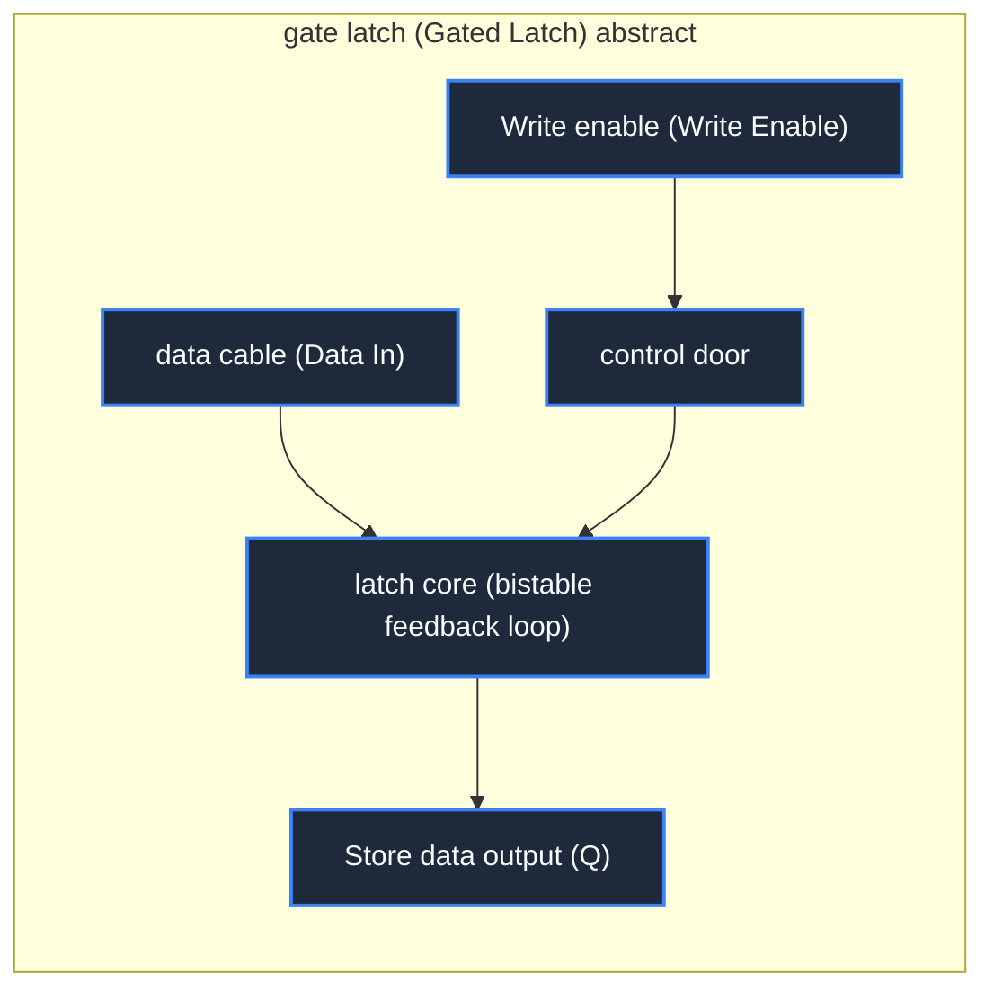

> **Course**: \[Computer Science Crash Course\] Crash Course Computer Science (PBS / All 40 episodes carefully revised)  
> **Module**: Module 1: Hardware & Architecture  
> **Keynote speaker**: Carrie Anne Philbin  
> **Video duration**: 12:17 ｜ **HD screenshots**: 4 blackboard writing/illustrations on core knowledge points  
> **Direct video**: [📺Watch the original video of this lecture on Bilibili (P6)](https://www.bilibili.com/video/BV1EW411u7th/?p=6)  
> **Full book navigation**: [← Previous lecture (P05)](/en/notes/cccs/lecture-05) ｜ [📚 Return to the full book catalog](/en/notes/topics/CCCS) ｜ [Next lecture (P07) →](/en/notes/cccs/lecture-07)

---

## Core Introduction and Concept Panorama

Reveals the essential transition from combinational logic to sequential logic, explains in detail the structure of AND-OR latches, gated latches, and multi-bit registers, and provides an in-depth analysis of the grand system of two-dimensional matrix addressing and SRAM random access memory.

---

## 1. The watershed between combinational logic and sequential logic: state memory

*(Reference time: 00:01:00 · [Video jump (P6 00:01:00)](https://www.bilibili.com/video/BV1EW411u7th/?p=6&t=60))*

In the previous lectures, the logic gates, full adders, and ALUs we discussed all belong to **Combinational Logic**.
- **Characteristics of Combinational Logic**: The output is completely determined instantaneously by the current input. Once the input changes, the output changes; once the input is disconnected, all intermediate states disappear. It has no memory and cannot save calculation results.
- **The birth of Sequential Logic**: If the computer calculates  $1+1=2$  If it cannot be persisted for the next step of calculation, the entire computing system will not be sustainable. Computers must have sequential circuits that can "remember" past states.

The core techniques for achieving memory are amazing: **Connect the output end back to the input end to form a positive feedback closed loop (Feedback Loop)!**

*⏱ Timestamp: 00:02:20 · 📷 Classroom screenshot · [Watch the corresponding clip on Bilibili (P6 00:02:20)](https://www.bilibili.com/video/BV1EW411u7th/?p=6&t=140)*

## 2. AND-OR latch (Latch) and gate timing control

*(Reference time: 00:02:10 · [Video jump (P6 00:02:10)](https://www.bilibili.com/video/BV1EW411u7th/?p=6&t=130))*

#### 1. Working principle of AND-OR latch
We use an OR gate and an AND gate to build the original latch:
- Set one input terminal of the OR gate as the "Set", and connect its output to one input terminal of the AND gate;
- The other input terminal of the AND gate is set to "Reset (normally set to 1)", and the output terminal of the AND gate is **Wrap around and connect back to the other input of the OR gate**!
- **Self-locking retention mechanism**: 
  1. The initial state output is 0. When we give a brief 1 pulse at the Set terminal, the OR gate output becomes 1, enters the AND gate (Reset is 1), and the AND gate output becomes 1;
  2. Even if the pulse on the Set end is removed immediately (Set changes back to 0), the 1 output by the AND gate has been sent back to the OR gate through the feedback loop, and the OR gate continues to output 1! The circuit "bites" this state by itself, achieving permanent memory of 1 bit of information;
  3. To clear this memory, just give the Reset terminal a brief 0 pulse, the AND gate is forced to output 0, the feedback chain is interrupted, and the circuit returns to the initial 0 state.

#### 2. Gated Latch
The AND-OR latch requires two control lines (Set and Reset), which is cumbersome to use. Engineers improved this by adding additional logic gates to **Gated D Latch**: 
- **Data terminal (Data, D)**: Enter the target value we want to save (0 or 1);
- **Write Enable (WE)**: Control valve. When WE is 0, the latch completely blocks the external input, and any data transition on the D terminal will not affect the internally saved value; only when WE becomes 1, the internal memory is instantly updated to the level state of the D terminal.

*⏱ Timestamp: 00:04:10 · 📷 Classroom screenshot · [Watch the corresponding clip on Bilibili (P6 00:04:10)](https://www.bilibili.com/video/BV1EW411u7th/?p=6&t=250)*

## 3. Register: the extremely fast workbench inside the CPU

*(Reference time: 00:04:45 · [Video jump (P6 00:04:45)](https://www.bilibili.com/video/BV1EW411u7th/?p=6&t=285))*

A single latch can only store 1 bit. In order to store a complete value inside the CPU, we connect multiple latches in parallel in a row:
- Connect all the Write Enable ports of the eight gate latches to the same bus;
- When the common enable line lights up, the level on the 8-bit data line (Data Bus) is instantly swallowed and locked by 8 latches at the same time.

This set of latches working in parallel is called **Register**.
- **Bit width (Width)**: The number of bits that a register can hold simultaneously is called the "word length" or "bit width" of the computer. Early microprocessors had 8-bit registers, and then evolved to 16-bit, 32-bit, and today's mainstream CPUs generally have 64-bit general-purpose registers.
- **physical status**: The register is welded next to the CPU computing core and is connected to the ALU by a very short physical bus. The read and write latency is usually  **Sub-nanosecond**  Level is the fastest but most expensive data storage unit in the entire computer system.

*⏱ Timestamp: 00:06:00 · 📷 Classroom screenshot · [Watch the corresponding clip on Bilibili (P6 00:06:00)](https://www.bilibili.com/video/BV1EW411u7th/?p=6&t=360)*

## 4. Two-dimensional matrix addressing and random access memory (RAM)

*(Reference time: 00:06:30 · [Video jump (P6 00:06:30)](https://www.bilibili.com/video/BV1EW411u7th/?p=6&t=390))*

The number of registers inside a CPU is extremely limited (usually just a few dozen) because each latch requires its own dedicated wire connection. If we want to store millions or even hundreds of millions of data (such as a picture, a program), the number of wires will cause an uncontrollable "combination explosion".

How to manage massive memory latches with very few control pins? The great innovation in the history of computer engineering - \*\*Grid Matrix Addressing (Matrix Addressing)\*\* is here!

#### 1. 256-bit SRAM matrix addressing model
We arrange the 256 latches into a  $16 \times 16$  The square matrix:
- Each latch needs to meet two conditions to be high at the same time before it is selected: **Row Line**  with  **Column Line**  must be turned on simultaneously (using a tiny two-input AND gate for gating);
- Addressing 256 units requires only an 8-bit address code (Address): the high 4 bits are sent in **Row Decoder**, the lower 4 bits are sent into **Column Decoder**. The decoder converts the 4-bit binary input from  $0000 \sim 1111$  Decoded as the only activated high-level line among the 16 lines!
- Routing advantage: Originally requiring 256 independent addressing lines, now only  $16 + 16 = 32$  With only one matrix cable, the wire cost drops by nearly 90%!

#### 2. Why is it called “Random Access”?
This memory is called  **RAM (Random Access Memory, random access memory)**.
- “Random” does not mean “unpredictable”; **Addressing access time is completely independent of physical space location (Uniform Latency)**!
- Traditional magnetic tape or punched paper tape is "Sequential Access". To read the 1000th data, you must scroll the tape from the beginning and fast forward, which takes several minutes. In RAM, as long as the digital address code is given, the row/column decoder electrical signal is established at the speed of light. Whether reading the 0th unit or the 255th unit, the nanosecond time consumed is exactly the same!

*⏱ Timestamp: 00:08:30 · 📷 Classroom screenshot · [Watch the corresponding clip on Bilibili (P6 00:08:30)](https://www.bilibili.com/video/BV1EW411u7th/?p=6&t=510)*

---

## Attachment: Knowledge mind map and review thinking of this lecture

This lecture serves as  **Module 1: Hardware & Architecture**  As the core component of the system, the system connects the thinking leap from the underlying hardware physical switch, the middle layer abstract protocol to the upper layer application. It is recommended to combine the original video of Station B with the graphic guide of this lecture for repeated verification to understand the engineering trade-offs and inevitable logic behind technological evolution.

[← Previous lecture (P05)](/en/notes/cccs/lecture-05) ｜ [📚 Return to the full book catalog](/en/notes/topics/CCCS) ｜ [Next lecture (P07) →](/en/notes/cccs/lecture-07)
