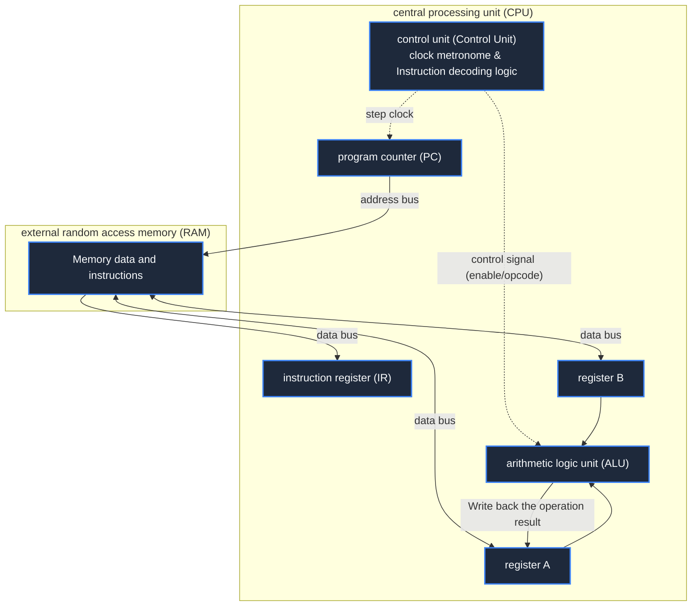

> **Course**: \[Computer Science Crash Course\] Crash Course Computer Science (PBS / All 40 episodes carefully revised)  
> **Module**: Module 1: Hardware & Architecture  
> **Keynote speaker**: Carrie Anne Philbin  
> **Video duration**: 11:38 ｜ **HD screenshots**: 4 blackboard writing/illustrations on core knowledge points  
> **Direct video**: [📺Watch the original video of this lecture on Bilibili (P7)](https://www.bilibili.com/video/BV1EW411u7th/?p=7)  
> **Full book navigation**: [← Previous lecture (P06)](/en/notes/cccs/lecture-06) ｜ [📚 Return to the full book catalog](/en/notes/topics/CCCS) ｜ [Next lecture (P08) →](/en/notes/cccs/lecture-08)

---

## Core Introduction and Concept Panorama

The ALU, register file, RAM and control unit are assembled into a complete central processing unit (CPU), and the microscopic operating mechanism of the classic three-stage clock cycle - Fetch, Decode and Execute - is deeply dissected.

---

## 1. Assembling the CPU: three pillars of microarchitecture and bus interconnection

*(Reference time: 00:01:15 · [Video jump (P7 00:01:15)](https://www.bilibili.com/video/BV1EW411u7th/?p=7&t=75))*

Now we have all the building blocks to build a complete computer:
- **ALU**: Responsible for addition, subtraction and logical operations;
- **register file**: Provide high-speed temporary variable storage (such as register A, register B);
- **RAM**: Store large-scale data and running program instructions.

How to make these passive circuit components operate automatically like living bodies? This requires the introduction of a control center——**Control Unit (CU)**.
We integrated CU, ALU and registers into one chip, and we were born **Central Processing Unit (CPU)**.

Data interaction is realized between components through three sets of public physical channels - \*\*Buses\*\*:
1. **Address Bus**: CPU one-way output, indicating the physical address of the memory currently desired to be read and written;
2. **Data Bus**: Bidirectional transmission, transferring values or instruction bytes between CPU internal registers and external RAM;
3. **Control Bus**: Transmit read/write enable, clock pulse and interrupt signals to direct the coordinated actions of various components.

*⏱ Timestamp: 00:02:45 · 📷 Classroom screenshot · [Watch the corresponding clip on Bilibili (P7 00:02:45)](https://www.bilibili.com/video/BV1EW411u7th/?p=7&t=165)*

## 2. Fetch phase (Fetch): Capturing instructions from memory

*(Reference time: 00:03:50 · [Video jump (P7 00:03:50)](https://www.bilibili.com/video/BV1EW411u7th/?p=7&t=230))*

There are two key registers inside the CPU that specifically manage the flow of instructions:
- **Program Counter (PC)**: Record the memory address in RAM of the next instruction that the CPU is about to read. When the computer is turned on, the PC is usually reset by hardware to  `00000000`; 
- **Instruction Register (IR)**: Responsible for storing the instruction bytes currently being executed.

#### Finger removal micro-operation steps:
1. **Send address**: The control unit sends an enable signal to push the address saved in the PC register (such as address 0) to the address bus;
2. **Activate memory reading**: The control bus pulls up the "Read Enable" of the RAM, and the row/column decoder inside the RAM locks the unit in nanoseconds;
3. **Load into IR**: Binary instructions in this unit (e.g.  `00101110`) is dumped onto the data bus, flows to the CPU and is latched into the instruction register IR;
4. **PC auto-increment step**: The control unit sends out a pulse to add 1 to the PC value to prepare for the next cycle of fetching.

*⏱ Timestamp: 00:04:30 · 📷 Classroom screenshot · [Watch the corresponding clip on Bilibili (P7 00:04:30)](https://www.bilibili.com/video/BV1EW411u7th/?p=7&t=270)*

## 3. Decoding stage (Decode): parsing operation codes and operands

*(Reference time: 00:05:40 · [Video jump (P7 00:05:40)](https://www.bilibili.com/video/BV1EW411u7th/?p=7&t=340))*

After the instruction is latched into the IR, the control unit must understand what this cold binary 0/1 wants it to do.

Assume we use a classic 8-bit microinstruction format:
- **The high 4 bits are the operation code (Opcode)**: Define the operation type. For example  `0010`  represent  `LOAD_A` (load data from memory into register A), `0001`  represent  `ADD` (Perform addition);
- **The lower 4 bits are the operand address (Address / Operand)**: For example  `1110`  Represents decimal address 14.

#### Decoding logic matrix:
There is a set of dedicated decoding logic gates inside the control unit:
- The upper 4 bits of the IR opcode are fed into a 4-16 decoder, only the  `LOAD_A`  The control line is activated and pulled high;
- At this point, the control unit knows exactly what the instruction is intended to do: **You need to access RAM address No. 14, take out the data and put it into register A**!

*⏱ Timestamp: 00:06:15 · 📷 Classroom screenshot · [Watch the corresponding clip on Bilibili (P7 00:06:15)](https://www.bilibili.com/video/BV1EW411u7th/?p=7&t=375)*

## 4. Execution phase (Execute) and system clock generator

*(Reference time: 00:07:30 · [Video jump (P7 00:07:30)](https://www.bilibili.com/video/BV1EW411u7th/?p=7&t=450))*

#### Perform micro-operation steps:
1. The control unit pushes the lower 4 address bits of the IR (14) onto the address bus;
2. Turn on the read enable of RAM, and the value stored at address No. 14 (for example, the number 3) floods the data bus;
3. The control unit opens the register A precisely **Write Enable**, the number 3 on the data bus is instantly loaded into register A!
At this point, a complete instruction cycle ends successfully.

#### System Clock: The surging heartbeat of the CPU
What directs the entire microarchitecture to jump strictly in sequence to avoid phase conflicts in data on the bus? The answer is **clock generator**.
- The clock circuit is made of a quartz crystal oscillator (Crystal Oscillator), which generates extremely regular alternating high and low square wave pulses;
- **Clock Speed**: The number of pulse oscillations per second.
  - 1 Hertz (1 Hz) represents 1 clock beat per second;
  - 1 megahertz (1 MHz) represents 1 million beats per second;
  - Modern personal computer CPUs generally reach  **3 GHz ~ 5 GHz**, meaning the processor beats per second  **3 billion to 5 billion times**! In the blink of an eye at the microsecond level, billions of fetch-decode-execute loops whiz by with near-miraculous precision.

*⏱ Timestamp: 00:08:30 · 📷 Classroom screenshot · [Watch the corresponding clip on Bilibili (P7 00:08:30)](https://www.bilibili.com/video/BV1EW411u7th/?p=7&t=510)*

---

## Attachment: Knowledge mind map and review thinking of this lecture

This lecture serves as  **Module 1: Hardware & Architecture**  As the core component of the system, the system connects the thinking leap from the underlying hardware physical switch, the middle layer abstract protocol to the upper layer application. It is recommended to combine the original video of Station B with the graphic guide of this lecture for repeated verification to understand the engineering trade-offs and inevitable logic behind technological evolution.

[← Previous lecture (P06)](/en/notes/cccs/lecture-06) ｜ [📚 Return to the full book catalog](/en/notes/topics/CCCS) ｜ [Next lecture (P08) →](/en/notes/cccs/lecture-08)
