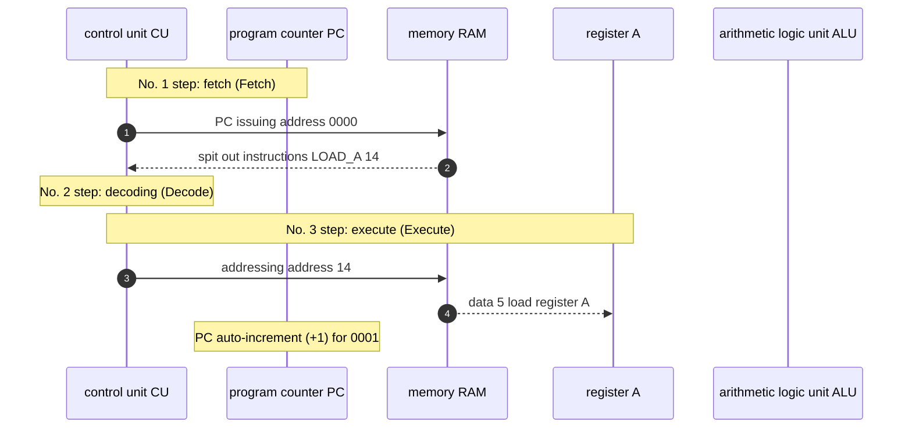

> **Course**: \[Computer Science Crash Course\] Crash Course Computer Science (PBS / All 40 episodes carefully revised)  
> **Module**: Module 1: Hardware & Architecture  
> **Keynote speaker**: Carrie Anne Philbin  
> **Video duration**: 10:36 ｜ **HD screenshots**: 4 blackboard writing/illustrations on core knowledge points  
> **Direct video**: [📺Watch the original video of this lecture on Bilibili (P8)](https://www.bilibili.com/video/BV1EW411u7th/?p=8)  
> **Full book navigation**: [← Previous lecture (P07)](/en/notes/cccs/lecture-07) ｜ [📚 Return to the full book catalog](/en/notes/topics/CCCS) ｜ [Next lecture (P09) →](/en/notes/cccs/lecture-09)

---

## Core Introduction and Concept Panorama

An in-depth discussion of the specification design of the Instruction Set Architecture (ISA), a detailed analysis of the entire execution process of data handling, arithmetic operations and conditional jump JUMP, and an explanation of how the concept of stored programs breeds a pure and powerful modern software ecosystem.

---

## 1. Instruction Set Architecture (ISA): the contract for the intersection of software and hardware

*(Reference time: 00:01:20 · [Video jump (P8 00:01:20)](https://www.bilibili.com/video/BV1EW411u7th/?p=8&t=80))*

Although the CPU has extremely strong electrical signal execution capabilities, if there are no clear external specifications to tell it what operations it supports, it is still just a pile of cold silicon crystals.

The entire set of instructions formulated by the hardware designer and directly understood and executed by the CPU is called **Instruction Set Architecture (ISA)**. ISA is the most important layer of software and hardware demarcation contract in the computer system:
- The upper-level compiler and programmers write instruction codes according to ISA specifications;
- The underlying chip microarchitecture is responsible for accurately materializing these instructions using transistor logic gates.

In a typical small teaching machine architecture, an instruction is spliced into two parts: 
`[ 4位 操作码 Opcode ] [ 4位 操作数/地址 Operand ]`
- `LOAD_A (0010)`: Load the data at the specified memory address into register A;
- `LOAD_B (0011)`: Load the data at the specified memory address into register B;
- `ADD (0100)`: Command ALU to add register A and register B, and store the result back to register A;
- `STORE_A (0101)`: Store the calculation result in register A into the specified memory address.

*⏱ Timestamp: 00:02:30 · 📷 Classroom screenshot · [Watch the corresponding clip on Bilibili (P8 00:02:30)](https://www.bilibili.com/video/BV1EW411u7th/?p=8&t=150)*

## 2. Track the continuous execution of a program

*(Reference time: 00:03:40 · [Video jump (P8 00:03:40)](https://www.bilibili.com/video/BV1EW411u7th/?p=8&t=220))*

Let's step through a basic addition program in virtual memory (calculate the addition of two values and save them):

| memory address | binary code | Assembly mnemonics | Semantic explanation |
|:---|:---|:---|:---|
| 0000 | 0010 1110 | `LOAD_A 14` | Read the value at address 14 into register A |
| 0001 | 0011 1111 | `LOAD_B 15` | Read the value at address 15 into register B |
| 0010 | 0100 0000 | `ADD` | ALU calculates A + B and stores the result in register A |
| 0011 | 0101 1101 | `STORE_A 13` | Write the sum of register A back to address 13 |
| 0100 | 1111 0000 | `HALT` | shutdown termination program |
| ... | ... | ... | ... |
| 1110 (14) | 0000 0101 | Data: 5 | Operand 1 to be operated on |
| 1111 (15) | 0000 0011 | Data: 3 | Operand 2 to be operated on |

#### Execution trace:
1. **T=0 clock**:PC=0, grab  `LOAD_A 14`. After execution, the number 5 at address 14 is firmly placed in register A;
2. **T=1 clock**:PC=1, grab  `LOAD_B 15`. After execution, the number 3 at address 15 is entered into register B;
3. **T=2 clock**:PC=2, grab  `ADD`. The control unit activates the addition path of the ALU and the writing end of the register A, and the content of the register A instantly jumps from 5 to 8;
4. **T=3 clock**:PC=3, grab  `STORE_A 13`. The data bus transfers 8 in register A to memory address 13 for storage;
5. **T=4 clock**:PC=4, grab  `HALT`, the clock generator stops oscillating, and the program is successfully executed.

*⏱ Timestamp: 00:04:45 · 📷 Classroom screenshot · [Watch the corresponding clip on Bilibili (P8 00:04:45)](https://www.bilibili.com/video/BV1EW411u7th/?p=8&t=285)*

## 3. Conditional jump (JUMP) and Turing-complete branch logic

*(Reference time: 00:06:10 · [Video jump (P8 00:06:10)](https://www.bilibili.com/video/BV1EW411u7th/?p=8&t=370))*

If the program can only flow sequentially from top to bottom, one by one, then it is nothing more than a step-by-step mechanical automatic music box. True intelligence is born in **Conditional judgment and branch jump**!

computers introduced  **JUMP instruction**: 
- **Unconditional jump (JUMP)**: The instruction operand directly specifies the target memory address. When executing, the control unit does not increment the PC by 1, but **Directly forcibly overwrite the operand address into the program counter PC**! When the next clock comes, the CPU will start fetching instructions from this new address, realizing a program jump;
- **Conditional jump (Conditional JUMP, such as JUMP\_IF\_NEGATIVE / JUMP\_IF\_ZERO)**: 
  - This instruction directly monitors the ALU status flag mentioned in the previous lecture!
  - For example  `JUMP_IF_NEGATIVE 4`: If the previous operation result is a negative number (negative flag bit N = 1), modify the PC to 4; if it is not negative (N = 0), ignore this instruction and the PC will increment normally.

#### Loops and infinite possibilities:
Using conditional jumps, we can implement high-level language functions on hardware with just three instructions.  `while`  cycle, `for`  Iterate well  `if-else`  Conditional branch! It is with this ability of self-testing results and dynamically deciding the next step that computers have crossed the threshold of Turing Completeness.

*⏱ Timestamp: 00:06:30 · 📷 Classroom screenshot · [Watch the corresponding clip on Bilibili (P8 00:06:30)](https://www.bilibili.com/video/BV1EW411u7th/?p=8&t=390)*

## 4. Stored program computers: The awakening of the concept of software

*(Reference time: 00:08:45 · [Video jump (P8 00:08:45)](https://www.bilibili.com/video/BV1EW411u7th/?p=8&t=525))*

In the ENIAC era, to change the computer to calculate another task, several female mathematicians had to manually unplug and plug thousands of jumper cables in front of hundreds of patch panels with wiring diagrams, which took days or even weeks. This cumbersome method was called **Hardwired Programming**.

In 1945, mathematician John von Neumann systematically elaborated on the core concept of the \*\*Stored-Program Computer\*\* in the famous "First Draft of the EDVAC Report":
- **Code is data**: There is no difference in physical form between instructions and data. They are both a string of binary bits composed of 0 and 1, and can be stored together in the same readable and writable RAM memory without any obstacles;
- **The birth of software**: To change the function of the computer, workers no longer need to disassemble the machine and rewire it. They only need to write a new piece of binary data to the memory!

Hardware has become the universal physical cornerstone, and software, the flow of instruction data flowing in the memory, has become the endless power that gives the machine an ever-changing soul.

*⏱ Timestamp: 00:09:00 · 📷 Classroom screenshot · [Watch the corresponding clip on Bilibili (P8 00:09:00)](https://www.bilibili.com/video/BV1EW411u7th/?p=8&t=540)*

---

## Attachment: Knowledge mind map and review thinking of this lecture

This lecture serves as  **Module 1: Hardware & Architecture**  As the core component of the system, the system connects the thinking leap from the underlying hardware physical switch, the middle layer abstract protocol to the upper layer application. It is recommended to combine the original video of Station B with the graphic guide of this lecture for repeated verification to understand the engineering trade-offs and inevitable logic behind technological evolution.

[← Previous lecture (P07)](/en/notes/cccs/lecture-07) ｜ [📚 Return to the full book catalog](/en/notes/topics/CCCS) ｜ [Next lecture (P09) →](/en/notes/cccs/lecture-09)
