> **Course**: \[Computer Science Crash Course\] Crash Course Computer Science (PBS / All 40 episodes carefully revised)  
> **Module**: Module 1: Hardware & Architecture  
> **Keynote speaker**: Carrie Anne Philbin  
> **Video duration**: 12:23 ｜ **HD screenshots**: 4 blackboard writing/illustrations on core knowledge points  
> **Direct video**: [📺Watch the original video of this lecture on Bilibili (P9)](https://www.bilibili.com/video/BV1EW411u7th/?p=9)  
> **Full book navigation**: [← Previous lecture (P08)](/en/notes/cccs/lecture-08) ｜ [📚 Return to the full book catalog](/en/notes/topics/CCCS) ｜ [Next lecture (P10) →](/en/notes/cccs/lecture-10)

---

## Core Introduction and Concept Panorama

Breaking through the clock bottleneck of early single-cycle microarchitectures, and in-depth analysis of instruction-level pipeline parallelism (Pipelining), pipeline hazard processing, dynamic branch prediction, superscalar out-of-order execution, and multi-level cache architecture.

---

## 1. Clock bottleneck of single-cycle processor and Amdahl’s law

*(Reference time: 00:01:10 · [Video jump (P9 00:01:10)](https://www.bilibili.com/video/BV1EW411u7th/?p=9&t=70))*

In the basic CPU built in the previous lecture, an instruction must completely go through the three stages of Fetch, Decode, and Execute before the next instruction can be started in the next clock cycle.

- **Critical Path Delay**: The time each instruction takes depends on which part of the pipeline takes the longest physical time (such as accessing slow external RAM). The intervals between clock pulses must be wide enough to wait for the level of the longest path to completely stabilize;
- **Resources idle and wasted**: While the ALU is performing an addition, the control unit's decoder and RAM addressing logic are all sitting around waiting.
In order to increase computing throughput several times without infinitely increasing the physical switching limit of silicon chips, computer architecture scientists launched a thrilling microarchitecture performance revolution.

*⏱ Timestamp: 00:02:40 · 📷 Classroom screenshot · [Watch the corresponding clip on Bilibili (P9 00:02:40)](https://www.bilibili.com/video/BV1EW411u7th/?p=9&t=160)*

## 2. Pipelining: laundry and factory assembly line metaphor

*(Reference time: 00:03:30 · [Video jump (P9 00:03:30)](https://www.bilibili.com/video/BV1EW411u7th/?p=9&t=210))*

The most classic idea to improve throughput is **Pipeline**.

- **laundry metaphor**: Cleaning a bucket of clothes requires four steps: washing (30 minutes), drying (40 minutes), ironing (20 minutes), and folding (10 minutes).
  - **Non-pipelined mode**: Wait until the first bucket of clothes has been washed, dried, ironed and folded (100 minutes) before placing the second bucket. It takes 400 minutes to wash four buckets of laundry!
  - **Pipeline mode**: After the first bucket of clothes is washed and moved into the dryer, the washing machine immediately puts the second bucket of clothes! When the assembly line is full, every longest single step (40 minutes), a bucket of washed clothes will be folded and baked!
- **Classic RISC five-stage pipeline**: 
  1. **IF (Instruction Fetch, Fetch)**
  2. **ID (Instruction Decode/Register Read, decoding/reading register)**
  3. **EX (Execute/Address Calculation, execution/effective address calculation)**
  4. **MEM (Memory Access, memory access)**
  5. **WB (Write Back, write back the result to the register)**

In an ideal state, the pipeline allows the processor to spit out a completed instruction in every clock cycle, making the number of instructions per instruction cycle (CPI, Cycles Per Instruction) close to the ideal value of 1!

```mermaid
gantt
    title Five-level instruction pipeline parallel timing (Instruction Pipelining)
    dateFormat X
    axisFormat clock %s
    section instructions 1
    fetch IF       :0, 1
    decoding ID       :1, 2
    execute EX       :2, 3
    Access MEM      :3, 4
    write back WB       :4, 5
    section instructions 2
    fetch IF       :1, 2
    decoding ID       :2, 3
    execute EX       :3, 4
    Access MEM      :4, 5
    write back WB       :5, 6
    section instructions 3
    fetch IF       :2, 3
    decoding ID       :3, 4
    execute EX       :4, 5
    Access MEM      :5, 6
    write back WB       :6, 7
```

*⏱ Timestamp: 00:05:00 · 📷 Classroom screenshot · [Watch the corresponding clip on Bilibili (P9 00:05:00)](https://www.bilibili.com/video/BV1EW411u7th/?p=9&t=300)*

## 3. Pipeline Hazards and Dynamic Branch Prediction

*(Reference time: 00:06:00 · [Video jump (P9 00:06:00)](https://www.bilibili.com/video/BV1EW411u7th/?p=9&t=360))*

The assembly line is not a free lunch. In actual operation, it will encounter three serious types of problems: **Pipeline Hazards**: 

1. **Structural Hazard**: Hardware resource conflict. For example, the instruction fetch component and the memory access component want to access the same memory bus at the same time;
2. **Data Hazard (RAW read-after-write)**: Instruction 2 needs to use the operation result of instruction 1, but instruction 1 has not reached the WB writeback stage, and instruction 2 is already trying to read the old data in the EX stage!
   - *Solution*: Insert a no-operation waiting bubble (Stall), or use **Bypass forwarding technology (Forwarding / Bypassing)**, directly short-circuit the output terminal of the ALU to the input terminal of the next clock;
3. **Control Hazard**: A conditional jump instruction was encountered! While the jump instruction is still executing, three subsequent instructions have been prefetched at the end of the pipeline. If a jump occurs when the condition is met, all three prefetched instructions are wrong, and the pipeline must be completely cleared (Pipeline Flush), resulting in a huge performance penalty.

#### Branch Predictor and Speculative Execution
To solve the control adventure, modern CPUs are equipped with extremely clever **branch predictor**: 
- Record historical statistics of loop jumps (for example, if a loop is executed 99 times, the predictor is 99% confident that it will still jump next time);
- Before the condition result is completely calculated, the CPU will ignore the situation and follow the predicted direction to speculatively execute (Speculatively Execute) the subsequent code in advance! If the guess is correct, the pipeline runs seamlessly; if the guess is wrong, the hardware cancels the temporary register modification and rolls back the pipeline. The accuracy of modern branch predictors has generally exceeded 98%!

*⏱ Timestamp: 00:07:15 · 📷 Classroom screenshot · [Watch the corresponding clip on Bilibili (P9 00:07:15)](https://www.bilibili.com/video/BV1EW411u7th/?p=9&t=435)*

## 4. Superscalar, out-of-order execution and multi-level cache system (Cache)

*(Reference time: 00:08:40 · [Video jump (P9 00:08:40)](https://www.bilibili.com/video/BV1EW411u7th/?p=9&t=520))*

In pursuit of ultimate computing power, modern processors further break through physical limitations:

#### 1. Superscalar multi-emission
If one pipeline is not enough, the chip is crammed into 4 or even 8 parallel pipelines! Four instructions are simultaneously fetched per clock cycle, and simultaneous decoding is assigned to different dedicated ALUs for execution (such as integer ALU, floating point FPU, vector SIMD unit).

#### 2. Out-of-Order Execution (OoO)
If instruction 2 is waiting for slow data, and the following instructions 3 and 4 have nothing to do with it, the CPU's scheduling engine will automatically skip instruction 2, first execute instructions 3 and 4, and finally submit the results in the \*\*Reorder Buffer (ROB)\*\* in the original program order.

#### 3. Memory wall and multi-level cache (Cache Hierarchy)
As CPU clock frequencies surge into gigahertz (GHz), the capacitor charge and discharge speed of external memory RAM cannot keep up, forming the famous "memory wall."
CPU designers integrated extremely fast SRAM cache into the core of the chip:
- **L1 Cache (level one cache)**: Separated into L1 data cache and L1 instruction cache, right under the nose of the computing core, with a clock cycle of 1~4 beats;
- **L2 Cache (second level cache)**: The capacity is slightly larger and the speed is slightly slower (about 10 beats);
- **L3 Cache (three-level shared cache)**: Shared by all CPU physical cores, usually several megabytes to tens of megabytes.
take advantage of **temporal locality** (The data just accessed will be accessed soon) and **spatial locality** (The adjacent data of the data just accessed will also be accessed immediately). The cache hit rate is usually as high as more than 95%, which prevents high-speed processors from being dragged to death by slow memory.

*⏱ Timestamp: 00:09:30 · 📷 Classroom screenshot · [Watch the corresponding clip on Bilibili (P9 00:09:30)](https://www.bilibili.com/video/BV1EW411u7th/?p=9&t=570)*

---

## Attachment: Knowledge mind map and review thinking of this lecture

This lecture serves as  **Module 1: Hardware & Architecture**  As the core component of the system, the system connects the thinking leap from the underlying hardware physical switch, the middle layer abstract protocol to the upper layer application. It is recommended to combine the original video of Station B with the graphic guide of this lecture for repeated verification to understand the engineering trade-offs and inevitable logic behind technological evolution.

[← Previous lecture (P08)](/en/notes/cccs/lecture-08) ｜ [📚 Return to the full book catalog](/en/notes/topics/CCCS) ｜ [Next lecture (P10) →](/en/notes/cccs/lecture-10)
