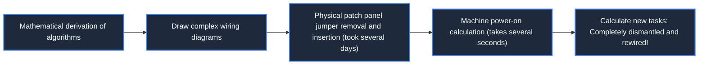

> **Course**: \[Computer Science Crash Course\] Crash Course Computer Science (PBS / All 40 episodes carefully revised)  
> **Module**: Module 2: Programming Language and Software Core (Software & Programming)  
> **Keynote speaker**: Carrie Anne Philbin  
> **Video duration**: 09:26 ｜ **HD screenshots**: 4 blackboard writing/illustrations on core knowledge points  
> **Direct video**: [📺Watch the original video of this lecture on Bilibili (P10)](https://www.bilibili.com/video/BV1EW411u7th/?p=10)  
> **Full book navigation**: [← Previous lecture (P09)](/en/notes/cccs/lecture-09) ｜ [📚 Return to the full book catalog](/en/notes/topics/CCCS) ｜ [Next lecture (P11) →](/en/notes/cccs/lecture-11)

---

## Core Introduction and Concept Panorama

Trace back the historical evolution of programming, from Jacquard Jacquard machines and ENIAC jumper boards to punched paper tape, magnetic tape and Altair 8800 front panel switches, and analyze how programming is decoupled from heavy physical wiring to elegant and pure symbolic art.

---

## 1. Pioneers of mechanical programming: Jacquard Jacquard machine and punched cards

*(Reference time: 00:01:10 · [Video jump (P10 00:01:10)](https://www.bilibili.com/video/BV1EW411u7th/?p=10&t=70))*

More than a century before the birth of computers, the idea of "programming" had quietly taken root in the textile industry.

In 1801, French inventor Joseph Marie Jacquard invented the revolutionary **Jacquard Loom**: 
- **physical mechanism**: A series of thick cardboards connected by ropes are hung above the Jacquard machine, with regular holes punched in the cardboard. The probe with the raised warp will be pressed against the cardboard: when it encounters a hole, the probe passes through and the corresponding warp is lifted; if there is no hole, the probe is blocked and the warp remains motionless.
- **epoch-making significance**: The weaver does not need to manually stir up thousands of complicated silk threads. He only needs to replace a string of punched cards, and the loom can automatically weave a complicated and gorgeous brocade!
This is the first time in human history **Abstract complex process steps into discrete physical drilling sequences (data and programs)**. Charles Babbage and Ada Lovelace drew inspiration from this and conceived the program input mechanism of the Analytical Engine.

*⏱ Timestamp: 00:01:30 · 📷 Classroom screenshot · [Watch the corresponding clip on Bilibili (P10 00:01:30)](https://www.bilibili.com/video/BV1EW411u7th/?p=10&t=90)*

## 2. The era of hard-wired logic: the physical wiring nightmare of plugboards

*(Reference time: 00:02:30 · [Video jump (P10 00:02:30)](https://www.bilibili.com/video/BV1EW411u7th/?p=10&t=150))*

When the first generation of electronic computers was invented, the word "software" had not even been invented. Programming was considered an extremely laborious and physically demanding job in electrical wiring at the time.

Take the famous ENIAC as an example:
- The machine itself has no concept of software, and all its adders, multipliers and registers are composed of huge independent cabinets;
- **Reconstruct physical circuits**: In order for ENIAC to calculate a new ballistic table, programmers (usually a team of extremely outstanding female mathematicians, such as Katherine Johnson, etc.) must first design an extremely large circuit timing diagram on scratch paper; then, holding hundreds of thick jumper cables, manually unplug and plug jumpers in front of the plugboards (Plugboards), and adjust hundreds of knobs and switches;
- **Time consuming comparison**: Rewiring programming usually requires the expenditure of  **days or weeks**, and after the wiring is completed, the machine is powered on and the calculation only takes a few seconds! Hardware idle time far exceeds working time.

*⏱ Timestamp: 00:02:40 · 📷 Classroom screenshot · [Watch the corresponding clip on Bilibili (P10 00:02:40)](https://www.bilibili.com/video/BV1EW411u7th/?p=10&t=160)*

## 3. Perforated paper tape and magnetic media: code carriers move towards the information age

*(Reference time: 00:05:15 · [Video jump (P10 00:05:15)](https://www.bilibili.com/video/BV1EW411u7th/?p=10&t=315))*

With the implementation of the von Neumann architecture and the concept of stored programs, instructions were stored in memory. However, every time the power is turned off, the data in the early memory (such as delay lines and magnetic cores) will be lost. How to store the program persistently?

Engineer invented **Punched Tape **with** Punch Cards**: 
- Each row of holes on the paper tape corresponds to a byte of machine instructions;
- The Optical Tape Reader uses a light source and a photosensitive sensor to scan and read hundreds of lines of punched data per second, and then pours it into the computer memory instantly;
- **Rigorous code physical test**: Programmers use a keypunch to punch cards line by line. There may be thousands of cards in a box. If you accidentally punch a wrong hole, the entire card will be invalid; if you accidentally drop a box of cards on the ground, you must manually pick them up one by one without row numbers, otherwise the entire program will crash!

*⏱ Timestamp: 00:05:30 · 📷 Classroom screenshot · [Watch the corresponding clip on Bilibili (P10 00:05:30)](https://www.bilibili.com/video/BV1EW411u7th/?p=10&t=330)*

## 4. Front Panel DIP Switches: Altair 8800 and the Age of Garage Hacking

*(Reference time: 00:07:30 · [Video jump (P10 00:07:30)](https://www.bilibili.com/video/BV1EW411u7th/?p=10&t=450))*

1975, the year that started the personal computer revolution  **Altair 8800**  Available. At that time, it had no keyboard or monitor, just a metal front panel covered with red LED indicators and Toggle Switches.

#### The ultimate hard core of DIP programming:
1. The programmer manually flips 16 address switches to specify the target memory address for writing (e.g.  `00000000`); 
2. Toggle 8 data switches to arrange the binary opcode of the current instruction (for example  `00111100`); 
3. Pull the "Single Step Deposit" spring switch, and the machine will forcefully write the 8-bit data into the memory unit;
4. The address is automatically incremented, and the programmer then dials the next line of instructions...
To enter a simple calculator program, the programmer would need to manually flip switches hundreds or thousands of times in succession, like playing a piano! But it was this pure experience of directly fighting with the machine's underlying binary electrical signals that ignited the boundless enthusiasm of early computer hackers such as Bill Gates and Paul Allen, and pushed them to write the first BASIC interpreter for Altair, kicking off the microcomputer software industry.

*⏱ Timestamp: 00:07:45 · 📷 Classroom screenshot · [Watch the corresponding clip on Bilibili (P10 00:07:45)](https://www.bilibili.com/video/BV1EW411u7th/?p=10&t=465)*

---

## Attachment: Knowledge mind map and review thinking of this lecture

This lecture serves as  **Module 2: Programming Language and Software Core (Software & Programming)**  As the core component of the system, the system connects the thinking leap from the underlying hardware physical switch, the middle layer abstract protocol to the upper layer application. It is recommended to combine the original video of Station B with the graphic guide of this lecture for repeated verification to understand the engineering trade-offs and inevitable logic behind technological evolution.

[← Previous lecture (P09)](/en/notes/cccs/lecture-09) ｜ [📚 Return to the full book catalog](/en/notes/topics/CCCS) ｜ [Next lecture (P11) →](/en/notes/cccs/lecture-11)
