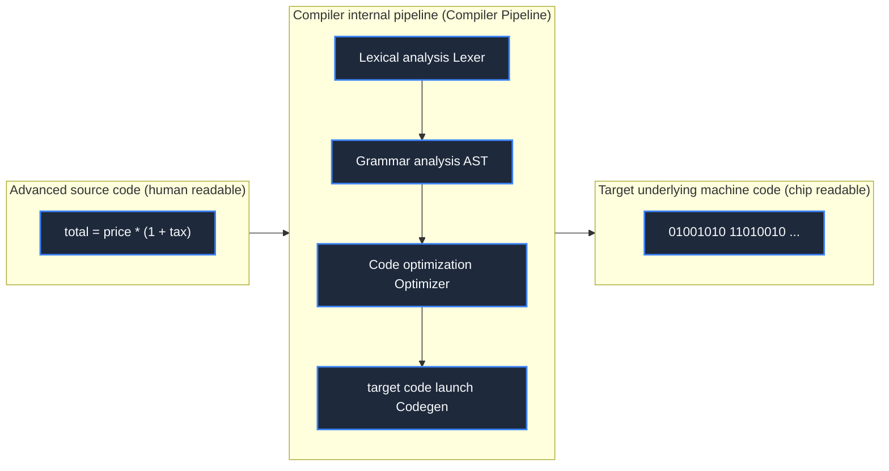

> **Course**: \[Computer Science Crash Course\] Crash Course Computer Science (PBS / All 40 episodes carefully revised)  
> **Module**: Module 2: Programming Language and Software Core (Software & Programming)  
> **Keynote speaker**: Carrie Anne Philbin  
> **Video duration**: 11:52 ｜ **HD screenshots**: 4 blackboard writing/illustrations on core knowledge points  
> **Direct video**: [📺Watch the original video of this lecture on Bilibili (P11)](https://www.bilibili.com/video/BV1EW411u7th/?p=11)  
> **Full book navigation**: [← Previous lecture (P10)](/en/notes/cccs/lecture-10) ｜ [📚 Return to the full book catalog](/en/notes/topics/CCCS) ｜ [Next lecture (P12) →](/en/notes/cccs/lecture-12)

---

## Core Introduction and Concept Panorama

Review the evolution of computer language from anti-human binary machine code to assembly language mnemonics, explain in detail Grace Hopper's great breakthrough in inventing the world's first compiler, and explore how early high-level languages such as FORTRAN and COBOL laid the foundation for modern software engineering.

---

## 1. The cognitive abyss of machine language and the dawn of assembly mnemonics

*(Reference time: 00:01:10 · [Video jump (P11 00:01:10)](https://www.bilibili.com/video/BV1EW411u7th/?p=11&t=70))*

In the early days of computers, programmers could only write directly **Machine Language**: 
`0010 1110 0011 1111 0100 0000 0101 1101 ...`
- Programmers must memorize complex operation code tables for each chip model in their heads;
- Once the program needs to insert a new instruction, hundreds or thousands of subsequent memory addresses must be recalculated and modified one by one. If a number is copied incorrectly, it will trigger a global avalanche.

#### Assembly Language: The birth of mnemonics
In order to save the sanity of human programmers, in the late 1940s, **assembly language** It came into being.
- **Mnemonics**: Replace cold numeric codes with short human abbreviations. For example, use  `LOAD`  Represents loading, `ADD`  represents addition, `JMP`  Represents jump;
- **Labels**: can be used  `LOOP:`  or  `SUM`  Instead of hard-coded physical memory absolute addresses;
- **Assembler**: is also a program whose sole task is to automatically scan assembly text and mechanically translate mnemonics and symbol labels one-to-one into pure binary 0/1 that can be recognized by the machine. Programmers' development efficiency instantly increases dozens of times!

*⏱ Timestamp: 00:02:30 · 📷 Classroom screenshot · [Watch the corresponding clip on Bilibili (P11 00:02:30)](https://www.bilibili.com/video/BV1EW411u7th/?p=11&t=150)*

## 2. Grace Hopper and the emergence of the compiler

*(Reference time: 00:04:40 · [Video jump (P11 00:04:40)](https://www.bilibili.com/video/BV1EW411u7th/?p=11&t=280))*

Although assembly language solves the problem of readability, it is still related to the specific hardware architecture. **Hardware Dependent**. The assembly code written for the Harvard Mark series is completely a pile of waste paper on UNIVAC; and the assembly language is still stuck in the low-level register and memory data transfer, and cannot directly express complex mathematical formulas.

At this time, a legendary woman in the history of computing appeared - U.S. Navy commodore and mathematician **Grace Hopper**.

Hopper proposed a fantasy that was dismissed as "fantasy" by most computer scientists at the time: **Why can't we write programs using vocabulary that is close to human daily English, and then let the computer compile these high-level vocabulary into machine instructions?**

Conservatives in the academic circles at the time mocked her: "A computer can do arithmetic, how can it possibly understand English words? It has no ability to think!"
Against all doubts, Hopper developed it on UNIVAC I in 1952 **The world's first compiler - A-0 system (Arithmetic Compiler)**!
- The compiler breaks through the rigid mapping of "one line of mnemonics corresponds to one line of machine code" in assembly language, and can automatically expand a high-level human description (such as "calculate the compound interest formula") into dozens of underlying microinstruction pipelines!
- Hopper later said: "I had a compiler that worked, but for the first three years no one wanted to use it. They felt that the compiled code was far less efficient than hand-written assembly. They didn't know that human time is far more valuable than computer time!"

*⏱ Timestamp: 00:05:30 · 📷 Classroom screenshot · [Watch the corresponding clip on Bilibili (P11 00:05:30)](https://www.bilibili.com/video/BV1EW411u7th/?p=11&t=330)*

## 3. The golden age of high-level languages: FORTRAN, ALGOL and COBOL

*(Reference time: 00:06:50 · [Video jump (P11 00:06:50)](https://www.bilibili.com/video/BV1EW411u7th/?p=11&t=410))*

The success of the compiler inspired an all-out explosion of high-level programming languages:

#### 1. FORTRAN (Formula Translator, 1957)
Developed by the team of legendary IBM engineer John Backus, the full name  **FORmula TRANslating System**.
- Specifically for scientists and mathematicians, it allows for the first time to directly write programs using algebraic formulas (such as  `X = (Y + Z) * 2`); 
- Equipped with an extremely powerful optimizing compiler, the generated machine code runs as fast as handwritten assembly, and has dominated aerospace, weather simulation, and nuclear fusion research for decades.

#### 2. COBOL (Common Business Language, 1959)
The language developed by Grace Hopper as a core consultant and jointly developed by all walks of life, the full name  **COmmon Business-Oriented Language**.
- For accounting in banks, insurance and commercial enterprises, the grammar is very close to natural English sentences (such as  `MULTIPLY HOURS BY HOURLY-RATE GIVING GROSS-PAY`); 
- It has strong fixed-point precision support and portability (the prototype of Write Once, Run Anywhere). To this day, there are still trillions of dollars of traditional financial and bank clearing systems around the world that silently run the core of COBOL back then!

#### 3. The blossoming branches of the tree of language
Subsequently, emphasizing the rigorous logic of algorithm description  **ALGOL(1958)**  Lay out the code block (`begin...end`) and the structured programming paradigm; John McCarthy invented the paradigm that symbolizes the origin of artificial intelligence and functional programming.  **LISP(1958)**. Computer science has finally gotten rid of the shackles of hardware scaffolding and has become an independent and magnificent discipline about abstract thinking and problem solving.

*⏱ Timestamp: 00:07:05 · 📷 Classroom screenshot · [Watch the corresponding clip on Bilibili (P11 00:07:05)](https://www.bilibili.com/video/BV1EW411u7th/?p=11&t=425)*

*⏱ Timestamp: 00:08:10 · 📷 Classroom screenshot · [Watch the corresponding clip on Bilibili (P11 00:08:10)](https://www.bilibili.com/video/BV1EW411u7th/?p=11&t=490)*

---

## Attachment: Knowledge mind map and review thinking of this lecture

This lecture serves as  **Module 2: Programming Language and Software Core (Software & Programming)**  As the core component of the system, the system connects the thinking leap from the underlying hardware physical switch, the middle layer abstract protocol to the upper layer application. It is recommended to combine the original video of Station B with the graphic guide of this lecture for repeated verification to understand the engineering trade-offs and inevitable logic behind technological evolution.

[← Previous lecture (P10)](/en/notes/cccs/lecture-10) ｜ [📚 Return to the full book catalog](/en/notes/topics/CCCS) ｜ [Next lecture (P12) →](/en/notes/cccs/lecture-12)
