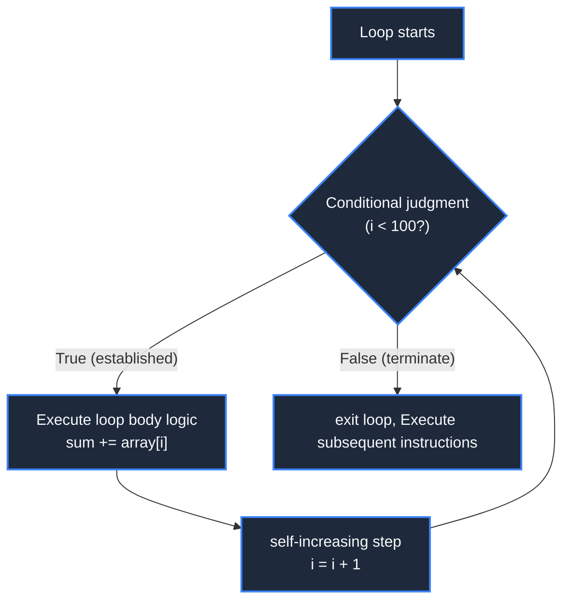

> **Course**: \[Computer Science Crash Course\] Crash Course Computer Science (PBS / All 40 episodes carefully revised)  
> **Module**: Module 2: Programming Language and Software Core (Software & Programming)  
> **Keynote speaker**: Carrie Anne Philbin  
> **Video duration**: 11:57 ｜ **HD screenshots**: 4 blackboard writing/illustrations on core knowledge points  
> **Direct video**: [📺Watch the original video of this lecture on Bilibili (P12)](https://www.bilibili.com/video/BV1EW411u7th/?p=12)  
> **Full book navigation**: [← Previous lecture (P11)](/en/notes/cccs/lecture-11) ｜ [📚 Return to the full book catalog](/en/notes/topics/CCCS) ｜ [Next lecture (P13) →](/en/notes/cccs/lecture-13)

---

## Core Introduction and Concept Panorama

The system dismantles the four atomic cornerstones of modern programming languages: variable symbol binding, IF conditional control branches, WHILE/FOR iteration loops, and the microscopic execution mechanism of function parameter call stack frames.

---

## 1. Variables: Putting human labels on memory

*(Reference time: 00:01:10 · [Video jump (P12 00:01:10)](https://www.bilibili.com/video/BV1EW411u7th/?p=12&t=70))*

In the underlying machine, data can only be hosted on something like  `0x7ffee4b2a1c0`  Such a semantically meaningless hexadecimal physical memory address.

High-level languages introduce the concept of variables:
- A variable is a name (symbol binding) given to a specific memory area. declare a variable  `int health = 100;`, the compiler will circle 4 bytes in the memory, write the binary with the initial value of 100, and remember the variable name  `health`  The corresponding mapping to the address;
- **Type Systems**: Instructs the compiler how much memory to use to store it, and how to interpret this string of 0/1 (whether it is interpreted as a complement integer, as an IEEE 754 floating point number, or as a character).


*⏱ Timestamp: 00:01:30 · 📷 Classroom screenshot · [Watch the corresponding clip on Bilibili (P12 00:01:30)](https://www.bilibili.com/video/BV1EW411u7th/?p=12&t=90)*

## 2. Control flow branching: IF-ELSE and logical bifurcation

*(Reference time: 00:02:40 · [Video jump (P12 00:02:40)](https://www.bilibili.com/video/BV1EW411u7th/?p=12&t=160))*

By default, the program is executed downstream from the first line, but the real business is full of uncertainties. \*\*Conditional Statements\*\* give the program the ability to think and make decisions:

```python
if player_health <= 0:
    print("Game Over")
    trigger_respawn()
else:
    continue_game()
```

- **Low-level hardware mapping**: The compiler will  `if`  Conditional translation learned in Lecture 5 **Comparison operation (CMP, perform subtraction update flag bit)**, followed by a lesson from Lecture 8 **Conditional jump instruction (JUMP\_IF\_FALSE)**. If the player's health is greater than 0, the CPU hardware will skip it directly.  `Game Over`  Code block, transferred to execution  `else`  branch.


*⏱ Timestamp: 00:02:55 · 📷 Classroom screenshot · [Watch the corresponding clip on Bilibili (P12 00:02:55)](https://www.bilibili.com/video/BV1EW411u7th/?p=12&t=175)*

## 3. Loop iteration: Use limited code to drive the machine to do billions of calculations

*(Reference time: 00:04:10 · [Video jump (P12 00:04:10)](https://www.bilibili.com/video/BV1EW411u7th/?p=12&t=250))*

The most awesome quality of a computer is that it never tires or makes mistakes while performing boring, repetitive operations.

The structure to implement repeated operations is **Loops**: 
- **WHILE loop**: As long as the given Boolean condition remains True, the code block in the loop body is executed over and over again;
- **Infinite Loop prevention**: The loop body must contain code that changes the state of the judgment condition (for example, the counter increments  `i = i + 1`), otherwise the program will fall into an infinite loop forever, exhausting CPU resources and causing the interface to become unresponsive and suspended;
- **FOR loop**: Syntactic sugar specifically for predefined times or set traversal, which highly condenses initialization, boundary judgment and auto-increment steps into one line of elegant expression.




*⏱ Timestamp: 00:04:20 · 📷 Classroom screenshot · [Watch the corresponding clip on Bilibili (P12 00:04:20)](https://www.bilibili.com/video/BV1EW411u7th/?p=12&t=260)*

## 4. Functions: Modularization and micro-execution of the call stack

*(Reference time: 00:06:40 · [Video jump (P12 00:06:40)](https://www.bilibili.com/video/BV1EW411u7th/?p=12&t=400))*

As programs expand to tens of thousands of lines, if all logic is written in one file, the code will become an unmaintainable "spaghetti mess." \*\*Functions/Subroutines\*\* came into being.

- **higher level abstraction**: Encapsulate a piece of code that performs a specific function, give it a clear name, and receive input **Parameters**, spit out after calculation **Return Value**; 
- **The Call Stack**:
When a function is called, the operating system allocates an independent area for the function in the "Stack" area of memory. **Stack Frame**, stores the passed actual parameters, local variables and after the function is executed **The return address where to jump back (Return Address)**;
Encountered after function execution  `return` , the stack frame is instantly popped and destroyed, the memory is returned to the system, and the CPU accurately jumps back to the caller's breakpoint to continue execution. Function encapsulation completely eliminates redundant and repeated code and becomes the basis for modular reuse in all modern software projects.


*⏱ Timestamp: 00:07:00 · 📷 Classroom screenshot · [Watch the corresponding clip on Bilibili (P12 00:07:00)](https://www.bilibili.com/video/BV1EW411u7th/?p=12&t=420)*

---

## Attachment: Knowledge mind map and review thinking of this lecture

This lecture serves as  **Module 2: Programming Language and Software Core (Software & Programming)**  As the core component of the system, the system connects the thinking leap from the underlying hardware physical switch, the middle layer abstract protocol to the upper layer application. It is recommended to combine the original video of Station B with the graphic guide of this lecture for repeated verification to understand the engineering trade-offs and inevitable logic behind technological evolution.

[← Previous lecture (P11)](/en/notes/cccs/lecture-11) ｜ [📚 Return to the full book catalog](/en/notes/topics/CCCS) ｜ [Next lecture (P13) →](/en/notes/cccs/lecture-13)
