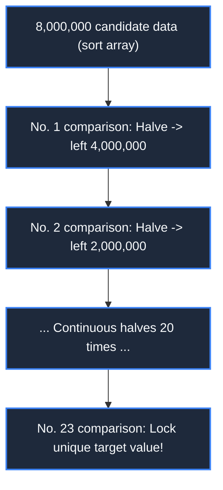

> **Course**: \[Computer Science Crash Course\] Crash Course Computer Science (PBS / All 40 episodes carefully revised)  
> **Module**: Module 2: Programming Language and Software Core (Software & Programming)  
> **Keynote speaker**: Carrie Anne Philbin  
> **Video duration**: 11:44 ｜ **HD screenshots**: 4 blackboard writing/illustrations on core knowledge points  
> **Direct video**: [📺Watch the original video of this lecture on Bilibili (P13)](https://www.bilibili.com/video/BV1EW411u7th/?p=13)  
> **Full book navigation**: [← Previous lecture (P12)](/en/notes/cccs/lecture-12) ｜ [📚 Return to the full book catalog](/en/notes/topics/CCCS) ｜ [Next lecture (P14) →](/en/notes/cccs/lecture-14)

---

## Core Introduction and Concept Panorama

In-depth analysis of the essential definition of algorithms, using the classic cases of search (linear vs bisection) and sorting (selection vs merge) as the starting point, systematically deduces the big O asymptotic time complexity system, revealing the dimensionality reduction impact of elegant algorithms compared to violent brute force calculations.

---

## 1. What is an algorithm? Start with recipes to solve problems

*(Reference time: 00:01:00 · [Video jump (P13 00:01:00)](https://www.bilibili.com/video/BV1EW411u7th/?p=13&t=60))*

The word \*\*Algorithm\*\* originated from the 9th century Persian mathematician Al-Khwarizmi.

The essence of the algorithm is: **A computational process consisting of a precise and limited series of rigorous operational steps in order to solve a specific type of problem.**.
Just like a recipe for baking a cake: the input is flour, sugar and eggs, and after clear and unambiguous steps such as mixing and baking, the final output is a delicious cake.

In the computer field, there are often hundreds or thousands of different algorithms for the same problem. Even though their output is completely correct and consistent, there is a huge difference in the time (CPU clock) and space (RAM memory) consumed!

*⏱ Timestamp: 00:01:30 · 📷 Classroom screenshot · [Watch the corresponding clip on Bilibili (P13 00:01:30)](https://www.bilibili.com/video/BV1EW411u7th/?p=13&t=90)*

## 2. Big PK of search algorithm: linear search vs binary search

*(Reference time: 00:02:15 · [Video jump (P13 00:02:15)](https://www.bilibili.com/video/BV1EW411u7th/?p=13&t=135))*

Suppose you search for a phone number named "John Smith" in a phone book containing 8 million people:

#### 1. Linear Search
- **Operation mode**: Start from the first line on page 1 of the phone book, and compare it one by one until you find it.
- **cost**: If the target is on the last line, or doesn't exist at all, you have to page through it 8 million times! If the amount of data expands to 8 billion, the browsing time will expand linearly in proportion.

#### 2. Binary Search
- **Prerequisites**:The phone book must be **Sorted alphabetically** Yes!
- **Operation mode**: Turn directly to page 4 million in the middle. If the middle name is "Miller," "Smith" must come after it in the alphabet, and the first 4 million pages are **Eliminated instantly and permanently**! Then continue to fold in half in the second half...
- **The miraculous power of mathematics**: For every comparison, the search space is cut in half! 
  $$\log_2(8,000,000) \approx 23$$
  **Requires up to 23 page flips**, you can lock the target among 8 million names! This is the dimensionality reduction strike of logarithmic efficiency versus linear brute force.

*⏱ Timestamp: 00:03:05 · 📷 Classroom screenshot · [Watch the corresponding clip on Bilibili (P13 00:03:05)](https://www.bilibili.com/video/BV1EW411u7th/?p=13&t=185)*

## 3. Big PK of sorting algorithms: selection sort vs merge sort

*(Reference time: 00:04:10 · [Video jump (P13 00:04:10)](https://www.bilibili.com/video/BV1EW411u7th/?p=13&t=250))*

Binary search requires that the data must be sorted first. How to sort a messy array?

#### 1. Selection Sort
- **Strategy**: Scan the entire array, find the smallest number, and exchange it with position 0; then scan the remaining numbers, find the next smallest number, and put it at position 1...
- **Performance evaluation**: for  $N$  elements, the total number of comparisons is: 
  $$(N-1) + (N-2) + \dots + 1 = \frac{N(N-1)}{2} \approx \frac{N^2}{2}$$
   When the data size increases 10 times, the computing time increases dramatically  **100 times**! Processing 1 million numbers would require 500 billion comparisons, and modern CPUs would be choked to death.

#### 2. Merge Sort and Divide and Conquer
Proposed by the master of mathematics von Neumann in 1945, the Divide and Conquer philosophy is adopted:
- Split the array into two and then into four, recursively split until each sub-array has only 1 element (1 element is naturally ordered!);
- Then bottom up **Two-way merge (Merge)**: Compare the heads of two ordered small arrays, whichever is smaller will fall into the new array first.
- **performance leap**: The split depth is  $\log N$, the merging time of each layer is  $N$, the total time complexity is only  **$O(N \log N)$**! Processing 1 million numbers requires only about 20 million operations, reducing the time taken from hours to a fraction of a second.

*⏱ Timestamp: 00:05:20 · 📷 Classroom screenshot · [Watch the corresponding clip on Bilibili (P13 00:05:20)](https://www.bilibili.com/video/BV1EW411u7th/?p=13&t=320)*

## 4. Asymptotic complexity and Big-O Notation (Big-O Notation)

*(Reference time: 00:06:50 · [Video jump (P13 00:06:50)](https://www.bilibili.com/video/BV1EW411u7th/?p=13&t=410))*

In order to horizontally and objectively evaluate the merits and demerits of algorithms, computer scientists broke away from specific computer hardware and running seconds and invented **Big-O Notation**:
it describes **With input size  $N$  When approaching infinity, the upper limit of the growth trend of time or space consumed by the algorithm**.

| complexity order | common name | Typical algorithm | scale  $N=100万$  Estimated steps in hours |
|:---|:---|:---|:---|
| **$O(1)$** | constant order | Array subscript addressing, hash table lookup | 1 time (completed instantly) |
| **$O(\log N)$** | Logarithmic order | Binary search, binary balanced tree retrieval | about 20 times |
| **$O(N)$** | linear order | Linear search, simple traversal | 1 million times |
| **$O(N \log N)$** | linear logarithmic order | Merge sort, quick sort (average) | About 20 million times (excellent) |
| **$O(N^2)$** | square order | Selection sort, bubble sort | 1 trillion times (extremely slow) |
| **$O(2^N)$** | Exponential order | Brute force cracking of all passwords and traveling salesman problem | The destruction of the universe is not complete |

Understanding Big O complexity is the watershed for programmers to transform from junior "code porters" to senior "architecture engineers".

*⏱ Timestamp: 00:07:00 · 📷 Classroom screenshot · [Watch the corresponding clip on Bilibili (P13 00:07:00)](https://www.bilibili.com/video/BV1EW411u7th/?p=13&t=420)*

---

## Attachment: Knowledge mind map and review thinking of this lecture

This lecture serves as  **Module 2: Programming Language and Software Core (Software & Programming)**  As the core component of the system, the system connects the thinking leap from the underlying hardware physical switch, the middle layer abstract protocol to the upper layer application. It is recommended to combine the original video of Station B with the graphic guide of this lecture for repeated verification to understand the engineering trade-offs and inevitable logic behind technological evolution.

[← Previous lecture (P12)](/en/notes/cccs/lecture-12) ｜ [📚 Return to the full book catalog](/en/notes/topics/CCCS) ｜ [Next lecture (P14) →](/en/notes/cccs/lecture-14)
