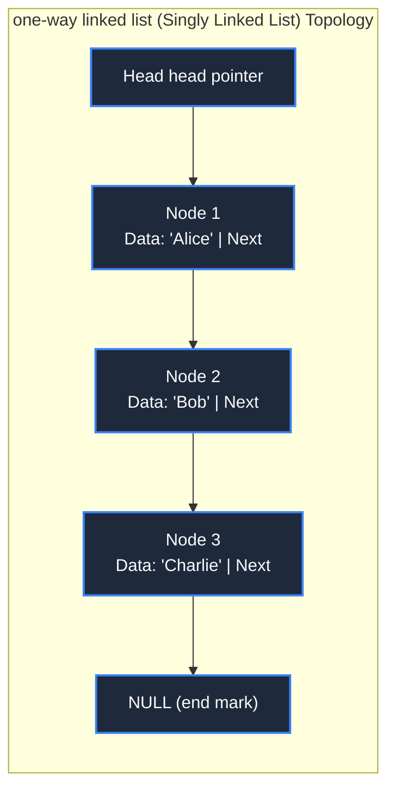

> **Course**: \[Computer Science Crash Course\] Crash Course Computer Science (PBS / All 40 episodes carefully revised)  
> **Module**: Module 2: Programming Language and Software Core (Software & Programming)  
> **Keynote speaker**: Carrie Anne Philbin  
> **Video duration**: 10:06 ｜ **HD screenshots**: 4 blackboard writing/illustrations on core knowledge points  
> **Direct video**: [📺Watch the original video of this lecture on Bilibili (P14)](https://www.bilibili.com/video/BV1EW411u7th/?p=14)  
> **Full book navigation**: [← Previous lecture (P13)](/en/notes/cccs/lecture-13) ｜ [📚 Return to the full book catalog](/en/notes/topics/CCCS) ｜ [Next lecture (P15) →](/en/notes/cccs/lecture-15)

---

## Core Introduction and Concept Panorama

In-depth analysis of the organizational skeleton of the programming world - data structure, from continuous memory arrays and pointer linked lists, to restricted linear list stacks and queues, to hierarchical binary trees and complex topological graph models, revealing the inherent symbiotic relationship between data topology and algorithm performance.

---

## 1. Array: extremely fast random access to physically continuous memory

*(Reference time: 00:00:45 · [Video jump (P14 00:00:45)](https://www.bilibili.com/video/BV1EW411u7th/?p=14&t=45))*

\*\*Data Structure\*\* is the way data is organized and stored in a computer. It determines the amount of resistance an algorithm has when accessing, inserting, and deleting data.

The most basic and commonly used data structure is **Array**: 
- **physical arrangement**: Allocate a section in memory **absolutely strictly continuous** physical space;
- **$O(1)$  Addressing formula**: Each element occupies a fixed number of bytes (e.g. 4 bytes). To access the  $i$  elements, the hardware does not need to traverse, only one arithmetic instruction is needed: 
  $$\text{Address}(A[i]) = \text{BaseAddress} + (i \times \text{ElementSize})$$
- **fatal weakness**: 
  1. The capacity is fixed and expansion is difficult (it must be moved entirely to a larger free memory);
  2. Intermediate insertion or deletion is extremely expensive (in order to make room for new elements, all subsequent elements must be shifted back one space as a whole, and the time complexity is as high as  $O(N)$).

*⏱ Timestamp: 00:00:50 · 📷 Classroom screenshot · [Watch the corresponding clip on Bilibili (P14 00:00:50)](https://www.bilibili.com/video/BV1EW411u7th/?p=14&t=50)*

## 2. Linked List: a dynamic free network woven with pointers

*(Reference time: 00:04:40 · [Video jump (P14 00:04:40)](https://www.bilibili.com/video/BV1EW411u7th/?p=14&t=280))*

In order to solve the pain of array expansion and relocation, engineers designed **Linked List**: 
- **Node structure**: Linked lists do not require continuous memory. Each node is scattered in any corner of the memory and contains two core fields:
  1. **Data domain**: Store real and useful business data;
  2. **Pointer field (Next Pointer)**: Store the physical address of the next node in memory.
- **Flexible insertion and deletion**: To insert a new node into the linked list, there is no need to translate any existing data, just point the Next pointer of the predecessor node to the new node, and the Next pointer of the new node points to the successor node. The time complexity is pleasing  **$O(1)$**!
- **exchange price**:lost  $O(1)$  Random access capability. If you want to read the 100th node, you must start from the head pointer (Head) and traverse one by one. The query time degrades to  $O(N)$.

*⏱ Timestamp: 00:05:00 · 📷 Classroom screenshot · [Watch the corresponding clip on Bilibili (P14 00:05:00)](https://www.bilibili.com/video/BV1EW411u7th/?p=14&t=300)*

## 3. Stack and Queue: Disciplined restricted linear tables

*(Reference time: 00:06:15 · [Video jump (P14 00:06:15)](https://www.bilibili.com/video/BV1EW411u7th/?p=14&t=375))*

In many real-life business scenarios, we do not allow arbitrary insertion or random reading, but need to strictly regulate the entry and exit discipline of data:

#### 1. Stack: LIFO, Last In First Out
- Like a tube of badminton or a stack of plates, the last plate put in is the first to be taken out;
- **core operations**: `push` (push to the top of the stack) and  `pop` (pop the top of the stack);
- **Application cornerstone**: Mentioned in Lecture 12 **function call stack**, browser **Back history button**, and the text editor's **Undo operation (Undo/Ctrl+Z)**!

#### 2. Queue: FIFO, First In First Out
- Like queuing up at a supermarket checkout, the first customer to check out and leave first;
- **core operations**: `enqueue` (The end of the queue joins the queue) and  `dequeue` (The leader of the team leaves the team);
- **Application cornerstone**: The task queue of the printer waiting to be printed, the packet buffer pool forwarded by the network router, and the multi-process ready scheduling queue of the operating system.

*⏱ Timestamp: 00:06:20 · 📷 Classroom screenshot · [Watch the corresponding clip on Bilibili (P14 00:06:20)](https://www.bilibili.com/video/BV1EW411u7th/?p=14&t=380)*

## 4. Tree and Graph: nonlinear high-dimensional topology modeling

*(Reference time: 00:07:30 · [Video jump (P14 00:07:30)](https://www.bilibili.com/video/BV1EW411u7th/?p=14&t=450))*

When the data relationship is no longer a one-dimensional sequence, but has hierarchical affiliation or mesh interconnection, we have entered the palace of non-linear data structures:

#### 1. Tree (Tree) and Binary Search Tree (BST)
- **Topology**: There is a unique root node (Root), each node can have zero or more child nodes (Children), and there are no loops between nodes;
- **Binary Search Tree**: Specifies that the values of all nodes in the left subtree are strictly less than the root node, and that the values of all nodes in the right subtree are strictly greater than the root node. It solidifies the essence of binary search in the topological structure, and the retrieval efficiency reaches the ideal  $O(\log N)$!
- **Real world application**: Directory tree file structure of the operating system, HTML web page document object model (DOM Tree).

#### 2. Graph: the network that connects everything
- By \*\*Vertices/Nodes **with connected vertices** Edges are composed of \*\*. Edges can be directed (directed graph) or assigned weights (weighted graph);
- **Real world application**: Urban road navigation on Amap/Google Maps (finding the shortest path Dijkstra algorithm), friend relationship graphs in social networks (six degrees of separation theory), and BGP topology routing between Internet routers.

**"Program = Algorithm + Data Structure"**——This famous saying by Turing Award winner Niklaus Wirth succinctly explains the entire meaning of software construction.

*⏱ Timestamp: 00:07:40 · 📷 Classroom screenshot · [Watch the corresponding clip on Bilibili (P14 00:07:40)](https://www.bilibili.com/video/BV1EW411u7th/?p=14&t=460)*

---

## Attachment: Knowledge mind map and review thinking of this lecture

This lecture serves as  **Module 2: Programming Language and Software Core (Software & Programming)**  As the core component of the system, the system connects the thinking leap from the underlying hardware physical switch, the middle layer abstract protocol to the upper layer application. It is recommended to combine the original video of Station B with the graphic guide of this lecture for repeated verification to understand the engineering trade-offs and inevitable logic behind technological evolution.

[← Previous lecture (P13)](/en/notes/cccs/lecture-13) ｜ [📚 Return to the full book catalog](/en/notes/topics/CCCS) ｜ [Next lecture (P15) →](/en/notes/cccs/lecture-15)
