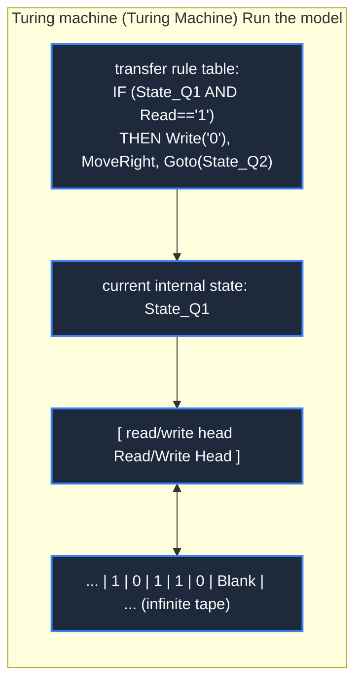

> **Course**: \[Computer Science Crash Course\] Crash Course Computer Science (PBS / All 40 episodes carefully revised)  
> **Module**: Module 2: Programming Language and Software Core (Software & Programming)  
> **Keynote speaker**: Carrie Anne Philbin  
> **Video duration**: 13:05 ｜ **HD screenshots**: 4 blackboard writing/illustrations on core knowledge points  
> **Direct video**: [📺Watch the original video of this lecture on Bilibili (P15)](https://www.bilibili.com/video/BV1EW411u7th/?p=15)  
> **Full book navigation**: [← Previous lecture (P14)](/en/notes/cccs/lecture-14) ｜ [📚 Return to the full book catalog](/en/notes/topics/CCCS) ｜ [Next lecture (P16) →](/en/notes/cccs/lecture-16)

---

## Core Introduction and Concept Panorama

In memory of the legendary life of Alan Turing, the father of computer science and artificial intelligence, it provides an in-depth analysis of the mathematical model of the Turing machine, the proof of undecidability of the halting problem, the historical achievements of deciphering Enigma in World War II, and the philosophical meaning of the Turing test.

---

## 1. The Father of Theoretical Computer Science: Alan Turing’s Thoughts of the Century

*(Reference time: 00:01:00 · [Video jump (P15 00:01:00)](https://www.bilibili.com/video/BV1EW411u7th/?p=15&t=60))*

Alan Mathison Turing (1912-1954) was the most dazzling genius mathematician, logician and codebreaker in the history of mankind in the 20th century.

In 1936, before any modern electronic computers were born, Turing, who was only 24 years old, proposed a thought experiment model that ran purely in thinking in his paper "On Computable Numbers and Their Application to Deterministic Problems" -**Turing Machine**. This extremely simple mathematical model laid an unshakable theoretical foundation for the entire computer science in one fell swoop.


*⏱ Timestamp: 00:01:50 · 📷 Classroom screenshot · [Watch the corresponding clip on Bilibili (P15 00:01:50)](https://www.bilibili.com/video/BV1EW411u7th/?p=15&t=110)*

## 2. Turing machine mathematical model: What is computability?

*(Reference time: 00:02:10 · [Video jump (P15 00:02:10)](https://www.bilibili.com/video/BV1EW411u7th/?p=15&t=130))*

A Turing machine consists of four extremely simple components:
1. **An infinitely extending paper tape (Tape)**: Divided into continuous small squares, each square can be printed with symbols (such as 0, 1) or remain blank, which is equivalent to unlimited capacity of memory;
2. **A read/write head (Read/Write Head)**: You can move left and right in a single step on the paper tape, read the symbols of the current grid, or erase and rewrite new symbols;
3. **A state register (State Register)**: Save the current internal state of the Turing machine (such as state A, state B, shutdown state);
4. **A set of fixed action transfer tables (Transition Table)**: Equivalent to procedural rules. It is stipulated that "in the current state, if the symbol X is read, do three things: rewrite the symbol as Y, move one space left/right, and change the internal state to the new state Z."

#### Church-Turing Thesis
Turing proved that: any complex modern supercomputer (no matter how many thousands of CPU cores and how much memory it has), all computing problems that it can solve mathematically are essentially **A simple Universal Turing Machine can calculate it exactly**!
A machine is called a Turing machine as long as it can simulate all the behaviors of a Turing machine. **Turing Complete**. This has become the highest criterion for measuring whether a programming language or hardware architecture has general computing capabilities.




*⏱ Timestamp: 00:06:10 · 📷 Classroom screenshot · [Watch the corresponding clip on Bilibili (P15 00:06:10)](https://www.bilibili.com/video/BV1EW411u7th/?p=15&t=370)*

## 3. The Halting Problem: The absolute boundary of computer computing power

*(Reference time: 00:05:40 · [Video jump (P15 00:05:40)](https://www.bilibili.com/video/BV1EW411u7th/?p=15&t=340))*

Can computers solve all mathematical problems in the world? Turing gave a world-shaking negative answer.

He proposed the famous **Halting Problem**: 
**Is there such a universal analysis program?  $H(P, I)$, it can review any program  $P$  and its input  $I$, and give the answer deterministically within a limited time: program  $P$  Will it eventually complete normal execution and stop (return True), or will it fall into an infinite loop and never stop (return False)?**

#### The beautiful proof by contradiction (diagonal method):
Suppose this universal analyzer  $H$  Really exists. We use it as the core to build an evil paradox program  `Bizarro(P)`: 
```python
def Bizarro(P):
    if H(P, P) == True: # 如果 H 断言程序 P 自审时会停机
        while True: pass # 那 Bizarro 偏偏故意进入死循环！
    else:               # 如果 H 断言程序 P 自审时会死循环
        return True     # 那 Bizarro 偏偏立刻停机退出！
```
Now, the ultimate question comes: **if we put  `Bizarro`  The program itself serves as input, feeding it itself to execute  `Bizarro(Bizarro)`, what will happen?**
1. if  $H$  assert  `Bizarro`  will shut down, then according to the code logic, `Bizarro`  Immediately enter an infinite loop and never stop——**$H$  The prediction was wrong**!
2. if  $H$  assert  `Bizarro`  There will be no downtime. According to the code logic, `Bizarro`  Stop and exit after execution is completed in an instant——**$H$  Wrong prediction again**!

No matter  $H$  Any prediction given will immediately lead to logical contradictions! Therefore: **A universal shutdown judgment program is mathematically impossible!**
 Turing used this to declare to all mankind: There is an undecidable boundary that can never be crossed between human reason and machine calculations.


*⏱ Timestamp: 00:09:00 · 📷 Classroom screenshot · [Watch the corresponding clip on Bilibili (P15 00:09:00)](https://www.bilibili.com/video/BV1EW411u7th/?p=15&t=540)*

## 4. The Legend of Bletchley Park and the Father of Artificial Intelligence

*(Reference time: 00:08:20 · [Video jump (P15 00:08:20)](https://www.bilibili.com/video/BV1EW411u7th/?p=15&t=500))*

#### 1. The cryptographic war to save the world (World War II and Enigma)
After the outbreak of World War II, Turing was recruited to join the top-secret intelligence agency Bletchley Park in the United Kingdom.
Faced with Nazi Germany's "Enigma" cipher machine, which had 150 billion possible key combinations and changed the codebook at midnight every day, Turing led the team to design and develop an electromechanical cryptanalysis machine——**Bombe**.
The Bombe machine simultaneously investigated conflicts through hundreds of high-speed rotating simulated rotors, and successfully deciphered the most confidential communications of the German submarine force. Historians recognize that the Turing team’s deciphering work ended World War II at least two years early, saving the precious lives of tens of millions of innocent civilians on the European battlefields!

#### 2. The Turing Test (1950)
After the war, Turing turned his attention to the nature of thinking and published his seminal paper "Computing Machinery and Intelligence", proposing the famous **Turing Test (Imitation Game)**:
Have a human referee talk to a machine and another person behind the scenes via a text terminal simultaneously. If the referee cannot accurately distinguish which is a machine and which is a real person, then the machine should be deemed to be "intelligent".

#### Tragedy and Eternal Glory
It is sad that such a superhero who saved civilization was convicted of "gross indecency" by a British court in 1952 due to the homophobic laws at the time, and was forced to undergo inhumane chemical castration treatment that destroyed the nervous system. Turing was found dead in his home on June 7, 1954, next to a bitten apple soaked in highly toxic cyanide. He was only 41 years old.

In honor of this undisputed giant, computer science’s highest honor is named **A.M. Turing Award**, known as the "Nobel Prize in the computer industry". Turing's ideological fire is still burning in every micro-architectural innovation and neuronal leap of large language models in human beings.


*⏱ Timestamp: 00:10:30 · 📷 Classroom screenshot · [Watch the corresponding clip on Bilibili (P15 00:10:30)](https://www.bilibili.com/video/BV1EW411u7th/?p=15&t=630)*

---

## Attachment: Knowledge mind map and review thinking of this lecture

This lecture serves as  **Module 2: Programming Language and Software Core (Software & Programming)**  As the core component of the system, the system connects the thinking leap from the underlying hardware physical switch, the middle layer abstract protocol to the upper layer application. It is recommended to combine the original video of Station B with the graphic guide of this lecture for repeated verification to understand the engineering trade-offs and inevitable logic behind technological evolution.

[← Previous lecture (P14)](/en/notes/cccs/lecture-14) ｜ [📚 Return to the full book catalog](/en/notes/topics/CCCS) ｜ [Next lecture (P16) →](/en/notes/cccs/lecture-16)
