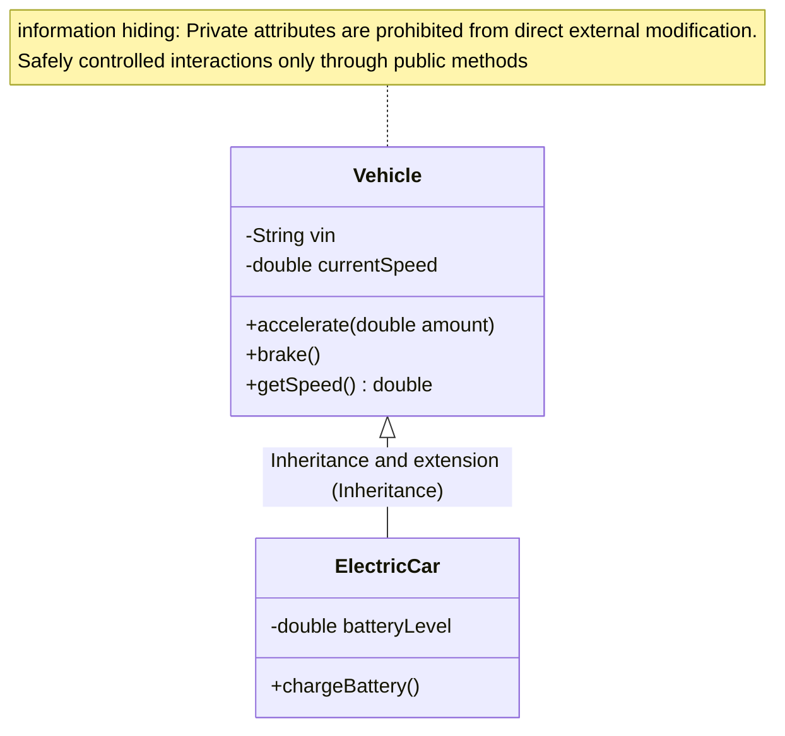

> **Course**: \[Computer Science Crash Course\] Crash Course Computer Science (PBS / All 40 episodes carefully revised)  
> **Module**: Module 2: Programming Language and Software Core (Software & Programming)  
> **Keynote speaker**: Carrie Anne Philbin  
> **Video duration**: 10:35 ｜ **HD screenshots**: 4 blackboard writing/illustrations on core knowledge points  
> **Direct video**: [📺Watch the original video of this lecture on Bilibili (P16)](https://www.bilibili.com/video/BV1EW411u7th/?p=16)  
> **Full book navigation**: [← Previous lecture (P15)](/en/notes/cccs/lecture-15) ｜ [📚 Return to the full book catalog](/en/notes/topics/CCCS) ｜ [Next lecture (P17) →](/en/notes/cccs/lecture-17)

---

## Core Introduction and Concept Panorama

Facing the evolution challenges of software engineering from personal scripts to industrial-level large-scale complex systems, it provides an in-depth analysis of the core principles of object-oriented encapsulation, API contract decoupling, version control (Git), unit testing and agile R&D systems.

---

## 1. Software Crisis and the Birth of the Industrialized Engineering Dimension

*(Reference time: 00:01:05 · [Video jump (P16 00:01:05)](https://www.bilibili.com/video/BV1EW411u7th/?p=16&t=65))*

A person can write a few hundred lines of gadgets, and the code can be whatever he wants; but when the scale of the software climbs to hundreds of thousands or millions of lines (such as 50 million lines of code in a modern operating system), and hundreds of engineers collaborate on the same project, disaster strikes:
- A programmer changed a value in a global variable, causing a module responsible for another team thousands of miles away to crash unexpectedly;
- No one dares to modify old code because no one knows which line of code hides a fatal dependency;
This is the famous "Software Crisis" that broke out in the 1960s.

In order to prevent large-scale software projects from becoming a bottomless quagmire of gold and failure, **Software Engineering **It came into being. It’s not about teaching you how to write clever one-liners;** Study how to organize specifications, team division of labor and architectural decoupling to enable extremely large and complex systems to be continuously and stably delivered iteratively** of industrial science.

*⏱ Timestamp: 00:01:20 · 📷 Classroom screenshot · [Watch the corresponding clip on Bilibili (P16 00:01:20)](https://www.bilibili.com/video/BV1EW411u7th/?p=16&t=80)*

## 2. Object-oriented programming (OOP): real-world mapping and information hiding

*(Reference time: 00:02:30 · [Video jump (P16 00:02:30)](https://www.bilibili.com/video/BV1EW411u7th/?p=16&t=150))*

In order to tame complexity, computer scientists proposed the Object-Oriented Programming (OOP) paradigm:
- **Object**:Associated \*\*data (property/status) **with the ability to perform operations on that data** Operation (method/function) \*\*Forcibly bundled and packaged in a box;
- **Class**: The blueprint or template of the object. For example, define a  `Car`  class, containing attributes  `speed`, `fuel`, and methods  `accelerate()`, `brake()`; 
- **Encapsulation and information hiding**: The microscopic data details inside the object (such as the specific engine revolutions) are completely hidden from the outside (Private), and the outside can only interact through the exposed public methods (Public Methods). This prevents the disaster of external code tampering with the internal state at will, and realizes the "everyone clears the door for themselves" of each module.

*⏱ Timestamp: 00:02:40 · 📷 Classroom screenshot · [Watch the corresponding clip on Bilibili (P16 00:02:40)](https://www.bilibili.com/video/BV1EW411u7th/?p=16&t=160)*

## 3. Application programming interface (API): a solid moat between systems

*(Reference time: 00:03:50 · [Video jump (P16 00:03:50)](https://www.bilibili.com/video/BV1EW411u7th/?p=16&t=230))*

In the development of a cruise control system for a large car, how do the teams responsible for radar sensing and the team responsible for throttle injection work together?
The answer is pass  **API (Application Programming Interface, application programming interface)**.

- **Interface Contract**: The radar team only needs to declare to the outside world: "As long as you call my  `get_distance_to_front_car()`  function, I promise to return you a floating point distance within 10 milliseconds";
- **Internal black boxing**: Whether the bottom layer of the radar team uses ultrasonic algorithms, lidar or infrared binocular ranging, the throttle team does not need to know at all, and they don't care at all!
As long as the API specification does not change, the radar team can reconstruct the optimization algorithm internally without causing destructive failures in other modules of the car. APIs build a solid moat that elegantly decouples software layers.

*⏱ Timestamp: 00:04:00 · 📷 Classroom screenshot · [Watch the corresponding clip on Bilibili (P16 00:04:00)](https://www.bilibili.com/video/BV1EW411u7th/?p=16&t=240)*

## 4. Modern software engineering tool flow: version control, testing and continuous integration

*(Reference time: 00:05:20 · [Video jump (P16 00:05:20)](https://www.bilibili.com/video/BV1EW411u7th/?p=16&t=320))*

The arsenal of modern professional software engineers has long gone beyond plain text editors:

1. **Integrated Development Environment (IDE)**: Such as VS Code and IntelliJ, which integrate code syntax highlighting, real-time static type checking, smart completion and underlying breakpoint single-step debugger;
2. **Version Control System (Git)**: Record historical snapshots of every change in each line of code. Hundreds of people can develop functions in parallel on their independent branches (Branches), and then review and merge (Merge/Pull Request), even if there is a failure, they can accurately roll back to any historical stable version in one second;
3. **Automated Testing**: 
   - **Unit Tests**: Write extreme value verification code for each independent function;
   - **Regression Testing**: Before each new function is submitted, the automated test suite frantically executes tens of thousands of test cases in the background to ensure that the newly added code does not secretly destroy existing old functions in dark corners;
4. **Continuous integration and deployment (CI/CD)**: The automated pipeline automatically pulls code, compiles, packages, tests and seamlessly launches it on the cloud server.

It is these sophisticated software engineering methodologies and tool chains that allow humans to confidently build incredible digital miracles such as modern aerospace flight control, autonomous driving, and global cloud infrastructure that contain tens of millions of lines of code.

*⏱ Timestamp: 00:05:30 · 📷 Classroom screenshot · [Watch the corresponding clip on Bilibili (P16 00:05:30)](https://www.bilibili.com/video/BV1EW411u7th/?p=16&t=330)*

---

## Attachment: Knowledge mind map and review thinking of this lecture

This lecture serves as  **Module 2: Programming Language and Software Core (Software & Programming)**  As the core component of the system, the system connects the thinking leap from the underlying hardware physical switch, the middle layer abstract protocol to the upper layer application. It is recommended to combine the original video of Station B with the graphic guide of this lecture for repeated verification to understand the engineering trade-offs and inevitable logic behind technological evolution.

[← Previous lecture (P15)](/en/notes/cccs/lecture-15) ｜ [📚 Return to the full book catalog](/en/notes/topics/CCCS) ｜ [Next lecture (P17) →](/en/notes/cccs/lecture-17)
