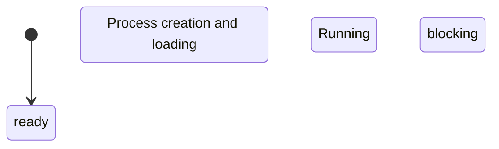

> **Course**: \[Computer Science Crash Course\] Crash Course Computer Science (PBS / All 40 episodes carefully revised)  
> **Module**: Module 3: System Architecture and Storage Media (Systems & Storage)  
> **Keynote speaker**: Carrie Anne Philbin  
> **Video duration**: 13:35 ｜ **HD screenshots**: 4 blackboard writing/illustrations on core knowledge points  
> **Direct video**: [📺Watch the original video of this lecture on Bilibili (P18)](https://www.bilibili.com/video/BV1EW411u7th/?p=18)  
> **Full book navigation**: [← Previous lecture (P17)](/en/notes/cccs/lecture-17) ｜ [📚 Return to the full book catalog](/en/notes/topics/CCCS) ｜ [Next lecture (P19) →](/en/notes/cccs/lecture-19)

---

## Core Introduction and Concept Panorama

Explore the evolution history of the operating system as the hub of hardware and application software, and explain in detail the hardware abstraction layer (HAL), device drivers, multi-program time-sharing rotation, virtual memory protection mechanism, and the modern system architecture philosophy established by Unix.

---

## 1. The pain points of program operation in the age of chaos and the birth of the operating system

*(Reference time: 00:01:05 · [Video jump (P18 00:01:05)](https://www.bilibili.com/video/BV1EW411u7th/?p=18&t=65))*

In the early computer era, the housekeeping software "operating system" did not exist.
Every programmer writes a program that must program directly to bare-metal hardware:
- The code must be hard-coded on how to use electrical signals to make a specific model of tape roll, and how to control the needle feed of a specific printer;
- A new printer was installed, and all printing functions in the entire program were invalidated and rewritten;
- The computer can only run one program at a time. After the program is executed and shut down, the computer is completely idle, waiting for manual replacement of the punched paper tape.

In order to eliminate this primitive chaos, the operating system (Operating System, OS) came into being. The operating system is the core software that is first loaded when the computer is turned on and resides in memory to control the highest privileges of the system. It acts as an omnipotent and grand middleman between application software and the underlying hardware.

*⏱ Timestamp: 00:02:00 · 📷 Classroom screenshot · [Watch the corresponding clip on Bilibili (P18 00:02:00)](https://www.bilibili.com/video/BV1EW411u7th/?p=18&t=120)*

## 2. Hardware Abstraction Layer (HAL) and Device Drivers

*(Reference time: 00:02:15 · [Video jump (P18 00:02:15)](https://www.bilibili.com/video/BV1EW411u7th/?p=18&t=135))*

The most important moat built by the operating system for upper-layer applications is **Hardware Abstraction Layer (HAL)**: 
- **Device Drivers**: Hardware manufacturers (such as HP and NVIDIA) write special drivers according to the standard interfaces established by the operating system. The driver is responsible for figuring out the specific electrical signal communication details;
- **Unified system calls (System Calls)**: Upper-layer software (such as Word or games) only needs to call the standard API exposed by the operating system: `print(document)`. Whether it's a laser printer, an inkjet printer, or a virtual PDF printer, the operating system is responsible for forwarding the calls to the corresponding driver. Applications are completely freed from the clutter of heterogeneous hardware.

*⏱ Timestamp: 00:04:10 · 📷 Classroom screenshot · [Watch the corresponding clip on Bilibili (P18 00:04:10)](https://www.bilibili.com/video/BV1EW411u7th/?p=18&t=250)*

## 3. Multiprogramming and CPU time-sharing scheduling

*(Reference time: 00:04:00 · [Video jump (P18 00:04:00)](https://www.bilibili.com/video/BV1EW411u7th/?p=18&t=240))*

Early computers were extremely expensive, and CPUs could run millions of times faster than mechanical peripherals (e.g., card readers, magnetic tapes). While a program waits to read a tape, millions of CPU clock ticks are meaninglessly idling.

operating system introduced **Multiprogramming and Time-Sharing Systems**: 
- **Process status switching**: When process A initiates slow I/O reading and writing, the scheduler of the operating system immediately intervenes, suspends process A and places it in the blocking queue, and at the same time schedules process B in the ready queue for rapid execution on the CPU;
- **Time slice rotation (Round-Robin)**: The operating system uses hardware timer interrupts to cut the CPU time into microsecond-level "Time Slices". Every ten milliseconds, the current program is forcibly interrupted and the next program is executed. Because the switching is so fast, to a human user it looks like the music player, web browser and code editor are running smoothly and concurrently at the same time!

*⏱ Timestamp: 00:06:20 · 📷 Classroom screenshot · [Watch the corresponding clip on Bilibili (P18 00:06:20)](https://www.bilibili.com/video/BV1EW411u7th/?p=18&t=380)*

## 4. Isolation of virtual memory and memory protection

*(Reference time: 00:06:10 · [Video jump (P18 00:06:10)](https://www.bilibili.com/video/BV1EW411u7th/?p=18&t=370))*

When multiple programs are crowded together in the same physical RAM memory, extremely dangerous security risks arise:
What if the game program has an infinite loop pointer that goes out of bounds, accidentally overwrites the memory of the banking software, or a malicious virus directly reads the password of another program?

Modern operating systems rely on internal CPU **Memory Management Unit (MMU)**, realized **Virtual Memory & Paging**: 
1. **Address space sandbox**: Each running process is deceptively given a contiguous and huge "virtual address space" (e.g. 4GB or higher). The process thinks that it monopolizes all the memory of the entire computer;
2. **Page Tables**: MMU is responsible for dynamically mapping virtual pages (Page) into discrete frames (Frame) of physical memory;
3. **Privilege level protection (Ring 0 vs Ring 3)**: A process is absolutely prohibited from accessing physical memory across the sandbox. If a program attempts to illegally spy on other processes or the core kernel area of the operating system, the CPU hardware directly triggers it in nanoseconds. **Page Fault / Segmentation Fault**, the operating system immediately forcibly kills the program without mercy! Other programs are completely uninterrupted.

*⏱ Timestamp: 00:09:30 · 📷 Classroom screenshot · [Watch the corresponding clip on Bilibili (P18 00:09:30)](https://www.bilibili.com/video/BV1EW411u7th/?p=18&t=570)*

## 5. Bell Labs Unix legend and modern operating system philosophy

*(Reference time: 00:09:20 · [Video jump (P18 00:09:20)](https://www.bilibili.com/video/BV1EW411u7th/?p=18&t=560))*

In 1969, on an idle PDP-7 minicomputer at Bell Labs, \*\*Ken Thompson **with** Dennis Ritchie\*\* teamed up to create the supreme monument of the modern operating system——**Unix**.

Unix has established an extremely profound and elegant system philosophy:
1. **Everything is a File**: Not only ordinary data are files, but also directories, hardware devices (such as keyboard, video memory), and even network sockets are all passable from the system's perspective.  `open`, `read`, `write`, `close`  Pure file streams for operations;
2. **Single responsibility and pipeline collaboration**: Each gadget only focuses on doing one thing to the extreme (such as  `cat`, `grep`, `sort`), through \*\* Pipe (Pipe  `|`)\*\* Seamlessly connect the output of the previous program to the input of the next program;
3. **C language rewriting system**: In order to allow Unix to be easily ported to other hardware architectures, Rich invented the system that takes into account both high-level abstraction and low-level hardware control.  **C language**. Unix became the first general-purpose operating system refactored in a high-level language.

Today, whether Apple’s macOS/iOS, Google’s Android, or the server ruler Linux, they all originate from or are deeply infiltrated into the core blood of Unix.

---

## Attachment: Knowledge mind map and review thinking of this lecture

This lecture serves as  **Module 3: System Architecture and Storage Media (Systems & Storage)**  As the core component of the system, the system connects the thinking leap from the underlying hardware physical switch, the middle layer abstract protocol to the upper layer application. It is recommended to combine the original video of Station B with the graphic guide of this lecture for repeated verification to understand the engineering trade-offs and inevitable logic behind technological evolution.

[← Previous lecture (P17)](/en/notes/cccs/lecture-17) ｜ [📚 Return to the full book catalog](/en/notes/topics/CCCS) ｜ [Next lecture (P19) →](/en/notes/cccs/lecture-19)
