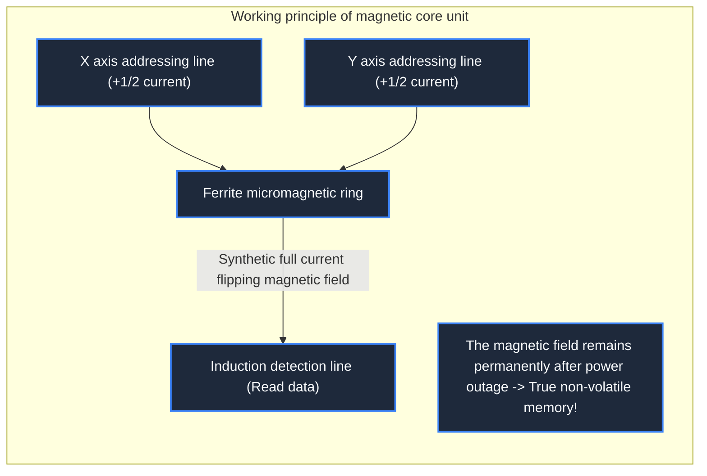

> **Course**: \[Computer Science Crash Course\] Crash Course Computer Science (PBS / All 40 episodes carefully revised)  
> **Module**: Module 3: System Architecture and Storage Media (Systems & Storage)  
> **Keynote speaker**: Carrie Anne Philbin  
> **Video duration**: 12:17 ｜ **HD screenshots**: 4 blackboard writing/illustrations on core knowledge points  
> **Direct video**: [📺Watch the original video of this lecture on Bilibili (P19)](https://www.bilibili.com/video/BV1EW411u7th/?p=19)  
> **Full book navigation**: [← Previous lecture (P18)](/en/notes/cccs/lecture-18) ｜ [📚 Return to the full book catalog](/en/notes/topics/CCCS) ｜ [Next lecture (P20) →](/en/notes/cccs/lecture-20)

---

## Core Introduction and Concept Panorama

Retracing the physical evolution of computer external storage and memory media, from mercury delay lines and magnetic core hand-woven mesh, to magnetic recording in mechanical hard drives HDD and modern NAND Flash solid-state electronic storage, we analyze the engineering trade-offs of the storage pyramid.

---

## 1. The fundamental distinction between volatile memory and non-volatile storage

*(Reference time: 00:01:00 · [Video jump (P19 00:01:00)](https://www.bilibili.com/video/BV1EW411u7th/?p=19&t=60))*

There is a natural physical tear in the computer's need for information preservation:
- **Memory (Primary Memory, such as RAM)**: The speed must be extremely fast to keep up with the nanosecond-level computing rhythm of the CPU, but it is \*\*volatile\*\* - as soon as the computer is unplugged and shut down, all the data inside it disappears instantly;
- **Storage media (Secondary Storage, such as hard disk, solid state)**: The speed is relatively slow, but it must be \*\*Non-Volatile\*\* - precious photos and programs will remain intact even after ten years of power outage.

In order to find the best medium that combines speed, capacity, durability and economic cost, physicists and engineers staged a seventy-year materials engineering epic.

*⏱ Timestamp: 00:02:20 · 📷 Classroom screenshot · [Watch the corresponding clip on Bilibili (P19 00:02:20)](https://www.bilibili.com/video/BV1EW411u7th/?p=19&t=140)*

## 2. Early wild black technology: delay lines and magnetic core memory

*(Reference time: 00:02:10 · [Video jump (P19 00:02:10)](https://www.bilibili.com/video/BV1EW411u7th/?p=19&t=130))*

#### 1. Mercury Delay Line, 1940s
In the early days of semiconductor RAM, engineers took advantage of **The physical properties of sound waves that are much slower than photoelectricity**:
A quartz piezoelectric crystal is placed at one end of a long metal tube filled with liquid mercury to convert binary electrical signals into high-frequency sound wave pulses that slowly travel through the mercury at 1450 m/s; the microphone at the other end receives the sound waves and converts them back into electrical signals, amplifies them, and then sends them back to the entrance for re-emission! Data is dynamically "temporarily stored" like echoes of sound waves swirling in water pipes. The disadvantages are that it is extremely heavy, highly toxic, and extremely sensitive to temperature.

#### 2. Magnetic Core Memory (1950s-1970s)
Perfected by Chinese-American physicists An Wang and Jay Forrester:
- It uses extremely small annular ferrite magnetic rings and weaves them through thin copper wires to form a huge grid;
- By passing a pulse current in the forward or reverse direction, the magnetic ring is magnetized into a clockwise or counterclockwise magnetic field, which locks in to represent 1 and 0 respectively;
- **Indestructible feats**: The magnetic core is not afraid of radiation or power outage, and it was used to successfully land on the moon with the Apollo 11 lunar landing computer (Apollo Guidance Computer). At that time, all magnetic core meshes were woven by female textile workers by hand-threading needles and threads under a microscope!

*⏱ Timestamp: 00:05:30 · 📷 Classroom screenshot · [Watch the corresponding clip on Bilibili (P19 00:05:30)](https://www.bilibili.com/video/BV1EW411u7th/?p=19&t=330)*

## 3. The miracle of rotating magnetism: Hard Disk Drive

*(Reference time: 00:07:30 · [Video jump (P19 00:07:30)](https://www.bilibili.com/video/BV1EW411u7th/?p=19&t=450))*

In 1956, IBM developed mankind's first commercial hard drive system——**IBM 305 RAMAC**: 
- It consists of 50 huge magnetized aluminum alloy discs up to 61 centimeters in diameter, weighing up to a ton and having to be moved with a forklift;
- The total storage capacity was extremely shocking at the time: **5 megabytes (5 MB)**!

#### Modern precision engineering of mechanical hard drives:
The platters of a modern HDD spin at high speeds of 5400 or 7200 rpm. A tiny electromagnetic read-write head floats just above the disk surface.  **A few nanometers**  On top of a micro-airflow air cushion (equivalent to a Boeing 747 flying at supersonic speeds half a centimeter close to the ground):
- **write**: The magnetic head electromagnetic coil instantly generates a microscopic polar magnetic field, arranging the tiny magnetic domains on the disk surface to the left or right;
- **read**: Utilizing the giant magnetoresistance effect (GMR), the magnetic head passes over the magnetic domain surface to induce resistance changes to read data;
HDD has brought storage costs to extremely low levels, and has long dominated the second storage throne in personal computers and data centers.

*⏱ Timestamp: 00:08:15 · 📷 Classroom screenshot · [Watch the corresponding clip on Bilibili (P19 00:08:15)](https://www.bilibili.com/video/BV1EW411u7th/?p=19&t=495)*

## 4. Solid-state electronics era: NAND Flash flash memory and storage pyramid

*(Reference time: 00:10:10 · [Video jump (P19 00:10:10)](https://www.bilibili.com/video/BV1EW411u7th/?p=19&t=610))*

Because mechanical hard disks must rely on the mechanical swing of the magnetic head arm to seek (Seek Time), the random read and write delay is as high as 5 to 10 milliseconds (ms), which is as slow as a snail in the face of nanosecond-level CPUs, and the drop and vibration can easily scratch the disk.

#### The rise of solid-state flash memory (NAND Flash/SSD)
Invented in the 1980s (Toshiba engineer Fujio Saoka):
- **All solid state without any mechanical parts**: Internally composed of micro floating-gate transistors (Floating-Gate Transistor). Through high-voltage quantum mechanical tunneling, electrons are forced into a "floating gate" trap that is completely blocked by a silicon dioxide insulating layer;
- Even if the power is completely cut off, the electrons trapped in the floating gate can be safely imprisoned for decades! Data can be read by detecting the level of the transistor conduction threshold voltage;
- Solid state drives (SSDs) reduce data seek latency to microseconds ($\mu s$) level, completely eliminating the mechanical rotation waiting for computer startup and loading.

#### Modern computer storage hierarchy pyramid (Memory Hierarchy)
From top to bottom:
1. **CPU registers**: Nanosecond level, capacity of dozens of bytes;
2. **CPU cache (L1-L3 Cache)**: A few nanoseconds, a capacity of several megabytes;
3. **Main memory (DRAM)**: tens of nanoseconds, tens of gigabytes of capacity;
4. **Solid State Drive (SSD)**: tens of microseconds, capacity of several terabytes (TB);
5. **Cloud and cold storage tapes**: Milliseconds to seconds, mass storage.
Computer architecture takes advantage of the subtle complementarity of speed and capacity at all levels to achieve unparalleled comprehensive computing performance within a limited budget.

*⏱ Timestamp: 00:10:30 · 📷 Classroom screenshot · [Watch the corresponding clip on Bilibili (P19 00:10:30)](https://www.bilibili.com/video/BV1EW411u7th/?p=19&t=630)*

---

## Attachment: Knowledge mind map and review thinking of this lecture

This lecture serves as  **Module 3: System Architecture and Storage Media (Systems & Storage)**  As the core component of the system, the system connects the thinking leap from the underlying hardware physical switch, the middle layer abstract protocol to the upper layer application. It is recommended to combine the original video of Station B with the graphic guide of this lecture for repeated verification to understand the engineering trade-offs and inevitable logic behind technological evolution.

[← Previous lecture (P18)](/en/notes/cccs/lecture-18) ｜ [📚 Return to the full book catalog](/en/notes/topics/CCCS) ｜ [Next lecture (P20) →](/en/notes/cccs/lecture-20)
