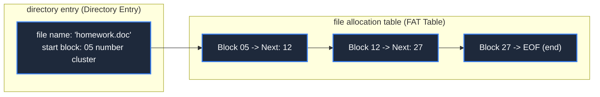

> **Course**: \[Computer Science Crash Course\] Crash Course Computer Science (PBS / All 40 episodes carefully revised)  
> **Module**: Module 3: System Architecture and Storage Media (Systems & Storage)  
> **Keynote speaker**: Carrie Anne Philbin  
> **Video duration**: 12:03 ｜ **HD screenshots**: 4 blackboard writing/illustrations on core knowledge points  
> **Direct video**: [📺Watch the original video of this lecture on Bilibili (P20)](https://www.bilibili.com/video/BV1EW411u7th/?p=20)  
> **Full book navigation**: [← Previous lecture (P19)](/en/notes/cccs/lecture-19) ｜ [📚 Return to the full book catalog](/en/notes/topics/CCCS) ｜ [Next lecture (P21) →](/en/notes/cccs/lecture-21)

---

## Core Introduction and Concept Panorama

Decrypt how the file system organizes the messy underlying storage sectors into a clear directory tree, and deeply explore file format abstraction, file allocation table (FAT), disk fragmentation causes and defragmentation, and Inode metadata architecture.

---

## 1. The nature of files: from continuous byte stream to semantic format

*(Reference time: 00:01:15 · [Video jump (P20 00:01:15)](https://www.bilibili.com/video/BV1EW411u7th/?p=20&t=75))*

From the perspective of the underlying storage hardware (such as a hard drive or SSD), the universe is just rows of numbered, empty 0 and 1 sectors. The hardware has no idea what an “essay” is, what “MP3 music” is, what a “selfie” is.

The abstraction that gives human meaning to this cold binary bit is called **File**: 
- **File Formats**: A structural agreement reached by both parties.
  - **Plain text file (.txt)**: Interpret each byte into human-readable text characters according to ASCII or UTF-8 encoding lookup table;
  - **Audio file (.wav)**: The file header first records the sampling rate (such as 44100Hz) and bit depth, and then each integer in turn represents the air pressure of the sound wave amplitude;
  - **Bitmap image (.bmp)**: The file header records the resolution length and width, and each subsequent 3 bytes represent the red (R), green (G), and blue (B) brightness of the pixel.
The file extension (.txt, .png) only provides a default opening method for the operating system desktop icon; what really determines the content of the file is its strict internal organizational specifications.

*⏱ Timestamp: 00:02:40 · 📷 Classroom screenshot · [Watch the corresponding clip on Bilibili (P20 00:02:40)](https://www.bilibili.com/video/BV1EW411u7th/?p=20&t=160)*

## 2. File allocation table (FAT) and chain storage mechanism

*(Reference time: 00:05:40 · [Video jump (P20 00:05:40)](https://www.bilibili.com/video/BV1EW411u7th/?p=20&t=340))*

When a file is larger than a single storage sector (such as 4KB), how is it distributed on the disk?

An early solution was **File Allocation Table (FAT)**: 
- The operating system opens a table (FAT table) in the head of the disk to record the status of each cluster (Cluster/Block);
- **Directory entry record metadata**: The folder itself is also a special file containing a list of files. Each file records its **File name, size, modification time, and its "Start Block" on disk**; 
- **Linked list jump tracking**: If the file is large, after the starting block is full, the entry of the block in the FAT table will record "the next block is in block No. 15"; when block No. 15 is read, the table will record "continue to block No. 42"; until a special event is encountered in the table  `EOF（End of File）`  mark, the file is considered completely read.

*⏱ Timestamp: 00:06:10 · 📷 Classroom screenshot · [Watch the corresponding clip on Bilibili (P20 00:06:10)](https://www.bilibili.com/video/BV1EW411u7th/?p=20&t=370)*

## 3. External fragmentation and disk defragmentation (Defragmentation)

*(Reference time: 00:08:10 · [Video jump (P20 00:08:10)](https://www.bilibili.com/video/BV1EW411u7th/?p=20&t=490))*

As users continue to create new files, modify old files, and delete unused downloads on their computers, disk space becomes riddled with holes:
- It is difficult to find a continuous blank sector to fill a large 100MB file at once. The file system can only tear it into eight pieces and stuff it into thousands of fragmentary holes.
- **seek disaster**: On a mechanical hard disk, reading a file means that the magnetic head must mechanically jump between the inner and outer rings of the disk like crazy hundreds of times. The computer becomes stuck and the sound of disk reading roars!
- **Defragmentation**: This led to the classic early "disk defragmentation" feature of Windows. The system is like playing Huarong Road, moving data blocks to temporary memory, compactly reorganizing all scattered files into a continuous arrangement, so that the magnetic head can read smoothly in one go.

*⏱ Timestamp: 00:08:50 · 📷 Classroom screenshot · [Watch the corresponding clip on Bilibili (P20 00:08:50)](https://www.bilibili.com/video/BV1EW411u7th/?p=20&t=530)*

## 4. Hierarchical file system directory tree and Inode index node

*(Reference time: 00:09:50 · [Video jump (P20 00:09:50)](https://www.bilibili.com/video/BV1EW411u7th/?p=20&t=590))*

In early systems, all files were stacked flatly in a flat root directory, and finding a file was like finding a needle in a haystack.

Modern operating systems introduce **Hierarchical Directory Tree**: 
- With the unique \*\* root directory (Root  `/`  or  `C:\`)\*\* as the source, branching out subdirectories and files downwards, forming a clear absolute path (Absolute Path) and relative path (Relative Path);
- **Unix Inode architecture (index node)**:
Modern Linux file systems (such as ext4) no longer use the inefficient FAT linked list, but allocate an independent  **Inode data block**:
Inode directly saves all permissions, owners, timestamps, and a set of files **Direct block pointer, indirect block pointer and third-level indirect block pointer**! Through multi-level index trees, the system can  $O(1)$  The time complexity of quickly addressing any offset position in a single very large file, even hundreds of GB in size, lays a solid foundation for databases and modern operating systems.

*⏱ Timestamp: 00:10:10 · 📷 Classroom screenshot · [Watch the corresponding clip on Bilibili (P20 00:10:10)](https://www.bilibili.com/video/BV1EW411u7th/?p=20&t=610)*

---

## Attachment: Knowledge mind map and review thinking of this lecture

This lecture serves as  **Module 3: System Architecture and Storage Media (Systems & Storage)**  As the core component of the system, the system connects the thinking leap from the underlying hardware physical switch, the middle layer abstract protocol to the upper layer application. It is recommended to combine the original video of Station B with the graphic guide of this lecture for repeated verification to understand the engineering trade-offs and inevitable logic behind technological evolution.

[← Previous lecture (P19)](/en/notes/cccs/lecture-19) ｜ [📚 Return to the full book catalog](/en/notes/topics/CCCS) ｜ [Next lecture (P21) →](/en/notes/cccs/lecture-21)
