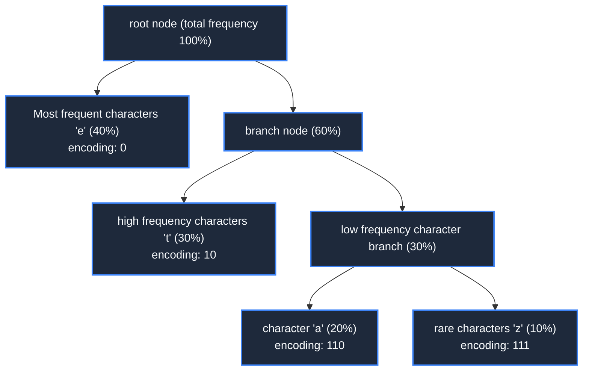

> **Course**: \[Computer Science Crash Course\] Crash Course Computer Science (PBS / All 40 episodes carefully revised)  
> **Module**: Module 3: System Architecture and Storage Media (Systems & Storage)  
> **Keynote speaker**: Carrie Anne Philbin  
> **Video duration**: 12:47 ｜ **HD screenshots**: 4 blackboard writing/illustrations on core knowledge points  
> **Direct video**: [📺Watch the original video of this lecture on Bilibili (P21)](https://www.bilibili.com/video/BV1EW411u7th/?p=21)  
> **Full book navigation**: [← Previous lecture (P20)](/en/notes/cccs/lecture-20) ｜ [📚 Return to the full book catalog](/en/notes/topics/CCCS) ｜ [Next lecture (P22) →](/en/notes/cccs/lecture-22)

---

## Core Introduction and Concept Panorama

Analyze the mathematics and perceptual theory of data compression, from lossless compression that eliminates statistical redundancy (run-length coding, Huffman trees), to lossy perceptual compression that deceives human senses (JPEG/MP3 psychology model), to temporally redundant motion prediction for video streaming.

---

## 1. Why compression? Shannon information theory and bandwidth bottleneck

*(Reference time: 00:01:10 · [Video jump (P21 00:01:10)](https://www.bilibili.com/video/BV1EW411u7th/?p=21&t=70))*

An uncompressed 4K Ultra HD wallpaper featuring  $3840 \times 2160$  pixels, each pixel requires 3 bytes (1 byte each for RGB) to record the color, and the volume of a single image is up to  **24.8 megabytes (MB)**; If it is a 2-hour 4K 60-frame movie, the amount of uncompressed raw data will reach an extremely staggering amount.  **10.7 terabytes (TB)**! No home broadband or mobile phone data can handle this torrent of data.

\*\*Data Compression\*\* is the most magical alchemy in computer science:
- Its mathematical basis was created by Claude Shannon in 1948 **Information Theory**; 
- Real-life data is filled with a large number of **Statistical redundancy **and useless information. The essence of compression is** Find more compact mathematical expressions without losing core information (or within a human-acceptable loss range)**.

The data compression community is divided into two distinct philosophical schools: **Lossless compression (Lossless)**  with  **Lossy compression (Lossy)**.

*⏱ Timestamp: 00:02:40 · 📷 Classroom screenshot · [Watch the corresponding clip on Bilibili (P21 00:02:40)](https://www.bilibili.com/video/BV1EW411u7th/?p=21&t=160)*

## 2. Lossless compression: run-length coding and Huffman prefix tree

*(Reference time: 00:02:30 · [Video jump (P21 00:02:30)](https://www.bilibili.com/video/BV1EW411u7th/?p=21&t=150))*

**Lossless Compression **Guarantee: decompressed data vs. original data** Identical at the binary bit level, exactly.**. Usually used for program installation packages (.zip), text code and databases.

#### 1. Run-Length Encoding (RLE)
The simplest lossless compression idea: counting consecutive repeated character sequences.
- Raw data: `WWWWWWWWWWWWBWWWWWWWWWWWWBBBWWWWWWWW`  (36 bytes)
- After RLE compression: `12W1B12W3B8W`  (11 bytes, a size reduction of nearly 70%!)
In simple binary fax telegrams or monochrome clip art, RLE works extremely well; but if you encounter random cluttered text, RLE will even make the size bloat.

#### 2. Huffman Coding and optimal prefix tree
In 1952, MIT graduate student David Huffman invented an epoch-making encoding algorithm:
- **core insights**: Why do all letters rigidly occupy 8 Bits? In an English novel, the letters  `'e'`  appears 12.7% of the time, while the letters  `'z'`  Only 0.07%!
- **variable length prefix code**: The more frequently a character appears, the shorter the binary code given to it (such as  `'e'`  Only 2 Bits are used: `01`); characters that appear very rarely are assigned longer codes (such as  `'z'`  Use 8 Bits: `11010011`); 
- **Huffman tree construction**: Count the frequency of occurrence of each character as a weight, and greedily merge the two smallest nodes from bottom to top to construct a binary tree. Starting from the root node, going left is 0 and going right is 1. Since the encoding of any character can never be a prefix of another character, no delimiters are needed during decoding, making it a great success in text and common ZIP/GZIP compression algorithms.

*⏱ Timestamp: 00:05:20 · 📷 Classroom screenshot · [Watch the corresponding clip on Bilibili (P21 00:05:20)](https://www.bilibili.com/video/BV1EW411u7th/?p=21&t=320)*

## 3. Lossy compression: perceptual engineering that deceives the human brain

*(Reference time: 00:06:30 · [Video jump (P21 00:06:30)](https://www.bilibili.com/video/BV1EW411u7th/?p=21&t=390))*

If you want to compress a landscape photo or a song, it is not only expensive but unnecessary to demand that every bit is accurate! Because human eyes and ears are extremely rough sensory organs with a large number of physiological blind spots.

**Lossy Compression **Decisively throw away those human organs** Redundant information that is not noticeable at all**: 

#### 1. Psychoacoustics and MP3 Audio Compression
- The frequency limit that the human ear can hear is 20Hz ~ 20,000Hz. MP3 directly and violently cuts off high-frequency ultrasonic waves above 20kHz;
- **Auditory Masking**: At the moment when a heavy heavy metal snare drum sound (high-energy and loud) sounds in rock music, the extremely subtle guitar noise in the adjacent frequency band cannot be heard by the human brain at all! The MP3 algorithm keenly identifies these masked sounds and directly deletes them all!
MP3 reduces the size of the original lossless audio by a full  **10 times**, while ordinary people wearing headphones can hardly hear the slightest difference.

#### 2. Human eye color space and JPEG image compression
- There are far more rod photoreceptor cells (sensitive to light and dark) than cone photoreceptor cells (sensitive to color) in the human retina - humans are extremely sensitive to changes in brightness, but extremely slow to small transitions in color!
- JPEG first converts the RGB color space to  **YCbCr** (Brightness Y, Chroma Cb/Cr), followed by Chroma  $4:2:0$  Downsampling (the resolution is directly halved and discarded); then the discrete cosine transform (DCT) is used to convert the image from the spatial domain to the frequency domain, and quantitatively truncate the high-frequency coefficients representing microscopic noise. Eventually a 20MB photo was compressed into 2MB, promoting a comprehensive explosion of digital photography and social networking around the world.

*⏱ Timestamp: 00:07:35 · 📷 Classroom screenshot · [Watch the corresponding clip on Bilibili (P21 00:07:35)](https://www.bilibili.com/video/BV1EW411u7th/?p=21&t=455)*

## 4. Temporal redundancy and motion compensation in video streaming

*(Reference time: 00:09:10 · [Video jump (P21 00:09:10)](https://www.bilibili.com/video/BV1EW411u7th/?p=21&t=550))*

Video is essentially dozens of still images flashed by one second in succession. However, between adjacent frames in movies, there is often almost no change in the background (for example, a news anchor is talking, only the lips are moving, and the studio background behind is completely still for tens of seconds).

Modern video coding standards (such as H.264, HEVC/H.265, AV1) introduced **Temporal redundancy compression (Inter-frame Compression)**: 
- **I frame (Intra-frame / key frame)**: Complete, stand-alone static JPEG image with all details;
- **P frame (Predicted-frame / forward prediction frame)**: Does not save the complete picture, only records relative to the previous frame **Displaced motion vectors (Motion Vectors) and tiny pixel residuals**; 
- **B frame (Bi-directional/bi-directional predictive frame)**: Refer to both the previous frame and the next frame for forward and backward interpolation estimation.

Through this extreme compression of "transmitting only the changed amount", an uncompressed Blu-ray movie that was originally hundreds of GB can be compressed to only a few megabits of bandwidth and can be played smoothly in 4K quality on Bilibili or streaming media platforms, completely reshaping the spread of modern human cultural entertainment.

*⏱ Timestamp: 00:09:45 · 📷 Classroom screenshot · [Watch the corresponding clip on Bilibili (P21 00:09:45)](https://www.bilibili.com/video/BV1EW411u7th/?p=21&t=585)*

---

## Attachment: Knowledge mind map and review thinking of this lecture

This lecture serves as  **Module 3: System Architecture and Storage Media (Systems & Storage)**  As the core component of the system, the system connects the thinking leap from the underlying hardware physical switch, the middle layer abstract protocol to the upper layer application. It is recommended to combine the original video of Station B with the graphic guide of this lecture for repeated verification to understand the engineering trade-offs and inevitable logic behind technological evolution.

[← Previous lecture (P20)](/en/notes/cccs/lecture-20) ｜ [📚 Return to the full book catalog](/en/notes/topics/CCCS) ｜ [Next lecture (P22) →](/en/notes/cccs/lecture-22)
