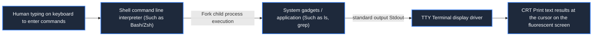

> **Course**: \[Computer Science Crash Course\] Crash Course Computer Science (PBS / All 40 episodes carefully revised)  
> **Module**: Module 4: Human-computer interaction and graphics rendering (User Interface & Graphics)  
> **Keynote speaker**: Carrie Anne Philbin  
> **Video duration**: 11:23 ｜ **HD screenshots**: 4 blackboard writing/illustrations on core knowledge points  
> **Direct video**: [📺Watch the original video of this lecture on Bilibili (P22)](https://www.bilibili.com/video/BV1EW411u7th/?p=22)  
> **Full book navigation**: [← Previous lecture (P21)](/en/notes/cccs/lecture-21) ｜ [📚 Return to the full book catalog](/en/notes/topics/CCCS) ｜ [Next lecture (P23) →](/en/notes/cccs/lecture-23)

---

## Core Introduction and Concept Panorama

Looking back on the early evolution of human-computer interaction interfaces, from the QWERTY mechanical layout of typewriters, Teletype, to the efficient human-computer dialogue paradigm of glass terminal VT100 and Unix command line (CLI).

---

## 1. The heavy quagmire of early human-computer interaction and the inheritance of typewriters

*(Reference time: 00:01:10 · [Video jump (P22 00:01:10)](https://www.bilibili.com/video/BV1EW411u7th/?p=22&t=70))*

In the 1950s, human-computer communication was extremely counterintuitive:
The user uses the program to punch holes line by line on the card punching machine, and hands the thick stack of cards to the operator in a white coat; the operator queues up to feed the cards into the card reader, the computer performs batch calculations at night, and the next morning the printer spits out a bunch of cold calculation reports on a long folded paper. If you type one wrong comma in the middle, a whole 24 hours can be wasted.

Lack of real-time two-way communication between man and machine **Real-time interaction (Interactive Computing)**.
In order to break the deadlock, engineers turned to office equipment that was already very mature in the 19th century——**Mechanical typewriter (Typewriter)**.

- **The origin of the QWERTY keyboard**: Designed by Christopher Sholes in the 1870s. If the early mechanical typewriters pressed the keys too fast, the metal arms that mechanically struck adjacent letters could easily get stuck in mid-air. Shores deliberately placed the most commonly used adjacent letters in the English language (e.g.  `T`  and  `H`, `E`  and  `R`) are physically distributed at both ends of the keyboard, deliberately slowing down the typist's alternation of hands to prevent key jams. This key layout, which originated from the compromise of mechanical anti-jamming, has become the standard that has dominated modern human digital input for a century and a half.

*⏱ Timestamp: 00:03:20 · 📷 Classroom screenshot · [Watch the corresponding clip on Bilibili (P22 00:03:20)](https://www.bilibili.com/video/BV1EW411u7th/?p=22&t=200)*

## 2. Teletype: tapping conversations across distances

*(Reference time: 00:05:10 · [Video jump (P22 00:05:10)](https://www.bilibili.com/video/BV1EW411u7th/?p=22&t=310))*

The combination of typewriter and telegraph technology gave birth to **Teletype/TTY**: 
- The user types a character on the keyboard, and the electromechanical device encodes the keystroke into a specific ASCII serial current pulse and sends it out;
- The motor at the receiving end drives the character wheel to directly print the corresponding character shapes on the white paper of the roller.

The computer engineer keenly connected TTY to the serial port of the computer:
- The user types a line of code or command, and the computer receives it word for word;
- After completing the calculation, the computer sent the result back to the teletype machine through the serial port, printing it on the paper tape with a deafening crackling sound. For the first time, human beings have experienced the pleasure of instant interaction of "asking a question and answering a question"!
This is why the Linux terminal device name remains today  **`tty`** (such as  `/dev/tty1`) century-old historical relics.

*⏱ Timestamp: 00:05:30 · 📷 Classroom screenshot · [Watch the corresponding clip on Bilibili (P22 00:05:30)](https://www.bilibili.com/video/BV1EW411u7th/?p=22&t=330)*

## 3. Popularization of Glass TTY and terminal consoles

*(Reference time: 00:07:20 · [Video jump (P22 00:07:20)](https://www.bilibili.com/video/BV1EW411u7th/?p=22&t=440))*

Although the teletype machine was convenient, it was extremely wasteful of paper, the mechanical printing speed was extremely slow (it could only spit out a dozen characters per second), and the mechanical noise was deafening.

By the 1970s, the cost of cathode ray tube (CRT) screen technology had plummeted. Engineers immediately replaced the paper roll with a fluorescent screen, creating what was nicknamed the "Glass TTY" video terminal (such as DEC's classic  **VT100**): 
- The screen can display 80 columns at a time  $\times$  24 lines of bright green or amber characters;
- The cursor flashes cheerfully on the screen to remind the user that it is currently waiting for input;
- Characters are displayed instantly without any mechanical delay. Human-computer interaction has officially entered the era of pure optoelectronics.

*⏱ Timestamp: 00:07:30 · 📷 Classroom screenshot · [Watch the corresponding clip on Bilibili (P22 00:07:30)](https://www.bilibili.com/video/BV1EW411u7th/?p=22&t=450)*

## 4. Command Line Interface (CLI): The ultimate power in minimalist text

*(Reference time: 00:08:35 · [Video jump (P22 00:08:35)](https://www.bilibili.com/video/BV1EW411u7th/?p=22&t=515))*

With the birth of video terminals, Command Line Interface (CLI) has become the core paradigm governing human-computer interaction:
- The user is faced with a streamlined prompt (e.g.  `$`  or  `>`), type clear instructions (e.g.  `cd /var/log`, `grep "error" app.log`); 
- **Standard input and output redirection (Redirection  `<`  with  `>`)**: You can direct the output of any program to a file, or through a pipe  `|`  Connect a huge automated assembly line in series.

Although graphical interfaces subsequently swept the mass consumer market, in the eyes of system administrators, software developers, cloud computing architects, and hackers, CLI has always been the ultimate productivity blade with the fastest response, the highest degree of automation, and the most precise expression in the world of computing power.

*⏱ Timestamp: 00:08:45 · 📷 Classroom screenshot · [Watch the corresponding clip on Bilibili (P22 00:08:45)](https://www.bilibili.com/video/BV1EW411u7th/?p=22&t=525)*

---

## Attachment: Knowledge mind map and review thinking of this lecture

This lecture serves as  **Module 4: User Interface & Graphics**  As the core component of the system, the system connects the thinking leap from the underlying hardware physical switch, the middle layer abstract protocol to the upper layer application. It is recommended to combine the original video of Station B with the graphic guide of this lecture for repeated verification to understand the engineering trade-offs and inevitable logic behind technological evolution.

[← Previous lecture (P21)](/en/notes/cccs/lecture-21) ｜ [📚 Return to the full book catalog](/en/notes/topics/CCCS) ｜ [Next lecture (P23) →](/en/notes/cccs/lecture-23)
