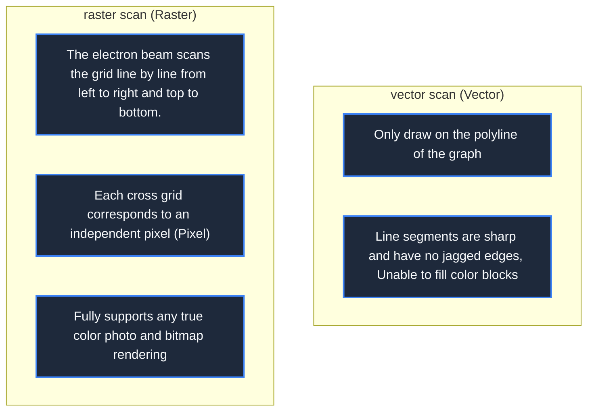

> **Course**: \[Computer Science Crash Course\] Crash Course Computer Science (PBS / All 40 episodes carefully revised)  
> **Module**: Module 4: Human-computer interaction and graphics rendering (User Interface & Graphics)  
> **Keynote speaker**: Carrie Anne Philbin  
> **Video duration**: 11:31 ｜ **HD screenshots**: 4 blackboard writing/illustrations on core knowledge points  
> **Direct video**: [📺Watch the original video of this lecture on Bilibili (P23)](https://www.bilibili.com/video/BV1EW411u7th/?p=23)  
> **Full book navigation**: [← Previous lecture (P22)](/en/notes/cccs/lecture-22) ｜ [📚 Return to the full book catalog](/en/notes/topics/CCCS) ｜ [Next lecture (P24) →](/en/notes/cccs/lecture-24)

---

## Core Introduction and Concept Panorama

Revealing the evolution of hardware technology from plain text to graphic images, it explains in detail how the physical structure of the CRT cathode ray tube, character generation ROM, vector graphics display, and framebuffer (Framebuffer) create the cornerstone of modern 2D bitmap graphics.

---

## 1. Cathode Ray Tube (CRT): From Physical Photons to Screen Display

*(Reference time: 00:01:10 · [Video jump (P23 00:01:10)](https://www.bilibili.com/video/BV1EW411u7th/?p=23&t=70))*

Today, when liquid crystals (LCDs) and OLEDs dominate the world, the first impression the older generation has of a computer screen is that it looks like a giant glass box. **Cathode Ray Tube (CRT)**.

#### The microphysical working mechanism of CRT:
1. **Electron Gun**: Located at the end of the vacuum tube, the cathode filament is heated by electricity to release a large number of high-energy electrons;
2. **Focus and Deflection Coils**: A high-voltage electric field gathers electrons into a high-speed electron beam as thin as a hair. Two sets of orthogonal electromagnets (deflection coils) control the deflection angle of the electron beam in the horizontal (X) and vertical (Y) directions extremely accurately by changing the strength of the magnetic field;
3. **Phosphor Screen**: High-speed electrons bombard the phosphor coated on the inner wall of the screen. The fluorescent material is stimulated to emit light and radiate visible light photons outward. If the electron beam is moved away, the fluorescence slowly extinguishes within a few milliseconds, so the electron beam must refresh and scan the entire screen repeatedly at a frequency of more than 60 times per second (60 Hz), using the persistence effect of human vision to maintain the stability of the picture.

*⏱ Timestamp: 00:01:15 · 📷 Classroom screenshot · [Watch the corresponding clip on Bilibili (P23 00:01:15)](https://www.bilibili.com/video/BV1EW411u7th/?p=23&t=75)*

## 2. Character generation ROM: budget-conscious in an era of expensive video memory

*(Reference time: 00:03:20 · [Video jump (P23 00:03:20)](https://www.bilibili.com/video/BV1EW411u7th/?p=23&t=200))*

In the early 1970s, RAM memory was extremely expensive. If you want to control the light and dark of every tiny pixel on the screen (bitmap display), a  $640 \times 480$  Pixel's black-and-white screen required a full 38.4 KB of RAM—more than the entire computer's system memory at the time!

Engineers designed a budget-conscious compromise of hardware—**Character Generator ROM**: 
- There are no pixels stored in the graphics card memory, **Only ASCII character encoding is stored**! one  $80 \times 24$  terminal screen, just a few  **1.9 KB**  of video memory!
- A solid read-only memory (ROM) is burned into the graphics card, which stores the standard dot matrix patterns of all characters (such as letters  `'A'`  is a  $8 \times 8$  black and white grid);
- When the electron beam scans the screen, the graphics card hardware directly reads the ASCII code as an address to query the ROM, spits out the dot matrix bits, and instantly prints clear and regular English letters on the screen.

*⏱ Timestamp: 00:03:30 · 📷 Classroom screenshot · [Watch the corresponding clip on Bilibili (P23 00:03:30)](https://www.bilibili.com/video/BV1EW411u7th/?p=23&t=210)*

## 3. Vector Displays: The electron beam is the paintbrush

*(Reference time: 00:05:30 · [Video jump (P23 00:05:30)](https://www.bilibili.com/video/BV1EW411u7th/?p=23&t=330))*

In addition to characters, scientists and game developers are eager to draw arbitrary geometric shapes (circles, polylines, polygons).

An early solution was **Vector Display**: 
- **Do not scan useless areas**: The electron beam does not scan the entire background line by line, but, like an artist's brush, directly scans the background from a point in space  $(x_1, y_1)$  Light up and launch, move straight line to the target point  $(x_2, y_2)$!
- **Classic history application**: 
  - In 1962, early MIT geeks used the oscilloscope screen to write mankind's first real computer video game on the PDP-1 mainframe -**Spacewar!**; 
  - Atari's classic arcade game "Asteroids" became popular around the world in the late 1970s.
The lines of vector graphics are extremely sharp and smooth, without any aliasing noise; but the fatal disadvantage is that it cannot fill in solid colors, and if there are too many lines on the same screen, the electron beam will not have time to finish drawing before the phosphor goes out, and the entire picture will flicker wildly and violently.

*⏱ Timestamp: 00:05:40 · 📷 Classroom screenshot · [Watch the corresponding clip on Bilibili (P23 00:05:40)](https://www.bilibili.com/video/BV1EW411u7th/?p=23&t=340)*

## 4. Framebuffer and 2D raster bitmap revolution

*(Reference time: 00:07:50 · [Video jump (P23 00:07:50)](https://www.bilibili.com/video/BV1EW411u7th/?p=23&t=470))*

With the cost of semiconductor memory falling avalanchely at a rate of doubling every year, computers have finally ushered in a real visual revolution——**Framebuffer/raster scan display**.

- **One-to-one mapping between video memory and screen**: A dedicated RAM memory is opened inside the graphics card, called "frame buffer". Each byte (or multiple bits) in the video memory establishes a strict coordinate mapping with each physical pixel on the screen!
- **Raster scan pipeline**: The electron beam starts from the upper left corner of the screen, quickly sweeps across a line from left to right, then quickly sweeps back (horizontal blanking), and then scans the next line...scans from top to bottom (vertical blanking V-Sync), and so on;
- **Line drawing algorithm and 2D drawing API**:
The CPU no longer directly commands the hardware deflection coil, but uses mathematical algorithms (such as the famous Bresenham line drawing algorithm) to rewrite pixel values in the frame buffer memory.
From this moment on, the computer has completely evolved from a rigid instrument that can only count numbers and pronounce letters, to a universal multimedia visual window that can draw gorgeous charts, play smooth animations, and render high-definition digital photos.

*⏱ Timestamp: 00:08:00 · 📷 Classroom screenshot · [Watch the corresponding clip on Bilibili (P23 00:08:00)](https://www.bilibili.com/video/BV1EW411u7th/?p=23&t=480)*

---

## Attachment: Knowledge mind map and review thinking of this lecture

This lecture serves as  **Module 4: User Interface & Graphics**  As the core component of the system, the system connects the thinking leap from the underlying hardware physical switch, the middle layer abstract protocol to the upper layer application. It is recommended to combine the original video of Station B with the graphic guide of this lecture for repeated verification to understand the engineering trade-offs and inevitable logic behind technological evolution.

[← Previous lecture (P22)](/en/notes/cccs/lecture-22) ｜ [📚 Return to the full book catalog](/en/notes/topics/CCCS) ｜ [Next lecture (P24) →](/en/notes/cccs/lecture-24)
