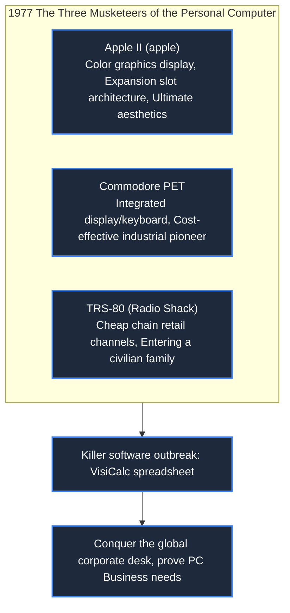

> **Course**: \[Computer Science Crash Course\] Crash Course Computer Science (PBS / All 40 episodes carefully revised)  
> **Module**: Module 4: Human-computer interaction and graphics rendering (User Interface & Graphics)  
> **Keynote speaker**: Carrie Anne Philbin  
> **Video duration**: 10:15 ｜ **HD screenshots**: 4 blackboard writing/illustrations on core knowledge points  
> **Direct video**: [📺Watch the original video of this lecture on Bilibili (P25)](https://www.bilibili.com/video/BV1EW411u7th/?p=25)  
> **Full book navigation**: [← Previous lecture (P24)](/en/notes/cccs/lecture-24) ｜ [📚 Return to the full book catalog](/en/notes/topics/CCCS) ｜ [Next lecture (P26) →](/en/notes/cccs/lecture-26)

---

## Core Introduction and Concept Panorama

Relive the epic personal computer (PC) revolution of the late 1970s, from garage geeks in the Silicon Valley Homebrew Club to the Apple II out-of-the-box storm, the killer app VisiCalc, and the panoramic journey of the IBM PC open standard establishment.

---

## 1. Fire in the Garage: Homebrew Computer Club

*(Reference time: 00:01:10 · [Video jump (P25 00:01:10)](https://www.bilibili.com/video/BV1EW411u7th/?p=25&t=70))*

Until the mid-1970s, computers were still a towering artifact reserved only for the Pentagon, multinational banks, and top universities. Ordinary people who want to gain access to computing power can only apply for extremely meager machine time on the time-sharing system terminal.

But a group of young geeks deeply influenced by the counterculture believe: **Computing power belongs to everyone, and everyone should have a computer that belongs entirely to them on their desk!**

In 1975, the first Homebrew Computer Club meeting was held in a garage in Menlo Park, California:
- Geeks here feverishly exchange circuit board drawings and share newly purchased microprocessor chips;
- Among the members are a young pair named Steve: hardware geniuses **Steve Wozniak **with strong business vision and aesthetic intuition** Steve Jobs**.
With incredible genius intuition, Wozniak used very few chips to hand-solder a single-board computer that can be directly connected to a television and a typewriter keyboard - this is  **Apple I**. Jobs keenly saw the business opportunity and founded Apple Computer Company in his garage.

*⏱ Timestamp: 00:02:20 · 📷 Classroom screenshot · [Watch the corresponding clip on Bilibili (P25 00:02:20)](https://www.bilibili.com/video/BV1EW411u7th/?p=25&t=140)*

## 2. The Three Musketeers 1977: From geeky toys to out-of-the-box home appliances

*(Reference time: 00:04:30 · [Video jump (P25 00:04:30)](https://www.bilibili.com/video/BV1EW411u7th/?p=25&t=270))*

1977 is known as the first year of the personal computer. In this year, three companies launched commercial microcomputers that completely got rid of hard-core soldering iron and could be used by the general public by plugging in the power supply. They are called the "Three Musketeers of 1977":

1. **Apple II**: Jobs insisted on designing an extremely elegant plastic off-white chassis for it, hiding all exposed circuit boards and fan noise; Wozniak designed a graphics architecture and built-in speakers that support 6-color high-resolution display, equipped with expansion slots and floppy disk drives, and became the legend of the longest-lived and best-selling personal computer in history;
2. **Commodore PET**: Founded by Jack Tramiel, it integrates the host, keyboard, monochrome monitor and tape drive into an extremely thick integrated body;
3. **TRS-80(Radio Shack)**: Relying on the sales network of thousands of electronic parts chain stores across the United States, it has entered the living rooms and middle school classrooms of countless American families at extremely low prices.

*⏱ Timestamp: 00:04:40 · 📷 Classroom screenshot · [Watch the corresponding clip on Bilibili (P25 00:04:40)](https://www.bilibili.com/video/BV1EW411u7th/?p=25&t=280)*

## 3. Killer App VisiCalc: Spreadsheets make PCs a necessity for enterprises

*(Reference time: 00:05:50 · [Video jump (P25 00:05:50)](https://www.bilibili.com/video/BV1EW411u7th/?p=25&t=350))*

Early PCs were often derided by serious business executives as "expensive toys for kids to play games with." It wasn't until 1979 that Harvard Business School students Dan Bricklin and Bob Frankston wrote a program for the Apple II called  **VisiCalc**  software.

- **VisiCalc is the world's first spreadsheet software (Spreadsheet)**: It divides the screen into a grid matrix composed of row numbers and column labels, allowing dynamic association formulas to be defined in cells (such as  `=A1+B1`); 
- **commercial nuclear fission effect**: In the past, the financial director of a multinational company had to make a 5-year financial budget model, which required 20 accountants to use hand-operated mechanical calculators to calculate by hand for a whole week; if they wanted to test "what would happen if raw materials increased by 5%", all employees had to erase their pencils and calculate again from scratch for a week! In VisiCalc, you only need to change a number on the keyboard, **Thousands of cells are automatically re-cascaded and recalculated within half a second.**!
Thousands of Wall Street financial analysts and company bosses rushed into computer stores. They didn’t ask how much an Apple II computer cost. They only asked one sentence: "Can this computer run VisiCalc? If it can run it, I will buy 10 units immediately!" For the first time, the software turned away from customers and became the absolutely decisive force driving the sales of expensive hardware.

*⏱ Timestamp: 00:06:00 · 📷 Classroom screenshot · [Watch the corresponding clip on Bilibili (P25 00:06:00)](https://www.bilibili.com/video/BV1EW411u7th/?p=25&t=360)*

## 4. The End of Big Blue: IBM PC Open Standards and Compatible Computer Empire

*(Reference time: 00:08:10 · [Video jump (P25 00:08:10)](https://www.bilibili.com/video/BV1EW411u7th/?p=25&t=490))*

Seeing the exponential explosion of the personal computer market, the "Blue Giant" dominates the mainframe world **IBM**  Finally I couldn't sit still anymore.

In August 1981, IBM formed an independent rapid action team, breaking all traditions of self-research and development behind closed doors within the company, and launched IBM at an alarming speed.  **IBM PC(Model 5150)**: 
- **Comprehensive Adoption of Commercial Components of Shelves (COTS)**: The CPU purchased Intel's 16-bit 8088 chip, and the operating system was outsourced to a then-little-known company in Seattle led by Bill Gates. **Microsoft (offers MS-DOS)**; 
- **Disclose all hardware circuit diagrams and BIOS interfaces**: Anyone can produce compatible peripherals and expansion cards for IBM PCs;
- **PC Clones**: Compaq cracked IBM's BIOS through clean room reverse engineering, triggering thousands of manufacturers around the world to rush to produce cheap and affordable "IBM PC compatibles." Open architecture standards defeated all closed competitors, and MS-DOS, followed by Windows, quickly ascended to the throne of personal computers on more than 90 percent of the world's desks.

*⏱ Timestamp: 00:08:20 · 📷 Classroom screenshot · [Watch the corresponding clip on Bilibili (P25 00:08:20)](https://www.bilibili.com/video/BV1EW411u7th/?p=25&t=500)*

---

## Attachment: Knowledge mind map and review thinking of this lecture

This lecture serves as  **Module 4: User Interface & Graphics**  As the core component of the system, the system connects the thinking leap from the underlying hardware physical switch, the middle layer abstract protocol to the upper layer application. It is recommended to combine the original video of Station B with the graphic guide of this lecture for repeated verification to understand the engineering trade-offs and inevitable logic behind technological evolution.

[← Previous lecture (P24)](/en/notes/cccs/lecture-24) ｜ [📚 Return to the full book catalog](/en/notes/topics/CCCS) ｜ [Next lecture (P26) →](/en/notes/cccs/lecture-26)
