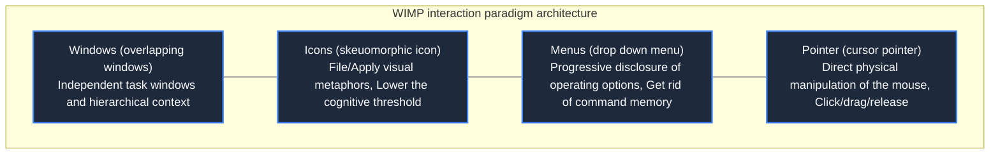

> **Course**: \[Computer Science Crash Course\] Crash Course Computer Science (PBS / All 40 episodes carefully revised)  
> **Module**: Module 4: Human-computer interaction and graphics rendering (User Interface & Graphics)  
> **Keynote speaker**: Carrie Anne Philbin  
> **Video duration**: 12:59 ｜ **HD screenshots**: 4 blackboard writing/illustrations on core knowledge points  
> **Direct video**: [📺Watch the original video of this lecture on Bilibili (P26)](https://www.bilibili.com/video/BV1EW411u7th/?p=26)  
> **Full book navigation**: [← Previous lecture (P25)](/en/notes/cccs/lecture-25) ｜ [📚 Return to the full book catalog](/en/notes/topics/CCCS) ｜ [Next lecture (P27) →](/en/notes/cccs/lecture-27)

---

## Core Introduction and Concept Panorama

Revisit the most glorious leap in the history of human-computer interaction - the graphical user interface (GUI), from Engelbart's invention of the mouse and the mother of all presentations, to Xerox PARC's establishment of the WIMP desktop metaphor, to the popularity storm of Apple Macintosh and Windows.

---

## 1. Engelbart and “The Mother of All Demos”

*(Reference time: 00:01:15 · [Video jump (P26 00:01:15)](https://www.bilibili.com/video/BV1EW411u7th/?p=26&t=75))*

In the 1960s, mainstream thinking in the computer world still held that command lines and punch cards were the only ways to communicate with machines. And computer pioneers at Stanford Research Institute International (SRI) **Douglas Engelbart**, with a vision far beyond that era.

On December 9, 1968, Engelbart delivered a public demonstration that shocked the world at the Fall Joint Computer Conference in San Francisco, and was honored as "The Mother of All Demos" by later generations:
- He sat in front of the console, holding a hand-carved wooden box with two vertically intersecting metal wheels underneath -**This is the first computer mouse in human history**!
- A cross-dimensional visual interface appeared on the screen: he moved the cursor smoothly on the screen, clicked on links in real time to jump to view documents (hypertext network), opened overlapping split-screen windows on the screen, and even used microwave links to conduct off-site two-way video conferencing and collaborative text editing with colleagues dozens of kilometers away!
This 90-minute demonstration previewed almost all the core forms of the Internet and modern operating systems in the 1990s a full 20 years in advance.

*⏱ Timestamp: 00:02:20 · 📷 Classroom screenshot · [Watch the corresponding clip on Bilibili (P26 00:02:20)](https://www.bilibili.com/video/BV1EW411u7th/?p=26&t=140)*

## 2. The Fountain of Miracles at Xerox PARC: Alto and the Desktop Metaphor

*(Reference time: 00:04:30 · [Video jump (P26 00:04:30)](https://www.bilibili.com/video/BV1EW411u7th/?p=26&t=270))*

As the overlord of copy machines, Xerox was worried that the future paperless office would subvert its main business, so it established the legendary Xerox Co., Ltd. in Silicon Valley in 1970. **Xerox PARC**, gathering the world’s top talented geeks.

In 1973, Xerox PARC built the \*\*Xerox Alto\*\* computer that was ten years ahead of its time:
- **Physical Desktop Metaphor**: In order to allow ordinary office secretaries who have never touched a computer to get started in one second, the PARC team perfectly mapped everything in the real office on the screen - the background of the screen is a "Desktop", the data collection is drawn as a "Folder", and useless waste paper is thrown into the "Trash Can";
- **What you see is what you get (WYSIWYG)**: When the document is formatted on the screen, the font size, bold italics, and margins are exactly the same as the paper printed by the laser printer!
However, the management at Xerox's New York headquarters was conservative and believed that the Alto was too expensive and did not understand the future of personal computers. This epoch-making masterpiece was shelved.

*⏱ Timestamp: 00:04:40 · 📷 Classroom screenshot · [Watch the corresponding clip on Bilibili (P26 00:04:40)](https://www.bilibili.com/video/BV1EW411u7th/?p=26&t=280)*

## 3. WIMP interaction paradigm: the ultimate bridge between humans and the digital world

*(Reference time: 00:06:20 · [Video jump (P26 00:06:20)](https://www.bilibili.com/video/BV1EW411u7th/?p=26&t=380))*

The human-computer interaction specifications established by Xerox PARC are collectively known as  **WIMP paradigm**: 
1. **Windows**: The screen is divided into multiple rectangular windows, each running an independent application. Windows can be freely scaled, dragged and moved, and stacked up and down (with the help of Z-order depth sorting);
2. **Icons**: Use intuitive graphical symbols to represent abstract binary executable programs or data documents, eliminating the mental burden on users to memorize complex file paths on the command line;
3. **Menus**: The drop-down menu and contextual right-click menu clearly list all the functions that the program can perform (cut, copy, paste), making the interaction change from "memory recall (Recall)" to easy "visual recognition (Recognition)";
4. **Pointer**: The mouse cursor becomes the incarnation of human fingers in the virtual digital space, bringing intuitive operations of click, double click, right-click menu and drag & drop.

*⏱ Timestamp: 00:06:30 · 📷 Classroom screenshot · [Watch the corresponding clip on Bilibili (P26 00:06:30)](https://www.bilibili.com/video/BV1EW411u7th/?p=26&t=390)*

## 4. Jobs’ Pilgrimage and Macintosh’s Civilian Revolution

*(Reference time: 00:08:30 · [Video jump (P26 00:08:30)](https://www.bilibili.com/video/BV1EW411u7th/?p=26&t=510))*

In late 1979, a young Steve Jobs led Apple's core engineering team to Xerox PARC in exchange for allowing Xerox to purchase 100,000 Apple stock warrants.

When Xerox engineers demonstrated Alto's graphical interface, overlapping windows, and mouse operations to Jobs, Jobs jumped up and down in the room excitedly and shouted:
"Why don't you push this to the whole world? This is the most incredible thing in human history! It's so obvious! It will eventually rule the world!"

After returning to Apple, Jobs immediately devoted himself to the research and development of new projects. In January 1984, with the famous "1984" Super Bowl TV commercial, \*\*Apple Macintosh\*\* was launched at a civilian price of US$2,495!
The Macintosh has a built-in sound chip, an exquisite black-and-white bitmap high-refresh screen, an original one-button mouse, and the smooth Mac OS graphics system. Then in 1995 Microsoft launched the landmark  **Windows 95**, completely popularizing the graphical interface into every personal computer in the world, and mankind has completely bid farewell to the era of cold and dull code black screens.

*⏱ Timestamp: 00:08:40 · 📷 Classroom screenshot · [Watch the corresponding clip on Bilibili (P26 00:08:40)](https://www.bilibili.com/video/BV1EW411u7th/?p=26&t=520)*

---

## Attachment: Knowledge mind map and review thinking of this lecture

This lecture serves as  **Module 4: User Interface & Graphics**  As the core component of the system, the system connects the thinking leap from the underlying hardware physical switch, the middle layer abstract protocol to the upper layer application. It is recommended to combine the original video of Station B with the graphic guide of this lecture for repeated verification to understand the engineering trade-offs and inevitable logic behind technological evolution.

[← Previous lecture (P25)](/en/notes/cccs/lecture-25) ｜ [📚 Return to the full book catalog](/en/notes/topics/CCCS) ｜ [Next lecture (P27) →](/en/notes/cccs/lecture-27)
