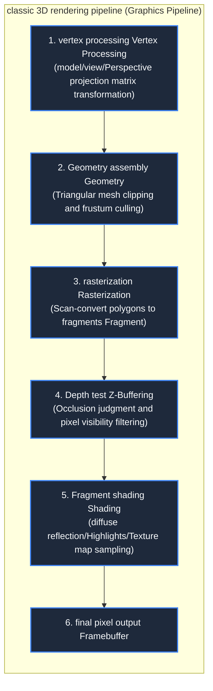

> **Course**: \[Computer Science Crash Course\] Crash Course Computer Science (PBS / All 40 episodes carefully revised)  
> **Module**: Module 4: Human-computer interaction and graphics rendering (User Interface & Graphics)  
> **Keynote speaker**: Carrie Anne Philbin  
> **Video duration**: 12:41 ｜ **HD screenshots**: 4 blackboard writing/illustrations on core knowledge points  
> **Direct video**: [📺Watch the original video of this lecture on Bilibili (P27)](https://www.bilibili.com/video/BV1EW411u7th/?p=27)  
> **Full book navigation**: [← Previous lecture (P26)](/en/notes/cccs/lecture-26) ｜ [📚 Return to the full book catalog](/en/notes/topics/CCCS) ｜ [Next lecture (P28) →](/en/notes/cccs/lecture-28)

---

## Core Introduction and Concept Panorama

Comprehensive dismantling of the mathematical and engineering architecture of the 3D computer graphics pipeline, from three-dimensional vertex space transformation, triangular mesh subdivision, to rasterization, depth buffering Z-Buffering occlusion culling, to realistic light and shadow shading and proprietary GPU hardware acceleration.

---

## 1. The art of dimensionality reduction: presenting a three-dimensional world on a two-dimensional flat screen

*(Reference time: 00:01:20 · [Video jump (P27 00:01:20)](https://www.bilibili.com/video/BV1EW411u7th/?p=27&t=80))*

Whether it is a mobile phone screen, a computer monitor or a movie screen, they are all physically thin. **Two-dimensional planar pixel array**.
How can a computer present a grand 3D virtual world (such as "Toy Story", AAA game masterpieces or the Metaverse) with depth of field, light and shadow, occlusion and perspective relationships on a flat screen?

This depends on **The 3D Graphics Pipeline**.
The rendering pipeline is essentially a set of highly parallel linear algebra matrix operation pipelines that are responsible for accurately projecting and converting mathematical geometry defined in a three-dimensional virtual space into specific RGB pixels on the screen step by step.

*⏱ Timestamp: 00:02:40 · 📷 Classroom screenshot · [Watch the corresponding clip on Bilibili (P27 00:02:40)](https://www.bilibili.com/video/BV1EW411u7th/?p=27&t=160)*

## 2. Geometric modeling and triangular polygon mesh (Polygon Mesh)

*(Reference time: 00:02:30 · [Video jump (P27 00:02:30)](https://www.bilibili.com/video/BV1EW411u7th/?p=27&t=150))*

How are objects in the 3D world described numerically?

- **Space vertices (Vertices)**: Each point has coordinates in three-dimensional space  $(X, Y, Z)$; 
- **Why is graphics so fond of "triangles"?**
  1. **spatial certainty**: Any three points in space that are not collinear, **An absolutely flat plane must and can only be determined uniquely** (If it is a quadrilateral, the fourth point may not be on the same plane, causing the polygon to be distorted);
  2. **Mathematics is extremely easy**: Triangles are extremely stable and efficient in rasterized interpolation (barycentric coordinate system) calculations.
- **Triangular Mesh**: By piecing together thousands of tiny triangles end to end, extremely complex curved objects (such as the streamlined body of a sports car and the facial skin of game characters) can be realistically fitted. The more triangles there are, the more refined the model is, but the matrix computing power required to calculate it also increases exponentially.

*⏱ Timestamp: 00:05:10 · 📷 Classroom screenshot · [Watch the corresponding clip on Bilibili (P27 00:05:10)](https://www.bilibili.com/video/BV1EW411u7th/?p=27&t=310)*

## 3. Perspective projection, rasterization and depth buffering (Z-Buffering)

*(Reference time: 00:05:00 · [Video jump (P27 00:05:00)](https://www.bilibili.com/video/BV1EW411u7th/?p=27&t=300))*

#### 1. Matrix transformation and perspective projection (Perspective Projection)
Pass  $4 \times 4$  The homogeneous coordinate transformation matrix maps the 3D object to the virtual camera's View Frustum after translation, rotation, and scaling. Perspective projection simulates the natural optical law of the human retina, which is "big near and small" $Z$  The coordinates are divided by the distance, flattening the 3D point onto the 2D projection plane.

#### 2. Rasterization
The projected two-dimensional continuous triangle boundary must be implemented on the discrete screen pixel grid. The raster scan conversion is responsible for determining whether each pixel on the screen is inside or outside the triangle, and generates the **Fragments**.

#### 3. Depth Buffering (Z-Buffering): Eliminate ghosting and mold penetration
When two objects overlap in the direction of view, the object closer to the camera must perfectly block the object behind it.
The early "Painter's Algorithm" drew from back to front, but completely failed when polygons interspersed with each other.
Commonly used in modern graphics cards **Depth buffer (Z-Buffer)**: 
- An independent memory with the same resolution as the screen is opened in the video memory, and each unit records the depth of the foreground that the pixel is currently closest to the lens.  $Z$  value;
- Each time a new pixel is rasterized, its depth is compared: if the new pixel is closer to the lens than the Z-Buffer records, the color overlay of that pixel is written to video memory and the Z-Buffer is flushed; if the new pixel is behind, it is discarded without mercy! This perfectly solves the occlusion determination of 3D objects.

*⏱ Timestamp: 00:06:30 · 📷 Classroom screenshot · [Watch the corresponding clip on Bilibili (P27 00:06:30)](https://www.bilibili.com/video/BV1EW411u7th/?p=27&t=390)*

## 4. The birth of photorealistic lighting shading and dedicated graphics processing unit (GPU)

*(Reference time: 00:08:20 · [Video jump (P27 00:08:20)](https://www.bilibili.com/video/BV1EW411u7th/?p=27&t=500))*

With geometry, objects still look like rough plastic blocks and physical reflections of light must be calculated:

1. **Flat Shading**: Each triangle calculates a normal vector to calculate lighting, and the entire triangle is painted with the same color. The edges are angular and extremely rough;
2. **Gouraud coloring**: Calculate illumination at the vertices of the triangle, and perform linear bilinear interpolation on the internal pixels, eliminating obvious edges and corners;
3. **Phong lighting model**: Fine interpolation of normal vectors at the pixel level for accurate simulation **Ambient + Diffuse + Specular**, rendering the dazzling reflections of metal, glass and water.

#### The independent ascendancy of graphics processing units (GPUs)
3D rendering requires the exact same matrix multiplication and vector dot product operations to be performed concurrently on millions of pixels and vertices on the same screen. The CPU, an architecture optimized for complex single-threaded serial logic, was overwhelmed.

In 1999, NVIDIA launched the world’s first chip called \*\*GPU (Graphics Processing Unit)\*\*——**GeForce 256**: 
- The GPU integrates hundreds or thousands of streamlined arithmetic units and is designed for large-scale hyper-parallel throughput (SIMD/SIMT);
- GPU not only dominates 3D video games and special effects in the film industry, but its terrifying ultra-large-scale floating-point parallel computing power has unexpectedly become the ultimate power engine for modern deep learning neural networks and large artificial intelligence models twenty years later!

*⏱ Timestamp: 00:08:40 · 📷 Classroom screenshot · [Watch the corresponding clip on Bilibili (P27 00:08:40)](https://www.bilibili.com/video/BV1EW411u7th/?p=27&t=520)*

---

## Attachment: Knowledge mind map and review thinking of this lecture

This lecture serves as  **Module 4: User Interface & Graphics**  As the core component of the system, the system connects the thinking leap from the underlying hardware physical switch, the middle layer abstract protocol to the upper layer application. It is recommended to combine the original video of Station B with the graphic guide of this lecture for repeated verification to understand the engineering trade-offs and inevitable logic behind technological evolution.

[← Previous lecture (P26)](/en/notes/cccs/lecture-26) ｜ [📚 Return to the full book catalog](/en/notes/topics/CCCS) ｜ [Next lecture (P28) →](/en/notes/cccs/lecture-28)
