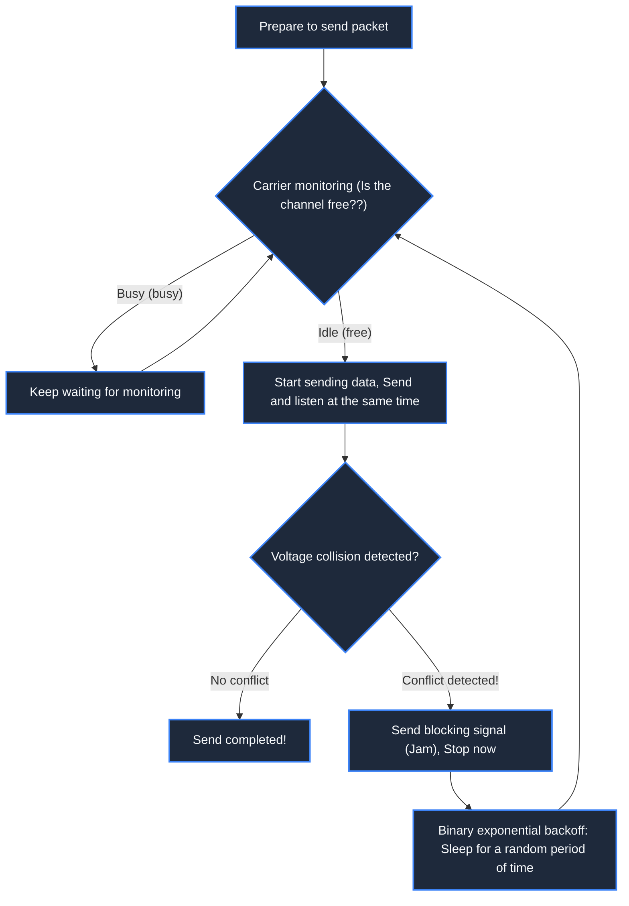

> **Course**: \[Computer Science Crash Course\] Crash Course Computer Science (PBS / All 40 episodes carefully revised)  
> **Module**: Module 5: Computer Networks & Security  
> **Keynote speaker**: Carrie Anne Philbin  
> **Video duration**: 12:20 ｜ **HD screenshots**: 4 blackboard writing/illustrations on core knowledge points  
> **Direct video**: [📺Watch the original video of this lecture on Bilibili (P28)](https://www.bilibili.com/video/BV1EW411u7th/?p=28)  
> **Full book navigation**: [← Previous lecture (P27)](/en/notes/cccs/lecture-27) ｜ [📚 Return to the full book catalog](/en/notes/topics/CCCS) ｜ [Next lecture (P29) →](/en/notes/cccs/lecture-29)

---

## Core Introduction and Concept Panorama

Deconstruct the key leap from stand-alone computing to the Internet, and analyze in detail the LAN topology, Ethernet CSMA/CD conflict avoidance algorithm, resource bottlenecks of traditional circuit switching, and the revolutionary breakthroughs of modern packet switching (Packet Switching).

---

## 1. The end of the island: from stand-alone isolation to local area network (LAN)

*(Reference time: 00:01:10 · [Video jump (P28 00:01:10)](https://www.bilibili.com/video/BV1EW411u7th/?p=28&t=70))*

Before the 1960s, every computer was an isolated digital island. If you want to transfer data from one computer to another, you can only rely on humans to physically move punch cards or tape disks. This method is nicknamed "Sneakernet".

As the number of computers in offices increased, engineers began to try to connect computers directly with cables, forming the **Local Area Network (LAN)**: 
- **Bus Topology**: All computers are hung from the same main coaxial cable that runs through the room;
- **Star Topology**: All computers are connected to a central hub (Hub) or switch;
- **Ring Topology**: Computers are connected into a closed loop, and data is passed one-way along the loop like a baton.

*⏱ Timestamp: 00:02:20 · 📷 Classroom screenshot · [Watch the corresponding clip on Bilibili (P28 00:02:20)](https://www.bilibili.com/video/BV1EW411u7th/?p=28&t=140)*

## 2. Ethernet vs. CSMA/CD: Code of Politeness at a Cocktail Party

*(Reference time: 00:03:10 · [Video jump (P28 00:03:10)](https://www.bilibili.com/video/BV1EW411u7th/?p=28&t=190))*

In 1973, Robert Metcalfe of Xerox PARC invented the network that dominates local area networks to this day. **Ethernet**.

In a shared bus network, there is a fatal problem: all computers share the same copper cable as the broadcast channel. If computer A and computer B start transmitting electrical signals at the same time, the radio waves will collide head-on in the copper cable, and the voltage will be superimposed and distorted instantly, forming **Data conflict (Collision)**, the entire network message is destroyed!

Ethernet was designed with genius  **CSMA/CD (Carrier Sense Multiple Access/Collision Detection)**  Algorithms, like gentlemen’s rules at a noisy cocktail party:
1. **Carrier Sense**: Listen first and speak later. Before sending a call, the network card first detects whether there is a voltage signal on the copper cable. If someone is talking, shut up and wait;
2. **Multiple Access**: All devices have equal status and can monitor and compete for channels at any time;
3. **Collision Detection**: Talk and listen at the same time. While transmitting its own signal, the network card continues to detect the channel voltage. If you find that the voltage is abnormally high, it means the car has crashed!
4. **Exponential Backoff**: Once a conflict is detected, both parties immediately stop sending and each throws a random dice internally. **sleep for random microseconds** Try sending again later! This randomness greatly reduces the probability of another crash next time.

*⏱ Timestamp: 00:03:30 · 📷 Classroom screenshot · [Watch the corresponding clip on Bilibili (P28 00:03:30)](https://www.bilibili.com/video/BV1EW411u7th/?p=28&t=210)*

## 3. Circuit Switching: The Fragile and Expensive Old Empire

*(Reference time: 00:06:20 · [Video jump (P28 00:06:20)](https://www.bilibili.com/video/BV1EW411u7th/?p=28&t=380))*

As networks spanned cities and countries, early long-distance communications relied entirely on traditional **Telephone Network (AT&T Telephone Network)**.

The telephone network adopts the \*\*Circuit Switching\*\* model:
- When you call San Francisco from New York, hundreds of electromechanical switches click along the way, moving you and the other party between the two cities. **Create a physically dedicated end-to-end copper conductor**; 
- **fatal flaw**: 
  1. During the call, even if both parties remain silent for ten minutes, this precious transoceanic physical copper cable is completely monopolized by you, while thousands of other people can only queue and wait in line;
  2. Extremely vulnerable: During the Cold War, the US military realized that once a Soviet nuclear bomb destroyed the telephone exchange hub in a key city in the middle, the entire US military command network would be instantly cut off and paralyzed!

*⏱ Timestamp: 00:06:40 · 📷 Classroom screenshot · [Watch the corresponding clip on Bilibili (P28 00:06:40)](https://www.bilibili.com/video/BV1EW411u7th/?p=28&t=400)*

## 4. Packet Switching: the soul of the birth of the Internet

*(Reference time: 00:08:30 · [Video jump (P28 00:08:30)](https://www.bilibili.com/video/BV1EW411u7th/?p=28&t=510))*

In order to build a distributed communication network that can still heal itself under nuclear attack, Paul Baran and Donald Davies proposed a method that subverts human cognition. **Packet Switching**: 

- **Shredding large chunks of data**: Whether sending a photo or an email, the software does not attempt to establish an exclusive physical channel; **Chop it into thousands of independent small packets (Packets)**; 
- **Headers**: Each data packet is marked with the sender address (source IP), recipient address (destination IP) and sequence number;
- **Dynamic pathfinding and store and forward (Store and Forward)**: After receiving the data packet, the \*\*routers (Routers)\*\* along the way dynamically decide the next hop direction based on the current congestion situation of each line. Packet 1 may take the Chicago route, and packet 2 may take the Dallas route; even if one of the nodes encounters a nuclear attack and explosion, the router will automatically change the route in milliseconds!
In 1969, the U.S. Defense Advanced Research Projects Agency built a  **ARPANET**, connecting four universities - the grand curtain of the modern Internet has officially opened.

*⏱ Timestamp: 00:08:50 · 📷 Classroom screenshot · [Watch the corresponding clip on Bilibili (P28 00:08:50)](https://www.bilibili.com/video/BV1EW411u7th/?p=28&t=530)*

---

## Attachment: Knowledge mind map and review thinking of this lecture

This lecture serves as  **Module 5: Computer Networks & Security**  As the core component of the system, the system connects the thinking leap from the underlying hardware physical switch, the middle layer abstract protocol to the upper layer application. It is recommended to combine the original video of Station B with the graphic guide of this lecture for repeated verification to understand the engineering trade-offs and inevitable logic behind technological evolution.

[← Previous lecture (P27)](/en/notes/cccs/lecture-27) ｜ [📚 Return to the full book catalog](/en/notes/topics/CCCS) ｜ [Next lecture (P29) →](/en/notes/cccs/lecture-29)
