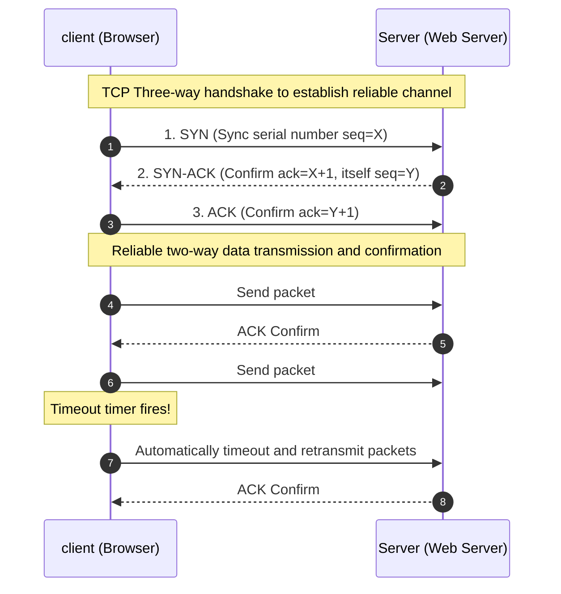

> **Course**: \[Computer Science Crash Course\] Crash Course Computer Science (PBS / All 40 episodes carefully revised)  
> **Module**: Module 5: Computer Networks & Security  
> **Keynote speaker**: Carrie Anne Philbin  
> **Video duration**: 11:59 ｜ **HD screenshots**: 4 blackboard writing/illustrations on core knowledge points  
> **Direct video**: [📺Watch the original video of this lecture on Bilibili (P29)](https://www.bilibili.com/video/BV1EW411u7th/?p=29)  
> **Full book navigation**: [← Previous lecture (P28)](/en/notes/cccs/lecture-28) ｜ [📚 Return to the full book catalog](/en/notes/topics/CCCS) ｜ [Next lecture (P30) →](/en/notes/cccs/lecture-30)

---

## Core Introduction and Concept Panorama

In-depth dismantling of the core communication protocol family that supports the global Internet, detailed explanation of IP addressing routing, TCP reliable transmission control (handshake, sliding window, packet loss retransmission), UDP low-latency datagram, and DNS tree parsing mechanism.

---

## 1. Networks of Networks: IP Protocol and Global Addressing

*(Reference time: 00:01:15 · [Video jump (P29 00:01:15)](https://www.bilibili.com/video/BV1EW411u7th/?p=29&t=75))*

The Internet is not a single physical entity, but a "Network of Networks" that is interconnected by tens of thousands of independent commercial operators, universities and government LANs around the world.

Allowing billions of devices from different manufacturers and operating systems around the world to understand each other relies on a system designed by Vint Cerf and Bob Kahn  **TCP/IP protocol suite**: 

- **Internet Protocol (IP)**: Responsible for sending data packets from the source host to the destination host anywhere in the world;
- **IP Address**: Every device connected to the Internet must have a globally unique logical door number.
  - **IPv4**: Consists of 32 binary bits, usually written as 4 decimal digits (such as  `192.168.1.1`), which can provide about 4.3 billion addresses (currently fully exhausted);
  - **IPv6**: Expanded to 128 bits, able to assign an independent IP address to every grain of sand on the planet;
- **Hop-by-Hop Routing**:Data packet passes  `traceroute`  The command can see every hop it makes between fiber switches as it travels across the ocean.

*⏱ Timestamp: 00:02:20 · 📷 Classroom screenshot · [Watch the corresponding clip on Bilibili (P29 00:02:20)](https://www.bilibili.com/video/BV1EW411u7th/?p=29&t=140)*

## 2. Transmission Control Protocol (TCP): Building absolute reliability on unreliable networks

*(Reference time: 00:04:20 · [Video jump (P29 00:04:20)](https://www.bilibili.com/video/BV1EW411u7th/?p=29&t=260))*

The underlying IP protocol is **Unreliable Best-Effort Service**: It does not guarantee that the data packet will be delivered. When the network is congested, the data packet may be ruthlessly discarded by the router, or the data packet may be sent out of sequence first.

How to safely transmit a serious financial statement or executable program on a dangerous network full of packet loss and disorder? This requires riding on the IP protocol **Transmission Control Protocol (TCP)**!

#### 1. Three-Way Handshake
Before officially transmitting data, both parties must confirm that each other's sending and receiving capabilities are intact:
- Client sends  `SYN` (Application to establish connection);
- Server response  `SYN-ACK` (Agree to connect and confirm that your communication is good);
- Client replies again  `ACK` (Confirm receipt, the connection is officially established!).

#### 2. Sequence number reassembly and packet loss retransmission
- The sender assigns a strictly increasing sequence number (Sequence Number) to each chopped data packet;
- After receiving it, the receiver must send an acknowledgment message (ACK) back to the sender. If the receiver finds that it has received packets 15 and 17 but missed packet 16, it will repeatedly ask for retransmission;
- Once the sender's timeout timer is triggered, **Automatic retransmission of lost packets 16**; After the receiver collects all the data packets, it assembles and restores the complete file according to the original sequence number.

*⏱ Timestamp: 00:04:40 · 📷 Classroom screenshot · [Watch the corresponding clip on Bilibili (P29 00:04:40)](https://www.bilibili.com/video/BV1EW411u7th/?p=29&t=280)*

## 3. User Datagram Protocol (UDP): The Light Cavalry in Pursuit of Extreme Speed

*(Reference time: 00:06:40 · [Video jump (P29 00:06:40)](https://www.bilibili.com/video/BV1EW411u7th/?p=29&t=400))*

Although TCP guarantees 100% reliability, its complex handshake, confirmation retransmission and congestion control bring unavoidable problems. **Network latency (Latency)**.

In some real-time application scenarios, speed is far more important than perfection!
For example, online multiplayer online shooting games, Tencent conference real-time voice, and video live streaming:
- If the game loses a packet that the player moved 5 centimeters to the left, there is no need to stop and spend 200 milliseconds to retransmit, because after 200 milliseconds this position will be out of date!
- Use this time  **UDP(User Datagram Protocol)**: 
  - **No connection, no handshake, no confirmation, no retransmission**; 
  - Shoot the data packets directly towards the destination IP like a machine gun. The screen may occasionally flicker when a few packets are lost, but the overall delay is suppressed to the limit of more than ten milliseconds, ensuring the silky smoothness and feel of the game.

*⏱ Timestamp: 00:06:50 · 📷 Classroom screenshot · [Watch the corresponding clip on Bilibili (P29 00:06:50)](https://www.bilibili.com/video/BV1EW411u7th/?p=29&t=410)*

## 4. Domain Name System (DNS): The Internet’s globally distributed phone book

*(Reference time: 00:08:15 · [Video jump (P29 00:08:15)](https://www.bilibili.com/video/BV1EW411u7th/?p=29&t=495))*

Computer hardware only recognizes shapes  `142.250.190.46`  numeric IP addresses, but the human brain is extremely bad at remembering long, boring strings of numbers. Humans prefer to read things like  `bilibili.com`, `google.com`  Such a semantic name.

\*\*Domain Name System (DNS)\*\* is the world's largest distributed hierarchical key-value database:
1. **Root DNS Servers**: There are only 13 logical root domain name systems in the global core, managing top-level domain name classifications;
2. **Top-level domain name server (TLD DNS)**:Management  `.com`, `.org`, `.cn`, `.edu`  etc;
3. **Authoritative DNS**: Stores precise host resolution records owned by a specific company.

When your browser types  `bilibili.com`  When:
The operating system first checks the local cache, and if not, asks the operator's recursive resolver for help; the resolver goes all the way to the root server and TLD server, and successfully translates the domain name into a real physical IP address within a few milliseconds, and then officially initiates a TCP handshake.

*⏱ Timestamp: 00:08:00 · 📷 Classroom screenshot · [Watch the corresponding clip on Bilibili (P29 00:08:00)](https://www.bilibili.com/video/BV1EW411u7th/?p=29&t=480)*

---

## Attachment: Knowledge mind map and review thinking of this lecture

This lecture serves as  **Module 5: Computer Networks & Security**  As the core component of the system, the system connects the thinking leap from the underlying hardware physical switch, the middle layer abstract protocol to the upper layer application. It is recommended to combine the original video of Station B with the graphic guide of this lecture for repeated verification to understand the engineering trade-offs and inevitable logic behind technological evolution.

[← Previous lecture (P28)](/en/notes/cccs/lecture-28) ｜ [📚 Return to the full book catalog](/en/notes/topics/CCCS) ｜ [Next lecture (P30) →](/en/notes/cccs/lecture-30)
