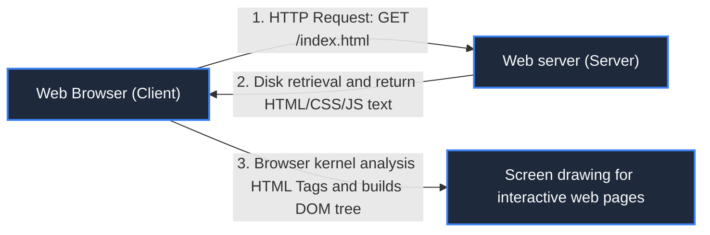

> **Course**: \[Computer Science Crash Course\] Crash Course Computer Science (PBS / All 40 episodes carefully revised)  
> **Module**: Module 5: Computer Networks & Security  
> **Keynote speaker**: Carrie Anne Philbin  
> **Video duration**: 11:36 ｜ **HD screenshots**: 4 blackboard writing/illustrations on core knowledge points  
> **Direct video**: [📺Watch the original video of this lecture on Bilibili (P30)](https://www.bilibili.com/video/BV1EW411u7th/?p=30)  
> **Full book navigation**: [← Previous lecture (P29)](/en/notes/cccs/lecture-29) ｜ [📚 Return to the full book catalog](/en/notes/topics/CCCS) ｜ [Next lecture (P31) →](/en/notes/cccs/lecture-31)

---

## Core Introduction and Concept Panorama

Clarify the essential differences between the Internet (underlying infrastructure) and the World Wide Web (upper-layer hypermedia applications), and deeply explore Tim Berners-Lee's hypertext ideas, HTML structure, HTTP protocol operating paradigm, as well as search engines and network neutrality laws.

---

## 1. Clarify the basic concepts: Internet vs Web

*(Reference time: 00:01:10 · [Video jump (P30 00:01:10)](https://www.bilibili.com/video/BV1EW411u7th/?p=30&t=70))*

Many people confuse the two words in daily life, but they belong to completely different dimensions:
- **The Internet**: Yes **underlying physical infrastructure** (like railroad tracks, road networks, transoceanic fiber optic cables, and routers), responsible for the reliable transmission of pure data packets between computers;
- **The World Wide Web (WWW/Web)**: Yes **A specific hypertext application service running on the railway track of the Internet** (Like a passenger train running on a railroad). In addition to the World Wide Web, tens of thousands of other network services such as email (SMTP/POP3), file transfer (FTP), and online online games are also running on the Internet.

*⏱ Timestamp: 00:02:30 · 📷 Classroom screenshot · [Watch the corresponding clip on Bilibili (P30 00:02:30)](https://www.bilibili.com/video/BV1EW411u7th/?p=30&t=150)*

## 2. Tim Berners-Lee’s invention of the century at CERN

*(Reference time: 00:02:20 · [Video jump (P30 00:02:20)](https://www.bilibili.com/video/BV1EW411u7th/?p=30&t=140))*

In 1989, at the European Nuclear Research Center (CERN) in Geneva, Switzerland, British physicist and computer scientist Tim Berners-Lee faced a pain point: tens of thousands of high-energy physicists from dozens of countries gathered here. They each used different computer systems to write papers, and academic materials were scattered in different server corners, making retrieval collaboration extremely painful.

Berners-Lee envisioned a global information network supported by three cornerstones:
1. **URL (Uniform Resource Locator)**: A globally unique hypermedia address (e.g.  `https://www.bilibili.com/video/BV1...`), no matter which country or server the resource is placed on, it can be accurately locked with a row of addresses;
2. **HTTP (HyperText Transfer Protocol)**: A lightweight application layer protocol for communication between browsers and web servers;
3. **HTML (HyperText Markup Language)**: Document specification for formatting hypermedia pages with text tags.

#### The core magic of hypertext: hyperlinks
The most revolutionary thing is **Hyperlink**! In traditional books, reading can only be done step by step from front to back; while in the World Wide Web, **A touch of blue underline on the text allows readers to instantly jump tens of thousands of kilometers to relevant documents on another server on the other side of the ocean with just one click.**! The knowledge of all mankind is thus intertwined into a boundless organic hyperlinked Internet giant network.

*⏱ Timestamp: 00:04:30 · 📷 Classroom screenshot · [Watch the corresponding clip on Bilibili (P30 00:04:30)](https://www.bilibili.com/video/BV1EW411u7th/?p=30&t=270)*

## 3. HTTP protocol interaction model and status code analysis

*(Reference time: 00:06:30 · [Video jump (P30 00:06:30)](https://www.bilibili.com/video/BV1EW411u7th/?p=30&t=390))*

The Web uses the classic \*\*Client-Server\*\* stateless request/response model:

- **Request Methods**: 
  - `GET`: Request a specific web page or image from the server (safe and idempotent);
  - `POST`: Submit form data to the server (such as the user logging in, entering their account and password, and submitting comments);
- **Response status codes (HTTP Status Codes)**: The server uses three digits to clearly inform the life or death outcome of the request:
  - `200 OK`: The request is successful, and the page content is attached to the message body;
  - `301/302 Redirect`: Resource relocation redirection;
  - `403 Forbidden`: Insufficient permissions, access denied;
  - `404 Not Found`: The most famous error code in the world, the resource being accessed does not exist on the server at all;
  - `500/502 Internal Server Error`: The server's own code crashes or the gateway is overloaded.

*⏱ Timestamp: 00:06:40 · 📷 Classroom screenshot · [Watch the corresponding clip on Bilibili (P30 00:06:40)](https://www.bilibili.com/video/BV1EW411u7th/?p=30&t=400)*

## 4. The rise of search engines and Net Neutrality (Net Neutrality)

*(Reference time: 00:08:20 · [Video jump (P30 00:08:20)](https://www.bilibili.com/video/BV1EW411u7th/?p=30&t=500))*

#### 1. The rise to the top of search engines
As the number of web pages on the World Wide Web exploded into billions of pages, the early Yahoo manual catalog went bankrupt. The rise of search engines represented by Google:
- Rely on \*\*Web Crawlers\*\* to crawl all web pages around the world along hyperlinks day and night;
- Invented by Larry Page  **PageRank algorithm** Hyperlink network topology is used to score web page votes, achieving precise hits in search results.

#### 2. Net Neutrality
The key reason why the World Wide Web can inspire unprecedented technological innovation and prosperity in the entire human civilization in just a few decades lies in Tim Berners-Lee’s **Announce the renunciation of any patents on the World Wide Web and dedicate it to all mankind as a completely open and free gift forever and free of charge**!

**net neutrality** Claim: Internet service providers (ISPs) must treat all packets flowing through the network equally, **It is absolutely prohibited to deliberately limit the speed of certain competitors' websites for commercial interests, or to open privileged express lanes to large companies that have paid tolls.**. To defend net neutrality is to defend the highest belief that the Internet is a public digital infrastructure for universal benefit and fairness for mankind.

*⏱ Timestamp: 00:08:30 · 📷 Classroom screenshot · [Watch the corresponding clip on Bilibili (P30 00:08:30)](https://www.bilibili.com/video/BV1EW411u7th/?p=30&t=510)*

---

## Attachment: Knowledge mind map and review thinking of this lecture

This lecture serves as  **Module 5: Computer Networks & Security**  As the core component of the system, the system connects the thinking leap from the underlying hardware physical switch, the middle layer abstract protocol to the upper layer application. It is recommended to combine the original video of Station B with the graphic guide of this lecture for repeated verification to understand the engineering trade-offs and inevitable logic behind technological evolution.

[← Previous lecture (P29)](/en/notes/cccs/lecture-29) ｜ [📚 Return to the full book catalog](/en/notes/topics/CCCS) ｜ [Next lecture (P31) →](/en/notes/cccs/lecture-31)
