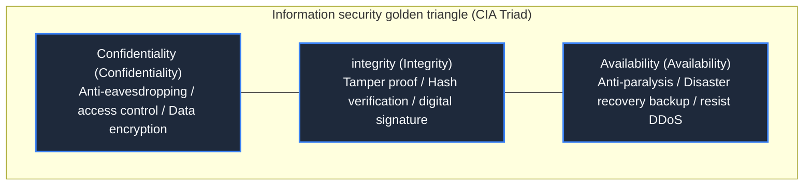

> **Course**: \[Computer Science Crash Course\] Crash Course Computer Science (PBS / All 40 episodes carefully revised)  
> **Module**: Module 5: Computer Networks & Security  
> **Keynote speaker**: Carrie Anne Philbin  
> **Video duration**: 12:30 ｜ **HD screenshots**: 4 blackboard writing/illustrations on core knowledge points  
> **Direct video**: [📺Watch the original video of this lecture on Bilibili (P31)](https://www.bilibili.com/video/BV1EW411u7th/?p=31)  
> **Full book navigation**: [← Previous lecture (P30)](/en/notes/cccs/lecture-30) ｜ [📚 Return to the full book catalog](/en/notes/topics/CCCS) ｜ [Next lecture (P32) →](/en/notes/cccs/lecture-32)

---

## Core Introduction and Concept Panorama

Comprehensive perspective on modern cyberspace and system defense systems, and in-depth analysis of the three elements of information security CIA (confidentiality, integrity, availability), multi-factor identity authentication mechanism, mandatory access control model and trusted computing sandbox isolation architecture.

---

## 1. The ultimate criterion for computer security: CIA’s three elements

*(Reference time: 00:01:05 · [Video jump (P31 00:01:05)](https://www.bilibili.com/video/BV1EW411u7th/?p=31&t=65))*

As the lifeblood of the global economy, medical grids, and national defense control are fully integrated into computer systems, information security is no longer just about preventing hackers from showing off their skills, but is directly related to national security and citizens’ personal and property life and death.

In information security academia, the highest guideline for measuring whether a system is secure is called  **The CIA Triad**: 
1. **Confidentiality/Secrecy**: Information can only be read by authorized legal personnel to prevent eavesdropping and data leakage (such as bank account passwords or medical privacy);
2. **Integrity**: Ensure that the data has not been tampered with, forged or damaged by unauthorized hackers during storage and transmission (for example, hackers cannot secretly add two more zeros after the transfer amount);
3. **Availability**: Ensure that legitimate users can have stable access at any time when they need to use the system, and prevent service paralysis (for example, the emergency dispatch system cannot be destroyed by traffic floods).

*⏱ Timestamp: 00:01:10 · 📷 Classroom screenshot · [Watch the corresponding clip on Bilibili (P31 00:01:10)](https://www.bilibili.com/video/BV1EW411u7th/?p=31&t=70)*

## 2. Identity authentication mechanism: mathematical logic of multi-factor authentication (MFA)

*(Reference time: 00:03:15 · [Video jump (P31 00:03:15)](https://www.bilibili.com/video/BV1EW411u7th/?p=31&t=195))*

How does the system determine that the person typing on the keyboard in front of the screen is really the legitimate user it claims to be? This requires **Authentication**.

Human computer authentication is usually divided into three major evidence dimensions:
1. **Something You Know**: Static password, PIN code, security question. The most vulnerable and easily vulnerable to credential stuffing, phishing or brute force cracking;
2. **Something You Have**: Physical U-Shield, SMS verification code, Google Authenticator dynamic TOTP token;
3. **Something You Are**: Biometric identification, such as fingerprint, Face ID facial recognition, iris scan.

\*\*Multi-Factor Authentication (MFA)\*\* requires that at least two different dimensions of evidence must be met at the same time: even if a hacker steals your plaintext password through the air, he will still be unable to log in without the physical phone in your pocket, reducing the probability of account compromise by more than 99.9%.

*⏱ Timestamp: 00:03:20 · 📷 Classroom screenshot · [Watch the corresponding clip on Bilibili (P31 00:03:20)](https://www.bilibili.com/video/BV1EW411u7th/?p=31&t=200)*

## 3. Access control and Bell-LaPadula model

*(Reference time: 00:07:20 · [Video jump (P31 00:07:20)](https://www.bilibili.com/video/BV1EW411u7th/?p=31&t=440))*

After the user successfully logs in, the system must also clearly determine what specific privileges he has -**Authorization**.

In high-level security systems (such as military systems), the well-known  **Bell-LaPadula Security Model**: 
- **No Read Up**: People with Top Secret level can read Secret level files, but ordinary employees without Secret level will never be able to read Top Secret level files;
- **No Write Down**: People with top-secret authority are absolutely prohibited from writing top-secret information into public or low-confidence documents (to prevent privileged personnel from inadvertently leaking secrets to low-privilege groups).
In daily operating systems, it is widely used **Role-based access control (RBAC) **with** Principle of Least Privilege**- Any program or user is only given the absolute minimum permissions necessary to complete the current task.

*⏱ Timestamp: 00:07:30 · 📷 Classroom screenshot · [Watch the corresponding clip on Bilibili (P31 00:07:30)](https://www.bilibili.com/video/BV1EW411u7th/?p=31&t=450)*

## 4. Trusted Computing Base (TCB) and Sandbox Isolation Defense (Sandbox)

*(Reference time: 00:09:50 · [Video jump (P31 00:09:50)](https://www.bilibili.com/video/BV1EW411u7th/?p=31&t=590))*

Any large software will have bugs. In the face of potential malicious code injection, the core idea of defense is **Assume that all untrusted components have been compromised**, and implement defense in depth:

1. **Trusted Computing Base (TCB)**:
The operating system divides the system into a minimal set of kernel code that is absolutely trustworthy, and all other drivers and applications are kicked out of the core circle;
2. **Sandboxing**:
Modern web browsers (such as Chrome) and mobile operating systems (iOS/Android) put each web tab and app into a separate sandbox container:
Even if the malicious script in the sandbox uses the vulnerability to gain control of the process, it cannot directly call the physical camera, scan the user's local disk album, or monitor global keyboard keys. It can only idle harmlessly in a restricted cage.

*⏱ Timestamp: 00:10:00 · 📷 Classroom screenshot · [Watch the corresponding clip on Bilibili (P31 00:10:00)](https://www.bilibili.com/video/BV1EW411u7th/?p=31&t=600)*

---

## Attachment: Knowledge mind map and review thinking of this lecture

This lecture serves as  **Module 5: Computer Networks & Security**  As the core component of the system, the system connects the thinking leap from the underlying hardware physical switch, the middle layer abstract protocol to the upper layer application. It is recommended to combine the original video of Station B with the graphic guide of this lecture for repeated verification to understand the engineering trade-offs and inevitable logic behind technological evolution.

[← Previous lecture (P30)](/en/notes/cccs/lecture-30) ｜ [📚 Return to the full book catalog](/en/notes/topics/CCCS) ｜ [Next lecture (P32) →](/en/notes/cccs/lecture-32)
