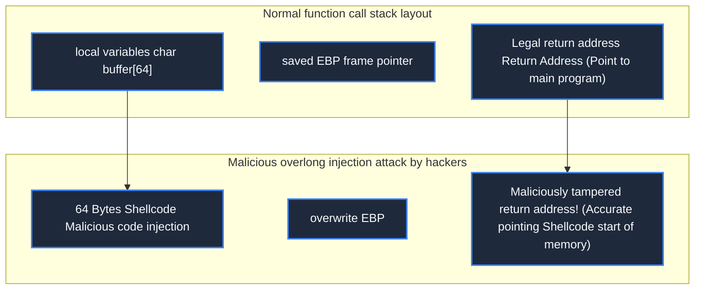

> **Course**: \[Computer Science Crash Course\] Crash Course Computer Science (PBS / All 40 episodes carefully revised)  
> **Module**: Module 5: Computer Networks & Security  
> **Keynote speaker**: Carrie Anne Philbin  
> **Video duration**: 11:52 ｜ **HD screenshots**: 4 blackboard writing/illustrations on core knowledge points  
> **Direct video**: [📺Watch the original video of this lecture on Bilibili (P32)](https://www.bilibili.com/video/BV1EW411u7th/?p=32)  
> **Full book navigation**: [← Previous lecture (P31)](/en/notes/cccs/lecture-31) ｜ [📚 Return to the full book catalog](/en/notes/topics/CCCS) ｜ [Next lecture (P33) →](/en/notes/cccs/lecture-33)

---

## Core Introduction and Concept Panorama

In-depth analysis of the deadly tactics of modern network attacks and the causes of underlying vulnerabilities, detailed analysis of social engineering phishing, stack buffer overflow (memory out-of-bounds hijacking of command flow), SQL injection dynamic privilege escalation, and the devastating power of the global botnet DDoS traffic tsunami.

---

## 1. The most vulnerable system vulnerabilities are humans: social engineering and phishing

*(Reference time: 00:01:10 · [Video jump (P32 00:01:10)](https://www.bilibili.com/video/BV1EW411u7th/?p=32&t=70))*

Top hackers often don't need to use expensive zero-day exploits (Zero-Day) because the easiest security weaknesses to break are **human weakness**——This is **Social Engineering**.

- **Phishing**: A hacker forges an extremely realistic "Company IT Department Notification to Change Password" email, or forges a bank statement; the attached link leads to a fake phishing website that is exactly the same as the real official website at the pixel level, tricking the victim into secretly handing over their account and password;
- **Watering hole attacks and spear phishing**: Hackers conduct long-term social media profile analysis on key executives of specific companies and customize malicious attachments full of trust temptations (such as a Trojan horse program disguised as "Annual Salary Adjustment Plan.pdf"). Security is not only a technical confrontation, but also a prevention of human psychological cognition.


*⏱ Timestamp: 00:02:20 · 📷 Classroom screenshot · [Watch the corresponding clip on Bilibili (P32 00:02:20)](https://www.bilibili.com/video/BV1EW411u7th/?p=32&t=140)*

## 2. Stack buffer overflow (Buffer Overflow): memory out of bounds and execution flow hijacking

*(Reference time: 00:04:30 · [Video jump (P32 00:04:30)](https://www.bilibili.com/video/BV1EW411u7th/?p=32&t=270))*

Among the underlying system software, the most classic system-level destructive vulnerability is **Stack Buffer Overflow**.

In Lecture 12, we know that when a C language function is called, the call stack frame stores: 
`[ 局部变量缓冲区 (如 char buffer[64]) ] [ 帧指针 EBP ] [ 函数返回地址 (Return Address) ]`

If the programmer uses dangerous functions without bounds safety checks (e.g.  `gets(buffer)`  or  `strcpy`): 
1. The hacker deliberately fed an extremely long malicious string of up to 128 bytes into the input box;
2. The excess characters flooded the 64-byte buffer boundary, brutally overwriting adjacent memory along the way. **Accurately tamper with the original legal function return address**!
3. Executed when the function completes execution  `RET`  When assembling instructions, the CPU's program counter (PC) does not jump back to normal code; **Jumped directly into the malicious machine instructions (Shellcode) that the hacker had hidden in the memory in advance.**! The hacker instantly seized the highest and highest control of the entire computer.
Modern compilers have introduced powerful defenses such as Stack Canaries, Address Space Layout Randomization (ASLR), and Data Execution Protection (DEP/NX bit) to comprehensively suppress buffer overflows.




*⏱ Timestamp: 00:04:40 · 📷 Classroom screenshot · [Watch the corresponding clip on Bilibili (P32 00:04:40)](https://www.bilibili.com/video/BV1EW411u7th/?p=32&t=280)*

## 3. Code injection and SQL injection attacks (SQL Injection)

*(Reference time: 00:06:40 · [Video jump (P32 00:06:40)](https://www.bilibili.com/video/BV1EW411u7th/?p=32&t=400))*

If in the back-end code, the programmer roughly splices the string entered by the user directly into the database query statement, it will break out. **SQL injection vulnerability**: 

```sql
SELECT * FROM users WHERE username = 'USER_INPUT' AND password = 'PASSWORD_INPUT';
```

If a hacker enters this carefully constructed string of code into the username input box: 
`admin' OR '1'='1`

The back-end spliced SQL statement instantly becomes:
```sql
SELECT * FROM users WHERE username = 'admin' OR '1'='1' AND password = '...';
```
- due to  `'1'='1'`  It is always logically True, and all password judgments in the second half are completely bypassed by logical short circuit!
- The database obediently spits out all the administrator's account rights to the hacker!
Core rules of defense: **Never trust any client input!**  Parameterized query precompilation (Prepared Statements) must be used to physically insulate data from code instructions.


*⏱ Timestamp: 00:06:50 · 📷 Classroom screenshot · [Watch the corresponding clip on Bilibili (P32 00:06:50)](https://www.bilibili.com/video/BV1EW411u7th/?p=32&t=410)*

## 4. Botnet and Distributed Denial of Service Attacks (DDoS)

*(Reference time: 00:09:40 · [Video jump (P32 00:09:40)](https://www.bilibili.com/video/BV1EW411u7th/?p=32&t=580))*

Some attacks are not aimed at stealing data, but rather at completely destroying the availability of a system (the A in CIA).

**Distributed Denial of Service (DDoS)**: 
- Hackers use worms to hack into millions of vulnerable smart home routers, networked cameras or personal computers around the world, and assemble them into devices that are secretly controlled by the hacker's central control server. **Botnet**; 
- When a hacker gives an order, millions of "broiler" devices simultaneously launch a violent traffic flood (such as SYN flood, DNS amplification attack) to the target website server;
- The bandwidth of the target server was instantly filled up with hundreds of gigabits per second (Gbps) of garbage traffic. The CPU and memory connection tables were completely full and collapsed, causing normal legitimate users to be completely unable to log in and access. Modern cloud security vendors filter and absorb this tsunami of traffic at the edge with globally distributed Anycast hubs.


*⏱ Timestamp: 00:10:00 · 📷 Classroom screenshot · [Watch the corresponding clip on Bilibili (P32 00:10:00)](https://www.bilibili.com/video/BV1EW411u7th/?p=32&t=600)*

---

## Attachment: Knowledge mind map and review thinking of this lecture

This lecture serves as  **Module 5: Computer Networks & Security**  As the core component of the system, the system connects the thinking leap from the underlying hardware physical switch, the middle layer abstract protocol to the upper layer application. It is recommended to combine the original video of Station B with the graphic guide of this lecture for repeated verification to understand the engineering trade-offs and inevitable logic behind technological evolution.

[← Previous lecture (P31)](/en/notes/cccs/lecture-31) ｜ [📚 Return to the full book catalog](/en/notes/topics/CCCS) ｜ [Next lecture (P33) →](/en/notes/cccs/lecture-33)
